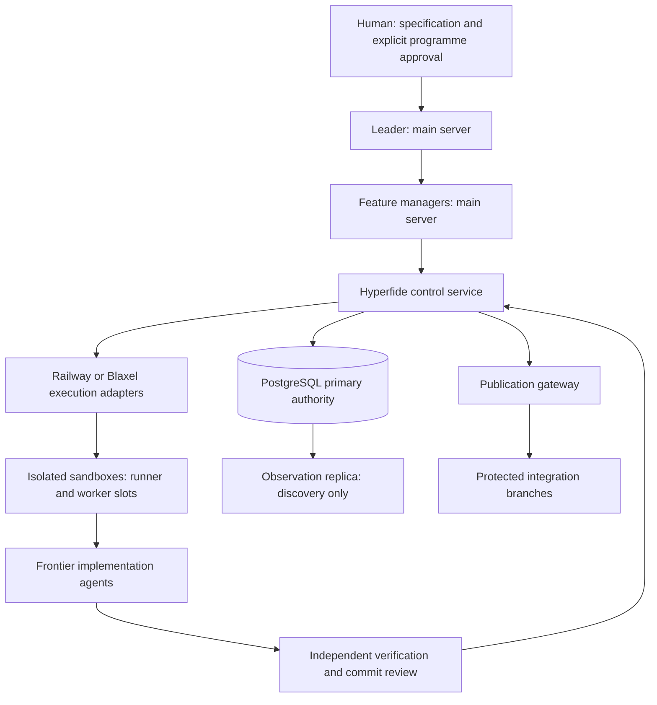

<div align="center">

# Hyperfide


<a
  href="https://trendshift.io/repositories/267432?utm_source=trendshift-badge&amp;utm_medium=badge&amp;utm_campaign=badge-trendshift-267432" target="_blank" rel="noopener noreferrer">

</a>

**The agent workflow tool that scales from small, simple projects to large, complex codebases.**

The local CLI is pure C11: one binary, one SQLite database, no telemetry.

[](LICENSE)
[](#)
[](.github/workflows/ci.yml)
</div>
<div align="center">

[English](README.md) · [简体中文](docs/i18n/README.zh-CN.md) · [Español](docs/i18n/README.es.md) · [हिन्दी](docs/i18n/README.hi.md) · [العربية](docs/i18n/README.ar.md) · [Français](docs/i18n/README.fr.md) · [Português (BR)](docs/i18n/README.pt-BR.md)
</div>

---

## Overview

Hyperfide is an agent workflow engine in a single binary, `hyperfide`. It maintains the four things a project needs beyond the code itself — what the code **is**, how it got **here**, what happens **next**, and what was **learned** along the way — and serves all four to humans and AI agents alike.

This tree is Hyperfide 2.0 in development: `hyperfide version` prints `2.0.0-dev`, and nothing in it is a production release. Hyperfide grew out of Codify, whose 1.x releases, feature IDs (such as `codify-v15` and `codify-v16`) and commit history keep their original names. 2.0 adds a [distributed control plane](#the-hyperfide-control-plane) — a leader and feature managers on a supervisory server, remote sandboxes for builds and agents, PostgreSQL as the authority — around the same local CLI.

> **Compatibility.** `hyperfide` is the canonical command. `cg` is a deprecated compatibility alias installed from the same executable, with identical arguments, JSON and exit codes; it stays for the supported compatibility window of the approved release and is removed only in a later release that announces it. Every example below uses `hyperfide`; `cg` runs the same thing.

`hyperfide fleet up` starts a durable, crash-resumable supervisor for the main agent, wave managers and task workers. It manages each Codex or Claude Code process until work is qualified and merged. Agents receive graph context, branch drift is checked before integration, and `hyperfide serve` streams events to the editor. Indexing is coalesced across workers; the graph and memory cover every branch and worktree. The core loop makes no network call; the few features that do are named at the end of this overview.

**What the code is.** Hyperfide indexes source files into a queryable graph: symbols, calls, imports, types, routes, and full-text search, all stored locally in SQLite. Language coverage ranges from native syntax extraction to file-only tracking; [the coverage matrix](docs/indexing.md#extraction-coverage) states the boundary for each family. `hyperfide context <query>` answers "catch me up on this area" in one call: matching symbols with snippets, callers, callees, and related routes. Comments are indexed as first-class nodes for purpose, contracts, dangers, and couplings that live only in prose.

**How it got here.** A built-in content-addressed snapshot system gives you commits, history, diffs, and restore with no external VCS required. Because snapshots share a database with the graph, `hyperfide changes` reports the blast radius of your uncommitted edits. `hyperfide changelog` writes the release notes: from git history by default — a release per tag or version bump, groups from the commit-subject prefix, each task reference carried through, and, with a key, a short model-written Highlights paragraph per release — and from the snapshot chain with symbol-level diffs when you pass `--snapshots` or the project has no git at all.

**What happens next.** A spec engine turns plain-text kvx spec files into a working plan: a task board with dependency waves, acceptance criteria attached to every task — and a `done` that is verified, not asserted. `hyperfide spec new` and `hyperfide spec add` create the plan, `hyperfide spec lint` proves it is executable, and the loop runs it. In Prod mode, `implemented` records coding completion and source evidence without claiming qualification; only `done` means executable qualification and graph checks passed. In parallel mode, several agents work at once, bounded by the disjointness of the paths each task declares.

**What was learned along the way.** An agent memory stores deliberate notes — decisions, constraints, outcomes, preferences, facts — in the same database as the graph, linked to the task they were made under. `hyperfide remember` saves one mid-task, every `hyperfide spec done` records an honest outcome automatically (including refusals), and `hyperfide recall` brings it all back, ranked by relevance and recency.

The layers reinforce each other: commits are auto-tagged with the task they implement, memories surface on the task they belong to, `hyperfide why` walks a symbol back to the decisions behind it, and `hyperfide spec trace` walks any task to its symbols, commits, and memories.

**And it is present between the steps, not only at them.** `hyperfide work open` starts with a compact task packet, `hyperfide work update` returns only new state/evidence/workspace deltas, `hyperfide event progress` classifies loops without mistaking activity for progress, and `hyperfide guard` notices when an edit drifts outside declared scope. A built-in MCP server exposes 67 tools, resources, and prompts to every MCP-capable agent, while `hyperfide integrate` plans, applies, and diagnoses each host's native configuration.

**And it drives agents, not just serves them.** `hyperfide handoff` and `hyperfide resume` move a task between sessions without losing state, `hyperfide spec claim-next` hands an idle agent the next conflict-free task atomically, and `hyperfide spec run` fans a whole wave out to Codex CLI or Claude Code sessions — one sandboxed child process per claimed task, logs and prompts on disk, leases released on failure.

**And it survives a fleet.** Indexing is a shared resource, not a per-process habit: the first `hyperfide` that wants a pass runs it, the rest leave a note and coalesce into it, a freshness window skips the walk entirely, and machine-wide parse slots keep concurrent projects inside the core budget ([docs/sync.md](docs/sync.md)). Above that, `spec/workflow.kvx` can declare a hierarchy — a main agent owning the task list, a manager per wave, a worker per task — and `hyperfide fleet` drives the branch flow: worktree, merge-up, land behind the test and lint gates, pull request, checkpoint. `hyperfide fleet up` runs that whole tree by itself under a detached supervisor — every wave at once, each manager and its workers alive together, each worker in its own worktree — nudging stalled agents, retrying failed ones with what went wrong, escalating what cannot be rescued, stopping at the approval gates you opted into, and reporting complete when the work **merged**, not when a process exited ([docs/hierarchy.md](docs/hierarchy.md)). Kill the supervisor and `hyperfide fleet up --resume` adopts the agents still alive. Drift from the spec, colliding tasks, and interface changes other branches depend on are flagged before they merge ([docs/drift.md](docs/drift.md)); `hyperfide projection build` folds every active branch, uncommitted work included, onto one projection ref and names the symbol, interface and textual conflicts with their branches before anything merges, and the projection follows the work through the hooks, `hyperfide watch`, `hyperfide serve` and the supervisor ([docs/projection.md](docs/projection.md)). Every change is an event that `hyperfide events --follow` and `hyperfide serve` stream live ([docs/events.md](docs/events.md)). All of them share one graph and one memory: every branch and linked worktree of the repository indexes into the same `.codegraph/`, scoped by branch ([docs/branches.md](docs/branches.md)).

**And it asks for a decision when one is needed.** `hyperfide jev` reaches TypeSafe's System One model for typed judgements — true/false, one-of, ranked. `hyperfide memory classify` uses it to say which notes are reusable skills, and `hyperfide skills promote` renders those into portable `.agents/skills/<slug>/SKILL.md`; a failing `verify_cmd` gets a triage line, `hyperfide guard` gets its findings ranked, and a pull request gets a readiness score. Jev is mandatory for the features built on it, never for the core loop, and never authoritative — no Jev answer changes an exit code ([docs/jev.md](docs/jev.md)).

**And documentation is the last verified task.** New feature specs enable an `@docs` closure stage by default. Once every ordinary task qualifies, Hyperfide builds a bounded evidence packet from the spec, task-attributed snapshots, code graph, routes, memories, checks, and existing docs. The same configured agent connector updates user and developer documentation, while `hyperfide docs check` checks declared claim references, local inline links, required graph-surface coverage, and configured target scope. `hyperfide docs close` records a dedicated `[spec:<feature>/@docs]` snapshot and an incremental baseline for the next spec flow. These structural checks support review; they do not certify every sentence's meaning.

The CLI runs no background services you did not start and sends no telemetry — the fleet supervisor runs only after `hyperfide fleet up`, and stops with `hyperfide fleet down`. The graph, memory, snapshots, and the whole task loop run on your machine and stay there. The exceptions are named and opt-in: Jev decisions need `OPENROUTER_API_KEY`, and only the commands built on them ever make that call; `hyperfide changelog` asks a model for release highlights, and `hyperfide recap` has Solar Decide pick statements from past sessions and a model write the brief, only when `CENTRA_API_KEY` (or `HYPERFIDE_CHANGELOG_KEY`) is set; and `hyperfide fleet pr` and `checkpoint` call `gh`. The distributed control services under `services/hyperfide` are separate processes you start explicitly ([The Hyperfide control plane](#the-hyperfide-control-plane)).

## Why Hyperfide

**It closes the loop from plan to proof.** Most tooling either plans work (task lists) or describes code (search, indexes). Hyperfide does both against the same database, so the plan can be checked against reality: when a task declares it introduces `checkMode` and touches `src/*.ts`, `hyperfide spec done` refuses to mark it complete until the graph and the history agree.

**Agents work like engineers, not tourists.** Instead of wandering a repository file by file, an agent asks `hyperfide spec next` for what to do, `hyperfide context` for everything about the area, and `hyperfide impact` for who breaks — then commits with automatic task attribution. The entire loop is available over MCP, so it never has to leave the protocol.

**The project remembers what sessions forget.** Agent context windows reset; the memory table does not. A decision written once with `hyperfide remember` meets the next session automatically — on `hyperfide spec next`, on `hyperfide spec start`, in `hyperfide recall` at session start — instead of being rediscovered at full price. And because refused completions are recorded too, "this task was blocked twice and here is why" is one query away.

**Context arrives in one call, not twenty — and inside a budget.** `hyperfide context <query>` is designed around how agents actually consume code. One request returns everything needed to start working: relevant memories, where execution enters, what matched, who calls it, what it calls, and which routes touch it — ranked (real definitions above test fixtures, called code above dead code) and fitted to a token budget (`--budget`, default 4000). A symbol is printed in full once; every later mention is a compact `name path:line`, and anything cut by the budget is announced with an explicit omitted count instead of silently dropped.

**Impact analysis is a first-class command.** `hyperfide impact <name> -d 3` walks caller and callee edges transitively and answers the two questions that matter before any change: who breaks if this moves, and what does it depend on.

**Search is instant and layered.** An FTS5 trigram index over symbol names gives case-insensitive substring matching with no warm-up, backed by a word index over full file bodies for everything else.

**The index reports when coverage or freshness is uncertain.** `hyperfide watch` observes file changes and requests debounced syncs. A lost watcher event or failed registration leaves durable reconciliation debt. CLI and MCP answers expose extraction coverage and bounded source checks as verified, stale or unchecked; a coalesced update does not by itself certify freshness. One process holds the index gate while other callers leave dirty notes, and machine-wide slots cap parse threads across projects ([indexing details](docs/indexing.md#freshness-and-migrations)).

**It adapts to the hardware it runs on.** At startup, `hyperfide` sizes its worker pool and SQLite caches from what the system actually provides: container-aware core counts (the intersection of cgroup v1/v2 CPU quota, the affinity mask, and online CPUs), honest available RAM (`MemAvailable` intersected with cgroup memory limits), and measured per-project cost. A 16-core workstation gets the full parallel pipeline. A 2-core VPS gets one tuned to finish reliably. Run `hyperfide info` to see exactly how the pipeline was sized.

**Everything stays local.** The graph lives in a SQLite database under `.codegraph/`, and snapshots are content-addressed objects under `.codegraph/objects/`. Delete the directory and every trace is gone.

## The intent layer

A parser sees symbols, calls, and routes. It cannot see *why* a function
exists, what its callers must hold true, or that `save_tasks` must run
after `load_tasks` reads the disk — that half of the codebase lives only in
comments. Hyperfide indexes it ([docs/ANCHORS.md](docs/ANCHORS.md) is the full
convention):

- **Anchors** are comments that pass the derivability test — *if an agent
  could have written it by reading the code, it is not an anchor.* Four
  kinds pay: **purpose**, **contract**, **danger**, **pointer**.
- **Doc-first retrieval**: where an anchor exists, `hyperfide context` serves doc +
  signature instead of body lines — several times more symbols per token
  budget.
- **`hyperfide survey`** reads a hundred files for the price of one body: purpose
  lines and docs with signatures, never bodies.
- **Soft edges**: names inside anchors resolve into `(soft)` references —
  cross-language and dynamic couplings no parser can derive, labeled so
  they are never mistaken for parsed calls.
- **Drift honesty**: every anchor baselines the code it describes. When the
  code moves on, the doc is marked stale — in `hyperfide check`, `hyperfide guard`, and
  in retrieval itself — until it is updated or deleted. Warn, don't block.
- **`hyperfide anchors`** ranks uncovered symbols by coordination score (fan-out ×
  extent × referencing files, deliberately not raw popularity) so backfill
  starts at orchestration points, not at `sb_puts`.

None of it is required: a repository that never adopts the convention still
gets capture, survey, and soft edges from whatever comments already exist.

## One session with Hyperfide

```sh
hyperfide brief                     # root, active task + ACs, uncommitted work, prior decisions
hyperfide spec next                 # the next eligible task, ACs + relevant memories
hyperfide spec start 16.7           # claim it — one task in progress at a time
hyperfide context "password auth"   # memories, entry points, symbols, callers, routes in one call
hyperfide why verifyLogin           # who changed it, under which task, and what was decided
hyperfide impact verifyLogin -d 2   # who breaks if this changes
# ...implement...
hyperfide guard                     # anything drifting outside what task 16.7 declared?
hyperfide test-impact               # which tests cover what you just changed
hyperfide remember "sessions rotate on login" --type decision   # linked to task 16.7
hyperfide review                    # the change, paired with the ACs it claims to satisfy
hyperfide commit -m "add password auth"   # snapshot, auto-tagged [spec:ion_spec/16.7]
hyperfide spec done 16.7            # qualification: verify_cmd + graph checks; outcome recorded
hyperfide spec trace 16.7           # proof: task -> symbols -> commits -> memories
```

And when a session has to stop before the task is finished — the context window is full, the day is over — the work does not evaporate:

```sh
# session A, stopping early
hyperfide handoff --done "schema migration; token rotation" \
                  --next "wire the login route; extend 03_auth test" \
                  --blocked "flaky fixture on CI" -m "rotate on login, not refresh"

# session B, hours later, a fresh context window
hyperfide resume --prompt   # paste-ready block: task, steps done, blockers,
                            # next steps, uncommitted files, lease state
```

A handoff is stored as a structured memory linked to the task; each new one supersedes the previous, so `hyperfide resume` always meets the latest state, not a pile of stale notes.

Every command in that loop is also an MCP tool, so a connected agent can run it end to end — and every step works just as well in a ten-file project as in a monorepo. `hyperfide check` runs the whole gate in CI as a single step, and `hyperfide hook install` wires the sync and the scope check so most of this happens without anyone invoking it.

## Supported languages and frameworks

Native syntax adapters cover JavaScript/JSX, TypeScript/TSX, C, C++, Objective-C, Go, Rust, Python, Ruby, PHP, Java, Kotlin, Scala, C#, Swift, Dart, Lua, Luau, R, Erlang, Solidity, Terraform, Nix, Pascal, COBOL, VB.NET, CFScript, CFQuery, and ArkTS. Mixed-format adapters cover selected CFML, Vue, Svelte, Astro, Liquid, Razor, Delphi form, and MyBatis XML constructs. JSON, YAML, Twig and properties are tracked at file level. The [indexing guide](docs/indexing.md) explains supported facts, fallback, limits and unresolved boundaries.

Framework-aware routing records supported literal registrations and links a uniquely identified handler where evidence permits. It covers Express, Next.js, React Router, Expo Router, SvelteKit, Vue/Nuxt, FastAPI, Django, Flask, Laravel, Rails, Spring, Gin, Axum, ASP.NET and Vapor, plus selected registrations in Koa, Fastify, Hapi, NestJS, Sinatra, Echo, Fiber, Chi and Actix. Computed paths and ambiguous handlers remain unresolved.

## Installation

Hyperfide 2.0 is built from source in this revision. The one-line installer in `scripts/install.sh` is not advertised as a Hyperfide release until the distribution and rename tasks (25.4 and 26.2 in `spec/hyperfide/spec.kvx`) close.

Dependencies: a C compiler, `python3` (the build discovers native components with it), and the development packages for SQLite, libcurl and OpenSSL's libcrypto (`libsqlite3-dev`, `libcurl4-openssl-dev`, `libssl-dev` on Debian and Ubuntu). The tree-sitter runtime and grammars are vendored.

```sh
make && sudo make install
```

`make` links `./hyperfide` and copies it to `./cg`; `make install` checks that the two are byte-identical and installs both into `$(PREFIX)/bin` (default `/usr/local`). `make uninstall` removes both. Per-project `.codegraph/` data is never touched.

Upgrades are safe on existing projects: the database carries a schema version (18 in this tree), and on the first open after an upgrade `hyperfide` rebuilds only the derived index tables (files, symbols, refs, routes, imports, and the search indexes) — the next sync repopulates them. Memories, git history, leases, attempts, events, and the branch and agent registries are never dropped by a migration. An older binary refuses to open a newer database instead of downgrading it.

Then, in any project:

```sh
cd your-project
hyperfide init
```

On a terminal, `hyperfide init`, `hyperfide index`, and `hyperfide sync` show a live progress line
on stderr — phase, files done of files to do, workers, elapsed time, and any
lock it is waiting for — erased before the summary. Piped output is unchanged;
`HYPERFIDE_PROGRESS=plain` prints plain lines instead, `HYPERFIDE_PROGRESS=0` turns it off.
See [docs/sync.md](docs/sync.md#progress).

Environment variables are spelled `HYPERFIDE_*` throughout. The older `CG_*` names, and the `CODIFY_*` names the tree still recognizes (`CODIFY_ROOT`, `CODIFY_INSTALL_DIR`, `CODIFY_BASE_URL`, and the authority, credential, transport, MCP tool-policy and mode variables), are accepted as aliases of the same setting; setting an alias and its `HYPERFIDE_*` name to different values stops the command with an alias-conflict error instead of picking one.

## Command reference

`hyperfide help` prints the map: every command by group, one line each, fitted to the terminal. `hyperfide help <command>` (or `hyperfide <command> --help`, `-h`) shows one command's usage, subcommands, flags, examples, and related commands; `hyperfide help --all` prints all of them, and `hyperfide help --json` gives editors and agents the same table to build menus from. The tables below name the same commands as `hyperfide help`. The overview also prints the command-name note quoted in the [Compatibility](#overview) paragraph.

| Command | Description |
| --- | --- |
| `hyperfide help [<command>] [--all] [--json]` | The grouped overview, one command's detail, every detail, or the whole table as JSON. An unknown name suggests the closest ones and exits 1. Bold and dim only on a terminal (`NO_COLOR`, `TERM=dumb`, and `HYPERFIDE_COLOR=0\|1` decide); `COLUMNS` sets the width, never below 60 |
| `hyperfide version` | Print the version (`--version` too) |

### Graph

| Command | Description |
| --- | --- |
| `hyperfide init [--nested] [--force]` | Create `.codegraph/` and build the initial index; inside a linked git worktree of an initialized repository, join the shared graph under this branch instead. Refuses inside an enclosing project (`--nested` makes this directory its own) and in your home directory (`--force`) |
| `hyperfide sync [paths] [--max-age MS] [--background] [--wait MS] [--auto] [--workers N]` | Incremental index: coalesces into a pass already running (`--wait`, default 2000 ms), skips when fresh, and walks only the paths named; `--auto` marks an implicit sync that `[sync] auto = false` skips |
| `hyperfide index [--full] [--workers N]` | The blocking form of sync that always walks, waiting for a pass already running. `--workers N` (on both) beats `HYPERFIDE_INDEX_WORKERS` and `[index] workers` in the project configuration. Exits 75 when the database stays busy past the lock wait |
| `hyperfide branches` | Every branch indexed into the shared graph, with its worktree, head, base, and file count |
| `hyperfide search <q> [-n N]` | Symbol and full-text search (default 20 results; `--path`, `--lang`, `--kind`, `--name`, `--no-tests` narrow it): a phrase matches names (`export memory` finds `memory_export` and `exportMemory`), doc comments and bodies, ranked in that order with source before tests; file hits show the matching line. Definitions answer, never their prototypes; a bounded typo fallback applies when exact and segment matches find nothing ([docs/retrieval.md](docs/retrieval.md)) |
| `hyperfide grep <pattern> [-E] [-i]` | Line search instead of a shell grep: a literal (or `-E` regex) found through the trigram index, read from disk, each hit placed in its enclosing symbol, ranked and capped by `-n` and `--budget` with the omitted tail; `--path`, `--lang`, `--no-tests`, `--symbol`, `--kind`, `-C`, `--files`, `--count` ([docs/retrieval.md](docs/retrieval.md)) |
| `hyperfide symbol <name>` | Definition, snippet, and reference count |
| `hyperfide impact <name> [-d N] [--budget N]` | Transitive callers and callees to depth N (default 3), fitted to a token budget (default 8000) |
| `hyperfide flow <callers\|callees\|impact\|paths> <name> [target]` | Bounded typed-relation traversal with source evidence, dynamic boundaries and explicit limits: `--depth` (1 to 8), `--max-nodes` (up to 256), `--max-edges` (up to 512), `--max-ms` (up to 2000), `--max-output` bytes |
| `hyperfide inspect` | Hierarchy and cautious unreferenced-code inspection; see the subcommands below |
| `hyperfide inspect hierarchy <name> [-n N]` | Bounded ancestors, subtypes, and implementations from typed relations |
| `hyperfide inspect unused [-n N] [--path GLOB]` | Unreferenced symbols and bounded reachability from known roots, with exclusion reasons; never a deletion verdict |
| `hyperfide context <q> [--budget N] [-n K]` | One-call context bundle for agents: memories, symbols, entry points, routes — top K symbols (default 8), filled to a token budget (default 4000) with explicit omitted counts and, in `--json`, `tokens_used`. A file path gets the file's outline (purpose, symbols, imports, dependents); a directory gets its files |
| `hyperfide survey [path\|query] [--budget N]` | The tier below bodies: file purpose lines and symbol docs with signatures across ~100 files per call — never a body. Uncovered files and symbols are named, and anything cut by the budget (default 16000) is an explicit omitted count |
| `hyperfide files [pattern] [--dirs] [--depth N] [-n N]` | Files by glob (`src/**/*.go`), by the words of their path (`sync gate`), or by directory, each with language, lines and symbol count; `--dirs` maps directories with file and line counts and dominant language. `--path`, `--lang` and `--no-tests` narrow it, as they narrow `search`, `context` and `survey` |
| `hyperfide anchors [--stale] [--uncovered]` | Anchor health: docs whose code moved on, and uncovered symbols ranked by coordination score (fan-out × extent × referencing files) — the backfill work list |
| `hyperfide routes [filter]` | URL pattern to handler table |
| `hyperfide show <symbol\|path:line> [--full]` | Just that symbol's body — by name, or by the cursor position an editor holds; long bodies truncate with a `… (+N more lines, use --full)` marker |
| `hyperfide why <symbol>` | Provenance: the commits that changed it, the tasks they implemented, the decisions recorded |
| `hyperfide test-impact [symbol]` | Tests referencing a symbol — or every symbol in your uncommitted changes |
| `hyperfide watch [--debounce MS] [--fleet]` | Auto-sync on native filesystem events (debounce default 300 ms); `--fleet` watches every worktree the graph knows, each under its own branch |
| `hyperfide root` | The project root `hyperfide` resolves to from here; `--json` adds the shared project, the worktree flag, and the branch |
| `hyperfide info` | Machine profile, pipeline sizing (the worker count and its origin), the bound project root and branch, branch-scoped index coverage, and the parser inventory |
| `hyperfide config [init\|get K\|set K V\|check] [--json]` | Project configuration in `hyperfide.kvx` (a legacy `codify.kvx` is still read): every setting with its origin, the commented defaults, one key read or written in place, and a check for unknown keys and bad values. Works before `hyperfide init`. See [docs/config.md](docs/config.md) |

### Version control

Snapshots are content-addressed with SHA-256 and blobs are deduplicated.

| Command | Description |
| --- | --- |
| `hyperfide commit -m <msg>` | Snapshot the working tree, synced first and auto-tagged with the in-progress task; `--task <id>` names the task, `--amend` replaces the last snapshot, `--git` also makes a real git commit with the same spec tag |
| `hyperfide log [-n N]` / `hyperfide status` | Snapshot history (default 20), and worktree versus HEAD with branch-scoped index coverage and pending reconciliation |
| `hyperfide diff [A] [B]` | LCS line diff between snapshots or the worktree |
| `hyperfide checkout <id> [--force]` | Restore a snapshot |
| `hyperfide changes [--limit N]` | Impact radius of uncommitted edits: the symbols you touched plus their external callers — capped by default (40 symbols, 8 callers each) with `(+N more)` markers; `--limit` overrides |
| `hyperfide git-sync [-n N]` | Ingest git history (default 2000 commits) — commits, authors, per-file churn — which then ranks search and context and answers `hyperfide why` |
| `hyperfide events [--since N] [--kind K,..] [-n N] [--follow [--for S]] [--head]` | The event log: every task, claim, attempt, agent, fleet, supervisor, drift and approval change by sequence number. `--kind` takes a comma list where a trailing `.` is a prefix (`fleet.`); `--follow` streams; `--json` is one object per line. See [docs/events.md](docs/events.md) |

Hyperfide's snapshots do not replace git. `.gitignore` is honoured alongside `.cgignore`, `hyperfide git-sync` reads your real history, and `hyperfide commit --git` writes to both, so adopting Hyperfide is never all-or-nothing.

### Changelog

`hyperfide changelog` renders release notes from git history. A release starts at a tag **or** at the commit that changed the project's version — `CG_VERSION` in `src/cg.h`, a `VERSION` file, or `package.json` — so a project that never tags still gets one section per version. What came after the last one is named by the version the working tree carries when that is new (the release being prepared), by `--tag NAME`, and only otherwise `[Unreleased]`. A group is the commit-subject prefix, and the `[spec:<feature>/<task>]` that `hyperfide commit` appends becomes a task reference on the bullet. Commit and compare links come from `git remote get-url origin`; with no remote, a bullet reads `- Add gauge (497c30a)` and the footer links are left out.

```markdown
## [0.3.0] - 2026-09-28

### Features
- Add gauge ([497c30a](https://github.com/acme/demo/commit/497c30acbc9dc0daf869af07a993db74ea0da779))

### Documentation
- Explain gauges ([191d0c8](https://github.com/acme/demo/commit/191d0c811203dc1bba7b39f0b9095e5875a1ff7f))

## [0.2.0] - 2026-09-28

### Bug fixes
- **parser:** Handle empty input ([682f9f8](https://github.com/acme/demo/commit/682f9f8c9bd6bb5813cfc2665c4e1265fba16933), task demo/1.2)

[0.3.0]: https://github.com/acme/demo/compare/0.2.0...0.3.0
[0.2.0]: https://github.com/acme/demo/compare/0.1.0...0.2.0
```

**Highlights.** With `CENTRA_API_KEY` in the environment or the project's `.env` (or `HYPERFIDE_CHANGELOG_KEY`), each release also gets a `### Highlights` block: two to five sentences, and a few bullets for a large release, written by a model from that release's grouped commits. The derived bullets are never changed, and the prompt tells the model not to invent anything the commits do not say. The default endpoint is `https://gateway.centra.ag/v1/chat/completions` with the model `openrouter/anthropic/claude-haiku-5.5`; `HYPERFIDE_CHANGELOG_ENDPOINT` and `HYPERFIDE_CHANGELOG_MODEL` point it anywhere OpenAI-compatible. Answers are cached under `.codegraph/changelog-cache/` by the release's commits and the model, so regenerating the file asks only about releases that changed. `--summarize` insists (and says so when no key is found), `--no-summarize` keeps the model out, and a failed call prints `highlights for <release> skipped — <why>` on stderr and writes the notes without prose.

```sh
hyperfide changelog -o CHANGELOG.md        # every release, highlights when a key is present
hyperfide changelog --unreleased           # only the newest section and its footer line
hyperfide changelog --tag 1.2.0            # name the newest section 1.2.0, dated today
hyperfide changelog --no-summarize -n 3    # the plain record, three newest releases
```

`-n N` caps the release sections, and `-o FILE` writes the file relative to the repository root and reports how many highlights were written and how many came from the cache. `--snapshots` — and any project without a `.git` — falls back to the snapshot renderer, whose output is a symbol-level diff per snapshot rather than a release history. `cliff.toml` at the repository root is the matching [git-cliff](https://git-cliff.org) configuration; git-cliff only knows tags, so the two produce the same file only for a tags-only repository with no version file and no model key. This repository's `CHANGELOG.md` is generated with `hyperfide changelog -o CHANGELOG.md`.

### Recap

`hyperfide recap` writes the brief a fresh agent needs to pick a project back up: what the project is, what changed in the last weeks, what the recent sessions did, the facts that would otherwise be lost, and the next step. Its raw material is the transcripts Claude Code and Codex already keep on the machine (`~/.claude/projects/<cwd>/*.jsonl` and `~/.codex/sessions/**/rollout-*.jsonl`, matched to this repository by working directory), which are the only record of *why* between commits and far too long to hand over whole.

Two models do two different jobs. Each transcript is cut into statements — a user request, one paragraph or bullet of the assistant's answer, a file edited, a command that committed or tested — and handed in small chunks to **Solar Decide**, Upstage's System One decision model, through the Centra gateway (`openrouter/upstage/solar-decide` at `https://gateway.centra.ag/v1/systemone`, the same request schema as Jev). For every statement it answers three typed questions with calibrated probabilities and no prose: which kind it is (goal, decision, constraint, fact, done, open thread, dead end, noise), whether it still held when the session ended, and whether a resuming agent needs it. The statements that clear the bar, ranked by the product of those probabilities and cut to `--budget` characters, form the **decided log**: every line quoted from a session, none written by a model. That log, with facts read from the repository (the active feature and its task statuses, the recent commits, the stored memories), goes to the gateway chat model `hyperfide changelog` already uses, which writes the brief itself. The decided log is kept at `.codegraph/recap/decided.md` so any sentence in the brief can be checked against what was actually said.

```bash
hyperfide recap                              # 6 newest sessions of the last 21 days → <context>/recap.md
hyperfide recap --sessions 10 --since 45     # wider window
hyperfide recap --decided                    # stop at the picked statements; print them, write no prose
hyperfide recap --facts                      # the repository facts alone; no key, no model
hyperfide recap -o - --agents codex          # to stdout, Codex sessions only
```

Both calls use `CENTRA_API_KEY` (or `HYPERFIDE_CHANGELOG_KEY`) from the environment or the project's `.env`; without it the command stops with a clear error, since neither half has a local stand-in. The endpoint bills every question against the whole state, so chunks are small (6 statements, `HYPERFIDE_RECAP_CHUNK`) and several run at once (`HYPERFIDE_RECAP_PARALLEL`, default 6). Time and cost depend on the session and the gateway; this revision does not state a measured figure. Decisions are cached per chunk under `.codegraph/recap-cache/`, so a rerun asks only about sessions that are new. What never reaches a model: thinking blocks, tool output, harness notifications and reminders, code fences, and sessions from other projects. `HYPERFIDE_RECAP_DECIDE_MODEL`, `HYPERFIDE_RECAP_DECIDE_ENDPOINT` and `HYPERFIDE_RECAP_MODEL` point either half elsewhere; `HYPERFIDE_RECAP_CLAUDE_DIR` and `HYPERFIDE_RECAP_CODEX_DIR` say where to look. The brief is written to `recap.md` in the context directory: `.codify/recap.md` by default, `.hyperfide/context/recap.md` when the project has a `hyperfide.kvx`.

### Code map

`hyperfide codemap` writes `CODEMAP.md` at the repository root: the one file a new agent (or person) reads to know what the project is, how to build and test it, where things live, and which symbols the rest of the code leans on. It is built from the graph, never from a model. Purpose lines are the code's own file comments and READMEs, and a directory with neither gets none. Symbols are ranked by the calls that resolve to them. The same graph gives the same bytes, and the map never counts itself, so `hyperfide codemap --check` works as a CI gate. `hyperfide brief` names the map and says whether it is current; the MCP `codemap` tool returns it without writing. See [docs/codemap.md](docs/codemap.md).

```bash
hyperfide codemap                  # write CODEMAP.md (8000-token budget)
hyperfide codemap --budget 3000    # tighter: least-referenced entries go first, each section counts what it left out
hyperfide codemap --check          # exit 1 when CODEMAP.md is missing or stale; writes nothing
hyperfide codemap -o - --json      # the same map as structured data
```

### Memory

Durable agent notes, stored in the same SQLite database as the graph. Memories written while a spec task is in progress link themselves to it, and `hyperfide spec done` records outcomes automatically. Never store secrets in them.

| Command | Description |
| --- | --- |
| `hyperfide remember <text>` | Save a memory — `--type decision\|constraint\|outcome\|preference\|fact` (default `fact`), `--task <feature/id>` (defaults to the in-progress spec task), optional `--symbols` / `--files` anchors, `--supersedes <id>` to retire a reversed decision |
| `hyperfide recall [query]` | Search memories: full-text over the body, ranked by relevance then recency; filter with `--task`, `--type`, `-n N`, or `--near <file>` for anchored retrieval |
| `hyperfide forget <id>` | Delete a memory |
| `hyperfide memory compact` | Collapse duplicate memories (`--dry-run` to preview) |
| `hyperfide memory classify [<id>\|--all\|--unclassified]` | Ask Jev what each note is — `skill`, `decision`, `constraint`, `fact`, `noise` — with a confidence, and store it on the memory. No argument does the unclassified ones; `-n N` caps the batch |
| `hyperfide memory export [-o FILE]` | Write memories as JSONL — a header line, then one object per memory keyed by a content id — to stdout or `FILE`; select with `--task` (a tag or prefix), `--type`, `--branch`, `--since DAYS` |
| `hyperfide memory import <FILE\|->` | Add the memories this graph does not hold yet, by content id, in one transaction: creation time, class, and supersession travel; `--dry-run` reports without writing, `--keep-branch` keeps branch names this graph does not track, `--retask OLD=NEW` rewrites a task-tag prefix. `--from DIR` reads another Hyperfide project's graph read-only instead of a file. See [docs/memory-transport.md](docs/memory-transport.md) |
| `hyperfide skills list\|promote <id>\|render` | The memories classed `skill`, promoted into `.agents/skills/<slug>/SKILL.md`, and kept current with the note they came from |

A superseded memory is never deleted — the reversal is history worth keeping. It simply stops leading the results, so a session meets the current decision first.

A classified memory carries its class everywhere it appears — `class skill 0.82` in `hyperfide recall`, `[decision/skill]` in `hyperfide brief`, `class` and `confidence` in both `--json`. Promotion writes a generated file that says so: it carries an ownership marker and a link back to the memory, a file without that marker is never overwritten, and `hyperfide skills render` refreshes the ones whose note has moved on. See [docs/jev.md](docs/jev.md#memory-classification-and-skills).

### Agentic

| Command | Description |
| --- | --- |
| `hyperfide mcp` | Run as an MCP stdio server (it reports itself as `hyperfide`): 67 tools, `hyperfide://` resources for the workflow, each feature spec and the agent context (legacy `codify://` URIs are still read), and the prompts `orient`, `start-work`, `review-change` and `close-task` |
| `hyperfide lsp` | Run as a Language Server (stdio) — every editor, not just VS Code |
| `hyperfide serve` | One JSON-RPC connection (stdio) for an editor: every MCP tool, any `hyperfide` command (`exec`), `cancel`, and pushed event subscriptions from a sequence number. Idle, it holds no lock and runs no index pass. See [docs/events.md](docs/events.md#cg-serve) |
| `hyperfide tool list \| call <name> [json]` | Run one MCP tool from a shell, without an MCP client |
| `hyperfide integrate detect\|plan\|apply\|doctor [--no-plugin]` | Capability-aware setup for Codex, Claude Code, Copilot/VS Code, Cursor, Gemini CLI, OpenCode, Zed, Windsurf, Cline, and Continue; `detect` is the default, planning is read-only, apply is idempotent and backed up with `.codify.bak` copies |
| `hyperfide mcp-install` | Compatibility alias for `hyperfide integrate apply` |
| `hyperfide hook install` | Wire agent and git hooks so the graph stays fresh and scope drift surfaces on its own |
| `hyperfide hook post-edit` | The wired edit hook itself: reads the host's payload on stdin and does one targeted background sync plus a guard of the edited path — one process per edit, not two full syncs |
| `hyperfide hook event` | The wired lifecycle hook (`--host claude\|codex`): records the host's own sessions and the subagents its Agent tool spawns in the agents registry with their worktree, branch, task, and last tool, emits `agent.native.*` events, and feeds the payload to `hyperfide event ingest`; always exits 0 |
| `hyperfide hook pre-bash` | The wired Bash hook: when a command runs grep, rg, ag, ack, find, fd, or `ls -R` over the tree, answers with the `hyperfide grep` or `hyperfide files` equivalent as context, once per session per command; never a permission decision, silent under `HYPERFIDE_SHELL_ADVICE=0` or `[hooks] shell_advice = false`; always exits 0 |
| `hyperfide changelog [-n N] [-o FILE] [--unreleased] [--tag NAME] [--snapshots] [--summarize\|--no-summarize]` | Release notes from git history: a release per tag or version bump, the newest named by the working tree's version, groups from the commit-subject prefix, `[spec:<feature>/<task>]` rendered as a task reference, and model-written Highlights per release when `CENTRA_API_KEY` is set (see [Changelog](#changelog)). `--snapshots`, or a project with no `.git`, renders from the snapshot chain instead, with symbol-level diffs: added and removed functions, new routes |
| `hyperfide recap [--sessions N] [--since DAYS] [--budget CHARS] [-o FILE] [--agents claude,codex] [--decided] [--facts]` | Resume brief from past Claude Code and Codex sessions: Solar Decide (System One, via the Centra gateway) picks the statements a resuming agent needs, the gateway chat model writes `recap.md` in the context directory; the picked statements stay in `.codegraph/recap/decided.md`. Needs `CENTRA_API_KEY` (see [Recap](#recap)) |
| `hyperfide agentmd [--write]` | Generate graph orientation as `agent-context.md` in the context directory (`.codify/` by default, `.hyperfide/context/` with a `hyperfide.kvx`); root `AGENTS.md` and `CLAUDE.md` remain owned by `hyperfide spec render` |
| `hyperfide codemap [-o FILE\|-] [--budget N] [--force] [--check] [--json]` | Write `CODEMAP.md`, the repository map an agent reads first: overview with build and test commands, layout, entry points, modules with their most-referenced symbols, directory dependencies, tests, workflow pointers. Byte-stable, fitted to a token budget (default 8000), never overwrites a file it did not generate; `--check` exits 1 when it is missing or stale (see [Code map](#code-map)) |

### Agent control plane

Hyperfide keeps four independent authorities explicit: Git state, Hyperfide snapshot state, declared spec state, and live fenced attempts. `hyperfide state` shows them together without treating one as proof of another; `hyperfide spec reconcile` diagnoses orphaned declarations and mutates only with `--repair`.

Native host hooks feed JSON to `hyperfide event ingest`. Each event gets a stable semantic identity, occurrence fingerprint, session/attempt identity, exact workspace revision, and evidence delta. `hyperfide event progress` classifies repeated failure, repeated observation, A-B patch oscillation, and no-evidence windows. Recovery is finite—warn, re-plan, bounded experiment, handoff, waiting for input, optional stop—and advisory unless `HYPERFIDE_PROGRESS_ENFORCE=1` explicitly enables the terminal policy.

`hyperfide work open` composes the objective, criteria, allowed scope, independent state, memories, focused graph context, tests, and latest event into one packet. Its opaque revision feeds `hyperfide work update`, which returns only changed state, evidence, and workspace paths. `hyperfide work close` pairs every criterion with durable evidence or marks it unverified.

The adapter registry reports native, portable, or unavailable capabilities for MCP, instructions, skills, hooks, sessions, and cloud execution. Portable assets live under `.agents/` and the context directory (`.codify/` by default, `.hyperfide/context/` with a `hyperfide.kvx`); existing host configs are merged with recoverable `.codify.bak` copies, and `integrate apply` also renders the Claude Code plugin under `~/.codify/plugins/claude-code` and writes `.codex/hooks.json` (`--no-plugin` skips both). Integrations execute the local `hyperfide` binary, runtime records stay in `.codegraph/graph.db`, and none of it makes a network call or sends telemetry.

### Governance

These four are what make Hyperfide present at every step rather than only at the bookends. All of them advise by default; only `--strict` makes them fail.

| Command | Description |
| --- | --- |
| `hyperfide brief` | Session state in one call: root, active task with its criteria, uncommitted paths, recent decisions, and whether `CODEMAP.md` is current |
| `hyperfide review` | The change paired with what it claims: changed symbols, callers now at risk, and the task's acceptance criteria |
| `hyperfide guard [paths] [--strict]` | Grounding, contract, and hygiene findings against the in-progress task's declared `touches`, including edits outside that scope |
| `hyperfide drift check <id> [--base REF] \| collisions \| coverage \| summary [-f F]` | A task's change against its declared touches and symbols; open tasks that would collide if run at once; acceptance criteria with no qualified task; drift counts for a feature. Warns; see [docs/drift.md](docs/drift.md) |
| `hyperfide check [--strict]` | The single CI gate: render staleness, spec lint, task evidence, claim consistency, worktree state |
| `hyperfide state` | Separately label Git, snapshot, spec declaration, live-attempt, and stale state |
| `hyperfide event ingest\|history\|progress` | Normalize host lifecycle JSON and classify novel evidence versus activity or loops |
| `hyperfide work open\|update\|close` | Open compact work context (`--task ID`), retrieve deltas since a `REVISION`, and close criteria against evidence (`--evidence CLAUSE=PROOF`, repeatable) |
| `hyperfide handoff` | Record session state against a task before stopping: `--done "a;b"`, `--next "a;b"`, `--blocked "x"`, `-m <note>`, `--task <id>` (defaults to your current task). Stored as a structured memory; each handoff supersedes the previous one for the task |
| `hyperfide resume [--task <id>] [--prompt] [--budget N]` | Everything a fresh session needs to pick a task up: the task packet, the latest handoff (parsed back into done/next/blocked), task-scoped memories, uncommitted paths, lease state. `--prompt` renders it as a paste-ready block for a new agent session, fitted to `--budget` (default 6000 tokens) |
| `hyperfide journal [list\|apply\|drop <id>\|--failed\|--all]` | Pending writes queued while the database was busy: list, apply, drop. Lifecycle writes that find the database locked land under `.codegraph/journal/` and are replayed in order by the next process that holds the write lock |

Most query commands accept `--json`. That flag, the MCP server, and the language server are the agent-native interfaces.

## Spec workflow

The spec workflow is how Hyperfide turns a feature plan into tracked, verified work. Specs live as plain-text kvx files — readable by humans, diffable, and owned by your repository — and Hyperfide renders them into IDE rule files and markdown mirrors while driving the task loop on top. It works in any repository containing `spec/workflow.kvx`, is fully independent of `.codegraph/`, and is a drop-in C replacement for Ion's `spec/specgen` with byte-identical output.

| Command | Description |
| --- | --- |
| `hyperfide spec new <feature>` | Scaffold `spec/<feature>/spec.kvx` — and `spec/workflow.kvx` when the repo has none — and make it active |
| `hyperfide spec add <id> --title T` | Insert a task, preserving every other byte: `--wave`, `--requires`, `--symbols`, `--touches`, `--verify`, `--do "a;b"`, `--reqs`, `--section` |
| `hyperfide spec lint` | Validate the plan: `requires` cycles, requires pointing at unknown tasks, tasks with no acceptance criteria, dead `touches` globs. Exits 2 on errors |
| `hyperfide spec render [--check]` | Regenerate the IDE pointer files named under `[adapters]` in `spec/workflow.kvx` (a new workflow lists `CLAUDE.md` and `AGENTS.md`; Cursor, Devin and Kiro pointers get their own front matter) and the markdown mirror (`requirements.md`, `design.md`, `tasks.md`); `--check` exits 2 if anything is stale |
| `hyperfide spec` / `hyperfide spec status` | Task board: mode plus separate `done`, `implemented`, `in_progress`, and `pending` counts, progress, the current task, the next eligible one, and any live claims |
| `hyperfide spec mode <prod\|standard\|parallel>` | Configure dependency and concurrency semantics; absent or unknown mode is standard |
| `hyperfide spec wave` | Every eligible task in the current wave, not just the first |
| `hyperfide spec ready` | Every eligible task across **all** waves, grouped by wave, each marked when its `touches` conflict with a live claim — the full frontier an orchestrator can dispatch |
| `hyperfide spec claim <id>` / `release <id>` | Lease a task to an owning agent with an expiry (`--agent`, `--ttl` minutes, default 30); claiming refuses a task another agent holds live, and releasing someone else's lease requires that agent's name or `--force` — no silent steals. `done` and `implemented` release the task's lease automatically |
| `hyperfide spec heartbeat <id>` | Renew a live attempt's lease: `--agent`, `--attempt`, `--fence`, `--ttl` |
| `hyperfide spec reconcile [--repair]` | Report in-progress declarations no live attempt backs; `--repair` fixes them |
| `hyperfide spec claim-next [--agent N] [--ttl M]` | Atomically claim the first eligible task whose `touches` conflict with neither in-progress tasks nor live leases (file lock + one transaction), and return the full packet: task, lease, task-scoped memories. Exits 3 when the frontier is empty — distinct from an error |
| `hyperfide spec run` | Orchestrate a parallel or Prod wave: claim eligible tasks and drive one agent process per slot — see [Driving agents](#driving-agents). `-n N`, `--driver codex\|claude\|custom`, `--dry-run`, `--max-fail K`, `--agent-prefix P`; `--fleet` is the hierarchical form (see [Fleet mode](#fleet-mode-a-hierarchy-of-agents)) |
| `hyperfide spec next` | The lowest-wave pending task whose `requires` are satisfied (`done` only in standard mode; `implemented` or `done` in Prod mode), with its do-bullets and expanded acceptance criteria |
| `hyperfide spec start <id>` | Mark a task `in_progress`; enforces one at a time and met `requires`. `--force` overrides the one-at-a-time limit only; `--ahead` claims a task whose `requires` are still open, to be built against the projection, and `done` waits until they land |
| `hyperfide spec implemented <id>` | In Prod mode, run source graph checks without executing `verify_cmd`, then mark coding complete as `implemented` (unchecked; qualification pending; no `--force`) |
| `hyperfide spec done <id>` | From `in_progress` or `implemented`, run the task's `verify_cmd` and graph checks; mark it `done` only when qualification passes, otherwise preserve `implemented`, and record an outcome memory either way. `--force` marks it done without qualifying |
| `hyperfide spec trace [<id>] [--no-sync]` | Trace tasks to code (after a graph refresh unless `--no-sync`): declared symbols resolved in the graph (location, kind, refs), touched paths matched against actual changes, the commits tagged with the task, and its memories |
| `hyperfide spec docs <status\|auto\|manual\|off\|start\|block\|reset\|done>` | Inspect or configure the reserved `@docs` closure stage. New specs use `auto`; specs without a `[documentation]` section retain legacy completion behavior until explicitly enabled |

`mode`, `start`, `implemented`, and `done` rewrite only the single `status = "..."` or mode setting line in the kvx file. Every other byte, comment, and blank line survives. The command then quietly re-renders so the checkboxes in `tasks.md` stay current; implemented tasks remain unchecked and carry `Implemented - qualification pending`. The kvx files remain the single source of truth; every spec subcommand takes `-f <feature>` to override `[meta] active_feature`, and `--root DIR` to act on another tree.

`hyperfide commit` automatically tags its message with the in-progress task, for example `... [spec:ion_spec/16.7]`, so `hyperfide log` and `hyperfide changelog` trace every snapshot back to the spec. The spec commands are also exposed as MCP tools, letting a connected agent plan (`spec_new`, `spec_add`, `spec_lint`), drive the standard loop (next, start, snapshot, done) or the Prod loop (next, start, snapshot, implemented, qualification, done), and work the parallel frontier (`spec_ready`, `spec_claim_next`, `spec_release`, `handoff`, `resume`) without leaving the protocol.

### Documentation closure

For a complete walkthrough, ownership and recovery instructions, and checker limitations, read [Generate and maintain project documentation](docs/DOCUMENTATION.md). Maintainers can browse the [source reference](docs/SOURCE-REFERENCE.md); [fixture routes and test symbols](docs/TEST-REFERENCE.md) are listed separately and are not live Hyperfide services.

`@docs` is feature-level work rather than a synthetic numbered implementation task. In `auto` mode, `hyperfide spec next` and `hyperfide spec claim-next` return it after the last leaf task is qualified, so `hyperfide spec run` launches it through the existing Codex, Claude, or custom driver with the same lease, fence, heartbeat, log, and failure recovery. `manual` keeps it visible for an explicitly started agent; `off` intentionally skips it. An older spec with no `[documentation]` section uses `legacy` behavior and can opt in with `hyperfide spec docs auto` or `hyperfide spec docs manual`.

Documentation commands accept `-f <feature>` like the spec commands. When renaming a feature directory, completed tasks can retain their original snapshot attribution with `evidence_task = "original-feature/task-id"`; new snapshots still use the current feature name.

```ini
[documentation]
mode      = "auto"
status    = "pending"
audiences = ["user", "developer"]
targets   = ["README.md", "docs/**", "CONTRIBUTING.md", "CHANGELOG.md"]
```

| Command | Contract |
| --- | --- |
| `hyperfide docs status` | Current mode, effective state, targets, and baseline mode |
| `hyperfide docs plan` | Read-only baseline or incremental plan, audience requirements, target scope, and existing documentation inventory |
| `hyperfide docs packet` | Write `.codegraph/docs/<feature>/packet.md`, `provenance.json`, `claims.kvx`, and `required.kvx` from bounded local evidence |
| `hyperfide docs check` | Validate target scope, document preservation, local links, audience mappings, claim evidence, commands, repository paths, symbols, routes, and required changed public surface |
| `hyperfide docs trace` | Connect documentation claims and snapshots to source task snapshots, provenance, and the last baseline |
| `hyperfide docs close` | Re-run the checks, create the attributed snapshot, close the fenced `@docs` attempt, and record the project-wide incremental baseline |

The agent fills `claims.kvx`; Hyperfide regenerates `required.kvx`. Every claim must name a configured document and local evidence. User guidance, developer guidance, release or migration notes, exclusions, and unresolved items remain separate fields so missing evidence cannot quietly become product prose. The checker never deletes or renames a canonical document, never accepts writes outside the configured targets, and revokes its verification marker after any failure.

These checks establish structural grounding, not the truth of every sentence: agents must record factual claims and reviewers must assess their meaning. Local inline Markdown links are checked for existing repository destinations; external URLs, fragment anchors, reference-style links, and runtime behavior are not certified. Missing source evidence is labeled unavailable. Generated packets and markers live under `.codegraph/docs/`; project-owned Markdown or reStructuredText files remain the public output. All six operations are also exposed through MCP, and VS Code shows the closure item plus plan, packet, check, and trace actions.

### Parallel mode

Standard and Prod mode both run one task at a time. Agents increasingly do not — a fan-out of five or twenty is ordinary now, and the failure that follows is always the same: two of them editing the same files.

`hyperfide spec mode parallel` keeps Prod mode's `implemented`-unlocks-implementation semantics and relaxes only how many tasks may be in flight, because the plan already declares each task's `touches`. That makes overlap knowable before any work starts:

```sh
hyperfide spec ready                         # the whole frontier: every eligible task, every wave,
                                      # conflicts with live claims marked
hyperfide spec claim 4.1 --agent alice       # a lease with an owner and an expiry
hyperfide spec start 4.1                     # refused if another live task claims the same paths
hyperfide spec claim-next --agent bob        # or skip the choosing: atomically claim the first
                                      # conflict-free task and get the full packet back
```

`claim-next` is the primitive a fleet runs on: the pick and the claim happen under a file lock and a single database transaction, so twenty agents calling it at once get twenty different, disjoint tasks — or exit code 3 when the frontier is empty. A claim held by another agent can be neither taken nor released out from under it (`--force` exists, and is loud). Finishing honestly is automatic: `hyperfide spec done` and `hyperfide spec implemented` release the task's lease themselves.

Leases expire, so an agent that dies holding one does not wedge the wave; `hyperfide check` reports expired leases and overlapping live claims as problems.

When the project also has a `.codegraph/` index, tasks can declare what their implementation looks like. `hyperfide spec implemented` checks source evidence without running commands; `hyperfide spec done` performs executable qualification against reality:

```ini
[task.2.1]
title   = "Check mode"
symbols = ["checkMode"]      # must exist in the code graph
touches = ["src/*.ts"]       # a matching path must actually have changed
```

`symbols` are looked up in the indexed graph; `touches` patterns (exact paths or globs) are matched against the union of worktree changes and the files changed by commits tagged with the task — Hyperfide snapshots and plain **git** commits whose message carries `[spec:<feature>/<id>]` both count, and git history is ingested before the check runs, so verification still passes after the work has been committed. That is what a fleet needs: every worker commits on its own branch, while the snapshot chain is one line shared by all of them. In Prod mode, `implemented` satisfies downstream `requires` but is not qualified and never renders as `[x]`; if qualification fails, the task remains `implemented`. `hyperfide spec trace [<id>]` shows the full task→code→commit chain for one task or the whole feature, in text or `--json`.

The workflow also feeds the memory layer on its own. Every completion writes a terse outcome memory — including refused ones, so a later session can see that a task was blocked and why. `hyperfide spec next` and `hyperfide spec start` print the memories relevant to the task (linked by id, or matching its title), and `hyperfide spec trace` includes them in the chain. An agent driving the loop builds up project memory without ever being asked to.

### Fleet mode: a hierarchy of agents

Parallel mode keeps twenty agents from editing the same files. Fleet mode gives them a shape. `spec/workflow.kvx` declares a hierarchy — a **main** agent that owns the task list and merges pull requests, one **wave manager** per wave owning a wave branch cut from main, and one **task worker** per task on a branch cut from its wave branch — so every wave runs at once, the tasks of a wave run side by side, and work flows upward through verified merges. With `waves = parallel` (the default on git 2.38 and newer) a task may start ahead of the tasks it `requires`, building against the projection; `done` stays strict, main is merged forward into every live wave branch after each land, and workers take it in with `hyperfide fleet sync`. Templates without `{wave}` and `{task}` keep the older shape: a feature manager per feature, a worker per wave.

```ini
[hierarchy]
enabled    = true
main       = "main"
remote     = "origin"
worktrees  = ".codegraph/worktrees"
waves      = "parallel"      # parallel | sequential: may a task start ahead of its requires?
test_gate  = "make test"
lint_gate  = "make hyperfide CFLAGS='-O2 -Werror'"
pr         = "auto"          # auto | manual
checkpoint = "manual"

[role.worker]                # [role.main] and [role.manager] likewise;
branch  = "task/{feature}/{task}"  # every key falls back to a default;
base    = "wave/{feature}/{wave}"  # {wave} and {task} give each wave and each task its own branch
driver  = "codex"            # how its agents run, and what they may spend
wall    = "3h"
stall   = "10m"
retries = 2
approve = ["land"]           # opt-in: wait for `hyperfide fleet approve`
```

| Command | Description |
| --- | --- |
| `hyperfide projection build [--index] [--strict]`, `status`, `diff [branch]`, `show`, `findings` | Every active branch folded onto the base with `git merge-tree` (git 2.38 or newer), uncommitted work included, at `refs/codify/projection` (the ref keeps its historical name); conflicts reported by path and branch. `--index` indexes it as branch `codify/projection`, `--strict` leaves a conflicting branch out, `--branch NAME` folds one in, `--force` rebuilds unchanged inputs ([docs/projection.md](docs/projection.md)) |
| `hyperfide fleet roles` | The hierarchy as configured: branch templates, base, remote, gates, PR policy. A repo with no `[hierarchy]` section shows the defaults it *would* use, marked not configured |
| `hyperfide fleet status [--all] [--no-discover]` | Who is alive in which role, on which task, under which parent |
| `hyperfide fleet discover [--since DUR]` | Native Claude Code and Codex sessions and subagents found from the transcripts the hosts write, for hosts whose hooks never fired: rows created or completed (never overwriting a hook's field), worktrees registered, untouched transcripts marked stale. `fleet status`/`tree`, `serve` and `watch --fleet` run it first unless `--no-discover` or `[fleet] discover = false` |
| `hyperfide fleet sync [--base B]` | In a task worktree, merge its base branch in after a land was merged forward: refused while an uncommitted file is also changed on the base (named), a conflict aborted and named, otherwise the commits and files that came in, then a projection build |
| `hyperfide fleet plan [-f F]` | Which manager owns each wave and which worker owns each task, planned branches beside live agents |
| `hyperfide fleet tree [-f F]` | The live tree — main, managers, workers — with each branch's progress, whether it is ahead of its base or already merged, and every worker's attempt and heartbeat. Refused in a repo that runs flat |
| `hyperfide fleet begin <id> [-f F] [--agent A]` | Create or reuse the task branch and worktree, cut from its wave branch, and claim the task for its worker. Idempotent; `--agent` names a replacement; `--ahead` claims a task whose `requires` are still open |
| `hyperfide fleet merge-up <id> [--keep]` | Merge a **qualified** task branch into its wave branch, after printing the projection's known findings for it. Refused while the branch tip says the task is not `done` (`--force` overrides); conflicts are listed by path and the merge aborted, or left in place with `--keep` |
| `hyperfide fleet land <wave\|id>` | Merge a wave branch into local main and run the test and lint gates. Refused while a task of the wave is open; red resets main to where it was; green opens the PR when the policy says `auto` and merges main forward into the live wave branches. `--no-pr` skips the PR |
| `hyperfide fleet pr <wave\|feature>` | Push and open the pull request against `<remote>/<main>` through `gh`, or print the exact commands when `gh` is absent. `--dry-run` calls nothing; an already-open PR is reported, not duplicated |
| `hyperfide fleet checkpoint [--dry-run]` | Merge the open `wave/*` pull requests (`feature/*` in the older shape) lowest number first, stopping at the first that will not merge |
| `hyperfide fleet up [-f F \| --all] [-n N] [--driver D] [--max-fail K] [--max-rounds R] [--foreground] [--resume [RUN]] [--dry-run]` | Start a durable run under a detached supervisor: main, managers, and workers at once, supervised until every task is qualified and merged. `--resume` continues an unfinished run, adopting agents still alive |
| `hyperfide fleet down [--drain] [--wait SECONDS] \| pause \| resume [RUN]` | Stop (claims released, branches kept), let live work finish first (`--wait`, default 30 s), freeze spawning, or continue |
| `hyperfide fleet runs` | Runs, their state, and whether their supervisor is alive |
| `hyperfide fleet approvals [--all] \| approve <id> [--reject] [-m note]` | What waits at an opt-in gate (`land`, `pr`, `drift`, `coverage`), and the decision that releases it |
| `hyperfide fleet steer <agent> <message>` | A message for a running agent: its next edit (Claude Code, through the post-edit hook) or its next prompt |
| `hyperfide fleet brief [feature]` | The manager's briefing for a feature: subtree state, live workers, failed attempts, conflicts, approvals |

An agent's place in the tree lives in its environment — `HYPERFIDE_AGENT`, `HYPERFIDE_ROLE`, `HYPERFIDE_PARENT`, `HYPERFIDE_FEATURE`, `HYPERFIDE_WAVE` (and `HYPERFIDE_GH` to name the `gh` binary) — and `hyperfide fleet begin` prints the exact line to export (it spells the variables with their `CG_*` aliases, which are equivalent). With no role set nothing is registered, so a solo session is unchanged. With it, `hyperfide brief` names the role and parent, claims carry the branch, and the attempt ledger records branch, worktree, and parent for good.

`hyperfide fleet up` drives the whole tree by itself. A detached supervisor runs every feature you name (`--all`: every feature with work left, each starting once its `[meta] requires` are done), a manager per wave and its workers alive together, each worker in its own worktree with its identity in the environment. An excerpt from the integration test `tests/integration/35_fleet_e2e.sh`, which drives the supervisor with a scripted custom driver:

```
$ hyperfide fleet up --foreground --all -n 3 --max-fail 5
[fleet] alpha — a manager per wave (all at once) + 3 worker slot(s), driver custom, 48 wake(s)
[fleet] waves parallel — a task may start ahead of its requires, on the projection (default, git >= 2.38)
[fleet] manager wm-alpha-1 on wave/alpha/1 (47 wake(s) left), log .codegraph/agents/alpha-manager-1.log
[fleet] worker w-alpha-2.1 → 2.1 (wave 1) on task/alpha/2.1, log .codegraph/agents/alpha-2.1.log
[fleet] worker w-alpha-2.2 → 2.2 (wave 1) on task/alpha/2.2, log .codegraph/agents/alpha-2.2.log
[fleet] worker w-alpha-2.1 task 2.1 exit 1 → INCOMPLETE
[fleet] worker w-alpha-2.1 → 2.1 (wave 1) on task/alpha/2.1, log .codegraph/agents/alpha-2.1.log
[fleet] worker w-alpha-2.1 task 2.1 exit 0 → done
[fleet] worker w-alpha-2.2 on 2.2: no progress for 2s — nudged
[fleet] worker w-alpha-2.2 on 2.2: stalled — no progress for 2s after a nudge — stopping it
[fleet] worker w-alpha-2.2 task 2.2 exit 143 → INCOMPLETE
...
[fleet] alpha complete — 4/4 task(s) qualified, wave/alpha/* merged into main, 2 failure(s)
[fleet] beta complete — 2/2 task(s) qualified, wave/beta/* merged into main, 0 failure(s)
```

What it does between those lines:

- **Runs are durable.** The run and every node — role, parent, task, branch, worktree, pid, attempt, fence, retries, spend — live in the database. Kill the supervisor and `hyperfide fleet up --resume` adopts the agents still alive (checked by pid and start time) and keeps the retry counts; `down`, `down --drain`, `pause` and `resume` stop, drain, freeze, or continue a run.
- **Supervision.** Progress is work — events, log output, changes in the worktree — not a heartbeat. One stall window without it earns a nudge, a second stops the attempt with a handoff. `wall` and `spend` budgets stop an attempt; a failed task is retried with what went wrong in its prompt; when retries run out it escalates to the manager, then to main, then is marked blocked while the rest of the run continues.
- **Three levels at once.** A feature merge lock replaces turn-taking, so managers and workers run together; with a `{task}` branch template the tasks of one wave run in parallel on their own branches, except the pairs predicted to collide. `[hierarchy] main_agent = true` runs Main Gideon as a process too.
- **Briefings from the graph.** A worker's prompt carries its criteria, the current definitions of its declared symbols with callers and callees, what its prerequisites actually produced on the feature branch, and what its siblings are touching, fitted to a token budget; `hyperfide work update` reports symbols merged upstream since the attempt began.
- **Blocking is opt-in.** Gates listed in a role's `approve` stop `land`, `pr`, a drifted `merge-up`, or a land with uncovered criteria until `hyperfide fleet approve`. Without them nothing waits for a person.

A subtree is complete because it **merged**, not because a process exited. `hyperfide spec run --fleet` is the same run in the foreground, `--dry-run` plans without claiming or creating anything, and without an enabled `[hierarchy]` the fleet is refused before anything is spawned; the single-level `hyperfide spec run` is untouched.

The full flow, supervision, approvals, briefings, and a worked example are in [docs/hierarchy.md](docs/hierarchy.md); drift in [docs/drift.md](docs/drift.md); the event log, `hyperfide serve`, and steering in [docs/events.md](docs/events.md).

### One graph for every branch

A fleet works on many branches in many worktrees of one repository, and Hyperfide indexes all of them into one `.codegraph/`. A linked worktree resolves to the shared project through git's common directory, so `hyperfide init` there **joins** rather than demanding a second database:

```sh
$ cd .codegraph/worktrees/wave-fleet-1 && hyperfide init
joined /path/proj as worktree /path/proj/.codegraph/worktrees/wave-fleet-1 on branch wave/fleet/1

$ hyperfide branches
* main             203 files  bde2b2a9  /path/proj                         9s ago
  feature/fleet      0 files  227a1f98  …/worktrees/feature-fleet   2m ago  base main
  wave/fleet/1      13 files  b5d899dd  …/worktrees/wave-fleet-1    1m ago  base feature/fleet
```

File rows are scoped by branch (`UNIQUE(branch_id, path)`), so a sync on one branch never adds or removes another's rows; freshness and the index gate are per branch too, so two worktrees walk in parallel without either being told the graph is already fresh. The schema (version 16 onward; 18 in this tree) carries the branch registry plus the branch, worktree, and parent on every attempt. Branch identity is read from git's own files — no process is spawned to learn a branch name, which matters when a fleet opens the graph thousands of times.

Queries answer for the branch you are on. `--branch <name>` asks another and `--all-branches` asks them all — on `search`, `symbol`, `context`, `survey`, `impact`, `recall`, `anchors`, `check` and `guard` — and a hit is labelled `@branch` only when more than one branch is in scope, so single-branch output never changes. Ten worktrees are mostly the same bytes, so the indexer keys parsed content by hash and reuses it across branches (`40 reused` in `hyperfide sync`, `"reused"` in its JSON): a fresh worktree costs a walk and a copy, not a full parse.

Memories carry the branch they were made on, because a decision taken on a wave branch is not yet a decision of the project; `hyperfide fleet merge-up` promotes them to the base along with the code, dropping the ones the base already holds. `hyperfide brief` opens with the branch, its worktree, and the other branches with work in the graph. And `hyperfide watch --fleet` follows every registered worktree from one process, picking up a worktree `hyperfide fleet begin` created seconds after it appears. Details and the migration rules are in [docs/branches.md](docs/branches.md).

### Jev decisions

Some questions are not deterministic — *is this failure flaky or real, is this memory a reusable skill or noise, which of these findings matters most.* `hyperfide jev` asks TypeSafe's System One model (`typesafe/jev-1.13`, over OpenRouter) for a typed answer: a `noul` (probability true), a `choice` of up to 255 labelled options, or an ordinal `score`. It never generates text.

| Command | Description |
| --- | --- |
| `hyperfide jev doctor [--probe]` | Key, curl, endpoint, model, and log health; `--probe` sends one tiny decision |
| `hyperfide jev ask [<request.json>\|-]` | Ask directly: `--state S`, `--noul N I`, `--choice N I --option K=D …`, `--score N I --level L …`, or a complete request body |
| `hyperfide jev log [-n N]` | The last N calls from `.codegraph/jev.log`, with request id, model, tokens, cost, and latency |

Three commands ask a question of their own and print the answer beside their verdict:

| When | Jev adds |
| --- | --- |
| `hyperfide spec done` and `verify_cmd` fails | `jev triage: test_failure (confidence 0.82) → fix_test (confidence 0.82)` — a category and a next action from the tail of the output, also appended to the outcome memory |
| `hyperfide guard` | `[jev 3.80 Blocking]` per finding, and the findings ordered most severe first — scored in one call whatever the count |
| `hyperfide fleet pr` | `Jev readiness: 0.95 (high) — 2/3 tasks qualified, 4 commits` in the pull request body |

All three share one gate, so the failure mode is the same everywhere: `jev: OPENROUTER_API_KEY is not set — failure triage skipped`, once, on stderr, with the command's own verdict and exit code untouched. `hyperfide guard --strict` still fails on exactly what it failed on before; a red `verify_cmd` is still red.

Apart from the opt-in changelog highlights and `hyperfide recap`, this is the one remote call the local CLI makes, and the principle says so: the graph, memory and workflow stay local, Jev is **mandatory** for the features built on it — `hyperfide memory classify` with no `OPENROUTER_API_KEY` is a clear error, never a quiet fallback — and **never authoritative**: it narrows, ranks, and flags, while `verify_cmd` and the graph checks decide. The key never reaches a command line (`curl` is driven through a private `0600` config file), `429` and `529` back off and retry, and every call is logged. See [docs/jev.md](docs/jev.md).

## Project configuration

Hyperfide works without any configuration file. If you want to change where it
keeps its files, stop it from syncing the graph on its own, or set how many
parse workers an index pass uses, add an optional `hyperfide.kvx` at the
repository root. `hyperfide config init` writes one with every default spelled
out and a comment on each key (excerpt; it also lists the commented
`[projection]`, `[fleet]` and `[hooks]` keys):

```
[sync]
auto = true                 # implicit syncs: hooks, read-command freshness, MCP/LSP/serve/watch

[paths]
spec    = "spec"            # workflow.kvx, feature specs, rendered mirrors
context = ".hyperfide/context"         # agent-context.md, recap.md
skills  = ".agents/skills"  # generated SKILL.md files
codemap = "CODEMAP.md"      # written by cg codemap

[index]
# workers = auto            # parse workers per index pass: 1-64; auto sizes from the machine
# walk = auto               # how sync finds changes: git (status + diff since the last pass), full (walk the tree), auto (git above 20000 files)
```

A project configured before the rename keeps working: when there is no
`hyperfide.kvx`, the legacy `codify.kvx` is read, and with no file at all the
context directory defaults to `.codify`. A new `hyperfide.kvx` defaults it to
`.hyperfide/context`. If both files exist, commands stop with a configuration
conflict unless a completed names migration (recorded in
`.hyperfide/names.json`) selects `hyperfide.kvx`; resolve it by keeping one file.

Setting `paths.spec = "planning/specs"` moves the whole spec workflow there.
The engine, orchestrator, fleet, docs, drift, recap, MCP resources and root
discovery all follow it, and the rendered CLAUDE.md and AGENTS.md name the new
directory.

Setting `auto = false` stops every implicit sync: the post-edit hook, the
freshness check on read commands, the pre-commit index, the post-commit hook,
and the MCP, LSP, watch and VS Code refreshes. `hyperfide sync`, `hyperfide index` and
`hyperfide init` still run, and `hyperfide brief` says that the graph may be stale.

`[index] workers = N` (1 to 64) sets the parse workers for `hyperfide init`, `hyperfide index`
and `hyperfide sync` — more than the machine profile picks on a big machine, fewer on
a shared one. `--workers N` on the command line beats `HYPERFIDE_INDEX_WORKERS`,
which beats the file; `hyperfide info` prints the count and where it came from
([docs/config.md](docs/config.md#index-workers)).

A path that is absolute, that escapes the repository with `..`, or that is
empty is rejected with a message naming the key and the file, and the default
is used instead. Unknown keys never stop a command: `hyperfide config check` lists
them, and `hyperfide check` reports them as a warning. See
[docs/config.md](docs/config.md).

## Driving agents

Everything above serves an agent that already exists. Hyperfide can also be the thing that starts them: from the terminal with `hyperfide spec run`, or from VS Code one task at a time.

### The orchestrator: `hyperfide spec run`

`hyperfide spec run` turns a parallel spec into running agent sessions. It loops the same primitives a human fleet would use — `claim-next` picks a conflict-free task, `resume --prompt` writes its briefing — then forks one driver process per slot, feeding each the prompt on stdin and capturing its output to a per-task log:

```
$ hyperfide spec run -n 1
[run] task 1.1 → custom (agent run-1, log .codegraph/agents/drv-1.1.log)
[run] task 1.1 exit 0 → status done
[run] task 2.1 → custom (agent run-1, log .codegraph/agents/drv-2.1.log)
[run] task 2.1 exit 0 → status done
...
[run] frontier empty — 0 failure(s) this run
```

(Output from `tests/integration/18_orchestrate.sh`, which uses a scripted custom driver; with the default driver each line names `codex`.)

Configuration lives in `spec/workflow.kvx`, next to everything else the workflow owns:

```ini
[agents]
driver      = "codex"        # codex | claude | custom
max         = 2              # default slot count (-n overrides); 2 when absent
ttl         = 3600           # lease TTL, seconds
codex_args  = ""             # extra arguments for the codex driver
claude_args = ""             # extra arguments for the claude driver
cmd         = ""             # custom driver: a shell template with
                             # ${PROMPT_FILE} ${TASK} ${ROOT} ${AGENT} ${MODEL}
model       = ""             # optional model passed to the driver
```

The safety posture is deliberate. The `codex` driver runs `codex exec --sandbox workspace-write --skip-git-repo-check -C <root>`, so children get Codex CLI's workspace-write sandbox — they can edit the project and nothing else. The `claude` driver runs `claude -p --permission-mode acceptEdits`: headless, edits auto-accepted, everything riskier still gated by Claude Code's own permission system. The `custom` driver hands your own command template to `/bin/sh -c` with the prompt file, task id, root, and agent name substituted — which is also how the orchestrator tests itself without either CLI installed.

Completion is judged by the spec, not the process: after a child exits, the task's status is re-read. `done` or `implemented` means success (the lease was already auto-released); anything else releases the lease so the task returns to the pool, and records an outcome memory — `agent exited rc=N without completing` — so the failure is knowledge, not just a log line. The run stops when the frontier is empty, or when failures exceed `--max-fail` (default 2). Ctrl-C terminates the children, releases their leases, and exits 130; nothing stays claimed by a dead run. `--dry-run` prints the full plan — waves, tasks, the exact argv per task — and claims nothing.

Orchestration requires a `.codegraph/` index (leases live there) and `hyperfide spec mode parallel` (or `prod`); anything else is refused with a one-line hint.

### The agent view (VS Code)

The Hyperfide sidebar carries a persistent **Agent** chat view: the extension is an [Agent Client Protocol](https://agentclientprotocol.com) client that spawns Claude Code or Codex through its ACP adapter (`claude-code-acp` / `codex-acp`, or any ACP agent via `codify.acp.customCommand`) lazily on your first message — no task required, a driver picker in the header, New Chat to reset. The view renders streamed replies and thinking, tool calls as live status cards with diffs, the agent's plan, and permission requests as inline buttons. Every session gets **Hyperfide's MCP server injected automatically** (`hyperfide mcp`), so the agent has the graph, spec, and memory tools with zero per-repo config; the agent's ACP file reads and writes are served by the extension and confined to the workspace.

The chat itself is a real chat: markdown replies with headings, tables and fenced code blocks that copy in a click, every file path the agent mentions clickable to that line, collapsed thinking, an autosizing composer with history, and a context bar carrying the feature, the attached task's live status, and the driver. Typing `/` opens a palette of **Hyperfide's own verbs** — `/brief`, `/next`, `/context`, `/search`, `/impact`, `/why`, `/changes`, `/review`, `/tests`, `/check`, `/status`, `/remember`, `/handoff`, `/task`, `/open` — each of which runs the real `hyperfide` command in the workspace, shows the output as a card, *and* hands it to the agent as context. Asking "what breaks if I change this?" and running `hyperfide impact` are the same gesture. Beyond those, **every tool `hyperfide` serves is a slash command** — the palette is generated from the tool list, with argument hints and typing taken from each tool's schema (`/get_context auth flow`, `/spec_claim id=2.1 ttl=20`) — so the chat reaches everything Hyperfide can do. And it reaches the fleet: `/fleet` shows the tree and runs, `/attach <agent>` follows a fleet agent's live transcript so that what you type next steers it, `/steer <agent> <message>` sends one message, and approval requests and escalations arrive as cards with Approve and Reject. Transcripts render windowed, so a long transcript does not render all at once.

**Start Agent Session on Task** drives the same chat with the board discipline: it claims the task, seeds the opening prompt from `hyperfide resume --task <id> --prompt`, and runs the session in the view (or, when the view is busy, in an editor panel beside it — concurrent task sessions each get their own). Set `codify.agent.interface: "terminal"` for the classic seeded terminal instead — that path is also offered automatically when the adapter fails to start.

**Run Agent Headless on Task** runs the claim + prompt as a background VS Code task (`codex exec --sandbox workspace-write` or `claude -p`) and reports the exit as a notification. **Run Wave with Agents** launches `hyperfide spec run -n <codify.agent.parallelism>` in a terminal. **Hand Off Task** and **Resume Task in Agent Session** wrap `hyperfide handoff` and `hyperfide resume`, and **Stop Agent Session** ends a session — a panel or terminal closing with the task unfinished offers a handoff and releases the claim. Every view updates from events pushed over one `hyperfide serve` connection, so there is no polling; against an older binary the board falls back to polling every 10 seconds while sessions run. Each task is decorated with the agent holding its lease. See [editors/vscode/README.md](editors/vscode/README.md).

## The Hyperfide control plane

Everything above runs on one machine: one SQLite graph, one supervisor per project. Hyperfide 2.0 adds a distributed operating model for runs too large for that — many feature managers, remote sandboxes, independent verification — described in [docs/hyperfide/operations.md](docs/hyperfide/operations.md) and the [design overview](spec/hyperfide/design.body.md). It is a development tree, not a release: the interfaces below exist in source, and their qualification is tracked task by task.



- **Leader and managers supervise; sandboxes execute.** The human works with the leader, which pins the spec and appoints feature managers; both run on the supervisory main server. Builds, implementation, tests and checker runs belong in sandboxes, never on the leadership server. A sandbox is not an agent: its capacity is reserved before worker slots, tests or builds are admitted.
- **PostgreSQL is the authority.** The control service records tasks, attempts, leases, custody and evidence in a PostgreSQL primary. A read replica serves observation and discovery only; ownership changes, leases, qualification and publication revalidate on the primary.
- **Providers are adapters with explicit gaps.** Railway and Blaxel adapters create sandboxes. Capabilities a provider lacks are reported as `UNSUPPORTED`, never emulated; the capability table is in the operations guide.
- **Agents cannot certify themselves.** Claude Code and Codex remain the frontier execution connectors. A worker cannot gain publication authority by naming a branch, reporting a zero exit code, or editing a task status: independent verifiers and commit reviewers check the exact submission, and a publication gateway alone writes protected integration branches. Decision models (Jev and the other evaluated routes) may narrow, rank or flag; deterministic gates decide.

The services are TypeScript under `services/hyperfide` (Node 24.22.0, pinned by its lockfile). Build them in an execution sandbox:

```sh
make hyperfide-deps       # npm --prefix services/hyperfide ci --ignore-scripts
make hyperfide-services   # npm --prefix services/hyperfide run build
make hyperfide-check      # type-check only
```

`services/hyperfide/dist/control.js`, `provisioner.js` and `dispatch.js` are the entrypoints. Each needs an explicitly approved policy file and the exact specification revision it approves (`--policy FILE --spec-revision REV`, plus optional `--components`, `--module-root`, `--mode stdio|https|daemon`, `--host`, `--port`, `--tls-cert`, `--tls-key`), and refuses anything else:

```text
$ node services/hyperfide/dist/control.js
{"ok":false,"error":{"code":"INVALID_ARGS","message":"Explicit trusted policy and pinned specification revision required"}}
$ node services/hyperfide/dist/control.js --policy /nonexistent --spec-revision X
{"ok":false,"error":{"code":"POLICY_INVALID","message":"Trusted policy file is unavailable"}}
```

What this changes for a reader of the rest of this page:

- The local `hyperfide` CLI is not a control-service client and grants no distributed authority. `hyperfide fleet down --drain` stops a CLI-supervised run; it does not stop remote sandboxes.
- Database settings for the services are `HYPERFIDE_<ROLE>_PRIMARY_DATABASE_URL` (falling back to `DATABASE_URL`), an optional `HYPERFIDE_<ROLE>_REPLICA_DATABASE_URL`, and `HYPERFIDE_MIGRATION_DATABASE_URL` for the migration operator; the bounded pool settings are in the operations guide.
- Migration components import historical SQLite state with its provenance, plan the rename of `codify.kvx` to `hyperfide.kvx` and of `.codify/agent-context.md` to `.hyperfide/context/agent-context.md` with backups, and treat legacy `CG_*`/`CODIFY_*` variables as aliases. An old `done` flag is imported as history, not as current qualification.

**State in this revision.** `spec/hyperfide/spec.kvx` records 8 of its 113 tasks as `done`; the rest, including the rename, distribution and release tasks (25.x, 26.x, 28.x) and the live-provider, schedule-replay and fault campaigns (27.2–27.4), are `pending`. Task evidence lives in `artifacts/hyperfide/tasks/<id>/evidence-index.json`; those are task-component receipts, not full acceptance cases. No live provider, fleet, throughput, latency or restore limit has been measured. Hundreds of agents and 100 concurrent sandboxes across Railway and Blaxel pools are planning targets, not measured capacity or availability, and provider account limits are deployment inputs that still need qualification.

## Editors

### Language server

`hyperfide lsp` is a Language Server over the same graph, so every editor gets Hyperfide — not just the one with an extension. It needs no compiler, no toolchain, and no project configuration: everything is answered from `.codegraph/`.

| Capability | What you get |
| --- | --- |
| Go to definition, find references | Straight from the `symbols` and `refs` tables |
| Hover | What the symbol is, how many references it has, **and the decisions recorded about it** |
| Workspace and document symbols | Instant trigram-backed lookup across the project |
| Code lens | Reference count and test-reference count above every function — coverage gaps become visible while reading |
| Diagnostics | kvx parse errors, and files edited outside the in-progress task's declared `touches` |

That last row is the point: scope drift shows up as a squiggle at the moment of the edit, for the human and the agent alike, without either of them running a command.

Point any LSP client at `hyperfide lsp` over stdio. For Neovim:

```lua
vim.lsp.start({ name = "hyperfide", cmd = { "hyperfide", "lsp" },
                root_dir = vim.fs.root(0, { ".codegraph", ".git" }) })
```

### VS Code extension

`editors/vscode/` ships the Hyperfide extension — the whole workflow in the editor:

- **Code navigation from the graph.** It runs `hyperfide lsp` and speaks LSP to it, so go-to-definition, find-references, workspace symbols, and code lens work in every indexed language with no compiler and no configuration. Hover shows what a symbol is, how many references it has, and the decisions recorded about it.
- **Scope drift as a squiggle.** Editing a file outside the in-progress task's declared `touches` raises a warning in the Problems panel, at the moment of the edit. Advisory, never an error.
- **A live task tree.** Tasks grouped feature → section → wave, the way the spec is written and the way a fleet divides work. Each row carries what decides whether you can pick it up: status, the agent holding the lease and its role, the branch, and the requires that are not met yet. Filter by status, wave or owner and search by id, title, section, owner, symbol or path; the active filter shows in the view title and survives a reload. A detail panel per task shows acceptance criteria, do-steps, declared symbols with their resolved location, touched paths, the verify command, tagged commits and the memories written under it. Start, complete, claim, release, run the verify command in the task's own worktree, open its branch, and copy a resume prompt.
- **Agent sessions from the task board.** Start a Claude Code or Codex session on a task — in the ACP agent panel by default, or a terminal, or headless — hand off, resume, run a whole wave, and stop sessions, with live lease decorations on the board. See [Driving agents](#driving-agents).
- **A memory browser.** Full text across project memory with filters for type, Jev class, task, branch and date, a detail pane whose symbols and files link back into the code, and supersede, forget, classify-with-Jev and promote-to-skill as actions.
- **Start the fleet, and watch it live.** **Start fleet** — a CodeLens on a feature's `spec.kvx`, the fleet view's title, or the command palette — previews the plan (roles and budgets, the agents and branches a dry run would spawn, predicted collisions, what is already running) and, on confirm, runs `hyperfide fleet up`; Stop (now or drain), Pause and Resume sit on the view. The fleet tree shows Main Gideon, managers and workers with each branch, worktree, attempt, heartbeat and merge state, plus what each agent last said or did, its tokens and cost, and stall, retry and escalation badges; pending approvals are rows you decide from, and clicking an agent opens its transcript. Begin, merge-up, land, PR, checkpoint and open-worktree remain as actions. A refresh never opens a pull request, and merge state is only what the branch registry can prove.
- **Live over one connection.** With a binary that has `serve`, the extension keeps one `hyperfide serve` child for every call and every event, patches the views from pushed events, and turns its polls off. `codify.serve: false`, or an older binary, falls back to shelling out and polling.
- **One Actions menu** covering brief, review, test-impact, why, check, guard, snapshot, spec authoring, and hook installation. Reports open as rendered markdown.
- **kvx editing.** Go-to-definition on a `requires` entry jumps to that task; completion offers the keys a task actually understands; the outline lists every requirement and task.
- **One refresh scheduler.** Every trigger — a pushed event, a spec file changing, a turn ending, a command finishing, a poll — funnels through a single chain of `hyperfide` calls: bursts debounce into one run, a two-second floor sits between runs, and at most one trailing run queues behind a chain in flight. Each chain syncs once inside a three-second freshness window at background priority and never waits on another process's pass. The extension does **not** watch `graph.db` — its own sync writes it, and that watcher used to turn every refresh into the next.

The extension has no dependencies and no build step — including its Language Server client, which is written by hand for exactly that reason.

```sh
cd editors/vscode
npx @vscode/vsce package        # produces codify-workflow-2.0.0-dev.vsix
code --install-extension codify-workflow-2.0.0-dev.vsix --force
```

The extension displays as Hyperfide Workflow; its package and Marketplace identity keep their historical names (`codify-workflow`, `SidioraLabs.codify-workflow`), and so do its `codify.*` settings and command ids. Every command is also registered under a `hyperfide.*` id, and the binary is found through `hyperfide.binaryPath` (or the legacy `codify.binaryPath`; the two must agree), defaulting to `hyperfide` on `PATH`. See [editors/vscode/README.md](editors/vscode/README.md). Any other editor gets the same navigation by pointing its LSP client at `hyperfide lsp`.

## Development

```sh
make                     # build ./hyperfide and its byte-identical copy ./cg
make unit                # C unit tests          (tests/unit/*.c against build/libcg.a)
make integration         # end-to-end CLI tests  (tests/integration/*.sh in sandboxes)
make test                # both
make hyperfide-services  # build the TypeScript control services (after make hyperfide-deps)
make hyperfide-check     # type-check them
```

`make release` runs `scripts/release.sh`, which constructs a checksummed release on a remote executor and never publishes it. It needs `scripts/release.sh --output DIR` and `HYPERFIDE_BUILD_PLACEMENT=remote`, plus the pinned Node, npm and Python toolchain it checks for; plain `make release` passes no `--output` and stops with `hyperfide release: --output is required`.

Repository layout:

```
src/                 C modules and focused headers; src/cg.h is the shared core header
src/hyperfide/       native Hyperfide components: branding, sandbox supervisor,
                     launch, readiness, preparation, transport, control client
src/govern.c         brief, review, guard, check, handoff, resume — the governance layer
src/orchestrate.c    hyperfide spec run and the fleet supervisor (hyperfide fleet up):
                     durable runs, three levels at once, stalls, budgets, retries, escalation
src/syncgate.c       the single-writer index gate and machine-wide parse slots
src/fleet.c          roles and capabilities, the branch lifecycle, merge lock,
                     approval gates, fleet tree
src/events.c         the append-only event log and hyperfide events
src/serve.c          hyperfide serve — one JSON-RPC connection with pushed events
src/drivers.c        agent launch argv, structured output read into events, steering
src/drift.c          spec drift, collision prediction, interface drift, coverage
src/changelog.c      release notes from git history, optional model highlights
src/recap.c          resume brief from agent transcripts: System One picks, chat model writes
src/jev.c            typed decisions over curl
src/skills.c         memories classed as skills, rendered as .agents/skills
src/lsp.c            language server over the graph
src/gitint.c         git history ingestion, churn, branch identity, commit mirroring
services/hyperfide/  TypeScript control, provisioner and dispatch services
tests/unit/          kvx grammar, SHA-256 vectors, JSON scanner, StrBuf/IO
tests/integration/   graph, vcs, agentic, MCP protocol, spec engine, watcher,
                     sync gate, fleet, branches, jev, changelog, events, serve,
                     supervisor, drift, briefings, fleet end to end, recap,
                     explore
tests/hyperfide/     the qualification runner (qualify.py), the independent
                     evidence checker (check-evidence.py), cases and manifests
tests/fixtures/      sample polyglot project, a spec repo with golden outputs,
                     an explore project with gold queries,
                     stand-ins for curl, gh, and an OpenAI endpoint, and a
                     scripted fleet driver
editors/vscode/      VS Code extension (plain JS): kvx language, task tree,
                     agent panel, memory browser, live fleet view, serve client
scripts/             install/uninstall scripts (not advertised for 2.0 yet),
                     release construction, native component discovery
spec/hyperfide/      the Hyperfide 2.0 specification, design and contracts
artifacts/hyperfide/ per-task evidence indexes
docs/ARCHITECTURE.md how the pieces fit together
docs/hyperfide/operations.md  the control plane: build, start, PostgreSQL,
                     providers, verification, recovery, migration
docs/sync.md         the sync gate, freshness, slots, incremental resolution
docs/config.md       project configuration: relocated spec/context/skills paths, auto-sync
docs/journal.md      the write journal: what is queued when the database is busy, replay,
                     hyperfide journal
docs/retrieval.md    declarations, phrase ranking, path outlines, the budget
docs/hierarchy.md    roles, branch flow, the supervisor, supervision, approvals,
                     briefings
docs/drift.md        spec, collision, interface, and coverage drift
docs/events.md       the event log, hyperfide serve, drivers, steering
docs/branches.md     the unified multi-branch graph and its schema
docs/jev.md          typed decisions: types, transport, configuration, limits
```

The spec-render goldens were generated by the original Go specgen, so rendering parity is locked in by `make test`. CI (`.github/workflows/ci.yml`) builds and runs the unit and integration suites on pushes to `main` and on pull requests.

## Sharing the graph between the editor and agents

The graph is one SQLite file in WAL mode and every `hyperfide` process in a checkout writes to it — the editor's `hyperfide lsp`, `hyperfide watch`, `hyperfide mcp`, and each agent's commands. Writers take the lock in short bursts (the indexer commits every few dozen files and parses outside the lock), and a CLI command waits up to `HYPERFIDE_BUSY_TIMEOUT_MS` (default 30000) for its turn, so `hyperfide spec start`/`done` during an editor index simply waits a moment. If the lock never frees, lifecycle writes such as `hyperfide remember`, `hyperfide handoff`, the bookkeeping behind `hyperfide spec done`, and hook events are queued in `.codegraph/journal/`. The command exits 0 and says the write is queued, and the next `hyperfide` command that gets the lock applies it (`hyperfide journal` lists the queue; [docs/journal.md](docs/journal.md)). Writes that must see the live state, such as `hyperfide spec claim` and `claim-next`, still exit 75. Their message says nothing was applied, the same command is safe to retry, and why the write was not queued. `hyperfide lsp` and `hyperfide watch` never hold an agent up: they defer their own index while the database is busy and keep answering from the last completed one.

The database lock decides who *writes*. A separate gate decides who *walks*: `.codegraph/index.lock` is held by the one process running an index pass, and every other caller leaves its paths in `.codegraph/index.dirty` and returns immediately, coalesced. The holder drains that note before it releases, so an edit made during a pass is picked up by that pass rather than by a fourth process. Above the project, parse threads are rationed machine-wide through slot files under `/tmp/codify-<uid>` (`HYPERFIDE_INDEX_SLOTS`, `HYPERFIDE_INDEX_WORKERS`, `HYPERFIDE_SLOT_DIR`), so ten projects indexing at once do not each claim every core. A linked worktree gets its own lock and note beside the main tree's. [docs/sync.md](docs/sync.md) has the full contract.

## Notes and limitations

- Ignore rules combine built-in defaults (VCS directories, `node_modules`, build output and binaries), root and nested `.gitignore` files, and `.cgignore` patterns.
- Native syntax-tree adapters extract structural facts; embedded and declarative adapters recognize selected constructs, and file-only formats have no symbol graph. A labelled heuristic fallback handles parser failures. Resolution uses syntax evidence but is not a full type checker. Dynamic calls and ambiguous targets remain unresolved ([coverage](docs/indexing.md#extraction-coverage)).
- Snapshots store non-ignored files up to 32 MiB, including binaries. The graph scans text files up to 8 MiB; parser depth and node limits are separate.
- A coalesced sync queues its changes for the index holder and returns before those changes are guaranteed visible. Reads may see already committed index chunks; answer health reports pending work and checks contributing source files within a bounded budget.
- Queries default to the current branch. Many accept `--branch <name>` and `--all-branches`, but graph traversal and inspection require one branch; cross-branch hits are labelled where supported. See each command's help for its scope.
- `hyperfide fleet` drives `git` and `gh` as subprocesses. Without `gh`, `pr` and `checkpoint` print the commands instead of running them, and `checkpoint` only treats pull requests whose head branch matches the manager's branch template up to `{feature}` (`wave/` by default, `feature/` in the older shape) as its own.
- Jev needs the network and `OPENROUTER_API_KEY`. Nothing in the core loop depends on it, and no Jev answer changes an exit code.
- The fleet supervisor is one per project and spawns agents through their CLIs; it does not authenticate them. A `spend` budget depends on the cost the driver reports, only Claude Code can be steered mid-turn, and the `retry` approval gate is accepted but not yet enforced. The rest is in [docs/hierarchy.md](docs/hierarchy.md#limitations).
- Drift detection is line- and graph-level: behaviour changes inside unchanged lines, calls through a third function, and references the indexer cannot see are missed ([docs/drift.md](docs/drift.md#limitations)).
- Changelog highlights need the network and a key; without one the notes are the plain derived record.
- The distributed control plane is not qualified in this revision: its full acceptance cases, live provider runs and fault campaigns are pending, so no capacity, throughput or availability figure applies to it ([State in this revision](#the-hyperfide-control-plane)).
- Some generated text and historical identifiers still carry the Codify name: the projection ref `refs/codify/projection`, the `/tmp/codify-<uid>` slot directory, `.codify.bak` backups, `.cgignore`, and the extension's `codify.*` settings.

## Community

- [Why Codify exists](WHY.md)
- [Contributing guide](CONTRIBUTING.md)
- [Security policy](SECURITY.md)
- [Code of conduct](CODE_OF_CONDUCT.md)
- [Maintainers](MAINTAINERS.md)
- [How to cite](CITATION.cff)

## License

MIT © [Sidiora Labs](https://sidiora.com)
