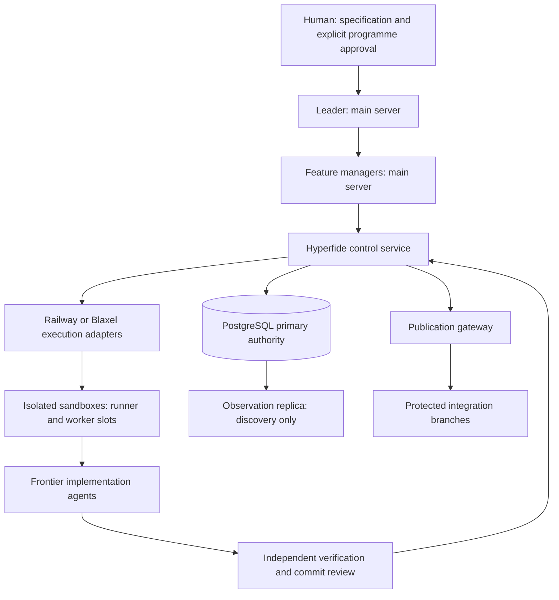

# Hyperfide operations

This guide describes implemented source interfaces and their evidence boundaries. It does not announce a production release. The implementation programme is Hyperfide 2.0; historical Codify feature IDs, Git commits and native provider names retain their original identities.

## Authority and topology



The main server hosts leadership, feature management and supervision. Builds, implementation and checker execution belong in sandboxes. A sandbox is not an agent: fixed resource capacity must be reserved before admitting worker slots, tests or builds. Hundreds of agents and 100 sandboxes are planning requirements, not measured throughput or availability guarantees.

The human interacts with the leader. Feature managers own their assigned packages and request work through Hyperfide; workers cannot acquire publication authority by naming a branch, posting a successful exit code or editing a task status. Claude Code and Codex remain frontier execution connectors. Auxiliary decision models may narrow, rank or flag; qualified evidence and deterministic gates decide acceptance.

## Source and qualification states

A source branch, successful compiler run, authoring check or task-component receipt does not qualify a full acceptance case. The canonical runner records the selected variant, exact input hashes, source inventory, process outcome, assertion inventory and cleanup. The independent checker revalidates those records.

The canonical case registry (tests/hyperfide/registry.json) currently holds 57 acceptance cases, V-001 to V-057, and every one has an empty full-case assertion inventory. Those cases are unregistered for full qualification and block release readiness. Do not fill missing evidence with component results, vendor benchmarks or unexecuted plan text. Provider, connector, restore, sustained-fleet and live-model measurements remain pending until their own exact-current receipts exist.

Support state at the documented source revision. Task status comes from spec/hyperfide/spec.kvx; component evidence comes from artifacts/hyperfide/tasks/<id>/evidence-index.json. Labels:

- **done**: the specification marks the task done.
- **implemented (component evidence)**: the source exists and the task's registered task-component variant passed. The task is still pending in the specification, and its full cases remain UNRUN.
- **pending**: the task is not closed and this tree has no passing task-component evidence for it.
- **proposed**: planning text only.

| Area | State | Owning task(s) |
| --- | --- | --- |
| Approval policy and dependency-enabled build boundaries | done | 1.4 |
| Main-host placement, human programme interface, frontier assignment policy | implemented (component evidence) | 1.1–1.3 |
| Control/provisioner/dispatch service entrypoints, policy-gated startup | done (policy, schema and gateway); implemented (component evidence) for the authenticated service | 1.4, 4.1, 4.2, 14.1 |
| Pinned run specification import | pending: source in services/hyperfide/src/spec, no task-component evidence index in this tree | 2.1 |
| Dependency graphs, versioned decomposition, proof obligations | implemented (component evidence) | 2.2–2.4 |
| Agent hierarchy, scoped packets and views | implemented (component evidence) | 3.1–3.4 |
| PostgreSQL authority schema, primary transaction gateway, migrations and old-primary fencing | done | 4.1, 4.2, 4.4 |
| Replica-barrier packet assembly | implemented (component evidence) | 4.3 |
| Claims, reservations, leases, dispatch reconciliation, resource admission | implemented (component evidence) | 5.1–5.4 |
| Outbox, inbox, instructions, dispatch recovery | implemented (component evidence) | 6.1–6.4 |
| Central graph extraction, staging, publication, query parity | implemented (component evidence) | 7.1–7.4 |
| Provider interface and UNSUPPORTED outcomes | done | 8.1 |
| Provider pools, intents/orphans, placement/relocation | implemented (component evidence) | 8.2–8.4 |
| Railway adapter | implemented (component evidence) | 9.1–9.4 |
| Blaxel coding images | done | 10.1 |
| Blaxel lifetime, create-or-get, preview gating | implemented (component evidence) | 10.2–10.4 |
| Content-derived environment profiles | done | 11.1 |
| Source and cache materialisation, readiness probes, prewarming | implemented (component evidence) | 11.2–11.4 |
| Packet-scoped workspace slices for very large repositories | pending: no source or evidence in this tree | 11.5 |
| Sandbox supervisor and worker slots | implemented (component evidence) | 12.1–12.4 |
| Claude Code and Codex connectors, session lineage | implemented (component evidence) | 13.1–13.4 |
| Identity enrolment, scoped credentials, authenticated HTTPS service | implemented (component evidence) | 14.1–14.4 |
| Attempt source, artifacts, checkpoints, retention | implemented (component evidence) | 15.1–15.4 |
| Independent task qualification | implemented (component evidence) | 16.1–16.4 |
| Commit and semantic assurance | implemented (component evidence) | 17.1–17.4 |
| Findings, GitHub projection, routing | implemented (component evidence) | 18.1–18.3 |
| Finding closure after fenced repair | implemented; component evidence fails (exit 1: 28 of 31 registered assertions pass, and the genuine-execution-start, independent-resolution and reopen assertions are unmet) | 18.4 |
| Integration candidates, publication gateway, closure, release barrier | implemented (component evidence) | 19.1–19.4 |
| Typed decision providers, bounded decision assistance, decision evaluation and promotion | implemented (component evidence) | 20.1–22.4 |
| Observability, resource accounting, notifications | implemented (component evidence) | 23.1–23.4 |
| Supervisory and sandbox recovery, stop/drain/cancel controllers, recovery drills | implemented (component evidence) | 24.1–24.4 |
| SQLite import, cutover/rollback, authority-mode routing, release planning | implemented (component evidence) | 25.1–25.4 |
| Hyperfide identity, canonical hyperfide entrypoint, cg compatibility, name/alias migration, generated guidance | implemented (component evidence) | 26.1–26.4 |
| Strict qualifier and independent receipt checker | done | 27.1 |
| Deterministic schedule replay | implemented (component evidence); full replay cases UNRUN | 27.2 |
| Live Railway/Blaxel provider and native agent qualification, 48/72-hour fleet campaigns | pending: campaign driver source (tests/hyperfide/campaigns/live.py) but no task-component evidence index; no measured limits exist | 27.3 |
| Composite fault qualification | implemented (component evidence, driver component only); full campaign blocked by O-06, O-09, destructive-execution approval, database failover topology and task 27.3 full receipts | 27.4 |
| Operational documentation, documentation closure, release readiness, traceability retention | implemented (component evidence) | 28.1–28.4 |
| Hundreds of agents / 100 concurrent sandboxes | proposed planning target | 27.3 |
| Optional Span GPU self-hosting | proposed; only the self-hosted promotion gate is implemented (component evidence) | 22.4 |

## Build and start

Run preparation and builds in an allocated execution sandbox, never on the leadership server:

```sh
npm --prefix services/hyperfide ci --ignore-scripts
npm --prefix services/hyperfide run build
```

The lockfile pins dependencies and the package declares Node 24.22.0. Start the appropriate entrypoint with an explicitly approved policy file, its exact specification revision, registered fragments and built module root:

```sh
node services/hyperfide/dist/control.js --policy /run/hyperfide/policy.json --spec-revision APPROVED_REVISION --components services/hyperfide/components --module-root services/hyperfide/dist
```

The corresponding source entrypoints are provisioner.js and dispatch.js. A missing approval, denied role/action, mismatched revision, absent linked module or invalid dependency graph refuses startup. The stdio protocol is bounded JSONL; its presence does not grant remote authority.

The authenticated network service uses the explicit HTTPS mode, trusted TLS certificate/key and identity configuration. Identity enrolment, request signatures, origin, nonce, credential version, deployment epoch and current run/boot/lease are enforced by the actual task 14.1 protocol. Never copy fixture credentials into an operational environment.

Every entrypoint (control.js, provisioner.js, dispatch.js) accepts exactly these flags, parsed by services/hyperfide/src/components/service.ts; any other flag refuses startup with INVALID_ARGS:

| Flag | Meaning |
| --- | --- |
| --policy FILE | Required. Trusted approved policy JSON, regular file of at most 1 MiB. |
| --spec-revision REV | Required. Must equal the revision approved in the policy. |
| --components DIR | Component fragment directory (default services/hyperfide/components). |
| --module-root DIR | Built module root (default services/hyperfide/dist). |
| --mode stdio\|https\|daemon | Default stdio (bounded JSONL on stdin/stdout). https and daemon print a ready event on stderr and run until SIGTERM/SIGINT. |
| --host, --port | HTTPS listener address (host default 127.0.0.1). |
| --tls-cert, --tls-key | HTTPS certificate and private key. |

HTTPS mode refuses with AUTH_REQUIRED unless the 14.1 identity component is registered, and refuses with TRANSPORT_CONFIG when HYPERFIDE_MIGRATION_JOB=1. HF_SERVICE_MAX_REQUEST_BYTES and HF_SERVICE_MAX_RESPONSE_BYTES set protocol byte limits (default 1 MiB, range 256 bytes to 64 MiB; HTTPS is further capped at 1 MiB). These are configured bounds, not measured capacity.

Observed refusals from the built entrypoint in a task sandbox (exit code 1):

```text
$ node services/hyperfide/dist/control.js
{"ok":false,"error":{"code":"INVALID_ARGS","message":"Explicit trusted policy and pinned specification revision required"}}
$ node services/hyperfide/dist/control.js --policy /nonexistent --spec-revision X
{"ok":false,"error":{"code":"POLICY_INVALID","message":"Trusted policy file is unavailable"}}
```

Authenticated startup, refusal of a request that claims its own approval, refusal of a request for another run and service restart are exercised against PostgreSQL by tests/hyperfide/cases/tasks/28_1.py; the recorded outcome is artifacts/hyperfide/tasks/28.1/evidence-index.json (local, force-added evidence; not a full-case receipt).

## Local CLI

The local-first CLI is the hyperfide executable. cg is a deprecated compatibility alias from the same executable, with identical arguments, JSON and exit codes; it is byte-identical at this revision, and version prints 2.0.0-dev for both. It stays for the compatibility window of the approved release (see hyperfide help, "command names"). The CLI is not a control-service client and grants no distributed authority. Commands relevant to operations, all listed by hyperfide help --all:

| Command | Use |
| --- | --- |
| hyperfide version | Print the version. |
| hyperfide config [init\|get\|set\|check] | Read or validate codify.kvx settings with their origin. |
| hyperfide docs status\|plan\|packet\|check\|trace\|close | Local grounded documentation closure evidence. |
| hyperfide spec docs status\|auto\|manual\|off\|start\|block\|reset\|done | The reserved @docs closure stage. |
| hyperfide fleet up\|down [--drain] [--wait SECONDS]\|pause\|resume\|runs\|status | Local run supervision; fleet down releases claims and keeps branches. |
| hyperfide journal list\|apply\|drop | Writes queued while the local database was busy. |

The configuration file is still named codify.kvx; the 26.3 component plans migration to hyperfide.kvx. The installer (scripts/install.sh) is not advertised as a Hyperfide release until tasks 25.4 and 26.2 close.

## PostgreSQL and migrations

Connection settings are read by services/hyperfide/src/storage/runtime.ts. Each role uses HYPERFIDE_<ROLE>_PRIMARY_DATABASE_URL (for example HYPERFIDE_CONTROL_PRIMARY_DATABASE_URL), falling back to the DATABASE_URL compatibility setting; HYPERFIDE_<ROLE>_REPLICA_DATABASE_URL is optional; migrations require HYPERFIDE_MIGRATION_DATABASE_URL and run with one connection. Bounded settings: HYPERFIDE_PG_LISTENER_MAX (default 1, maximum 4), HYPERFIDE_PG_MAX_QUEUED (default 32, maximum 1024), HYPERFIDE_PG_SYNCHRONOUS_COMMIT (on or remote_apply) and HYPERFIDE_REQUIRE_SYNC_REPLICA (0 or 1). A process that already owns a different PostgreSQL configuration refuses with DATABASE_CONFIG_CONFLICT. Replicas serve observation and discovery; ownership changes, leases, qualification and publication must revalidate on the primary. A replica is not a second writable authority.

Migration credentials are dedicated to the migration operator. Task 4.4 owns ascending, checksummed migrations; request handlers never create their own tables. Missing schema is a readiness refusal. Preserve already applied SQL bytes and their checksums. The 28.2 documentation migration adds immutable packet, checker, baseline and closure records with the authority transaction-isolation guard.

Primary transactions use the shared 4.2 gateway. Identity guards run inside each actual transaction attempt and are repeated after retry. A lost COMMIT acknowledgement is an unknown outcome: reconcile the durable operation identity before another external side effect. Do not infer safe failover from an epoch row or a caller boolean; production promotion requires actual old-primary/control-writer fencing.

## Preparation, secrets and execution

A preparation receipt binds an exact repository commit/tree, prerequisites, manifest and execution profile. It must be complete before admitting a worker. Inject scoped environment and credential references through the approved provider/identity path. Do not log secret values, embed them in public manifests or share leader credentials with workers.

Provider acceptance, a sandbox ID and runner readiness are separate states. Reconcile provider state using the actual native account/environment/resource identity, then enrol the exact sandbox boot. The advertised Railway/Blaxel account capacity is an input to planning; live provider limits, image publication and process execution need their own qualification.

Provider capability differences implemented by the adapters (services/hyperfide/src/providers). An UNSUPPORTED outcome is explicit; there is no emulated support:

| Capability | Railway (providers/railway) | Blaxel (providers/blaxel) |
| --- | --- | --- |
| Stop signal | TERM and KILL | TERM only; KILL is UNSUPPORTED. A stopped API parent leaves the outcome UNKNOWN until job-tree cleanup is reconciled. |
| Persistent volumes | Refused (persistent_volume_bytes must be 0) | Refused until per-boot qualified volume allocation exists |
| Process stdin | Unavailable after detach or restart | — |
| Attach with resume cursor | — | UNSUPPORTED |
| Resources | Memory must be exactly representable | CPU and memory must match provider coupling; writable overlay cannot exceed memory; timeouts in whole seconds |
| Pre-boot worker credentials | — | Disabled; use post-enrolment process references |
| Snapshots, network policy, copy, lifetime methods | — | UNSUPPORTED in the process adapter (lifetime policy is a separate ttl-idle/ttl-max-age/date delete policy) |
| Account limits | Planning input only | account_limits_qualified must be declared; live limits pending 27.3 |

Provider components: 8.2 provider.pools.*, 8.3 provider.intents.* and provider.orphans.list, 8.4 provider.placement.* and provider.relocation.*. All three components register in the provisioner role, and 8.2 and 8.3 also register in the control role. Contract checks report authority NONE and live_qualification NOT_EVALUATED.

Remote work is prepared in a primary transaction, its intent is committed, then the opaque runner permit executes. No remote build occurs inside a PostgreSQL transaction. Unknown execution or cleanup remains unknown and retains capacity until reconciliation proves otherwise.

## Verification and publication

A worker submission enters durable custody for its exact commit and source manifest. Independent verifier jobs, review coverage, blocking findings and integration candidate gates govern publication. Transport credentials stay behind the publication gateway; expected old/new object IDs and current authority are checked at the actual Git side effect.

The canonical component command shape is below. Use a fresh output directory for each changed immutable manifest.

```sh
python3 tests/hyperfide/qualify.py --case V-035 --manifest tests/hyperfide/manifests/tasks/28.2.json --output-dir /tmp/hyperfide/docs-component-campaign
python3 tests/hyperfide/check-evidence.py --campaign /tmp/hyperfide/docs-component-campaign
```

This selects the registered task-component inventory. It does not replace a full-case campaign. A completed receipt chain whose authentication is described as unanchored-consistency-only proves internal consistency; authoritative admission still requires trusted execution custody and the exact current gate.

## Documentation packet, check and close

Documentation policy comes from the current accepted specification's explicit [documentation] section. Its original mode, targets and check_cmd survive import. A caller cannot override them. Missing, off or unsupported policy is held for an explicit disposition. Explicit packet, check and close operations are supported in auto and manual modes; manual mode never waives the independent checker or durable baseline.

docs.packet binds current accepted spec ID/generation, run epoch, programme input digest and the observed published commit set. Trusted run-scoped repository roots supply actual Git trees and complete configured target blob bytes. The packet and later baseline persist enough content for independent retrieval after restart.

docs.check must use the real remote runner and an independently observed deterministic checker proof. Connector success, a caller-provided digest, a warning or a self-reported PASS cannot substitute. docs.close commits baseline and closure together only after a durable successful checker result. Persistence failure aborts closure. A changed relevant revision or lost fence invalidates it. Documentation failure never recursively launches a new programme.

## Decision evaluation

Requested candidates are respan/span-02, typesafe/jev-1.14 and liquid/d1-ultra. Their route availability and actual workload performance must be measured; model identifiers in a spec are not proof of capability.

Evaluation uses independently signed historically available packets, separated incident/feature/repository groups, calibration data and sealed holdout data. Unknown labels stay unknown. Actual, estimated and unknown usage remain distinct. A scorecard compares the declared baseline with all three candidates and reports uncertainty, abstention, latency and billed attempt cost. Replay correctness is not cost per qualified integrated outcome.

Controlled trials require exact-plan approval, independent randomised units, complete observed outcomes, full cost accounting and stop conditions. Synthetic fixtures cannot prove live performance or enable policy promotion. Promotion gates retain exact model/route/rubric/purpose and qualification versions; drift or expired qualification disables model action policy while preserving workers, artifacts and deterministic fallback. Optional Span GPU self-hosting requires separate licence/engine/correctness/overload/restart evidence and never blocks the hosted baseline.

## Measured qualification limits

No live provider, fleet, throughput, latency or restore limit has been measured: tasks 27.2 (schedule replay), 27.3 (live providers and native agents, 48/72-hour campaigns) and 27.4 (composite faults) are pending in the specification. 27.2 and 27.4 have task-component evidence only, 27.3 has none, and every referenced full acceptance case is UNRUN. The only figures in this guide are configured bounds enforced by code (protocol bytes, PostgreSQL pool and listener limits) and the local task-component observation recorded in artifacts/hyperfide/tasks/28.1/evidence-index.json: the twelve registered 28.1 assertions run against a local PostgreSQL fixture on Node 24.22.0. That observation is a task-component receipt only and cannot replace any full-case, provider, connector or campaign receipt.

## Stop, recovery and retention

Stop the requested scope through its authorised control operation. Revocation/fencing, observed process termination, provider cleanup and released capacity are distinct facts. A missing response is not proof that a sandbox or agent stopped. Preserve unknown outcomes for reconciliation.

Recovery uses exact durable source/checkpoint manifests and current identity; a latest session name is not a safe resume instruction. Restore/rollback requires independent drills and verified artifact bytes. Retention follows admitted references, manifest-child dependencies and legal holds. Do not delete chunks while retained evidence still references their parent manifest.

Control operations: recovery.stop.describe, recovery.stop.request, recovery.stop.finalize and recovery.stop.reconcile (24.3, recovery/stop.ts); recovery.drill.describe/plan/execute/inspect/reconcile (24.4, recovery/drills.ts); artifact.retention.inspect/hold/release/policy/collect/reconcile (15.4, artifacts/retention.ts; immutable artifact_retention_events from migration 0029). Locally, hyperfide fleet down --drain stops a CLI-supervised run; it does not stop remote sandboxes.

## Migration, identity and troubleshooting

SQLite import preserves historical state and provenance separately from live authority. An old done flag is not current qualification. Offline/local core behavior cannot claim distributed ownership; stale projections cannot overwrite fresh central state. The canonical Hyperfide distribution and the cg compatibility entrypoint are implemented with task-component evidence for tasks 25.4 and 26.2. No installer is advertised until those tasks close in the specification.

Migration and rebrand components, all in the control role. The tasks are pending in the specification and have task-component evidence only, so these are implemented interfaces, not qualified guarantees:

- 25.1 migration.sqlite.describe/snapshot/inventory/archive/import/status: historical import with provenance.
- 25.2 cutover.describe/inspect/prepare/validate/activate/rollback/recovery: single-authority cutover with separate rollback boundaries.
- 25.4 release.inspect/compatibility/plan: upgrade order VERIFY_PREBUILT_ARTIFACTS, EXPAND_SCHEMA, drain dispatch, install control, provisioner, dispatch, update runners, canary, reconcile old clients, CONTRACT_SCHEMA. The plan returns deployment_authorized false and build_on_supervision_host false; a release whose bin/cg differs from bin/hyperfide is refused.
- 26.3 migration.names.plan/apply/rollback/aliases: codify.kvx to hyperfide.kvx and .codify/agent-context.md to .hyperfide/context/agent-context.md with backups; legacy CG_* and CODIFY_* variables (for example CG_AUTHORITY_URL, CODIFY_ROOT) are aliases of their HYPERFIDE_* names, and differing values refuse with ALIAS_CONFLICT.
- 26.4 migration.generated.inspect/run: regenerated owned guidance.

Rollback restores the documented previous usable state only for reversible steps. Operating rule (not yet a qualified guarantee): treat schema contraction (CONTRACT_SCHEMA) and protocol upgrades accepted by new clients as irreversible; roll back before contraction, and never accept evidence produced under an incompatible protocol. Old/new parity is not yet qualified (V-028 and V-055 remain UNRUN as full cases).

| Observation | Required investigation |
| --- | --- |
| Service refuses startup | Approval/revision/role, linked fragment, actual dependency capability and required schema. |
| INVALID_ARGS or POLICY_INVALID at startup | Only the flags in the entrypoint table are accepted; --policy must name a readable regular JSON file of at most 1 MiB. |
| AUTH_REQUIRED or TRANSPORT_CONFIG with --mode https | 14.1 identity component registered; HYPERFIDE_MIGRATION_JOB unset; TLS certificate/key readable. |
| DATABASE_CONFIG_INVALID or DATABASE_CONFIG_CONFLICT | Role-specific primary URL or DATABASE_URL present; HYPERFIDE_MIGRATION_DATABASE_URL for migrations; bounded PG settings in range; one configuration per process. |
| ALIAS_CONFLICT during rename migration | Legacy CG_*/CODIFY_* and HYPERFIDE_* variables set to different values. |
| Provider returns UNSUPPORTED | Requested capability against the Railway/Blaxel table above; no fallback emulation exists. |
| Request is unauthenticated or stale | TLS origin, signed raw bytes, nonce/time, credential version/revocation, run epoch, boot and compute lease. |
| Provider created a sandbox but no worker starts | Preparation proof, boot enrolment, resource/slot reservation and actual native connector readiness. |
| Checker exited successfully but work is unqualified | Exact assertion inventory, canonical independent check, trusted execution custody, source revision and cleanup. |
| Docs will not close | Accepted policy/check command, exact publication set, current fence, durable checker result and baseline persistence. |
| Release remains held | Missing full-case registration/evidence, unresolved blocking findings, stale gate, unexplained retained resource or absent restore/rollback/docs proof. |

The release readiness checker must account for every native clause and required case, plus task/candidate/programme, policy, docs, restore/rollback and cleanup obligations. Its controlled-pack self-tests qualify the checker; they do not release Hyperfide. Final closure seals its validated input inventory and does not require its own digest as an input.

## Distributed documentation API

Component28.2 exposes docs.packet with pinned accepted revision, generation, programme and integrated source manifest; docs.inspect reads authoritative currentness. docs.check requires an authenticated VERIFIER, a dedicated TEST allocation, current registered runner source commit/tree and the accepted checker command. Its bounded execution profile comes from deployment configuration, including the Python executable digest, environment and timeout. The command must emit the deterministic native documentation JSON report, including every named ok assertion; a zero exit alone is refused. The remote wrapper independently checks every target blob before and after execution.

The checker runs through actual runner.remote.v1, with preparation and its durable intent committed before execution. Missing supplier capabilities or schema refuse operation. Each repository needs its own successful immutable check. docs.close accepts packet_id plus check_ids (or check_id for one repository), verifies complete exact repository coverage, and persists snapshot, baseline and closure atomically. Unconfirmed process cleanup or incomplete artifacts hold checker admission and closure. Successful checks still do not authorise slot release.

The bounded28.2 persistence fixture uses the actual createClosureComponent factory and explicit seeded checker records. It does not qualify the remote runner. Full distributed documentation acceptance requires the actual5/12 service composition and independently admitted remote execution. The production fragment retains those supplier dependencies.

Component28.4 separates a bounded structural mapping response from release.traceability.archive, which retains the complete sanitised public pack through artifact.store.v1. An archive verifies retrievable bytes and does not grant product qualification. Component28.3 release.readiness.assess holds incomplete evidence. release.readiness.seal requires all full-case gates, current authoritative programme and documentation closure, a verified COMPLETE artifact, then a fresh guarded primary recheck before writing its immutable release record. Controlled complete-inventory checker fixtures do not establish a product release.

Release evidence admission uses a deployment-owned protected schema_version 2 index. Each entry binds reference, evidence_root, campaign, receipt_id, receipt_digest and gate_kinds; the index organisation_id/run_id must match the actual invocation. evidence_root is an exclusively service-owned mode0700 portable stage containing trusted-relocation.json. The service must keep untrusted agents in separate UIDs or VMs and freeze its own stage writers. The canonical checker verifies every original source/input/tool/artifact pin through the exact relocation map. The release consumer uses absolute isolated Python, a closed environment, the qualified proof assets, and the actual private-stage guard/inspection lock. HYPERFIDE_RELEASE_PYTHON and HYPERFIDE_RELEASE_QUALIFIED_PROOF_ROOT are protected deployment settings, never request fields. Nonportable version1 indexes fail closed. Component proof remains insufficient for full release gates.
