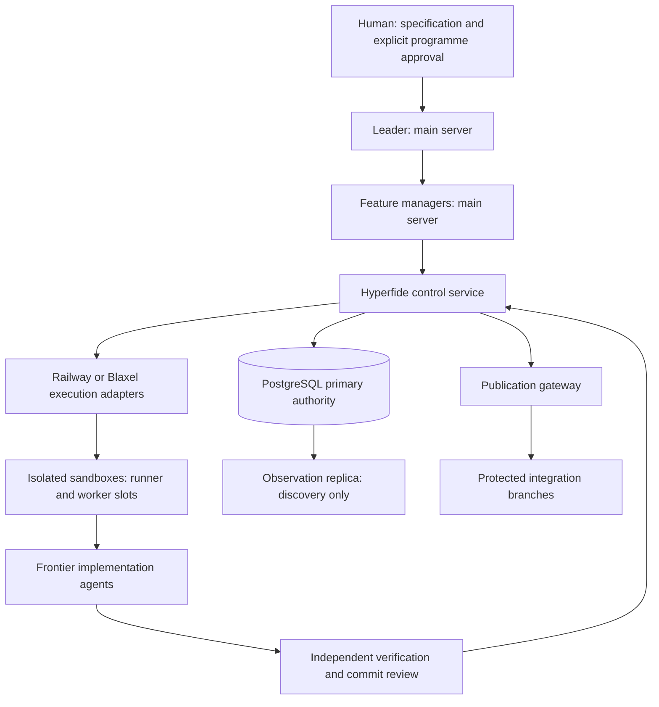

# Hyperfide operations

This guide describes implemented source interfaces and their evidence boundaries. It does not announce a production release. The implementation programme is Hyperfide 2.0; historical Codify feature IDs, Git commits and native provider names retain their original identities.

## Authority and topology



The main server hosts leadership, feature management and supervision. Builds, implementation and checker execution belong in sandboxes. A sandbox is not an agent: fixed resource capacity must be reserved before admitting worker slots, tests or builds. Hundreds of agents and 100 sandboxes are planning requirements, not measured throughput or availability guarantees.

The human interacts with the leader. Feature managers own their assigned packages and request work through Hyperfide; workers cannot acquire publication authority by naming a branch, posting a successful exit code or editing a task status. Claude Code and Codex remain frontier execution connectors. Auxiliary decision models may narrow, rank or flag; qualified evidence and deterministic gates decide acceptance.

## Source and qualification states

A source branch, successful compiler run, authoring check or task-component receipt does not qualify a full acceptance case. The canonical runner records the selected variant, exact input hashes, source inventory, process outcome, assertion inventory and cleanup. The independent checker revalidates those records.

The current canonical case registry may contain empty full-case assertion inventories. Those cases are unregistered for full qualification and block release readiness. Do not fill missing evidence with component results, vendor benchmarks or unexecuted plan text. Provider, connector, restore, sustained-fleet and live-model measurements remain pending until their own exact-current receipts exist.

## Build and start

Run preparation and builds in an allocated execution sandbox, never on the leadership server:

```sh
npm --prefix services/hyperfide ci --ignore-scripts
npm --prefix services/hyperfide run build
```

The lockfile pins dependencies and the package declares Node 24.22.0. Start the appropriate entrypoint with an explicitly approved policy file, its exact specification revision, registered fragments and built module root:

```sh
node services/hyperfide/dist/control.js --policy /run/hyperfide/policy.json --spec-revision APPROVED_REVISION --components services/hyperfide/components --module-root services/hyperfide/dist
```

The corresponding source entrypoints are provisioner.js and dispatch.js. A missing approval, denied role/action, mismatched revision, absent linked module or invalid dependency graph refuses startup. The stdio protocol is bounded JSONL; its presence does not grant remote authority.

The authenticated network service uses the explicit HTTPS mode, trusted TLS certificate/key and identity configuration. Exact flags are defined by components/service.ts; identity enrolment, request signatures, origin, nonce, credential version, deployment epoch and current run/boot/lease are enforced by the actual task 14.1 protocol. Never copy fixture credentials into an operational environment.

## PostgreSQL and migrations

Use the role-specific primary connection settings documented by storage/runtime.ts, or the supported DATABASE_URL compatibility setting. Replicas serve observation and discovery; ownership changes, leases, qualification and publication must revalidate on the primary. A replica is not a second writable authority.

Migration credentials are dedicated to the migration operator. Task 4.4 owns ascending, checksummed migrations; request handlers never create their own tables. Missing schema is a readiness refusal. Preserve already applied SQL bytes and their checksums. The 28.2 documentation migration adds immutable packet, checker, baseline and closure records with the authority transaction-isolation guard.

Primary transactions use the shared 4.2 gateway. Identity guards run inside each actual transaction attempt and are repeated after retry. A lost COMMIT acknowledgement is an unknown outcome: reconcile the durable operation identity before another external side effect. Do not infer safe failover from an epoch row or a caller boolean; production promotion requires actual old-primary/control-writer fencing.

## Preparation, secrets and execution

A preparation receipt binds an exact repository commit/tree, prerequisites, manifest and execution profile. It must be complete before admitting a worker. Inject scoped environment and credential references through the approved provider/identity path. Do not log secret values, embed them in public manifests or share leader credentials with workers.

Provider acceptance, a sandbox ID and runner readiness are separate states. Reconcile provider state using the actual native account/environment/resource identity, then enrol the exact sandbox boot. The advertised Railway/Blaxel account capacity is an input to planning; live provider limits, image publication and process execution need their own qualification.

Remote work is prepared in a primary transaction, its intent is committed, then the opaque runner permit executes. No remote build occurs inside a PostgreSQL transaction. Unknown execution or cleanup remains unknown and retains capacity until reconciliation proves otherwise.

## Verification and publication

A worker submission enters durable custody for its exact commit and source manifest. Independent verifier jobs, review coverage, blocking findings and integration candidate gates govern publication. Transport credentials stay behind the publication gateway; expected old/new object IDs and current authority are checked at the actual Git side effect.

The canonical component command shape is below. Use a fresh output directory for each changed immutable manifest.

```sh
python3 tests/hyperfide/qualify.py --case V-035 --manifest tests/hyperfide/manifests/tasks/28.2.json --output-dir /tmp/hyperfide/docs-component-campaign
python3 tests/hyperfide/check-evidence.py --campaign /tmp/hyperfide/docs-component-campaign
```

This selects the registered task-component inventory. It does not replace a full-case campaign. A completed receipt chain whose authentication is described as unanchored-consistency-only proves internal consistency; authoritative admission still requires trusted execution custody and the exact current gate.

## Documentation packet, check and close

Documentation policy comes from the current accepted specification's explicit [documentation] section. Its original mode, targets and check_cmd survive import. A caller cannot override them. Missing, off or unsupported policy is held for an explicit disposition. Explicit packet, check and close operations are supported in auto and manual modes; manual mode never waives the independent checker or durable baseline.

docs.packet binds current accepted spec ID/generation, run epoch, programme input digest and the observed published commit set. Trusted run-scoped repository roots supply actual Git trees and complete configured target blob bytes. The packet and later baseline persist enough content for independent retrieval after restart.

docs.check must use the real remote runner and an independently observed deterministic checker proof. Connector success, a caller-provided digest, a warning or a self-reported PASS cannot substitute. docs.close commits baseline and closure together only after a durable successful checker result. Persistence failure aborts closure. A changed relevant revision or lost fence invalidates it. Documentation failure never recursively launches a new programme.

## Decision evaluation

Requested candidates are respan/span-02, typesafe/jev-1.14 and liquid/d1-ultra. Their route availability and actual workload performance must be measured; model identifiers in a spec are not proof of capability.

Evaluation uses independently signed historically available packets, separated incident/feature/repository groups, calibration data and sealed holdout data. Unknown labels stay unknown. Actual, estimated and unknown usage remain distinct. A scorecard compares the declared baseline with all three candidates and reports uncertainty, abstention, latency and billed attempt cost. Replay correctness is not cost per qualified integrated outcome.

Controlled trials require exact-plan approval, independent randomised units, complete observed outcomes, full cost accounting and stop conditions. Synthetic fixtures cannot prove live performance or enable policy promotion. Promotion gates retain exact model/route/rubric/purpose and qualification versions; drift or expired qualification disables model action policy while preserving workers, artifacts and deterministic fallback. Optional Span GPU self-hosting requires separate licence/engine/correctness/overload/restart evidence and never blocks the hosted baseline.

## Stop, recovery and retention

Stop the requested scope through its authorised control operation. Revocation/fencing, observed process termination, provider cleanup and released capacity are distinct facts. A missing response is not proof that a sandbox or agent stopped. Preserve unknown outcomes for reconciliation.

Recovery uses exact durable source/checkpoint manifests and current identity; a latest session name is not a safe resume instruction. Restore/rollback requires independent drills and verified artifact bytes. Retention follows admitted references, manifest-child dependencies and legal holds. Do not delete chunks while retained evidence still references their parent manifest.

## Migration, identity and troubleshooting

SQLite import preserves historical state and provenance separately from live authority. An old done flag is not current qualification. Offline/local core behavior cannot claim distributed ownership; stale projections cannot overwrite fresh central state. Canonical Hyperfide distribution and the cg compatibility entrypoint must be verified by the actual tasks 25/26 implementation before an installer is advertised.

| Observation | Required investigation |
| --- | --- |
| Service refuses startup | Approval/revision/role, linked fragment, actual dependency capability and required schema. |
| Request is unauthenticated or stale | TLS origin, signed raw bytes, nonce/time, credential version/revocation, run epoch, boot and compute lease. |
| Provider created a sandbox but no worker starts | Preparation proof, boot enrolment, resource/slot reservation and actual native connector readiness. |
| Checker exited successfully but work is unqualified | Exact assertion inventory, canonical independent check, trusted execution custody, source revision and cleanup. |
| Docs will not close | Accepted policy/check command, exact publication set, current fence, durable checker result and baseline persistence. |
| Release remains held | Missing full-case registration/evidence, unresolved blocking findings, stale gate, unexplained retained resource or absent restore/rollback/docs proof. |

The release readiness checker must account for every native clause and required case, plus task/candidate/programme, policy, docs, restore/rollback and cleanup obligations. Its controlled-pack self-tests qualify the checker; they do not release Hyperfide. Final closure seals its validated input inventory and does not require its own digest as an input.

## Distributed documentation API

Component28.2 exposes docs.packet with pinned accepted revision, generation, programme and integrated source manifest; docs.inspect reads authoritative currentness. docs.check requires an authenticated VERIFIER, a dedicated TEST allocation, current registered runner source commit/tree and the accepted checker command. Its bounded execution profile comes from deployment configuration, including the Python executable digest, environment and timeout. The command must emit the deterministic native documentation JSON report, including every named ok assertion; a zero exit alone is refused. The remote wrapper independently checks every target blob before and after execution.

The checker runs through actual runner.remote.v1, with preparation and its durable intent committed before execution. Missing supplier capabilities or schema refuse operation. Each repository needs its own successful immutable check. docs.close accepts packet_id plus check_ids (or check_id for one repository), verifies complete exact repository coverage, and persists snapshot, baseline and closure atomically. Unconfirmed process cleanup or incomplete artifacts hold checker admission and closure. Successful checks still do not authorise slot release.

The bounded28.2 persistence fixture uses the actual createClosureComponent factory and explicit seeded checker records. It does not qualify the remote runner. Full distributed documentation acceptance requires the actual5/12 service composition and independently admitted remote execution. The production fragment retains those supplier dependencies.

Component28.4 separates a bounded structural mapping response from release.traceability.archive, which retains the complete sanitised public pack through artifact.store.v1. An archive verifies retrievable bytes and does not grant product qualification. Component28.3 release.readiness.assess holds incomplete evidence. release.readiness.seal requires all full-case gates, current authoritative programme and documentation closure, a verified COMPLETE artifact, then a fresh guarded primary recheck before writing its immutable release record. Controlled complete-inventory checker fixtures do not establish a product release.
