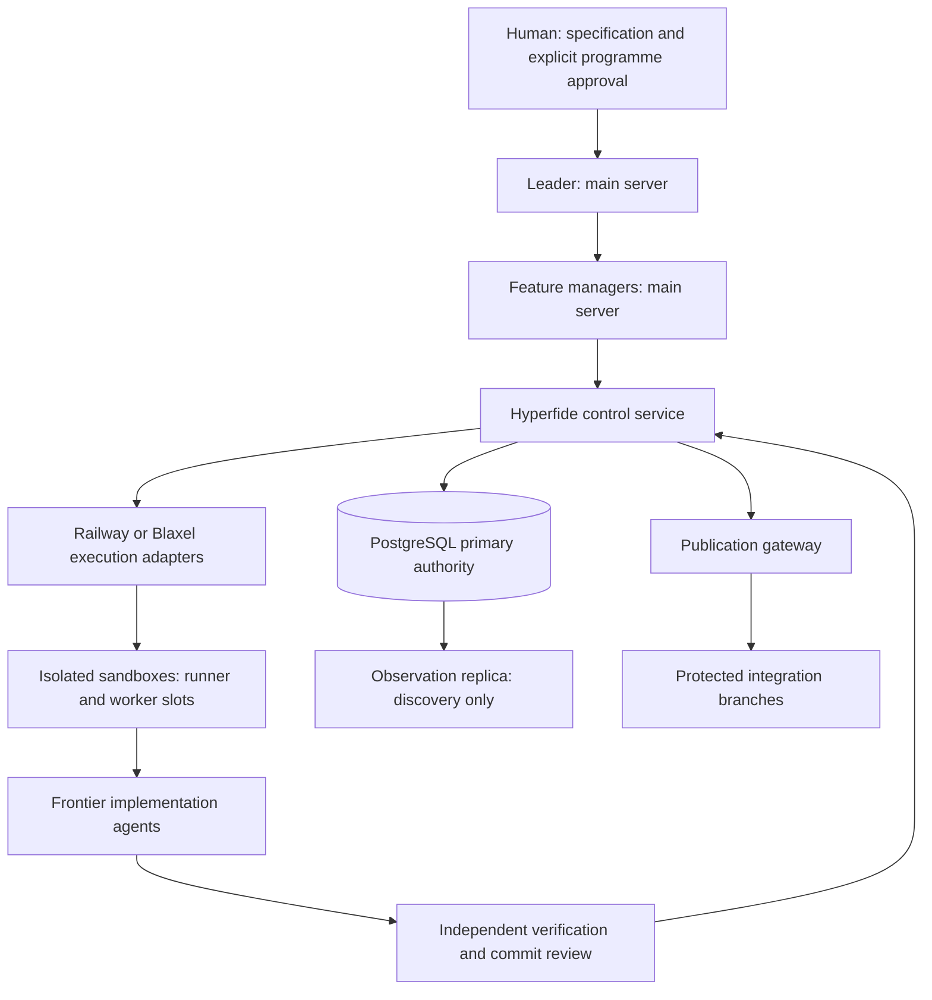

<div align="center">

# Hyperfide


<a
  href="https://trendshift.io/repositories/267432?utm_source=trendshift-badge&amp;utm_medium=badge&amp;utm_campaign=badge-trendshift-267432" target="_blank" rel="noopener noreferrer">

</a>

**أداة سير عمل الوكلاء التي تتسع من المشاريع الصغيرة البسيطة إلى قواعد الشيفرة الكبيرة والمعقدة.**

واجهة سطر الأوامر المحلية مكتوبة بلغة C11 خالصة: ملف تنفيذي واحد، وقاعدة بيانات SQLite واحدة، ولا قياس عن بُعد.

[](../../LICENSE)
[](#)
[](../../.github/workflows/ci.yml)
</div>
<div align="center">

[English](../../README.md)  [简体中文](README.zh-CN.md) · [Español](README.es.md) · [हिन्दी](README.hi.md) · [العربية](README.ar.md) · [Français](README.fr.md) · [Português (BR)](README.pt-BR.md)
</div>

---

## نظرة عامة

Hyperfide محرك لسير عمل الوكلاء في ملف تنفيذي واحد هو `hyperfide`. يتولى الأشياء الأربعة التي يحتاجها المشروع فيما وراء الشيفرة نفسها — ما **هي** الشيفرة، وكيف وصلت إلى **هنا**، وما الذي سيحدث **تاليًا**، وما الذي جرى **تعلّمه** في الطريق — ويقدّم الأربعة جميعًا للبشر ولوكلاء الذكاء الاصطناعي على حد سواء.

هذه الشجرة هي Hyperfide 2.0 قيد التطوير: يطبع `hyperfide version` القيمة `2.0.0-dev`، ولا شيء فيها إصدار إنتاجي. نشأ Hyperfide من Codify، الذي تحتفظ إصداراته 1.x ومعرّفات ميزاته (مثل `codify-v15` و`codify-v16`) وتاريخ التزاماته بأسمائها الأصلية. ويضيف الإصدار 2.0 [مستوى تحكم موزّعًا](#مستوى-التحكم-في-hyperfide) — قائدًا ومديري ميزات على خادم إشرافي، وصناديق عزل بعيدة للبناء وللوكلاء، وPostgreSQL بوصفها المرجعية — حول واجهة سطر الأوامر المحلية نفسها.

> **التوافق.** `hyperfide` هو الأمر المعتمد. و`cg` اسم بديل للتوافق مُهمَل يُثبَّت من الملف التنفيذي نفسه، بالوسائط نفسها وJSON نفسه ورموز الخروج نفسها؛ ويبقى طوال نافذة التوافق المدعومة للإصدار المعتمد، ولا يُزال إلا في إصدار لاحق يعلن ذلك. كل الأمثلة أدناه تستخدم `hyperfide`؛ و`cg` يشغّل الشيء نفسه.

يبدأ `hyperfide fleet up` مشرفًا دائمًا قابلًا للاستئناف بعد الانهيار للوكيل الرئيسي ومديري الموجات وعمّال المهام. ويدير كل عملية Codex أو Claude Code حتى يُؤهَّل العمل ويُدمج. يتلقى الوكلاء سياق الرسم البياني، ويُفحص انجراف الفروع قبل الدمج، ويبث `hyperfide serve` الأحداث إلى المحرر. وتُجمَع الفهرسة عبر العمّال؛ ويغطي الرسم البياني والذاكرة كل فرع وشجرة عمل. لا تُجري الحلقة الأساسية أي استدعاء شبكي؛ والميزات القليلة التي تفعل ذلك مسمّاة في نهاية هذه النظرة العامة.

**ما هي الشيفرة.** يفهرس Hyperfide ملفات المصدر في رسم بياني قابل للاستعلام: الرموز، والاستدعاءات، والاستيرادات، والأنواع، والمسارات، والبحث النصي الكامل، وكل ذلك مخزَّن محليًا في SQLite. وتتدرج تغطية اللغات من الاستخراج النحوي الأصلي إلى تتبع الملفات فقط؛ و[مصفوفة التغطية](../../docs/indexing.md#extraction-coverage) تبيّن الحد لكل عائلة. يجيب `hyperfide context <query>` عن سؤال «أطلعني على هذه المنطقة» في استدعاء واحد: الرموز المطابقة مع مقتطفاتها، والمستدعون، والمستدعَون، والمسارات ذات الصلة. وتُفهرس التعليقات كعُقد من الدرجة الأولى للغرض والعقود والمخاطر والاقترانات التي لا تعيش إلا في النثر.

**كيف وصلت إلى هنا.** يمنحك نظام لقطات مدمج مُعنوَن بالمحتوى الالتزامات والتاريخ والفروق والاستعادة دون الحاجة إلى أي نظام تحكم بالإصدارات خارجي. ولأن اللقطات تتشارك قاعدة البيانات مع الرسم البياني، يبلّغ `hyperfide changes` عن نطاق أثر تعديلاتك غير الملتزم بها. ويكتب `hyperfide changelog` ملاحظات الإصدار: من تاريخ git افتراضيًا — إصدار لكل وسم أو رفع للإصدار، ومجموعات من بادئة عنوان الالتزام، ومرجع كل مهمة محمول معها، ومع مفتاح، فقرة «أبرز النقاط» قصيرة يكتبها نموذج لكل إصدار — ومن سلسلة اللقطات بفروق على مستوى الرموز عند تمرير `--snapshots` أو حين لا يستخدم المشروع git أصلًا.

**ما الذي سيحدث تاليًا.** يحوّل محرك المواصفات ملفات مواصفات kvx النصية إلى خطة عمل فعلية: لوحة مهام بموجات اعتماد، ومعايير قبول مرفقة بكل مهمة — وحالة `done` مُتحقَّق منها لا مُدّعاة. ينشئ `hyperfide spec new` و`hyperfide spec add` الخطة، ويثبت `hyperfide spec lint` أنها قابلة للتنفيذ، وتتولى الحلقة تشغيلها. في وضع Prod، تسجّل `implemented` اكتمال البرمجة ودليل المصدر دون ادعاء التأهيل؛ ولا تعني `done` إلا نجاح التأهيل التنفيذي وفحوص الرسم البياني. وفي الوضع المتوازي يعمل عدة وكلاء معًا، في حدود تباعد المسارات التي تعلنها كل مهمة.

**ما الذي جرى تعلّمه في الطريق.** تخزّن ذاكرة الوكيل ملاحظات مقصودة — قرارات وقيودًا ونتائج وتفضيلات وحقائق — في قاعدة البيانات نفسها مع الرسم البياني، مرتبطةً بالمهمة التي كُتبت في أثنائها. يحفظ `hyperfide remember` ملاحظة في منتصف المهمة، ويسجّل كل `hyperfide spec done` نتيجة صادقة تلقائيًا (بما في ذلك حالات الرفض)، ويعيد `hyperfide recall` كل ذلك مرتَّبًا حسب الصلة والحداثة.

والطبقات يعزز بعضها بعضًا: تُوسم الالتزامات تلقائيًا بالمهمة التي تنفذها، وتظهر الذكريات على المهمة التي تنتمي إليها، ويعود `hyperfide why` برمز إلى القرارات التي وراءه، ويسير `hyperfide spec trace` من أي مهمة إلى رموزها والتزاماتها وذكرياتها.

**وهو حاضر بين الخطوات، لا عندها فقط.** يبدأ `hyperfide work open` بحزمة مهمة مدمجة، ويعيد `hyperfide work update` فروق الحالة والأدلة ومساحة العمل الجديدة فقط، ويصنّف `hyperfide event progress` الحلقات دون الخلط بين النشاط والتقدم، ويلاحظ `hyperfide guard` حين يخرج تعديل عن النطاق المعلن. ويعرض خادم MCP مدمج 67 أداة مع موارد وقوالب أوامر لكل وكيل يدعم MCP، بينما يخطط `hyperfide integrate` لإعدادات كل مضيف الأصلية ويطبقها ويشخّصها.

**وهو يقود الوكلاء، لا يخدمهم فحسب.** ينقل `hyperfide handoff` و`hyperfide resume` مهمة بين الجلسات دون فقدان الحالة، ويسلّم `hyperfide spec claim-next` الوكيل الخامل المهمة التالية الخالية من التعارض ذريًا، ويوزّع `hyperfide spec run` موجة كاملة على جلسات Codex CLI أو Claude Code — عملية فرعية معزولة لكل مهمة محجوزة، مع السجلات والموجّهات على القرص وتحرير عقود الإيجار عند الفشل.

**وهو يصمد أمام أسطول.** الفهرسة مورد مشترك لا عادة لكل عملية: أول `hyperfide` يحتاج إلى تمريرة يشغّلها، ويترك الباقون ملاحظة وينضمون إليها، وتتخطى نافذة الحداثة المسح كليًا، وتُبقي فتحات التحليل على مستوى الجهاز المشاريعَ المتزامنة ضمن ميزانية الأنوية ([docs/sync.md](../../docs/sync.md)). وفوق ذلك، يمكن لـ `spec/workflow.kvx` أن يعلن تسلسلًا هرميًا — وكيل رئيسي يملك قائمة المهام، ومدير لكل موجة، وعامل لكل مهمة — ويقود `hyperfide fleet` تدفق الفروع: شجرة العمل، والدمج صعودًا، والهبوط خلف بوابتي الاختبار والتدقيق، وطلب السحب، ونقطة التفتيش. ويشغّل `hyperfide fleet up` الشجرة كلها وحده تحت مشرف منفصل — كل الموجات معًا، وكل مدير وعمّاله أحياء معًا، وكل عامل في شجرة عمله — فيحثّ الوكلاء المتوقفين، ويعيد محاولة الفاشلين مع ما حدث من خطأ، ويصعّد ما لا يمكن إنقاذه، ويتوقف عند بوابات الموافقة التي اخترتها، ويعلن الاكتمال حين **يُدمج** العمل لا حين تخرج عملية ([docs/hierarchy.md](../../docs/hierarchy.md)). أوقف المشرف وسيتبنى `hyperfide fleet up --resume` الوكلاء الذين ما زالوا أحياء. ويُنبَّه إلى الانجراف عن المواصفة، والمهام المتصادمة، وتغييرات الواجهات التي تعتمد عليها فروع أخرى قبل الدمج ([docs/drift.md](../../docs/drift.md))؛ ويطوي `hyperfide projection build` كل فرع نشط، بما فيه العمل غير الملتزم به، على مرجع إسقاط واحد ويسمّي تعارضات الرموز والواجهات والنصوص مع فروعها قبل أي دمج، ويتبع الإسقاطُ العملَ عبر الخطافات و`hyperfide watch` و`hyperfide serve` والمشرف ([docs/projection.md](../../docs/projection.md)). وكل تغيير حدثٌ يبثه `hyperfide events --follow` و`hyperfide serve` مباشرة ([docs/events.md](../../docs/events.md)). ويتشارك الجميع رسمًا بيانيًا واحدًا وذاكرة واحدة: كل فرع وشجرة عمل مرتبطة في المستودع تُفهرس في `.codegraph/` نفسه، مقيّدة بالفرع ([docs/branches.md](../../docs/branches.md)).

**ويطلب قرارًا حين يلزم.** يصل `hyperfide jev` إلى نموذج System One من TypeSafe لأحكام مُنمَّطة — صحيح/خطأ، أو واحد من خيارات، أو ترتيب. يستخدمه `hyperfide memory classify` لمعرفة الملاحظات التي هي مهارات قابلة لإعادة الاستخدام، ويصيّرها `hyperfide skills promote` إلى `.agents/skills/<slug>/SKILL.md` محمولة؛ ويحصل `verify_cmd` الفاشل على سطر فرز، و`hyperfide guard` على نتائج مرتبة، وطلب السحب على درجة جاهزية. Jev إلزامي للميزات المبنية عليه، ولا يدخل الحلقة الأساسية أبدًا، وليس صاحب القرار أبدًا — لا تغيّر أي إجابة من Jev رمز خروج ([docs/jev.md](../../docs/jev.md)).

**والتوثيق هو آخر مهمة مُتحقَّق منها.** تفعّل مواصفات الميزات الجديدة مرحلة إغلاق `@docs` افتراضيًا. بعد تأهيل كل المهام العادية، يبني Hyperfide حزمة أدلة محدودة من المواصفة، واللقطات المنسوبة إلى المهام، والرسم البياني للشيفرة، والمسارات، والذكريات، والفحوص، والتوثيق القائم. ويحدّث موصّل الوكيل المُعدّ نفسه توثيق المستخدم والمطوّر، بينما يفحص `hyperfide docs check` مراجع الادعاءات المعلنة، والروابط المحلية المضمّنة، وتغطية أسطح الرسم البياني المطلوبة، ونطاق الأهداف المُعدّ. ويسجّل `hyperfide docs close` لقطة `[spec:<feature>/@docs]` مخصصة وخط أساس تدريجيًا لتدفق المواصفة التالي. هذه الفحوص البنيوية تدعم المراجعة؛ ولا تشهد بمعنى كل جملة.

لا تشغّل واجهة سطر الأوامر أي خدمات خلفية لم تبدأها بنفسك ولا ترسل أي قياس عن بُعد — مشرف الأسطول لا يعمل إلا بعد `hyperfide fleet up`، ويتوقف بـ `hyperfide fleet down`. الرسم البياني والذاكرة واللقطات وحلقة المهام كلها تعمل على جهازك وتبقى فيه. والاستثناءات مسمّاة واختيارية: قرارات Jev تحتاج إلى `OPENROUTER_API_KEY`، ولا تجري ذلك الاستدعاء إلا الأوامر المبنية عليها؛ ويطلب `hyperfide changelog` أبرز نقاط الإصدار من نموذج، ويجعل `hyperfide recap` نموذج Solar Decide يختار عبارات من الجلسات السابقة ونموذجًا يكتب الموجز، وذلك فقط عند ضبط `CENTRA_API_KEY` (أو `HYPERFIDE_CHANGELOG_KEY`)؛ ويستدعي `hyperfide fleet pr` و`checkpoint` الأداة `gh`. وخدمات التحكم الموزّعة تحت `services/hyperfide` عمليات منفصلة تبدؤها صراحة ([مستوى التحكم في Hyperfide](#مستوى-التحكم-في-hyperfide)).

## لماذا Hyperfide

**يغلق الحلقة من الخطة إلى الإثبات.** معظم الأدوات إما تخطط العمل (قوائم المهام) أو تصف الشيفرة (البحث والفهارس). أما Hyperfide فيفعل الأمرين على قاعدة البيانات نفسها، فيمكن فحص الخطة مقابل الواقع: عندما تعلن مهمة أنها تُدخل `checkMode` وتمسّ `src/*.ts`، يرفض `hyperfide spec done` وضعها مكتملة حتى يتفق الرسم البياني والتاريخ.

**الوكلاء يعملون كالمهندسين لا كالسائحين.** بدلًا من التجوال في المستودع ملفًا ملفًا، يسأل الوكيل `hyperfide spec next` عمّا يجب فعله، و`hyperfide context` عن كل ما يخص المنطقة، و`hyperfide impact` عمّن سينكسر — ثم يلتزم مع نسبة تلقائية إلى المهمة. والحلقة بأكملها متاحة عبر MCP، فلا يضطر إلى مغادرة البروتوكول أبدًا.

**المشروع يتذكر ما تنساه الجلسات.** نوافذ سياق الوكلاء تُصفَّر؛ أما جدول الذاكرة فلا. قرار كُتب مرة بـ `hyperfide remember` يلاقي الجلسة التالية تلقائيًا — في `hyperfide spec next`، وفي `hyperfide spec start`، وفي `hyperfide recall` عند بدء الجلسة — بدلًا من إعادة اكتشافه بكامل التكلفة. ولأن حالات الإكمال المرفوضة مسجّلة أيضًا، فإن «هذه المهمة حُجبت مرتين وهذا هو السبب» على بُعد استعلام واحد.

**السياق يصل في استدعاء واحد لا عشرين — وضمن ميزانية.** صُمّم `hyperfide context <query>` حول الطريقة التي يستهلك بها الوكلاء الشيفرة فعلًا. يعيد طلب واحد كل ما يلزم لبدء العمل: الذكريات ذات الصلة، وأين يدخل التنفيذ، وما طابق، ومن يستدعيه، وما الذي يستدعيه، وأي المسارات تمسّه — مرتبًا (التعريفات الحقيقية فوق تجهيزات الاختبار، والشيفرة المستدعاة فوق الشيفرة الميتة) ومضبوطًا على ميزانية رموز (`--budget`، الافتراضي 4000). يُطبع الرمز كاملًا مرة واحدة؛ وكل ذكر لاحق له يكون `name path:line` مدمجًا، وكل ما تقطعه الميزانية يُعلَن بعدّ صريح لما حُذف بدلًا من إسقاطه بصمت.

**تحليل الأثر أمر من الدرجة الأولى.** يسير `hyperfide impact <name> -d 3` على حواف المستدعين والمستدعَين بشكل متعدٍّ ويجيب عن السؤالين المهمين قبل أي تغيير: من سينكسر إذا تحرّك هذا، وعلامَ يعتمد.

**البحث فوري ومتعدد الطبقات.** يمنح فهرس FTS5 ثلاثي الحروف على أسماء الرموز مطابقة جزئية غير حساسة لحالة الأحرف بلا إحماء، يسانده فهرس كلمات على كامل محتوى الملفات لكل ما عدا ذلك.

**يبلّغ الفهرس حين تكون التغطية أو الحداثة غير مؤكدة.** يراقب `hyperfide watch` تغييرات الملفات ويطلب مزامنات مؤجلة. والحدث الضائع من المراقب أو التسجيل الفاشل يترك دَين مصالحة دائمًا. وتعرض إجابات واجهة سطر الأوامر وMCP تغطية الاستخراج وفحوص المصدر المحدودة بوصفها verified أو stale أو unchecked؛ والتحديث المجمَّع لا يشهد بالحداثة وحده. تمسك عملية واحدة بوابة الفهرس بينما يترك المستدعون الآخرون ملاحظات بالتغييرات، وتحدّ الفتحات على مستوى الجهاز خيوط التحليل عبر المشاريع ([تفاصيل الفهرسة](../../docs/indexing.md#freshness-and-migrations)).

**يتكيف مع العتاد الذي يعمل عليه.** عند البدء، يحدد `hyperfide` حجم مجمّع عمّاله وذاكرات SQLite المؤقتة مما يوفره النظام فعلًا: عدد أنوية واعٍ بالحاويات (تقاطع حصة CPU في cgroup v1/v2، وقناع الألفة، والمعالجات المتصلة)، وذاكرة متاحة صادقة (`MemAvailable` متقاطعة مع حدود ذاكرة cgroup)، وكلفة مقاسة لكل مشروع. تحصل محطة عمل بست عشرة نواة على خط الأنابيب المتوازي كاملًا، ويحصل خادم VPS بنواتين على خط مضبوط لينتهي بموثوقية. شغِّل `hyperfide info` لترى بالضبط كيف حُدد حجم خط الأنابيب.

**كل شيء يبقى محليًا.** يعيش الرسم البياني في قاعدة بيانات SQLite تحت `.codegraph/`، واللقطات كائنات مُعنوَنة بالمحتوى تحت `.codegraph/objects/`. احذف المجلد وسيختفي كل أثر.

## طبقة النية

يرى المحلِّل الرموز والاستدعاءات والمسارات. لكنه لا يرى *لماذا* توجد دالة،
أو ما يجب أن يضمنه مستدعوها، أو أن `save_tasks` يجب أن تعمل
بعد أن تقرأ `load_tasks` القرص — ذلك النصف من قاعدة الشيفرة لا يعيش إلا في
التعليقات. ويفهرسه Hyperfide (الاصطلاح الكامل في [docs/ANCHORS.md](../../docs/ANCHORS.md)):

- **المرتكزات** تعليقات تجتاز اختبار الاشتقاق — *إن كان وكيل يستطيع
  كتابتها بقراءة الشيفرة فليست مرتكزًا.* وأربعة
  أنواع منها مجدية: **purpose** و**contract** و**danger** و**pointer**.
- **الاسترجاع بالتوثيق أولًا**: حيث يوجد مرتكز، يقدّم `hyperfide context` التوثيق +
  التوقيع بدلًا من أسطر الجسم — أضعاف الرموز لكل ميزانية
  رموز.
- **`hyperfide survey`** يقرأ مئة ملف بثمن جسم واحد: أسطر الغرض
  والتوثيق مع التواقيع، دون أجسام أبدًا.
- **الحواف اللينة**: تُحل الأسماء داخل المرتكزات إلى مراجع `(soft)` —
  اقترانات عابرة للغات وديناميكية لا يستطيع أي محلل اشتقاقها، موسومة كي
  لا تُحسب خطأً استدعاءات محلَّلة.
- **الصدق إزاء الانجراف**: كل مرتكز يتخذ الشيفرة التي يصفها خط أساس. وحين
  تتغير الشيفرة، يُعلَّم التوثيق قديمًا — في `hyperfide check` و`hyperfide guard` و
  في الاسترجاع نفسه — حتى يُحدَّث أو يُحذف. نحذّر ولا نمنع.
- **`hyperfide anchors`** يرتّب الرموز غير المغطاة حسب درجة التنسيق (التفرع الخارجي ×
  الامتداد × الملفات المشيرة، وليس الشعبية الخام عمدًا) فتبدأ التعبئة
  عند نقاط التنسيق، لا عند `sb_puts`.

لا شيء من ذلك إلزامي: المستودع الذي لا يتبنى الاصطلاح أبدًا يحصل مع ذلك
على الالتقاط والمسح والحواف اللينة من أي تعليقات موجودة أصلًا.

## جلسة واحدة مع Hyperfide

```sh
hyperfide brief                     # root, active task + ACs, uncommitted work, prior decisions
hyperfide spec next                 # the next eligible task, ACs + relevant memories
hyperfide spec start 16.7           # claim it — one task in progress at a time
hyperfide context "password auth"   # memories, entry points, symbols, callers, routes in one call
hyperfide why verifyLogin           # who changed it, under which task, and what was decided
hyperfide impact verifyLogin -d 2   # who breaks if this changes
# ...implement...
hyperfide guard                     # anything drifting outside what task 16.7 declared?
hyperfide test-impact               # which tests cover what you just changed
hyperfide remember "sessions rotate on login" --type decision   # linked to task 16.7
hyperfide review                    # the change, paired with the ACs it claims to satisfy
hyperfide commit -m "add password auth"   # snapshot, auto-tagged [spec:ion_spec/16.7]
hyperfide spec done 16.7            # qualification: verify_cmd + graph checks; outcome recorded
hyperfide spec trace 16.7           # proof: task -> symbols -> commits -> memories
```

وحين يجب أن تتوقف جلسة قبل إنهاء المهمة — امتلأت نافذة السياق، أو انتهى اليوم — لا يتبخر العمل:

```sh
# session A, stopping early
hyperfide handoff --done "schema migration; token rotation" \
                  --next "wire the login route; extend 03_auth test" \
                  --blocked "flaky fixture on CI" -m "rotate on login, not refresh"

# session B, hours later, a fresh context window
hyperfide resume --prompt   # paste-ready block: task, steps done, blockers,
                            # next steps, uncommitted files, lease state
```

يُخزَّن التسليم كذكرى مُهيكلة مرتبطة بالمهمة؛ ويحلّ كل تسليم جديد محل السابق، فيلاقي `hyperfide resume` دائمًا أحدث حالة، لا كومة من الملاحظات القديمة.

كل أمر في تلك الحلقة هو أيضًا أداة MCP، فيستطيع وكيل متصل تشغيلها من البداية إلى النهاية — وكل خطوة تعمل في مشروع من عشرة ملفات كما تعمل في مستودع ضخم أحادي. ويشغّل `hyperfide check` البوابة كاملة في CI كخطوة واحدة، ويربط `hyperfide hook install` المزامنة وفحص النطاق فيحدث معظم ذلك دون أن يستدعيه أحد.

## اللغات وأطر العمل المدعومة

تغطي المحوّلات النحوية الأصلية JavaScript/JSX وTypeScript/TSX وC وC++‎ وObjective-C وGo وRust وPython وRuby وPHP وJava وKotlin وScala وC#‎ وSwift وDart وLua وLuau وR وErlang وSolidity وTerraform وNix وPascal وCOBOL وVB.NET وCFScript وCFQuery وArkTS. وتغطي المحوّلات متعددة الصيغ بنى مختارة من CFML وVue وSvelte وAstro وLiquid وRazor ونماذج Delphi وMyBatis XML. أما JSON وYAML وTwig وملفات properties فتُتتبَّع على مستوى الملف. ويشرح [دليل الفهرسة](../../docs/indexing.md) الحقائق المدعومة، والبديل الاحتياطي، والحدود، والتخوم غير المحلولة.

يسجّل التوجيه الواعي بأطر العمل التسجيلات الحرفية المدعومة ويربط معالجًا محدَّدًا بشكل فريد حيث تسمح الأدلة. ويغطي Express وNext.js وReact Router وExpo Router وSvelteKit وVue/Nuxt وFastAPI وDjango وFlask وLaravel وRails وSpring وGin وAxum وASP.NET وVapor، إضافة إلى تسجيلات مختارة في Koa وFastify وHapi وNestJS وSinatra وEcho وFiber وChi وActix. وتبقى المسارات المحسوبة والمعالجات الملتبسة غير محلولة.

## التثبيت

يُبنى Hyperfide 2.0 من المصدر في هذه المراجعة. ولا يُعلَن مثبّت السطر الواحد في `scripts/install.sh` إصدارًا لـ Hyperfide حتى تُغلق مهمتا التوزيع وإعادة التسمية (25.4 و26.2 في `spec/hyperfide/spec.kvx`).

المتطلبات: مترجم C، و`python3` (يكتشف البناء المكوّنات الأصلية به)، وحزم التطوير لـ SQLite وlibcurl وlibcrypto من OpenSSL (`libsqlite3-dev` و`libcurl4-openssl-dev` و`libssl-dev` على Debian وUbuntu). وبيئة تشغيل tree-sitter وقواعدها النحوية مضمّنة في المستودع.

```sh
make && sudo make install
```

يربط `make` الملف `./hyperfide` وينسخه إلى `./cg`؛ ويتحقق `make install` من أن الاثنين متطابقان بايتًا ببايت ويثبّتهما كليهما في `$(PREFIX)/bin` (الافتراضي `/usr/local`). ويزيل `make uninstall` كليهما. وبيانات `.codegraph/` الخاصة بكل مشروع لا تُمَس أبدًا.

الترقيات آمنة على المشاريع القائمة: تحمل قاعدة البيانات رقم إصدار للمخطط (18 في هذه الشجرة)، وعند أول فتح بعد الترقية لا يعيد `hyperfide` بناء إلا جداول الفهرس المشتقة (الملفات والرموز والمراجع والمسارات والاستيرادات وفهارس البحث) — وتعيد المزامنة التالية ملأها. الذكريات وتاريخ git وعقود الإيجار والمحاولات والأحداث وسجلّا الفروع والوكلاء لا يسقطها أي ترحيل أبدًا. ويرفض الملف التنفيذي الأقدم فتح قاعدة بيانات أحدث بدلًا من خفض إصدارها.

ثم، في أي مشروع:

```sh
cd your-project
hyperfide init
```

على الطرفية، تعرض `hyperfide init` و`hyperfide index` و`hyperfide sync` سطر تقدّم حيًّا
على stderr — المرحلة، وعدد الملفات المنجزة من أصل ما يجب إنجازه، والعمّال، والوقت المنقضي، وأي
قفل تنتظره — ويُمحى قبل الملخص. ولا يتغير الإخراج الموجَّه عبر أنبوب؛
و`HYPERFIDE_PROGRESS=plain` يطبع أسطرًا عادية بدلًا منه، و`HYPERFIDE_PROGRESS=0` يوقفه.
انظر [docs/sync.md](../../docs/sync.md#progress).

تُكتب متغيرات البيئة بالصيغة `HYPERFIDE_*` في كل مكان. والأسماء الأقدم `CG_*`، وأسماء `CODIFY_*` التي ما زالت الشجرة تتعرف عليها (`CODIFY_ROOT` و`CODIFY_INSTALL_DIR` و`CODIFY_BASE_URL`، ومتغيرات المرجعية وبيانات الاعتماد والنقل وسياسة أدوات MCP والوضع)، مقبولة أسماءً بديلة للإعداد نفسه؛ وضبط اسم بديل واسمه `HYPERFIDE_*` بقيمتين مختلفتين يوقف الأمر بخطأ تعارض الأسماء البديلة بدلًا من اختيار إحداهما.

## مرجع الأوامر

يطبع `hyperfide help` الخريطة: كل أمر ضمن مجموعته، بسطر واحد لكل أمر، مضبوطًا على عرض الطرفية. ويعرض `hyperfide help <command>` (أو `hyperfide <command> --help` و`-h`) استخدام أمر واحد وأوامره الفرعية وخياراته وأمثلته والأوامر المرتبطة به؛ ويطبعها `hyperfide help --all` جميعًا، ويمنح `hyperfide help --json` المحررات والوكلاء الجدول نفسه ليبنوا منه قوائمهم. والجداول أدناه تسمّي الأوامر نفسها التي يسمّيها `hyperfide help`. وتطبع النظرة العامة أيضًا ملاحظة أسماء الأوامر المقتبسة في فقرة [التوافق](#نظرة-عامة).

| الأمر | الوصف |
| --- | --- |
| `hyperfide help [<command>] [--all] [--json]` | النظرة العامة المجمّعة، أو تفاصيل أمر واحد، أو كل التفاصيل، أو الجدول كاملًا بصيغة JSON. والاسم غير المعروف يقترح أقرب الأسماء ويخرج بالرمز 1. الخط العريض والباهت على الطرفية فقط (يحسم ذلك `NO_COLOR` و`TERM=dumb` و`HYPERFIDE_COLOR=0\|1`)؛ ويحدد `COLUMNS` العرض، ولا يقل أبدًا عن 60 |
| `hyperfide version` | يطبع الإصدار (و`--version` كذلك) |

### الرسم البياني

| الأمر | الوصف |
| --- | --- |
| `hyperfide init [--nested] [--force]` | ينشئ `.codegraph/` ويبني الفهرس الأولي؛ وداخل شجرة عمل git مرتبطة لمستودع مُهيّأ، ينضم بدلًا من ذلك إلى الرسم البياني المشترك تحت هذا الفرع. ويرفض العمل داخل مشروع محيط (`--nested` يجعل هذا المجلد مشروعًا مستقلًا) وفي مجلد المنزل (`--force`) |
| `hyperfide sync [paths] [--max-age MS] [--background] [--wait MS] [--auto] [--workers N]` | فهرسة تدريجية: تنضم إلى تمريرة جارية أصلًا (`--wait`، الافتراضي 2000 ms)، وتتخطى عند الحداثة، ولا تمسح إلا المسارات المسمّاة؛ و`--auto` يعلّم مزامنة ضمنية يتخطاها `[sync] auto = false` |
| `hyperfide index [--full] [--workers N]` | الشكل الحاجب من sync الذي يمسح دائمًا، منتظرًا تمريرة جارية أصلًا. و`--workers N` (في كليهما) يتقدّم على `HYPERFIDE_INDEX_WORKERS` و`[index] workers` في إعداد المشروع. ويخرج بالرمز 75 حين تبقى قاعدة البيانات مشغولة بعد مهلة انتظار القفل |
| `hyperfide branches` | كل فرع مفهرس في الرسم البياني المشترك، مع شجرة عمله ورأسه وقاعدته وعدد ملفاته |
| `hyperfide search <q> [-n N]` | بحث في الرموز وبحث نصي كامل (الافتراضي 20 نتيجة؛ و`--path` و`--lang` و`--kind` و`--name` و`--no-tests` تضيّقه): العبارة تطابق الأسماء (`export memory` يجد `memory_export` و`exportMemory`) وتعليقات التوثيق والأجسام، مرتبة بهذا الترتيب مع المصدر قبل الاختبارات؛ ونتائج الملفات تعرض السطر المطابق. تجيب التعريفات لا نماذجها الأولية أبدًا؛ ويُطبَّق بديل محدود للأخطاء الإملائية حين لا تجد المطابقات الدقيقة ومطابقات المقاطع شيئًا ([docs/retrieval.md](../../docs/retrieval.md)) |
| `hyperfide grep <pattern> [-E] [-i]` | بحث في الأسطر بدلًا من grep الصدفة: نص حرفي (أو تعبير `-E` نمطي) يُعثر عليه عبر الفهرس الثلاثي ويُقرأ من القرص، وتوضع كل نتيجة في رمزها المحيط، مرتبة ومحدودة بـ `-n` و`--budget` مع ذيل ما حُذف؛ و`--path` و`--lang` و`--no-tests` و`--symbol` و`--kind` و`-C` و`--files` و`--count` ([docs/retrieval.md](../../docs/retrieval.md)) |
| `hyperfide symbol <name>` | التعريف والمقتطف وعدد المراجع |
| `hyperfide impact <name> [-d N] [--budget N]` | المستدعون والمستدعَون بشكل متعدٍّ حتى العمق N (الافتراضي 3)، ضمن ميزانية رموز (الافتراضي 8000) |
| `hyperfide flow <callers\|callees\|impact\|paths> <name> [target]` | تنقّل محدود عبر العلاقات المُنمَّطة مع أدلة المصدر والتخوم الديناميكية والحدود الصريحة: `--depth` (من 1 إلى 8)، و`--max-nodes` (حتى 256)، و`--max-edges` (حتى 512)، و`--max-ms` (حتى 2000)، و`--max-output` بالبايت |
| `hyperfide inspect` | فحص التسلسل الهرمي وفحص حذر للشيفرة غير المشار إليها؛ انظر الأوامر الفرعية أدناه |
| `hyperfide inspect hierarchy <name> [-n N]` | الأسلاف والأنواع الفرعية والتنفيذات، محدودة ومأخوذة من العلاقات المُنمَّطة |
| `hyperfide inspect unused [-n N] [--path GLOB]` | الرموز غير المشار إليها وقابلية الوصول المحدودة من جذور معروفة، مع أسباب الاستبعاد؛ وليس حكمًا بالحذف أبدًا |
| `hyperfide context <q> [--budget N] [-n K]` | حزمة سياق باستدعاء واحد للوكلاء: الذكريات والرموز ونقاط الدخول والمسارات — أعلى K رمزًا (الافتراضي 8)، مملوءة حتى ميزانية رموز (الافتراضي 4000) مع أعداد صريحة لما حُذف، و`tokens_used` في `--json`. ومسار الملف يحصل على مخطط الملف (الغرض والرموز والاستيرادات والمعتمدون عليه)؛ والمجلد يحصل على ملفاته |
| `hyperfide survey [path\|query] [--budget N]` | الطبقة التي دون الأجسام: أسطر غرض الملفات وتوثيق الرموز مع التواقيع عبر نحو 100 ملف في كل استدعاء — دون جسم أبدًا. وتُسمّى الملفات والرموز غير المغطاة، وكل ما تقطعه الميزانية (الافتراضي 16000) عدٌّ صريح لما حُذف |
| `hyperfide files [pattern] [--dirs] [--depth N] [-n N]` | الملفات بنمط glob (`src/**/*.go`) أو بكلمات مسارها (`sync gate`) أو بالمجلد، كلٌّ مع لغته وأسطره وعدد رموزه؛ و`--dirs` يرسم المجلدات بعدد ملفاتها وأسطرها ولغتها الغالبة. و`--path` و`--lang` و`--no-tests` تضيّقه كما تضيّق `search` و`context` و`survey` |
| `hyperfide anchors [--stale] [--uncovered]` | صحة المرتكزات: التوثيق الذي تجاوزته شيفرته، والرموز غير المغطاة مرتبة حسب درجة التنسيق (التفرع الخارجي × الامتداد × الملفات المشيرة) — قائمة عمل التعبئة |
| `hyperfide routes [filter]` | جدول من نمط URL إلى المعالج |
| `hyperfide show <symbol\|path:line> [--full]` | جسم ذلك الرمز فقط — بالاسم، أو بموضع المؤشر الذي يحمله المحرر؛ والأجسام الطويلة تُقتطع بعلامة `… (+N more lines, use --full)` |
| `hyperfide why <symbol>` | الأصل: الالتزامات التي غيّرته، والمهام التي نفذتها، والقرارات المسجلة |
| `hyperfide test-impact [symbol]` | الاختبارات التي تشير إلى رمز — أو إلى كل رمز في تغييراتك غير الملتزم بها |
| `hyperfide watch [--debounce MS] [--fleet]` | مزامنة تلقائية عند أحداث نظام الملفات الأصلية (التأجيل الافتراضي 300 ms)؛ و`--fleet` يراقب كل شجرة عمل يعرفها الرسم البياني، كلٌّ تحت فرعه |
| `hyperfide root` | جذر المشروع الذي يحلّه `hyperfide` من هنا؛ و`--json` يضيف المشروع المشترك وعلامة شجرة العمل والفرع |
| `hyperfide info` | ملف تعريف الجهاز، وتحديد حجم خط الأنابيب (عدد العمّال ومصدره)، وجذر المشروع المرتبط والفرع، وتغطية الفهرس المقيّدة بالفرع، وجرد المحلِّلات |
| `hyperfide config [init\|get K\|set K V\|check] [--json]` | إعداد المشروع في `hyperfide.kvx` (وما زال ملف `codify.kvx` القديم يُقرأ): كل إعداد مع مصدره، والقيم الافتراضية المعلّق عليها، وقراءة مفتاح واحد أو كتابته في مكانه، وفحص للمفاتيح المجهولة والقيم الخاطئة. يعمل قبل `hyperfide init`. انظر [docs/config.md](../../docs/config.md) |

### التحكم بالإصدارات

اللقطات مُعنوَنة بالمحتوى باستخدام SHA-256، والكتل مُزالة التكرار.

| الأمر | الوصف |
| --- | --- |
| `hyperfide commit -m <msg>` | يلتقط لقطة لشجرة العمل، بعد مزامنتها أولًا وموسومة تلقائيًا بالمهمة الجارية؛ و`--task <id>` يسمّي المهمة، و`--amend` يستبدل آخر لقطة، و`--git` يُنشئ أيضًا التزام git حقيقيًا بوسم spec نفسه |
| `hyperfide log [-n N]` / `hyperfide status` | تاريخ اللقطات (الافتراضي 20)، وشجرة العمل مقابل HEAD مع تغطية الفهرس المقيّدة بالفرع والمصالحة المعلّقة |
| `hyperfide diff [A] [B]` | فرق أسطر LCS بين اللقطات أو شجرة العمل |
| `hyperfide checkout <id> [--force]` | يستعيد لقطة |
| `hyperfide changes [--limit N]` | نطاق أثر التعديلات غير الملتزم بها: الرموز التي لمستها ومستدعوها الخارجيون — محدود افتراضيًا (40 رمزًا، و8 مستدعين لكل منها) مع علامات `(+N more)`؛ و`--limit` يتجاوز الحد |
| `hyperfide git-sync [-n N]` | يستوعب تاريخ git (الافتراضي 2000 التزام) — الالتزامات والمؤلفين وتقلّب كل ملف — الذي يرتّب بعد ذلك البحث والسياق ويجيب `hyperfide why` |
| `hyperfide events [--since N] [--kind K,..] [-n N] [--follow [--for S]] [--head]` | سجل الأحداث: كل تغيير في المهام والحجوزات والمحاولات والوكلاء والأسطول والمشرف والانجراف والموافقات برقم تسلسلي. يقبل `--kind` قائمة مفصولة بفواصل تُعامَل فيها `.` اللاحقة كبادئة (`fleet.`)؛ و`--follow` يبث؛ و`--json` كائن واحد لكل سطر. انظر [docs/events.md](../../docs/events.md) |

لقطات Hyperfide لا تحلّ محل git. يُحترم `.gitignore` إلى جانب `.cgignore`، ويقرأ `hyperfide git-sync` تاريخك الحقيقي، ويكتب `hyperfide commit --git` في الاثنين، فلا يكون تبنّي Hyperfide أبدًا مسألة كل شيء أو لا شيء.

### سجل التغييرات

يصيّر `hyperfide changelog` ملاحظات الإصدار من تاريخ git. يبدأ الإصدار عند وسم **أو** عند الالتزام الذي غيّر إصدار المشروع — `CG_VERSION` في `src/cg.h`، أو ملف `VERSION`، أو `package.json` — فيحصل المشروع الذي لا يستخدم الوسوم أبدًا على قسم لكل إصدار. وما جاء بعد آخر إصدار يُسمّى بالإصدار الذي تحمله شجرة العمل حين يكون جديدًا (الإصدار قيد التحضير)، أو بـ `--tag NAME`، وإلا فقط فـ `[Unreleased]`. المجموعة هي بادئة عنوان الالتزام، ويصبح `[spec:<feature>/<task>]` الذي يُلحقه `hyperfide commit` مرجع مهمة على البند. وتأتي روابط الالتزامات والمقارنات من `git remote get-url origin`؛ وبلا مستودع بعيد، يُقرأ البند `- Add gauge (497c30a)` وتُترك روابط التذييل.

```markdown
## [0.3.0] - 2026-09-28

### Features
- Add gauge ([497c30a](https://github.com/acme/demo/commit/497c30acbc9dc0daf869af07a993db74ea0da779))

### Documentation
- Explain gauges ([191d0c8](https://github.com/acme/demo/commit/191d0c811203dc1bba7b39f0b9095e5875a1ff7f))

## [0.2.0] - 2026-09-28

### Bug fixes
- **parser:** Handle empty input ([682f9f8](https://github.com/acme/demo/commit/682f9f8c9bd6bb5813cfc2665c4e1265fba16933), task demo/1.2)

[0.3.0]: https://github.com/acme/demo/compare/0.2.0...0.3.0
[0.2.0]: https://github.com/acme/demo/compare/0.1.0...0.2.0
```

**أبرز النقاط.** مع `CENTRA_API_KEY` في البيئة أو في `.env` الخاص بالمشروع (أو `HYPERFIDE_CHANGELOG_KEY`)، يحصل كل إصدار أيضًا على كتلة `### Highlights`: من جملتين إلى خمس، وبضعة بنود للإصدار الكبير، يكتبها نموذج من التزامات ذلك الإصدار المجمّعة. لا تُغيَّر البنود المشتقة أبدًا، ويطلب الموجّه من النموذج ألا يختلق شيئًا لا تقوله الالتزامات. نقطة النهاية الافتراضية هي `https://gateway.centra.ag/v1/chat/completions` مع النموذج `openrouter/anthropic/claude-haiku-5.5`؛ ويوجّه `HYPERFIDE_CHANGELOG_ENDPOINT` و`HYPERFIDE_CHANGELOG_MODEL` الطلب إلى أي نقطة متوافقة مع OpenAI. تُخزَّن الإجابات مؤقتًا تحت `.codegraph/changelog-cache/` بحسب التزامات الإصدار والنموذج، فلا يُسأل عند إعادة توليد الملف إلا عن الإصدارات التي تغيّرت. يُصرّ `--summarize` على الطلب (ويقول ذلك حين لا يُعثر على مفتاح)، ويُبعد `--no-summarize` النموذج، والاستدعاء الفاشل يطبع `highlights for <release> skipped — <why>` على stderr ويكتب الملاحظات دون نثر.

```sh
hyperfide changelog -o CHANGELOG.md        # every release, highlights when a key is present
hyperfide changelog --unreleased           # only the newest section and its footer line
hyperfide changelog --tag 1.2.0            # name the newest section 1.2.0, dated today
hyperfide changelog --no-summarize -n 3    # the plain record, three newest releases
```

يحدّ `-n N` عدد أقسام الإصدارات، ويكتب `-o FILE` الملف نسبةً إلى جذر المستودع ويبلّغ عن عدد أبرز النقاط المكتوبة وعدد ما جاء منها من الذاكرة المؤقتة. ويعود `--snapshots` — وأي مشروع بلا `.git` — إلى مصيّر اللقطات، الذي يخرج فرقًا على مستوى الرموز لكل لقطة بدلًا من تاريخ إصدارات. و`cliff.toml` في جذر المستودع هو إعداد [git-cliff](https://git-cliff.org) المطابق؛ وgit-cliff لا يعرف إلا الوسوم، فلا ينتج الاثنان الملف نفسه إلا لمستودع يستخدم الوسوم فقط بلا ملف إصدار ولا مفتاح نموذج. وملف `CHANGELOG.md` في هذا المستودع مولَّد بـ `hyperfide changelog -o CHANGELOG.md`.

### موجز الاستئناف

يكتب `hyperfide recap` الموجز الذي يحتاجه وكيل جديد ليستأنف العمل على مشروع: ما هو المشروع، وما الذي تغيّر في الأسابيع الأخيرة، وما الذي فعلته الجلسات الحديثة، والحقائق التي كانت ستضيع لولاه، والخطوة التالية. ومادته الخام هي النصوص التي يحتفظ بها Claude Code وCodex أصلًا على الجهاز (`~/.claude/projects/<cwd>/*.jsonl` و`~/.codex/sessions/**/rollout-*.jsonl`، مطابَقةً مع هذا المستودع بحسب مجلد العمل)، وهي السجل الوحيد لـ *لماذا* بين الالتزامات، وأطول بكثير من أن تُسلَّم كاملة.

نموذجان يؤديان مهمتين مختلفتين. يُقطَّع كل نص إلى عبارات — طلب مستخدم، أو فقرة أو بند واحد من إجابة المساعد، أو ملف عُدِّل، أو أمر التزم أو اختبر — وتُسلَّم في دفعات صغيرة إلى **Solar Decide**، نموذج القرار System One من Upstage، عبر بوابة Centra (`openrouter/upstage/solar-decide` على `https://gateway.centra.ag/v1/systemone`، بمخطط الطلب نفسه الذي يستخدمه Jev). ولكل عبارة يجيب عن ثلاثة أسئلة مُنمَّطة باحتمالات معايَرة ودون نثر: من أي نوع هي (هدف، قرار، قيد، حقيقة، منجَز، خيط مفتوح، طريق مسدود، ضجيج)، وهل ظلت قائمة حين انتهت الجلسة، وهل يحتاجها وكيل مستأنِف. والعبارات التي تتجاوز العتبة، مرتبةً بحاصل ضرب تلك الاحتمالات ومقطوعةً عند `--budget` حرفًا، تشكّل **السجل المُقرَّر**: كل سطر مقتبس من جلسة، ولا شيء منه كتبه نموذج. ويذهب ذلك السجل، مع حقائق مقروءة من المستودع (الميزة النشطة وحالات مهامها، والالتزامات الحديثة، والذكريات المخزَّنة)، إلى نموذج الدردشة في البوابة الذي يستخدمه `hyperfide changelog` أصلًا، فيكتب الموجز نفسه. ويُحفظ السجل المُقرَّر في `.codegraph/recap/decided.md` كي يمكن مطابقة أي جملة في الموجز مع ما قيل فعلًا.

```bash
hyperfide recap                              # 6 newest sessions of the last 21 days → <context>/recap.md
hyperfide recap --sessions 10 --since 45     # wider window
hyperfide recap --decided                    # stop at the picked statements; print them, write no prose
hyperfide recap --facts                      # the repository facts alone; no key, no model
hyperfide recap -o - --agents codex          # to stdout, Codex sessions only
```

يستخدم الاستدعاءان كلاهما `CENTRA_API_KEY` (أو `HYPERFIDE_CHANGELOG_KEY`) من البيئة أو من `.env` الخاص بالمشروع؛ وبدونه يتوقف الأمر بخطأ واضح، إذ لا بديل محليًا لأي من النصفين. وتحاسب نقطة النهاية على كل سؤال مقابل الحالة كلها، لذا فالدفعات صغيرة (6 عبارات، `HYPERFIDE_RECAP_CHUNK`) ويعمل عدة منها معًا (`HYPERFIDE_RECAP_PARALLEL`، الافتراضي 6). ويعتمد الوقت والكلفة على الجلسة والبوابة؛ ولا تذكر هذه المراجعة رقمًا مقاسًا. وتُخزَّن القرارات مؤقتًا لكل دفعة تحت `.codegraph/recap-cache/`، فلا تسأل إعادة التشغيل إلا عن الجلسات الجديدة. وما لا يصل إلى أي نموذج أبدًا: كتل التفكير، ومخرجات الأدوات، وإشعارات بيئة التشغيل وتذكيراتها، وكتل الشيفرة، وجلسات المشاريع الأخرى. ويوجّه `HYPERFIDE_RECAP_DECIDE_MODEL` و`HYPERFIDE_RECAP_DECIDE_ENDPOINT` و`HYPERFIDE_RECAP_MODEL` أيًّا من النصفين إلى مكان آخر؛ ويحدد `HYPERFIDE_RECAP_CLAUDE_DIR` و`HYPERFIDE_RECAP_CODEX_DIR` أين يُبحث. ويُكتب الموجز في `recap.md` داخل مجلد السياق: `.codify/recap.md` افتراضيًا، و`.hyperfide/context/recap.md` حين يكون للمشروع ملف `hyperfide.kvx`.

### خريطة الشيفرة

يكتب `hyperfide codemap` الملف `CODEMAP.md` في جذر المستودع: الملف الوحيد الذي يقرؤه وكيل جديد (أو شخص) ليعرف ما هو المشروع، وكيف يُبنى ويُختبر، وأين تعيش الأشياء، وأي الرموز تتكئ عليها بقية الشيفرة. يُبنى من الرسم البياني، لا من نموذج أبدًا. أسطر الغرض هي تعليقات الملفات وملفات README الخاصة بالشيفرة نفسها، والمجلد الذي لا يملك أيًّا منهما لا يحصل على سطر. وتُرتَّب الرموز بحسب الاستدعاءات التي تُحل إليها. والرسم البياني نفسه يعطي البايتات نفسها، والخريطة لا تعدّ نفسها أبدًا، فيعمل `hyperfide codemap --check` بوابةً في CI. ويسمّي `hyperfide brief` الخريطة ويقول هل هي حديثة؛ وتعيدها أداة MCP `codemap` دون كتابة. انظر [docs/codemap.md](../../docs/codemap.md).

```bash
hyperfide codemap                  # write CODEMAP.md (8000-token budget)
hyperfide codemap --budget 3000    # tighter: least-referenced entries go first, each section counts what it left out
hyperfide codemap --check          # exit 1 when CODEMAP.md is missing or stale; writes nothing
hyperfide codemap -o - --json      # the same map as structured data
```

### الذاكرة

ملاحظات وكيل دائمة، مخزَّنة في قاعدة بيانات SQLite نفسها مع الرسم البياني. الذكريات المكتوبة أثناء مهمة spec جارية ترتبط بها تلقائيًا، ويسجّل `hyperfide spec done` النتائج تلقائيًا. لا تخزّن فيها الأسرار أبدًا.

| الأمر | الوصف |
| --- | --- |
| `hyperfide remember <text>` | يحفظ ذكرى — `--type decision\|constraint\|outcome\|preference\|fact` (الافتراضي `fact`)، و`--task <feature/id>` (الافتراضي مهمة spec الجارية)، ومرتكزات `--symbols` / `--files` اختيارية، و`--supersedes <id>` لإحالة قرار معكوس إلى التقاعد |
| `hyperfide recall [query]` | يبحث في الذكريات: بحث نصي كامل في المتن، مرتَّب حسب الصلة ثم الحداثة؛ مع التصفية بـ `--task` أو `--type` أو `-n N` أو `--near <file>` للاسترجاع المرتبط بالمرتكزات |
| `hyperfide forget <id>` | يحذف ذكرى |
| `hyperfide memory compact` | يطوي الذكريات المكررة (`--dry-run` للمعاينة) |
| `hyperfide memory classify [<id>\|--all\|--unclassified]` | يسأل Jev عن فئة كل ملاحظة — `skill` أو `decision` أو `constraint` أو `fact` أو `noise` — مع درجة ثقة، ويخزّنها على الذكرى. وبلا وسيط يعالج غير المصنفة؛ و`-n N` يحدّ الدفعة |
| `hyperfide memory export [-o FILE]` | يكتب الذكريات بصيغة JSONL — سطر ترويسة، ثم كائن واحد لكل ذكرى مفهرس بمعرّف المحتوى — إلى stdout أو `FILE`؛ والاختيار بـ `--task` (وسم أو بادئة) و`--type` و`--branch` و`--since DAYS` |
| `hyperfide memory import <FILE\|->` | يضيف الذكريات التي لا يحملها هذا الرسم البياني بعد، بحسب معرّف المحتوى، في معاملة واحدة: ينتقل وقت الإنشاء والفئة والاستبدال معها؛ و`--dry-run` يبلّغ دون كتابة، و`--keep-branch` يُبقي أسماء الفروع التي لا يتتبعها هذا الرسم البياني، و`--retask OLD=NEW` يعيد كتابة بادئة وسم المهمة. و`--from DIR` يقرأ الرسم البياني لمشروع Hyperfide آخر للقراءة فقط بدلًا من ملف. انظر [docs/memory-transport.md](../../docs/memory-transport.md) |
| `hyperfide skills list\|promote <id>\|render` | الذكريات المصنفة `skill`، مُرقّاة إلى `.agents/skills/<slug>/SKILL.md`، ومُبقاة محدَّثة مع الملاحظة التي جاءت منها |

الذكرى المُستبدَلة لا تُحذف أبدًا — فالتراجع تاريخ يستحق الحفظ. إنها ببساطة تكفّ عن تصدّر النتائج، فتلاقي الجلسةُ القرارَ الحالي أولًا.

تحمل الذكرى المصنفة فئتها حيثما ظهرت — `class skill 0.82` في `hyperfide recall`، و`[decision/skill]` في `hyperfide brief`، و`class` و`confidence` في `--json` لكليهما. والترقية تكتب ملفًا مولَّدًا يصرّح بذلك: يحمل علامة ملكية ورابطًا إلى الذكرى، ولا يُكتب فوق ملف بلا تلك العلامة أبدًا، ويحدّث `hyperfide skills render` الملفات التي تجاوزتها ملاحظاتها. انظر [docs/jev.md](../../docs/jev.md#memory-classification-and-skills).

### للوكلاء

| الأمر | الوصف |
| --- | --- |
| `hyperfide mcp` | يعمل كخادم MCP عبر stdio (يعرّف نفسه بالاسم `hyperfide`): 67 أداة، وموارد `hyperfide://` لسير العمل ولكل مواصفة ميزة ولسياق الوكيل (وما زالت عناوين `codify://` القديمة تُقرأ)، والقوالب `orient` و`start-work` و`review-change` و`close-task` |
| `hyperfide lsp` | يعمل كخادم لغة (stdio) — لكل محرر، لا لـ VS Code وحده |
| `hyperfide serve` | اتصال JSON-RPC واحد (stdio) للمحرر: كل أداة MCP، وأي أمر `hyperfide` (`exec`)، و`cancel`، واشتراكات أحداث مدفوعة من رقم تسلسلي. وهو خامل لا يمسك قفلًا ولا يشغّل تمريرة فهرسة. انظر [docs/events.md](../../docs/events.md#cg-serve) |
| `hyperfide tool list \| call <name> [json]` | يشغّل أداة MCP واحدة من الصدفة، دون عميل MCP |
| `hyperfide integrate detect\|plan\|apply\|doctor [--no-plugin]` | إعداد واعٍ بالقدرات لـ Codex وClaude Code وCopilot/VS Code وCursor وGemini CLI وOpenCode وZed وWindsurf وCline وContinue؛ و`detect` هو الافتراضي، والتخطيط للقراءة فقط، والتطبيق متساوي الأثر ومدعوم بنسخ احتياطية `.codify.bak` |
| `hyperfide mcp-install` | اسم بديل للتوافق لـ `hyperfide integrate apply` |
| `hyperfide hook install` | يربط خطافات الوكلاء وgit كي يبقى الرسم البياني حديثًا ويظهر انجراف النطاق من تلقاء نفسه |
| `hyperfide hook post-edit` | خطاف التعديل المربوط نفسه: يقرأ حمولة المضيف من stdin ويُجري مزامنة خلفية موجّهة واحدة إضافة إلى حراسة للمسار المعدَّل — عملية واحدة لكل تعديل، لا مزامنتين كاملتين |
| `hyperfide hook event` | خطاف دورة الحياة المربوط (`--host claude\|codex`): يسجّل جلسات المضيف نفسه والوكلاء الفرعيين الذين تطلقهم أداة Agent الخاصة به في سجل الوكلاء مع شجرة عملهم وفرعهم ومهمتهم وآخر أداة، ويُصدر أحداث `agent.native.*`، ويمرّر الحمولة إلى `hyperfide event ingest`؛ ويخرج دائمًا بالرمز 0 |
| `hyperfide hook pre-bash` | خطاف Bash المربوط: حين يشغّل أمرٌ grep أو rg أو ag أو ack أو find أو fd أو `ls -R` على الشجرة، يجيب بما يكافئه من `hyperfide grep` أو `hyperfide files` كسياق، مرة واحدة لكل جلسة لكل أمر؛ وليس قرار إذن أبدًا، وصامت مع `HYPERFIDE_SHELL_ADVICE=0` أو `[hooks] shell_advice = false`؛ ويخرج دائمًا بالرمز 0 |
| `hyperfide changelog [-n N] [-o FILE] [--unreleased] [--tag NAME] [--snapshots] [--summarize\|--no-summarize]` | ملاحظات الإصدار من تاريخ git: إصدار لكل وسم أو رفع للإصدار، والأحدث مسمّى بإصدار شجرة العمل، ومجموعات من بادئة عنوان الالتزام، و`[spec:<feature>/<task>]` مُصيَّرًا مرجعَ مهمة، وأبرز النقاط يكتبها نموذج لكل إصدار عند ضبط `CENTRA_API_KEY` (انظر [سجل التغييرات](#سجل-التغييرات)). و`--snapshots`، أو مشروع بلا `.git`، يصيّر من سلسلة اللقطات بدلًا من ذلك، بفروق على مستوى الرموز: الدوال المضافة والمحذوفة، والمسارات الجديدة |
| `hyperfide recap [--sessions N] [--since DAYS] [--budget CHARS] [-o FILE] [--agents claude,codex] [--decided] [--facts]` | موجز استئناف من جلسات Claude Code وCodex السابقة: يختار Solar Decide (System One، عبر بوابة Centra) العبارات التي يحتاجها وكيل مستأنِف، ويكتب نموذج الدردشة في البوابة `recap.md` في مجلد السياق؛ وتبقى العبارات المختارة في `.codegraph/recap/decided.md`. يحتاج إلى `CENTRA_API_KEY` (انظر [موجز الاستئناف](#موجز-الاستئناف)) |
| `hyperfide agentmd [--write]` | يولّد توجيه الرسم البياني بصيغة `agent-context.md` في مجلد السياق (`.codify/` افتراضيًا، و`.hyperfide/context/` مع `hyperfide.kvx`)؛ ويبقى `AGENTS.md` و`CLAUDE.md` في الجذر ملكًا لـ `hyperfide spec render` |
| `hyperfide codemap [-o FILE\|-] [--budget N] [--force] [--check] [--json]` | يكتب `CODEMAP.md`، خريطة المستودع التي يقرؤها الوكيل أولًا: نظرة عامة مع أوامر البناء والاختبار، والتخطيط، ونقاط الدخول، والوحدات مع أكثر رموزها إشارةً، واعتماديات المجلدات، والاختبارات، ومؤشرات سير العمل. ثابتة بايتًا ببايت، ومضبوطة على ميزانية رموز (الافتراضي 8000)، ولا تكتب أبدًا فوق ملف لم تولّده؛ و`--check` يخرج بالرمز 1 حين تكون مفقودة أو قديمة (انظر [خريطة الشيفرة](#خريطة-الشيفرة)) |

### مستوى التحكم بالوكلاء

يُبقي Hyperfide أربع سلطات مستقلة صريحة: حالة Git، وحالة لقطات Hyperfide، وحالة المواصفة المعلنة، والمحاولات الحية المسيّجة. يعرضها `hyperfide state` معًا دون اعتبار إحداها دليلًا على الأخرى؛ ويشخّص `hyperfide spec reconcile` الإعلانات اليتيمة ولا يغيّر شيئًا إلا مع `--repair`.

تمرّر خطافات المضيف الأصلية JSON إلى `hyperfide event ingest`. ويحصل كل حدث على هوية دلالية ثابتة، وبصمة وقوع، وهوية جلسة/محاولة، ومراجعة مساحة العمل الدقيقة، وفرق الأدلة. ويصنّف `hyperfide event progress` الفشل المتكرر، والملاحظة المتكررة، وتذبذب الرقع A-B، والنوافذ الخالية من الأدلة. والتعافي محدود — تحذير، فإعادة تخطيط، فتجربة محدودة، فتسليم، فانتظار مُدخل، فإيقاف اختياري — واستشاري ما لم يفعّل `HYPERFIDE_PROGRESS_ENFORCE=1` صراحةً السياسة النهائية.

يجمع `hyperfide work open` الهدف والمعايير والنطاق المسموح والحالة المستقلة والذكريات وسياق الرسم البياني المركّز والاختبارات وآخر حدث في حزمة واحدة. ومراجعتها المعتمة تغذّي `hyperfide work update`، الذي لا يعيد إلا الحالة والأدلة ومسارات مساحة العمل التي تغيّرت. ويقرن `hyperfide work close` كل معيار بدليل دائم أو يعلّمه غير مُتحقَّق منه.

يبلّغ سجل المحوّلات عن القدرات الأصلية أو المحمولة أو غير المتاحة لـ MCP والتعليمات والمهارات والخطافات والجلسات والتنفيذ السحابي. وتعيش الأصول المحمولة تحت `.agents/` ومجلد السياق (`.codify/` افتراضيًا، و`.hyperfide/context/` مع `hyperfide.kvx`)؛ وتُدمج إعدادات المضيف القائمة مع نسخ `.codify.bak` قابلة للاسترداد، ويصيّر `integrate apply` أيضًا إضافة Claude Code تحت `~/.codify/plugins/claude-code` ويكتب `.codex/hooks.json` (و`--no-plugin` يتخطى الاثنين). وتشغّل التكاملات الملف التنفيذي المحلي `hyperfide`، وتبقى سجلات التشغيل في `.codegraph/graph.db`، ولا شيء من ذلك يُجري استدعاءً شبكيًا أو يرسل قياسًا عن بُعد.

### الحوكمة

هذه الأربعة هي ما يجعل Hyperfide حاضرًا في كل خطوة لا عند البداية والنهاية فقط. جميعها تنصح افتراضيًا؛ ولا يجعلها تفشل إلا `--strict`.

| الأمر | الوصف |
| --- | --- |
| `hyperfide brief` | حالة الجلسة في استدعاء واحد: الجذر، والمهمة النشطة مع معاييرها، والمسارات غير الملتزم بها، والقرارات الحديثة، وهل `CODEMAP.md` حديث |
| `hyperfide review` | التغيير مقرونًا بما يدّعيه: الرموز المتغيرة، والمستدعون المعرّضون الآن للخطر، ومعايير قبول المهمة |
| `hyperfide guard [paths] [--strict]` | نتائج التأريض والعقود والنظافة مقابل `touches` المعلنة للمهمة الجارية، بما في ذلك التعديلات خارج ذلك النطاق |
| `hyperfide drift check <id> [--base REF] \| collisions \| coverage \| summary [-f F]` | تغيير المهمة مقابل touches ورموزها المعلنة؛ والمهام المفتوحة التي ستتصادم لو شُغّلت معًا؛ ومعايير القبول التي لا مهمة مؤهلة لها؛ وأعداد الانجراف لميزة. يحذّر؛ انظر [docs/drift.md](../../docs/drift.md) |
| `hyperfide check [--strict]` | بوابة CI الوحيدة: قِدم التصيير، وتدقيق spec، وأدلة المهام، واتساق الادعاءات، وحالة شجرة العمل |
| `hyperfide state` | يوسم على حدة حالة Git واللقطات وإعلان المواصفة والمحاولة الحية والحالة القديمة |
| `hyperfide event ingest\|history\|progress` | يطبّع JSON دورة حياة المضيف ويصنّف الأدلة الجديدة مقابل النشاط أو الحلقات |
| `hyperfide work open\|update\|close` | يفتح سياق عمل مدمجًا (`--task ID`)، ويسترجع الفروق منذ `REVISION`، ويغلق المعايير مقابل الأدلة (`--evidence CLAUSE=PROOF`، قابل للتكرار) |
| `hyperfide handoff` | يسجّل حالة الجلسة على مهمة قبل التوقف: `--done "a;b"`، و`--next "a;b"`، و`--blocked "x"`، و`-m <note>`، و`--task <id>` (الافتراضي مهمتك الحالية). يُخزَّن كذكرى مُهيكلة؛ وكل تسليم يحلّ محل السابق للمهمة |
| `hyperfide resume [--task <id>] [--prompt] [--budget N]` | كل ما تحتاجه جلسة جديدة لتستأنف مهمة: حزمة المهمة، وآخر تسليم (مُحلَّلًا من جديد إلى done/next/blocked)، والذكريات الخاصة بالمهمة، والمسارات غير الملتزم بها، وحالة العقد. و`--prompt` يصيّره كتلة جاهزة للّصق في جلسة وكيل جديدة، مضبوطة على `--budget` (الافتراضي 6000 رمز) |
| `hyperfide journal [list\|apply\|drop <id>\|--failed\|--all]` | الكتابات المعلّقة التي اصطفت بينما كانت قاعدة البيانات مشغولة: عرضها وتطبيقها وإسقاطها. كتابات دورة الحياة التي تجد قاعدة البيانات مقفلة تستقر تحت `.codegraph/journal/` وتُعاد بالترتيب على يد العملية التالية التي تمسك قفل الكتابة |

معظم أوامر الاستعلام تقبل `--json`. وذلك الخيار، وخادم MCP، وخادم اللغة هي الواجهات الأصلية للوكلاء.

## سير عمل المواصفات

سير عمل المواصفات هو الطريقة التي يحوّل بها Hyperfide خطة ميزة إلى عمل متتبَّع ومُتحقَّق منه. تعيش المواصفات كملفات kvx نصية — يقرؤها البشر، وتقبل المقارنة، ويملكها مستودعك — ويصيّرها Hyperfide إلى ملفات قواعد لبيئات التطوير ومرايا markdown بينما يدير حلقة المهام فوقها. يعمل في أي مستودع يحتوي على `spec/workflow.kvx`، وهو مستقل تمامًا عن `.codegraph/`، وبديل مباشر بلغة C لـ `spec/specgen` الخاص بـ Ion بمخرجات متطابقة بايتًا ببايت.

| الأمر | الوصف |
| --- | --- |
| `hyperfide spec new <feature>` | ينشئ هيكل `spec/<feature>/spec.kvx` — و`spec/workflow.kvx` حين لا يملكه المستودع — ويجعله نشطًا |
| `hyperfide spec add <id> --title T` | يُدرج مهمة مع الحفاظ على كل بايت آخر: `--wave` و`--requires` و`--symbols` و`--touches` و`--verify` و`--do "a;b"` و`--reqs` و`--section` |
| `hyperfide spec lint` | يتحقق من الخطة: دورات `requires`، وrequires التي تشير إلى مهام مجهولة، والمهام بلا معايير قبول، وأنماط `touches` الميتة. يخرج بالرمز 2 عند وجود أخطاء |
| `hyperfide spec render [--check]` | يعيد توليد ملفات مؤشرات بيئات التطوير المسمّاة تحت `[adapters]` في `spec/workflow.kvx` (يُدرج سير العمل الجديد `CLAUDE.md` و`AGENTS.md`؛ ومؤشرات Cursor وDevin وKiro تحصل على ترويستها الخاصة) والمرآة بصيغة markdown (`requirements.md` و`design.md` و`tasks.md`)؛ و`--check` يخرج بالرمز 2 إن كان أي شيء قديمًا |
| `hyperfide spec` / `hyperfide spec status` | لوحة المهام: الوضع إضافة إلى أعداد منفصلة لـ `done` و`implemented` و`in_progress` و`pending`، والتقدم، والمهمة الحالية، والمؤهلة التالية، وأي حجوزات حية |
| `hyperfide spec mode <prod\|standard\|parallel>` | يضبط دلالات الاعتماد والتزامن؛ والوضع الغائب أو المجهول هو standard |
| `hyperfide spec wave` | كل مهمة مؤهلة في الموجة الحالية، لا الأولى فقط |
| `hyperfide spec ready` | كل مهمة مؤهلة عبر **كل** الموجات، مجمّعة حسب الموجة، وكلٌّ معلَّمة حين تتعارض `touches` الخاصة بها مع حجز حي — الحدّ الكامل الذي يستطيع المنسّق توزيعه |
| `hyperfide spec claim <id>` / `release <id>` | يؤجّر مهمة لوكيل مالك مع انتهاء صلاحية (`--agent`، و`--ttl` بالدقائق، الافتراضي 30)؛ ويرفض الحجز مهمةً يمسكها وكيل آخر حيًّا، وتحرير عقد شخص آخر يتطلب اسم ذلك الوكيل أو `--force` — لا سرقات صامتة. و`done` و`implemented` يحرران عقد المهمة تلقائيًا |
| `hyperfide spec heartbeat <id>` | يجدد عقد محاولة حية: `--agent` و`--attempt` و`--fence` و`--ttl` |
| `hyperfide spec reconcile [--repair]` | يبلّغ عن إعلانات قيد التنفيذ لا تسندها محاولة حية؛ و`--repair` يصلحها |
| `hyperfide spec claim-next [--agent N] [--ttl M]` | يحجز ذريًا أول مهمة مؤهلة لا تتعارض `touches` الخاصة بها مع المهام قيد التنفيذ ولا مع العقود الحية (قفل ملف + معاملة واحدة)، ويعيد الحزمة كاملة: المهمة، والعقد، والذكريات الخاصة بالمهمة. يخرج بالرمز 3 حين يكون الحدّ فارغًا — وهذا مختلف عن الخطأ |
| `hyperfide spec run` | ينسّق موجة متوازية أو Prod: يحجز المهام المؤهلة ويقود عملية وكيل واحدة لكل فتحة — انظر [قيادة الوكلاء](#قيادة-الوكلاء). و`-n N` و`--driver codex\|claude\|custom` و`--dry-run` و`--max-fail K` و`--agent-prefix P`؛ و`--fleet` هو الشكل الهرمي (انظر [وضع الأسطول](#وضع-الأسطول-تسلسل-هرمي-من-الوكلاء)) |
| `hyperfide spec next` | المهمة المعلّقة ذات أدنى موجة التي استوفيت `requires` الخاصة بها (`done` فقط في الوضع standard؛ و`implemented` أو `done` في وضع Prod)، مع بنود do ومعايير القبول الموسّعة |
| `hyperfide spec start <id>` | يعلّم مهمة `in_progress`؛ ويفرض مهمة واحدة في كل مرة واستيفاء `requires`. و`--force` يتجاوز حد المهمة الواحدة فقط؛ و`--ahead` يحجز مهمة ما زالت `requires` الخاصة بها مفتوحة، لتُبنى مقابل الإسقاط، وينتظر `done` حتى تهبط |
| `hyperfide spec implemented <id>` | في وضع Prod، يشغّل فحوص الرسم البياني للمصدر دون تنفيذ `verify_cmd`، ثم يعلّم اكتمال البرمجة بـ `implemented` (غير مؤشَّر؛ والتأهيل معلّق؛ ولا `--force`) |
| `hyperfide spec done <id>` | من `in_progress` أو `implemented`، يشغّل `verify_cmd` الخاص بالمهمة وفحوص الرسم البياني؛ ولا يعلّمها `done` إلا حين ينجح التأهيل، وإلا يحافظ على `implemented`، ويسجّل ذكرى نتيجة في الحالتين. و`--force` يعلّمها منجزة دون تأهيل |
| `hyperfide spec trace [<id>] [--no-sync]` | يتتبع المهام إلى الشيفرة (بعد تحديث الرسم البياني ما لم يُمرَّر `--no-sync`): الرموز المعلنة محلولةً في الرسم البياني (الموقع والنوع والمراجع)، والمسارات الممسوسة مطابَقةً مع التغييرات الفعلية، والالتزامات الموسومة بالمهمة، وذكرياتها |
| `hyperfide spec docs <status\|auto\|manual\|off\|start\|block\|reset\|done>` | يفحص أو يضبط مرحلة الإغلاق المحجوزة `@docs`. تستخدم المواصفات الجديدة `auto`؛ والمواصفات التي بلا قسم `[documentation]` تحتفظ بسلوك الإكمال القديم حتى تُفعَّل صراحةً |

لا يعيد `mode` و`start` و`implemented` و`done` كتابة إلا السطر الوحيد `status = "..."` أو سطر إعداد الوضع في ملف kvx. وكل بايت وتعليق وسطر فارغ آخر يبقى. ثم يعيد الأمر التصيير بهدوء كي تبقى مربعات الاختيار في `tasks.md` محدَّثة؛ وتبقى المهام المنفَّذة غير مؤشَّرة وتحمل `Implemented - qualification pending`. وتبقى ملفات kvx مصدر الحقيقة الوحيد؛ وكل أمر فرعي من spec يقبل `-f <feature>` لتجاوز `[meta] active_feature`، و`--root DIR` للعمل على شجرة أخرى.

يضيف `hyperfide commit` تلقائيًا إلى رسالته وسم المهمة الجارية، مثل `... [spec:ion_spec/16.7]`، فيتتبع `hyperfide log` و`hyperfide changelog` كل لقطة رجوعًا إلى المواصفة. وأوامر spec متاحة أيضًا كأدوات MCP، فيستطيع وكيل متصل أن يخطط (`spec_new` و`spec_add` و`spec_lint`)، ويقود الحلقة القياسية (next، start، snapshot، done) أو حلقة Prod (next، start، snapshot، implemented، qualification، done)، ويعمل على الحدّ المتوازي (`spec_ready` و`spec_claim_next` و`spec_release` و`handoff` و`resume`) دون مغادرة البروتوكول.

### إغلاق التوثيق

للحصول على شرح كامل، وتعليمات الملكية والتعافي، وحدود الفاحص، اقرأ [توليد توثيق المشروع وصيانته](../../docs/DOCUMENTATION.md). ويستطيع المشرفون على المشروع تصفّح [مرجع المصدر](../../docs/SOURCE-REFERENCE.md)؛ و[مسارات التجهيزات ورموز الاختبار](../../docs/TEST-REFERENCE.md) مدرجة على حدة وليست خدمات Hyperfide حية.

`@docs` عمل على مستوى الميزة لا مهمة تنفيذ مرقّمة اصطناعية. في وضع `auto`، يعيده `hyperfide spec next` و`hyperfide spec claim-next` بعد تأهيل آخر مهمة ورقية، فيطلقه `hyperfide spec run` عبر مشغّل Codex أو Claude أو المشغّل المخصص القائم، بالعقد والسياج ونبض القلب والسجل والتعافي من الفشل أنفسها. ويُبقيه `manual` ظاهرًا لوكيل يُبدأ صراحةً؛ ويتخطاه `off` عمدًا. والمواصفة الأقدم التي بلا قسم `[documentation]` تستخدم السلوك `legacy` ويمكنها الاشتراك بـ `hyperfide spec docs auto` أو `hyperfide spec docs manual`.

تقبل أوامر التوثيق `-f <feature>` كأوامر spec. وعند إعادة تسمية مجلد ميزة، يمكن للمهام المكتملة الاحتفاظ بنسبة لقطاتها الأصلية بـ `evidence_task = "original-feature/task-id"`؛ وتبقى اللقطات الجديدة تستخدم اسم الميزة الحالي.

```ini
[documentation]
mode      = "auto"
status    = "pending"
audiences = ["user", "developer"]
targets   = ["README.md", "docs/**", "CONTRIBUTING.md", "CHANGELOG.md"]
```

| الأمر | العقد |
| --- | --- |
| `hyperfide docs status` | الوضع الحالي، والحالة الفعلية، والأهداف، ووضع خط الأساس |
| `hyperfide docs plan` | خطة خط أساس أو خطة تدريجية للقراءة فقط، ومتطلبات الجمهور، ونطاق الأهداف، وجرد التوثيق القائم |
| `hyperfide docs packet` | يكتب `.codegraph/docs/<feature>/packet.md` و`provenance.json` و`claims.kvx` و`required.kvx` من أدلة محلية محدودة |
| `hyperfide docs check` | يتحقق من نطاق الأهداف، والحفاظ على المستندات، والروابط المحلية، وربط الجماهير، وأدلة الادعاءات، والأوامر، ومسارات المستودع، والرموز، والمسارات، والسطح العام المتغير المطلوب |
| `hyperfide docs trace` | يربط ادعاءات التوثيق ولقطاته بلقطات مهام المصدر، والأصل، وآخر خط أساس |
| `hyperfide docs close` | يعيد تشغيل الفحوص، وينشئ اللقطة المنسوبة، ويغلق محاولة `@docs` المسيّجة، ويسجّل خط الأساس التدريجي على مستوى المشروع |

يملأ الوكيل `claims.kvx`؛ ويعيد Hyperfide توليد `required.kvx`. وكل ادعاء يجب أن يسمّي مستندًا مُعدًّا ودليلًا محليًا. وإرشادات المستخدم، وإرشادات المطوّر، وملاحظات الإصدار أو الترحيل، والاستثناءات، والبنود غير المحلولة تبقى حقولًا منفصلة كي لا يتحول الدليل المفقود بهدوء إلى نثر عن المنتج. والفاحص لا يحذف مستندًا أساسيًا أو يعيد تسميته أبدًا، ولا يقبل كتابات خارج الأهداف المُعدّة أبدًا، ويُلغي علامة التحقق الخاصة به بعد أي فشل.

تُثبت هذه الفحوص التأريض البنيوي، لا صحة كل جملة: يجب على الوكلاء تسجيل الادعاءات الواقعية وعلى المراجعين تقييم معناها. وتُفحص روابط Markdown المحلية المضمّنة بحثًا عن وجهات موجودة في المستودع؛ أما عناوين URL الخارجية، ومراسي الأجزاء، والروابط المرجعية، وسلوك وقت التشغيل فلا يُشهد بها. والدليل المصدري المفقود يوسم غير متاح. وتعيش الحزم والعلامات المولَّدة تحت `.codegraph/docs/`؛ وتبقى ملفات Markdown أو reStructuredText التي يملكها المشروع هي المخرجات العامة. والعمليات الست كلها متاحة أيضًا عبر MCP، ويعرض VS Code بند الإغلاق إضافة إلى إجراءات الخطة والحزمة والفحص والتتبع.

### الوضع المتوازي

الوضعان standard وProd كلاهما يشغّلان مهمة واحدة في كل مرة. والوكلاء على نحو متزايد لا يفعلون — توزيع على خمسة أو عشرين أمر عادي الآن، والفشل الذي يتبعه هو نفسه دائمًا: اثنان منهم يحرران الملفات نفسها.

يحتفظ `hyperfide spec mode parallel` بدلالات وضع Prod التي تجعل `implemented` يفتح التنفيذ، ولا يخفف إلا عدد المهام التي يمكن أن تكون جارية، لأن الخطة تعلن أصلًا `touches` كل مهمة. وهذا يجعل التداخل معروفًا قبل بدء أي عمل:

```sh
hyperfide spec ready                         # the whole frontier: every eligible task, every wave,
                                      # conflicts with live claims marked
hyperfide spec claim 4.1 --agent alice       # a lease with an owner and an expiry
hyperfide spec start 4.1                     # refused if another live task claims the same paths
hyperfide spec claim-next --agent bob        # or skip the choosing: atomically claim the first
                                      # conflict-free task and get the full packet back
```

`claim-next` هو اللبنة التي يقوم عليها الأسطول: الاختيار والحجز يحدثان تحت قفل ملف ومعاملة قاعدة بيانات واحدة، فيحصل عشرون وكيلًا يستدعونه معًا على عشرين مهمة مختلفة ومتباعدة — أو رمز الخروج 3 حين يكون الحدّ فارغًا. والحجز الذي يمسكه وكيل آخر لا يمكن أخذه ولا تحريره من تحته (`--force` موجود، وصاخب). والإنهاء الصادق تلقائي: `hyperfide spec done` و`hyperfide spec implemented` يحرران عقد المهمة بنفسيهما.

تنتهي صلاحية العقود، فالوكيل الذي يموت ممسكًا بعقد لا يعطّل الموجة؛ ويبلّغ `hyperfide check` عن العقود المنتهية والحجوزات الحية المتداخلة بوصفها مشكلات.

وحين يملك المشروع أيضًا فهرس `.codegraph/`، تستطيع المهام أن تعلن كيف يبدو تنفيذها. يفحص `hyperfide spec implemented` أدلة المصدر دون تشغيل أوامر؛ ويُجري `hyperfide spec done` التأهيل التنفيذي مقابل الواقع:

```ini
[task.2.1]
title   = "Check mode"
symbols = ["checkMode"]      # must exist in the code graph
touches = ["src/*.ts"]       # a matching path must actually have changed
```

يُبحث عن `symbols` في الرسم البياني المفهرس؛ وتُطابَق أنماط `touches` (مسارات دقيقة أو أنماط glob) مع اتحاد تغييرات شجرة العمل والملفات التي غيّرتها الالتزامات الموسومة بالمهمة — لقطات Hyperfide والتزامات **git** العادية التي تحمل رسالتها `[spec:<feature>/<id>]` تُحسب كلتاهما، ويُستوعب تاريخ git قبل تشغيل الفحص، فيبقى التحقق ناجحًا بعد التزام العمل. وهذا ما يحتاجه الأسطول: كل عامل يلتزم على فرعه، بينما سلسلة اللقطات خط واحد يتشاركه الجميع. في وضع Prod، يستوفي `implemented` الـ `requires` اللاحقة لكنه غير مؤهل ولا يُصيَّر أبدًا بصيغة `[x]`؛ وإن فشل التأهيل، تبقى المهمة `implemented`. ويعرض `hyperfide spec trace [<id>]` سلسلة المهمة←الشيفرة←الالتزام كاملة لمهمة واحدة أو للميزة كلها، نصًّا أو `--json`.

ويغذّي سير العمل أيضًا طبقة الذاكرة من تلقاء نفسه. كل إكمال يكتب ذكرى نتيجة موجزة — بما في ذلك المرفوضة، فتستطيع جلسة لاحقة أن ترى أن مهمة حُجبت ولماذا. ويطبع `hyperfide spec next` و`hyperfide spec start` الذكريات ذات الصلة بالمهمة (المرتبطة بالمعرّف، أو المطابقة لعنوانها)، ويُدرجها `hyperfide spec trace` في السلسلة. والوكيل الذي يقود الحلقة يبني ذاكرة المشروع دون أن يُطلب منه ذلك قط.

### وضع الأسطول: تسلسل هرمي من الوكلاء

يمنع الوضع المتوازي عشرين وكيلًا من تحرير الملفات نفسها. ويمنحهم وضع الأسطول شكلًا. يعلن `spec/workflow.kvx` تسلسلًا هرميًا — وكيل **main** يملك قائمة المهام ويدمج طلبات السحب، و**مدير موجة** واحد لكل موجة يملك فرع موجة مقطوعًا من main، و**عامل مهمة** واحد لكل مهمة على فرع مقطوع من فرع موجته — فتعمل كل الموجات معًا، وتعمل مهام الموجة جنبًا إلى جنب، ويتدفق العمل صعودًا عبر دمج مُتحقَّق منه. ومع `waves = parallel` (الافتراضي في git 2.38 وما بعده) يمكن لمهمة أن تبدأ قبل المهام التي `requires` إليها، فتُبنى مقابل الإسقاط؛ ويبقى `done` صارمًا، ويُدمج main إلى الأمام في كل فرع موجة حي بعد كل هبوط، ويستوعبه العمّال بـ `hyperfide fleet sync`. والقوالب التي بلا `{wave}` و`{task}` تحتفظ بالشكل الأقدم: مدير ميزة لكل ميزة، وعامل لكل موجة.

```ini
[hierarchy]
enabled    = true
main       = "main"
remote     = "origin"
worktrees  = ".codegraph/worktrees"
waves      = "parallel"      # parallel | sequential: may a task start ahead of its requires?
test_gate  = "make test"
lint_gate  = "make hyperfide CFLAGS='-O2 -Werror'"
pr         = "auto"          # auto | manual
checkpoint = "manual"

[role.worker]                # [role.main] and [role.manager] likewise;
branch  = "task/{feature}/{task}"  # every key falls back to a default;
base    = "wave/{feature}/{wave}"  # {wave} and {task} give each wave and each task its own branch
driver  = "codex"            # how its agents run, and what they may spend
wall    = "3h"
stall   = "10m"
retries = 2
approve = ["land"]           # opt-in: wait for `hyperfide fleet approve`
```

| الأمر | الوصف |
| --- | --- |
| `hyperfide projection build [--index] [--strict]`, `status`, `diff [branch]`, `show`, `findings` | كل فرع نشط مطويّ على القاعدة بـ `git merge-tree` (git 2.38 أو أحدث)، بما فيه العمل غير الملتزم به، في `refs/codify/projection` (يحتفظ المرجع باسمه التاريخي)؛ والتعارضات مُبلَّغ عنها بحسب المسار والفرع. و`--index` يفهرسه بوصفه الفرع `codify/projection`، و`--strict` يستبعد الفرع المتعارض، و`--branch NAME` يطوي فرعًا واحدًا، و`--force` يعيد بناء مدخلات لم تتغير ([docs/projection.md](../../docs/projection.md)) |
| `hyperfide fleet roles` | التسلسل الهرمي كما هو مُعدّ: قوالب الفروع، والقاعدة، والمستودع البعيد، والبوابات، وسياسة طلبات السحب. والمستودع الذي بلا قسم `[hierarchy]` يعرض القيم الافتراضية التي *كان سيستخدمها*، معلَّمة بأنها غير مُعدّة |
| `hyperfide fleet status [--all] [--no-discover]` | من الحي في أي دور، وعلى أي مهمة، وتحت أي أب |
| `hyperfide fleet discover [--since DUR]` | جلسات Claude Code وCodex الأصلية ووكلاؤها الفرعيون المكتشفون من النصوص التي يكتبها المضيفون، للمضيفين الذين لم تُطلق خطافاتهم قط: صفوف أُنشئت أو اكتملت (دون الكتابة فوق حقل كتبه خطاف أبدًا)، وأشجار عمل مسجّلة، ونصوص لم تُمَس معلَّمة قديمة. ويشغّله `fleet status`/`tree` و`serve` و`watch --fleet` أولًا ما لم يُمرَّر `--no-discover` أو `[fleet] discover = false` |
| `hyperfide fleet sync [--base B]` | في شجرة عمل مهمة، يدمج فرع قاعدتها فيها بعد أن دُمج هبوطٌ إلى الأمام: يُرفض ما دام ملف غير ملتزم به متغيرًا أيضًا على القاعدة (ويُسمّى)، ويُجهض التعارض ويُسمّى، وإلا فالالتزامات والملفات التي دخلت، ثم بناء إسقاط |
| `hyperfide fleet plan [-f F]` | أي مدير يملك كل موجة وأي عامل يملك كل مهمة، والفروع المخطط لها إلى جانب الوكلاء الأحياء |
| `hyperfide fleet tree [-f F]` | الشجرة الحية — main والمديرون والعمّال — مع تقدم كل فرع، وهل هو متقدم على قاعدته أم مدموج أصلًا، ومحاولة كل عامل ونبض قلبه. يُرفض في مستودع يعمل مسطّحًا |
| `hyperfide fleet begin <id> [-f F] [--agent A]` | ينشئ فرع المهمة وشجرة عملها أو يعيد استخدامهما، مقطوعين من فرع موجتها، ويحجز المهمة لعاملها. متساوي الأثر؛ و`--agent` يسمّي بديلًا؛ و`--ahead` يحجز مهمة ما زالت `requires` الخاصة بها مفتوحة |
| `hyperfide fleet merge-up <id> [--keep]` | يدمج فرع مهمة **مؤهلة** في فرع موجتها، بعد طباعة نتائج الإسقاط المعروفة له. يُرفض ما دام رأس الفرع يقول إن المهمة ليست `done` (و`--force` يتجاوز ذلك)؛ وتُدرج التعارضات بحسب المسار ويُجهض الدمج، أو يُترك في مكانه مع `--keep` |
| `hyperfide fleet land <wave\|id>` | يدمج فرع موجة في main المحلي ويشغّل بوابتي الاختبار والتدقيق. يُرفض ما دامت مهمة من الموجة مفتوحة؛ والأحمر يعيد main إلى حيث كان؛ والأخضر يفتح طلب السحب حين تقول السياسة `auto` ويدمج main إلى الأمام في فروع الموجات الحية. و`--no-pr` يتخطى طلب السحب |
| `hyperfide fleet pr <wave\|feature>` | يدفع طلب السحب ويفتحه مقابل `<remote>/<main>` عبر `gh`، أو يطبع الأوامر الدقيقة حين يغيب `gh`. و`--dry-run` لا يستدعي شيئًا؛ وطلب السحب المفتوح أصلًا يُبلَّغ عنه ولا يُكرَّر |
| `hyperfide fleet checkpoint [--dry-run]` | يدمج طلبات السحب المفتوحة `wave/*` (و`feature/*` في الشكل الأقدم) من الأدنى رقمًا أولًا، متوقفًا عند أول طلب لا يقبل الدمج |
| `hyperfide fleet up [-f F \| --all] [-n N] [--driver D] [--max-fail K] [--max-rounds R] [--foreground] [--resume [RUN]] [--dry-run]` | يبدأ تشغيلًا دائمًا تحت مشرف منفصل: main والمديرون والعمّال معًا، تحت الإشراف حتى تُؤهَّل كل مهمة وتُدمج. و`--resume` يواصل تشغيلًا لم يكتمل، متبنّيًا الوكلاء الذين ما زالوا أحياء |
| `hyperfide fleet down [--drain] [--wait SECONDS] \| pause \| resume [RUN]` | الإيقاف (تُحرَّر الحجوزات، وتُبقى الفروع)، أو ترك العمل الحي ينتهي أولًا (`--wait`، الافتراضي 30 s)، أو تجميد الإطلاق، أو المواصلة |
| `hyperfide fleet runs` | التشغيلات وحالتها وهل مشرفها حي |
| `hyperfide fleet approvals [--all] \| approve <id> [--reject] [-m note]` | ما ينتظر عند بوابة اختيارية (`land` و`pr` و`drift` و`coverage`)، والقرار الذي يحرّره |
| `hyperfide fleet steer <agent> <message>` | رسالة لوكيل جارٍ: عند تعديله التالي (Claude Code، عبر خطاف post-edit) أو موجّهه التالي |
| `hyperfide fleet brief [feature]` | إحاطة المدير لميزة: حالة الشجرة الفرعية، والعمّال الأحياء، والمحاولات الفاشلة، والتعارضات، والموافقات |

يعيش موقع الوكيل في الشجرة في بيئته — `HYPERFIDE_AGENT` و`HYPERFIDE_ROLE` و`HYPERFIDE_PARENT` و`HYPERFIDE_FEATURE` و`HYPERFIDE_WAVE` (و`HYPERFIDE_GH` لتسمية الملف التنفيذي `gh`) — ويطبع `hyperfide fleet begin` السطر الدقيق للتصدير (ويكتب المتغيرات بأسمائها البديلة `CG_*`، وهي مكافئة). وبلا دور مضبوط لا يُسجَّل شيء، فتبقى الجلسة المنفردة كما هي. ومعه، يسمّي `hyperfide brief` الدور والأب، وتحمل الحجوزات الفرع، ويسجّل دفتر المحاولات الفرع وشجرة العمل والأب على نحو دائم.

يقود `hyperfide fleet up` الشجرة كلها وحده. يشغّل مشرف منفصل كل ميزة تسمّيها (`--all`: كل ميزة بقي فيها عمل، وكلٌّ تبدأ حين تُنجز `[meta] requires` الخاصة بها)، ومديرًا لكل موجة وعمّاله أحياء معًا، وكل عامل في شجرة عمله وهويته في بيئته. مقتطف من اختبار التكامل `tests/integration/35_fleet_e2e.sh`، الذي يقود المشرف بمشغّل مخصص مكتوب نصيًا:

```
$ hyperfide fleet up --foreground --all -n 3 --max-fail 5
[fleet] alpha — a manager per wave (all at once) + 3 worker slot(s), driver custom, 48 wake(s)
[fleet] waves parallel — a task may start ahead of its requires, on the projection (default, git >= 2.38)
[fleet] manager wm-alpha-1 on wave/alpha/1 (47 wake(s) left), log .codegraph/agents/alpha-manager-1.log
[fleet] worker w-alpha-2.1 → 2.1 (wave 1) on task/alpha/2.1, log .codegraph/agents/alpha-2.1.log
[fleet] worker w-alpha-2.2 → 2.2 (wave 1) on task/alpha/2.2, log .codegraph/agents/alpha-2.2.log
[fleet] worker w-alpha-2.1 task 2.1 exit 1 → INCOMPLETE
[fleet] worker w-alpha-2.1 → 2.1 (wave 1) on task/alpha/2.1, log .codegraph/agents/alpha-2.1.log
[fleet] worker w-alpha-2.1 task 2.1 exit 0 → done
[fleet] worker w-alpha-2.2 on 2.2: no progress for 2s — nudged
[fleet] worker w-alpha-2.2 on 2.2: stalled — no progress for 2s after a nudge — stopping it
[fleet] worker w-alpha-2.2 task 2.2 exit 143 → INCOMPLETE
...
[fleet] alpha complete — 4/4 task(s) qualified, wave/alpha/* merged into main, 2 failure(s)
[fleet] beta complete — 2/2 task(s) qualified, wave/beta/* merged into main, 0 failure(s)
```

ما يفعله بين تلك الأسطر:

- **التشغيلات دائمة.** التشغيل وكل عقدة — الدور والأب والمهمة والفرع وشجرة العمل وpid والمحاولة والسياج وإعادات المحاولة والإنفاق — تعيش في قاعدة البيانات. أوقف المشرف وسيتبنى `hyperfide fleet up --resume` الوكلاء الذين ما زالوا أحياء (بالتحقق من pid ووقت البدء) ويحتفظ بأعداد إعادات المحاولة؛ و`down` و`down --drain` و`pause` و`resume` توقف التشغيل أو تصرّفه أو تجمّده أو تواصله.
- **الإشراف.** التقدم عمل — أحداث، ومخرجات سجل، وتغييرات في شجرة العمل — لا نبض قلب. نافذة توقف واحدة بلا تقدم تستحق حثًّا، والثانية توقف المحاولة مع تسليم. وتوقف ميزانيتا `wall` و`spend` المحاولة؛ وتُعاد المهمة الفاشلة مع ما حدث من خطأ في موجّهها؛ وحين تنفد إعادات المحاولة تُصعَّد إلى المدير، ثم إلى main، ثم تُعلَّم محجوبة بينما يواصل بقية التشغيل.
- **ثلاثة مستويات معًا.** قفل دمج الميزة يحل محل تبادل الأدوار، فيعمل المديرون والعمّال معًا؛ ومع قالب فرع `{task}` تعمل مهام الموجة الواحدة بالتوازي على فروعها، إلا الأزواج المتوقع تصادمها. ويشغّل `[hierarchy] main_agent = true` Main Gideon كعملية أيضًا.
- **إحاطات من الرسم البياني.** يحمل موجّه العامل معاييره، والتعريفات الحالية لرموزه المعلنة مع مستدعيها ومستدعَيها، وما أنتجته متطلباته فعلًا على فرع الميزة، وما يمسّه أشقاؤه، ضمن ميزانية رموز؛ ويبلّغ `hyperfide work update` عن الرموز المدموجة في المنبع منذ بدء المحاولة.
- **المنع اختياري.** البوابات المدرجة في `approve` لدور ما توقف `land` و`pr` و`merge-up` المنجرف أو الهبوط بمعايير غير مغطاة حتى `hyperfide fleet approve`. ودونها لا ينتظر شيء أي شخص.

الشجرة الفرعية مكتملة لأنها **دُمجت**، لا لأن عملية خرجت. و`hyperfide spec run --fleet` هو التشغيل نفسه في المقدمة، و`--dry-run` يخطط دون حجز أو إنشاء أي شيء، وبلا `[hierarchy]` مفعّل يُرفض الأسطول قبل إطلاق أي شيء؛ ويبقى `hyperfide spec run` أحادي المستوى كما هو.

التدفق الكامل، والإشراف، والموافقات، والإحاطات، ومثال عملي في [docs/hierarchy.md](../../docs/hierarchy.md)؛ والانجراف في [docs/drift.md](../../docs/drift.md)؛ وسجل الأحداث و`hyperfide serve` والتوجيه في [docs/events.md](../../docs/events.md).

### رسم بياني واحد لكل فرع

يعمل الأسطول على فروع كثيرة في أشجار عمل كثيرة لمستودع واحد، ويفهرسها Hyperfide كلها في `.codegraph/` واحد. تُحل شجرة العمل المرتبطة إلى المشروع المشترك عبر مجلد git المشترك، فيكون `hyperfide init` فيها **انضمامًا** بدلًا من المطالبة بقاعدة بيانات ثانية:

```sh
$ cd .codegraph/worktrees/wave-fleet-1 && cg init
joined /path/proj as worktree /path/proj/.codegraph/worktrees/wave-fleet-1 on branch wave/fleet/1

$ hyperfide branches
* main             203 files  bde2b2a9  /path/proj                         9s ago
  feature/fleet      0 files  227a1f98  …/worktrees/feature-fleet   2m ago  base main
  wave/fleet/1      13 files  b5d899dd  …/worktrees/wave-fleet-1    1m ago  base feature/fleet
```

صفوف الملفات مقيّدة بالفرع (`UNIQUE(branch_id, path)`)، فالمزامنة على فرع لا تضيف صفوف فرع آخر ولا تحذفها أبدًا؛ والحداثة وبوابة الفهرس لكل فرع أيضًا، فتمسح شجرتا عمل بالتوازي دون أن يُقال لأي منهما إن الرسم البياني حديث أصلًا. ويحمل المخطط (من الإصدار 16 فصاعدًا؛ و18 في هذه الشجرة) سجل الفروع إضافة إلى الفرع وشجرة العمل والأب على كل محاولة. وتُقرأ هوية الفرع من ملفات git نفسها — لا تُطلق أي عملية لمعرفة اسم فرع، وهذا مهم حين يفتح الأسطول الرسم البياني آلاف المرات.

تجيب الاستعلامات عن الفرع الذي أنت عليه. يسأل `--branch <name>` فرعًا آخر و`--all-branches` يسألها جميعًا — في `search` و`symbol` و`context` و`survey` و`impact` و`recall` و`anchors` و`check` و`guard` — ولا تُوسم النتيجة بـ `@branch` إلا حين يكون في النطاق أكثر من فرع واحد، فلا يتغير إخراج الفرع الواحد أبدًا. وعشر أشجار عمل هي في معظمها البايتات نفسها، لذا يفهرس المفهرس المحتوى المحلَّل بحسب البصمة ويعيد استخدامه عبر الفروع (`40 reused` في `hyperfide sync`، و`"reused"` في JSON الخاص به): شجرة العمل الجديدة تكلّف مسحًا ونسخًا، لا تحليلًا كاملًا.

تحمل الذكريات الفرع الذي كُتبت عليه، لأن قرارًا اتُّخذ على فرع موجة ليس بعدُ قرارًا للمشروع؛ ويرقّيها `hyperfide fleet merge-up` إلى القاعدة مع الشيفرة، مُسقطًا ما تحمله القاعدة أصلًا. ويبدأ `hyperfide brief` بالفرع، وشجرة عمله، والفروع الأخرى التي لها عمل في الرسم البياني. ويتابع `hyperfide watch --fleet` كل شجرة عمل مسجّلة من عملية واحدة، ملتقطًا شجرة العمل التي أنشأها `hyperfide fleet begin` بعد ثوانٍ من ظهورها. والتفاصيل وقواعد الترحيل في [docs/branches.md](../../docs/branches.md).

### قرارات Jev

بعض الأسئلة ليست حتمية — *هل هذا الفشل متقلب أم حقيقي، هل هذه الذكرى مهارة قابلة لإعادة الاستخدام أم ضجيج، أيّ هذه النتائج أهم.* يسأل `hyperfide jev` نموذج System One من TypeSafe (`typesafe/jev-1.13`، عبر OpenRouter) عن إجابة مُنمَّطة: `noul` (احتمال الصحة)، أو `choice` من حتى 255 خيارًا موسومًا، أو `score` ترتيبي. ولا يولّد نصًّا أبدًا.

| الأمر | الوصف |
| --- | --- |
| `hyperfide jev doctor [--probe]` | صحة المفتاح وcurl ونقطة النهاية والنموذج والسجل؛ و`--probe` يرسل قرارًا صغيرًا واحدًا |
| `hyperfide jev ask [<request.json>\|-]` | السؤال مباشرة: `--state S`، أو `--noul N I`، أو `--choice N I --option K=D …`، أو `--score N I --level L …`، أو جسم طلب كامل |
| `hyperfide jev log [-n N]` | آخر N استدعاء من `.codegraph/jev.log`، مع معرّف الطلب والنموذج والرموز والكلفة وزمن الاستجابة |

ثلاثة أوامر تطرح سؤالًا خاصًا بها وتطبع الإجابة إلى جانب حكمها:

| متى | ما يضيفه Jev |
| --- | --- |
| `hyperfide spec done` و`verify_cmd` يفشل | `jev triage: test_failure (confidence 0.82) → fix_test (confidence 0.82)` — فئة وإجراء تالٍ من ذيل المخرجات، يُلحقان أيضًا بذكرى النتيجة |
| `hyperfide guard` | `[jev 3.80 Blocking]` لكل نتيجة، والنتائج مرتبة من الأشد خطورة أولًا — تُقيَّم في استدعاء واحد مهما كان عددها |
| `hyperfide fleet pr` | `Jev readiness: 0.95 (high) — 2/3 tasks qualified, 4 commits` في نص طلب السحب |

تتشارك الثلاثة بوابة واحدة، فنمط الفشل واحد في كل مكان: `jev: OPENROUTER_API_KEY is not set — failure triage skipped`، مرة واحدة، على stderr، مع بقاء حكم الأمر نفسه ورمز خروجه دون مساس. ويبقى `hyperfide guard --strict` يفشل على ما كان يفشل عليه من قبل بالضبط؛ و`verify_cmd` الأحمر يبقى أحمر.

فيما عدا أبرز نقاط سجل التغييرات الاختيارية و`hyperfide recap`، هذا هو الاستدعاء البعيد الوحيد الذي تُجريه واجهة سطر الأوامر المحلية، والمبدأ يقول ذلك: الرسم البياني والذاكرة وسير العمل تبقى محلية، وJev **إلزامي** للميزات المبنية عليه — `hyperfide memory classify` بلا `OPENROUTER_API_KEY` خطأ واضح، لا بديل صامت أبدًا — و**ليس صاحب القرار أبدًا**: يضيّق ويرتّب وينبّه، بينما يحسم `verify_cmd` وفحوص الرسم البياني. لا يصل المفتاح أبدًا إلى سطر أوامر (يُقاد `curl` عبر ملف إعداد خاص بصلاحيات `0600`)، و`429` و`529` تتراجع وتعيد المحاولة، وكل استدعاء مُسجَّل. انظر [docs/jev.md](../../docs/jev.md).

## إعداد المشروع

يعمل Hyperfide دون أي ملف إعداد. إن أردت تغيير المكان الذي
يحفظ فيه ملفاته، أو منعه من مزامنة الرسم البياني من تلقاء نفسه، أو تحديد عدد
عمّال التحليل في تمريرة الفهرسة، فأضف ملف `hyperfide.kvx` اختياريًا في
جذر المستودع. يكتب `hyperfide config init` ملفًا بكل القيم الافتراضية مكتوبةً
صراحةً مع تعليق على كل مفتاح (مقتطف؛ وهو يُدرج أيضًا المفاتيح المعلّق عليها
في `[projection]` و`[fleet]` و`[hooks]`):

```
[sync]
auto = true                 # implicit syncs: hooks, read-command freshness, MCP/LSP/serve/watch

[paths]
spec    = "spec"            # workflow.kvx, feature specs, rendered mirrors
context = ".hyperfide/context"         # agent-context.md, recap.md
skills  = ".agents/skills"  # generated SKILL.md files
codemap = "CODEMAP.md"      # written by cg codemap

[index]
# workers = auto            # parse workers per index pass: 1-64; auto sizes from the machine
# walk = auto               # how sync finds changes: git (status + diff since the last pass), full (walk the tree), auto (git above 20000 files)
```

يبقى المشروع المُعدّ قبل إعادة التسمية عاملًا: حين لا يوجد
`hyperfide.kvx`، يُقرأ الملف القديم `codify.kvx`، ومع غياب أي ملف يكون
مجلد السياق افتراضيًا `.codify`. ويجعله ملف `hyperfide.kvx` الجديد افتراضيًا
`.hyperfide/context`. وإن وُجد الملفان كلاهما، تتوقف الأوامر بتعارض إعداد
ما لم يختر ترحيل أسماء مكتمل (مسجَّل في
`.hyperfide/names.json`) الملف `hyperfide.kvx`؛ وحلّه بالإبقاء على ملف واحد.

ضبط `paths.spec = "planning/specs"` ينقل سير عمل المواصفات كله إلى هناك.
والمحرك والمنسّق والأسطول والتوثيق والانجراف وموجز الاستئناف وموارد MCP واكتشاف
الجذر كلها تتبعه، ويسمّي CLAUDE.md وAGENTS.md المُصيَّران المجلد
الجديد.

ضبط `auto = false` يوقف كل مزامنة ضمنية: خطاف post-edit، وفحص
الحداثة في أوامر القراءة، وفهرسة ما قبل الالتزام، وخطاف ما بعد الالتزام،
وتحديثات MCP وLSP وwatch وVS Code. ويبقى `hyperfide sync` و`hyperfide index` و
`hyperfide init` تعمل، ويقول `hyperfide brief` إن الرسم البياني قد يكون قديمًا.

يضبط `[index] workers = N` (من 1 إلى 64) عمّال التحليل لـ `hyperfide init` و`hyperfide index`
و`hyperfide sync` — أكثر مما يختاره ملف تعريف الجهاز على جهاز كبير، وأقل على
جهاز مشترك. و`--workers N` في سطر الأوامر يتقدّم على `HYPERFIDE_INDEX_WORKERS`،
الذي يتقدّم على الملف؛ ويطبع `hyperfide info` العدد ومصدره
([docs/config.md](../../docs/config.md#index-workers)).

المسار المطلق، أو الذي يخرج من المستودع بـ `..`، أو
الفارغ يُرفض برسالة تسمّي المفتاح والملف، وتُستخدم القيمة الافتراضية
بدلًا منه. والمفاتيح المجهولة لا توقف أي أمر أبدًا: يُدرجها `hyperfide config check`،
ويبلّغ عنها `hyperfide check` تحذيرًا. انظر
[docs/config.md](../../docs/config.md).

## قيادة الوكلاء

كل ما سبق يخدم وكيلًا موجودًا أصلًا. ويمكن لـ Hyperfide أيضًا أن يكون ما يطلقه: من الطرفية بـ `hyperfide spec run`، أو من VS Code مهمةً مهمة.

### المنسّق: `hyperfide spec run`

يحوّل `hyperfide spec run` مواصفة متوازية إلى جلسات وكلاء جارية. يكرر اللبنات نفسها التي يستخدمها أسطول بشري — يختار `claim-next` مهمة خالية من التعارض، ويكتب `resume --prompt` إحاطتها — ثم يطلق عملية مشغّل واحدة لكل فتحة، مغذّيًا كلًّا منها بالموجّه على stdin وملتقطًا مخرجاتها في سجل لكل مهمة:

```
$ hyperfide spec run -n 1
[run] task 1.1 → custom (agent run-1, log .codegraph/agents/drv-1.1.log)
[run] task 1.1 exit 0 → status done
[run] task 2.1 → custom (agent run-1, log .codegraph/agents/drv-2.1.log)
[run] task 2.1 exit 0 → status done
...
[run] frontier empty — 0 failure(s) this run
```

(مخرجات من `tests/integration/18_orchestrate.sh`، الذي يستخدم مشغّلًا مخصصًا مكتوبًا نصيًا؛ ومع المشغّل الافتراضي يسمّي كل سطر `codex`.)

يعيش الإعداد في `spec/workflow.kvx`، إلى جانب كل ما يملكه سير العمل:

```ini
[agents]
driver      = "codex"        # codex | claude | custom
max         = 2              # default slot count (-n overrides); 2 when absent
ttl         = 3600           # lease TTL, seconds
codex_args  = ""             # extra arguments for the codex driver
claude_args = ""             # extra arguments for the claude driver
cmd         = ""             # custom driver: a shell template with
                             # ${PROMPT_FILE} ${TASK} ${ROOT} ${AGENT} ${MODEL}
model       = ""             # optional model passed to the driver
```

وضعية الأمان مقصودة. يشغّل المشغّل `codex` الأمر `codex exec --sandbox workspace-write --skip-git-repo-check -C <root>`، فيحصل الأبناء على صندوق عزل workspace-write الخاص بـ Codex CLI — يستطيعون تحرير المشروع ولا شيء غيره. ويشغّل المشغّل `claude` الأمر `claude -p --permission-mode acceptEdits`: بلا واجهة، والتعديلات مقبولة تلقائيًا، وكل ما هو أخطر يبقى محكومًا بنظام الأذونات الخاص بـ Claude Code. ويسلّم المشغّل `custom` قالب أمرك الخاص إلى `/bin/sh -c` مع استبدال ملف الموجّه ومعرّف المهمة والجذر واسم الوكيل — وهكذا أيضًا يختبر المنسّق نفسه دون تثبيت أي من الواجهتين.

يُحكم على الاكتمال بالمواصفة لا بالعملية: بعد خروج الابن، تُعاد قراءة حالة المهمة. `done` أو `implemented` تعني النجاح (وقد حُرّر العقد تلقائيًا أصلًا)؛ وأي شيء آخر يحرّر العقد فتعود المهمة إلى المجمّع، ويسجّل ذكرى نتيجة — `agent exited rc=N without completing` — فيكون الفشل معرفةً لا مجرد سطر في سجل. ويتوقف التشغيل حين يفرغ الحدّ، أو حين تتجاوز حالات الفشل `--max-fail` (الافتراضي 2). وCtrl-C ينهي الأبناء، ويحرر عقودهم، ويخرج بالرمز 130؛ فلا يبقى شيء محجوزًا لتشغيل ميت. و`--dry-run` يطبع الخطة كاملة — الموجات والمهام وargv الدقيق لكل مهمة — ولا يحجز شيئًا.

يتطلب التنسيق فهرس `.codegraph/` (فالعقود تعيش هناك) و`hyperfide spec mode parallel` (أو `prod`)؛ وأي شيء آخر يُرفض بتلميح من سطر واحد.

### عرض الوكيل (VS Code)

يحمل الشريط الجانبي لـ Hyperfide عرض دردشة **Agent** دائمًا: الامتداد عميل [Agent Client Protocol](https://agentclientprotocol.com) يطلق Claude Code أو Codex عبر محوّل ACP الخاص به (`claude-code-acp` / `codex-acp`، أو أي وكيل ACP عبر `codify.acp.customCommand`) بكسل عند أول رسالة منك — دون الحاجة إلى مهمة، مع منتقي مشغّل في الترويسة، وNew Chat لإعادة الضبط. ويصيّر العرض الردود المتدفقة والتفكير، واستدعاءات الأدوات كبطاقات حالة حية مع الفروق، وخطة الوكيل، وطلبات الأذونات كأزرار مضمّنة. وكل جلسة يُحقن فيها **خادم MCP الخاص بـ Hyperfide تلقائيًا** (`hyperfide mcp`)، فيملك الوكيل أدوات الرسم البياني والمواصفات والذاكرة دون أي إعداد لكل مستودع؛ وقراءات الوكيل وكتاباته للملفات عبر ACP يخدمها الامتداد ومحصورة في مساحة العمل.

والدردشة نفسها دردشة حقيقية: ردود markdown بعناوين وجداول وكتل شيفرة مسوّرة تُنسخ بنقرة، وكل مسار ملف يذكره الوكيل قابل للنقر حتى ذلك السطر، وتفكير مطويّ، ومحرر رسائل يضبط حجمه تلقائيًا مع سجل، وشريط سياق يحمل الميزة وحالة المهمة المرفقة الحية والمشغّل. وكتابة `/` تفتح لوحة **أفعال Hyperfide الخاصة** — `/brief` و`/next` و`/context` و`/search` و`/impact` و`/why` و`/changes` و`/review` و`/tests` و`/check` و`/status` و`/remember` و`/handoff` و`/task` و`/open` — وكلٌّ منها يشغّل أمر `hyperfide` الحقيقي في مساحة العمل، ويعرض المخرجات كبطاقة، *ويسلّمها* للوكيل سياقًا. فسؤال «ما الذي ينكسر إن غيّرت هذا؟» وتشغيل `hyperfide impact` إيماءة واحدة. وفيما وراء ذلك، **كل أداة يخدمها `hyperfide` أمر شرطة مائلة** — اللوحة مولَّدة من قائمة الأدوات، مع تلميحات الوسائط وأنواعها المأخوذة من مخطط كل أداة (`/get_context auth flow`، `/spec_claim id=2.1 ttl=20`) — فتصل الدردشة إلى كل ما يستطيعه Hyperfide. وتصل إلى الأسطول: يعرض `/fleet` الشجرة والتشغيلات، ويتابع `/attach <agent>` النص الحي لوكيل في الأسطول فيوجّهه ما تكتبه بعد ذلك، ويرسل `/steer <agent> <message>` رسالة واحدة، وتصل طلبات الموافقة والتصعيدات كبطاقات بزرّي Approve وReject. وتُصيَّر النصوص بالنوافذ، فلا يُصيَّر النص الطويل دفعة واحدة.

يقود **Start Agent Session on Task** الدردشة نفسها بانضباط لوحة المهام: يحجز المهمة، ويبذر الموجّه الافتتاحي من `hyperfide resume --task <id> --prompt`، ويشغّل الجلسة في العرض (أو، حين يكون العرض مشغولًا، في لوحة محرر إلى جانبه — وجلسات المهام المتزامنة يحصل كلٌّ منها على لوحته). اضبط `codify.agent.interface: "terminal"` للحصول على الطرفية المبذورة الكلاسيكية بدلًا من ذلك — وذلك المسار يُعرض أيضًا تلقائيًا حين يفشل المحوّل في البدء.

يشغّل **Run Agent Headless on Task** الحجز + الموجّه كمهمة VS Code خلفية (`codex exec --sandbox workspace-write` أو `claude -p`) ويبلّغ عن الخروج بإشعار. ويطلق **Run Wave with Agents** الأمر `hyperfide spec run -n <codify.agent.parallelism>` في طرفية. ويغلّف **Hand Off Task** و**Resume Task in Agent Session** الأمرين `hyperfide handoff` و`hyperfide resume`، وينهي **Stop Agent Session** جلسة — واللوحة أو الطرفية التي تُغلق والمهمة غير منتهية تعرض تسليمًا وتحرر الحجز. وكل عرض يتحدث من أحداث مدفوعة عبر اتصال `hyperfide serve` واحد، فلا استطلاع؛ ومع ملف تنفيذي أقدم تعود اللوحة إلى الاستطلاع كل 10 ثوانٍ أثناء عمل الجلسات. وكل مهمة مزيّنة بالوكيل الذي يمسك عقدها. انظر [editors/vscode/README.md](../../editors/vscode/README.md).

## مستوى التحكم في Hyperfide

كل ما سبق يعمل على جهاز واحد: رسم بياني SQLite واحد، ومشرف واحد لكل مشروع. ويضيف Hyperfide 2.0 نموذج تشغيل موزّعًا للتشغيلات الأكبر من ذلك — مديرو ميزات كثيرون، وصناديق عزل بعيدة، وتحقق مستقل — موصوفًا في [docs/hyperfide/operations.md](../../docs/hyperfide/operations.md) و[نظرة التصميم العامة](../../spec/hyperfide/design.body.md). إنها شجرة تطوير لا إصدار: الواجهات أدناه موجودة في المصدر، وتأهيلها متتبَّع مهمةً مهمة.



- **القائد والمديرون يشرفون؛ وصناديق العزل تنفّذ.** يعمل الإنسان مع القائد، الذي يثبّت المواصفة ويعيّن مديري الميزات؛ ويعمل كلاهما على الخادم الرئيسي الإشرافي. والبناء والتنفيذ والاختبارات وتشغيلات الفاحص مكانها صناديق العزل، لا خادم القيادة أبدًا. وصندوق العزل ليس وكيلًا: تُحجز سعته قبل قبول فتحات العمّال أو الاختبارات أو عمليات البناء.
- **PostgreSQL هي المرجعية.** تسجّل خدمة التحكم المهام والمحاولات والعقود والحيازة والأدلة في PostgreSQL أساسية. ونسخة القراءة المتماثلة تخدم المراقبة والاكتشاف فقط؛ وتغييرات الملكية والعقود والتأهيل والنشر يُعاد التحقق منها على الأساسية.
- **المزوّدون محوّلات بفجوات صريحة.** ينشئ محوّلا Railway وBlaxel صناديق العزل. والقدرات التي يفتقر إليها مزوّد يُبلَّغ عنها بوصفها `UNSUPPORTED`، ولا تُحاكى أبدًا؛ وجدول القدرات في دليل التشغيل.
- **الوكلاء لا يستطيعون الشهادة لأنفسهم.** يبقى Claude Code وCodex موصّلَي التنفيذ الطليعيين. ولا يستطيع العامل اكتساب سلطة النشر بتسمية فرع، أو الإبلاغ عن رمز خروج صفري، أو تحرير حالة مهمة: يفحص المتحققون المستقلون ومراجعو الالتزامات التقديم الدقيق، وبوابة النشر وحدها تكتب فروع التكامل المحمية. ونماذج القرار (Jev والمسارات المُقيَّمة الأخرى) قد تضيّق أو ترتّب أو تنبّه؛ والبوابات الحتمية تحسم.

الخدمات مكتوبة بـ TypeScript تحت `services/hyperfide` (Node 24.22.0، مثبّتة بملف القفل الخاص بها). ابنِها في صندوق عزل للتنفيذ:

```sh
make hyperfide-deps       # npm --prefix services/hyperfide ci --ignore-scripts
make hyperfide-services   # npm --prefix services/hyperfide run build
make hyperfide-check      # type-check only
```

نقاط الدخول هي `services/hyperfide/dist/control.js` و`provisioner.js` و`dispatch.js`. وكلٌّ منها يحتاج إلى ملف سياسة معتمد صراحةً وإلى مراجعة المواصفة الدقيقة التي يعتمدها (`--policy FILE --spec-revision REV`، إضافة إلى `--components` و`--module-root` و`--mode stdio|https|daemon` و`--host` و`--port` و`--tls-cert` و`--tls-key` الاختيارية)، ويرفض أي شيء آخر:

```text
$ node services/hyperfide/dist/control.js
{"ok":false,"error":{"code":"INVALID_ARGS","message":"Explicit trusted policy and pinned specification revision required"}}
$ node services/hyperfide/dist/control.js --policy /nonexistent --spec-revision X
{"ok":false,"error":{"code":"POLICY_INVALID","message":"Trusted policy file is unavailable"}}
```

ما يغيّره ذلك لقارئ بقية هذه الصفحة:

- واجهة سطر الأوامر المحلية `hyperfide` ليست عميلًا لخدمة التحكم ولا تمنح أي سلطة موزّعة. يوقف `hyperfide fleet down --drain` تشغيلًا يشرف عليه سطر الأوامر؛ ولا يوقف صناديق العزل البعيدة.
- إعدادات قاعدة البيانات للخدمات هي `HYPERFIDE_<ROLE>_PRIMARY_DATABASE_URL` (مع الرجوع إلى `DATABASE_URL`)، و`HYPERFIDE_<ROLE>_REPLICA_DATABASE_URL` اختياريًا، و`HYPERFIDE_MIGRATION_DATABASE_URL` لمشغّل الترحيل؛ وإعدادات المجمّع المحدودة في دليل التشغيل.
- تستورد مكوّنات الترحيل حالة SQLite التاريخية مع أصلها، وتخطط لإعادة تسمية `codify.kvx` إلى `hyperfide.kvx` و`.codify/agent-context.md` إلى `.hyperfide/context/agent-context.md` مع نسخ احتياطية، وتعامل متغيرات `CG_*`/`CODIFY_*` القديمة كأسماء بديلة. وعلامة `done` القديمة تُستورد تاريخًا، لا تأهيلًا حاليًا.

**الحالة في هذه المراجعة.** يسجّل `spec/hyperfide/spec.kvx` ثماني مهام من مهامه الـ 113 بحالة `done`؛ والباقي، بما فيه مهام إعادة التسمية والتوزيع والإصدار (25.x و26.x و28.x) وحملات المزوّدين الحية وإعادة تشغيل الجدولة والأعطال (27.2–27.4)، بحالة `pending`. وتعيش أدلة المهام في `artifacts/hyperfide/tasks/<id>/evidence-index.json`؛ وهي إيصالات لمكوّنات المهام، لا حالات قبول كاملة. ولم يُقَس أي حد للمزوّدين الحيين أو الأسطول أو الإنتاجية أو زمن الاستجابة أو الاستعادة. ومئات الوكلاء و100 صندوق عزل متزامن عبر مجمّعات Railway وBlaxel أهداف تخطيطية، لا سعة أو إتاحة مقاسة، وحدود حسابات المزوّدين مدخلات نشر ما زالت تحتاج إلى تأهيل.

## المحررات

### خادم اللغة

`hyperfide lsp` خادم لغة فوق الرسم البياني نفسه، فيحصل كل محرر على Hyperfide — لا ذلك الذي يملك امتدادًا فقط. لا يحتاج إلى مترجم ولا سلسلة أدوات ولا إعداد للمشروع: كل شيء يُجاب من `.codegraph/`.

| القدرة | ما تحصل عليه |
| --- | --- |
| الانتقال إلى التعريف، وإيجاد المراجع | مباشرة من جدولي `symbols` و`refs` |
| التمرير | ما هو الرمز، وكم مرجعًا له، **والقرارات المسجلة عنه** |
| رموز مساحة العمل والمستند | بحث فوري مدعوم بالفهرس الثلاثي عبر المشروع |
| عدسة الشيفرة | عدد المراجع وعدد مراجع الاختبارات فوق كل دالة — فتصبح فجوات التغطية مرئية أثناء القراءة |
| التشخيصات | أخطاء تحليل kvx، والملفات المعدَّلة خارج `touches` المعلنة للمهمة الجارية |

ذلك الصف الأخير هو بيت القصيد: يظهر انجراف النطاق خطًّا متعرجًا لحظة التعديل، للإنسان والوكيل على حد سواء، دون أن يشغّل أي منهما أمرًا.

وجّه أي عميل LSP إلى `hyperfide lsp` عبر stdio. لـ Neovim:

```lua
vim.lsp.start({ name = "hyperfide", cmd = { "hyperfide", "lsp" },
                root_dir = vim.fs.root(0, { ".codegraph", ".git" }) })
```

### امتداد VS Code

يحتوي `editors/vscode/` على امتداد Hyperfide — سير العمل كله في المحرر:

- **تنقّل في الشيفرة من الرسم البياني.** يشغّل `hyperfide lsp` ويتحدث إليه بـ LSP، فيعمل الانتقال إلى التعريف وإيجاد المراجع ورموز مساحة العمل وعدسة الشيفرة في كل لغة مفهرسة بلا مترجم وبلا إعداد. ويعرض التمرير ما هو الرمز، وكم مرجعًا له، والقرارات المسجلة عنه.
- **انجراف النطاق خطًّا متعرجًا.** تحرير ملف خارج `touches` المعلنة للمهمة الجارية يرفع تحذيرًا في لوحة Problems، لحظة التعديل. استشاري، وليس خطأً أبدًا.
- **شجرة مهام حية.** مهام مجمّعة ميزة ← قسم ← موجة، كما تُكتب المواصفة وكما يقسّم الأسطول العمل. ويحمل كل صف ما يحدد هل يمكنك التقاطها: الحالة، والوكيل الذي يمسك العقد ودوره، والفرع، والمتطلبات التي لم تُستوفَ بعد. صفِّ حسب الحالة أو الموجة أو المالك وابحث بالمعرّف أو العنوان أو القسم أو المالك أو الرمز أو المسار؛ ويظهر المرشح النشط في عنوان العرض ويصمد بعد إعادة التحميل. ولوحة تفاصيل لكل مهمة تعرض معايير القبول، وخطوات do، والرموز المعلنة مع مواقعها المحلولة، والمسارات الممسوسة، وأمر التحقق، والالتزامات الموسومة، والذكريات المكتوبة تحتها. ابدأ، وأكمل، واحجز، وحرّر، وشغّل أمر التحقق في شجرة عمل المهمة نفسها، وافتح فرعها، وانسخ موجّه استئناف.
- **جلسات وكلاء من لوحة المهام.** ابدأ جلسة Claude Code أو Codex على مهمة — في لوحة وكيل ACP افتراضيًا، أو في طرفية، أو بلا واجهة — وسلّم، واستأنف، وشغّل موجة كاملة، وأوقف الجلسات، مع زخارف عقود حية على اللوحة. انظر [قيادة الوكلاء](#قيادة-الوكلاء).
- **متصفح ذاكرة.** نص كامل عبر ذاكرة المشروع مع مرشحات للنوع وفئة Jev والمهمة والفرع والتاريخ، ولوحة تفاصيل تربط رموزها وملفاتها بالشيفرة، والاستبدال والنسيان والتصنيف بـ Jev والترقية إلى مهارة كإجراءات.
- **ابدأ الأسطول، وراقبه حيًا.** يعاين **Start fleet** — عدسة شيفرة على `spec.kvx` الخاص بميزة، أو عنوان عرض الأسطول، أو لوحة الأوامر — الخطة (الأدوار والميزانيات، والوكلاء والفروع التي سيطلقها تشغيل تجريبي، والتصادمات المتوقعة، وما يعمل أصلًا)، وعند التأكيد يشغّل `hyperfide fleet up`؛ وتقع Stop (فورًا أو بالتصريف) وPause وResume على العرض. وتعرض شجرة الأسطول Main Gideon والمديرين والعمّال مع كل فرع وشجرة عمل ومحاولة ونبض قلب وحالة دمج، إضافة إلى آخر ما قاله كل وكيل أو فعله، ورموزه وكلفته، وشارات التوقف وإعادة المحاولة والتصعيد؛ والموافقات المعلّقة صفوف تقرر منها، والنقر على وكيل يفتح نصه. وتبقى begin وmerge-up وland وPR وcheckpoint وopen-worktree إجراءات. والتحديث لا يفتح طلب سحب أبدًا، وحالة الدمج ليست إلا ما يستطيع سجل الفروع إثباته.
- **حيّ عبر اتصال واحد.** مع ملف تنفيذي يملك `serve`، يُبقي الامتداد ابنًا واحدًا من `hyperfide serve` لكل استدعاء وكل حدث، ويرقّع العروض من الأحداث المدفوعة، ويوقف استطلاعاته. ومع `codify.serve: false`، أو ملف تنفيذي أقدم، يعود إلى تشغيل الأوامر عبر الصدفة والاستطلاع.
- **قائمة إجراءات واحدة** تغطي brief وreview وtest-impact وwhy وcheck وguard واللقطة وتأليف المواصفات وتثبيت الخطافات. والتقارير تُفتح بصيغة markdown مُصيَّرة.
- **تحرير kvx.** الانتقال إلى التعريف على مُدخل `requires` يقفز إلى تلك المهمة؛ والإكمال يعرض المفاتيح التي تفهمها المهمة فعلًا؛ والمخطط يُدرج كل متطلب ومهمة.
- **مُجدوِل تحديث واحد.** كل مُطلِق — حدث مدفوع، أو تغيّر ملف مواصفة، أو انتهاء دور، أو انتهاء أمر، أو استطلاع — يمر عبر سلسلة واحدة من استدعاءات `hyperfide`: الدفعات المتتابعة تُؤجَّل في تشغيل واحد، وحدّ أدنى من ثانيتين يفصل بين التشغيلات، وتشغيل لاحق واحد على الأكثر يصطف خلف سلسلة جارية. وكل سلسلة تزامن مرة واحدة داخل نافذة حداثة من ثلاث ثوانٍ بأولوية خلفية ولا تنتظر أبدًا تمريرة عملية أخرى. والامتداد **لا** يراقب `graph.db` — فمزامنته نفسها تكتب فيه، وتلك المراقبة كانت تحوّل كل تحديث إلى التالي.

لا اعتماديات للامتداد ولا خطوة بناء — بما في ذلك عميل خادم اللغة الخاص به، المكتوب يدويًا لهذا السبب تحديدًا.

```sh
cd editors/vscode
npx @vscode/vsce package        # produces codify-workflow-2.0.0-dev.vsix
code --install-extension codify-workflow-2.0.0-dev.vsix --force
```

يظهر الامتداد باسم Hyperfide Workflow؛ وتحتفظ حزمته وهويته في Marketplace بأسمائهما التاريخية (`codify-workflow` و`SidioraLabs.codify-workflow`)، وكذلك إعداداته `codify.*` ومعرّفات أوامره. وكل أمر مسجّل أيضًا تحت معرّف `hyperfide.*`، ويُعثر على الملف التنفيذي عبر `hyperfide.binaryPath` (أو `codify.binaryPath` القديم؛ ويجب أن يتفق الاثنان)، والافتراضي `hyperfide` على `PATH`. انظر [editors/vscode/README.md](../../editors/vscode/README.md). وأي محرر آخر يحصل على التنقل نفسه بتوجيه عميل LSP الخاص به إلى `hyperfide lsp`.

## التطوير

```sh
make                     # build ./hyperfide and its byte-identical copy ./cg
make unit                # C unit tests          (tests/unit/*.c against build/libcg.a)
make integration         # end-to-end CLI tests  (tests/integration/*.sh in sandboxes)
make test                # both
make hyperfide-services  # build the TypeScript control services (after make hyperfide-deps)
make hyperfide-check     # type-check them
```

يشغّل `make release` الملف `scripts/release.sh`، الذي يبني إصدارًا مع مجاميع تحقق على منفّذ بعيد ولا ينشره أبدًا. ويحتاج إلى `scripts/release.sh --output DIR` و`HYPERFIDE_BUILD_PLACEMENT=remote`، إضافة إلى سلسلة أدوات Node وnpm وPython المثبّتة التي يتحقق منها؛ و`make release` العادي لا يمرّر `--output` ويتوقف بـ `hyperfide release: --output is required`.

تخطيط المستودع:

```
src/                 C modules and focused headers; src/cg.h is the shared core header
src/hyperfide/       native Hyperfide components: branding, sandbox supervisor,
                     launch, readiness, preparation, transport, control client
src/govern.c         brief, review, guard, check, handoff, resume — the governance layer
src/orchestrate.c    hyperfide spec run and the fleet supervisor (hyperfide fleet up):
                     durable runs, three levels at once, stalls, budgets, retries, escalation
src/syncgate.c       the single-writer index gate and machine-wide parse slots
src/fleet.c          roles and capabilities, the branch lifecycle, merge lock,
                     approval gates, fleet tree
src/events.c         the append-only event log and hyperfide events
src/serve.c          hyperfide serve — one JSON-RPC connection with pushed events
src/drivers.c        agent launch argv, structured output read into events, steering
src/drift.c          spec drift, collision prediction, interface drift, coverage
src/changelog.c      release notes from git history, optional model highlights
src/recap.c          resume brief from agent transcripts: System One picks, chat model writes
src/jev.c            typed decisions over curl
src/skills.c         memories classed as skills, rendered as .agents/skills
src/lsp.c            language server over the graph
src/gitint.c         git history ingestion, churn, branch identity, commit mirroring
services/hyperfide/  TypeScript control, provisioner and dispatch services
tests/unit/          kvx grammar, SHA-256 vectors, JSON scanner, StrBuf/IO
tests/integration/   graph, vcs, agentic, MCP protocol, spec engine, watcher,
                     sync gate, fleet, branches, jev, changelog, events, serve,
                     supervisor, drift, briefings, fleet end to end, recap,
                     explore
tests/hyperfide/     the qualification runner (qualify.py), the independent
                     evidence checker (check-evidence.py), cases and manifests
tests/fixtures/      sample polyglot project, a spec repo with golden outputs,
                     an explore project with gold queries,
                     stand-ins for curl, gh, and an OpenAI endpoint, and a
                     scripted fleet driver
editors/vscode/      VS Code extension (plain JS): kvx language, task tree,
                     agent panel, memory browser, live fleet view, serve client
scripts/             install/uninstall scripts (not advertised for 2.0 yet),
                     release construction, native component discovery
spec/hyperfide/      the Hyperfide 2.0 specification, design and contracts
artifacts/hyperfide/ per-task evidence indexes
docs/ARCHITECTURE.md how the pieces fit together
docs/hyperfide/operations.md  the control plane: build, start, PostgreSQL,
                     providers, verification, recovery, migration
docs/sync.md         the sync gate, freshness, slots, incremental resolution
docs/config.md       project configuration: relocated spec/context/skills paths, auto-sync
docs/journal.md      the write journal: what is queued when the database is busy, replay,
                     hyperfide journal
docs/retrieval.md    declarations, phrase ranking, path outlines, the budget
docs/hierarchy.md    roles, branch flow, the supervisor, supervision, approvals,
                     briefings
docs/drift.md        spec, collision, interface, and coverage drift
docs/events.md       the event log, hyperfide serve, drivers, steering
docs/branches.md     the unified multi-branch graph and its schema
docs/jev.md          typed decisions: types, transport, configuration, limits
```

مخرجات spec-render المرجعية ولّدها specgen الأصلي المكتوب بـ Go، فتكافؤ التصيير مقفل بـ `make test`. ويبني CI (`.github/workflows/ci.yml`) مجموعتي الاختبارات الوحدوية والتكاملية ويشغّلهما عند الدفع إلى `main` وعلى طلبات السحب.

## مشاركة الرسم البياني بين المحرر والوكلاء

الرسم البياني ملف SQLite واحد في وضع WAL، وكل عملية `hyperfide` في نسخة العمل تكتب فيه — `hyperfide lsp` الخاص بالمحرر، و`hyperfide watch`، و`hyperfide mcp`، وأوامر كل وكيل. يأخذ الكتّاب القفل في دفعات قصيرة (يلتزم المفهرس كل بضع عشرات من الملفات ويحلّل خارج القفل)، وينتظر أمر سطر الأوامر حتى `HYPERFIDE_BUSY_TIMEOUT_MS` (الافتراضي 30000) دوره، فينتظر `hyperfide spec start`/`done` أثناء فهرسة المحرر لحظةً فحسب. وإن لم يتحرر القفل أبدًا، تصطف كتابات دورة الحياة مثل `hyperfide remember` و`hyperfide handoff` والمحاسبة وراء `hyperfide spec done` وأحداث الخطافات في `.codegraph/journal/`. ويخرج الأمر بالرمز 0 ويقول إن الكتابة اصطفت، وأمر `hyperfide` التالي الذي يحصل على القفل يطبّقها (يُدرج `hyperfide journal` الطابور؛ [docs/journal.md](../../docs/journal.md)). أما الكتابات التي يجب أن ترى الحالة الحية، مثل `hyperfide spec claim` و`claim-next`، فما زالت تخرج بالرمز 75. وتقول رسالتها إن شيئًا لم يُطبَّق، وإن إعادة الأمر نفسه آمنة، ولماذا لم تصطف الكتابة. ولا يعطّل `hyperfide lsp` و`hyperfide watch` أي وكيل أبدًا: يؤجلان فهرستهما ما دامت قاعدة البيانات مشغولة ويواصلان الإجابة من آخر فهرسة مكتملة.

قفل قاعدة البيانات يحدد من *يكتب*. وبوابة منفصلة تحدد من *يمسح*: يمسك `.codegraph/index.lock` العمليةُ الوحيدة التي تشغّل تمريرة فهرسة، وكل مستدعٍ آخر يترك مساراته في `.codegraph/index.dirty` ويعود فورًا، منضمًّا. ويصرّف الممسك تلك الملاحظة قبل أن يحرر القفل، فالتعديل الذي يحدث أثناء تمريرة تلتقطه تلك التمريرة لا عملية رابعة. وفوق المشروع، تُقنَّن خيوط التحليل على مستوى الجهاز عبر ملفات فتحات تحت `/tmp/codify-<uid>` (`HYPERFIDE_INDEX_SLOTS` و`HYPERFIDE_INDEX_WORKERS` و`HYPERFIDE_SLOT_DIR`)، فلا يطالب كل من عشرة مشاريع تُفهرس معًا بكل نواة. وشجرة العمل المرتبطة تحصل على قفلها وملاحظتها الخاصين إلى جانب قفل الشجرة الرئيسية وملاحظتها. وفي [docs/sync.md](../../docs/sync.md) العقد الكامل.

## ملاحظات وحدود

- تجمع قواعد التجاهل بين الافتراضيات المدمجة (مجلدات أنظمة التحكم بالإصدارات، و`node_modules`، ومخرجات البناء والملفات الثنائية)، وملفات `.gitignore` في الجذر والمتداخلة، وأنماط `.cgignore`.
- تستخرج محوّلات شجرة النحو الأصلية حقائق بنيوية؛ وتتعرف المحوّلات المضمّنة والتصريحية على بنى مختارة، والصيغ المتتبَّعة على مستوى الملف فقط لا رسم رموز لها. ويعالج بديل استدلالي موسوم حالات فشل المحلِّل. ويستخدم الحلّ أدلة نحوية لكنه ليس فاحص أنواع كاملًا. وتبقى الاستدعاءات الديناميكية والأهداف الملتبسة غير محلولة ([التغطية](../../docs/indexing.md#extraction-coverage)).
- تخزّن اللقطات الملفات غير المتجاهلة حتى 32 MiB، بما فيها الملفات الثنائية. ويمسح الرسم البياني الملفات النصية حتى 8 MiB؛ وحدود عمق المحلِّل وعدد العقد منفصلة.
- المزامنة المنضمّة تضع تغييراتها في الطابور لممسك الفهرس وتعود قبل ضمان ظهور تلك التغييرات. وقد ترى القراءات أجزاء فهرس ملتزمة أصلًا؛ وتبلّغ صحة الإجابة عن العمل المعلّق وتفحص ملفات المصدر المساهمة ضمن ميزانية محدودة.
- تعمل الاستعلامات افتراضيًا على الفرع الحالي. ويقبل كثير منها `--branch <name>` و`--all-branches`، لكن التنقل في الرسم البياني والفحص يتطلبان فرعًا واحدًا؛ وتُوسم النتائج العابرة للفروع حيث يكون ذلك مدعومًا. انظر مساعدة كل أمر لمعرفة نطاقه.
- يقود `hyperfide fleet` الأداتين `git` و`gh` كعمليات فرعية. وبدون `gh`، يطبع `pr` و`checkpoint` الأوامر بدلًا من تشغيلها، ولا يعامل `checkpoint` بوصفها طلباته إلا طلبات السحب التي يطابق فرع رأسها قالب فرع المدير حتى `{feature}` (`wave/` افتراضيًا، و`feature/` في الشكل الأقدم).
- يحتاج Jev إلى الشبكة و`OPENROUTER_API_KEY`. ولا شيء في الحلقة الأساسية يعتمد عليه، ولا تغيّر أي إجابة من Jev رمز خروج.
- مشرف الأسطول واحد لكل مشروع ويطلق الوكلاء عبر واجهات سطر أوامرهم؛ ولا يصادق عليهم. وتعتمد ميزانية `spend` على الكلفة التي يبلّغ عنها المشغّل، ولا يمكن توجيه إلا Claude Code في منتصف الدور، وبوابة الموافقة `retry` مقبولة لكنها غير مفروضة بعد. والبقية في [docs/hierarchy.md](../../docs/hierarchy.md#limitations).
- كشف الانجراف على مستوى الأسطر والرسم البياني: تغييرات السلوك داخل أسطر لم تتغير، والاستدعاءات عبر دالة ثالثة، والمراجع التي لا يراها المفهرس كلها تفوته ([docs/drift.md](../../docs/drift.md#limitations)).
- تحتاج أبرز نقاط سجل التغييرات إلى الشبكة ومفتاح؛ وبدونه تكون الملاحظات هي السجل المشتق العادي.
- مستوى التحكم الموزّع غير مؤهل في هذه المراجعة: حالات قبوله الكاملة وتشغيلات المزوّدين الحية وحملات الأعطال معلّقة، فلا ينطبق عليه أي رقم للسعة أو الإنتاجية أو الإتاحة ([الحالة في هذه المراجعة](#مستوى-التحكم-في-hyperfide)).
- بعض النصوص المولَّدة والمعرّفات التاريخية ما زالت تحمل اسم Codify: مرجع الإسقاط `refs/codify/projection`، ومجلد الفتحات `/tmp/codify-<uid>`، والنسخ الاحتياطية `.codify.bak`، و`.cgignore`، وإعدادات الامتداد `codify.*`.

## المجتمع

- [لماذا وُجد Codify](../../WHY.md)
- [دليل المساهمة](../../CONTRIBUTING.md)
- [سياسة الأمان](../../SECURITY.md)
- [مدونة السلوك](../../CODE_OF_CONDUCT.md)
- [المشرفون على المشروع](../../MAINTAINERS.md)
- [كيفية الاستشهاد](../../CITATION.cff)

## الترخيص

MIT © [Sidiora Labs](https://sidiora.com)
