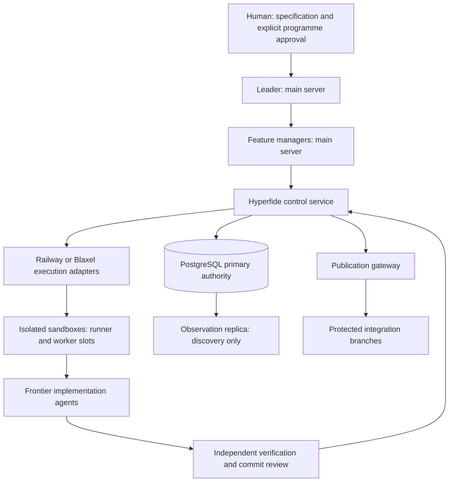

<div align="center">

# Hyperfide


<a
  href="https://trendshift.io/repositories/267432?utm_source=trendshift-badge&amp;utm_medium=badge&amp;utm_campaign=badge-trendshift-267432" target="_blank" rel="noopener noreferrer">

</a>

**La herramienta de flujo de trabajo para agentes que escala de proyectos pequeños y simples a bases de código grandes y complejas.**

La CLI local es C11 puro: un solo binario, una sola base de datos SQLite, sin telemetría.

[](../../LICENSE)
[](#)
[](../../.github/workflows/ci.yml)
</div>
<div align="center">

[English](../../README.md) · [简体中文](README.zh-CN.md) · [Español](README.es.md) · [हिन्दी](README.hi.md) · [العربية](README.ar.md) · [Français](README.fr.md) · [Português (BR)](README.pt-BR.md)
</div>

---

## Descripción general

Hyperfide es un motor de flujo de trabajo para agentes en un solo binario, `hyperfide`. Mantiene las cuatro cosas que un proyecto necesita más allá del propio código — qué **es** el código, cómo llegó **hasta aquí**, qué viene **después** y qué se **aprendió** por el camino — y las sirve por igual a humanos y a agentes de IA.

Este árbol es Hyperfide 2.0 en desarrollo: `hyperfide version` imprime `2.0.0-dev`, y nada de lo que contiene es una versión de producción. Hyperfide nació de Codify, cuyas versiones 1.x, IDs de funcionalidad (como `codify-v15` y `codify-v16`) e historial de commits conservan sus nombres originales. La 2.0 añade un [plano de control distribuido](#el-plano-de-control-de-hyperfide) — un líder y gestores de funcionalidad en un servidor de supervisión, sandboxes remotos para compilaciones y agentes, PostgreSQL como autoridad — alrededor de la misma CLI local.

> **Compatibilidad.** `hyperfide` es el comando canónico. `cg` es un alias de compatibilidad obsoleto instalado desde el mismo ejecutable, con argumentos, JSON y códigos de salida idénticos; se mantiene durante la ventana de compatibilidad admitida de la versión aprobada y solo se elimina en una versión posterior que lo anuncie. Todos los ejemplos de abajo usan `hyperfide`; `cg` ejecuta lo mismo.

`hyperfide fleet up` arranca un supervisor duradero y reanudable tras un fallo para el agente principal, los gestores de oleada y los trabajadores de tarea. Gestiona cada proceso de Codex o Claude Code hasta que el trabajo queda cualificado y fusionado. Los agentes reciben contexto del grafo, la deriva entre ramas se comprueba antes de la integración y `hyperfide serve` transmite los eventos al editor. La indexación se agrupa entre trabajadores; el grafo y la memoria cubren todas las ramas y worktrees. El ciclo principal no hace ninguna llamada de red; las pocas funciones que sí la hacen se nombran al final de esta descripción general.

**Qué es el código.** Hyperfide indexa archivos fuente en un grafo consultable: símbolos, llamadas, imports, tipos, rutas y búsqueda de texto completo, todo almacenado localmente en SQLite. La cobertura de lenguajes va desde la extracción sintáctica nativa hasta el seguimiento solo de archivos; [la matriz de cobertura](../../docs/indexing.md#extraction-coverage) indica el límite de cada familia. `hyperfide context <query>` responde a "ponme al día sobre esta zona" en una sola llamada: símbolos coincidentes con fragmentos, llamadores, llamados y rutas relacionadas. Los comentarios se indexan como nodos de primera clase para el propósito, los contratos, los peligros y los acoplamientos que solo viven en prosa.

**Cómo llegó hasta aquí.** Un sistema integrado de instantáneas direccionadas por contenido te da commits, historial, diffs y restauración sin necesidad de un VCS externo. Como las instantáneas comparten base de datos con el grafo, `hyperfide changes` informa del radio de impacto de tus ediciones sin confirmar. `hyperfide changelog` redacta las notas de versión: por defecto a partir del historial de git — una versión por tag o por cambio de número de versión, grupos según el prefijo del asunto del commit, cada referencia a una tarea conservada y, con una clave, un breve párrafo de Highlights escrito por un modelo para cada versión — y a partir de la cadena de instantáneas, con diffs a nivel de símbolo, cuando pasas `--snapshots` o el proyecto no tiene git en absoluto.

**Qué viene después.** Un motor de specs convierte archivos de spec kvx en texto plano en un plan operativo: un tablero de tareas con oleadas de dependencias, criterios de aceptación adjuntos a cada tarea — y un `done` que se verifica, no se afirma. `hyperfide spec new` y `hyperfide spec add` crean el plan, `hyperfide spec lint` demuestra que es ejecutable y el ciclo lo ejecuta. En modo Prod, `implemented` registra que la codificación está terminada y la evidencia en el código fuente sin afirmar la cualificación; solo `done` significa que la cualificación ejecutable y las comprobaciones del grafo pasaron. En modo paralelo trabajan varios agentes a la vez, limitados por la disjunción de las rutas que declara cada tarea.

**Qué se aprendió por el camino.** Una memoria de agente almacena notas deliberadas — decisiones, restricciones, resultados, preferencias, hechos — en la misma base de datos que el grafo, vinculadas a la tarea bajo la que se tomaron. `hyperfide remember` guarda una a mitad de tarea, cada `hyperfide spec done` registra automáticamente un resultado honesto (incluidos los rechazos) y `hyperfide recall` lo recupera todo, ordenado por relevancia y actualidad.

Las capas se refuerzan entre sí: los commits se etiquetan automáticamente con la tarea que implementan, las memorias afloran en la tarea a la que pertenecen, `hyperfide why` lleva un símbolo hasta las decisiones que hay detrás y `hyperfide spec trace` recorre cualquier tarea hasta sus símbolos, commits y memorias.

**Y está presente entre los pasos, no solo en ellos.** `hyperfide work open` empieza con un paquete compacto de la tarea, `hyperfide work update` devuelve solo los deltas nuevos de estado, evidencia y espacio de trabajo, `hyperfide event progress` clasifica los bucles sin confundir actividad con progreso y `hyperfide guard` detecta cuándo una edición se sale del alcance declarado. Un servidor MCP integrado expone 67 herramientas, recursos y prompts a cualquier agente compatible con MCP, mientras `hyperfide integrate` planifica, aplica y diagnostica la configuración nativa de cada host.

**Y dirige agentes, no solo los sirve.** `hyperfide handoff` y `hyperfide resume` pasan una tarea entre sesiones sin perder estado, `hyperfide spec claim-next` entrega atómicamente a un agente ocioso la siguiente tarea sin conflictos y `hyperfide spec run` reparte una oleada entera entre sesiones de Codex CLI o Claude Code — un proceso hijo aislado por tarea reclamada, con logs y prompts en disco y leases liberados si falla.

**Y sobrevive a una flota.** Indexar es un recurso compartido, no un hábito de cada proceso: el primer `hyperfide` que necesita una pasada la ejecuta, los demás dejan una nota y se agrupan en ella, una ventana de frescura se salta el recorrido por completo y unos slots de parseo a nivel de máquina mantienen los proyectos concurrentes dentro del presupuesto de núcleos ([docs/sync.md](../../docs/sync.md)). Por encima, `spec/workflow.kvx` puede declarar una jerarquía — un agente principal dueño de la lista de tareas, un gestor por oleada y un trabajador por tarea — y `hyperfide fleet` dirige el flujo de ramas: worktree, merge hacia arriba, aterrizaje tras las puertas de test y lint, pull request, checkpoint. `hyperfide fleet up` ejecuta todo ese árbol por sí solo bajo un supervisor desacoplado — todas las oleadas a la vez, cada gestor vivo junto a sus trabajadores, cada trabajador en su propio worktree — empujando a los agentes atascados, reintentando los fallidos con lo que salió mal, escalando lo que no tiene arreglo, deteniéndose en las puertas de aprobación que activaste y dando el trabajo por completo cuando se **fusionó**, no cuando un proceso terminó ([docs/hierarchy.md](../../docs/hierarchy.md)). Si matas el supervisor, `hyperfide fleet up --resume` adopta a los agentes que siguen vivos. La deriva respecto a la spec, las tareas que chocan y los cambios de interfaz de los que dependen otras ramas se señalan antes de fusionar ([docs/drift.md](../../docs/drift.md)); `hyperfide projection build` pliega cada rama activa, trabajo sin confirmar incluido, sobre una única ref de proyección y nombra los conflictos de símbolos, interfaces y texto con sus ramas antes de que nada se fusione, y la proyección sigue al trabajo a través de los hooks, `hyperfide watch`, `hyperfide serve` y el supervisor ([docs/projection.md](../../docs/projection.md)). Cada cambio es un evento que `hyperfide events --follow` y `hyperfide serve` transmiten en vivo ([docs/events.md](../../docs/events.md)). Todos comparten un grafo y una memoria: cada rama y worktree enlazado del repositorio se indexa en el mismo `.codegraph/`, separado por rama ([docs/branches.md](../../docs/branches.md)).

**Y pide una decisión cuando hace falta.** `hyperfide jev` consulta el modelo System One de TypeSafe para juicios tipados — verdadero/falso, uno de varios, ordenado. `hyperfide memory classify` lo usa para decir qué notas son skills reutilizables, y `hyperfide skills promote` las convierte en `.agents/skills/<slug>/SKILL.md` portables; un `verify_cmd` fallido recibe una línea de triaje, los hallazgos de `hyperfide guard` se ordenan y un pull request recibe una puntuación de preparación. Jev es obligatorio para las funciones construidas sobre él, nunca para el ciclo principal, y nunca autoritativo — ninguna respuesta de Jev cambia un código de salida ([docs/jev.md](../../docs/jev.md)).

**Y la documentación es la última tarea verificada.** Las specs de funcionalidad nuevas activan por defecto una etapa de cierre `@docs`. Cuando todas las tareas ordinarias están cualificadas, Hyperfide construye un paquete de evidencia acotado a partir de la spec, las instantáneas atribuidas a tareas, el grafo de código, las rutas, las memorias, las comprobaciones y la documentación existente. El mismo conector de agente configurado actualiza la documentación de usuario y de desarrollador, mientras `hyperfide docs check` comprueba las referencias de afirmaciones declaradas, los enlaces locales en línea, la cobertura exigida de la superficie del grafo y el alcance de destino configurado. `hyperfide docs close` registra una instantánea dedicada `[spec:<feature>/@docs]` y una línea base incremental para el siguiente flujo de spec. Estas comprobaciones estructurales apoyan la revisión; no certifican el significado de cada frase.

La CLI no ejecuta servicios en segundo plano que no hayas iniciado ni envía telemetría — el supervisor de la flota solo corre tras `hyperfide fleet up` y se detiene con `hyperfide fleet down`. El grafo, la memoria, las instantáneas y todo el ciclo de tareas se ejecutan en tu máquina y se quedan ahí. Las excepciones están nombradas y son opcionales: las decisiones de Jev necesitan `OPENROUTER_API_KEY`, y solo los comandos construidos sobre ellas hacen esa llamada; `hyperfide changelog` pide a un modelo los highlights de cada versión, y `hyperfide recap` hace que Solar Decide elija afirmaciones de sesiones pasadas y que un modelo escriba el resumen, solo cuando `CENTRA_API_KEY` (o `HYPERFIDE_CHANGELOG_KEY`) está definida; y `hyperfide fleet pr` y `checkpoint` llaman a `gh`. Los servicios de control distribuido bajo `services/hyperfide` son procesos aparte que inicias explícitamente ([El plano de control de Hyperfide](#el-plano-de-control-de-hyperfide)).

## Por qué Hyperfide

**Cierra el ciclo del plan a la prueba.** La mayoría de las herramientas o planifican el trabajo (listas de tareas) o describen el código (búsqueda, índices). Hyperfide hace ambas cosas contra la misma base de datos, así que el plan puede cotejarse con la realidad: cuando una tarea declara que introduce `checkMode` y toca `src/*.ts`, `hyperfide spec done` se niega a marcarla como completa hasta que el grafo y el historial coincidan.

**Los agentes trabajan como ingenieros, no como turistas.** En lugar de deambular por un repositorio archivo por archivo, un agente pide a `hyperfide spec next` qué hacer, a `hyperfide context` todo sobre la zona y a `hyperfide impact` quién se rompe — y después confirma con atribución automática de la tarea. Todo el ciclo está disponible por MCP, así que nunca tiene que salir del protocolo.

**El proyecto recuerda lo que las sesiones olvidan.** Las ventanas de contexto de los agentes se reinician; la tabla de memorias no. Una decisión escrita una vez con `hyperfide remember` encuentra automáticamente a la siguiente sesión — en `hyperfide spec next`, en `hyperfide spec start`, en `hyperfide recall` al inicio de la sesión — en lugar de redescubrirse a precio completo. Y como las completaciones rechazadas también se registran, "esta tarea se bloqueó dos veces y este es el motivo" está a una consulta de distancia.

**El contexto llega en una llamada, no en veinte — y dentro de un presupuesto.** `hyperfide context <query>` está diseñado según cómo consumen código realmente los agentes. Una sola petición devuelve todo lo necesario para empezar a trabajar: memorias relevantes, por dónde entra la ejecución, qué coincidió, quién lo llama, a qué llama y qué rutas lo tocan — ordenado (definiciones reales por encima de fixtures de test, código llamado por encima de código muerto) y ajustado a un presupuesto de tokens (`--budget`, por defecto 4000). Un símbolo se imprime completo una vez; cada mención posterior es un compacto `name path:line`, y todo lo que el presupuesto recorta se anuncia con un recuento explícito de omitidos en lugar de descartarse en silencio.

**El análisis de impacto es un comando de primera clase.** `hyperfide impact <name> -d 3` recorre transitivamente las aristas de llamadores y llamados y responde a las dos preguntas que importan antes de cualquier cambio: quién se rompe si esto se mueve y de qué depende.

**La búsqueda es instantánea y por capas.** Un índice FTS5 de trigramas sobre los nombres de símbolos ofrece coincidencias de subcadena sin distinguir mayúsculas y sin calentamiento, respaldado por un índice de palabras sobre el cuerpo completo de los archivos para todo lo demás.

**El índice informa cuando la cobertura o la frescura son inciertas.** `hyperfide watch` observa los cambios de archivos y solicita sincronizaciones con debounce. Un evento perdido del observador o un registro fallido deja una deuda de reconciliación duradera. Las respuestas de la CLI y de MCP exponen la cobertura de extracción y las comprobaciones acotadas del código fuente como verificadas, obsoletas o sin comprobar; una actualización agrupada no certifica por sí sola la frescura. Un proceso retiene la puerta del índice mientras los demás llamantes dejan notas de suciedad, y unos slots a nivel de máquina limitan los hilos de parseo entre proyectos ([detalles de indexación](../../docs/indexing.md#freshness-and-migrations)).

**Se adapta al hardware en el que corre.** Al arrancar, `hyperfide` dimensiona su pool de trabajadores y las cachés de SQLite según lo que el sistema realmente ofrece: recuentos de núcleos conscientes de contenedores (la intersección de la cuota de CPU de cgroup v1/v2, la máscara de afinidad y las CPU en línea), la RAM disponible honesta (`MemAvailable` intersectada con los límites de memoria de cgroup) y el coste medido por proyecto. Una estación de trabajo de 16 núcleos obtiene la tubería paralela completa. Un VPS de 2 núcleos obtiene una ajustada para terminar de forma fiable. Ejecuta `hyperfide info` para ver exactamente cómo se dimensionó la tubería.

**Todo permanece local.** El grafo vive en una base de datos SQLite bajo `.codegraph/`, y las instantáneas son objetos direccionados por contenido bajo `.codegraph/objects/`. Borra el directorio y desaparece todo rastro.

## La capa de intención

Un parser ve símbolos, llamadas y rutas. No puede ver *por qué* existe una
función, qué deben garantizar sus llamadores o que `save_tasks` debe ejecutarse
después de que `load_tasks` lea el disco — esa mitad del código solo vive en
los comentarios. Hyperfide la indexa ([docs/ANCHORS.md](../../docs/ANCHORS.md) es la
convención completa):

- **Anclas**: comentarios que pasan la prueba de derivabilidad — *si un agente
  pudiera haberlo escrito leyendo el código, no es un ancla.* Cuatro
  tipos valen la pena: **propósito**, **contrato**, **peligro**, **puntero**.
- **Recuperación doc-first**: donde existe un ancla, `hyperfide context` sirve doc +
  firma en lugar de las líneas del cuerpo — varias veces más símbolos por
  presupuesto de tokens.
- **`hyperfide survey`** lee cien archivos por el precio de un cuerpo: líneas de
  propósito y docs con firmas, nunca cuerpos.
- **Aristas blandas**: los nombres dentro de las anclas se resuelven como referencias `(soft)` —
  acoplamientos dinámicos y entre lenguajes que ningún parser puede derivar, etiquetados para
  que nunca se confundan con llamadas parseadas.
- **Honestidad ante la deriva**: cada ancla toma como línea base el código que describe. Cuando el
  código cambia, el doc se marca obsoleto — en `hyperfide check`, `hyperfide guard` y
  en la propia recuperación — hasta que se actualiza o se borra. Avisa, no bloquea.
- **`hyperfide anchors`** ordena los símbolos sin cubrir por puntuación de coordinación (fan-out ×
  extensión × archivos que lo referencian, deliberadamente no la popularidad bruta) para que el relleno
  empiece por los puntos de orquestación, no por `sb_puts`.

Nada de esto es obligatorio: un repositorio que nunca adopte la convención obtiene
igualmente captura, survey y aristas blandas de los comentarios que ya existan.

## Una sesión con Hyperfide

```sh
hyperfide brief                     # root, active task + ACs, uncommitted work, prior decisions
hyperfide spec next                 # the next eligible task, ACs + relevant memories
hyperfide spec start 16.7           # claim it — one task in progress at a time
hyperfide context "password auth"   # memories, entry points, symbols, callers, routes in one call
hyperfide why verifyLogin           # who changed it, under which task, and what was decided
hyperfide impact verifyLogin -d 2   # who breaks if this changes
# ...implement...
hyperfide guard                     # anything drifting outside what task 16.7 declared?
hyperfide test-impact               # which tests cover what you just changed
hyperfide remember "sessions rotate on login" --type decision   # linked to task 16.7
hyperfide review                    # the change, paired with the ACs it claims to satisfy
hyperfide commit -m "add password auth"   # snapshot, auto-tagged [spec:ion_spec/16.7]
hyperfide spec done 16.7            # qualification: verify_cmd + graph checks; outcome recorded
hyperfide spec trace 16.7           # proof: task -> symbols -> commits -> memories
```

Y cuando una sesión tiene que parar antes de terminar la tarea — la ventana de contexto está llena, se acabó el día — el trabajo no se evapora:

```sh
# session A, stopping early
hyperfide handoff --done "schema migration; token rotation" \
                  --next "wire the login route; extend 03_auth test" \
                  --blocked "flaky fixture on CI" -m "rotate on login, not refresh"

# session B, hours later, a fresh context window
hyperfide resume --prompt   # paste-ready block: task, steps done, blockers,
                            # next steps, uncommitted files, lease state
```

Un handoff se guarda como memoria estructurada vinculada a la tarea; cada uno nuevo sustituye al anterior, así que `hyperfide resume` siempre encuentra el estado más reciente, no un montón de notas obsoletas.

Cada comando de ese ciclo es también una herramienta MCP, así que un agente conectado puede ejecutarlo de principio a fin — y cada paso funciona igual de bien en un proyecto de diez archivos que en un monorepo. `hyperfide check` ejecuta toda la puerta en CI en un solo paso, y `hyperfide hook install` conecta la sincronización y la comprobación de alcance para que casi todo esto ocurra sin que nadie lo invoque.

## Lenguajes y frameworks compatibles

Los adaptadores sintácticos nativos cubren JavaScript/JSX, TypeScript/TSX, C, C++, Objective-C, Go, Rust, Python, Ruby, PHP, Java, Kotlin, Scala, C#, Swift, Dart, Lua, Luau, R, Erlang, Solidity, Terraform, Nix, Pascal, COBOL, VB.NET, CFScript, CFQuery y ArkTS. Los adaptadores de formato mixto cubren construcciones seleccionadas de CFML, Vue, Svelte, Astro, Liquid, Razor, formularios de Delphi y MyBatis XML. JSON, YAML, Twig y properties se siguen a nivel de archivo. La [guía de indexación](../../docs/indexing.md) explica los hechos admitidos, el respaldo, los límites y las fronteras sin resolver.

El enrutamiento consciente del framework registra los registros literales admitidos y vincula un manejador identificado de forma única cuando la evidencia lo permite. Cubre Express, Next.js, React Router, Expo Router, SvelteKit, Vue/Nuxt, FastAPI, Django, Flask, Laravel, Rails, Spring, Gin, Axum, ASP.NET y Vapor, además de registros seleccionados en Koa, Fastify, Hapi, NestJS, Sinatra, Echo, Fiber, Chi y Actix. Las rutas calculadas y los manejadores ambiguos quedan sin resolver.

## Instalación

En esta revisión, Hyperfide 2.0 se compila desde el código fuente. El instalador de una línea de `scripts/install.sh` no se anuncia como versión de Hyperfide hasta que se cierren las tareas de distribución y cambio de nombre (25.4 y 26.2 en `spec/hyperfide/spec.kvx`).

Dependencias: un compilador de C, `python3` (la compilación descubre con él los componentes nativos) y los paquetes de desarrollo de SQLite, libcurl y la libcrypto de OpenSSL (`libsqlite3-dev`, `libcurl4-openssl-dev`, `libssl-dev` en Debian y Ubuntu). El runtime de tree-sitter y las gramáticas vienen incluidos en el repositorio.

```sh
make && sudo make install
```

`make` enlaza `./hyperfide` y lo copia a `./cg`; `make install` comprueba que ambos son idénticos byte a byte e instala los dos en `$(PREFIX)/bin` (por defecto `/usr/local`). `make uninstall` elimina ambos. Los datos `.codegraph/` de cada proyecto nunca se tocan.

Las actualizaciones son seguras en proyectos existentes: la base de datos lleva una versión de esquema (18 en este árbol) y, en la primera apertura tras actualizar, `hyperfide` reconstruye solo las tablas de índice derivadas (archivos, símbolos, referencias, rutas, imports e índices de búsqueda), que la siguiente sincronización vuelve a llenar. Una migración nunca elimina memorias, historial de git, leases, intentos, eventos ni los registros de ramas y agentes. Un binario más antiguo se niega a abrir una base de datos más nueva en lugar de degradarla.

Después, en cualquier proyecto:

```sh
cd your-project
hyperfide init
```

En una terminal, `hyperfide init`, `hyperfide index` y `hyperfide sync` muestran una línea de progreso en vivo
por stderr — fase, archivos hechos de los pendientes, trabajadores, tiempo transcurrido y cualquier
lock que estén esperando —, que se borra antes del resumen. La salida redirigida no cambia;
`HYPERFIDE_PROGRESS=plain` imprime líneas simples en su lugar y `HYPERFIDE_PROGRESS=0` la desactiva.
Ver [docs/sync.md](../../docs/sync.md#progress).

Las variables de entorno se escriben `HYPERFIDE_*` en todas partes. Los nombres antiguos `CG_*`, y los nombres `CODIFY_*` que el árbol aún reconoce (`CODIFY_ROOT`, `CODIFY_INSTALL_DIR`, `CODIFY_BASE_URL` y las variables de autoridad, credenciales, transporte, política de herramientas MCP y modo), se aceptan como alias del mismo ajuste; dar valores distintos a un alias y a su nombre `HYPERFIDE_*` detiene el comando con un error de conflicto de alias en lugar de elegir uno.

## Referencia de comandos

`hyperfide help` imprime el mapa: cada comando por grupo, una línea por comando, ajustado a la terminal. `hyperfide help <command>` (o `hyperfide <command> --help`, `-h`) muestra el uso de un comando, sus subcomandos, flags, ejemplos y comandos relacionados; `hyperfide help --all` los imprime todos, y `hyperfide help --json` da a editores y agentes la misma tabla para construir menús. Las tablas de abajo nombran los mismos comandos que `hyperfide help`. La vista general también imprime la nota sobre los nombres de comando citada en el párrafo de [Compatibilidad](#descripción-general).

| Comando | Descripción |
| --- | --- |
| `hyperfide help [<command>] [--all] [--json]` | La vista general por grupos, el detalle de un comando, todos los detalles o la tabla completa en JSON. Un nombre desconocido sugiere los más cercanos y sale con 1. Negrita y atenuado solo en una terminal (deciden `NO_COLOR`, `TERM=dumb` y `HYPERFIDE_COLOR=0\|1`); `COLUMNS` fija el ancho, nunca por debajo de 60 |
| `hyperfide version` | Imprime la versión (también `--version`) |

### Grafo

| Comando | Descripción |
| --- | --- |
| `hyperfide init [--nested] [--force]` | Crea `.codegraph/` y construye el índice inicial; dentro de un worktree de git enlazado de un repositorio inicializado, se une en cambio al grafo compartido bajo esta rama. Se niega dentro de un proyecto envolvente (`--nested` hace de este directorio un proyecto propio) y en tu directorio personal (`--force`) |
| `hyperfide sync [paths] [--max-age MS] [--background] [--wait MS] [--auto] [--workers N]` | Índice incremental: se agrupa con una pasada ya en curso (`--wait`, por defecto 2000 ms), se omite si está fresco y recorre solo las rutas indicadas; `--auto` marca una sincronización implícita que `[sync] auto = false` omite |
| `hyperfide index [--full] [--workers N]` | La forma bloqueante de sync que siempre recorre, esperando a una pasada ya en curso. `--workers N` (en ambos) tiene prioridad sobre `HYPERFIDE_INDEX_WORKERS` y `[index] workers` en la configuración del proyecto. Sale con 75 cuando la base de datos sigue ocupada pasado el tiempo de espera del lock |
| `hyperfide branches` | Cada rama indexada en el grafo compartido, con su worktree, head, base y número de archivos |
| `hyperfide search <q> [-n N]` | Búsqueda de símbolos y de texto completo (20 resultados por defecto; `--path`, `--lang`, `--kind`, `--name`, `--no-tests` la acotan): una frase coincide con nombres (`export memory` encuentra `memory_export` y `exportMemory`), comentarios de documentación y cuerpos, ordenados en ese orden con el código fuente antes que los tests; las coincidencias de archivo muestran la línea coincidente. Responden las definiciones, nunca sus prototipos; un respaldo acotado para erratas se aplica cuando las coincidencias exactas y por segmento no encuentran nada ([docs/retrieval.md](../../docs/retrieval.md)) |
| `hyperfide grep <pattern> [-E] [-i]` | Búsqueda por líneas en lugar de un grep de shell: un literal (o regex con `-E`) hallado mediante el índice de trigramas, leído del disco, cada coincidencia situada en su símbolo envolvente, ordenada y limitada por `-n` y `--budget` con la cola omitida; `--path`, `--lang`, `--no-tests`, `--symbol`, `--kind`, `-C`, `--files`, `--count` ([docs/retrieval.md](../../docs/retrieval.md)) |
| `hyperfide symbol <name>` | Definición, fragmento y recuento de referencias |
| `hyperfide impact <name> [-d N] [--budget N]` | Llamadores y llamados transitivos hasta la profundidad N (por defecto 3), ajustados a un presupuesto de tokens (por defecto 8000) |
| `hyperfide flow <callers\|callees\|impact\|paths> <name> [target]` | Recorrido acotado de relaciones tipadas con evidencia en el código fuente, fronteras dinámicas y límites explícitos: `--depth` (de 1 a 8), `--max-nodes` (hasta 256), `--max-edges` (hasta 512), `--max-ms` (hasta 2000), `--max-output` en bytes |
| `hyperfide inspect` | Inspección de jerarquías y, con cautela, de código sin referencias; ver los subcomandos de abajo |
| `hyperfide inspect hierarchy <name> [-n N]` | Ancestros, subtipos e implementaciones acotados a partir de relaciones tipadas |
| `hyperfide inspect unused [-n N] [--path GLOB]` | Símbolos sin referencias y alcanzabilidad acotada desde raíces conocidas, con motivos de exclusión; nunca un veredicto de borrado |
| `hyperfide context <q> [--budget N] [-n K]` | Paquete de contexto en una llamada para agentes: memorias, símbolos, puntos de entrada, rutas — los K mejores símbolos (por defecto 8), rellenado hasta un presupuesto de tokens (por defecto 4000) con recuentos explícitos de omitidos y, en `--json`, `tokens_used`. Una ruta de archivo obtiene el esquema del archivo (propósito, símbolos, imports, dependientes); un directorio obtiene sus archivos |
| `hyperfide survey [path\|query] [--budget N]` | El nivel por debajo de los cuerpos: líneas de propósito de archivos y docs de símbolos con firmas en ~100 archivos por llamada — nunca un cuerpo. Los archivos y símbolos sin cubrir se nombran, y todo lo que el presupuesto (por defecto 16000) recorta es un recuento explícito de omitidos |
| `hyperfide files [pattern] [--dirs] [--depth N] [-n N]` | Archivos por glob (`src/**/*.go`), por las palabras de su ruta (`sync gate`) o por directorio, cada uno con lenguaje, líneas y número de símbolos; `--dirs` mapea directorios con recuentos de archivos y líneas y el lenguaje dominante. `--path`, `--lang` y `--no-tests` acotan, igual que acotan `search`, `context` y `survey` |
| `hyperfide anchors [--stale] [--uncovered]` | Salud de las anclas: docs cuyo código cambió y símbolos sin cubrir ordenados por puntuación de coordinación (fan-out × extensión × archivos que lo referencian) — la lista de trabajo de relleno |
| `hyperfide routes [filter]` | Tabla de patrón de URL a manejador |
| `hyperfide show <symbol\|path:line> [--full]` | Solo el cuerpo de ese símbolo — por nombre, o por la posición del cursor que tiene un editor; los cuerpos largos se truncan con un marcador `… (+N more lines, use --full)` |
| `hyperfide why <symbol>` | Procedencia: los commits que lo cambiaron, las tareas que implementaron, las decisiones registradas |
| `hyperfide test-impact [symbol]` | Tests que referencian un símbolo — o todos los símbolos de tus cambios sin confirmar |
| `hyperfide watch [--debounce MS] [--fleet]` | Sincronización automática con eventos nativos del sistema de archivos (debounce por defecto 300 ms); `--fleet` observa cada worktree que conoce el grafo, cada uno bajo su propia rama |
| `hyperfide root` | La raíz del proyecto que `hyperfide` resuelve desde aquí; `--json` añade el proyecto compartido, el indicador de worktree y la rama |
| `hyperfide info` | Perfil de la máquina, dimensionado de la tubería (el número de trabajadores y su origen), la raíz del proyecto y la rama vinculadas, la cobertura del índice por rama y el inventario de parsers |
| `hyperfide config [init\|get K\|set K V\|check] [--json]` | Configuración del proyecto en `hyperfide.kvx` (un `codify.kvx` heredado se sigue leyendo): cada ajuste con su origen, los valores por defecto comentados, una clave leída o escrita in situ y una comprobación de claves desconocidas y valores incorrectos. Funciona antes de `hyperfide init`. Ver [docs/config.md](../../docs/config.md) |

### Control de versiones

Las instantáneas se direccionan por contenido con SHA-256 y los blobs se deduplican.

| Comando | Descripción |
| --- | --- |
| `hyperfide commit -m <msg>` | Instantánea del árbol de trabajo, sincronizado primero y etiquetado automáticamente con la tarea en curso; `--task <id>` nombra la tarea, `--amend` sustituye la última instantánea, `--git` crea además un commit de git real con la misma etiqueta de spec |
| `hyperfide log [-n N]` / `hyperfide status` | Historial de instantáneas (por defecto 20), y árbol de trabajo frente a HEAD con la cobertura del índice por rama y la reconciliación pendiente |
| `hyperfide diff [A] [B]` | Diff de líneas LCS entre instantáneas o contra el árbol de trabajo |
| `hyperfide checkout <id> [--force]` | Restaura una instantánea |
| `hyperfide changes [--limit N]` | Radio de impacto de las ediciones sin confirmar: los símbolos que tocaste más sus llamadores externos — limitado por defecto (40 símbolos, 8 llamadores cada uno) con marcadores `(+N more)`; `--limit` lo sobrescribe |
| `hyperfide git-sync [-n N]` | Ingiere el historial de git (por defecto 2000 commits) — commits, autores, churn por archivo — que luego ordena la búsqueda y el contexto y responde a `hyperfide why` |
| `hyperfide events [--since N] [--kind K,..] [-n N] [--follow [--for S]] [--head]` | El registro de eventos: cada cambio de tarea, claim, intento, agente, flota, supervisor, deriva y aprobación por número de secuencia. `--kind` admite una lista separada por comas donde un `.` final es un prefijo (`fleet.`); `--follow` transmite; `--json` es un objeto por línea. Ver [docs/events.md](../../docs/events.md) |

Las instantáneas de Hyperfide no sustituyen a git. Se respeta `.gitignore` junto a `.cgignore`, `hyperfide git-sync` lee tu historial real y `hyperfide commit --git` escribe en ambos, así que adoptar Hyperfide nunca es todo o nada.

### Changelog

`hyperfide changelog` genera notas de versión a partir del historial de git. Una versión empieza en un tag **o** en el commit que cambió la versión del proyecto — `CG_VERSION` en `src/cg.h`, un archivo `VERSION` o `package.json` — así que un proyecto que nunca usa tags obtiene igualmente una sección por versión. Lo que viene después de la última recibe el nombre de la versión que lleva el árbol de trabajo cuando es nueva (la versión en preparación), el de `--tag NAME`, y solo en otro caso `[Unreleased]`. Cada grupo es el prefijo del asunto del commit, y el `[spec:<feature>/<task>]` que añade `hyperfide commit` se convierte en una referencia a la tarea en la viñeta. Los enlaces a commits y comparaciones salen de `git remote get-url origin`; sin remoto, una viñeta se lee `- Add gauge (497c30a)` y los enlaces del pie se omiten.

```markdown
## [0.3.0] - 2026-09-28

### Features
- Add gauge ([497c30a](https://github.com/acme/demo/commit/497c30acbc9dc0daf869af07a993db74ea0da779))

### Documentation
- Explain gauges ([191d0c8](https://github.com/acme/demo/commit/191d0c811203dc1bba7b39f0b9095e5875a1ff7f))

## [0.2.0] - 2026-09-28

### Bug fixes
- **parser:** Handle empty input ([682f9f8](https://github.com/acme/demo/commit/682f9f8c9bd6bb5813cfc2665c4e1265fba16933), task demo/1.2)

[0.3.0]: https://github.com/acme/demo/compare/0.2.0...0.3.0
[0.2.0]: https://github.com/acme/demo/compare/0.1.0...0.2.0
```

**Highlights.** Con `CENTRA_API_KEY` en el entorno o en el `.env` del proyecto (o `HYPERFIDE_CHANGELOG_KEY`), cada versión recibe además un bloque `### Highlights`: de dos a cinco frases, y unas cuantas viñetas para una versión grande, escritas por un modelo a partir de los commits agrupados de esa versión. Las viñetas derivadas nunca cambian, y el prompt indica al modelo que no invente nada que los commits no digan. El endpoint por defecto es `https://gateway.centra.ag/v1/chat/completions` con el modelo `openrouter/anthropic/claude-haiku-5.5`; `HYPERFIDE_CHANGELOG_ENDPOINT` y `HYPERFIDE_CHANGELOG_MODEL` lo apuntan a cualquier servicio compatible con OpenAI. Las respuestas se cachean en `.codegraph/changelog-cache/` según los commits de la versión y el modelo, así que regenerar el archivo solo pregunta por las versiones que cambiaron. `--summarize` lo exige (y lo dice cuando no encuentra clave), `--no-summarize` deja fuera al modelo y una llamada fallida imprime `highlights for <release> skipped — <why>` en stderr y escribe las notas sin prosa.

```sh
hyperfide changelog -o CHANGELOG.md        # every release, highlights when a key is present
hyperfide changelog --unreleased           # only the newest section and its footer line
hyperfide changelog --tag 1.2.0            # name the newest section 1.2.0, dated today
hyperfide changelog --no-summarize -n 3    # the plain record, three newest releases
```

`-n N` limita las secciones de versión, y `-o FILE` escribe el archivo relativo a la raíz del repositorio e informa de cuántos highlights se escribieron y cuántos vinieron de la caché. `--snapshots` — y cualquier proyecto sin `.git` — recurre al renderizador de instantáneas, cuya salida es un diff a nivel de símbolo por instantánea en lugar de un historial de versiones. `cliff.toml` en la raíz del repositorio es la configuración equivalente de [git-cliff](https://git-cliff.org); git-cliff solo conoce tags, así que los dos producen el mismo archivo solo en un repositorio que use solo tags, sin archivo de versión y sin clave de modelo. El `CHANGELOG.md` de este repositorio se genera con `hyperfide changelog -o CHANGELOG.md`.

### Recap

`hyperfide recap` escribe el resumen que necesita un agente nuevo para retomar un proyecto: qué es el proyecto, qué cambió en las últimas semanas, qué hicieron las sesiones recientes, los hechos que de otro modo se perderían y el siguiente paso. Su materia prima son las transcripciones que Claude Code y Codex ya guardan en la máquina (`~/.claude/projects/<cwd>/*.jsonl` y `~/.codex/sessions/**/rollout-*.jsonl`, emparejadas con este repositorio por el directorio de trabajo), que son el único registro del *porqué* entre commits y demasiado largas para entregarlas enteras.

Dos modelos hacen dos trabajos distintos. Cada transcripción se corta en afirmaciones — una petición del usuario, un párrafo o una viñeta de la respuesta del asistente, un archivo editado, un comando que confirmó o probó — y se entrega en bloques pequeños a **Solar Decide**, el modelo de decisión System One de Upstage, a través de la pasarela Centra (`openrouter/upstage/solar-decide` en `https://gateway.centra.ag/v1/systemone`, el mismo esquema de petición que Jev). Para cada afirmación responde tres preguntas tipadas con probabilidades calibradas y sin prosa: de qué tipo es (objetivo, decisión, restricción, hecho, hecho y terminado, hilo abierto, callejón sin salida, ruido), si seguía vigente cuando terminó la sesión y si un agente que retoma el trabajo la necesita. Las afirmaciones que superan el umbral, ordenadas por el producto de esas probabilidades y recortadas a `--budget` caracteres, forman el **registro decidido**: cada línea citada de una sesión, ninguna escrita por un modelo. Ese registro, con hechos leídos del repositorio (la funcionalidad activa y los estados de sus tareas, los commits recientes, las memorias almacenadas), va al modelo de chat de la pasarela que ya usa `hyperfide changelog`, que escribe el propio resumen. El registro decidido se guarda en `.codegraph/recap/decided.md` para que cualquier frase del resumen pueda cotejarse con lo que realmente se dijo.

```bash
hyperfide recap                              # 6 newest sessions of the last 21 days → <context>/recap.md
hyperfide recap --sessions 10 --since 45     # wider window
hyperfide recap --decided                    # stop at the picked statements; print them, write no prose
hyperfide recap --facts                      # the repository facts alone; no key, no model
hyperfide recap -o - --agents codex          # to stdout, Codex sessions only
```

Ambas llamadas usan `CENTRA_API_KEY` (o `HYPERFIDE_CHANGELOG_KEY`) del entorno o del `.env` del proyecto; sin ella, el comando se detiene con un error claro, ya que ninguna de las dos mitades tiene un sustituto local. El endpoint factura cada pregunta contra todo el estado, así que los bloques son pequeños (6 afirmaciones, `HYPERFIDE_RECAP_CHUNK`) y varios se ejecutan a la vez (`HYPERFIDE_RECAP_PARALLEL`, por defecto 6). El tiempo y el coste dependen de la sesión y de la pasarela; esta revisión no indica ninguna cifra medida. Las decisiones se cachean por bloque en `.codegraph/recap-cache/`, así que una nueva ejecución solo pregunta por las sesiones nuevas. Lo que nunca llega a un modelo: bloques de razonamiento, salida de herramientas, notificaciones y recordatorios del entorno, bloques de código y sesiones de otros proyectos. `HYPERFIDE_RECAP_DECIDE_MODEL`, `HYPERFIDE_RECAP_DECIDE_ENDPOINT` y `HYPERFIDE_RECAP_MODEL` apuntan cualquiera de las dos mitades a otro sitio; `HYPERFIDE_RECAP_CLAUDE_DIR` y `HYPERFIDE_RECAP_CODEX_DIR` dicen dónde buscar. El resumen se escribe en `recap.md` en el directorio de contexto: `.codify/recap.md` por defecto, `.hyperfide/context/recap.md` cuando el proyecto tiene un `hyperfide.kvx`.

### Mapa de código

`hyperfide codemap` escribe `CODEMAP.md` en la raíz del repositorio: el único archivo que un agente (o persona) nuevo lee para saber qué es el proyecto, cómo compilarlo y probarlo, dónde está cada cosa y en qué símbolos se apoya el resto del código. Se construye a partir del grafo, nunca a partir de un modelo. Las líneas de propósito son los propios comentarios de archivo y los README del código, y un directorio sin ninguno de los dos no recibe ninguna. Los símbolos se ordenan por las llamadas que se resuelven hacia ellos. El mismo grafo da los mismos bytes, y el mapa nunca se cuenta a sí mismo, así que `hyperfide codemap --check` sirve como puerta de CI. `hyperfide brief` nombra el mapa y dice si está al día; la herramienta MCP `codemap` lo devuelve sin escribirlo. Ver [docs/codemap.md](../../docs/codemap.md).

```bash
hyperfide codemap                  # write CODEMAP.md (8000-token budget)
hyperfide codemap --budget 3000    # tighter: least-referenced entries go first, each section counts what it left out
hyperfide codemap --check          # exit 1 when CODEMAP.md is missing or stale; writes nothing
hyperfide codemap -o - --json      # the same map as structured data
```

### Memoria

Notas duraderas para agentes, almacenadas en la misma base de datos SQLite que el grafo. Las memorias escritas mientras una tarea de spec está en curso se vinculan a ella, y `hyperfide spec done` registra los resultados automáticamente. Nunca almacenes secretos en ellas.

| Comando | Descripción |
| --- | --- |
| `hyperfide remember <text>` | Guarda una memoria — `--type decision\|constraint\|outcome\|preference\|fact` (por defecto `fact`), `--task <feature/id>` (por defecto la tarea de spec en curso), anclas opcionales `--symbols` / `--files`, `--supersedes <id>` para retirar una decisión revertida |
| `hyperfide recall [query]` | Busca memorias: texto completo sobre el cuerpo, ordenado por relevancia y luego por actualidad; filtra con `--task`, `--type`, `-n N` o `--near <file>` para recuperación anclada |
| `hyperfide forget <id>` | Elimina una memoria |
| `hyperfide memory compact` | Fusiona las memorias duplicadas (`--dry-run` para previsualizar) |
| `hyperfide memory classify [<id>\|--all\|--unclassified]` | Pregunta a Jev qué es cada nota — `skill`, `decision`, `constraint`, `fact`, `noise` — con una confianza, y la guarda en la memoria. Sin argumento procesa las no clasificadas; `-n N` limita el lote |
| `hyperfide memory export [-o FILE]` | Escribe las memorias como JSONL — una línea de cabecera y después un objeto por memoria con un id de contenido como clave — en stdout o en `FILE`; selecciona con `--task` (una etiqueta o prefijo), `--type`, `--branch`, `--since DAYS` |
| `hyperfide memory import <FILE\|->` | Añade, en una transacción, las memorias que este grafo aún no tiene, por id de contenido: viajan la fecha de creación, la clase y la sustitución; `--dry-run` informa sin escribir, `--keep-branch` conserva nombres de rama que este grafo no sigue, `--retask OLD=NEW` reescribe un prefijo de etiqueta de tarea. `--from DIR` lee en solo lectura el grafo de otro proyecto Hyperfide en lugar de un archivo. Ver [docs/memory-transport.md](../../docs/memory-transport.md) |
| `hyperfide skills list\|promote <id>\|render` | Las memorias clasificadas como `skill`, promovidas a `.agents/skills/<slug>/SKILL.md` y mantenidas al día con la nota de la que salieron |

Una memoria sustituida nunca se borra — la reversión es historia que vale la pena conservar. Simplemente deja de encabezar los resultados, así que una sesión encuentra primero la decisión vigente.

Una memoria clasificada lleva su clase allí donde aparece — `class skill 0.82` en `hyperfide recall`, `[decision/skill]` en `hyperfide brief`, `class` y `confidence` en ambos `--json`. La promoción escribe un archivo generado que lo indica: lleva una marca de propiedad y un enlace a la memoria, un archivo sin esa marca nunca se sobrescribe y `hyperfide skills render` refresca aquellos cuya nota ha cambiado. Ver [docs/jev.md](../../docs/jev.md#memory-classification-and-skills).

### Agentes

| Comando | Descripción |
| --- | --- |
| `hyperfide mcp` | Se ejecuta como servidor MCP por stdio (se identifica como `hyperfide`): 67 herramientas, recursos `hyperfide://` para el flujo de trabajo, cada spec de funcionalidad y el contexto del agente (las URI heredadas `codify://` se siguen leyendo), y los prompts `orient`, `start-work`, `review-change` y `close-task` |
| `hyperfide lsp` | Se ejecuta como Language Server (stdio) — para cualquier editor, no solo VS Code |
| `hyperfide serve` | Una conexión JSON-RPC (stdio) para un editor: cada herramienta MCP, cualquier comando `hyperfide` (`exec`), `cancel` y suscripciones a eventos enviados desde un número de secuencia. Inactivo, no retiene ningún lock ni ejecuta pasadas de índice. Ver [docs/events.md](../../docs/events.md#cg-serve) |
| `hyperfide tool list \| call <name> [json]` | Ejecuta una herramienta MCP desde la shell, sin cliente MCP |
| `hyperfide integrate detect\|plan\|apply\|doctor [--no-plugin]` | Configuración consciente de capacidades para Codex, Claude Code, Copilot/VS Code, Cursor, Gemini CLI, OpenCode, Zed, Windsurf, Cline y Continue; `detect` es el valor por defecto, planificar es de solo lectura, aplicar es idempotente y con copias de seguridad `.codify.bak` |
| `hyperfide mcp-install` | Alias de compatibilidad de `hyperfide integrate apply` |
| `hyperfide hook install` | Conecta hooks de agente y de git para que el grafo se mantenga fresco y la deriva de alcance aflore por sí sola |
| `hyperfide hook post-edit` | El propio hook de edición conectado: lee el payload del host por stdin y hace una sincronización dirigida en segundo plano más un guard de la ruta editada — un proceso por edición, no dos sincronizaciones completas |
| `hyperfide hook event` | El hook de ciclo de vida conectado (`--host claude\|codex`): registra las sesiones propias del host y los subagentes que lanza su herramienta Agent en el registro de agentes, con su worktree, rama, tarea y última herramienta, emite eventos `agent.native.*` y pasa el payload a `hyperfide event ingest`; siempre sale con 0 |
| `hyperfide hook pre-bash` | El hook de Bash conectado: cuando un comando ejecuta grep, rg, ag, ack, find, fd o `ls -R` sobre el árbol, responde con el equivalente de `hyperfide grep` o `hyperfide files` como contexto, una vez por sesión y comando; nunca decide permisos, silencioso con `HYPERFIDE_SHELL_ADVICE=0` o `[hooks] shell_advice = false`; siempre sale con 0 |
| `hyperfide changelog [-n N] [-o FILE] [--unreleased] [--tag NAME] [--snapshots] [--summarize\|--no-summarize]` | Notas de versión desde el historial de git: una versión por tag o cambio de versión, la más reciente nombrada por la versión del árbol de trabajo, grupos según el prefijo del asunto del commit, `[spec:<feature>/<task>]` convertido en referencia a la tarea y Highlights escritos por un modelo para cada versión cuando `CENTRA_API_KEY` está definida (ver [Changelog](#changelog)). `--snapshots`, o un proyecto sin `.git`, renderiza en cambio desde la cadena de instantáneas, con diffs a nivel de símbolo: funciones añadidas y eliminadas, rutas nuevas |
| `hyperfide recap [--sessions N] [--since DAYS] [--budget CHARS] [-o FILE] [--agents claude,codex] [--decided] [--facts]` | Resumen para retomar a partir de sesiones pasadas de Claude Code y Codex: Solar Decide (System One, vía la pasarela Centra) elige las afirmaciones que necesita un agente que retoma el trabajo y el modelo de chat de la pasarela escribe `recap.md` en el directorio de contexto; las afirmaciones elegidas quedan en `.codegraph/recap/decided.md`. Necesita `CENTRA_API_KEY` (ver [Recap](#recap)) |
| `hyperfide agentmd [--write]` | Genera la orientación del grafo como `agent-context.md` en el directorio de contexto (`.codify/` por defecto, `.hyperfide/context/` con un `hyperfide.kvx`); los `AGENTS.md` y `CLAUDE.md` de la raíz siguen siendo propiedad de `hyperfide spec render` |
| `hyperfide codemap [-o FILE\|-] [--budget N] [--force] [--check] [--json]` | Escribe `CODEMAP.md`, el mapa del repositorio que un agente lee primero: visión general con los comandos de compilación y test, estructura, puntos de entrada, módulos con sus símbolos más referenciados, dependencias entre directorios, tests y punteros al flujo de trabajo. Estable byte a byte, ajustado a un presupuesto de tokens (por defecto 8000), nunca sobrescribe un archivo que no generó; `--check` sale con 1 cuando falta o está obsoleto (ver [Mapa de código](#mapa-de-código)) |

### Plano de control de agentes

Hyperfide mantiene explícitas cuatro autoridades independientes: el estado de Git, el estado de las instantáneas de Hyperfide, el estado declarado de la spec y los intentos vivos protegidos por fence. `hyperfide state` las muestra juntas sin tratar una como prueba de otra; `hyperfide spec reconcile` diagnostica declaraciones huérfanas y solo modifica con `--repair`.

Los hooks nativos del host alimentan con JSON a `hyperfide event ingest`. Cada evento recibe una identidad semántica estable, una huella de ocurrencia, una identidad de sesión/intento, la revisión exacta del espacio de trabajo y un delta de evidencia. `hyperfide event progress` clasifica fallos repetidos, observaciones repetidas, oscilaciones de parches A-B y ventanas sin evidencia. La recuperación es finita —avisar, replanificar, experimento acotado, handoff, esperar una entrada, parada opcional— y consultiva salvo que `HYPERFIDE_PROGRESS_ENFORCE=1` active explícitamente la política terminal.

`hyperfide work open` compone el objetivo, los criterios, el alcance permitido, el estado independiente, las memorias, el contexto enfocado del grafo, los tests y el último evento en un único paquete. Su revisión opaca alimenta a `hyperfide work update`, que devuelve solo el estado, la evidencia y las rutas del espacio de trabajo que cambiaron. `hyperfide work close` empareja cada criterio con evidencia duradera o lo marca como sin verificar.

El registro de adaptadores informa de capacidades nativas, portables o no disponibles para MCP, instrucciones, skills, hooks, sesiones y ejecución en la nube. Los recursos portables viven bajo `.agents/` y el directorio de contexto (`.codify/` por defecto, `.hyperfide/context/` con un `hyperfide.kvx`); las configuraciones existentes del host se fusionan con copias `.codify.bak` recuperables, e `integrate apply` también renderiza el plugin de Claude Code bajo `~/.codify/plugins/claude-code` y escribe `.codex/hooks.json` (`--no-plugin` omite ambos). Las integraciones ejecutan el binario local `hyperfide`, los registros de ejecución se quedan en `.codegraph/graph.db` y nada de ello hace llamadas de red ni envía telemetría.

### Gobernanza

Estos cuatro son los que hacen que Hyperfide esté presente en cada paso y no solo al principio y al final. Todos avisan por defecto; solo `--strict` los hace fallar.

| Comando | Descripción |
| --- | --- |
| `hyperfide brief` | Estado de la sesión en una llamada: raíz, tarea activa con sus criterios, rutas sin confirmar, decisiones recientes y si `CODEMAP.md` está al día |
| `hyperfide review` | El cambio junto a lo que afirma: símbolos cambiados, llamadores ahora en riesgo y los criterios de aceptación de la tarea |
| `hyperfide guard [paths] [--strict]` | Hallazgos de fundamentación, contrato e higiene frente a los `touches` declarados por la tarea en curso, incluidas las ediciones fuera de ese alcance |
| `hyperfide drift check <id> [--base REF] \| collisions \| coverage \| summary [-f F]` | El cambio de una tarea frente a sus touches y símbolos declarados; tareas abiertas que chocarían si se ejecutaran a la vez; criterios de aceptación sin tarea cualificada; recuentos de deriva de una funcionalidad. Avisa; ver [docs/drift.md](../../docs/drift.md) |
| `hyperfide check [--strict]` | La puerta única de CI: renderizado obsoleto, lint de spec, evidencia de tareas, coherencia de afirmaciones, estado del worktree |
| `hyperfide state` | Etiqueta por separado el estado de Git, de instantáneas, de declaración de spec, de intentos vivos y obsoleto |
| `hyperfide event ingest\|history\|progress` | Normaliza el JSON de ciclo de vida del host y clasifica la evidencia nueva frente a la actividad o los bucles |
| `hyperfide work open\|update\|close` | Abre un contexto de trabajo compacto (`--task ID`), recupera los deltas desde una `REVISION` y cierra criterios contra evidencia (`--evidence CLAUSE=PROOF`, repetible) |
| `hyperfide handoff` | Registra el estado de la sesión contra una tarea antes de parar: `--done "a;b"`, `--next "a;b"`, `--blocked "x"`, `-m <note>`, `--task <id>` (por defecto tu tarea actual). Se guarda como memoria estructurada; cada handoff sustituye al anterior de la tarea |
| `hyperfide resume [--task <id>] [--prompt] [--budget N]` | Todo lo que una sesión nueva necesita para retomar una tarea: el paquete de la tarea, el último handoff (analizado de nuevo en done/next/blocked), las memorias de la tarea, las rutas sin confirmar y el estado del lease. `--prompt` lo renderiza como bloque listo para pegar en una nueva sesión de agente, ajustado a `--budget` (por defecto 6000 tokens) |
| `hyperfide journal [list\|apply\|drop <id>\|--failed\|--all]` | Escrituras pendientes encoladas mientras la base de datos estaba ocupada: listar, aplicar, descartar. Las escrituras de ciclo de vida que encuentran la base de datos bloqueada quedan en `.codegraph/journal/` y el siguiente proceso que obtiene el lock de escritura las reproduce en orden |

La mayoría de los comandos de consulta aceptan `--json`. Ese flag, el servidor MCP y el language server son las interfaces nativas para agentes.

## Flujo de trabajo de specs

El flujo de trabajo de specs es la forma en que Hyperfide convierte un plan de funcionalidad en trabajo seguido y verificado. Las specs viven como archivos kvx en texto plano — legibles por humanos, aptos para diff y propiedad de tu repositorio — y Hyperfide los renderiza en archivos de reglas para IDE y espejos en markdown mientras dirige encima el ciclo de tareas. Funciona en cualquier repositorio que contenga `spec/workflow.kvx`, es totalmente independiente de `.codegraph/` y es un reemplazo directo en C del `spec/specgen` de Ion con salida idéntica byte a byte.

| Comando | Descripción |
| --- | --- |
| `hyperfide spec new <feature>` | Crea el esqueleto de `spec/<feature>/spec.kvx` — y de `spec/workflow.kvx` cuando el repositorio no tiene ninguno — y lo activa |
| `hyperfide spec add <id> --title T` | Inserta una tarea, conservando cada otro byte: `--wave`, `--requires`, `--symbols`, `--touches`, `--verify`, `--do "a;b"`, `--reqs`, `--section` |
| `hyperfide spec lint` | Valida el plan: ciclos de `requires`, requires que apuntan a tareas desconocidas, tareas sin criterios de aceptación, globs de `touches` muertos. Sale con 2 si hay errores |
| `hyperfide spec render [--check]` | Regenera los archivos puntero para IDE nombrados bajo `[adapters]` en `spec/workflow.kvx` (un flujo de trabajo nuevo lista `CLAUDE.md` y `AGENTS.md`; los punteros de Cursor, Devin y Kiro reciben su propio front matter) y el espejo en markdown (`requirements.md`, `design.md`, `tasks.md`); `--check` sale con 2 si algo está desactualizado |
| `hyperfide spec` / `hyperfide spec status` | Tablero de tareas: modo más recuentos separados de `done`, `implemented`, `in_progress` y `pending`, progreso, la tarea actual, la siguiente elegible y cualquier claim vivo |
| `hyperfide spec mode <prod\|standard\|parallel>` | Configura la semántica de dependencias y concurrencia; un modo ausente o desconocido es standard |
| `hyperfide spec wave` | Todas las tareas elegibles de la oleada actual, no solo la primera |
| `hyperfide spec ready` | Todas las tareas elegibles de **todas** las oleadas, agrupadas por oleada, cada una marcada cuando sus `touches` entran en conflicto con un claim vivo — el frente completo que un orquestador puede despachar |
| `hyperfide spec claim <id>` / `release <id>` | Concede el lease de una tarea a un agente propietario con caducidad (`--agent`, `--ttl` en minutos, por defecto 30); reclamar rechaza una tarea que otro agente tiene viva, y liberar el lease de otro requiere el nombre de ese agente o `--force` — sin robos silenciosos. `done` e `implemented` liberan automáticamente el lease de la tarea |
| `hyperfide spec heartbeat <id>` | Renueva el lease de un intento vivo: `--agent`, `--attempt`, `--fence`, `--ttl` |
| `hyperfide spec reconcile [--repair]` | Informa de las declaraciones en curso que ningún intento vivo respalda; `--repair` las corrige |
| `hyperfide spec claim-next [--agent N] [--ttl M]` | Reclama atómicamente la primera tarea elegible cuyos `touches` no chocan ni con tareas en curso ni con leases vivos (bloqueo de archivo + una transacción), y devuelve el paquete completo: tarea, lease, memorias de la tarea. Sale con 3 cuando el frente está vacío — distinto de un error |
| `hyperfide spec run` | Orquesta una oleada paralela o Prod: reclama tareas elegibles y dirige un proceso de agente por slot — ver [Dirigir agentes](#dirigir-agentes). `-n N`, `--driver codex\|claude\|custom`, `--dry-run`, `--max-fail K`, `--agent-prefix P`; `--fleet` es la forma jerárquica (ver [Modo flota](#modo-flota-una-jerarquía-de-agentes)) |
| `hyperfide spec next` | La tarea pendiente de menor oleada cuyos `requires` están satisfechos (solo `done` en modo standard; `implemented` o `done` en modo Prod), con sus viñetas de pasos y sus criterios de aceptación expandidos |
| `hyperfide spec start <id>` | Marca una tarea como `in_progress`; impone una a la vez y `requires` cumplidos. `--force` solo salta el límite de una a la vez; `--ahead` reclama una tarea cuyos `requires` siguen abiertos, para construirla contra la proyección, y `done` espera a que aterricen |
| `hyperfide spec implemented <id>` | En modo Prod, ejecuta las comprobaciones del grafo sobre el código fuente sin ejecutar `verify_cmd` y después marca la codificación como terminada con `implemented` (sin marcar; cualificación pendiente; sin `--force`) |
| `hyperfide spec done <id>` | Desde `in_progress` o `implemented`, ejecuta el `verify_cmd` de la tarea y las comprobaciones del grafo; la marca `done` solo cuando la cualificación pasa, si no conserva `implemented`, y registra una memoria de resultado en ambos casos. `--force` la marca como done sin cualificar |
| `hyperfide spec trace [<id>] [--no-sync]` | Traza las tareas hasta el código (tras refrescar el grafo salvo con `--no-sync`): símbolos declarados resueltos en el grafo (ubicación, tipo, referencias), rutas tocadas cotejadas con los cambios reales, los commits etiquetados con la tarea y sus memorias |
| `hyperfide spec docs <status\|auto\|manual\|off\|start\|block\|reset\|done>` | Inspecciona o configura la etapa reservada de cierre `@docs`. Las specs nuevas usan `auto`; las specs sin sección `[documentation]` conservan el comportamiento de finalización heredado hasta que se active explícitamente |

`mode`, `start`, `implemented` y `done` reescriben solo la línea `status = "..."` o la línea del ajuste de modo en el archivo kvx. Cada otro byte, comentario y línea en blanco sobrevive. Después el comando vuelve a renderizar en silencio para que las casillas de `tasks.md` se mantengan al día; las tareas implementadas siguen sin marcar y llevan `Implemented - qualification pending`. Los archivos kvx siguen siendo la única fuente de verdad; cada subcomando de spec admite `-f <feature>` para sobrescribir `[meta] active_feature`, y `--root DIR` para actuar sobre otro árbol.

`hyperfide commit` etiqueta automáticamente su mensaje con la tarea en curso, por ejemplo `... [spec:ion_spec/16.7]`, así que `hyperfide log` y `hyperfide changelog` trazan cada instantánea hasta la spec. Los comandos de spec también se exponen como herramientas MCP, lo que permite a un agente conectado planificar (`spec_new`, `spec_add`, `spec_lint`), dirigir el ciclo standard (next, start, instantánea, done) o el ciclo Prod (next, start, instantánea, implemented, cualificación, done) y trabajar el frente paralelo (`spec_ready`, `spec_claim_next`, `spec_release`, `handoff`, `resume`) sin salir del protocolo.

### Cierre de documentación

Para un recorrido completo, instrucciones de propiedad y recuperación y las limitaciones del verificador, lee [Generar y mantener la documentación del proyecto](../../docs/DOCUMENTATION.md). Los mantenedores pueden consultar la [referencia del código fuente](../../docs/SOURCE-REFERENCE.md); las [rutas de fixtures y símbolos de test](../../docs/TEST-REFERENCE.md) se listan por separado y no son servicios vivos de Hyperfide.

`@docs` es trabajo a nivel de funcionalidad, no una tarea de implementación numerada sintética. En modo `auto`, `hyperfide spec next` y `hyperfide spec claim-next` lo devuelven después de cualificarse la última tarea hoja, así que `hyperfide spec run` lo lanza mediante el driver existente de Codex, Claude o custom con el mismo lease, fence, heartbeat, log y recuperación de fallos. `manual` lo deja visible para un agente iniciado explícitamente; `off` lo omite a propósito. Una spec más antigua sin sección `[documentation]` usa el comportamiento `legacy` y puede activarlo con `hyperfide spec docs auto` o `hyperfide spec docs manual`.

Los comandos de documentación aceptan `-f <feature>` como los comandos de spec. Al renombrar un directorio de funcionalidad, las tareas completadas pueden conservar la atribución de su instantánea original con `evidence_task = "original-feature/task-id"`; las instantáneas nuevas siguen usando el nombre actual de la funcionalidad.

```ini
[documentation]
mode      = "auto"
status    = "pending"
audiences = ["user", "developer"]
targets   = ["README.md", "docs/**", "CONTRIBUTING.md", "CHANGELOG.md"]
```

| Comando | Contrato |
| --- | --- |
| `hyperfide docs status` | Modo actual, estado efectivo, destinos y modo de línea base |
| `hyperfide docs plan` | Plan de línea base o incremental de solo lectura, requisitos por audiencia, alcance de destino e inventario de la documentación existente |
| `hyperfide docs packet` | Escribe `.codegraph/docs/<feature>/packet.md`, `provenance.json`, `claims.kvx` y `required.kvx` a partir de evidencia local acotada |
| `hyperfide docs check` | Valida el alcance de destino, la preservación de documentos, los enlaces locales, las asignaciones de audiencia, la evidencia de las afirmaciones, los comandos, las rutas del repositorio, los símbolos, las rutas URL y la superficie pública cambiada exigida |
| `hyperfide docs trace` | Conecta las afirmaciones y las instantáneas de documentación con las instantáneas de las tareas de origen, la procedencia y la última línea base |
| `hyperfide docs close` | Vuelve a ejecutar las comprobaciones, crea la instantánea atribuida, cierra el intento `@docs` protegido por fence y registra la línea base incremental de todo el proyecto |

El agente rellena `claims.kvx`; Hyperfide regenera `required.kvx`. Cada afirmación debe nombrar un documento configurado y evidencia local. La guía de usuario, la guía de desarrollador, las notas de versión o de migración, las exclusiones y los puntos sin resolver siguen siendo campos separados para que la evidencia ausente no pueda convertirse en silencio en prosa de producto. El verificador nunca borra ni renombra un documento canónico, nunca acepta escrituras fuera de los destinos configurados y revoca su marca de verificación tras cualquier fallo.

Estas comprobaciones establecen una fundamentación estructural, no la verdad de cada frase: los agentes deben registrar las afirmaciones factuales y los revisores deben evaluar su significado. Se comprueba que los enlaces Markdown locales en línea apunten a destinos existentes en el repositorio; las URL externas, los anclajes de fragmento, los enlaces de estilo referencia y el comportamiento en tiempo de ejecución no se certifican. La evidencia de código fuente ausente se etiqueta como no disponible. Los paquetes y marcas generados viven bajo `.codegraph/docs/`; los archivos Markdown o reStructuredText propiedad del proyecto siguen siendo la salida pública. Las seis operaciones también se exponen por MCP, y VS Code muestra el elemento de cierre más las acciones de plan, packet, check y trace.

### Modo paralelo

Los modos standard y Prod ejecutan una tarea a la vez. Los agentes cada vez menos — un reparto entre cinco o veinte ya es habitual, y el fallo que sigue es siempre el mismo: dos de ellos editando los mismos archivos.

`hyperfide spec mode parallel` conserva la semántica de Prod en la que `implemented` desbloquea la implementación y relaja solo cuántas tareas pueden estar en vuelo, porque el plan ya declara los `touches` de cada tarea. Eso hace que el solapamiento se pueda conocer antes de que empiece el trabajo:

```sh
hyperfide spec ready                         # the whole frontier: every eligible task, every wave,
                                      # conflicts with live claims marked
hyperfide spec claim 4.1 --agent alice       # a lease with an owner and an expiry
hyperfide spec start 4.1                     # refused if another live task claims the same paths
hyperfide spec claim-next --agent bob        # or skip the choosing: atomically claim the first
                                      # conflict-free task and get the full packet back
```

`claim-next` es la primitiva sobre la que corre una flota: la elección y el claim ocurren bajo un bloqueo de archivo y una sola transacción de base de datos, así que veinte agentes que lo llaman a la vez obtienen veinte tareas distintas y disjuntas — o el código de salida 3 cuando el frente está vacío. Un claim que tiene otro agente no se le puede quitar ni liberar a sus espaldas (`--force` existe, y hace ruido). Terminar honestamente es automático: `hyperfide spec done` y `hyperfide spec implemented` liberan ellos mismos el lease de la tarea.

Los leases caducan, así que un agente que muere con uno no atasca la oleada; `hyperfide check` informa de los leases caducados y de los claims vivos solapados como problemas.

Cuando el proyecto también tiene un índice `.codegraph/`, las tareas pueden declarar qué aspecto tiene su implementación. `hyperfide spec implemented` comprueba la evidencia en el código fuente sin ejecutar comandos; `hyperfide spec done` realiza la cualificación ejecutable contra la realidad:

```ini
[task.2.1]
title   = "Check mode"
symbols = ["checkMode"]      # must exist in the code graph
touches = ["src/*.ts"]       # a matching path must actually have changed
```

Los `symbols` se buscan en el grafo indexado; los patrones de `touches` (rutas exactas o globs) se cotejan con la unión de los cambios del árbol de trabajo y los archivos cambiados por los commits etiquetados con la tarea — cuentan tanto las instantáneas de Hyperfide como los commits normales de **git** cuyo mensaje lleva `[spec:<feature>/<id>]`, y el historial de git se ingiere antes de la comprobación, así que la verificación sigue pasando después de confirmar el trabajo. Eso es lo que necesita una flota: cada trabajador confirma en su propia rama, mientras que la cadena de instantáneas es una línea compartida por todos. En modo Prod, `implemented` satisface los `requires` posteriores pero no está cualificada y nunca se renderiza como `[x]`; si la cualificación falla, la tarea sigue en `implemented`. `hyperfide spec trace [<id>]` muestra la cadena completa tarea→código→commit de una tarea o de toda la funcionalidad, en texto o con `--json`.

El flujo de trabajo también alimenta por sí solo la capa de memoria. Cada completación escribe una breve memoria de resultado — incluidas las rechazadas, para que una sesión posterior pueda ver que una tarea se bloqueó y por qué. `hyperfide spec next` y `hyperfide spec start` imprimen las memorias relevantes para la tarea (vinculadas por id o que coinciden con su título), y `hyperfide spec trace` las incluye en la cadena. Un agente que dirige el ciclo acumula memoria del proyecto sin que nunca se le pida.

### Modo flota: una jerarquía de agentes

El modo paralelo impide que veinte agentes editen los mismos archivos. El modo flota les da forma. `spec/workflow.kvx` declara una jerarquía — un agente **principal** que posee la lista de tareas y fusiona los pull requests, un **gestor de oleada** por oleada dueño de una rama de oleada cortada de main y un **trabajador de tarea** por tarea en una rama cortada de su rama de oleada — así todas las oleadas corren a la vez, las tareas de una oleada corren en paralelo y el trabajo sube mediante merges verificados. Con `waves = parallel` (por defecto en git 2.38 y posteriores) una tarea puede empezar antes que las tareas que `requires`, construyendo contra la proyección; `done` sigue siendo estricto, main se fusiona hacia delante en cada rama de oleada viva tras cada aterrizaje y los trabajadores lo incorporan con `hyperfide fleet sync`. Las plantillas sin `{wave}` ni `{task}` conservan la forma anterior: un gestor por funcionalidad y un trabajador por oleada.

```ini
[hierarchy]
enabled    = true
main       = "main"
remote     = "origin"
worktrees  = ".codegraph/worktrees"
waves      = "parallel"      # parallel | sequential: may a task start ahead of its requires?
test_gate  = "make test"
lint_gate  = "make hyperfide CFLAGS='-O2 -Werror'"
pr         = "auto"          # auto | manual
checkpoint = "manual"

[role.worker]                # [role.main] and [role.manager] likewise;
branch  = "task/{feature}/{task}"  # every key falls back to a default;
base    = "wave/{feature}/{wave}"  # {wave} and {task} give each wave and each task its own branch
driver  = "codex"            # how its agents run, and what they may spend
wall    = "3h"
stall   = "10m"
retries = 2
approve = ["land"]           # opt-in: wait for `hyperfide fleet approve`
```

| Comando | Descripción |
| --- | --- |
| `hyperfide projection build [--index] [--strict]`, `status`, `diff [branch]`, `show`, `findings` | Cada rama activa plegada sobre la base con `git merge-tree` (git 2.38 o posterior), trabajo sin confirmar incluido, en `refs/codify/projection` (la ref conserva su nombre histórico); conflictos indicados por ruta y rama. `--index` la indexa como rama `codify/projection`, `--strict` deja fuera una rama en conflicto, `--branch NAME` pliega una, `--force` reconstruye entradas sin cambios ([docs/projection.md](../../docs/projection.md)) |
| `hyperfide fleet roles` | La jerarquía configurada: plantillas de rama, base, remoto, puertas, política de PR. Un repositorio sin sección `[hierarchy]` muestra los valores por defecto que *usaría*, marcados como no configurados |
| `hyperfide fleet status [--all] [--no-discover]` | Quién está vivo, en qué rol, en qué tarea y bajo qué padre |
| `hyperfide fleet discover [--since DUR]` | Sesiones y subagentes nativos de Claude Code y Codex hallados en las transcripciones que escriben los hosts, para hosts cuyos hooks nunca se dispararon: filas creadas o completadas (sin sobrescribir nunca un campo de un hook), worktrees registrados, transcripciones sin tocar marcadas como obsoletas. `fleet status`/`tree`, `serve` y `watch --fleet` lo ejecutan antes salvo `--no-discover` o `[fleet] discover = false` |
| `hyperfide fleet sync [--base B]` | En un worktree de tarea, fusiona su rama base después de que un aterrizaje se fusionara hacia delante: rechazado mientras un archivo sin confirmar también haya cambiado en la base (se nombra), un conflicto se aborta y se nombra; si no, los commits y archivos que entraron, y después una construcción de la proyección |
| `hyperfide fleet plan [-f F]` | Qué gestor posee cada oleada y qué trabajador cada tarea, las ramas planificadas junto a los agentes vivos |
| `hyperfide fleet tree [-f F]` | El árbol vivo — principal, gestores, trabajadores — con el progreso de cada rama, si está por delante de su base o ya fusionada, y el intento y el heartbeat de cada trabajador. Rechazado en un repositorio que funciona sin jerarquía |
| `hyperfide fleet begin <id> [-f F] [--agent A]` | Crea o reutiliza la rama y el worktree de la tarea, cortados de su rama de oleada, y reclama la tarea para su trabajador. Idempotente; `--agent` nombra un sustituto; `--ahead` reclama una tarea cuyos `requires` siguen abiertos |
| `hyperfide fleet merge-up <id> [--keep]` | Fusiona una rama de tarea **cualificada** en su rama de oleada, tras imprimir los hallazgos conocidos de la proyección para ella. Rechazado mientras la punta de la rama diga que la tarea no está `done` (`--force` lo sobrescribe); los conflictos se listan por ruta y el merge se aborta, o se deja en su sitio con `--keep` |
| `hyperfide fleet land <wave\|id>` | Fusiona una rama de oleada en el main local y ejecuta las puertas de test y lint. Rechazado mientras quede abierta una tarea de la oleada; en rojo restaura main a donde estaba; en verde abre el PR cuando la política dice `auto` y fusiona main hacia delante en las ramas de oleada vivas. `--no-pr` omite el PR |
| `hyperfide fleet pr <wave\|feature>` | Hace push y abre el pull request contra `<remote>/<main>` mediante `gh`, o imprime los comandos exactos cuando `gh` no está. `--dry-run` no llama a nada; un PR ya abierto se informa, no se duplica |
| `hyperfide fleet checkpoint [--dry-run]` | Fusiona los pull requests `wave/*` abiertos (`feature/*` en la forma anterior) de menor a mayor número, parando en el primero que no fusione |
| `hyperfide fleet up [-f F \| --all] [-n N] [--driver D] [--max-fail K] [--max-rounds R] [--foreground] [--resume [RUN]] [--dry-run]` | Arranca una ejecución duradera bajo un supervisor desacoplado: principal, gestores y trabajadores a la vez, supervisados hasta que cada tarea esté cualificada y fusionada. `--resume` continúa una ejecución sin terminar, adoptando a los agentes que siguen vivos |
| `hyperfide fleet down [--drain] [--wait SECONDS] \| pause \| resume [RUN]` | Detener (claims liberados, ramas conservadas), dejar terminar primero el trabajo vivo (`--wait`, por defecto 30 s), congelar el lanzamiento o continuar |
| `hyperfide fleet runs` | Las ejecuciones, su estado y si su supervisor sigue vivo |
| `hyperfide fleet approvals [--all] \| approve <id> [--reject] [-m note]` | Lo que espera en una puerta opcional (`land`, `pr`, `drift`, `coverage`) y la decisión que lo libera |
| `hyperfide fleet steer <agent> <message>` | Un mensaje para un agente en marcha: en su próxima edición (Claude Code, vía el hook post-edit) o en su próximo prompt |
| `hyperfide fleet brief [feature]` | El briefing del gestor para una funcionalidad: estado del subárbol, trabajadores vivos, intentos fallidos, conflictos, aprobaciones |

La posición de un agente en el árbol vive en su entorno — `HYPERFIDE_AGENT`, `HYPERFIDE_ROLE`, `HYPERFIDE_PARENT`, `HYPERFIDE_FEATURE`, `HYPERFIDE_WAVE` (y `HYPERFIDE_GH` para nombrar el binario `gh`) — y `hyperfide fleet begin` imprime la línea exacta que hay que exportar (escribe las variables con sus alias `CG_*`, que son equivalentes). Sin rol definido no se registra nada, así que una sesión en solitario no cambia. Con él, `hyperfide brief` nombra el rol y el padre, los claims llevan la rama y el registro de intentos guarda para siempre la rama, el worktree y el padre.

`hyperfide fleet up` dirige el árbol entero por sí solo. Un supervisor desacoplado ejecuta cada funcionalidad que nombres (`--all`: cada funcionalidad con trabajo pendiente, cada una empezando cuando sus `[meta] requires` están hechos), un gestor por oleada vivo junto a sus trabajadores, cada trabajador en su propio worktree con su identidad en el entorno. Un extracto del test de integración `tests/integration/35_fleet_e2e.sh`, que dirige el supervisor con un driver custom guionizado:

```
$ hyperfide fleet up --foreground --all -n 3 --max-fail 5
[fleet] alpha — a manager per wave (all at once) + 3 worker slot(s), driver custom, 48 wake(s)
[fleet] waves parallel — a task may start ahead of its requires, on the projection (default, git >= 2.38)
[fleet] manager wm-alpha-1 on wave/alpha/1 (47 wake(s) left), log .codegraph/agents/alpha-manager-1.log
[fleet] worker w-alpha-2.1 → 2.1 (wave 1) on task/alpha/2.1, log .codegraph/agents/alpha-2.1.log
[fleet] worker w-alpha-2.2 → 2.2 (wave 1) on task/alpha/2.2, log .codegraph/agents/alpha-2.2.log
[fleet] worker w-alpha-2.1 task 2.1 exit 1 → INCOMPLETE
[fleet] worker w-alpha-2.1 → 2.1 (wave 1) on task/alpha/2.1, log .codegraph/agents/alpha-2.1.log
[fleet] worker w-alpha-2.1 task 2.1 exit 0 → done
[fleet] worker w-alpha-2.2 on 2.2: no progress for 2s — nudged
[fleet] worker w-alpha-2.2 on 2.2: stalled — no progress for 2s after a nudge — stopping it
[fleet] worker w-alpha-2.2 task 2.2 exit 143 → INCOMPLETE
...
[fleet] alpha complete — 4/4 task(s) qualified, wave/alpha/* merged into main, 2 failure(s)
[fleet] beta complete — 2/2 task(s) qualified, wave/beta/* merged into main, 0 failure(s)
```

Lo que hace entre esas líneas:

- **Las ejecuciones son duraderas.** La ejecución y cada nodo — rol, padre, tarea, rama, worktree, pid, intento, fence, reintentos, gasto — viven en la base de datos. Si matas el supervisor, `hyperfide fleet up --resume` adopta a los agentes que siguen vivos (comprobados por pid y hora de inicio) y conserva los recuentos de reintentos; `down`, `down --drain`, `pause` y `resume` detienen, drenan, congelan o continúan una ejecución.
- **Supervisión.** El progreso es trabajo — eventos, salida de log, cambios en el worktree —, no un heartbeat. Una ventana de estancamiento sin él gana un empujón y una segunda detiene el intento con un handoff. Los presupuestos `wall` y `spend` detienen un intento; una tarea fallida se reintenta con lo que salió mal en su prompt; cuando se agotan los reintentos escala al gestor, luego al principal y después se marca como bloqueada mientras el resto de la ejecución continúa.
- **Tres niveles a la vez.** Un bloqueo de merge por funcionalidad sustituye a los turnos, así que gestores y trabajadores corren juntos; con una plantilla de rama `{task}` las tareas de una oleada corren en paralelo en sus propias ramas, salvo las parejas que se predice que chocarán. `[hierarchy] main_agent = true` ejecuta también a Main Gideon como proceso.
- **Briefings desde el grafo.** El prompt de un trabajador lleva sus criterios, las definiciones actuales de sus símbolos declarados con llamadores y llamados, lo que sus prerrequisitos produjeron realmente en la rama de la funcionalidad y lo que tocan sus hermanos, ajustado a un presupuesto de tokens; `hyperfide work update` informa de los símbolos fusionados aguas arriba desde que empezó el intento.
- **Bloquear es opcional.** Las puertas listadas en el `approve` de un rol detienen `land`, `pr`, un `merge-up` con deriva o un aterrizaje con criterios sin cubrir hasta `hyperfide fleet approve`. Sin ellas, nada espera a una persona.

Un subárbol está completo porque se **fusionó**, no porque un proceso terminó. `hyperfide spec run --fleet` es la misma ejecución en primer plano, `--dry-run` planifica sin reclamar ni crear nada y, sin un `[hierarchy]` activado, la flota se rechaza antes de lanzar nada; el `hyperfide spec run` de un solo nivel no cambia.

El flujo completo, la supervisión, las aprobaciones, los briefings y un ejemplo desarrollado están en [docs/hierarchy.md](../../docs/hierarchy.md); la deriva en [docs/drift.md](../../docs/drift.md); el registro de eventos, `hyperfide serve` y el steering en [docs/events.md](../../docs/events.md).

### Un grafo para todas las ramas

Una flota trabaja en muchas ramas en muchos worktrees de un repositorio, y Hyperfide los indexa todos en un único `.codegraph/`. Un worktree enlazado se resuelve al proyecto compartido a través del directorio común de git, así que `hyperfide init` allí **se une** en lugar de exigir una segunda base de datos:

```sh
$ cd .codegraph/worktrees/wave-fleet-1 && cg init
joined /path/proj as worktree /path/proj/.codegraph/worktrees/wave-fleet-1 on branch wave/fleet/1

$ hyperfide branches
* main             203 files  bde2b2a9  /path/proj                         9s ago
  feature/fleet      0 files  227a1f98  …/worktrees/feature-fleet   2m ago  base main
  wave/fleet/1      13 files  b5d899dd  …/worktrees/wave-fleet-1    1m ago  base feature/fleet
```

Las filas de archivos se separan por rama (`UNIQUE(branch_id, path)`), así que una sincronización en una rama nunca añade ni elimina filas de otra; la frescura y la puerta del índice también son por rama, así que dos worktrees recorren en paralelo sin que a ninguno se le diga que el grafo ya está fresco. El esquema (a partir de la versión 16; 18 en este árbol) incluye el registro de ramas más la rama, el worktree y el padre de cada intento. La identidad de la rama se lee de los propios archivos de git — no se lanza ningún proceso para conocer el nombre de una rama, lo que importa cuando una flota abre el grafo miles de veces.

Las consultas responden para la rama en la que estás. `--branch <name>` pregunta a otra y `--all-branches` a todas — en `search`, `symbol`, `context`, `survey`, `impact`, `recall`, `anchors`, `check` y `guard` — y una coincidencia se etiqueta `@branch` solo cuando hay más de una rama en el alcance, así que la salida de una sola rama nunca cambia. Diez worktrees son en su mayoría los mismos bytes, así que el indexador indexa el contenido parseado por hash y lo reutiliza entre ramas (`40 reused` en `hyperfide sync`, `"reused"` en su JSON): un worktree nuevo cuesta un recorrido y una copia, no un parseo completo.

Las memorias llevan la rama en la que se crearon, porque una decisión tomada en una rama de oleada todavía no es una decisión del proyecto; `hyperfide fleet merge-up` las promueve a la base junto con el código, descartando las que la base ya tiene. `hyperfide brief` empieza con la rama, su worktree y las otras ramas con trabajo en el grafo. Y `hyperfide watch --fleet` sigue cada worktree registrado desde un solo proceso, detectando un worktree que `hyperfide fleet begin` creó segundos después de que aparezca. Los detalles y las reglas de migración están en [docs/branches.md](../../docs/branches.md).

### Decisiones de Jev

Algunas preguntas no son deterministas — *¿este fallo es intermitente o real?, ¿esta memoria es una skill reutilizable o ruido?, ¿cuál de estos hallazgos importa más?* `hyperfide jev` pide al modelo System One de TypeSafe (`typesafe/jev-1.13`, vía OpenRouter) una respuesta tipada: un `noul` (probabilidad de verdadero), un `choice` de hasta 255 opciones etiquetadas o un `score` ordinal. Nunca genera texto.

| Comando | Descripción |
| --- | --- |
| `hyperfide jev doctor [--probe]` | Salud de la clave, curl, el endpoint, el modelo y el log; `--probe` envía una decisión mínima |
| `hyperfide jev ask [<request.json>\|-]` | Pregunta directa: `--state S`, `--noul N I`, `--choice N I --option K=D …`, `--score N I --level L …`, o un cuerpo de petición completo |
| `hyperfide jev log [-n N]` | Las últimas N llamadas de `.codegraph/jev.log`, con id de petición, modelo, tokens, coste y latencia |

Tres comandos hacen una pregunta propia e imprimen la respuesta junto a su veredicto:

| Cuándo | Lo que añade Jev |
| --- | --- |
| `hyperfide spec done` y `verify_cmd` falla | `jev triage: test_failure (confidence 0.82) → fix_test (confidence 0.82)` — una categoría y una siguiente acción a partir del final de la salida, añadidas también a la memoria de resultado |
| `hyperfide guard` | `[jev 3.80 Blocking]` por hallazgo, y los hallazgos ordenados del más grave al menos grave — puntuados en una sola llamada sea cual sea su número |
| `hyperfide fleet pr` | `Jev readiness: 0.95 (high) — 2/3 tasks qualified, 4 commits` en el cuerpo del pull request |

Los tres comparten una puerta, así que el modo de fallo es el mismo en todas partes: `jev: OPENROUTER_API_KEY is not set — failure triage skipped`, una vez, en stderr, con el veredicto y el código de salida propios del comando intactos. `hyperfide guard --strict` sigue fallando exactamente en lo que fallaba antes; un `verify_cmd` en rojo sigue en rojo.

Aparte de los highlights opcionales del changelog y de `hyperfide recap`, esta es la única llamada remota que hace la CLI local, y el principio lo dice: el grafo, la memoria y el flujo de trabajo se quedan en local, Jev es **obligatorio** para las funciones construidas sobre él — `hyperfide memory classify` sin `OPENROUTER_API_KEY` es un error claro, nunca un respaldo silencioso — y **nunca autoritativo**: acota, ordena y señala, mientras `verify_cmd` y las comprobaciones del grafo deciden. La clave nunca llega a una línea de comandos (`curl` se maneja mediante un archivo de configuración privado `0600`), los `429` y `529` esperan y reintentan, y cada llamada queda registrada. Ver [docs/jev.md](../../docs/jev.md).

## Configuración del proyecto

Hyperfide funciona sin ningún archivo de configuración. Si quieres cambiar dónde
guarda sus archivos, impedir que sincronice el grafo por su cuenta o fijar cuántos
trabajadores de parseo usa una pasada de índice, añade un `hyperfide.kvx` opcional en
la raíz del repositorio. `hyperfide config init` escribe uno con cada valor por defecto
explícito y un comentario en cada clave (extracto; también lista las claves comentadas
de `[projection]`, `[fleet]` y `[hooks]`):

```
[sync]
auto = true                 # implicit syncs: hooks, read-command freshness, MCP/LSP/serve/watch

[paths]
spec    = "spec"            # workflow.kvx, feature specs, rendered mirrors
context = ".hyperfide/context"         # agent-context.md, recap.md
skills  = ".agents/skills"  # generated SKILL.md files
codemap = "CODEMAP.md"      # written by cg codemap

[index]
# workers = auto            # parse workers per index pass: 1-64; auto sizes from the machine
# walk = auto               # how sync finds changes: git (status + diff since the last pass), full (walk the tree), auto (git above 20000 files)
```

Un proyecto configurado antes del cambio de nombre sigue funcionando: cuando no hay
`hyperfide.kvx`, se lee el `codify.kvx` heredado, y sin ningún archivo el
directorio de contexto es por defecto `.codify`. Un `hyperfide.kvx` nuevo lo fija por defecto en
`.hyperfide/context`. Si existen ambos archivos, los comandos se detienen con un conflicto
de configuración salvo que una migración de nombres completada (registrada en
`.hyperfide/names.json`) seleccione `hyperfide.kvx`; resuélvelo conservando un solo archivo.

Fijar `paths.spec = "planning/specs"` mueve allí todo el flujo de trabajo de specs.
El motor, el orquestador, la flota, docs, la deriva, recap, los recursos MCP y el
descubrimiento de la raíz lo siguen, y los CLAUDE.md y AGENTS.md renderizados nombran el nuevo
directorio.

Fijar `auto = false` detiene toda sincronización implícita: el hook post-edit, la
comprobación de frescura en los comandos de lectura, el índice previo al commit, el hook post-commit
y los refrescos de MCP, LSP, watch y VS Code. `hyperfide sync`, `hyperfide index` y
`hyperfide init` siguen funcionando, y `hyperfide brief` avisa de que el grafo puede estar obsoleto.

`[index] workers = N` (de 1 a 64) fija los trabajadores de parseo de `hyperfide init`, `hyperfide index`
y `hyperfide sync` — más de los que elige el perfil de la máquina en una máquina grande, menos en
una compartida. `--workers N` en la línea de comandos tiene prioridad sobre `HYPERFIDE_INDEX_WORKERS`,
que tiene prioridad sobre el archivo; `hyperfide info` imprime el número y de dónde salió
([docs/config.md](../../docs/config.md#index-workers)).

Una ruta absoluta, que se sale del repositorio con `..` o que está
vacía se rechaza con un mensaje que nombra la clave y el archivo, y se usa en su lugar el valor
por defecto. Las claves desconocidas nunca detienen un comando: `hyperfide config check` las
lista, y `hyperfide check` las informa como aviso. Ver
[docs/config.md](../../docs/config.md).

## Dirigir agentes

Todo lo anterior sirve a un agente que ya existe. Hyperfide también puede ser lo que los arranca: desde la terminal con `hyperfide spec run`, o desde VS Code, una tarea a la vez.

### El orquestador: `hyperfide spec run`

`hyperfide spec run` convierte una spec paralela en sesiones de agente en marcha. Repite las mismas primitivas que usaría una flota humana — `claim-next` elige una tarea sin conflictos, `resume --prompt` escribe su briefing — y después lanza un proceso driver por slot, pasándole el prompt por stdin y capturando su salida en un log por tarea:

```
$ hyperfide spec run -n 1
[run] task 1.1 → custom (agent run-1, log .codegraph/agents/drv-1.1.log)
[run] task 1.1 exit 0 → status done
[run] task 2.1 → custom (agent run-1, log .codegraph/agents/drv-2.1.log)
[run] task 2.1 exit 0 → status done
...
[run] frontier empty — 0 failure(s) this run
```

(Salida de `tests/integration/18_orchestrate.sh`, que usa un driver custom guionizado; con el driver por defecto cada línea nombra `codex`.)

La configuración vive en `spec/workflow.kvx`, junto a todo lo demás que posee el flujo de trabajo:

```ini
[agents]
driver      = "codex"        # codex | claude | custom
max         = 2              # default slot count (-n overrides); 2 when absent
ttl         = 3600           # lease TTL, seconds
codex_args  = ""             # extra arguments for the codex driver
claude_args = ""             # extra arguments for the claude driver
cmd         = ""             # custom driver: a shell template with
                             # ${PROMPT_FILE} ${TASK} ${ROOT} ${AGENT} ${MODEL}
model       = ""             # optional model passed to the driver
```

La postura de seguridad es deliberada. El driver `codex` ejecuta `codex exec --sandbox workspace-write --skip-git-repo-check -C <root>`, así que los hijos obtienen el sandbox workspace-write de Codex CLI — pueden editar el proyecto y nada más. El driver `claude` ejecuta `claude -p --permission-mode acceptEdits`: sin interfaz, ediciones aceptadas automáticamente y todo lo más arriesgado sigue sujeto al propio sistema de permisos de Claude Code. El driver `custom` entrega tu propia plantilla de comando a `/bin/sh -c` con el archivo del prompt, el id de la tarea, la raíz y el nombre del agente sustituidos — que es también como el orquestador se prueba a sí mismo sin ninguna de las dos CLI instaladas.

La finalización la juzga la spec, no el proceso: cuando un hijo termina, se vuelve a leer el estado de la tarea. `done` o `implemented` significa éxito (el lease ya se liberó automáticamente); cualquier otra cosa libera el lease para que la tarea vuelva al conjunto disponible y registra una memoria de resultado — `agent exited rc=N without completing` — para que el fallo sea conocimiento y no solo una línea de log. La ejecución para cuando el frente está vacío o cuando los fallos superan `--max-fail` (por defecto 2). Ctrl-C termina los hijos, libera sus leases y sale con 130; nada queda reclamado por una ejecución muerta. `--dry-run` imprime el plan completo — oleadas, tareas, el argv exacto por tarea — y no reclama nada.

La orquestación requiere un índice `.codegraph/` (los leases viven ahí) y `hyperfide spec mode parallel` (o `prod`); cualquier otra cosa se rechaza con una pista de una línea.

### La vista de agente (VS Code)

La barra lateral de Hyperfide incluye una vista de chat **Agent** persistente: la extensión es un cliente del [Agent Client Protocol](https://agentclientprotocol.com) que lanza Claude Code o Codex a través de su adaptador ACP (`claude-code-acp` / `codex-acp`, o cualquier agente ACP mediante `codify.acp.customCommand`) de forma diferida con tu primer mensaje — sin necesidad de tarea, con un selector de driver en la cabecera y New Chat para reiniciar. La vista renderiza las respuestas y el razonamiento en streaming, las llamadas a herramientas como tarjetas de estado en vivo con diffs, el plan del agente y las solicitudes de permiso como botones en línea. Cada sesión recibe **el servidor MCP de Hyperfide inyectado automáticamente** (`hyperfide mcp`), así que el agente tiene las herramientas de grafo, spec y memoria sin configuración por repositorio; las lecturas y escrituras de archivos ACP del agente las sirve la extensión y quedan confinadas al espacio de trabajo.

El chat en sí es un chat de verdad: respuestas en markdown con encabezados, tablas y bloques de código que se copian con un clic, cada ruta de archivo que menciona el agente clicable hasta esa línea, razonamiento plegado, un compositor que se redimensiona solo con historial y una barra de contexto con la funcionalidad, el estado en vivo de la tarea adjunta y el driver. Escribir `/` abre una paleta con **los verbos propios de Hyperfide** — `/brief`, `/next`, `/context`, `/search`, `/impact`, `/why`, `/changes`, `/review`, `/tests`, `/check`, `/status`, `/remember`, `/handoff`, `/task`, `/open` — cada uno de los cuales ejecuta el comando `hyperfide` real en el espacio de trabajo, muestra la salida como tarjeta *y* se la pasa al agente como contexto. Preguntar "¿qué se rompe si cambio esto?" y ejecutar `hyperfide impact` son el mismo gesto. Además, **cada herramienta que sirve `hyperfide` es un comando slash** — la paleta se genera a partir de la lista de herramientas, con las pistas de argumentos y los tipos tomados del esquema de cada herramienta (`/get_context auth flow`, `/spec_claim id=2.1 ttl=20`) — así que el chat llega a todo lo que Hyperfide puede hacer. Y llega a la flota: `/fleet` muestra el árbol y las ejecuciones, `/attach <agent>` sigue la transcripción en vivo de un agente de la flota para que lo que escribas a continuación lo dirija, `/steer <agent> <message>` envía un mensaje, y las solicitudes de aprobación y las escaladas llegan como tarjetas con Approve y Reject. Las transcripciones se renderizan por ventanas, así que una transcripción larga no se renderiza de golpe.

**Start Agent Session on Task** dirige el mismo chat con la disciplina del tablero: reclama la tarea, siembra el prompt inicial a partir de `hyperfide resume --task <id> --prompt` y ejecuta la sesión en la vista (o, cuando la vista está ocupada, en un panel del editor a su lado — cada sesión de tarea concurrente recibe el suyo). Fija `codify.agent.interface: "terminal"` para usar en su lugar la clásica terminal sembrada — esa vía también se ofrece automáticamente cuando el adaptador no consigue arrancar.

**Run Agent Headless on Task** ejecuta el claim + prompt como tarea de VS Code en segundo plano (`codex exec --sandbox workspace-write` o `claude -p`) e informa de la salida mediante una notificación. **Run Wave with Agents** lanza `hyperfide spec run -n <codify.agent.parallelism>` en una terminal. **Hand Off Task** y **Resume Task in Agent Session** envuelven `hyperfide handoff` y `hyperfide resume`, y **Stop Agent Session** termina una sesión — un panel o una terminal que se cierra con la tarea sin terminar ofrece un handoff y libera el claim. Cada vista se actualiza con eventos enviados por una sola conexión `hyperfide serve`, así que no hay polling; contra un binario más antiguo, el tablero vuelve al polling cada 10 segundos mientras haya sesiones en marcha. Cada tarea se decora con el agente que tiene su lease. Ver [editors/vscode/README.md](../../editors/vscode/README.md).

## El plano de control de Hyperfide

Todo lo anterior corre en una sola máquina: un grafo SQLite, un supervisor por proyecto. Hyperfide 2.0 añade un modelo operativo distribuido para ejecuciones demasiado grandes para eso — muchos gestores de funcionalidad, sandboxes remotos, verificación independiente — descrito en [docs/hyperfide/operations.md](../../docs/hyperfide/operations.md) y en la [visión general del diseño](../../spec/hyperfide/design.body.md). Es un árbol de desarrollo, no una versión publicada: las interfaces de abajo existen en el código fuente y su cualificación se sigue tarea por tarea.



- **El líder y los gestores supervisan; los sandboxes ejecutan.** El humano trabaja con el líder, que fija la spec y nombra a los gestores de funcionalidad; ambos corren en el servidor principal de supervisión. Las compilaciones, la implementación, los tests y las ejecuciones del verificador pertenecen a los sandboxes, nunca al servidor de liderazgo. Un sandbox no es un agente: su capacidad se reserva antes de admitir slots de trabajador, tests o compilaciones.
- **PostgreSQL es la autoridad.** El servicio de control registra tareas, intentos, leases, custodia y evidencia en un primario PostgreSQL. Una réplica de lectura sirve solo para observación y descubrimiento; los cambios de propiedad, los leases, la cualificación y la publicación se revalidan en el primario.
- **Los proveedores son adaptadores con carencias explícitas.** Los adaptadores de Railway y Blaxel crean sandboxes. Las capacidades que le faltan a un proveedor se informan como `UNSUPPORTED`, nunca se emulan; la tabla de capacidades está en la guía de operaciones.
- **Los agentes no pueden certificarse a sí mismos.** Claude Code y Codex siguen siendo los conectores de ejecución de frontera. Un trabajador no puede obtener autoridad de publicación nombrando una rama, informando de un código de salida cero o editando el estado de una tarea: verificadores independientes y revisores de commits comprueban el envío exacto, y solo una pasarela de publicación escribe en las ramas de integración protegidas. Los modelos de decisión (Jev y las demás rutas evaluadas) pueden acotar, ordenar o señalar; las puertas deterministas deciden.

Los servicios son TypeScript bajo `services/hyperfide` (Node 24.22.0, fijado por su lockfile). Compílalos en un sandbox de ejecución:

```sh
make hyperfide-deps       # npm --prefix services/hyperfide ci --ignore-scripts
make hyperfide-services   # npm --prefix services/hyperfide run build
make hyperfide-check      # type-check only
```

`services/hyperfide/dist/control.js`, `provisioner.js` y `dispatch.js` son los puntos de entrada. Cada uno necesita un archivo de política aprobado explícitamente y la revisión exacta de la especificación que aprueba (`--policy FILE --spec-revision REV`, más los opcionales `--components`, `--module-root`, `--mode stdio|https|daemon`, `--host`, `--port`, `--tls-cert`, `--tls-key`), y rechaza cualquier otra cosa:

```text
$ node services/hyperfide/dist/control.js
{"ok":false,"error":{"code":"INVALID_ARGS","message":"Explicit trusted policy and pinned specification revision required"}}
$ node services/hyperfide/dist/control.js --policy /nonexistent --spec-revision X
{"ok":false,"error":{"code":"POLICY_INVALID","message":"Trusted policy file is unavailable"}}
```

Lo que esto cambia para quien lea el resto de esta página:

- La CLI local `hyperfide` no es un cliente del servicio de control y no concede ninguna autoridad distribuida. `hyperfide fleet down --drain` detiene una ejecución supervisada por la CLI; no detiene los sandboxes remotos.
- Los ajustes de base de datos de los servicios son `HYPERFIDE_<ROLE>_PRIMARY_DATABASE_URL` (con `DATABASE_URL` como respaldo), un `HYPERFIDE_<ROLE>_REPLICA_DATABASE_URL` opcional y `HYPERFIDE_MIGRATION_DATABASE_URL` para el operador de migración; los ajustes acotados del pool están en la guía de operaciones.
- Los componentes de migración importan el estado histórico de SQLite con su procedencia, planifican el cambio de nombre de `codify.kvx` a `hyperfide.kvx` y de `.codify/agent-context.md` a `.hyperfide/context/agent-context.md` con copias de seguridad, y tratan las variables heredadas `CG_*`/`CODIFY_*` como alias. Un indicador `done` antiguo se importa como historia, no como cualificación vigente.

**Estado en esta revisión.** `spec/hyperfide/spec.kvx` registra 8 de sus 113 tareas como `done`; el resto, incluidas las tareas de cambio de nombre, distribución y publicación (25.x, 26.x, 28.x) y las campañas con proveedores reales, de repetición de planificación y de fallos (27.2–27.4), están en `pending`. La evidencia de las tareas vive en `artifacts/hyperfide/tasks/<id>/evidence-index.json`; son recibos de componentes de tareas, no casos de aceptación completos. No se ha medido ningún límite de proveedor real, flota, rendimiento, latencia ni restauración. Cientos de agentes y 100 sandboxes concurrentes entre pools de Railway y Blaxel son objetivos de planificación, no capacidad ni disponibilidad medidas, y los límites de cuenta de los proveedores son datos de entrada del despliegue que aún necesitan cualificación.

## Editores

### Language server

`hyperfide lsp` es un Language Server sobre el mismo grafo, así que cualquier editor obtiene Hyperfide — no solo el que tiene extensión. No necesita compilador, ni toolchain, ni configuración del proyecto: todo se responde desde `.codegraph/`.

| Capacidad | Lo que obtienes |
| --- | --- |
| Ir a la definición, buscar referencias | Directamente de las tablas `symbols` y `refs` |
| Hover | Qué es el símbolo, cuántas referencias tiene **y las decisiones registradas sobre él** |
| Símbolos del espacio de trabajo y del documento | Búsqueda instantánea respaldada por trigramas en todo el proyecto |
| Code lens | Recuento de referencias y de referencias desde tests encima de cada función — las carencias de cobertura se hacen visibles mientras lees |
| Diagnósticos | Errores de parseo de kvx y archivos editados fuera de los `touches` declarados por la tarea en curso |

Esa última fila es lo importante: la deriva de alcance aparece como un subrayado en el momento de la edición, para el humano y para el agente por igual, sin que ninguno de los dos ejecute un comando.

Apunta cualquier cliente LSP a `hyperfide lsp` por stdio. Para Neovim:

```lua
vim.lsp.start({ name = "hyperfide", cmd = { "hyperfide", "lsp" },
                root_dir = vim.fs.root(0, { ".codegraph", ".git" }) })
```

### Extensión para VS Code

`editors/vscode/` incluye la extensión de Hyperfide — todo el flujo de trabajo en el editor:

- **Navegación de código desde el grafo.** Ejecuta `hyperfide lsp` y habla LSP con él, así que ir a la definición, buscar referencias, los símbolos del espacio de trabajo y code lens funcionan en todos los lenguajes indexados sin compilador ni configuración. Hover muestra qué es un símbolo, cuántas referencias tiene y las decisiones registradas sobre él.
- **La deriva de alcance como subrayado.** Editar un archivo fuera de los `touches` declarados por la tarea en curso genera un aviso en el panel Problems, en el momento de la edición. Consultivo, nunca un error.
- **Un árbol de tareas en vivo.** Tareas agrupadas por funcionalidad → sección → oleada, como está escrita la spec y como una flota divide el trabajo. Cada fila lleva lo que decide si puedes cogerla: estado, el agente que tiene el lease y su rol, la rama y los requires que aún no se cumplen. Filtra por estado, oleada o dueño y busca por id, título, sección, dueño, símbolo o ruta; el filtro activo se muestra en el título de la vista y sobrevive a una recarga. Un panel de detalle por tarea muestra los criterios de aceptación, los pasos, los símbolos declarados con su ubicación resuelta, las rutas tocadas, el comando de verificación, los commits etiquetados y las memorias escritas bajo ella. Iniciar, completar, reclamar, liberar, ejecutar el comando de verificación en el propio worktree de la tarea, abrir su rama y copiar un prompt de reanudación.
- **Sesiones de agente desde el tablero de tareas.** Inicia una sesión de Claude Code o Codex sobre una tarea — en el panel de agente ACP por defecto, o en una terminal, o en segundo plano —, haz handoff, reanuda, ejecuta una oleada entera y detén sesiones, con decoraciones de lease en vivo en el tablero. Ver [Dirigir agentes](#dirigir-agentes).
- **Un explorador de memorias.** Texto completo sobre la memoria del proyecto con filtros por tipo, clase de Jev, tarea, rama y fecha, un panel de detalle cuyos símbolos y archivos enlazan de vuelta al código, y sustituir, olvidar, clasificar con Jev y promover a skill como acciones.
- **Arranca la flota y obsérvala en vivo.** **Start fleet** — un CodeLens en el `spec.kvx` de una funcionalidad, el título de la vista de flota o la paleta de comandos — previsualiza el plan (roles y presupuestos, los agentes y ramas que lanzaría una ejecución en seco, las colisiones previstas, lo que ya está en marcha) y, al confirmar, ejecuta `hyperfide fleet up`; Stop (ahora o drenando), Pause y Resume están en la vista. El árbol de la flota muestra a Main Gideon, gestores y trabajadores con cada rama, worktree, intento, heartbeat y estado de merge, además de lo último que dijo o hizo cada agente, sus tokens y coste, e insignias de estancamiento, reintento y escalada; las aprobaciones pendientes son filas desde las que decides, y hacer clic en un agente abre su transcripción. Begin, merge-up, land, PR, checkpoint y abrir el worktree siguen como acciones. Un refresco nunca abre un pull request, y el estado de merge es solo lo que el registro de ramas puede demostrar.
- **En vivo por una sola conexión.** Con un binario que tenga `serve`, la extensión mantiene un único hijo `hyperfide serve` para cada llamada y cada evento, actualiza las vistas a partir de los eventos enviados y desactiva sus polls. `codify.serve: false`, o un binario más antiguo, vuelve a lanzar procesos de shell y a hacer polling.
- **Un único menú Actions** que cubre brief, review, test-impact, why, check, guard, instantánea, autoría de specs e instalación de hooks. Los informes se abren como markdown renderizado.
- **Edición de kvx.** Ir a la definición sobre una entrada de `requires` salta a esa tarea; el autocompletado ofrece las claves que una tarea realmente entiende; el esquema lista cada requisito y cada tarea.
- **Un único planificador de refrescos.** Cada disparador — un evento enviado, un cambio en un archivo de spec, el final de un turno, un comando que termina, un poll — pasa por una única cadena de llamadas a `hyperfide`: las ráfagas se agrupan con debounce en una ejecución, hay un mínimo de dos segundos entre ejecuciones y como mucho una ejecución pendiente espera detrás de una cadena en curso. Cada cadena sincroniza una vez dentro de una ventana de frescura de tres segundos con prioridad de segundo plano y nunca espera la pasada de otro proceso. La extensión **no** observa `graph.db` — su propia sincronización lo escribe, y ese observador convertía cada refresco en el siguiente.

La extensión no tiene dependencias ni paso de compilación — incluido su cliente de Language Server, escrito a mano precisamente por ese motivo.

```sh
cd editors/vscode
npx @vscode/vsce package        # produces codify-workflow-2.0.0-dev.vsix
code --install-extension codify-workflow-2.0.0-dev.vsix --force
```

La extensión se muestra como Hyperfide Workflow; su paquete y su identidad en el Marketplace conservan sus nombres históricos (`codify-workflow`, `SidioraLabs.codify-workflow`), igual que sus ajustes `codify.*` y sus ids de comando. Cada comando también se registra bajo un id `hyperfide.*`, y el binario se encuentra mediante `hyperfide.binaryPath` (o el heredado `codify.binaryPath`; ambos deben coincidir), con `hyperfide` en el `PATH` como valor por defecto. Ver [editors/vscode/README.md](../../editors/vscode/README.md). Cualquier otro editor obtiene la misma navegación apuntando su cliente LSP a `hyperfide lsp`.

## Desarrollo

```sh
make                     # build ./hyperfide and its byte-identical copy ./cg
make unit                # C unit tests          (tests/unit/*.c against build/libcg.a)
make integration         # end-to-end CLI tests  (tests/integration/*.sh in sandboxes)
make test                # both
make hyperfide-services  # build the TypeScript control services (after make hyperfide-deps)
make hyperfide-check     # type-check them
```

`make release` ejecuta `scripts/release.sh`, que construye una versión con checksums en un ejecutor remoto y nunca la publica. Necesita `scripts/release.sh --output DIR` y `HYPERFIDE_BUILD_PLACEMENT=remote`, más la toolchain fijada de Node, npm y Python que comprueba; un `make release` sin más no pasa `--output` y se detiene con `hyperfide release: --output is required`.

Estructura del repositorio:

```
src/                 C modules and focused headers; src/cg.h is the shared core header
src/hyperfide/       native Hyperfide components: branding, sandbox supervisor,
                     launch, readiness, preparation, transport, control client
src/govern.c         brief, review, guard, check, handoff, resume — the governance layer
src/orchestrate.c    hyperfide spec run and the fleet supervisor (hyperfide fleet up):
                     durable runs, three levels at once, stalls, budgets, retries, escalation
src/syncgate.c       the single-writer index gate and machine-wide parse slots
src/fleet.c          roles and capabilities, the branch lifecycle, merge lock,
                     approval gates, fleet tree
src/events.c         the append-only event log and hyperfide events
src/serve.c          hyperfide serve — one JSON-RPC connection with pushed events
src/drivers.c        agent launch argv, structured output read into events, steering
src/drift.c          spec drift, collision prediction, interface drift, coverage
src/changelog.c      release notes from git history, optional model highlights
src/recap.c          resume brief from agent transcripts: System One picks, chat model writes
src/jev.c            typed decisions over curl
src/skills.c         memories classed as skills, rendered as .agents/skills
src/lsp.c            language server over the graph
src/gitint.c         git history ingestion, churn, branch identity, commit mirroring
services/hyperfide/  TypeScript control, provisioner and dispatch services
tests/unit/          kvx grammar, SHA-256 vectors, JSON scanner, StrBuf/IO
tests/integration/   graph, vcs, agentic, MCP protocol, spec engine, watcher,
                     sync gate, fleet, branches, jev, changelog, events, serve,
                     supervisor, drift, briefings, fleet end to end, recap,
                     explore
tests/hyperfide/     the qualification runner (qualify.py), the independent
                     evidence checker (check-evidence.py), cases and manifests
tests/fixtures/      sample polyglot project, a spec repo with golden outputs,
                     an explore project with gold queries,
                     stand-ins for curl, gh, and an OpenAI endpoint, and a
                     scripted fleet driver
editors/vscode/      VS Code extension (plain JS): kvx language, task tree,
                     agent panel, memory browser, live fleet view, serve client
scripts/             install/uninstall scripts (not advertised for 2.0 yet),
                     release construction, native component discovery
spec/hyperfide/      the Hyperfide 2.0 specification, design and contracts
artifacts/hyperfide/ per-task evidence indexes
docs/ARCHITECTURE.md how the pieces fit together
docs/hyperfide/operations.md  the control plane: build, start, PostgreSQL,
                     providers, verification, recovery, migration
docs/sync.md         the sync gate, freshness, slots, incremental resolution
docs/config.md       project configuration: relocated spec/context/skills paths, auto-sync
docs/journal.md      the write journal: what is queued when the database is busy, replay,
                     hyperfide journal
docs/retrieval.md    declarations, phrase ranking, path outlines, the budget
docs/hierarchy.md    roles, branch flow, the supervisor, supervision, approvals,
                     briefings
docs/drift.md        spec, collision, interface, and coverage drift
docs/events.md       the event log, hyperfide serve, drivers, steering
docs/branches.md     the unified multi-branch graph and its schema
docs/jev.md          typed decisions: types, transport, configuration, limits
```

Las salidas doradas del renderizado de specs se generaron con el specgen original en Go, así que la paridad del renderizado queda garantizada por `make test`. La CI (`.github/workflows/ci.yml`) compila y ejecuta las suites unitaria y de integración en los push a `main` y en los pull requests.

## Compartir el grafo entre el editor y los agentes

El grafo es un único archivo SQLite en modo WAL y todos los procesos `hyperfide` de un checkout escriben en él — el `hyperfide lsp` del editor, `hyperfide watch`, `hyperfide mcp` y los comandos de cada agente. Los escritores toman el lock en ráfagas cortas (el indexador confirma cada pocas docenas de archivos y parsea fuera del lock), y un comando CLI espera hasta `HYPERFIDE_BUSY_TIMEOUT_MS` (por defecto 30000) a que le toque, así que un `hyperfide spec start`/`done` durante una indexación del editor simplemente espera un momento. Si el lock nunca se libera, las escrituras de ciclo de vida como `hyperfide remember`, `hyperfide handoff`, la contabilidad detrás de `hyperfide spec done` y los eventos de hooks se encolan en `.codegraph/journal/`. El comando sale con 0 y dice que la escritura está encolada, y el siguiente comando `hyperfide` que obtiene el lock la aplica (`hyperfide journal` lista la cola; [docs/journal.md](../../docs/journal.md)). Las escrituras que deben ver el estado vivo, como `hyperfide spec claim` y `claim-next`, siguen saliendo con 75. Su mensaje dice que no se aplicó nada, que es seguro reintentar el mismo comando y por qué la escritura no se encoló. `hyperfide lsp` y `hyperfide watch` nunca retienen a un agente: aplazan su propio índice mientras la base de datos está ocupada y siguen respondiendo a partir del último completado.

El lock de la base de datos decide quién *escribe*. Una puerta aparte decide quién *recorre*: `.codegraph/index.lock` lo tiene el único proceso que ejecuta una pasada de índice, y cada otro llamante deja sus rutas en `.codegraph/index.dirty` y vuelve de inmediato, agrupado. El que lo tiene vacía esa nota antes de liberarlo, así que una edición hecha durante una pasada la recoge esa misma pasada y no un cuarto proceso. Por encima del proyecto, los hilos de parseo se racionan a nivel de máquina mediante archivos de slot bajo `/tmp/codify-<uid>` (`HYPERFIDE_INDEX_SLOTS`, `HYPERFIDE_INDEX_WORKERS`, `HYPERFIDE_SLOT_DIR`), así que diez proyectos indexando a la vez no reclaman cada uno todos los núcleos. Un worktree enlazado tiene su propio lock y su propia nota junto a los del árbol principal. [docs/sync.md](../../docs/sync.md) tiene el contrato completo.

## Notas y limitaciones

- Las reglas de exclusión combinan valores integrados por defecto (directorios de VCS, `node_modules`, salida de compilación y binarios), archivos `.gitignore` de la raíz y anidados, y patrones de `.cgignore`.
- Los adaptadores nativos de árbol sintáctico extraen hechos estructurales; los adaptadores incrustados y declarativos reconocen construcciones seleccionadas, y los formatos de solo archivo no tienen grafo de símbolos. Un respaldo heurístico etiquetado se ocupa de los fallos del parser. La resolución usa evidencia sintáctica pero no es un verificador de tipos completo. Las llamadas dinámicas y los destinos ambiguos quedan sin resolver ([cobertura](../../docs/indexing.md#extraction-coverage)).
- Las instantáneas guardan archivos no excluidos de hasta 32 MiB, incluidos binarios. El grafo examina archivos de texto de hasta 8 MiB; los límites de profundidad y de nodos del parser son aparte.
- Una sincronización agrupada encola sus cambios para el que tiene el índice y vuelve antes de que se garantice que esos cambios sean visibles. Las lecturas pueden ver bloques del índice ya confirmados; la salud de la respuesta informa del trabajo pendiente y comprueba los archivos fuente que contribuyen dentro de un presupuesto acotado.
- Las consultas usan la rama actual por defecto. Muchas aceptan `--branch <name>` y `--all-branches`, pero el recorrido y la inspección del grafo requieren una sola rama; las coincidencias entre ramas se etiquetan donde se admite. Consulta la ayuda de cada comando para conocer su alcance.
- `hyperfide fleet` maneja `git` y `gh` como subprocesos. Sin `gh`, `pr` y `checkpoint` imprimen los comandos en lugar de ejecutarlos, y `checkpoint` solo trata como propios los pull requests cuya rama de origen coincide con la plantilla de rama del gestor hasta `{feature}` (`wave/` por defecto, `feature/` en la forma anterior).
- Jev necesita red y `OPENROUTER_API_KEY`. Nada del ciclo principal depende de él, y ninguna respuesta de Jev cambia un código de salida.
- El supervisor de flota es uno por proyecto y lanza los agentes mediante sus CLI; no los autentica. Un presupuesto `spend` depende del coste que informe el driver, solo Claude Code puede recibir steering a mitad de turno y la puerta de aprobación `retry` se acepta pero aún no se aplica. El resto está en [docs/hierarchy.md](../../docs/hierarchy.md#limitations).
- La detección de deriva es a nivel de línea y de grafo: se pierden los cambios de comportamiento dentro de líneas sin cambios, las llamadas a través de una tercera función y las referencias que el indexador no puede ver ([docs/drift.md](../../docs/drift.md#limitations)).
- Los highlights del changelog necesitan red y una clave; sin ella, las notas son el registro derivado simple.
- El plano de control distribuido no está cualificado en esta revisión: sus casos de aceptación completos, las ejecuciones con proveedores reales y las campañas de fallos están pendientes, así que no se le aplica ninguna cifra de capacidad, rendimiento ni disponibilidad ([Estado en esta revisión](#el-plano-de-control-de-hyperfide)).
- Algunos textos generados e identificadores históricos aún llevan el nombre Codify: la ref de proyección `refs/codify/projection`, el directorio de slots `/tmp/codify-<uid>`, las copias de seguridad `.codify.bak`, `.cgignore` y los ajustes `codify.*` de la extensión.

## Comunidad

- [Por qué existe Codify](../../WHY.md)
- [Guía de contribución](../../CONTRIBUTING.md)
- [Política de seguridad](../../SECURITY.md)
- [Código de conducta](../../CODE_OF_CONDUCT.md)
- [Mantenedores](../../MAINTAINERS.md)
- [Cómo citar](../../CITATION.cff)

## Licencia

MIT © [Sidiora Labs](https://sidiora.com)
