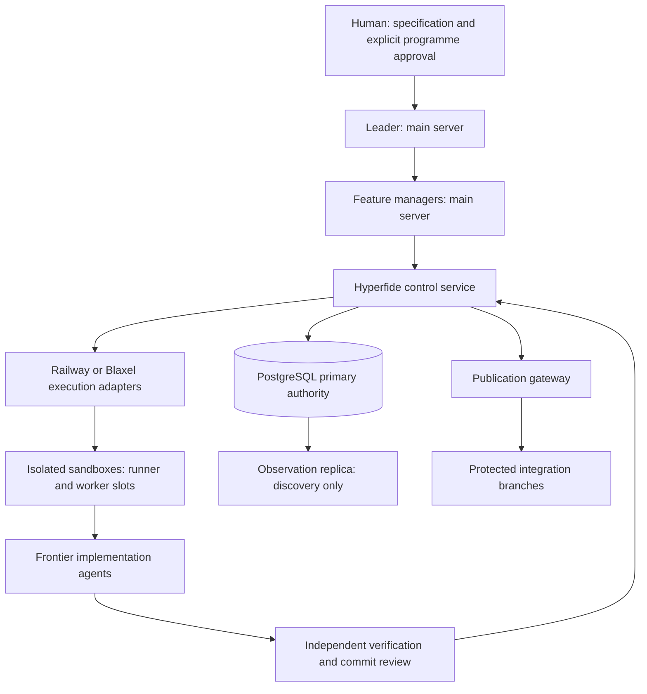

<div align="center">

# Hyperfide


<a
  href="https://trendshift.io/repositories/267432?utm_source=trendshift-badge&amp;utm_medium=badge&amp;utm_campaign=badge-trendshift-267432" target="_blank" rel="noopener noreferrer">

</a>

**L'outil de workflow pour agents, des petits projets simples aux grandes bases de code complexes.**

La CLI locale est en C11 pur : un seul binaire, une seule base SQLite, aucune télémétrie.

[](../../LICENSE)
[](#)
[](../../.github/workflows/ci.yml)
</div>
<div align="center">

[English](../../README.md)  [简体中文](README.zh-CN.md) · [Español](README.es.md) · [हिन्दी](README.hi.md) · [العربية](README.ar.md) · [Français](README.fr.md) · [Português (BR)](README.pt-BR.md)
</div>

---

## Présentation

Hyperfide est un moteur de workflow pour agents tenant dans un seul binaire, `hyperfide`. Il maintient les quatre choses dont un projet a besoin au-delà du code lui-même — ce que le code **est**, comment il en est arrivé **là**, ce qui vient **ensuite**, et ce qui a été **appris** en chemin — et les sert toutes les quatre aussi bien aux humains qu'aux agents d'IA.

Cet arbre est Hyperfide 2.0 en développement : `hyperfide version` affiche `2.0.0-dev`, et rien de ce qu'il contient n'est une version de production. Hyperfide est issu de Codify, dont les versions 1.x, les identifiants de fonctionnalité (comme `codify-v15` et `codify-v16`) et l'historique de commits gardent leurs noms d'origine. La 2.0 ajoute un [plan de contrôle distribué](#le-plan-de-contrôle-hyperfide) — un leader et des gestionnaires de fonctionnalité sur un serveur de supervision, des sandboxes distants pour les builds et les agents, PostgreSQL comme autorité — autour de la même CLI locale.

> **Compatibilité.** `hyperfide` est la commande canonique. `cg` est un alias de compatibilité déprécié, installé depuis le même exécutable, avec des arguments, un JSON et des codes de sortie identiques ; il reste disponible pendant la fenêtre de compatibilité prise en charge de la version approuvée et n'est supprimé que dans une version ultérieure qui l'annonce. Tous les exemples ci-dessous utilisent `hyperfide` ; `cg` exécute exactement la même chose.

`hyperfide fleet up` démarre un superviseur durable, capable de reprendre après un crash, pour l'agent principal, les gestionnaires de vague et les workers de tâche. Il gère chaque processus Codex ou Claude Code jusqu'à ce que le travail soit qualifié et fusionné. Les agents reçoivent le contexte du graphe, la dérive des branches est vérifiée avant l'intégration, et `hyperfide serve` diffuse les événements vers l'éditeur. L'indexation est mutualisée entre les workers ; le graphe et la mémoire couvrent chaque branche et chaque worktree. La boucle principale ne fait aucun appel réseau ; les quelques fonctionnalités qui en font sont nommées à la fin de cette présentation.

**Ce que le code est.** Hyperfide indexe les fichiers source sous forme de graphe interrogeable : symboles, appels, imports, types, routes et recherche plein texte, le tout stocké localement dans SQLite. La couverture des langages va de l'extraction syntaxique native au simple suivi de fichiers ; [la matrice de couverture](../../docs/indexing.md#extraction-coverage) indique la limite pour chaque famille. `hyperfide context <query>` répond en un seul appel à « mets-moi à jour sur cette zone » : symboles correspondants avec extraits, appelants, appelés et routes associées. Les commentaires sont indexés comme des nœuds à part entière, pour la finalité, les contrats, les dangers et les couplages qui n'existent qu'en prose.

**Comment il en est arrivé là.** Un système d'instantanés adressés par contenu, intégré, vous donne commits, historique, diffs et restauration sans aucun VCS externe. Comme les instantanés partagent une base avec le graphe, `hyperfide changes` rapporte le rayon d'impact de vos modifications non validées. `hyperfide changelog` rédige les notes de version : depuis l'historique git par défaut — une version par tag ou par changement de numéro de version, des groupes tirés du préfixe du sujet de commit, chaque référence de tâche conservée et, avec une clé, un court paragraphe Highlights rédigé par un modèle pour chaque version — et depuis la chaîne d'instantanés, avec des diffs au niveau des symboles, quand vous passez `--snapshots` ou que le projet n'a pas du tout de git.

**Ce qui vient ensuite.** Un moteur de specs transforme des fichiers de spec kvx en texte brut en un plan opérationnel : un tableau de tâches avec des vagues de dépendances, des critères d'acceptation attachés à chaque tâche — et un `done` vérifié, pas simplement affirmé. `hyperfide spec new` et `hyperfide spec add` créent le plan, `hyperfide spec lint` prouve qu'il est exécutable, et la boucle le déroule. En mode Prod, `implemented` enregistre la fin du codage et les preuves du code sans prétendre à la qualification ; seul `done` signifie que la qualification exécutable et les vérifications du graphe ont réussi. En mode parallèle, plusieurs agents travaillent à la fois, bornés par la disjonction des chemins que chaque tâche déclare.

**Ce qui a été appris en chemin.** Une mémoire d'agent stocke des notes délibérées — décisions, contraintes, résultats, préférences, faits — dans la même base que le graphe, liées à la tâche sous laquelle elles ont été prises. `hyperfide remember` en sauvegarde une en cours de tâche, chaque `hyperfide spec done` enregistre automatiquement un résultat honnête (refus compris), et `hyperfide recall` restitue le tout, classé par pertinence et par récence.

Les couches se renforcent mutuellement : les commits sont auto-étiquetés avec la tâche qu'ils implémentent, les mémoires remontent sur la tâche à laquelle elles appartiennent, `hyperfide why` remonte d'un symbole aux décisions qui le fondent, et `hyperfide spec trace` relie n'importe quelle tâche à ses symboles, commits et mémoires.

**Et il est présent entre les étapes, pas seulement à chacune d'elles.** `hyperfide work open` démarre avec un paquet de tâche compact, `hyperfide work update` ne renvoie que les nouveaux deltas d'état, de preuves et d'espace de travail, `hyperfide event progress` classe les boucles sans confondre activité et progrès, et `hyperfide guard` remarque quand une modification sort du périmètre déclaré. Un serveur MCP intégré expose 67 outils, des ressources et des prompts à tout agent compatible MCP, tandis que `hyperfide integrate` planifie, applique et diagnostique la configuration native de chaque hôte.

**Et il pilote les agents, pas seulement les sert.** `hyperfide handoff` et `hyperfide resume` font passer une tâche d'une session à l'autre sans perte d'état, `hyperfide spec claim-next` confie atomiquement à un agent inactif la prochaine tâche sans conflit, et `hyperfide spec run` déploie toute une vague vers des sessions Codex CLI ou Claude Code — un processus enfant sandboxé par tâche revendiquée, logs et prompts sur disque, baux libérés en cas d'échec.

**Et il survit à une flotte.** L'indexation est une ressource partagée, pas une habitude propre à chaque processus : le premier `hyperfide` qui veut une passe la lance, les autres laissent une note et s'y fondent, une fenêtre de fraîcheur évite entièrement le parcours, et des slots de parsing à l'échelle de la machine gardent les projets concurrents dans le budget de cœurs ([docs/sync.md](../../docs/sync.md)). Au-dessus, `spec/workflow.kvx` peut déclarer une hiérarchie — un agent principal propriétaire de la liste de tâches, un gestionnaire par vague, un worker par tâche — et `hyperfide fleet` pilote le flux de branches : worktree, merge-up, atterrissage derrière les portes de test et de lint, pull request, checkpoint. `hyperfide fleet up` fait tourner tout cet arbre seul sous un superviseur détaché — toutes les vagues à la fois, chaque gestionnaire et ses workers vivants ensemble, chaque worker dans son propre worktree — en relançant les agents bloqués, en retentant ceux qui ont échoué avec ce qui s'est mal passé, en escaladant ce qui ne peut être sauvé, en s'arrêtant aux portes d'approbation que vous avez choisies, et en déclarant l'achèvement quand le travail est **fusionné**, pas quand un processus se termine ([docs/hierarchy.md](../../docs/hierarchy.md)). Tuez le superviseur et `hyperfide fleet up --resume` adopte les agents encore vivants. La dérive par rapport à la spec, les tâches en collision et les changements d'interface dont dépendent d'autres branches sont signalés avant la fusion ([docs/drift.md](../../docs/drift.md)) ; `hyperfide projection build` replie chaque branche active, travail non validé compris, sur une seule ref de projection et nomme les conflits de symboles, d'interface et de texte avec leurs branches avant toute fusion, et la projection suit le travail via les hooks, `hyperfide watch`, `hyperfide serve` et le superviseur ([docs/projection.md](../../docs/projection.md)). Chaque changement est un événement que `hyperfide events --follow` et `hyperfide serve` diffusent en direct ([docs/events.md](../../docs/events.md)). Tous partagent un seul graphe et une seule mémoire : chaque branche et chaque worktree lié du dépôt s'indexe dans le même `.codegraph/`, cloisonné par branche ([docs/branches.md](../../docs/branches.md)).

**Et il demande une décision quand il en faut une.** `hyperfide jev` interroge le modèle System One de TypeSafe pour des jugements typés — vrai/faux, un-parmi, classé. `hyperfide memory classify` s'en sert pour dire quelles notes sont des skills réutilisables, et `hyperfide skills promote` les rend en `.agents/skills/<slug>/SKILL.md` portables ; un `verify_cmd` en échec reçoit une ligne de triage, les constats de `hyperfide guard` sont classés, et une pull request reçoit un score de préparation. Jev est obligatoire pour les fonctionnalités bâties dessus, jamais pour la boucle principale, et ne fait jamais autorité — aucune réponse de Jev ne change un code de sortie ([docs/jev.md](../../docs/jev.md)).

**Et la documentation est la dernière tâche vérifiée.** Les nouvelles specs de fonctionnalité activent par défaut une étape de clôture `@docs`. Une fois toutes les tâches ordinaires qualifiées, Hyperfide construit un paquet de preuves borné à partir de la spec, des instantanés attribués aux tâches, du graphe de code, des routes, des mémoires, des vérifications et de la documentation existante. Le même connecteur d'agent configuré met à jour la documentation utilisateur et développeur, tandis que `hyperfide docs check` vérifie les références de claims déclarées, les liens locaux en ligne, la couverture requise de la surface du graphe et le périmètre des cibles configurées. `hyperfide docs close` enregistre un instantané `[spec:<feature>/@docs]` dédié et une base incrémentale pour le prochain flux de spec. Ces vérifications structurelles aident la relecture ; elles ne certifient pas le sens de chaque phrase.

La CLI ne fait tourner aucun service en arrière-plan que vous n'avez pas lancé et n'envoie aucune télémétrie — le superviseur de flotte ne tourne qu'après `hyperfide fleet up`, et s'arrête avec `hyperfide fleet down`. Le graphe, la mémoire, les instantanés et toute la boucle de tâches s'exécutent sur votre machine et y restent. Les exceptions sont nommées et facultatives : les décisions Jev nécessitent `OPENROUTER_API_KEY`, et seules les commandes bâties dessus font cet appel ; `hyperfide changelog` demande à un modèle les highlights de version, et `hyperfide recap` fait choisir par Solar Decide des énoncés tirés de sessions passées et rédiger le brief par un modèle, seulement si `CENTRA_API_KEY` (ou `HYPERFIDE_CHANGELOG_KEY`) est défini ; et `hyperfide fleet pr` et `checkpoint` appellent `gh`. Les services de contrôle distribués sous `services/hyperfide` sont des processus distincts que vous démarrez explicitement ([Le plan de contrôle Hyperfide](#le-plan-de-contrôle-hyperfide)).

## Pourquoi Hyperfide

**Il boucle la boucle, du plan à la preuve.** La plupart des outils soit planifient le travail (listes de tâches), soit décrivent le code (recherche, index). Hyperfide fait les deux sur la même base, si bien que le plan peut être confronté à la réalité : quand une tâche déclare qu'elle introduit `checkMode` et touche `src/*.ts`, `hyperfide spec done` refuse de la marquer terminée tant que le graphe et l'historique ne concordent pas.

**Les agents travaillent comme des ingénieurs, pas comme des touristes.** Au lieu d'errer dans un dépôt fichier par fichier, un agent demande à `hyperfide spec next` quoi faire, à `hyperfide context` tout ce qui concerne la zone, et à `hyperfide impact` qui casse — puis commite avec attribution automatique à la tâche. Toute la boucle est disponible via MCP, donc il n'a jamais à quitter le protocole.

**Le projet se souvient de ce que les sessions oublient.** Les fenêtres de contexte des agents se réinitialisent ; la table de mémoire, non. Une décision écrite une fois avec `hyperfide remember` retrouve automatiquement la session suivante — à `hyperfide spec next`, à `hyperfide spec start`, dans `hyperfide recall` au début de la session — au lieu d'être redécouverte au prix fort. Et comme les complétions refusées sont elles aussi enregistrées, « cette tâche a été bloquée deux fois et voici pourquoi » n'est qu'à une requête.

**Le contexte arrive en un appel, pas en vingt — et dans un budget.** `hyperfide context <query>` est conçu autour de la façon dont les agents consomment réellement le code. Une requête renvoie tout ce qu'il faut pour commencer à travailler : mémoires pertinentes, points d'entrée de l'exécution, correspondances, qui l'appelle, ce qu'il appelle et quelles routes le touchent — classés (vraies définitions avant fixtures de test, code appelé avant code mort) et ajustés à un budget de tokens (`--budget`, 4000 par défaut). Un symbole est affiché en entier une seule fois ; chaque mention ultérieure est un `name path:line` compact, et tout ce que le budget coupe est annoncé avec un compte explicite d'omissions au lieu d'être abandonné en silence.

**L'analyse d'impact est une commande à part entière.** `hyperfide impact <name> -d 3` parcourt transitivement les arêtes d'appelants et d'appelés et répond aux deux questions qui comptent avant tout changement : qui casse si ceci bouge, et de quoi cela dépend-il.

**La recherche est instantanée et étagée.** Un index FTS5 par trigrammes sur les noms de symboles donne une correspondance de sous-chaîne insensible à la casse sans préchauffage, adossée à un index de mots sur le corps complet des fichiers pour tout le reste.

**L'index signale quand la couverture ou la fraîcheur est incertaine.** `hyperfide watch` observe les changements de fichiers et demande des synchronisations avec anti-rebond. Un événement d'observateur perdu ou un enregistrement en échec laisse une dette de réconciliation durable. Les réponses CLI et MCP exposent la couverture d'extraction et des contrôles de source bornés comme vérifiés, périmés ou non vérifiés ; une mise à jour mutualisée ne certifie pas à elle seule la fraîcheur. Un seul processus tient la porte d'index pendant que les autres appelants laissent des notes sales, et des slots à l'échelle de la machine plafonnent les threads de parsing entre projets ([détails de l'indexation](../../docs/indexing.md#freshness-and-migrations)).

**Il s'adapte au matériel sur lequel il tourne.** Au démarrage, `hyperfide` dimensionne son pool de workers et ses caches SQLite d'après ce que le système fournit réellement : un nombre de cœurs conscient des conteneurs (l'intersection du quota CPU cgroup v1/v2, du masque d'affinité et des CPU en ligne), une RAM disponible honnête (`MemAvailable` croisé avec les limites mémoire des cgroups) et le coût mesuré par projet. Une station de travail à 16 cœurs obtient le pipeline parallèle complet. Un VPS à 2 cœurs en obtient un réglé pour finir de façon fiable. Lancez `hyperfide info` pour voir exactement comment le pipeline a été dimensionné.

**Tout reste local.** Le graphe vit dans une base SQLite sous `.codegraph/`, et les instantanés sont des objets adressés par contenu sous `.codegraph/objects/`. Supprimez le répertoire et toute trace disparaît.

## La couche d'intention

Un parseur voit symboles, appels et routes. Il ne voit pas *pourquoi* une
fonction existe, ce que ses appelants doivent garantir, ni que `save_tasks`
doit s'exécuter après que `load_tasks` a lu le disque — cette moitié du code
ne vit que dans les commentaires. Hyperfide l'indexe ([docs/ANCHORS.md](../../docs/ANCHORS.md)
décrit la convention complète) :

- **Les ancres** sont des commentaires qui passent le test de dérivabilité —
  *si un agent aurait pu l'écrire en lisant le code, ce n'est pas une ancre.*
  Quatre types paient : **purpose**, **contract**, **danger**, **pointer**.
- **Récupération doc d'abord** : là où une ancre existe, `hyperfide context` sert doc +
  signature au lieu des lignes du corps — plusieurs fois plus de symboles par
  budget de tokens.
- **`hyperfide survey`** lit cent fichiers pour le prix d'un corps : lignes de
  finalité et docs avec signatures, jamais de corps.
- **Arêtes souples** : les noms dans les ancres se résolvent en références `(soft)` —
  des couplages inter-langages et dynamiques qu'aucun parseur ne peut dériver,
  étiquetés pour ne jamais être confondus avec des appels parsés.
- **Honnêteté face à la dérive** : chaque ancre prend pour base le code qu'elle décrit. Quand
  le code évolue, la doc est marquée périmée — dans `hyperfide check`, `hyperfide guard` et
  dans la récupération elle-même — jusqu'à ce qu'elle soit mise à jour ou supprimée. Avertir, ne pas bloquer.
- **`hyperfide anchors`** classe les symboles non couverts par score de coordination (fan-out ×
  étendue × fichiers référents, délibérément pas la popularité brute) pour que le
  rattrapage commence aux points d'orchestration, pas à `sb_puts`.

Rien de tout cela n'est obligatoire : un dépôt qui n'adopte jamais la convention
bénéficie quand même de la capture, du survey et des arêtes souples à partir des commentaires existants.

## Une session avec Hyperfide

```sh
hyperfide brief                     # root, active task + ACs, uncommitted work, prior decisions
hyperfide spec next                 # the next eligible task, ACs + relevant memories
hyperfide spec start 16.7           # claim it — one task in progress at a time
hyperfide context "password auth"   # memories, entry points, symbols, callers, routes in one call
hyperfide why verifyLogin           # who changed it, under which task, and what was decided
hyperfide impact verifyLogin -d 2   # who breaks if this changes
# ...implement...
hyperfide guard                     # anything drifting outside what task 16.7 declared?
hyperfide test-impact               # which tests cover what you just changed
hyperfide remember "sessions rotate on login" --type decision   # linked to task 16.7
hyperfide review                    # the change, paired with the ACs it claims to satisfy
hyperfide commit -m "add password auth"   # snapshot, auto-tagged [spec:ion_spec/16.7]
hyperfide spec done 16.7            # qualification: verify_cmd + graph checks; outcome recorded
hyperfide spec trace 16.7           # proof: task -> symbols -> commits -> memories
```

Et quand une session doit s'arrêter avant la fin de la tâche — la fenêtre de contexte est pleine, la journée est finie — le travail ne s'évapore pas :

```sh
# session A, stopping early
hyperfide handoff --done "schema migration; token rotation" \
                  --next "wire the login route; extend 03_auth test" \
                  --blocked "flaky fixture on CI" -m "rotate on login, not refresh"

# session B, hours later, a fresh context window
hyperfide resume --prompt   # paste-ready block: task, steps done, blockers,
                            # next steps, uncommitted files, lease state
```

Un handoff est stocké comme mémoire structurée liée à la tâche ; chaque nouveau handoff remplace le précédent, donc `hyperfide resume` retrouve toujours le dernier état, pas une pile de notes périmées.

Chaque commande de cette boucle est aussi un outil MCP, donc un agent connecté peut la dérouler de bout en bout — et chaque étape fonctionne aussi bien dans un projet de dix fichiers que dans un monorepo. `hyperfide check` exécute toute la porte en CI en une seule étape, et `hyperfide hook install` câble la synchronisation et le contrôle de périmètre pour que l'essentiel se fasse sans que personne ne l'invoque.

## Langages et frameworks pris en charge

Des adaptateurs syntaxiques natifs couvrent JavaScript/JSX, TypeScript/TSX, C, C++, Objective-C, Go, Rust, Python, Ruby, PHP, Java, Kotlin, Scala, C#, Swift, Dart, Lua, Luau, R, Erlang, Solidity, Terraform, Nix, Pascal, COBOL, VB.NET, CFScript, CFQuery et ArkTS. Des adaptateurs de formats mixtes couvrent certaines constructions CFML, Vue, Svelte, Astro, Liquid, Razor, formulaires Delphi et XML MyBatis. JSON, YAML, Twig et les fichiers properties sont suivis au niveau du fichier. Le [guide d'indexation](../../docs/indexing.md) explique les faits pris en charge, le repli, les limites et les frontières non résolues.

Le routage conscient du framework enregistre les déclarations littérales prises en charge et relie un gestionnaire identifié de façon unique quand les preuves le permettent. Il couvre Express, Next.js, React Router, Expo Router, SvelteKit, Vue/Nuxt, FastAPI, Django, Flask, Laravel, Rails, Spring, Gin, Axum, ASP.NET et Vapor, plus certaines déclarations dans Koa, Fastify, Hapi, NestJS, Sinatra, Echo, Fiber, Chi et Actix. Les chemins calculés et les gestionnaires ambigus restent non résolus.

## Installation

Dans cette révision, Hyperfide 2.0 se compile depuis les sources. L'installateur en une ligne de `scripts/install.sh` n'est pas présenté comme une version d'Hyperfide tant que les tâches de distribution et de renommage (25.4 et 26.2 dans `spec/hyperfide/spec.kvx`) ne sont pas closes.

Dépendances : un compilateur C, `python3` (le build s'en sert pour découvrir les composants natifs), et les paquets de développement de SQLite, libcurl et de la libcrypto d'OpenSSL (`libsqlite3-dev`, `libcurl4-openssl-dev`, `libssl-dev` sous Debian et Ubuntu). Le runtime tree-sitter et les grammaires sont embarqués dans le dépôt.

```sh
make && sudo make install
```

`make` lie `./hyperfide` et le copie en `./cg` ; `make install` vérifie que les deux sont identiques octet pour octet et les installe tous deux dans `$(PREFIX)/bin` (par défaut `/usr/local`). `make uninstall` supprime les deux. Les données `.codegraph/` de chaque projet ne sont jamais touchées.

Les mises à jour sont sûres sur les projets existants : la base porte une version de schéma (18 dans cet arbre), et à la première ouverture après une mise à jour `hyperfide` ne reconstruit que les tables d'index dérivées (fichiers, symboles, références, routes, imports et index de recherche) — la synchronisation suivante les repeuple. Mémoires, historique git, baux, tentatives, événements et registres des branches et des agents ne sont jamais supprimés par une migration. Un binaire plus ancien refuse d'ouvrir une base plus récente au lieu de la rétrograder.

Ensuite, dans n'importe quel projet :

```sh
cd your-project
hyperfide init
```

Dans un terminal, `hyperfide init`, `hyperfide index` et `hyperfide sync` affichent une ligne de progression en direct
sur stderr — phase, fichiers traités sur fichiers à traiter, workers, temps écoulé et tout
verrou attendu — effacée avant le résumé. Une sortie redirigée ne change pas ;
`HYPERFIDE_PROGRESS=plain` imprime de simples lignes à la place, `HYPERFIDE_PROGRESS=0` la désactive.
Voir [docs/sync.md](../../docs/sync.md#progress).

Les variables d'environnement s'écrivent `HYPERFIDE_*` partout. Les anciens noms `CG_*`, et les noms `CODIFY_*` que l'arbre reconnaît encore (`CODIFY_ROOT`, `CODIFY_INSTALL_DIR`, `CODIFY_BASE_URL`, et les variables d'autorité, d'identifiants, de transport, de politique d'outils MCP et de mode), sont acceptés comme alias du même réglage ; définir un alias et son nom `HYPERFIDE_*` avec des valeurs différentes arrête la commande avec une erreur de conflit d'alias au lieu d'en choisir une.

## Référence des commandes

`hyperfide help` affiche la carte : chaque commande par groupe, une ligne chacune, ajustée au terminal. `hyperfide help <command>` (ou `hyperfide <command> --help`, `-h`) montre l'usage d'une commande, ses sous-commandes, options, exemples et commandes liées ; `hyperfide help --all` les affiche toutes, et `hyperfide help --json` fournit aux éditeurs et aux agents la même table pour construire leurs menus. Les tables ci-dessous nomment les mêmes commandes que `hyperfide help`. La vue d'ensemble affiche aussi la note sur les noms de commande citée dans le paragraphe [Compatibilité](#présentation).

| Commande | Description |
| --- | --- |
| `hyperfide help [<command>] [--all] [--json]` | La vue d'ensemble par groupe, le détail d'une commande, tous les détails, ou la table entière en JSON. Un nom inconnu suggère les plus proches et sort avec 1. Gras et atténué seulement dans un terminal (`NO_COLOR`, `TERM=dumb` et `HYPERFIDE_COLOR=0\|1` en décident) ; `COLUMNS` fixe la largeur, jamais sous 60 |
| `hyperfide version` | Affiche la version (`--version` aussi) |

### Graphe

| Commande | Description |
| --- | --- |
| `hyperfide init [--nested] [--force]` | Crée `.codegraph/` et construit l'index initial ; dans un worktree git lié d'un dépôt initialisé, rejoint plutôt le graphe partagé sous cette branche. Refuse à l'intérieur d'un projet englobant (`--nested` fait de ce répertoire un projet à part) et dans votre répertoire personnel (`--force`) |
| `hyperfide sync [paths] [--max-age MS] [--background] [--wait MS] [--auto] [--workers N]` | Index incrémental : se fond dans une passe déjà en cours (`--wait`, 2000 ms par défaut), s'abstient si l'index est frais, et ne parcourt que les chemins nommés ; `--auto` marque une synchronisation implicite que `[sync] auto = false` saute |
| `hyperfide index [--full] [--workers N]` | La forme bloquante de sync, qui parcourt toujours, en attendant une passe déjà en cours. `--workers N` (sur les deux) l'emporte sur `HYPERFIDE_INDEX_WORKERS` et `[index] workers` dans la configuration du projet. Sort avec 75 quand la base reste occupée au-delà de l'attente du verrou |
| `hyperfide branches` | Chaque branche indexée dans le graphe partagé, avec son worktree, son head, sa base et son nombre de fichiers |
| `hyperfide search <q> [-n N]` | Recherche de symboles et plein texte (20 résultats par défaut ; `--path`, `--lang`, `--kind`, `--name`, `--no-tests` la restreignent) : une phrase correspond aux noms (`export memory` trouve `memory_export` et `exportMemory`), aux commentaires de doc et aux corps, classés dans cet ordre avec les sources avant les tests ; les résultats de fichier montrent la ligne correspondante. Ce sont les définitions qui répondent, jamais leurs prototypes ; un repli borné sur les fautes de frappe s'applique quand les correspondances exactes et par segment ne trouvent rien ([docs/retrieval.md](../../docs/retrieval.md)) |
| `hyperfide grep <pattern> [-E] [-i]` | Recherche de lignes à la place d'un grep shell : un littéral (ou une regex `-E`) trouvé via l'index par trigrammes, lu sur disque, chaque résultat placé dans son symbole englobant, classé et plafonné par `-n` et `--budget` avec la queue omise ; `--path`, `--lang`, `--no-tests`, `--symbol`, `--kind`, `-C`, `--files`, `--count` ([docs/retrieval.md](../../docs/retrieval.md)) |
| `hyperfide symbol <name>` | Définition, extrait et nombre de références |
| `hyperfide impact <name> [-d N] [--budget N]` | Appelants et appelés transitifs jusqu'à la profondeur N (3 par défaut), ajustés à un budget de tokens (8000 par défaut) |
| `hyperfide flow <callers\|callees\|impact\|paths> <name> [target]` | Parcours borné des relations typées avec preuves de source, frontières dynamiques et limites explicites : `--depth` (1 à 8), `--max-nodes` (jusqu'à 256), `--max-edges` (jusqu'à 512), `--max-ms` (jusqu'à 2000), `--max-output` en octets |
| `hyperfide inspect` | Inspection des hiérarchies et, avec prudence, du code non référencé ; voir les sous-commandes ci-dessous |
| `hyperfide inspect hierarchy <name> [-n N]` | Ancêtres, sous-types et implémentations bornés, tirés des relations typées |
| `hyperfide inspect unused [-n N] [--path GLOB]` | Symboles non référencés et accessibilité bornée depuis des racines connues, avec les raisons d'exclusion ; jamais un verdict de suppression |
| `hyperfide context <q> [--budget N] [-n K]` | Bundle de contexte en un appel pour les agents : mémoires, symboles, points d'entrée, routes — les K meilleurs symboles (8 par défaut), remplis jusqu'à un budget de tokens (4000 par défaut) avec des comptes explicites d'omissions et, en `--json`, `tokens_used`. Un chemin de fichier obtient le plan du fichier (finalité, symboles, imports, dépendants) ; un répertoire obtient ses fichiers |
| `hyperfide survey [path\|query] [--budget N]` | Le niveau sous les corps : lignes de finalité des fichiers et docs des symboles avec signatures sur ~100 fichiers par appel — jamais un corps. Les fichiers et symboles non couverts sont nommés, et tout ce que coupe le budget (16000 par défaut) devient un compte explicite d'omissions |
| `hyperfide files [pattern] [--dirs] [--depth N] [-n N]` | Fichiers par glob (`src/**/*.go`), par les mots de leur chemin (`sync gate`) ou par répertoire, chacun avec langage, lignes et nombre de symboles ; `--dirs` cartographie les répertoires avec nombre de fichiers et de lignes et langage dominant. `--path`, `--lang` et `--no-tests` le restreignent, comme ils restreignent `search`, `context` et `survey` |
| `hyperfide anchors [--stale] [--uncovered]` | Santé des ancres : docs dont le code a évolué, et symboles non couverts classés par score de coordination (fan-out × étendue × fichiers référents) — la liste de travail du rattrapage |
| `hyperfide routes [filter]` | Table motif d'URL vers gestionnaire |
| `hyperfide show <symbol\|path:line> [--full]` | Le seul corps de ce symbole — par nom, ou par la position de curseur que tient un éditeur ; les corps longs sont tronqués avec un marqueur `… (+N more lines, use --full)` |
| `hyperfide why <symbol>` | Provenance : les commits qui l'ont changé, les tâches qu'ils implémentaient, les décisions enregistrées |
| `hyperfide test-impact [symbol]` | Les tests qui référencent un symbole — ou chaque symbole de vos changements non validés |
| `hyperfide watch [--debounce MS] [--fleet]` | Synchronisation automatique sur les événements natifs du système de fichiers (anti-rebond de 300 ms par défaut) ; `--fleet` surveille chaque worktree connu du graphe, chacun sous sa propre branche |
| `hyperfide root` | La racine de projet que `hyperfide` résout depuis l'emplacement courant ; `--json` ajoute le projet partagé, l'indicateur de worktree et la branche |
| `hyperfide info` | Profil machine, dimensionnement du pipeline (le nombre de workers et son origine), la racine de projet et la branche liées, la couverture d'index par branche, et l'inventaire des parseurs |
| `hyperfide config [init\|get K\|set K V\|check] [--json]` | Configuration du projet dans `hyperfide.kvx` (un `codify.kvx` hérité est encore lu) : chaque réglage avec son origine, les valeurs par défaut commentées, une clé lue ou écrite sur place, et une vérification des clés inconnues et des valeurs invalides. Fonctionne avant `hyperfide init`. Voir [docs/config.md](../../docs/config.md) |

### Gestion de versions

Les instantanés sont adressés par contenu avec SHA-256 et les blobs sont dédupliqués.

| Commande | Description |
| --- | --- |
| `hyperfide commit -m <msg>` | Fait un instantané de l'arbre de travail, synchronisé d'abord et auto-étiqueté avec la tâche en cours ; `--task <id>` nomme la tâche, `--amend` remplace le dernier instantané, `--git` fait aussi un vrai commit git avec la même étiquette de spec |
| `hyperfide log [-n N]` / `hyperfide status` | Historique des instantanés (20 par défaut), et arbre de travail face à HEAD avec la couverture d'index par branche et la réconciliation en attente |
| `hyperfide diff [A] [B]` | Diff de lignes LCS entre instantanés ou avec l'arbre de travail |
| `hyperfide checkout <id> [--force]` | Restaure un instantané |
| `hyperfide changes [--limit N]` | Rayon d'impact des modifications non validées : les symboles que vous avez touchés plus leurs appelants externes — plafonné par défaut (40 symboles, 8 appelants chacun) avec des marqueurs `(+N more)` ; `--limit` le remplace |
| `hyperfide git-sync [-n N]` | Ingère l'historique git (2000 commits par défaut) — commits, auteurs, churn par fichier — qui pondère ensuite recherche et contexte et répond à `hyperfide why` |
| `hyperfide events [--since N] [--kind K,..] [-n N] [--follow [--for S]] [--head]` | Le journal d'événements : chaque changement de tâche, claim, tentative, agent, flotte, superviseur, dérive et approbation par numéro de séquence. `--kind` accepte une liste séparée par des virgules où un `.` final est un préfixe (`fleet.`) ; `--follow` diffuse ; `--json` donne un objet par ligne. Voir [docs/events.md](../../docs/events.md) |

Les instantanés d'Hyperfide ne remplacent pas git. `.gitignore` est respecté en même temps que `.cgignore`, `hyperfide git-sync` lit votre vrai historique, et `hyperfide commit --git` écrit dans les deux, si bien qu'adopter Hyperfide n'est jamais tout ou rien.

### Changelog

`hyperfide changelog` rend les notes de version depuis l'historique git. Une version commence à un tag **ou** au commit qui a changé la version du projet — `CG_VERSION` dans `src/cg.h`, un fichier `VERSION` ou `package.json` — donc un projet qui ne pose jamais de tag obtient quand même une section par version. Ce qui suit la dernière est nommé par la version que porte l'arbre de travail quand elle est nouvelle (la version en préparation), par `--tag NAME`, et seulement sinon `[Unreleased]`. Un groupe correspond au préfixe du sujet de commit, et le `[spec:<feature>/<task>]` qu'ajoute `hyperfide commit` devient une référence de tâche sur la puce. Les liens de commit et de comparaison viennent de `git remote get-url origin` ; sans remote, une puce se lit `- Add gauge (497c30a)` et les liens de pied de page sont omis.

```markdown
## [0.3.0] - 2026-09-28

### Features
- Add gauge ([497c30a](https://github.com/acme/demo/commit/497c30acbc9dc0daf869af07a993db74ea0da779))

### Documentation
- Explain gauges ([191d0c8](https://github.com/acme/demo/commit/191d0c811203dc1bba7b39f0b9095e5875a1ff7f))

## [0.2.0] - 2026-09-28

### Bug fixes
- **parser:** Handle empty input ([682f9f8](https://github.com/acme/demo/commit/682f9f8c9bd6bb5813cfc2665c4e1265fba16933), task demo/1.2)

[0.3.0]: https://github.com/acme/demo/compare/0.2.0...0.3.0
[0.2.0]: https://github.com/acme/demo/compare/0.1.0...0.2.0
```

**Highlights.** Avec `CENTRA_API_KEY` dans l'environnement ou le `.env` du projet (ou `HYPERFIDE_CHANGELOG_KEY`), chaque version reçoit aussi un bloc `### Highlights` : deux à cinq phrases, et quelques puces pour une grosse version, rédigées par un modèle à partir des commits groupés de cette version. Les puces dérivées ne sont jamais modifiées, et le prompt demande au modèle de ne rien inventer que les commits ne disent pas. L'endpoint par défaut est `https://gateway.centra.ag/v1/chat/completions` avec le modèle `openrouter/anthropic/claude-haiku-5.5` ; `HYPERFIDE_CHANGELOG_ENDPOINT` et `HYPERFIDE_CHANGELOG_MODEL` le pointent vers n'importe quel service compatible OpenAI. Les réponses sont mises en cache sous `.codegraph/changelog-cache/` selon les commits de la version et le modèle, donc régénérer le fichier n'interroge que les versions qui ont changé. `--summarize` insiste (et le dit quand aucune clé n'est trouvée), `--no-summarize` tient le modèle à l'écart, et un appel en échec affiche `highlights for <release> skipped — <why>` sur stderr et écrit les notes sans prose.

```sh
hyperfide changelog -o CHANGELOG.md        # every release, highlights when a key is present
hyperfide changelog --unreleased           # only the newest section and its footer line
hyperfide changelog --tag 1.2.0            # name the newest section 1.2.0, dated today
hyperfide changelog --no-summarize -n 3    # the plain record, three newest releases
```

`-n N` plafonne le nombre de sections de version, et `-o FILE` écrit le fichier relativement à la racine du dépôt et indique combien de highlights ont été écrits et combien venaient du cache. `--snapshots` — et tout projet sans `.git` — revient au rendu par instantanés, dont la sortie est un diff au niveau des symboles par instantané plutôt qu'un historique de versions. `cliff.toml` à la racine du dépôt est la configuration [git-cliff](https://git-cliff.org) correspondante ; git-cliff ne connaît que les tags, donc les deux ne produisent le même fichier que pour un dépôt avec seulement des tags, sans fichier de version et sans clé de modèle. Le `CHANGELOG.md` de ce dépôt est généré avec `hyperfide changelog -o CHANGELOG.md`.

### Recap

`hyperfide recap` rédige le brief dont un agent neuf a besoin pour reprendre un projet : ce qu'est le projet, ce qui a changé ces dernières semaines, ce qu'ont fait les sessions récentes, les faits qui seraient sinon perdus, et la prochaine étape. Sa matière première, ce sont les transcripts que Claude Code et Codex conservent déjà sur la machine (`~/.claude/projects/<cwd>/*.jsonl` et `~/.codex/sessions/**/rollout-*.jsonl`, rattachés à ce dépôt par répertoire de travail), qui sont la seule trace du *pourquoi* entre les commits et bien trop longs pour être transmis en entier.

Deux modèles font deux travaux différents. Chaque transcript est découpé en énoncés — une demande de l'utilisateur, un paragraphe ou une puce de la réponse de l'assistant, un fichier modifié, une commande qui a commité ou testé — et confié par petits blocs à **Solar Decide**, le modèle de décision System One d'Upstage, via la passerelle Centra (`openrouter/upstage/solar-decide` à `https://gateway.centra.ag/v1/systemone`, le même schéma de requête que Jev). Pour chaque énoncé, il répond à trois questions typées avec des probabilités calibrées et sans prose : de quel type il s'agit (objectif, décision, contrainte, fait, fait accompli, fil ouvert, impasse, bruit), s'il tenait encore à la fin de la session, et si un agent qui reprend en a besoin. Les énoncés qui passent le seuil, classés par le produit de ces probabilités et coupés à `--budget` caractères, forment le **journal décidé** : chaque ligne citée d'une session, aucune écrite par un modèle. Ce journal, avec des faits lus dans le dépôt (la fonctionnalité active et les statuts de ses tâches, les commits récents, les mémoires enregistrées), est envoyé au modèle de chat de la passerelle qu'utilise déjà `hyperfide changelog`, qui rédige lui-même le brief. Le journal décidé est conservé dans `.codegraph/recap/decided.md`, de sorte que toute phrase du brief peut être confrontée à ce qui a réellement été dit.

```bash
hyperfide recap                              # 6 newest sessions of the last 21 days → <context>/recap.md
hyperfide recap --sessions 10 --since 45     # wider window
hyperfide recap --decided                    # stop at the picked statements; print them, write no prose
hyperfide recap --facts                      # the repository facts alone; no key, no model
hyperfide recap -o - --agents codex          # to stdout, Codex sessions only
```

Les deux appels utilisent `CENTRA_API_KEY` (ou `HYPERFIDE_CHANGELOG_KEY`) depuis l'environnement ou le `.env` du projet ; sans elle, la commande s'arrête avec une erreur claire, puisqu'aucune des deux moitiés n'a de substitut local. L'endpoint facture chaque question sur l'état entier, donc les blocs sont petits (6 énoncés, `HYPERFIDE_RECAP_CHUNK`) et plusieurs tournent à la fois (`HYPERFIDE_RECAP_PARALLEL`, 6 par défaut). Le temps et le coût dépendent de la session et de la passerelle ; cette révision n'indique aucun chiffre mesuré. Les décisions sont mises en cache par bloc sous `.codegraph/recap-cache/`, donc une nouvelle exécution n'interroge que les sessions nouvelles. Ce qui n'atteint jamais un modèle : les blocs de réflexion, la sortie des outils, les notifications et rappels du harnais, les blocs de code et les sessions d'autres projets. `HYPERFIDE_RECAP_DECIDE_MODEL`, `HYPERFIDE_RECAP_DECIDE_ENDPOINT` et `HYPERFIDE_RECAP_MODEL` dirigent l'une ou l'autre moitié ailleurs ; `HYPERFIDE_RECAP_CLAUDE_DIR` et `HYPERFIDE_RECAP_CODEX_DIR` disent où chercher. Le brief est écrit dans `recap.md` dans le répertoire de contexte : `.codify/recap.md` par défaut, `.hyperfide/context/recap.md` quand le projet a un `hyperfide.kvx`.

### Carte du code

`hyperfide codemap` écrit `CODEMAP.md` à la racine du dépôt : le fichier unique qu'un nouvel agent (ou une nouvelle personne) lit pour savoir ce qu'est le projet, comment le compiler et le tester, où se trouvent les choses, et sur quels symboles s'appuie le reste du code. Il est construit à partir du graphe, jamais par un modèle. Les lignes de finalité sont les propres commentaires de fichier et README du code, et un répertoire qui n'a ni l'un ni l'autre n'en reçoit aucune. Les symboles sont classés par les appels qui se résolvent vers eux. Le même graphe donne les mêmes octets, et la carte ne se compte jamais elle-même, donc `hyperfide codemap --check` fonctionne comme porte de CI. `hyperfide brief` nomme la carte et dit si elle est à jour ; l'outil MCP `codemap` la renvoie sans l'écrire. Voir [docs/codemap.md](../../docs/codemap.md).

```bash
hyperfide codemap                  # write CODEMAP.md (8000-token budget)
hyperfide codemap --budget 3000    # tighter: least-referenced entries go first, each section counts what it left out
hyperfide codemap --check          # exit 1 when CODEMAP.md is missing or stale; writes nothing
hyperfide codemap -o - --json      # the same map as structured data
```

### Mémoire

Des notes d'agent durables, stockées dans la même base SQLite que le graphe. Les mémoires écrites pendant qu'une tâche de spec est en cours s'y lient d'elles-mêmes, et `hyperfide spec done` enregistre automatiquement les résultats. N'y stockez jamais de secrets.

| Commande | Description |
| --- | --- |
| `hyperfide remember <text>` | Sauvegarde une mémoire — `--type decision\|constraint\|outcome\|preference\|fact` (`fact` par défaut), `--task <feature/id>` (par défaut la tâche de spec en cours), ancres facultatives `--symbols` / `--files`, `--supersedes <id>` pour retirer une décision annulée |
| `hyperfide recall [query]` | Recherche dans les mémoires : plein texte sur le corps, classé par pertinence puis récence ; filtrer avec `--task`, `--type`, `-n N`, ou `--near <file>` pour une récupération ancrée |
| `hyperfide forget <id>` | Supprime une mémoire |
| `hyperfide memory compact` | Fusionne les mémoires en double (`--dry-run` pour prévisualiser) |
| `hyperfide memory classify [<id>\|--all\|--unclassified]` | Demande à Jev ce qu'est chaque note — `skill`, `decision`, `constraint`, `fact`, `noise` — avec une confiance, et l'enregistre sur la mémoire. Sans argument, traite celles qui ne sont pas classées ; `-n N` plafonne le lot |
| `hyperfide memory export [-o FILE]` | Écrit les mémoires en JSONL — une ligne d'en-tête, puis un objet par mémoire indexé par un identifiant de contenu — sur stdout ou dans `FILE` ; sélection avec `--task` (une étiquette ou un préfixe), `--type`, `--branch`, `--since DAYS` |
| `hyperfide memory import <FILE\|->` | Ajoute, par identifiant de contenu et en une seule transaction, les mémoires que ce graphe ne détient pas encore : date de création, classe et remplacement sont conservés ; `--dry-run` rapporte sans écrire, `--keep-branch` garde les noms de branche que ce graphe ne suit pas, `--retask OLD=NEW` réécrit un préfixe d'étiquette de tâche. `--from DIR` lit le graphe d'un autre projet Hyperfide en lecture seule au lieu d'un fichier. Voir [docs/memory-transport.md](../../docs/memory-transport.md) |
| `hyperfide skills list\|promote <id>\|render` | Les mémoires classées `skill`, promues en `.agents/skills/<slug>/SKILL.md`, et tenues à jour avec la note dont elles viennent |

Une mémoire remplacée n'est jamais supprimée — le revirement est un historique qui mérite d'être gardé. Elle cesse simplement d'arriver en tête des résultats, si bien qu'une session rencontre d'abord la décision actuelle.

Une mémoire classée porte sa classe partout où elle apparaît — `class skill 0.82` dans `hyperfide recall`, `[decision/skill]` dans `hyperfide brief`, `class` et `confidence` dans les deux `--json`. La promotion écrit un fichier généré qui le dit : il porte un marqueur de propriété et un lien vers la mémoire, un fichier sans ce marqueur n'est jamais écrasé, et `hyperfide skills render` rafraîchit ceux dont la note a évolué. Voir [docs/jev.md](../../docs/jev.md#memory-classification-and-skills).

### Agents

| Commande | Description |
| --- | --- |
| `hyperfide mcp` | Tourne comme serveur MCP en stdio (il se présente comme `hyperfide`) : 67 outils, des ressources `hyperfide://` pour le workflow, chaque spec de fonctionnalité et le contexte d'agent (les URI héritées `codify://` sont encore lues), et les prompts `orient`, `start-work`, `review-change` et `close-task` |
| `hyperfide lsp` | Tourne comme Language Server (stdio) — pour tous les éditeurs, pas seulement VS Code |
| `hyperfide serve` | Une connexion JSON-RPC (stdio) pour un éditeur : chaque outil MCP, toute commande `hyperfide` (`exec`), `cancel` et abonnements aux événements poussés depuis un numéro de séquence. Inactif, il ne tient aucun verrou et ne lance aucune passe d'index. Voir [docs/events.md](../../docs/events.md#cg-serve) |
| `hyperfide tool list \| call <name> [json]` | Exécute un outil MCP depuis un shell, sans client MCP |
| `hyperfide integrate detect\|plan\|apply\|doctor [--no-plugin]` | Configuration consciente des capacités pour Codex, Claude Code, Copilot/VS Code, Cursor, Gemini CLI, OpenCode, Zed, Windsurf, Cline et Continue ; `detect` est le défaut, la planification est en lecture seule, l'application est idempotente et sauvegardée par des copies `.codify.bak` |
| `hyperfide mcp-install` | Alias de compatibilité pour `hyperfide integrate apply` |
| `hyperfide hook install` | Câble les hooks d'agent et git pour que le graphe reste frais et que la dérive de périmètre apparaisse d'elle-même |
| `hyperfide hook post-edit` | Le hook d'édition câblé lui-même : lit la charge de l'hôte sur stdin et fait une synchronisation ciblée en arrière-plan plus un guard du chemin modifié — un processus par édition, pas deux synchronisations complètes |
| `hyperfide hook event` | Le hook de cycle de vie câblé (`--host claude\|codex`) : enregistre les sessions propres de l'hôte et les sous-agents lancés par son outil Agent dans le registre des agents avec leur worktree, leur branche, leur tâche et leur dernier outil, émet des événements `agent.native.*` et transmet la charge à `hyperfide event ingest` ; sort toujours avec 0 |
| `hyperfide hook pre-bash` | Le hook Bash câblé : quand une commande lance grep, rg, ag, ack, find, fd ou `ls -R` sur l'arbre, répond avec l'équivalent `hyperfide grep` ou `hyperfide files` comme contexte, une fois par session et par commande ; jamais une décision de permission, muet sous `HYPERFIDE_SHELL_ADVICE=0` ou `[hooks] shell_advice = false` ; sort toujours avec 0 |
| `hyperfide changelog [-n N] [-o FILE] [--unreleased] [--tag NAME] [--snapshots] [--summarize\|--no-summarize]` | Notes de version depuis l'historique git : une version par tag ou changement de numéro de version, la plus récente nommée par la version de l'arbre de travail, des groupes tirés du préfixe du sujet de commit, `[spec:<feature>/<task>]` rendu comme référence de tâche, et des Highlights rédigés par un modèle pour chaque version quand `CENTRA_API_KEY` est défini (voir [Changelog](#changelog)). `--snapshots`, ou un projet sans `.git`, effectue plutôt le rendu depuis la chaîne d'instantanés, avec des diffs au niveau des symboles : fonctions ajoutées et supprimées, nouvelles routes |
| `hyperfide recap [--sessions N] [--since DAYS] [--budget CHARS] [-o FILE] [--agents claude,codex] [--decided] [--facts]` | Brief de reprise à partir des sessions Claude Code et Codex passées : Solar Decide (System One, via la passerelle Centra) choisit les énoncés dont a besoin un agent qui reprend, le modèle de chat de la passerelle écrit `recap.md` dans le répertoire de contexte ; les énoncés choisis restent dans `.codegraph/recap/decided.md`. Nécessite `CENTRA_API_KEY` (voir [Recap](#recap)) |
| `hyperfide agentmd [--write]` | Génère l'orientation du graphe sous forme d'`agent-context.md` dans le répertoire de contexte (`.codify/` par défaut, `.hyperfide/context/` avec un `hyperfide.kvx`) ; les `AGENTS.md` et `CLAUDE.md` de la racine restent la propriété de `hyperfide spec render` |
| `hyperfide codemap [-o FILE\|-] [--budget N] [--force] [--check] [--json]` | Écrit `CODEMAP.md`, la carte du dépôt qu'un agent lit en premier : vue d'ensemble avec les commandes de build et de test, organisation, points d'entrée, modules avec leurs symboles les plus référencés, dépendances entre répertoires, tests, renvois vers le workflow. Stable à l'octet près, ajustée à un budget de tokens (8000 par défaut), n'écrase jamais un fichier qu'elle n'a pas généré ; `--check` sort avec 1 quand elle manque ou est périmée (voir [Carte du code](#carte-du-code)) |

### Plan de contrôle des agents

Hyperfide garde explicites quatre autorités indépendantes : l'état Git, l'état des instantanés Hyperfide, l'état déclaré de la spec et les tentatives clôturées en cours. `hyperfide state` les montre ensemble sans traiter l'une comme preuve d'une autre ; `hyperfide spec reconcile` diagnostique les déclarations orphelines et ne modifie qu'avec `--repair`.

Les hooks natifs des hôtes transmettent du JSON à `hyperfide event ingest`. Chaque événement reçoit une identité sémantique stable, une empreinte d'occurrence, une identité de session/tentative, la révision exacte de l'espace de travail et un delta de preuves. `hyperfide event progress` détecte les échecs répétés, les observations répétées, les oscillations de patch A-B et les fenêtres sans preuve. La reprise est finie — avertir, replanifier, expérience bornée, handoff, attente d'une entrée, arrêt facultatif — et consultative, sauf si `HYPERFIDE_PROGRESS_ENFORCE=1` active explicitement la politique terminale.

`hyperfide work open` compose l'objectif, les critères, le périmètre autorisé, l'état indépendant, les mémoires, le contexte de graphe ciblé, les tests et le dernier événement en un seul paquet. Sa révision opaque alimente `hyperfide work update`, qui ne renvoie que l'état, les preuves et les chemins d'espace de travail qui ont changé. `hyperfide work close` associe chaque critère à une preuve durable ou le marque non vérifié.

Le registre des adaptateurs indique les capacités natives, portables ou indisponibles pour MCP, les instructions, les skills, les hooks, les sessions et l'exécution dans le cloud. Les ressources portables vivent sous `.agents/` et dans le répertoire de contexte (`.codify/` par défaut, `.hyperfide/context/` avec un `hyperfide.kvx`) ; les configurations d'hôte existantes sont fusionnées avec des copies `.codify.bak` récupérables, et `integrate apply` rend aussi le plugin Claude Code sous `~/.codify/plugins/claude-code` et écrit `.codex/hooks.json` (`--no-plugin` saute les deux). Les intégrations exécutent le binaire `hyperfide` local, les enregistrements d'exécution restent dans `.codegraph/graph.db`, et rien de tout cela ne fait d'appel réseau ni n'envoie de télémétrie.

### Gouvernance

Ces quatre-là sont ce qui rend Hyperfide présent à chaque étape plutôt qu'aux seules extrémités. Tous sont consultatifs par défaut ; seul `--strict` les fait échouer.

| Commande | Description |
| --- | --- |
| `hyperfide brief` | L'état de la session en un appel : racine, tâche active avec ses critères, chemins non validés, décisions récentes, et si `CODEMAP.md` est à jour |
| `hyperfide review` | Le changement face à ce qu'il revendique : symboles changés, appelants désormais à risque, et les critères d'acceptation de la tâche |
| `hyperfide guard [paths] [--strict]` | Constats d'ancrage, de contrat et d'hygiène face aux `touches` déclarés de la tâche en cours, y compris les modifications hors de ce périmètre |
| `hyperfide drift check <id> [--base REF] \| collisions \| coverage \| summary [-f F]` | Le changement d'une tâche face à ses touches et symboles déclarés ; les tâches ouvertes qui entreraient en collision si elles tournaient à la fois ; les critères d'acceptation sans tâche qualifiée ; les comptes de dérive d'une fonctionnalité. Avertit ; voir [docs/drift.md](../../docs/drift.md) |
| `hyperfide check [--strict]` | La porte CI unique : rendu périmé, lint de spec, preuves des tâches, cohérence des claims, état du worktree |
| `hyperfide state` | Étiquette séparément l'état Git, des instantanés, des déclarations de spec, des tentatives en cours et l'état périmé |
| `hyperfide event ingest\|history\|progress` | Normalise le JSON de cycle de vie des hôtes et distingue les preuves nouvelles de la simple activité ou des boucles |
| `hyperfide work open\|update\|close` | Ouvre un contexte de travail compact (`--task ID`), récupère les deltas depuis une `REVISION`, et clôt les critères face aux preuves (`--evidence CLAUSE=PROOF`, répétable) |
| `hyperfide handoff` | Consigne l'état de session sur une tâche avant de s'arrêter : `--done "a;b"`, `--next "a;b"`, `--blocked "x"`, `-m <note>`, `--task <id>` (par défaut votre tâche courante). Stocké comme mémoire structurée ; chaque handoff remplace le précédent pour la tâche |
| `hyperfide resume [--task <id>] [--prompt] [--budget N]` | Tout ce dont une session neuve a besoin pour reprendre une tâche : le paquet de tâche, le dernier handoff (réanalysé en done/next/blocked), les mémoires de la tâche, les chemins non validés, l'état du bail. `--prompt` le rend sous forme de bloc prêt à coller pour une nouvelle session d'agent, ajusté à `--budget` (6000 tokens par défaut) |
| `hyperfide journal [list\|apply\|drop <id>\|--failed\|--all]` | Écritures en attente, mises en file pendant que la base était occupée : lister, appliquer, abandonner. Les écritures de cycle de vie qui trouvent la base verrouillée atterrissent sous `.codegraph/journal/` et sont rejouées dans l'ordre par le prochain processus qui détient le verrou d'écriture |

La plupart des commandes de requête acceptent `--json`. Cette option, le serveur MCP et le language server sont les interfaces natives pour les agents.

## Flux de travail des specs

Le flux de travail des specs est la manière dont Hyperfide transforme un plan de fonctionnalité en travail suivi et vérifié. Les specs vivent sous forme de fichiers kvx en texte brut — lisibles par des humains, diffables, appartenant à votre dépôt — et Hyperfide les rend en fichiers de règles d'IDE et en miroirs markdown tout en pilotant la boucle de tâches par-dessus. Il fonctionne dans tout dépôt contenant `spec/workflow.kvx`, est entièrement indépendant de `.codegraph/`, et remplace directement en C le `spec/specgen` d'Ion avec une sortie identique octet pour octet.

| Commande | Description |
| --- | --- |
| `hyperfide spec new <feature>` | Crée `spec/<feature>/spec.kvx` — et `spec/workflow.kvx` quand le dépôt n'en a pas — et l'active |
| `hyperfide spec add <id> --title T` | Insère une tâche en préservant tous les autres octets : `--wave`, `--requires`, `--symbols`, `--touches`, `--verify`, `--do "a;b"`, `--reqs`, `--section` |
| `hyperfide spec lint` | Valide le plan : cycles de `requires`, requires pointant vers des tâches inconnues, tâches sans critère d'acceptation, globs `touches` morts. Sort avec 2 en cas d'erreur |
| `hyperfide spec render [--check]` | Régénère les fichiers pointeurs d'IDE nommés sous `[adapters]` dans `spec/workflow.kvx` (un nouveau workflow liste `CLAUDE.md` et `AGENTS.md` ; les pointeurs Cursor, Devin et Kiro reçoivent leur propre front matter) et le miroir markdown (`requirements.md`, `design.md`, `tasks.md`) ; `--check` sort avec 2 si quelque chose est périmé |
| `hyperfide spec` / `hyperfide spec status` | Tableau des tâches : le mode plus des comptes séparés `done`, `implemented`, `in_progress` et `pending`, la progression, la tâche courante, la prochaine éligible, et les claims actifs |
| `hyperfide spec mode <prod\|standard\|parallel>` | Configure la sémantique de dépendance et de concurrence ; un mode absent ou inconnu vaut standard |
| `hyperfide spec wave` | Chaque tâche éligible de la vague courante, pas seulement la première |
| `hyperfide spec ready` | Chaque tâche éligible de **toutes** les vagues, groupées par vague, chacune marquée quand ses `touches` entrent en conflit avec un claim actif — toute la frontière qu'un orchestrateur peut distribuer |
| `hyperfide spec claim <id>` / `release <id>` | Confie une tâche par bail à un agent propriétaire, avec une expiration (`--agent`, `--ttl` en minutes, 30 par défaut) ; revendiquer refuse une tâche qu'un autre agent détient activement, et libérer le bail de quelqu'un d'autre exige le nom de cet agent ou `--force` — pas de vol silencieux. `done` et `implemented` libèrent automatiquement le bail de la tâche |
| `hyperfide spec heartbeat <id>` | Renouvelle le bail d'une tentative en cours : `--agent`, `--attempt`, `--fence`, `--ttl` |
| `hyperfide spec reconcile [--repair]` | Signale les déclarations en cours qu'aucune tentative active ne soutient ; `--repair` les corrige |
| `hyperfide spec claim-next [--agent N] [--ttl M]` | Revendique atomiquement la première tâche éligible dont les `touches` n'entrent en conflit ni avec les tâches en cours ni avec les baux actifs (verrou de fichier + une transaction), et renvoie le paquet complet : tâche, bail, mémoires de la tâche. Sort avec 3 quand la frontière est vide — distinct d'une erreur |
| `hyperfide spec run` | Orchestre une vague parallèle ou Prod : revendique les tâches éligibles et pilote un processus d'agent par slot — voir [Piloter les agents](#piloter-les-agents). `-n N`, `--driver codex\|claude\|custom`, `--dry-run`, `--max-fail K`, `--agent-prefix P` ; `--fleet` en est la forme hiérarchique (voir [Mode flotte](#mode-flotte--une-hiérarchie-dagents)) |
| `hyperfide spec next` | La tâche en attente de la vague la plus basse dont les `requires` sont satisfaits (`done` seulement en mode standard ; `implemented` ou `done` en mode Prod), avec ses puces do et ses critères d'acceptation développés |
| `hyperfide spec start <id>` | Marque une tâche `in_progress` ; impose une seule à la fois et des `requires` satisfaits. `--force` ne lève que la limite d'une tâche à la fois ; `--ahead` revendique une tâche dont les `requires` sont encore ouverts, à construire contre la projection, et `done` attend qu'ils atterrissent |
| `hyperfide spec implemented <id>` | En mode Prod, exécute les vérifications du graphe sur les sources sans exécuter `verify_cmd`, puis marque le codage terminé comme `implemented` (non coché ; qualification en attente ; pas de `--force`) |
| `hyperfide spec done <id>` | Depuis `in_progress` ou `implemented`, exécute le `verify_cmd` de la tâche et les vérifications du graphe ; la marque `done` seulement si la qualification réussit, sinon conserve `implemented`, et enregistre une mémoire de résultat dans les deux cas. `--force` la marque terminée sans qualification |
| `hyperfide spec trace [<id>] [--no-sync]` | Relie les tâches au code (après un rafraîchissement du graphe sauf `--no-sync`) : symboles déclarés résolus dans le graphe (emplacement, type, références), chemins touchés confrontés aux changements réels, commits étiquetés avec la tâche, et ses mémoires |
| `hyperfide spec docs <status\|auto\|manual\|off\|start\|block\|reset\|done>` | Inspecte ou configure l'étape réservée de clôture `@docs`. Les nouvelles specs utilisent `auto` ; les specs sans section `[documentation]` gardent l'ancien comportement de complétion jusqu'à activation explicite |

`mode`, `start`, `implemented` et `done` ne réécrivent que l'unique ligne `status = "..."` ou de réglage du mode dans le fichier kvx. Chaque autre octet, commentaire et ligne vide survit. La commande refait ensuite discrètement le rendu pour que les cases de `tasks.md` restent à jour ; les tâches implémentées restent non cochées et portent `Implemented - qualification pending`. Les fichiers kvx restent l'unique source de vérité ; chaque sous-commande de spec accepte `-f <feature>` pour remplacer `[meta] active_feature`, et `--root DIR` pour agir sur un autre arbre.

`hyperfide commit` étiquette automatiquement son message avec la tâche en cours, par exemple `... [spec:ion_spec/16.7]`, donc `hyperfide log` et `hyperfide changelog` relient chaque instantané à la spec. Les commandes de spec sont aussi exposées comme outils MCP, ce qui permet à un agent connecté de planifier (`spec_new`, `spec_add`, `spec_lint`), de dérouler la boucle standard (next, start, instantané, done) ou la boucle Prod (next, start, instantané, implemented, qualification, done), et de travailler la frontière parallèle (`spec_ready`, `spec_claim_next`, `spec_release`, `handoff`, `resume`) sans quitter le protocole.

### Clôture de la documentation

Pour un parcours complet, les instructions de propriété et de reprise, et les limites du vérificateur, lisez [Générer et maintenir la documentation du projet](../../docs/DOCUMENTATION.md). Les mainteneurs peuvent parcourir la [référence des sources](../../docs/SOURCE-REFERENCE.md) ; les [routes de fixtures et symboles de test](../../docs/TEST-REFERENCE.md) sont listés à part et ne sont pas des services Hyperfide actifs.

`@docs` est un travail au niveau de la fonctionnalité plutôt qu'une tâche d'implémentation numérotée synthétique. En mode `auto`, `hyperfide spec next` et `hyperfide spec claim-next` le renvoient une fois la dernière tâche feuille qualifiée, si bien que `hyperfide spec run` le lance via le pilote Codex, Claude ou custom existant, avec les mêmes bail, fence, heartbeat, log et reprise après échec. `manual` le garde visible pour un agent démarré explicitement ; `off` le saute délibérément. Une spec plus ancienne sans section `[documentation]` utilise le comportement `legacy` et peut l'activer avec `hyperfide spec docs auto` ou `hyperfide spec docs manual`.

Les commandes de documentation acceptent `-f <feature>` comme les commandes de spec. Lors du renommage d'un répertoire de fonctionnalité, les tâches terminées peuvent conserver l'attribution de leurs instantanés d'origine avec `evidence_task = "original-feature/task-id"` ; les nouveaux instantanés utilisent toujours le nom actuel de la fonctionnalité.

```ini
[documentation]
mode      = "auto"
status    = "pending"
audiences = ["user", "developer"]
targets   = ["README.md", "docs/**", "CONTRIBUTING.md", "CHANGELOG.md"]
```

| Commande | Contrat |
| --- | --- |
| `hyperfide docs status` | Mode actuel, état effectif, cibles et mode de base |
| `hyperfide docs plan` | Plan de base ou incrémental en lecture seule, exigences par public, périmètre des cibles et inventaire de la documentation existante |
| `hyperfide docs packet` | Écrit `.codegraph/docs/<feature>/packet.md`, `provenance.json`, `claims.kvx` et `required.kvx` à partir de preuves locales bornées |
| `hyperfide docs check` | Valide le périmètre des cibles, la préservation des documents, les liens locaux, les correspondances de public, les preuves des claims, les commandes, les chemins du dépôt, les symboles, les routes et la surface publique modifiée requise |
| `hyperfide docs trace` | Relie les claims et instantanés de documentation aux instantanés des tâches sources, à la provenance et à la dernière base |
| `hyperfide docs close` | Relance les vérifications, crée l'instantané attribué, clôt la tentative `@docs` clôturée par fence, et enregistre la base incrémentale à l'échelle du projet |

L'agent remplit `claims.kvx` ; Hyperfide régénère `required.kvx`. Chaque claim doit nommer un document configuré et une preuve locale. Les indications pour l'utilisateur, les indications pour le développeur, les notes de version ou de migration, les exclusions et les points non résolus restent des champs séparés, pour qu'une preuve manquante ne puisse pas discrètement devenir de la prose produit. Le vérificateur ne supprime ni ne renomme jamais un document canonique, n'accepte jamais d'écriture hors des cibles configurées, et révoque son marqueur de vérification après tout échec.

Ces vérifications établissent un ancrage structurel, pas la vérité de chaque phrase : les agents doivent enregistrer les claims factuels et les relecteurs doivent en évaluer le sens. Les liens Markdown locaux en ligne sont vérifiés pour des destinations existantes dans le dépôt ; les URL externes, les ancres de fragment, les liens de style référence et le comportement à l'exécution ne sont pas certifiés. Une preuve de source manquante est étiquetée comme indisponible. Les paquets et marqueurs générés vivent sous `.codegraph/docs/` ; les fichiers Markdown ou reStructuredText appartenant au projet restent la sortie publique. Les six opérations sont aussi exposées via MCP, et VS Code montre l'élément de clôture ainsi que les actions plan, packet, check et trace.

### Mode parallèle

Les modes standard et Prod exécutent tous deux une tâche à la fois. Les agents, de plus en plus, non — un déploiement sur cinq ou vingt agents est désormais ordinaire, et l'échec qui suit est toujours le même : deux d'entre eux qui modifient les mêmes fichiers.

`hyperfide spec mode parallel` garde la sémantique du mode Prod où `implemented` débloque l'implémentation et ne relâche que le nombre de tâches en vol, parce que le plan déclare déjà les `touches` de chaque tâche. Cela rend le chevauchement connaissable avant le début du travail :

```sh
hyperfide spec ready                         # the whole frontier: every eligible task, every wave,
                                      # conflicts with live claims marked
hyperfide spec claim 4.1 --agent alice       # a lease with an owner and an expiry
hyperfide spec start 4.1                     # refused if another live task claims the same paths
hyperfide spec claim-next --agent bob        # or skip the choosing: atomically claim the first
                                      # conflict-free task and get the full packet back
```

`claim-next` est la primitive sur laquelle tourne une flotte : le choix et la revendication se font sous un verrou de fichier et une seule transaction de base, si bien que vingt agents qui l'appellent à la fois obtiennent vingt tâches différentes et disjointes — ou le code de sortie 3 quand la frontière est vide. Un claim détenu par un autre agent ne peut être ni pris ni libéré à son insu (`--force` existe, et il est bruyant). Finir honnêtement est automatique : `hyperfide spec done` et `hyperfide spec implemented` libèrent eux-mêmes le bail de la tâche.

Les baux expirent, donc un agent qui meurt en en tenant un ne bloque pas la vague ; `hyperfide check` signale comme problèmes les baux expirés et les claims actifs qui se chevauchent.

Quand le projet a aussi un index `.codegraph/`, les tâches peuvent déclarer à quoi ressemble leur implémentation. `hyperfide spec implemented` vérifie les preuves dans les sources sans exécuter de commande ; `hyperfide spec done` effectue la qualification exécutable face à la réalité :

```ini
[task.2.1]
title   = "Check mode"
symbols = ["checkMode"]      # must exist in the code graph
touches = ["src/*.ts"]       # a matching path must actually have changed
```

Les `symbols` sont recherchés dans le graphe indexé ; les motifs `touches` (chemins exacts ou globs) sont confrontés à l'union des changements de l'arbre de travail et des fichiers modifiés par les commits étiquetés avec la tâche — les instantanés Hyperfide comme les simples commits **git** dont le message porte `[spec:<feature>/<id>]` comptent, et l'historique git est ingéré avant la vérification, donc celle-ci réussit encore après que le travail a été commité. C'est ce dont une flotte a besoin : chaque worker commite sur sa propre branche, alors que la chaîne d'instantanés est une seule ligne partagée par tous. En mode Prod, `implemented` satisfait les `requires` en aval mais n'est pas qualifié et ne s'affiche jamais comme `[x]` ; si la qualification échoue, la tâche reste `implemented`. `hyperfide spec trace [<id>]` montre la chaîne complète tâche→code→commit pour une tâche ou toute la fonctionnalité, en texte ou en `--json`.

Le workflow alimente aussi de lui-même la couche de mémoire. Chaque complétion écrit une mémoire de résultat concise — y compris les refus, pour qu'une session ultérieure puisse voir qu'une tâche a été bloquée et pourquoi. `hyperfide spec next` et `hyperfide spec start` affichent les mémoires pertinentes pour la tâche (liées par identifiant, ou correspondant à son titre), et `hyperfide spec trace` les inclut dans la chaîne. Un agent qui déroule la boucle constitue la mémoire du projet sans qu'on ait jamais à le lui demander.

### Mode flotte : une hiérarchie d'agents

Le mode parallèle empêche vingt agents de modifier les mêmes fichiers. Le mode flotte leur donne une forme. `spec/workflow.kvx` déclare une hiérarchie — un agent **main** propriétaire de la liste de tâches qui fusionne les pull requests, un **gestionnaire de vague** par vague propriétaire d'une branche de vague coupée depuis main, et un **worker de tâche** par tâche sur une branche coupée depuis sa branche de vague — si bien que toutes les vagues tournent à la fois, que les tâches d'une vague tournent côte à côte, et que le travail remonte par des fusions vérifiées. Avec `waves = parallel` (le défaut à partir de git 2.38) une tâche peut démarrer avant les tâches qu'elle `requires`, en construisant contre la projection ; `done` reste strict, main est fusionné en avant dans chaque branche de vague vivante après chaque atterrissage, et les workers l'intègrent avec `hyperfide fleet sync`. Les modèles sans `{wave}` ni `{task}` gardent l'ancienne forme : un gestionnaire par fonctionnalité, un worker par vague.

```ini
[hierarchy]
enabled    = true
main       = "main"
remote     = "origin"
worktrees  = ".codegraph/worktrees"
waves      = "parallel"      # parallel | sequential: may a task start ahead of its requires?
test_gate  = "make test"
lint_gate  = "make hyperfide CFLAGS='-O2 -Werror'"
pr         = "auto"          # auto | manual
checkpoint = "manual"

[role.worker]                # [role.main] and [role.manager] likewise;
branch  = "task/{feature}/{task}"  # every key falls back to a default;
base    = "wave/{feature}/{wave}"  # {wave} and {task} give each wave and each task its own branch
driver  = "codex"            # how its agents run, and what they may spend
wall    = "3h"
stall   = "10m"
retries = 2
approve = ["land"]           # opt-in: wait for `hyperfide fleet approve`
```

| Commande | Description |
| --- | --- |
| `hyperfide projection build [--index] [--strict]`, `status`, `diff [branch]`, `show`, `findings` | Chaque branche active repliée sur la base avec `git merge-tree` (git 2.38 ou plus récent), travail non validé compris, dans `refs/codify/projection` (la ref garde son nom historique) ; conflits rapportés par chemin et par branche. `--index` l'indexe comme branche `codify/projection`, `--strict` laisse de côté une branche en conflit, `--branch NAME` en replie une, `--force` reconstruit avec des entrées inchangées ([docs/projection.md](../../docs/projection.md)) |
| `hyperfide fleet roles` | La hiérarchie telle que configurée : modèles de branches, base, remote, portes, politique de PR. Un dépôt sans section `[hierarchy]` montre les valeurs par défaut qu'il *utiliserait*, marquées non configurées |
| `hyperfide fleet status [--all] [--no-discover]` | Qui est vivant, dans quel rôle, sur quelle tâche, sous quel parent |
| `hyperfide fleet discover [--since DUR]` | Sessions et sous-agents natifs Claude Code et Codex retrouvés à partir des transcripts qu'écrivent les hôtes, pour les hôtes dont les hooks ne se sont jamais déclenchés : lignes créées ou terminées (sans jamais écraser un champ d'un hook), worktrees enregistrés, transcripts intacts marqués périmés. `fleet status`/`tree`, `serve` et `watch --fleet` le lancent d'abord sauf avec `--no-discover` ou `[fleet] discover = false` |
| `hyperfide fleet sync [--base B]` | Dans un worktree de tâche, fusionne sa branche de base après qu'un atterrissage a été fusionné en avant : refusé tant qu'un fichier non validé est aussi modifié sur la base (nommé), conflit annulé et nommé, sinon les commits et fichiers entrés, puis une construction de projection |
| `hyperfide fleet plan [-f F]` | Quel gestionnaire possède chaque vague et quel worker possède chaque tâche, branches prévues à côté des agents vivants |
| `hyperfide fleet tree [-f F]` | L'arbre vivant — main, gestionnaires, workers — avec la progression de chaque branche, si elle est en avance sur sa base ou déjà fusionnée, et la tentative et le heartbeat de chaque worker. Refusé dans un dépôt qui fonctionne à plat |
| `hyperfide fleet begin <id> [-f F] [--agent A]` | Crée ou réutilise la branche et le worktree de la tâche, coupés depuis sa branche de vague, et revendique la tâche pour son worker. Idempotent ; `--agent` nomme un remplaçant ; `--ahead` revendique une tâche dont les `requires` sont encore ouverts |
| `hyperfide fleet merge-up <id> [--keep]` | Fusionne une branche de tâche **qualifiée** dans sa branche de vague, après avoir affiché les constats connus de la projection la concernant. Refusé tant que la pointe de la branche dit que la tâche n'est pas `done` (`--force` passe outre) ; les conflits sont listés par chemin et la fusion annulée, ou laissée en place avec `--keep` |
| `hyperfide fleet land <wave\|id>` | Fusionne une branche de vague dans main local et exécute les portes de test et de lint. Refusé tant qu'une tâche de la vague est ouverte ; rouge réinitialise main là où il était ; vert ouvre la PR quand la politique dit `auto` et fusionne main en avant dans les branches de vague vivantes. `--no-pr` saute la PR |
| `hyperfide fleet pr <wave\|feature>` | Pousse et ouvre la pull request contre `<remote>/<main>` via `gh`, ou affiche les commandes exactes quand `gh` est absent. `--dry-run` n'appelle rien ; une PR déjà ouverte est signalée, pas dupliquée |
| `hyperfide fleet checkpoint [--dry-run]` | Fusionne les pull requests `wave/*` ouvertes (`feature/*` dans l'ancienne forme), plus petit numéro d'abord, en s'arrêtant à la première qui ne fusionne pas |
| `hyperfide fleet up [-f F \| --all] [-n N] [--driver D] [--max-fail K] [--max-rounds R] [--foreground] [--resume [RUN]] [--dry-run]` | Démarre une exécution durable sous un superviseur détaché : main, gestionnaires et workers à la fois, supervisés jusqu'à ce que chaque tâche soit qualifiée et fusionnée. `--resume` poursuit une exécution inachevée en adoptant les agents encore vivants |
| `hyperfide fleet down [--drain] [--wait SECONDS] \| pause \| resume [RUN]` | Arrête (claims libérés, branches gardées), laisse d'abord finir le travail en cours (`--wait`, 30 s par défaut), gèle les lancements, ou reprend |
| `hyperfide fleet runs` | Les exécutions, leur état, et si leur superviseur est vivant |
| `hyperfide fleet approvals [--all] \| approve <id> [--reject] [-m note]` | Ce qui attend à une porte facultative (`land`, `pr`, `drift`, `coverage`), et la décision qui la libère |
| `hyperfide fleet steer <agent> <message>` | Un message pour un agent en cours : sa prochaine édition (Claude Code, via le hook post-edit) ou son prochain prompt |
| `hyperfide fleet brief [feature]` | Le briefing du gestionnaire pour une fonctionnalité : état du sous-arbre, workers vivants, tentatives échouées, conflits, approbations |

La place d'un agent dans l'arbre vit dans son environnement — `HYPERFIDE_AGENT`, `HYPERFIDE_ROLE`, `HYPERFIDE_PARENT`, `HYPERFIDE_FEATURE`, `HYPERFIDE_WAVE` (et `HYPERFIDE_GH` pour nommer le binaire `gh`) — et `hyperfide fleet begin` affiche la ligne exacte à exporter (il écrit les variables avec leurs alias `CG_*`, qui sont équivalents). Sans rôle défini, rien n'est enregistré, donc une session solo reste inchangée. Avec un rôle, `hyperfide brief` nomme le rôle et le parent, les claims portent la branche, et le registre des tentatives enregistre définitivement branche, worktree et parent.

`hyperfide fleet up` pilote l'arbre entier seul. Un superviseur détaché fait tourner chaque fonctionnalité que vous nommez (`--all` : chaque fonctionnalité ayant encore du travail, chacune démarrant une fois ses `[meta] requires` terminés), un gestionnaire par vague et ses workers vivants ensemble, chaque worker dans son propre worktree avec son identité dans l'environnement. Un extrait du test d'intégration `tests/integration/35_fleet_e2e.sh`, qui pilote le superviseur avec un pilote custom scripté :

```
$ hyperfide fleet up --foreground --all -n 3 --max-fail 5
[fleet] alpha — a manager per wave (all at once) + 3 worker slot(s), driver custom, 48 wake(s)
[fleet] waves parallel — a task may start ahead of its requires, on the projection (default, git >= 2.38)
[fleet] manager wm-alpha-1 on wave/alpha/1 (47 wake(s) left), log .codegraph/agents/alpha-manager-1.log
[fleet] worker w-alpha-2.1 → 2.1 (wave 1) on task/alpha/2.1, log .codegraph/agents/alpha-2.1.log
[fleet] worker w-alpha-2.2 → 2.2 (wave 1) on task/alpha/2.2, log .codegraph/agents/alpha-2.2.log
[fleet] worker w-alpha-2.1 task 2.1 exit 1 → INCOMPLETE
[fleet] worker w-alpha-2.1 → 2.1 (wave 1) on task/alpha/2.1, log .codegraph/agents/alpha-2.1.log
[fleet] worker w-alpha-2.1 task 2.1 exit 0 → done
[fleet] worker w-alpha-2.2 on 2.2: no progress for 2s — nudged
[fleet] worker w-alpha-2.2 on 2.2: stalled — no progress for 2s after a nudge — stopping it
[fleet] worker w-alpha-2.2 task 2.2 exit 143 → INCOMPLETE
...
[fleet] alpha complete — 4/4 task(s) qualified, wave/alpha/* merged into main, 2 failure(s)
[fleet] beta complete — 2/2 task(s) qualified, wave/beta/* merged into main, 0 failure(s)
```

Ce qu'il fait entre ces lignes :

- **Les exécutions sont durables.** L'exécution et chaque nœud — rôle, parent, tâche, branche, worktree, pid, tentative, fence, retries, dépense — vivent dans la base. Tuez le superviseur et `hyperfide fleet up --resume` adopte les agents encore vivants (vérifiés par pid et heure de démarrage) et garde les compteurs de nouvelles tentatives ; `down`, `down --drain`, `pause` et `resume` arrêtent, vident, gèlent ou poursuivent une exécution.
- **Supervision.** Le progrès, c'est du travail — événements, sortie de log, changements dans le worktree — pas un heartbeat. Une fenêtre de blocage sans progrès vaut une relance, une seconde arrête la tentative avec un handoff. Les budgets `wall` et `spend` arrêtent une tentative ; une tâche en échec est retentée avec ce qui s'est mal passé dans son prompt ; quand les nouvelles tentatives sont épuisées, elle est escaladée au gestionnaire, puis à main, puis marquée bloquée pendant que le reste de l'exécution continue.
- **Trois niveaux à la fois.** Un verrou de fusion par fonctionnalité remplace le tour de rôle, si bien que gestionnaires et workers tournent ensemble ; avec un modèle de branche `{task}`, les tâches d'une vague tournent en parallèle sur leurs propres branches, sauf les paires prédites en collision. `[hierarchy] main_agent = true` fait aussi tourner Main Gideon comme processus.
- **Des briefings tirés du graphe.** Le prompt d'un worker porte ses critères, les définitions actuelles de ses symboles déclarés avec appelants et appelés, ce que ses prérequis ont réellement produit sur la branche de fonctionnalité, et ce que touchent ses voisins, ajusté à un budget de tokens ; `hyperfide work update` signale les symboles fusionnés en amont depuis le début de la tentative.
- **Le blocage est facultatif.** Les portes listées dans le `approve` d'un rôle arrêtent `land`, `pr`, un `merge-up` en dérive, ou un atterrissage avec des critères non couverts jusqu'à `hyperfide fleet approve`. Sans elles, rien n'attend personne.

Un sous-arbre est terminé parce qu'il a **fusionné**, pas parce qu'un processus s'est terminé. `hyperfide spec run --fleet` est la même exécution au premier plan, `--dry-run` planifie sans rien revendiquer ni créer, et sans `[hierarchy]` activée la flotte est refusée avant tout lancement ; le `hyperfide spec run` à un seul niveau n'est pas modifié.

Le flux complet, la supervision, les approbations, les briefings et un exemple détaillé sont dans [docs/hierarchy.md](../../docs/hierarchy.md) ; la dérive dans [docs/drift.md](../../docs/drift.md) ; le journal d'événements, `hyperfide serve` et le pilotage dans [docs/events.md](../../docs/events.md).

### Un graphe pour chaque branche

Une flotte travaille sur de nombreuses branches dans de nombreux worktrees d'un même dépôt, et Hyperfide les indexe toutes dans un seul `.codegraph/`. Un worktree lié se résout vers le projet partagé via le répertoire commun de git, donc `hyperfide init` y **rejoint** le projet au lieu d'exiger une seconde base :

```sh
$ cd .codegraph/worktrees/wave-fleet-1 && cg init
joined /path/proj as worktree /path/proj/.codegraph/worktrees/wave-fleet-1 on branch wave/fleet/1

$ hyperfide branches
* main             203 files  bde2b2a9  /path/proj                         9s ago
  feature/fleet      0 files  227a1f98  …/worktrees/feature-fleet   2m ago  base main
  wave/fleet/1      13 files  b5d899dd  …/worktrees/wave-fleet-1    1m ago  base feature/fleet
```

Les lignes de fichiers sont cloisonnées par branche (`UNIQUE(branch_id, path)`), donc une synchronisation sur une branche n'ajoute ni ne supprime jamais les lignes d'une autre ; la fraîcheur et la porte d'index sont aussi par branche, si bien que deux worktrees se parcourent en parallèle sans qu'aucun ne s'entende dire que le graphe est déjà frais. Le schéma (à partir de la version 16 ; 18 dans cet arbre) porte le registre des branches ainsi que la branche, le worktree et le parent de chaque tentative. L'identité de branche est lue dans les propres fichiers de git — aucun processus n'est lancé pour connaître un nom de branche, ce qui compte quand une flotte ouvre le graphe des milliers de fois.

Les requêtes répondent pour la branche sur laquelle vous êtes. `--branch <name>` en interroge une autre et `--all-branches` les interroge toutes — sur `search`, `symbol`, `context`, `survey`, `impact`, `recall`, `anchors`, `check` et `guard` — et un résultat n'est étiqueté `@branch` que lorsque plus d'une branche est concernée, donc la sortie mono-branche ne change jamais. Dix worktrees, ce sont pour l'essentiel les mêmes octets, donc l'indexeur indexe le contenu parsé par hash et le réutilise entre branches (`40 reused` dans `hyperfide sync`, `"reused"` dans son JSON) : un worktree neuf coûte un parcours et une copie, pas un parsing complet.

Les mémoires portent la branche sur laquelle elles ont été créées, car une décision prise sur une branche de vague n'est pas encore une décision du projet ; `hyperfide fleet merge-up` les promeut vers la base avec le code, en écartant celles que la base détient déjà. `hyperfide brief` s'ouvre sur la branche, son worktree, et les autres branches qui ont du travail dans le graphe. Et `hyperfide watch --fleet` suit chaque worktree enregistré depuis un seul processus, en prenant en compte un worktree créé par `hyperfide fleet begin` quelques secondes après son apparition. Les détails et les règles de migration sont dans [docs/branches.md](../../docs/branches.md).

### Décisions Jev

Certaines questions ne sont pas déterministes — *cet échec est-il instable ou réel, cette mémoire est-elle un skill réutilisable ou du bruit, lequel de ces constats compte le plus.* `hyperfide jev` demande au modèle System One de TypeSafe (`typesafe/jev-1.13`, via OpenRouter) une réponse typée : un `noul` (probabilité vrai), un `choice` parmi jusqu'à 255 options étiquetées, ou un `score` ordinal. Il ne génère jamais de texte.

| Commande | Description |
| --- | --- |
| `hyperfide jev doctor [--probe]` | Santé de la clé, de curl, de l'endpoint, du modèle et du log ; `--probe` envoie une minuscule décision |
| `hyperfide jev ask [<request.json>\|-]` | Question directe : `--state S`, `--noul N I`, `--choice N I --option K=D …`, `--score N I --level L …`, ou un corps de requête complet |
| `hyperfide jev log [-n N]` | Les N derniers appels de `.codegraph/jev.log`, avec identifiant de requête, modèle, tokens, coût et latence |

Trois commandes posent une question qui leur est propre et affichent la réponse à côté de leur verdict :

| Quand | Ce que Jev ajoute |
| --- | --- |
| `hyperfide spec done` et `verify_cmd` échoue | `jev triage: test_failure (confidence 0.82) → fix_test (confidence 0.82)` — une catégorie et une action suivante tirées de la fin de la sortie, aussi ajoutées à la mémoire de résultat |
| `hyperfide guard` | `[jev 3.80 Blocking]` par constat, et les constats ordonnés du plus grave au moins grave — notés en un seul appel quel que soit leur nombre |
| `hyperfide fleet pr` | `Jev readiness: 0.95 (high) — 2/3 tasks qualified, 4 commits` dans le corps de la pull request |

Les trois partagent une seule porte, donc le mode d'échec est partout le même : `jev: OPENROUTER_API_KEY is not set — failure triage skipped`, une fois, sur stderr, avec le verdict et le code de sortie de la commande intacts. `hyperfide guard --strict` échoue toujours exactement sur ce qui le faisait échouer auparavant ; un `verify_cmd` rouge reste rouge.

En dehors des highlights de changelog facultatifs et de `hyperfide recap`, c'est le seul appel distant que fait la CLI locale, et le principe le dit : le graphe, la mémoire et le workflow restent locaux, Jev est **obligatoire** pour les fonctionnalités bâties dessus — `hyperfide memory classify` sans `OPENROUTER_API_KEY` est une erreur claire, jamais un repli silencieux — et **ne fait jamais autorité** : il restreint, classe et signale, tandis que `verify_cmd` et les vérifications du graphe décident. La clé n'atteint jamais une ligne de commande (`curl` est piloté via un fichier de configuration privé en `0600`), les réponses `429` et `529` déclenchent une temporisation puis une nouvelle tentative, et chaque appel est journalisé. Voir [docs/jev.md](../../docs/jev.md).

## Configuration du projet

Hyperfide fonctionne sans aucun fichier de configuration. Si vous voulez changer l'endroit
où il garde ses fichiers, l'empêcher de synchroniser le graphe de lui-même, ou fixer le nombre
de workers de parsing qu'utilise une passe d'index, ajoutez un `hyperfide.kvx` facultatif à la
racine du dépôt. `hyperfide config init` en écrit un avec chaque valeur par défaut explicitée
et un commentaire sur chaque clé (extrait ; il liste aussi les clés commentées
`[projection]`, `[fleet]` et `[hooks]`) :

```
[sync]
auto = true                 # implicit syncs: hooks, read-command freshness, MCP/LSP/serve/watch

[paths]
spec    = "spec"            # workflow.kvx, feature specs, rendered mirrors
context = ".hyperfide/context"         # agent-context.md, recap.md
skills  = ".agents/skills"  # generated SKILL.md files
codemap = "CODEMAP.md"      # written by cg codemap

[index]
# workers = auto            # parse workers per index pass: 1-64; auto sizes from the machine
# walk = auto               # how sync finds changes: git (status + diff since the last pass), full (walk the tree), auto (git above 20000 files)
```

Un projet configuré avant le renommage continue de fonctionner : quand il n'y a pas de
`hyperfide.kvx`, le `codify.kvx` hérité est lu, et sans aucun fichier le
répertoire de contexte vaut par défaut `.codify`. Un nouveau `hyperfide.kvx` le fixe par défaut à
`.hyperfide/context`. Si les deux fichiers existent, les commandes s'arrêtent sur un conflit
de configuration, sauf si une migration de noms terminée (enregistrée dans
`.hyperfide/names.json`) sélectionne `hyperfide.kvx` ; résolvez-le en ne gardant qu'un fichier.

Définir `paths.spec = "planning/specs"` y déplace tout le workflow de specs.
Le moteur, l'orchestrateur, la flotte, la documentation, la dérive, le recap, les ressources MCP et la
découverte de la racine le suivent tous, et les CLAUDE.md et AGENTS.md rendus nomment le nouveau
répertoire.

Définir `auto = false` arrête toute synchronisation implicite : le hook post-edit, la
vérification de fraîcheur des commandes de lecture, l'index pré-commit, le hook post-commit,
et les rafraîchissements MCP, LSP, watch et VS Code. `hyperfide sync`, `hyperfide index` et
`hyperfide init` tournent toujours, et `hyperfide brief` signale que le graphe peut être périmé.

`[index] workers = N` (1 à 64) fixe les workers de parsing pour `hyperfide init`, `hyperfide index`
et `hyperfide sync` — plus que ce que choisit le profil machine sur une grosse machine, moins sur
une machine partagée. `--workers N` en ligne de commande l'emporte sur `HYPERFIDE_INDEX_WORKERS`,
qui l'emporte sur le fichier ; `hyperfide info` affiche le nombre et son origine
([docs/config.md](../../docs/config.md#index-workers)).

Un chemin absolu, qui sort du dépôt avec `..`, ou vide est
rejeté avec un message nommant la clé et le fichier, et la valeur par défaut
est utilisée à la place. Les clés inconnues n'arrêtent jamais une commande : `hyperfide config check` les
liste, et `hyperfide check` les signale comme avertissement. Voir
[docs/config.md](../../docs/config.md).

## Piloter les agents

Tout ce qui précède sert un agent qui existe déjà. Hyperfide peut aussi être ce qui les démarre : depuis le terminal avec `hyperfide spec run`, ou depuis VS Code, une tâche à la fois.

### L'orchestrateur : `hyperfide spec run`

`hyperfide spec run` transforme une spec parallèle en sessions d'agents en cours d'exécution. Il boucle sur les mêmes primitives qu'utiliserait une flotte humaine — `claim-next` choisit une tâche sans conflit, `resume --prompt` écrit son briefing — puis lance un processus pilote par slot, en fournissant à chacun le prompt sur stdin et en capturant sa sortie dans un log par tâche :

```
$ hyperfide spec run -n 1
[run] task 1.1 → custom (agent run-1, log .codegraph/agents/drv-1.1.log)
[run] task 1.1 exit 0 → status done
[run] task 2.1 → custom (agent run-1, log .codegraph/agents/drv-2.1.log)
[run] task 2.1 exit 0 → status done
...
[run] frontier empty — 0 failure(s) this run
```

(Sortie de `tests/integration/18_orchestrate.sh`, qui utilise un pilote custom scripté ; avec le pilote par défaut, chaque ligne nomme `codex`.)

La configuration vit dans `spec/workflow.kvx`, à côté de tout ce que possède le workflow :

```ini
[agents]
driver      = "codex"        # codex | claude | custom
max         = 2              # default slot count (-n overrides); 2 when absent
ttl         = 3600           # lease TTL, seconds
codex_args  = ""             # extra arguments for the codex driver
claude_args = ""             # extra arguments for the claude driver
cmd         = ""             # custom driver: a shell template with
                             # ${PROMPT_FILE} ${TASK} ${ROOT} ${AGENT} ${MODEL}
model       = ""             # optional model passed to the driver
```

La posture de sécurité est délibérée. Le pilote `codex` exécute `codex exec --sandbox workspace-write --skip-git-repo-check -C <root>`, donc les enfants obtiennent le sandbox workspace-write de Codex CLI — ils peuvent modifier le projet et rien d'autre. Le pilote `claude` exécute `claude -p --permission-mode acceptEdits` : sans interface, modifications acceptées automatiquement, tout ce qui est plus risqué restant soumis au propre système de permissions de Claude Code. Le pilote `custom` confie votre propre modèle de commande à `/bin/sh -c` avec le fichier de prompt, l'identifiant de tâche, la racine et le nom d'agent substitués — c'est aussi ainsi que l'orchestrateur se teste sans qu'aucune des deux CLI ne soit installée.

La complétion est jugée par la spec, pas par le processus : à la sortie d'un enfant, le statut de la tâche est relu. `done` ou `implemented` signifie succès (le bail a déjà été libéré automatiquement) ; tout le reste libère le bail pour que la tâche retourne dans le lot, et enregistre une mémoire de résultat — `agent exited rc=N without completing` — pour que l'échec devienne une connaissance, pas seulement une ligne de log. L'exécution s'arrête quand la frontière est vide, ou quand les échecs dépassent `--max-fail` (2 par défaut). Ctrl-C termine les enfants, libère leurs baux et sort avec 130 ; rien ne reste revendiqué par une exécution morte. `--dry-run` affiche le plan complet — vagues, tâches, l'argv exact par tâche — et ne revendique rien.

L'orchestration exige un index `.codegraph/` (les baux y vivent) et `hyperfide spec mode parallel` (ou `prod`) ; tout le reste est refusé avec une indication d'une ligne.

### La vue agent (VS Code)

La barre latérale Hyperfide porte une vue de chat **Agent** persistante : l'extension est un client [Agent Client Protocol](https://agentclientprotocol.com) qui lance Claude Code ou Codex via leur adaptateur ACP (`claude-code-acp` / `codex-acp`, ou tout agent ACP via `codify.acp.customCommand`) à la demande, à votre premier message — aucune tâche requise, un sélecteur de pilote dans l'en-tête, New Chat pour réinitialiser. La vue affiche les réponses et la réflexion en flux, les appels d'outils sous forme de cartes d'état en direct avec diffs, le plan de l'agent, et les demandes de permission sous forme de boutons en ligne. Chaque session reçoit **le serveur MCP d'Hyperfide injecté automatiquement** (`hyperfide mcp`), donc l'agent dispose des outils de graphe, de spec et de mémoire sans aucune configuration par dépôt ; les lectures et écritures de fichiers ACP de l'agent sont servies par l'extension et confinées à l'espace de travail.

Le chat est un vrai chat : réponses markdown avec titres, tableaux et blocs de code délimités copiables en un clic, chaque chemin de fichier mentionné par l'agent cliquable jusqu'à la ligne, réflexion repliée, une zone de saisie auto-dimensionnée avec historique, et une barre de contexte portant la fonctionnalité, le statut en direct de la tâche attachée et le pilote. Taper `/` ouvre une palette des **verbes propres à Hyperfide** — `/brief`, `/next`, `/context`, `/search`, `/impact`, `/why`, `/changes`, `/review`, `/tests`, `/check`, `/status`, `/remember`, `/handoff`, `/task`, `/open` — dont chacun exécute la vraie commande `hyperfide` dans l'espace de travail, affiche la sortie sous forme de carte, *et* la transmet à l'agent comme contexte. Demander « qu'est-ce qui casse si je change ceci ? » et exécuter `hyperfide impact` sont le même geste. Au-delà, **chaque outil servi par `hyperfide` est une commande slash** — la palette est générée à partir de la liste d'outils, avec les indications d'arguments et le typage tirés du schéma de chaque outil (`/get_context auth flow`, `/spec_claim id=2.1 ttl=20`) — si bien que le chat atteint tout ce que sait faire Hyperfide. Et il atteint la flotte : `/fleet` montre l'arbre et les exécutions, `/attach <agent>` suit la transcription en direct d'un agent de flotte pour que ce que vous tapez ensuite le pilote, `/steer <agent> <message>` envoie un message, et les demandes d'approbation et escalades arrivent sous forme de cartes avec Approve et Reject. Les transcriptions sont rendues par fenêtre, donc une longue transcription n'est pas rendue d'un seul coup.

**Start Agent Session on Task** pilote le même chat avec la discipline du tableau : il revendique la tâche, amorce le prompt d'ouverture à partir de `hyperfide resume --task <id> --prompt`, et exécute la session dans la vue (ou, quand la vue est occupée, dans un panneau d'éditeur à côté — les sessions de tâche concurrentes ont chacune le leur). Définissez `codify.agent.interface: "terminal"` pour retrouver le terminal amorcé classique — ce chemin est aussi proposé automatiquement quand l'adaptateur ne démarre pas.

**Run Agent Headless on Task** exécute le claim + prompt comme tâche VS Code en arrière-plan (`codex exec --sandbox workspace-write` ou `claude -p`) et signale la sortie par une notification. **Run Wave with Agents** lance `hyperfide spec run -n <codify.agent.parallelism>` dans un terminal. **Hand Off Task** et **Resume Task in Agent Session** enveloppent `hyperfide handoff` et `hyperfide resume`, et **Stop Agent Session** termine une session — un panneau ou un terminal qui se ferme alors que la tâche n'est pas finie propose un handoff et libère le claim. Chaque vue se met à jour à partir des événements poussés sur une seule connexion `hyperfide serve`, donc sans polling ; face à un binaire plus ancien, le tableau revient à un polling toutes les 10 secondes pendant que des sessions tournent. Chaque tâche est décorée avec l'agent qui détient son bail. Voir [editors/vscode/README.md](../../editors/vscode/README.md).

## Le plan de contrôle Hyperfide

Tout ce qui précède tourne sur une seule machine : un graphe SQLite, un superviseur par projet. Hyperfide 2.0 ajoute un modèle d'exploitation distribué pour les exécutions trop grandes pour cela — de nombreux gestionnaires de fonctionnalité, des sandboxes distants, une vérification indépendante — décrit dans [docs/hyperfide/operations.md](../../docs/hyperfide/operations.md) et dans la [vue d'ensemble de la conception](../../spec/hyperfide/design.body.md). C'est un arbre de développement, pas une version publiée : les interfaces ci-dessous existent dans le code source, et leur qualification est suivie tâche par tâche.



- **Le leader et les gestionnaires supervisent ; les sandboxes exécutent.** L'humain travaille avec le leader, qui épingle la spec et nomme les gestionnaires de fonctionnalité ; tous deux tournent sur le serveur principal de supervision. Les builds, l'implémentation, les tests et les exécutions de vérificateurs appartiennent aux sandboxes, jamais au serveur de direction. Un sandbox n'est pas un agent : sa capacité est réservée avant que des slots de worker, des tests ou des builds y soient admis.
- **PostgreSQL est l'autorité.** Le service de contrôle enregistre les tâches, tentatives, baux, la garde et les preuves dans une instance PostgreSQL primaire. Une réplique en lecture sert uniquement à l'observation et à la découverte ; les changements de propriété, les baux, la qualification et la publication sont revalidés sur la primaire.
- **Les fournisseurs sont des adaptateurs aux lacunes explicites.** Les adaptateurs Railway et Blaxel créent des sandboxes. Les capacités qui manquent à un fournisseur sont signalées comme `UNSUPPORTED`, jamais émulées ; la table des capacités se trouve dans le guide d'exploitation.
- **Les agents ne peuvent pas se certifier eux-mêmes.** Claude Code et Codex restent les connecteurs d'exécution de pointe. Un worker ne peut pas obtenir l'autorité de publication en nommant une branche, en rapportant un code de sortie nul ou en modifiant un statut de tâche : des vérificateurs et des relecteurs de commits indépendants contrôlent la soumission exacte, et seule une passerelle de publication écrit les branches d'intégration protégées. Les modèles de décision (Jev et les autres voies évaluées) peuvent restreindre, classer ou signaler ; les portes déterministes décident.

Les services sont en TypeScript sous `services/hyperfide` (Node 24.22.0, épinglé par son lockfile). Compilez-les dans un sandbox d'exécution :

```sh
make hyperfide-deps       # npm --prefix services/hyperfide ci --ignore-scripts
make hyperfide-services   # npm --prefix services/hyperfide run build
make hyperfide-check      # type-check only
```

`services/hyperfide/dist/control.js`, `provisioner.js` et `dispatch.js` sont les points d'entrée. Chacun exige un fichier de politique explicitement approuvé et la révision exacte de la spécification qu'il approuve (`--policy FILE --spec-revision REV`, plus les options facultatives `--components`, `--module-root`, `--mode stdio|https|daemon`, `--host`, `--port`, `--tls-cert`, `--tls-key`), et refuse tout le reste :

```text
$ node services/hyperfide/dist/control.js
{"ok":false,"error":{"code":"INVALID_ARGS","message":"Explicit trusted policy and pinned specification revision required"}}
$ node services/hyperfide/dist/control.js --policy /nonexistent --spec-revision X
{"ok":false,"error":{"code":"POLICY_INVALID","message":"Trusted policy file is unavailable"}}
```

Ce que cela change pour le lecteur du reste de cette page :

- La CLI locale `hyperfide` n'est pas un client du service de contrôle et n'accorde aucune autorité distribuée. `hyperfide fleet down --drain` arrête une exécution supervisée par la CLI ; il n'arrête pas les sandboxes distants.
- Les réglages de base de données des services sont `HYPERFIDE_<ROLE>_PRIMARY_DATABASE_URL` (avec repli sur `DATABASE_URL`), un `HYPERFIDE_<ROLE>_REPLICA_DATABASE_URL` facultatif, et `HYPERFIDE_MIGRATION_DATABASE_URL` pour l'opérateur de migration ; les réglages bornés du pool sont dans le guide d'exploitation.
- Les composants de migration importent l'état SQLite historique avec sa provenance, planifient le renommage de `codify.kvx` en `hyperfide.kvx` et de `.codify/agent-context.md` en `.hyperfide/context/agent-context.md` avec sauvegardes, et traitent les variables héritées `CG_*`/`CODIFY_*` comme des alias. Un ancien indicateur `done` est importé comme historique, pas comme qualification actuelle.

**État dans cette révision.** `spec/hyperfide/spec.kvx` enregistre 8 de ses 113 tâches comme `done` ; les autres, y compris les tâches de renommage, de distribution et de publication (25.x, 26.x, 28.x) et les campagnes de fournisseurs réels, de rejeu de planification et de fautes (27.2–27.4), sont `pending`. Les preuves des tâches vivent dans `artifacts/hyperfide/tasks/<id>/evidence-index.json` ; ce sont des reçus par composant de tâche, pas des cas d'acceptation complets. Aucune limite de fournisseur réel, de flotte, de débit, de latence ou de restauration n'a été mesurée. Des centaines d'agents et 100 sandboxes concurrents répartis entre les pools Railway et Blaxel sont des objectifs de planification, pas une capacité ou une disponibilité mesurée, et les limites de compte des fournisseurs sont des données de déploiement qui doivent encore être qualifiées.

## Éditeurs

### Language server

`hyperfide lsp` est un Language Server sur le même graphe, si bien que chaque éditeur bénéficie d'Hyperfide — pas seulement celui qui a une extension. Il n'a besoin ni de compilateur, ni de chaîne d'outils, ni de configuration de projet : tout est répondu depuis `.codegraph/`.

| Capacité | Ce que vous obtenez |
| --- | --- |
| Aller à la définition, trouver les références | Directement depuis les tables `symbols` et `refs` |
| Hover | Ce qu'est le symbole, combien de références il a, **et les décisions enregistrées à son sujet** |
| Symboles de l'espace de travail et du document | Recherche instantanée adossée aux trigrammes dans tout le projet |
| Code lens | Nombre de références et de références de test au-dessus de chaque fonction — les trous de couverture deviennent visibles à la lecture |
| Diagnostics | Erreurs de parsing kvx, et fichiers modifiés hors des `touches` déclarés de la tâche en cours |

Cette dernière ligne est l'essentiel : la dérive de périmètre apparaît comme un soulignement ondulé au moment de l'édition, pour l'humain comme pour l'agent, sans que l'un ou l'autre ait à lancer une commande.

Pointez n'importe quel client LSP vers `hyperfide lsp` en stdio. Pour Neovim :

```lua
vim.lsp.start({ name = "hyperfide", cmd = { "hyperfide", "lsp" },
                root_dir = vim.fs.root(0, { ".codegraph", ".git" }) })
```

### Extension VS Code

`editors/vscode/` contient l'extension Hyperfide — tout le workflow dans l'éditeur :

- **Navigation dans le code depuis le graphe.** Elle exécute `hyperfide lsp` et lui parle en LSP, donc aller à la définition, trouver les références, les symboles de l'espace de travail et le code lens fonctionnent dans chaque langage indexé, sans compilateur ni configuration. Le hover montre ce qu'est un symbole, combien de références il a, et les décisions enregistrées à son sujet.
- **La dérive de périmètre soulignée.** Modifier un fichier hors des `touches` déclarés de la tâche en cours lève un avertissement dans le panneau Problems, au moment de l'édition. Consultatif, jamais une erreur.
- **Un arbre de tâches vivant.** Les tâches groupées fonctionnalité → section → vague, comme la spec est écrite et comme une flotte divise le travail. Chaque ligne porte ce qui décide si vous pouvez la prendre : statut, l'agent qui détient le bail et son rôle, la branche, et les requires pas encore satisfaits. Filtrez par statut, vague ou propriétaire et recherchez par identifiant, titre, section, propriétaire, symbole ou chemin ; le filtre actif s'affiche dans le titre de la vue et survit à un rechargement. Un panneau de détail par tâche montre les critères d'acceptation, les étapes do, les symboles déclarés avec leur emplacement résolu, les chemins touchés, la commande de vérification, les commits étiquetés et les mémoires écrites sous la tâche. Démarrer, terminer, revendiquer, libérer, exécuter la commande de vérification dans le propre worktree de la tâche, ouvrir sa branche, et copier un prompt de reprise.
- **Des sessions d'agent depuis le tableau des tâches.** Démarrez une session Claude Code ou Codex sur une tâche — dans le panneau agent ACP par défaut, ou dans un terminal, ou sans interface — passez la main, reprenez, exécutez une vague entière et arrêtez des sessions, avec des décorations de bail en direct sur le tableau. Voir [Piloter les agents](#piloter-les-agents).
- **Un navigateur de mémoire.** Plein texte sur toute la mémoire du projet avec des filtres par type, classe Jev, tâche, branche et date, un volet de détail dont les symboles et fichiers renvoient vers le code, et remplacer, oublier, classer avec Jev et promouvoir en skill comme actions.
- **Démarrer la flotte et la suivre en direct.** **Start fleet** — un CodeLens sur le `spec.kvx` d'une fonctionnalité, le titre de la vue flotte ou la palette de commandes — prévisualise le plan (rôles et budgets, les agents et branches qu'un essai à blanc lancerait, les collisions prédites, ce qui tourne déjà) et, après confirmation, exécute `hyperfide fleet up` ; Stop (immédiat ou en vidant), Pause et Resume sont sur la vue. L'arbre de flotte montre Main Gideon, les gestionnaires et les workers avec chaque branche, worktree, tentative, heartbeat et état de fusion, plus ce que chaque agent a dit ou fait en dernier, ses tokens et son coût, et des badges de blocage, de nouvelle tentative et d'escalade ; les approbations en attente sont des lignes depuis lesquelles vous décidez, et cliquer sur un agent ouvre sa transcription. Begin, merge-up, land, PR, checkpoint et open-worktree restent disponibles comme actions. Un rafraîchissement n'ouvre jamais de pull request, et l'état de fusion n'est que ce que le registre des branches peut prouver.
- **En direct sur une seule connexion.** Avec un binaire qui a `serve`, l'extension garde un seul enfant `hyperfide serve` pour chaque appel et chaque événement, met à jour les vues à partir des événements poussés, et désactive ses pollings. `codify.serve: false`, ou un binaire plus ancien, revient à l'exécution par shell et au polling.
- **Un seul menu Actions** couvrant brief, review, test-impact, why, check, guard, instantané, rédaction de spec et installation des hooks. Les rapports s'ouvrent en markdown rendu.
- **Édition kvx.** Aller à la définition sur une entrée `requires` saute à cette tâche ; la complétion propose les clés qu'une tâche comprend réellement ; le plan liste chaque exigence et chaque tâche.
- **Un ordonnanceur de rafraîchissement unique.** Chaque déclencheur — un événement poussé, un fichier de spec qui change, un tour qui se termine, une commande qui finit, un polling — passe par une seule chaîne d'appels `hyperfide` : les rafales sont regroupées en une exécution, un plancher de deux secondes sépare les exécutions, et au plus une exécution de queue attend derrière une chaîne en cours. Chaque chaîne synchronise une fois dans une fenêtre de fraîcheur de trois secondes, en priorité d'arrière-plan, et n'attend jamais la passe d'un autre processus. L'extension ne surveille **pas** `graph.db` — sa propre synchronisation l'écrit, et cette surveillance transformait chaque rafraîchissement en déclencheur du suivant.

L'extension n'a aucune dépendance ni étape de build — y compris son client de Language Server, écrit à la main précisément pour cette raison.

```sh
cd editors/vscode
npx @vscode/vsce package        # produces codify-workflow-2.0.0-dev.vsix
code --install-extension codify-workflow-2.0.0-dev.vsix --force
```

L'extension s'affiche sous le nom Hyperfide Workflow ; son paquet et son identité Marketplace gardent leurs noms historiques (`codify-workflow`, `SidioraLabs.codify-workflow`), tout comme ses réglages `codify.*` et ses identifiants de commande. Chaque commande est aussi enregistrée sous un identifiant `hyperfide.*`, et le binaire est trouvé via `hyperfide.binaryPath` (ou l'ancien `codify.binaryPath` ; les deux doivent concorder), avec `hyperfide` sur le `PATH` par défaut. Voir [editors/vscode/README.md](../../editors/vscode/README.md). Tout autre éditeur obtient la même navigation en pointant son client LSP vers `hyperfide lsp`.

## Développement

```sh
make                     # build ./hyperfide and its byte-identical copy ./cg
make unit                # C unit tests          (tests/unit/*.c against build/libcg.a)
make integration         # end-to-end CLI tests  (tests/integration/*.sh in sandboxes)
make test                # both
make hyperfide-services  # build the TypeScript control services (after make hyperfide-deps)
make hyperfide-check     # type-check them
```

`make release` exécute `scripts/release.sh`, qui construit une version avec sommes de contrôle sur un exécuteur distant et ne la publie jamais. Il faut `scripts/release.sh --output DIR` et `HYPERFIDE_BUILD_PLACEMENT=remote`, plus la chaîne d'outils Node, npm et Python épinglée qu'il vérifie ; un simple `make release` ne passe pas `--output` et s'arrête avec `hyperfide release: --output is required`.

Structure du dépôt :

```
src/                 C modules and focused headers; src/cg.h is the shared core header
src/hyperfide/       native Hyperfide components: branding, sandbox supervisor,
                     launch, readiness, preparation, transport, control client
src/govern.c         brief, review, guard, check, handoff, resume — the governance layer
src/orchestrate.c    hyperfide spec run and the fleet supervisor (hyperfide fleet up):
                     durable runs, three levels at once, stalls, budgets, retries, escalation
src/syncgate.c       the single-writer index gate and machine-wide parse slots
src/fleet.c          roles and capabilities, the branch lifecycle, merge lock,
                     approval gates, fleet tree
src/events.c         the append-only event log and hyperfide events
src/serve.c          hyperfide serve — one JSON-RPC connection with pushed events
src/drivers.c        agent launch argv, structured output read into events, steering
src/drift.c          spec drift, collision prediction, interface drift, coverage
src/changelog.c      release notes from git history, optional model highlights
src/recap.c          resume brief from agent transcripts: System One picks, chat model writes
src/jev.c            typed decisions over curl
src/skills.c         memories classed as skills, rendered as .agents/skills
src/lsp.c            language server over the graph
src/gitint.c         git history ingestion, churn, branch identity, commit mirroring
services/hyperfide/  TypeScript control, provisioner and dispatch services
tests/unit/          kvx grammar, SHA-256 vectors, JSON scanner, StrBuf/IO
tests/integration/   graph, vcs, agentic, MCP protocol, spec engine, watcher,
                     sync gate, fleet, branches, jev, changelog, events, serve,
                     supervisor, drift, briefings, fleet end to end, recap,
                     explore
tests/hyperfide/     the qualification runner (qualify.py), the independent
                     evidence checker (check-evidence.py), cases and manifests
tests/fixtures/      sample polyglot project, a spec repo with golden outputs,
                     an explore project with gold queries,
                     stand-ins for curl, gh, and an OpenAI endpoint, and a
                     scripted fleet driver
editors/vscode/      VS Code extension (plain JS): kvx language, task tree,
                     agent panel, memory browser, live fleet view, serve client
scripts/             install/uninstall scripts (not advertised for 2.0 yet),
                     release construction, native component discovery
spec/hyperfide/      the Hyperfide 2.0 specification, design and contracts
artifacts/hyperfide/ per-task evidence indexes
docs/ARCHITECTURE.md how the pieces fit together
docs/hyperfide/operations.md  the control plane: build, start, PostgreSQL,
                     providers, verification, recovery, migration
docs/sync.md         the sync gate, freshness, slots, incremental resolution
docs/config.md       project configuration: relocated spec/context/skills paths, auto-sync
docs/journal.md      the write journal: what is queued when the database is busy, replay,
                     hyperfide journal
docs/retrieval.md    declarations, phrase ranking, path outlines, the budget
docs/hierarchy.md    roles, branch flow, the supervisor, supervision, approvals,
                     briefings
docs/drift.md        spec, collision, interface, and coverage drift
docs/events.md       the event log, hyperfide serve, drivers, steering
docs/branches.md     the unified multi-branch graph and its schema
docs/jev.md          typed decisions: types, transport, configuration, limits
```

Les sorties de référence du rendu de specs ont été générées par le specgen original en Go, si bien que la parité de rendu est verrouillée par `make test`. La CI (`.github/workflows/ci.yml`) compile et exécute les suites unitaires et d'intégration à chaque push sur `main` et sur les pull requests.

## Partager le graphe entre l'éditeur et les agents

Le graphe est un fichier SQLite unique en mode WAL, et chaque processus `hyperfide` d'un checkout y écrit — le `hyperfide lsp` de l'éditeur, `hyperfide watch`, `hyperfide mcp` et les commandes de chaque agent. Les écrivains prennent le verrou par courtes rafales (l'indexeur valide tous les quelques dizaines de fichiers et parse hors du verrou), et une commande CLI attend son tour jusqu'à `HYPERFIDE_BUSY_TIMEOUT_MS` (30000 par défaut), donc un `hyperfide spec start`/`done` pendant une indexation de l'éditeur attend simplement un instant. Si le verrou ne se libère jamais, les écritures de cycle de vie comme `hyperfide remember`, `hyperfide handoff`, la comptabilité derrière `hyperfide spec done` et les événements de hook sont mis en file dans `.codegraph/journal/`. La commande sort avec 0 et indique que l'écriture est en file, et la prochaine commande `hyperfide` qui obtient le verrou l'applique (`hyperfide journal` liste la file ; [docs/journal.md](../../docs/journal.md)). Les écritures qui doivent voir l'état réel, comme `hyperfide spec claim` et `claim-next`, sortent toujours avec 75. Leur message indique que rien n'a été appliqué, que la même commande peut être relancée sans risque, et pourquoi l'écriture n'a pas été mise en file. `hyperfide lsp` et `hyperfide watch` ne retiennent jamais un agent : ils reportent leur propre indexation tant que la base est occupée et continuent de répondre à partir de la dernière terminée.

Le verrou de la base décide qui *écrit*. Une porte distincte décide qui *parcourt* : `.codegraph/index.lock` est détenu par le seul processus qui exécute une passe d'index, et tout autre appelant laisse ses chemins dans `.codegraph/index.dirty` et revient immédiatement, fondu dans la passe. Le détenteur vide cette note avant de libérer, donc une modification faite pendant une passe est prise en compte par cette passe plutôt que par un quatrième processus. Au-dessus du projet, les threads de parsing sont rationnés à l'échelle de la machine via des fichiers de slots sous `/tmp/codify-<uid>` (`HYPERFIDE_INDEX_SLOTS`, `HYPERFIDE_INDEX_WORKERS`, `HYPERFIDE_SLOT_DIR`), donc dix projets qui indexent à la fois ne réclament pas chacun tous les cœurs. Un worktree lié a son propre verrou et sa propre note à côté de ceux de l'arbre principal. [docs/sync.md](../../docs/sync.md) contient le contrat complet.

## Notes et limites

- Les règles d'exclusion combinent les valeurs par défaut intégrées (répertoires de VCS, `node_modules`, sorties de build et binaires), les fichiers `.gitignore` de la racine et des sous-dossiers, et les motifs `.cgignore`.
- Les adaptateurs d'arbre syntaxique natifs extraient des faits structurels ; les adaptateurs embarqués et déclaratifs reconnaissent certaines constructions, et les formats suivis uniquement comme fichiers n'ont pas de graphe de symboles. Un repli heuristique étiqueté gère les échecs du parseur. La résolution utilise les preuves syntaxiques mais n'est pas un vérificateur de types complet. Les appels dynamiques et les cibles ambiguës restent non résolus ([couverture](../../docs/indexing.md#extraction-coverage)).
- Les instantanés conservent les fichiers non exclus jusqu'à 32 MiB, binaires compris. Le graphe parcourt les fichiers texte jusqu'à 8 MiB ; la profondeur du parseur et les limites de nœuds sont distinctes.
- Une synchronisation mutualisée met ses changements en file pour le détenteur de l'index et revient avant que ces changements soient garantis visibles. Les lectures peuvent voir des blocs d'index déjà validés ; l'état de la réponse signale le travail en attente et vérifie les fichiers source contributeurs dans un budget borné.
- Les requêtes ciblent par défaut la branche courante. Beaucoup acceptent `--branch <name>` et `--all-branches`, mais le parcours et l'inspection du graphe exigent une seule branche ; les résultats inter-branches sont étiquetés là où c'est pris en charge. Consultez l'aide de chaque commande pour sa portée.
- `hyperfide fleet` pilote `git` et `gh` comme sous-processus. Sans `gh`, `pr` et `checkpoint` affichent les commandes au lieu de les exécuter, et `checkpoint` ne considère comme siennes que les pull requests dont la branche de tête correspond au modèle de branche du gestionnaire jusqu'à `{feature}` (`wave/` par défaut, `feature/` dans l'ancienne forme).
- Jev nécessite le réseau et `OPENROUTER_API_KEY`. Rien dans la boucle principale n'en dépend, et aucune réponse de Jev ne change un code de sortie.
- Le superviseur de flotte est unique par projet et lance les agents via leurs CLI ; il ne les authentifie pas. Un budget `spend` dépend du coût que rapporte le pilote, seul Claude Code peut être piloté en cours de tour, et la porte d'approbation `retry` est acceptée mais pas encore appliquée. Le reste est dans [docs/hierarchy.md](../../docs/hierarchy.md#limitations).
- La détection de dérive se fait au niveau des lignes et du graphe : les changements de comportement dans des lignes inchangées, les appels via une fonction tierce et les références que l'indexeur ne voit pas lui échappent ([docs/drift.md](../../docs/drift.md#limitations)).
- Les highlights du changelog nécessitent le réseau et une clé ; sans clé, les notes sont l'enregistrement dérivé brut.
- Le plan de contrôle distribué n'est pas qualifié dans cette révision : ses cas d'acceptation complets, ses exécutions avec de vrais fournisseurs et ses campagnes de fautes sont en attente, donc aucun chiffre de capacité, de débit ou de disponibilité ne s'y applique ([État dans cette révision](#le-plan-de-contrôle-hyperfide)).
- Certains textes générés et identifiants historiques portent encore le nom Codify : la ref de projection `refs/codify/projection`, le répertoire de slots `/tmp/codify-<uid>`, les sauvegardes `.codify.bak`, `.cgignore`, et les réglages `codify.*` de l'extension.

## Communauté

- [Pourquoi Codify existe](../../WHY.md)
- [Guide de contribution](../../CONTRIBUTING.md)
- [Politique de sécurité](../../SECURITY.md)
- [Code de conduite](../../CODE_OF_CONDUCT.md)
- [Mainteneurs](../../MAINTAINERS.md)
- [Comment citer](../../CITATION.cff)

## Licence

MIT © [Sidiora Labs](https://sidiora.com)
