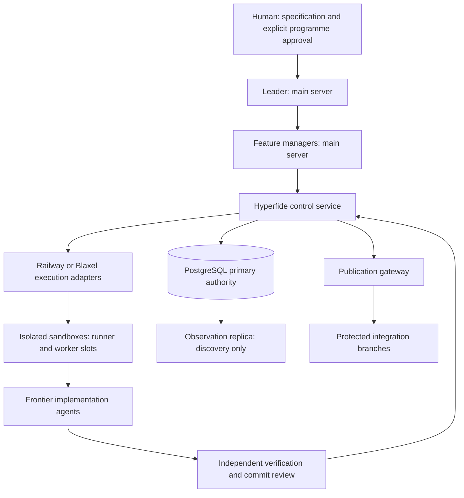

<div align="center">

# Hyperfide


<a
  href="https://trendshift.io/repositories/267432?utm_source=trendshift-badge&amp;utm_medium=badge&amp;utm_campaign=badge-trendshift-267432" target="_blank" rel="noopener noreferrer">

</a>

**एजेंट वर्कफ़्लो टूल जो छोटे, सरल प्रोजेक्ट से लेकर बड़े, जटिल कोडबेस तक साथ चलता है।**

लोकल CLI शुद्ध C11 में है: एक बाइनरी, एक SQLite डेटाबेस, कोई टेलीमेट्री नहीं।

[](../../LICENSE)
[](#)
[](../../.github/workflows/ci.yml)
</div>
<div align="center">

[English](../../README.md)  [简体中文](README.zh-CN.md) · [Español](README.es.md) · [हिन्दी](README.hi.md) · [العربية](README.ar.md) · [Français](README.fr.md) · [Português (BR)](README.pt-BR.md)
</div>

---

## परिचय

Hyperfide एक ही बाइनरी, `hyperfide`, में समाया हुआ एजेंट वर्कफ़्लो इंजन है। यह कोड से आगे की उन चार चीज़ों को सँभालता है जिनकी हर प्रोजेक्ट को ज़रूरत होती है — कोड **क्या है**, वह **यहाँ तक कैसे पहुँचा**, **आगे क्या होना है**, और रास्ते में **क्या सीखा गया** — और चारों को इंसानों और AI एजेंटों, दोनों के लिए उपलब्ध कराता है।

यह ट्री विकासाधीन Hyperfide 2.0 है: `hyperfide version` `2.0.0-dev` छापता है, और इसमें कुछ भी production रिलीज़ नहीं है। Hyperfide, Codify से निकला है, जिसकी 1.x रिलीज़, फ़ीचर IDs (जैसे `codify-v15` और `codify-v16`) और कमिट इतिहास अपने मूल नाम रखते हैं। 2.0 उसी लोकल CLI के चारों ओर एक [वितरित control plane](#hyperfide-कंट्रोल-प्लेन) जोड़ता है — supervisory सर्वर पर एक leader और feature managers, builds और एजेंटों के लिए remote sandboxes, और authority के रूप में PostgreSQL।

> **संगतता।** `hyperfide` मानक (canonical) कमांड है। `cg` एक deprecated compatibility alias है जो उसी executable से इंस्टॉल होता है, समान arguments, JSON और exit codes के साथ; यह स्वीकृत रिलीज़ की समर्थित compatibility window तक बना रहता है और केवल किसी बाद की रिलीज़ में हटाया जाता है जो इसकी घोषणा करे। नीचे हर उदाहरण `hyperfide` का उपयोग करता है; `cg` वही चीज़ चलाता है।

`hyperfide fleet up` main एजेंट, wave managers और task workers के लिए एक टिकाऊ, crash के बाद resume होने वाला supervisor शुरू करता है। यह हर Codex या Claude Code प्रोसेस को तब तक सँभालता है जब तक काम qualified और merged न हो जाए। एजेंटों को ग्राफ़ कॉन्टेक्स्ट मिलता है, integration से पहले branch drift जाँचा जाता है, और `hyperfide serve` events को एडिटर तक stream करता है। इंडेक्सिंग workers के बीच coalesce होती है; ग्राफ़ और मेमोरी हर branch और worktree को कवर करते हैं। मूल चक्र कोई नेटवर्क कॉल नहीं करता; जो थोड़े फ़ीचर करते हैं, उनके नाम इस परिचय के अंत में दिए गए हैं।

**कोड क्या है।** Hyperfide स्रोत फ़ाइलों को एक क्वेरी करने योग्य ग्राफ़ में इंडेक्स करता है: सिंबल, कॉल, imports, types, रूट और फुल-टेक्स्ट सर्च, सब SQLite में लोकल रूप से संग्रहीत। भाषा कवरेज नेटिव सिंटैक्स निष्कर्षण से लेकर केवल फ़ाइल ट्रैकिंग तक है; [कवरेज मैट्रिक्स](../../docs/indexing.md#extraction-coverage) हर परिवार की सीमा बताता है। `hyperfide context <query>` "इस हिस्से की पूरी तस्वीर दिखाओ" का जवाब एक ही कॉल में देता है: snippets के साथ मेल खाते सिंबल, कॉलर, कैली और संबंधित रूट। टिप्पणियाँ प्रथम-श्रेणी नोड के रूप में इंडेक्स होती हैं — उन उद्देश्यों, contracts, ख़तरों और couplings के लिए जो सिर्फ़ गद्य में रहते हैं।

**वह यहाँ तक कैसे पहुँचा।** बिल्ट-इन कंटेंट-एड्रेस्ड स्नैपशॉट सिस्टम आपको कमिट, इतिहास, डिफ़ और रिस्टोर देता है — किसी बाहरी VCS के बिना। क्योंकि स्नैपशॉट ग्राफ़ के साथ एक ही डेटाबेस साझा करते हैं, `hyperfide changes` आपके बिना कमिट किए बदलावों का प्रभाव दायरा बताता है। `hyperfide changelog` रिलीज़ नोट लिखता है: डिफ़ॉल्ट रूप से git इतिहास से — हर tag या version bump पर एक रिलीज़, commit-subject prefix से समूह, हर टास्क रेफ़रेंस साथ में, और key होने पर हर रिलीज़ के लिए मॉडल द्वारा लिखा एक छोटा Highlights पैराग्राफ़ — और जब आप `--snapshots` देते हैं या प्रोजेक्ट में git बिल्कुल नहीं होता, तो स्नैपशॉट चेन से, सिंबल-स्तरीय डिफ़ के साथ।

**आगे क्या होना है।** एक spec इंजन सादे-टेक्स्ट kvx spec फ़ाइलों को कार्यशील योजना में बदलता है: निर्भरता की waves वाला टास्क बोर्ड, हर टास्क से जुड़े स्वीकृति मानदंड — और ऐसा `done` जो सत्यापित होता है, सिर्फ़ घोषित नहीं। `hyperfide spec new` और `hyperfide spec add` योजना बनाते हैं, `hyperfide spec lint` साबित करता है कि वह चलने योग्य है, और चक्र उसे चलाता है। Prod मोड में `implemented` कोडिंग पूरी होने और source evidence को दर्ज करता है, qualification का दावा किए बिना; केवल `done` का मतलब है कि executable qualification और ग्राफ़ जाँचें पास हुईं। Parallel मोड में कई एजेंट एक साथ काम करते हैं, इस सीमा में कि हर टास्क के घोषित पाथ आपस में न टकराएँ।

**रास्ते में क्या सीखा गया।** एक एजेंट मेमोरी सोच-समझकर लिखे गए नोट — निर्णय, बाधाएँ, परिणाम, प्राथमिकताएँ, तथ्य — ग्राफ़ वाले उसी डेटाबेस में सहेजती है, हर नोट उस टास्क से जुड़ा जिसके दौरान वह बना। `hyperfide remember` काम के बीच एक नोट सहेजता है, हर `hyperfide spec done` अपने आप एक ईमानदार परिणाम दर्ज करता है (इनकार सहित), और `hyperfide recall` यह सब प्रासंगिकता और नवीनता के क्रम में वापस लाता है।

ये परतें एक-दूसरे को मज़बूत करती हैं: कमिट अपने आप उस टास्क से टैग होते हैं जिसे वे लागू करते हैं, मेमोरी उसी टास्क पर सामने आती हैं जिससे वे जुड़ी हैं, `hyperfide why` किसी सिंबल को उसके पीछे के निर्णयों तक ले जाता है, और `hyperfide spec trace` किसी भी टास्क से उसके सिंबल, कमिट और मेमोरी तक ले जाता है।

**और यह कदमों के बीच भी मौजूद रहता है, सिर्फ़ उन पर नहीं।** `hyperfide work open` एक संक्षिप्त टास्क पैकेट से शुरू करता है, `hyperfide work update` केवल नए state/evidence/workspace बदलाव लौटाता है, `hyperfide event progress` गतिविधि को प्रगति समझे बिना loops पहचानता है, और `hyperfide guard` बताता है जब कोई edit घोषित दायरे से बाहर जाता है। बिल्ट-इन MCP सर्वर हर MCP-सक्षम एजेंट को 67 टूल, resources और prompts देता है, जबकि `hyperfide integrate` हर host के नेटिव कॉन्फ़िगरेशन की योजना बनाता, लागू करता और जाँचता है।

**और यह एजेंटों को चलाता भी है, सिर्फ़ सेवा नहीं करता।** `hyperfide handoff` और `hyperfide resume` किसी टास्क को state खोए बिना एक सेशन से दूसरे तक ले जाते हैं, `hyperfide spec claim-next` खाली बैठे एजेंट को अगला टकराव-रहित टास्क atomically सौंपता है, और `hyperfide spec run` पूरी wave को Codex CLI या Claude Code सेशनों में बाँट देता है — हर claimed टास्क के लिए एक sandboxed child प्रोसेस, लॉग और prompt डिस्क पर, विफलता पर lease मुक्त।

**और यह पूरे fleet को झेल लेता है।** इंडेक्सिंग एक साझा संसाधन है, हर प्रोसेस की अलग आदत नहीं: पास चाहने वाला पहला `hyperfide` उसे चलाता है, बाकी एक नोट छोड़कर उसी में मिल जाते हैं, freshness window होने पर walk पूरी तरह छोड़ दिया जाता है, और मशीन-व्यापी parse slots एक साथ चल रहे प्रोजेक्टों को कोर बजट में रखते हैं ([docs/sync.md](../../docs/sync.md))। उसके ऊपर `spec/workflow.kvx` एक hierarchy घोषित कर सकता है — टास्क सूची का मालिक main एजेंट, हर wave का एक manager, हर टास्क का एक worker — और `hyperfide fleet` branch flow चलाता है: worktree, merge-up, test और lint gates के पीछे land, pull request, checkpoint। `hyperfide fleet up` यह पूरा पेड़ एक detached supervisor के नीचे खुद चलाता है — सभी waves एक साथ, हर manager और उसके workers साथ ज़िंदा, हर worker अपने worktree में — अटके एजेंटों को nudge करता है, विफल एजेंटों को ग़लती की जानकारी के साथ दोबारा चलाता है, जिसे बचाया न जा सके उसे escalate करता है, आपके चुने approval gates पर रुकता है, और complete तब बताता है जब काम **merged** हो, न कि जब कोई प्रोसेस बंद हो ([docs/hierarchy.md](../../docs/hierarchy.md))। Supervisor को बंद कर दें तो `hyperfide fleet up --resume` अब भी ज़िंदा एजेंटों को अपना लेता है। spec से drift, टकराते टास्क और दूसरी branches जिन interfaces पर निर्भर हैं उनके बदलाव merge से पहले चिह्नित होते हैं ([docs/drift.md](../../docs/drift.md)); `hyperfide projection build` हर सक्रिय branch को, बिना कमिट किए काम सहित, एक projection ref पर जोड़ता है और कुछ भी merge होने से पहले सिंबल, interface और टेक्स्ट टकरावों को उनकी branches के नाम के साथ बताता है, और projection hooks, `hyperfide watch`, `hyperfide serve` और supervisor के ज़रिए काम के साथ चलता रहता है ([docs/projection.md](../../docs/projection.md))। हर बदलाव एक event है जिसे `hyperfide events --follow` और `hyperfide serve` लाइव stream करते हैं ([docs/events.md](../../docs/events.md))। सब एक ग्राफ़ और एक मेमोरी साझा करते हैं: रिपॉज़िटरी की हर branch और linked worktree उसी `.codegraph/` में, branch के दायरे में, इंडेक्स होती है ([docs/branches.md](../../docs/branches.md))।

**और ज़रूरत पड़ने पर यह निर्णय माँगता है।** `hyperfide jev` typed फ़ैसलों के लिए TypeSafe के System One मॉडल तक पहुँचता है — true/false, one-of, ranked। `hyperfide memory classify` इससे बताता है कि कौन से नोट पुन: प्रयोग योग्य skills हैं, और `hyperfide skills promote` उन्हें पोर्टेबल `.agents/skills/<slug>/SKILL.md` में रेंडर करता है; विफल `verify_cmd` को एक triage लाइन, `hyperfide guard` के findings को रैंकिंग, और pull request को readiness स्कोर मिलता है। Jev इस पर बने फ़ीचरों के लिए अनिवार्य है, मूल चक्र के लिए कभी नहीं, और कभी प्रामाणिक नहीं — Jev का कोई जवाब exit code नहीं बदलता ([docs/jev.md](../../docs/jev.md))।

**और documentation आख़िरी सत्यापित टास्क है।** नए फ़ीचर spec में `@docs` closure stage डिफ़ॉल्ट रूप से चालू रहता है। सारे सामान्य टास्क qualify होने के बाद Hyperfide spec, टास्क-attributed स्नैपशॉट, कोड ग्राफ़, रूट, मेमोरी, जाँचों और मौजूदा docs से एक सीमित evidence पैकेट बनाता है। वही कॉन्फ़िगर किया गया एजेंट connector user और developer documentation अपडेट करता है, जबकि `hyperfide docs check` घोषित claim रेफ़रेंस, लोकल inline links, ज़रूरी ग्राफ़-सतह कवरेज और कॉन्फ़िगर किया गया target दायरा जाँचता है। `hyperfide docs close` एक अलग `[spec:<feature>/@docs]` स्नैपशॉट और अगले spec flow के लिए incremental baseline दर्ज करता है। ये संरचनात्मक जाँचें समीक्षा में मदद करती हैं; हर वाक्य के अर्थ को प्रमाणित नहीं करतीं।

CLI ऐसी कोई बैकग्राउंड सर्विस नहीं चलाता जो आपने शुरू न की हो और कोई टेलीमेट्री नहीं भेजता — fleet supervisor केवल `hyperfide fleet up` के बाद चलता है और `hyperfide fleet down` से रुकता है। ग्राफ़, मेमोरी, स्नैपशॉट और पूरा टास्क चक्र आपकी मशीन पर चलते हैं और वहीं रहते हैं। अपवाद नामित और opt-in हैं: Jev decisions को `OPENROUTER_API_KEY` चाहिए, और केवल उन पर बनी कमांड ही वह कॉल करती हैं; `hyperfide changelog` रिलीज़ highlights के लिए मॉडल से पूछता है, और `hyperfide recap` में Solar Decide पिछले सेशनों से कथन चुनता है और एक मॉडल brief लिखता है — दोनों केवल तब जब `CENTRA_API_KEY` (या `HYPERFIDE_CHANGELOG_KEY`) सेट हो; और `hyperfide fleet pr` और `checkpoint` `gh` को कॉल करते हैं। `services/hyperfide` के अंतर्गत वितरित control services अलग प्रोसेस हैं जिन्हें आप स्पष्ट रूप से शुरू करते हैं ([Hyperfide कंट्रोल प्लेन](#hyperfide-कंट्रोल-प्लेन))।

## Hyperfide क्यों

**यह योजना से प्रमाण तक का चक्र पूरा करता है।** ज़्यादातर टूल या तो काम की योजना बनाते हैं (टास्क सूचियाँ) या कोड का वर्णन करते हैं (सर्च, इंडेक्स)। Hyperfide दोनों एक ही डेटाबेस पर करता है, इसलिए योजना हक़ीक़त से परखी जा सकती है: जब कोई टास्क घोषित करता है कि वह `checkMode` जोड़ता है और `src/*.ts` को छूता है, तो `hyperfide spec done` तब तक उसे पूरा नहीं मानता जब तक ग्राफ़ और इतिहास सहमत न हों।

**एजेंट इंजीनियर की तरह काम करते हैं, सैलानी की तरह नहीं।** रिपॉज़िटरी में फ़ाइल-दर-फ़ाइल भटकने के बजाय एजेंट `hyperfide spec next` से पूछता है कि क्या करना है, `hyperfide context` से उस हिस्से की पूरी जानकारी लेता है, और `hyperfide impact` से जानता है कि कौन टूटेगा — फिर स्वचालित टास्क एट्रिब्यूशन के साथ कमिट करता है। पूरा चक्र MCP पर उपलब्ध है, इसलिए उसे कभी प्रोटोकॉल छोड़ना नहीं पड़ता।

**प्रोजेक्ट वह याद रखता है जो सेशन भूल जाते हैं।** एजेंट के कॉन्टेक्स्ट विंडो रीसेट हो जाते हैं; मेमोरी टेबल नहीं। `hyperfide remember` से एक बार लिखा निर्णय अगले सेशन को अपने आप मिलता है — `hyperfide spec next` पर, `hyperfide spec start` पर, सेशन की शुरुआत में `hyperfide recall` में — बजाय इसके कि उसे पूरी कीमत चुकाकर फिर से खोजा जाए। और क्योंकि इनकार की गई पूर्णताएँ भी दर्ज होती हैं, "यह टास्क दो बार अटका और इसकी वजह यह है" बस एक क्वेरी दूर है।

**कॉन्टेक्स्ट बीस नहीं, एक कॉल में आता है — और एक बजट के भीतर।** `hyperfide context <query>` इस हिसाब से बना है कि एजेंट असल में कोड कैसे पढ़ते हैं। एक अनुरोध काम शुरू करने के लिए ज़रूरी सब कुछ लौटाता है: प्रासंगिक मेमोरी, execution कहाँ प्रवेश करता है, क्या मेल खाया, उसे कौन कॉल करता है, वह किसे कॉल करता है, और कौन से रूट उसे छूते हैं — रैंक करके (असली परिभाषाएँ test fixtures से ऊपर, कॉल होने वाला कोड dead code से ऊपर) और token बजट में फ़िट करके (`--budget`, डिफ़ॉल्ट 4000)। कोई सिंबल पूरा एक बार छपता है; उसके बाद हर उल्लेख एक संक्षिप्त `name path:line` होता है, और बजट से कटी हर चीज़ चुपचाप हटाने के बजाय स्पष्ट omitted गिनती के साथ बताई जाती है।

**Impact analysis एक प्रथम-श्रेणी कमांड है।** `hyperfide impact <name> -d 3` कॉलर और कैली edges पर ट्रांज़िटिव रूप से चलता है और किसी भी बदलाव से पहले मायने रखने वाले दो सवालों का जवाब देता है: इसे हिलाने पर कौन टूटेगा, और यह किस पर निर्भर है।

**सर्च तुरंत और परतदार है।** सिंबल नामों पर FTS5 ट्राइग्राम इंडेक्स बिना वॉर्म-अप के case-insensitive सबस्ट्रिंग मैच देता है, और बाकी सब के लिए पूरी फ़ाइल body पर एक word इंडेक्स उसका साथ देता है।

**कवरेज या ताज़गी अनिश्चित हो तो इंडेक्स यह बताता है।** `hyperfide watch` फ़ाइल बदलाव देखता है और debounced सिंक माँगता है। छूटा watcher event या विफल registration टिकाऊ reconciliation debt छोड़ता है। CLI और MCP जवाब extraction कवरेज और सीमित source जाँचों को verified, stale या unchecked के रूप में दिखाते हैं; coalesced अपडेट अपने आप में ताज़गी प्रमाणित नहीं करता। एक प्रोसेस इंडेक्स gate पकड़ता है जबकि बाकी कॉलर dirty नोट छोड़ते हैं, और मशीन-व्यापी slots प्रोजेक्टों के पार parse threads सीमित रखते हैं ([इंडेक्सिंग विवरण](../../docs/indexing.md#freshness-and-migrations))।

**यह जिस हार्डवेयर पर चलता है, उसके अनुसार ढल जाता है।** शुरू होते समय `hyperfide` अपने वर्कर पूल और SQLite कैश का आकार उससे तय करता है जो सिस्टम वास्तव में देता है: कंटेनर-सचेत कोर काउंट (cgroup v1/v2 CPU quota, affinity mask और online CPUs का प्रतिच्छेद), ईमानदार उपलब्ध RAM (`MemAvailable` का cgroup memory limits से प्रतिच्छेद), और मापी गई प्रति-प्रोजेक्ट लागत। 16-कोर वर्कस्टेशन को पूरी समानांतर पाइपलाइन मिलती है। 2-कोर VPS को ऐसी पाइपलाइन मिलती है जो भरोसे से पूरी हो। पाइपलाइन का आकार ठीक कैसे तय हुआ, यह देखने के लिए `hyperfide info` चलाएँ।

**सब कुछ लोकल रहता है।** ग्राफ़ `.codegraph/` के नीचे एक SQLite डेटाबेस में रहता है, और स्नैपशॉट `.codegraph/objects/` के नीचे कंटेंट-एड्रेस्ड objects हैं। डायरेक्टरी हटाइए, और हर निशान मिट जाता है।

## Intent layer

Parser सिंबल, कॉल और रूट देखता है। वह यह नहीं देख सकता कि कोई फ़ंक्शन
*क्यों* है, उसके कॉलर को क्या सच बनाए रखना है, या कि `load_tasks` के डिस्क
पढ़ने के बाद `save_tasks` का चलना ज़रूरी है — कोडबेस का यह आधा हिस्सा सिर्फ़
टिप्पणियों में रहता है। Hyperfide उसे इंडेक्स करता है ([docs/ANCHORS.md](../../docs/ANCHORS.md) पूरी
convention है):

- **Anchors** वे टिप्पणियाँ हैं जो derivability test पास करती हैं — *अगर कोई एजेंट
  कोड पढ़कर उसे लिख सकता था, तो वह anchor नहीं है।* चार
  प्रकार काम के हैं: **purpose**, **contract**, **danger**, **pointer**।
- **Doc-first retrieval**: जहाँ anchor है, `hyperfide context` body लाइनों की जगह doc +
  signature देता है — उसी token बजट में कई गुना ज़्यादा
  सिंबल।
- **`hyperfide survey`** एक body की कीमत में सौ फ़ाइलें पढ़ता है: purpose
  लाइनें और signatures सहित docs, body कभी नहीं।
- **Soft edges**: anchors के भीतर के नाम `(soft)` रेफ़रेंस में हल होते हैं —
  cross-language और dynamic couplings जिन्हें कोई parser नहीं निकाल सकता, इस तरह लेबल किए हुए कि
  उन्हें कभी parsed कॉल न समझा जाए।
- **Drift की ईमानदारी**: हर anchor जिस कोड का वर्णन करता है उसकी baseline रखता है। जब
  कोड आगे बढ़ जाता है, doc stale चिह्नित होता है — `hyperfide check`, `hyperfide guard` में, और
  retrieval में भी — जब तक उसे अपडेट या हटाया न जाए। चेतावनी, रोक नहीं।
- **`hyperfide anchors`** बिना anchor वाले सिंबल को coordination स्कोर (fan-out ×
  extent × referencing files, जानबूझकर कच्ची लोकप्रियता नहीं) से रैंक करता है ताकि backfill
  orchestration पॉइंट से शुरू हो, `sb_puts` से नहीं।

इनमें से कुछ भी अनिवार्य नहीं: convention कभी न अपनाने वाली रिपॉज़िटरी को भी
पहले से मौजूद टिप्पणियों से capture, survey और soft edges मिलते हैं।

## Hyperfide के साथ एक सेशन

```sh
hyperfide brief                     # root, active task + ACs, uncommitted work, prior decisions
hyperfide spec next                 # the next eligible task, ACs + relevant memories
hyperfide spec start 16.7           # claim it — one task in progress at a time
hyperfide context "password auth"   # memories, entry points, symbols, callers, routes in one call
hyperfide why verifyLogin           # who changed it, under which task, and what was decided
hyperfide impact verifyLogin -d 2   # who breaks if this changes
# ...implement...
hyperfide guard                     # anything drifting outside what task 16.7 declared?
hyperfide test-impact               # which tests cover what you just changed
hyperfide remember "sessions rotate on login" --type decision   # linked to task 16.7
hyperfide review                    # the change, paired with the ACs it claims to satisfy
hyperfide commit -m "add password auth"   # snapshot, auto-tagged [spec:ion_spec/16.7]
hyperfide spec done 16.7            # qualification: verify_cmd + graph checks; outcome recorded
hyperfide spec trace 16.7           # proof: task -> symbols -> commits -> memories
```

और जब सेशन को टास्क पूरा होने से पहले रुकना पड़े — कॉन्टेक्स्ट विंडो भर गई हो, दिन ख़त्म हो गया हो — तो काम भाप नहीं बनता:

```sh
# session A, stopping early
hyperfide handoff --done "schema migration; token rotation" \
                  --next "wire the login route; extend 03_auth test" \
                  --blocked "flaky fixture on CI" -m "rotate on login, not refresh"

# session B, hours later, a fresh context window
hyperfide resume --prompt   # paste-ready block: task, steps done, blockers,
                            # next steps, uncommitted files, lease state
```

Handoff टास्क से जुड़ी एक structured मेमोरी के रूप में संग्रहीत होता है; हर नया handoff पिछले को supersede करता है, इसलिए `hyperfide resume` हमेशा ताज़ा state देखता है, बासी नोटों का ढेर नहीं।

उस चक्र की हर कमांड एक MCP टूल भी है, इसलिए जुड़ा हुआ एजेंट उसे शुरू से अंत तक चला सकता है — और हर कदम दस-फ़ाइल प्रोजेक्ट में भी उतना ही अच्छा काम करता है जितना monorepo में। `hyperfide check` CI में पूरा gate एक कदम में चलाता है, और `hyperfide hook install` सिंक और scope जाँच को जोड़ देता है ताकि इसका ज़्यादातर हिस्सा बिना किसी के बुलाए हो।

## समर्थित भाषाएँ और फ्रेमवर्क

नेटिव सिंटैक्स adapters JavaScript/JSX, TypeScript/TSX, C, C++, Objective-C, Go, Rust, Python, Ruby, PHP, Java, Kotlin, Scala, C#, Swift, Dart, Lua, Luau, R, Erlang, Solidity, Terraform, Nix, Pascal, COBOL, VB.NET, CFScript, CFQuery और ArkTS को कवर करते हैं। Mixed-format adapters चुनिंदा CFML, Vue, Svelte, Astro, Liquid, Razor, Delphi form और MyBatis XML संरचनाओं को कवर करते हैं। JSON, YAML, Twig और properties फ़ाइल स्तर पर ट्रैक होते हैं। [इंडेक्सिंग गाइड](../../docs/indexing.md) समर्थित तथ्य, fallback, सीमाएँ और अनसुलझी सीमा-रेखाएँ समझाती है।

फ्रेमवर्क-सचेत रूटिंग समर्थित literal registrations दर्ज करती है और जहाँ evidence अनुमति दे, वहाँ विशिष्ट रूप से पहचाने गए handler को जोड़ती है। यह Express, Next.js, React Router, Expo Router, SvelteKit, Vue/Nuxt, FastAPI, Django, Flask, Laravel, Rails, Spring, Gin, Axum, ASP.NET और Vapor को कवर करती है, साथ ही Koa, Fastify, Hapi, NestJS, Sinatra, Echo, Fiber, Chi और Actix में चुनिंदा registrations को। Computed पाथ और अस्पष्ट handlers अनसुलझे रहते हैं।

## इंस्टॉलेशन

इस संशोधन में Hyperfide 2.0 सोर्स से बिल्ड किया जाता है। `scripts/install.sh` का one-line installer तब तक Hyperfide रिलीज़ के रूप में प्रचारित नहीं किया जाता जब तक distribution और rename टास्क (`spec/hyperfide/spec.kvx` में 25.4 और 26.2) बंद न हो जाएँ।

निर्भरताएँ: एक C कंपाइलर, `python3` (बिल्ड इससे नेटिव components खोजता है), और SQLite, libcurl और OpenSSL के libcrypto के development packages (Debian और Ubuntu पर `libsqlite3-dev`, `libcurl4-openssl-dev`, `libssl-dev`)। tree-sitter runtime और grammars vendored हैं।

```sh
make && sudo make install
```

`make` `./hyperfide` को link करता है और उसे `./cg` में कॉपी करता है; `make install` जाँचता है कि दोनों byte-identical हैं और दोनों को `$(PREFIX)/bin` (डिफ़ॉल्ट `/usr/local`) में इंस्टॉल करता है। `make uninstall` दोनों को हटाता है। हर प्रोजेक्ट का `.codegraph/` डेटा कभी नहीं छुआ जाता।

मौजूदा प्रोजेक्टों पर अपग्रेड सुरक्षित है: डेटाबेस में schema वर्ज़न रहता है (इस ट्री में 18), और अपग्रेड के बाद पहली बार खुलने पर `hyperfide` केवल derived इंडेक्स टेबल (files, symbols, refs, routes, imports और सर्च इंडेक्स) फिर से बनाता है — अगला सिंक उन्हें फिर भर देता है। मेमोरी, git इतिहास, leases, attempts, events, और branch व agent registries किसी migration में कभी नहीं हटते। पुरानी बाइनरी नए डेटाबेस को downgrade करने के बजाय खोलने से इनकार करती है।

फिर किसी भी प्रोजेक्ट में:

```sh
cd your-project
hyperfide init
```

टर्मिनल पर `hyperfide init`, `hyperfide index` और `hyperfide sync` stderr पर एक लाइव progress लाइन
दिखाते हैं — चरण, कुल में से कितनी फ़ाइलें हो चुकीं, workers, बीता समय, और जिस
lock का इंतज़ार है वह — जो सारांश से पहले मिट जाती है। पाइप किया गया आउटपुट नहीं बदलता;
`HYPERFIDE_PROGRESS=plain` इसकी जगह सादी लाइनें छापता है, `HYPERFIDE_PROGRESS=0` इसे बंद कर देता है।
देखें [docs/sync.md](../../docs/sync.md#progress)।

Environment variables हर जगह `HYPERFIDE_*` के रूप में लिखे जाते हैं। पुराने `CG_*` नाम, और वे `CODIFY_*` नाम जिन्हें ट्री अब भी पहचानता है (`CODIFY_ROOT`, `CODIFY_INSTALL_DIR`, `CODIFY_BASE_URL`, और authority, credential, transport, MCP tool-policy और mode variables), उसी setting के aliases के रूप में स्वीकार किए जाते हैं; किसी alias और उसके `HYPERFIDE_*` नाम को अलग-अलग मान देने पर कमांड किसी एक को चुनने के बजाय alias-conflict त्रुटि के साथ रुक जाता है।

## कमांड संदर्भ

`hyperfide help` पूरा नक्शा छापता है: हर कमांड अपने समूह में, एक-एक लाइन में, टर्मिनल की चौड़ाई के हिसाब से। `hyperfide help <command>` (या `hyperfide <command> --help`, `-h`) एक कमांड का usage, subcommands, फ़्लैग, उदाहरण और संबंधित कमांड दिखाता है; `hyperfide help --all` सबको छापता है, और `hyperfide help --json` एडिटरों और एजेंटों को वही टेबल देता है ताकि वे उससे मेनू बना सकें। नीचे की टेबल वही कमांड बताती हैं जो `hyperfide help` बताता है। Overview [संगतता](#परिचय) पैराग्राफ़ में उद्धृत command-name नोट भी छापता है।

| कमांड | विवरण |
| --- | --- |
| `hyperfide help [<command>] [--all] [--json]` | समूहों वाला overview, एक कमांड का विवरण, सारे विवरण, या पूरी टेबल JSON में। अनजाना नाम सबसे क़रीबी नाम सुझाता है और 1 पर exit करता है। Bold और dim केवल टर्मिनल पर (`NO_COLOR`, `TERM=dumb` और `HYPERFIDE_COLOR=0\|1` तय करते हैं); `COLUMNS` चौड़ाई तय करता है, जो कभी 60 से कम नहीं होती |
| `hyperfide version` | वर्ज़न छापता है (`--version` भी) |

### ग्राफ़

| कमांड | विवरण |
| --- | --- |
| `hyperfide init [--nested] [--force]` | `.codegraph/` बनाकर पहला इंडेक्स बनाता है; initialized रिपॉज़िटरी के linked git worktree के भीतर, इसके बजाय इस branch के रूप में साझा ग्राफ़ से जुड़ता है। किसी घेरने वाले प्रोजेक्ट के भीतर (`--nested` इस डायरेक्टरी को अपना अलग प्रोजेक्ट बनाता है) और आपकी home डायरेक्टरी में (`--force`) इनकार करता है |
| `hyperfide sync [paths] [--max-age MS] [--background] [--wait MS] [--auto] [--workers N]` | इंक्रीमेंटल इंडेक्स: पहले से चल रहे पास में मिल जाता है (`--wait`, डिफ़ॉल्ट 2000 ms), ताज़ा होने पर छोड़ देता है, और केवल नामित पाथ पर walk करता है; `--auto` एक implicit सिंक चिह्नित करता है जिसे `[sync] auto = false` छोड़ देता है |
| `hyperfide index [--full] [--workers N]` | सिंक का blocking रूप जो हमेशा walk करता है, पहले से चल रहे पास का इंतज़ार करते हुए। `--workers N` (दोनों पर) `HYPERFIDE_INDEX_WORKERS` और प्रोजेक्ट कॉन्फ़िगरेशन के `[index] workers` से ऊपर रहता है। lock wait के बाद भी डेटाबेस व्यस्त रहे तो 75 पर exit करता है |
| `hyperfide branches` | साझा ग्राफ़ में इंडेक्स हर branch, उसके worktree, head, base और फ़ाइल गिनती के साथ |
| `hyperfide search <q> [-n N]` | सिंबल और फुल-टेक्स्ट सर्च (डिफ़ॉल्ट 20 नतीजे; `--path`, `--lang`, `--kind`, `--name`, `--no-tests` इसे सीमित करते हैं): एक वाक्यांश नामों (`export memory` से `memory_export` और `exportMemory` मिलते हैं), doc टिप्पणियों और bodies से मेल खाता है, इसी क्रम में रैंक होकर, tests से पहले source; फ़ाइल hits मेल खाती लाइन दिखाते हैं। जवाब परिभाषाएँ देती हैं, उनके prototypes कभी नहीं; exact और segment मैच कुछ न पाएँ तो एक सीमित typo fallback लागू होता है ([docs/retrieval.md](../../docs/retrieval.md)) |
| `hyperfide grep <pattern> [-E] [-i]` | shell grep की जगह लाइन सर्च: literal (या `-E` regex) trigram इंडेक्स से मिलता है, डिस्क से पढ़ा जाता है, हर hit अपने घेरने वाले सिंबल में रखा जाता है, `-n` और `--budget` से रैंक और सीमित, छूटे हिस्से की गिनती सहित; `--path`, `--lang`, `--no-tests`, `--symbol`, `--kind`, `-C`, `--files`, `--count` ([docs/retrieval.md](../../docs/retrieval.md)) |
| `hyperfide symbol <name>` | परिभाषा, snippet और रेफ़रेंस गिनती |
| `hyperfide impact <name> [-d N] [--budget N]` | गहराई N (डिफ़ॉल्ट 3) तक ट्रांज़िटिव कॉलर और कैली, token बजट (डिफ़ॉल्ट 8000) में फ़िट |
| `hyperfide flow <callers\|callees\|impact\|paths> <name> [target]` | source evidence, dynamic सीमाओं और स्पष्ट limits के साथ सीमित typed-relation traversal: `--depth` (1 से 8), `--max-nodes` (256 तक), `--max-edges` (512 तक), `--max-ms` (2000 तक), `--max-output` bytes |
| `hyperfide inspect` | पदानुक्रम और सावधान बिना-रेफ़रेंस-कोड जाँच; नीचे के subcommands देखें |
| `hyperfide inspect hierarchy <name> [-n N]` | typed relations से सीमित ancestors, subtypes और implementations |
| `hyperfide inspect unused [-n N] [--path GLOB]` | बिना रेफ़रेंस वाले सिंबल और ज्ञात roots से सीमित reachability, बाहर रखने के कारणों के साथ; कभी हटाने का फ़ैसला नहीं |
| `hyperfide context <q> [--budget N] [-n K]` | एजेंटों के लिए एक-कॉल कॉन्टेक्स्ट बंडल: मेमोरी, सिंबल, एंट्री पॉइंट, रूट — शीर्ष K सिंबल (डिफ़ॉल्ट 8), token बजट (डिफ़ॉल्ट 4000) तक भरे हुए, स्पष्ट omitted गिनती के साथ और `--json` में `tokens_used` के साथ। फ़ाइल पाथ देने पर फ़ाइल की रूपरेखा (purpose, सिंबल, imports, dependents) मिलती है; डायरेक्टरी देने पर उसकी फ़ाइलें |
| `hyperfide survey [path\|query] [--budget N]` | bodies से नीचे का स्तर: हर कॉल में ~100 फ़ाइलों की purpose लाइनें और signatures सहित सिंबल docs — body कभी नहीं। बिना कवर फ़ाइलें और सिंबल नामित होते हैं, और बजट (डिफ़ॉल्ट 16000) से कटी हर चीज़ एक स्पष्ट omitted गिनती है |
| `hyperfide files [pattern] [--dirs] [--depth N] [-n N]` | glob (`src/**/*.go`), पाथ के शब्दों (`sync gate`) या डायरेक्टरी से फ़ाइलें, हर एक भाषा, लाइनों और सिंबल गिनती के साथ; `--dirs` डायरेक्टरियों का नक्शा फ़ाइल और लाइन गिनती व प्रमुख भाषा सहित देता है। `--path`, `--lang` और `--no-tests` इसे वैसे ही सीमित करते हैं जैसे `search`, `context` और `survey` को |
| `hyperfide anchors [--stale] [--uncovered]` | Anchor की सेहत: वे docs जिनका कोड आगे बढ़ गया, और coordination स्कोर (fan-out × extent × referencing files) से रैंक किए बिना कवर सिंबल — backfill की कार्य-सूची |
| `hyperfide routes [filter]` | URL पैटर्न से handler की टेबल |
| `hyperfide show <symbol\|path:line> [--full]` | केवल उस सिंबल की body — नाम से, या एडिटर के cursor की स्थिति से; लंबी bodies `… (+N more lines, use --full)` marker के साथ कटती हैं |
| `hyperfide why <symbol>` | उत्पत्ति: इसे बदलने वाले कमिट, उनके लागू किए टास्क, दर्ज निर्णय |
| `hyperfide test-impact [symbol]` | किसी सिंबल — या आपके बिना कमिट बदलावों के हर सिंबल — को रेफ़र करने वाले टेस्ट |
| `hyperfide watch [--debounce MS] [--fleet]` | नेटिव filesystem events पर ऑटो-सिंक (debounce डिफ़ॉल्ट 300 ms); `--fleet` ग्राफ़ को ज्ञात हर worktree को उसकी अपनी branch के नीचे देखता है |
| `hyperfide root` | यहाँ से `hyperfide` जिस प्रोजेक्ट root पर पहुँचता है; `--json` साझा प्रोजेक्ट, worktree flag और branch जोड़ता है |
| `hyperfide info` | मशीन प्रोफ़ाइल, पाइपलाइन आकार (worker गिनती और उसका स्रोत), बँधा हुआ प्रोजेक्ट root और branch, branch-स्तरीय इंडेक्स कवरेज, और parser सूची |
| `hyperfide config [init\|get K\|set K V\|check] [--json]` | `hyperfide.kvx` में प्रोजेक्ट कॉन्फ़िगरेशन (पुराना `codify.kvx` अब भी पढ़ा जाता है): हर setting उसके स्रोत के साथ, टिप्पणी किए डिफ़ॉल्ट, एक key को उसी जगह पढ़ना या लिखना, और अज्ञात keys व ग़लत मानों की जाँच। `hyperfide init` से पहले भी काम करता है। देखें [docs/config.md](../../docs/config.md) |

### वर्ज़न कंट्रोल

स्नैपशॉट SHA-256 से कंटेंट-एड्रेस्ड हैं और ब्लॉब डीडुप्लिकेट होते हैं।

| कमांड | विवरण |
| --- | --- |
| `hyperfide commit -m <msg>` | वर्किंग ट्री का स्नैपशॉट, पहले सिंक होकर और चालू टास्क से अपने आप टैग होकर; `--task <id>` टास्क का नाम देता है, `--amend` आख़िरी स्नैपशॉट को बदल देता है, `--git` उसी spec टैग के साथ असली git कमिट भी करता है |
| `hyperfide log [-n N]` / `hyperfide status` | स्नैपशॉट इतिहास (डिफ़ॉल्ट 20), और HEAD की तुलना में वर्कट्री, branch-स्तरीय इंडेक्स कवरेज और लंबित reconciliation के साथ |
| `hyperfide diff [A] [B]` | स्नैपशॉट या वर्कट्री के बीच LCS लाइन डिफ़ |
| `hyperfide checkout <id> [--force]` | स्नैपशॉट बहाल करता है |
| `hyperfide changes [--limit N]` | बिना कमिट edits का प्रभाव दायरा: आपके छुए सिंबल और उनके बाहरी कॉलर — डिफ़ॉल्ट रूप से सीमित (40 सिंबल, हर एक के 8 कॉलर) `(+N more)` markers के साथ; `--limit` इसे बदलता है |
| `hyperfide git-sync [-n N]` | git इतिहास ingest करता है (डिफ़ॉल्ट 2000 कमिट) — कमिट, लेखक, प्रति-फ़ाइल churn — जो फिर सर्च और कॉन्टेक्स्ट की रैंकिंग करता है और `hyperfide why` का जवाब देता है |
| `hyperfide events [--since N] [--kind K,..] [-n N] [--follow [--for S]] [--head]` | Event log: हर task, claim, attempt, agent, fleet, supervisor, drift और approval बदलाव sequence नंबर के साथ। `--kind` comma सूची लेता है जिसमें अंत का `.` prefix है (`fleet.`); `--follow` stream करता है; `--json` हर लाइन पर एक object है। देखें [docs/events.md](../../docs/events.md) |

Hyperfide के स्नैपशॉट git की जगह नहीं लेते। `.gitignore` को `.cgignore` के साथ माना जाता है, `hyperfide git-sync` आपका असली इतिहास पढ़ता है, और `hyperfide commit --git` दोनों में लिखता है, इसलिए Hyperfide अपनाना कभी सब-या-कुछ-नहीं वाला फ़ैसला नहीं होता।

### Changelog

`hyperfide changelog` git इतिहास से रिलीज़ नोट बनाता है। रिलीज़ किसी tag **या** उस कमिट से शुरू होती है जिसने प्रोजेक्ट का वर्ज़न बदला — `src/cg.h` में `CG_VERSION`, एक `VERSION` फ़ाइल, या `package.json` — इसलिए कभी tag न करने वाले प्रोजेक्ट को भी हर वर्ज़न का एक सेक्शन मिलता है। आख़िरी रिलीज़ के बाद का हिस्सा उस वर्ज़न से नामित होता है जो वर्किंग ट्री में है, अगर वह नया है (तैयार हो रही रिलीज़), या `--tag NAME` से, और केवल वरना `[Unreleased]`। समूह commit-subject prefix है, और `hyperfide commit` जो `[spec:<feature>/<task>]` जोड़ता है वह bullet पर टास्क रेफ़रेंस बनता है। कमिट और compare links `git remote get-url origin` से आते हैं; remote न हो तो bullet `- Add gauge (497c30a)` जैसा दिखता है और footer links छोड़ दिए जाते हैं।

```markdown
## [0.3.0] - 2026-09-28

### Features
- Add gauge ([497c30a](https://github.com/acme/demo/commit/497c30acbc9dc0daf869af07a993db74ea0da779))

### Documentation
- Explain gauges ([191d0c8](https://github.com/acme/demo/commit/191d0c811203dc1bba7b39f0b9095e5875a1ff7f))

## [0.2.0] - 2026-09-28

### Bug fixes
- **parser:** Handle empty input ([682f9f8](https://github.com/acme/demo/commit/682f9f8c9bd6bb5813cfc2665c4e1265fba16933), task demo/1.2)

[0.3.0]: https://github.com/acme/demo/compare/0.2.0...0.3.0
[0.2.0]: https://github.com/acme/demo/compare/0.1.0...0.2.0
```

**Highlights।** environment या प्रोजेक्ट की `.env` में `CENTRA_API_KEY` (या `HYPERFIDE_CHANGELOG_KEY`) हो, तो हर रिलीज़ को एक `### Highlights` ब्लॉक भी मिलता है: दो से पाँच वाक्य, और बड़ी रिलीज़ में कुछ bullets, मॉडल द्वारा उसी रिलीज़ के समूहित कमिट से लिखे हुए। derived bullets कभी नहीं बदलते, और prompt मॉडल से कहता है कि कमिट जो नहीं कहते, वह कुछ न गढ़े। डिफ़ॉल्ट endpoint `https://gateway.centra.ag/v1/chat/completions` है, मॉडल `openrouter/anthropic/claude-haiku-5.5` के साथ; `HYPERFIDE_CHANGELOG_ENDPOINT` और `HYPERFIDE_CHANGELOG_MODEL` इसे किसी भी OpenAI-compatible जगह पर ले जाते हैं। जवाब रिलीज़ के कमिट और मॉडल के हिसाब से `.codegraph/changelog-cache/` में कैश होते हैं, इसलिए फ़ाइल दोबारा बनाने पर केवल बदली रिलीज़ के बारे में पूछा जाता है। `--summarize` ज़ोर देता है (और key न मिलने पर यह बताता है), `--no-summarize` मॉडल को बाहर रखता है, और विफल कॉल stderr पर `highlights for <release> skipped — <why>` छापकर बिना गद्य के नोट लिख देती है।

```sh
hyperfide changelog -o CHANGELOG.md        # every release, highlights when a key is present
hyperfide changelog --unreleased           # only the newest section and its footer line
hyperfide changelog --tag 1.2.0            # name the newest section 1.2.0, dated today
hyperfide changelog --no-summarize -n 3    # the plain record, three newest releases
```

`-n N` रिलीज़ सेक्शनों की सीमा तय करता है, और `-o FILE` फ़ाइल को रिपॉज़िटरी root के सापेक्ष लिखता है और बताता है कि कितने highlights लिखे गए और कितने कैश से आए। `--snapshots` — और `.git` रहित कोई भी प्रोजेक्ट — स्नैपशॉट रेंडरर पर लौटता है, जिसका आउटपुट रिलीज़ इतिहास के बजाय हर स्नैपशॉट का सिंबल-स्तरीय डिफ़ है। रिपॉज़िटरी root पर `cliff.toml` मेल खाता [git-cliff](https://git-cliff.org) कॉन्फ़िगरेशन है; git-cliff केवल tags जानता है, इसलिए दोनों एक जैसी फ़ाइल केवल उस रिपॉज़िटरी के लिए बनाते हैं जिसमें सिर्फ़ tags हों, कोई version फ़ाइल न हो और कोई मॉडल key न हो। इस रिपॉज़िटरी का `CHANGELOG.md` `hyperfide changelog -o CHANGELOG.md` से बनाया जाता है।

### Recap

`hyperfide recap` वह brief लिखता है जिसकी ज़रूरत किसी नए एजेंट को प्रोजेक्ट फिर से उठाने के लिए होती है: प्रोजेक्ट क्या है, पिछले हफ़्तों में क्या बदला, हाल के सेशनों ने क्या किया, वे तथ्य जो वरना खो जाते, और अगला कदम। इसका कच्चा माल वे transcripts हैं जो Claude Code और Codex पहले से मशीन पर रखते हैं (`~/.claude/projects/<cwd>/*.jsonl` और `~/.codex/sessions/**/rollout-*.jsonl`, working directory से इस रिपॉज़िटरी से मिलाए हुए), जो कमिट के बीच के *क्यों* का इकलौता रिकॉर्ड हैं और पूरे सौंपने के लिए बहुत लंबे हैं।

दो मॉडल दो अलग काम करते हैं। हर transcript को कथनों में काटा जाता है — user का अनुरोध, assistant के जवाब का एक पैराग्राफ़ या bullet, edit की गई फ़ाइल, कमिट या टेस्ट करने वाली कमांड — और छोटे-छोटे हिस्सों में **Solar Decide** को सौंपा जाता है, जो Upstage का System One decision मॉडल है, Centra gateway के ज़रिए (`openrouter/upstage/solar-decide`, `https://gateway.centra.ag/v1/systemone` पर, Jev जैसी ही request schema)। हर कथन के लिए यह calibrated probabilities के साथ और बिना गद्य के तीन typed सवालों का जवाब देता है: वह किस प्रकार का है (goal, decision, constraint, fact, done, open thread, dead end, noise), क्या वह सेशन ख़त्म होने पर भी लागू था, और क्या resume करने वाले एजेंट को उसकी ज़रूरत है। जो कथन सीमा पार करते हैं, उन probabilities के गुणनफल से रैंक होकर और `--budget` अक्षरों तक कटकर, **decided log** बनाते हैं: हर लाइन किसी सेशन से उद्धृत, कोई भी मॉडल की लिखी नहीं। वह log, रिपॉज़िटरी से पढ़े तथ्यों (सक्रिय फ़ीचर और उसके टास्क statuses, हाल के कमिट, संग्रहीत मेमोरी) के साथ, उस gateway chat मॉडल के पास जाता है जिसे `hyperfide changelog` पहले से उपयोग करता है, और वही brief लिखता है। decided log `.codegraph/recap/decided.md` पर रखा जाता है ताकि brief के किसी भी वाक्य को उस बात से मिलाया जा सके जो असल में कही गई थी।

```bash
hyperfide recap                              # 6 newest sessions of the last 21 days → <context>/recap.md
hyperfide recap --sessions 10 --since 45     # wider window
hyperfide recap --decided                    # stop at the picked statements; print them, write no prose
hyperfide recap --facts                      # the repository facts alone; no key, no model
hyperfide recap -o - --agents codex          # to stdout, Codex sessions only
```

दोनों कॉल environment या प्रोजेक्ट की `.env` से `CENTRA_API_KEY` (या `HYPERFIDE_CHANGELOG_KEY`) का उपयोग करती हैं; इसके बिना कमांड एक स्पष्ट त्रुटि के साथ रुक जाता है, क्योंकि किसी भी आधे का लोकल विकल्प नहीं है। Endpoint हर सवाल का बिल पूरी state के हिसाब से लेता है, इसलिए हिस्से छोटे होते हैं (6 कथन, `HYPERFIDE_RECAP_CHUNK`) और कई एक साथ चलते हैं (`HYPERFIDE_RECAP_PARALLEL`, डिफ़ॉल्ट 6)। समय और लागत सेशन और gateway पर निर्भर हैं; यह संशोधन कोई मापा हुआ आँकड़ा नहीं बताता। फ़ैसले हर हिस्से के लिए `.codegraph/recap-cache/` में कैश होते हैं, इसलिए दोबारा चलाने पर केवल नए सेशनों के बारे में पूछा जाता है। जो कभी किसी मॉडल तक नहीं पहुँचता: thinking blocks, टूल आउटपुट, harness notifications और reminders, code fences, और दूसरे प्रोजेक्टों के सेशन। `HYPERFIDE_RECAP_DECIDE_MODEL`, `HYPERFIDE_RECAP_DECIDE_ENDPOINT` और `HYPERFIDE_RECAP_MODEL` किसी भी आधे को कहीं और ले जाते हैं; `HYPERFIDE_RECAP_CLAUDE_DIR` और `HYPERFIDE_RECAP_CODEX_DIR` बताते हैं कि कहाँ देखना है। brief context डायरेक्टरी में `recap.md` में लिखा जाता है: डिफ़ॉल्ट रूप से `.codify/recap.md`, और प्रोजेक्ट में `hyperfide.kvx` होने पर `.hyperfide/context/recap.md`।

### कोड मैप

`hyperfide codemap` रिपॉज़िटरी root पर `CODEMAP.md` लिखता है: वह एक फ़ाइल जिसे नया एजेंट (या व्यक्ति) यह जानने के लिए पढ़ता है कि प्रोजेक्ट क्या है, उसे कैसे बिल्ड और टेस्ट करें, चीज़ें कहाँ हैं, और बाकी कोड किन सिंबल पर टिका है। यह ग्राफ़ से बनता है, कभी किसी मॉडल से नहीं। Purpose लाइनें कोड की अपनी फ़ाइल टिप्पणियाँ और READMEs हैं, और जिस डायरेक्टरी में दोनों न हों उसे कोई नहीं मिलती। सिंबल उन कॉल से रैंक होते हैं जो उन तक हल होती हैं। एक ही ग्राफ़ से एक ही bytes बनते हैं, और नक्शा कभी ख़ुद को नहीं गिनता, इसलिए `hyperfide codemap --check` CI gate के रूप में काम करता है। `hyperfide brief` नक्शे का नाम लेता है और बताता है कि वह ताज़ा है या नहीं; MCP `codemap` टूल उसे बिना लिखे लौटाता है। देखें [docs/codemap.md](../../docs/codemap.md)।

```bash
hyperfide codemap                  # write CODEMAP.md (8000-token budget)
hyperfide codemap --budget 3000    # tighter: least-referenced entries go first, each section counts what it left out
hyperfide codemap --check          # exit 1 when CODEMAP.md is missing or stale; writes nothing
hyperfide codemap -o - --json      # the same map as structured data
```

### मेमोरी

टिकाऊ एजेंट नोट, ग्राफ़ वाले उसी SQLite डेटाबेस में संग्रहीत। spec टास्क चालू रहते लिखी मेमोरी अपने आप उससे जुड़ जाती है, और `hyperfide spec done` परिणाम अपने आप दर्ज करता है। इनमें कभी सीक्रेट न रखें।

| कमांड | विवरण |
| --- | --- |
| `hyperfide remember <text>` | मेमोरी सहेजता है — `--type decision\|constraint\|outcome\|preference\|fact` (डिफ़ॉल्ट `fact`), `--task <feature/id>` (डिफ़ॉल्ट चालू spec टास्क), वैकल्पिक `--symbols` / `--files` anchors, पलटे गए निर्णय को हटाने के लिए `--supersedes <id>` |
| `hyperfide recall [query]` | मेमोरी खोजता है: body पर फुल-टेक्स्ट, प्रासंगिकता फिर नवीनता से रैंक; `--task`, `--type`, `-n N`, या anchored retrieval के लिए `--near <file>` से फ़िल्टर करें |
| `hyperfide forget <id>` | मेमोरी हटाता है |
| `hyperfide memory compact` | डुप्लिकेट मेमोरी समेटता है (preview के लिए `--dry-run`) |
| `hyperfide memory classify [<id>\|--all\|--unclassified]` | Jev से पूछता है कि हर नोट क्या है — `skill`, `decision`, `constraint`, `fact`, `noise` — confidence के साथ, और उसे मेमोरी पर संग्रहीत करता है। बिना argument के यह unclassified नोट लेता है; `-n N` बैच की सीमा तय करता है |
| `hyperfide memory export [-o FILE]` | मेमोरी को JSONL के रूप में लिखता है — एक header लाइन, फिर हर मेमोरी का एक object, content id से keyed — stdout या `FILE` में; `--task` (tag या prefix), `--type`, `--branch`, `--since DAYS` से चुनें |
| `hyperfide memory import <FILE\|->` | वे मेमोरी जोड़ता है जो इस ग्राफ़ में अभी नहीं हैं, content id से, एक transaction में: बनने का समय, class और supersession साथ जाते हैं; `--dry-run` बिना लिखे रिपोर्ट करता है, `--keep-branch` उन branch नामों को रखता है जिन्हें यह ग्राफ़ ट्रैक नहीं करता, `--retask OLD=NEW` task-tag prefix को फिर से लिखता है। `--from DIR` फ़ाइल की जगह किसी दूसरे Hyperfide प्रोजेक्ट का ग्राफ़ read-only पढ़ता है। देखें [docs/memory-transport.md](../../docs/memory-transport.md) |
| `hyperfide skills list\|promote <id>\|render` | `skill` वर्ग की मेमोरी, `.agents/skills/<slug>/SKILL.md` में promote की गई, और जिस नोट से आई उसके साथ अद्यतन रखी गई |

Supersede की गई मेमोरी कभी हटाई नहीं जाती — पलटाव भी सहेजने लायक इतिहास है। वह बस नतीजों में सबसे आगे नहीं रहती, इसलिए सेशन को पहले मौजूदा निर्णय मिलता है।

Classify की गई मेमोरी जहाँ भी दिखती है, अपना class साथ रखती है — `hyperfide recall` में `class skill 0.82`, `hyperfide brief` में `[decision/skill]`, और दोनों के `--json` में `class` और `confidence`। Promotion एक generated फ़ाइल लिखता है जो यह बात बताती है: उसमें एक ownership marker और मेमोरी का link होता है, उस marker के बिना कोई फ़ाइल कभी overwrite नहीं होती, और `hyperfide skills render` उन फ़ाइलों को ताज़ा करता है जिनका नोट आगे बढ़ गया है। देखें [docs/jev.md](../../docs/jev.md#memory-classification-and-skills)।

### एजेंटिक

| कमांड | विवरण |
| --- | --- |
| `hyperfide mcp` | MCP stdio सर्वर के रूप में चलता है (यह ख़ुद को `hyperfide` बताता है): 67 टूल, वर्कफ़्लो, हर फ़ीचर spec और agent context के लिए `hyperfide://` resources (पुराने `codify://` URIs अब भी पढ़े जाते हैं), और prompts `orient`, `start-work`, `review-change` और `close-task` |
| `hyperfide lsp` | Language Server (stdio) के रूप में चलता है — हर एडिटर के लिए, सिर्फ़ VS Code नहीं |
| `hyperfide serve` | एडिटर के लिए एक JSON-RPC connection (stdio): हर MCP टूल, कोई भी `hyperfide` कमांड (`exec`), `cancel`, और sequence नंबर से pushed event subscriptions। निष्क्रिय होने पर यह न कोई lock रखता है, न इंडेक्स पास चलाता है। देखें [docs/events.md](../../docs/events.md#hyperfide-serve) |
| `hyperfide tool list \| call <name> [json]` | MCP client के बिना shell से एक MCP टूल चलाता है |
| `hyperfide integrate detect\|plan\|apply\|doctor [--no-plugin]` | Codex, Claude Code, Copilot/VS Code, Cursor, Gemini CLI, OpenCode, Zed, Windsurf, Cline और Continue के लिए क्षमता-सचेत सेटअप; `detect` डिफ़ॉल्ट है, planning केवल पढ़ती है, apply idempotent है और `.codify.bak` प्रतियों के साथ बैकअप लेता है |
| `hyperfide mcp-install` | `hyperfide integrate apply` का compatibility alias |
| `hyperfide hook install` | एजेंट और git hooks जोड़ता है ताकि ग्राफ़ ताज़ा रहे और scope drift अपने आप सामने आए |
| `hyperfide hook post-edit` | ख़ुद जुड़ा हुआ edit hook: stdin पर host का payload पढ़ता है और edit किए पाथ का एक लक्षित बैकग्राउंड सिंक और एक guard करता है — हर edit पर एक प्रोसेस, दो पूरे सिंक नहीं |
| `hyperfide hook event` | जुड़ा lifecycle hook (`--host claude\|codex`): host के अपने सेशन और उसके Agent टूल से बने subagents को उनके worktree, branch, टास्क और आख़िरी टूल के साथ agents registry में दर्ज करता है, `agent.native.*` events निकालता है, और payload `hyperfide event ingest` को देता है; हमेशा exit 0 |
| `hyperfide hook pre-bash` | जुड़ा Bash hook: जब कोई कमांड ट्री पर grep, rg, ag, ack, find, fd या `ls -R` चलाती है, तो `hyperfide grep` या `hyperfide files` का समकक्ष context के रूप में बताता है, प्रति सेशन प्रति कमांड एक बार; कभी permission फ़ैसला नहीं, `HYPERFIDE_SHELL_ADVICE=0` या `[hooks] shell_advice = false` पर चुप; हमेशा exit 0 |
| `hyperfide changelog [-n N] [-o FILE] [--unreleased] [--tag NAME] [--snapshots] [--summarize\|--no-summarize]` | git इतिहास से रिलीज़ नोट: हर tag या version bump पर एक रिलीज़, सबसे नई का नाम वर्किंग ट्री के वर्ज़न से, commit-subject prefix से समूह, `[spec:<feature>/<task>]` टास्क रेफ़रेंस के रूप में रेंडर, और `CENTRA_API_KEY` सेट होने पर हर रिलीज़ के लिए मॉडल-लिखित Highlights (देखें [Changelog](#changelog))। `--snapshots`, या `.git` रहित प्रोजेक्ट, इसके बजाय स्नैपशॉट चेन से रेंडर करता है, सिंबल-स्तरीय डिफ़ के साथ: जोड़े और हटाए गए फ़ंक्शन, नए रूट |
| `hyperfide recap [--sessions N] [--since DAYS] [--budget CHARS] [-o FILE] [--agents claude,codex] [--decided] [--facts]` | पिछले Claude Code और Codex सेशनों से resume brief: Solar Decide (System One, Centra gateway के ज़रिए) वे कथन चुनता है जिनकी resume करने वाले एजेंट को ज़रूरत है, gateway chat मॉडल context डायरेक्टरी में `recap.md` लिखता है; चुने गए कथन `.codegraph/recap/decided.md` में रहते हैं। `CENTRA_API_KEY` चाहिए (देखें [Recap](#recap)) |
| `hyperfide agentmd [--write]` | context डायरेक्टरी में `agent-context.md` के रूप में ग्राफ़ orientation बनाता है (डिफ़ॉल्ट रूप से `.codify/`, `hyperfide.kvx` होने पर `.hyperfide/context/`); रूट के `AGENTS.md` और `CLAUDE.md` का मालिक `hyperfide spec render` ही रहता है |
| `hyperfide codemap [-o FILE\|-] [--budget N] [--force] [--check] [--json]` | `CODEMAP.md` लिखता है, वह रिपॉज़िटरी नक्शा जिसे एजेंट सबसे पहले पढ़ता है: बिल्ड और टेस्ट कमांड सहित overview, layout, एंट्री पॉइंट, सबसे ज़्यादा रेफ़र किए सिंबल वाले modules, डायरेक्टरी निर्भरताएँ, टेस्ट, वर्कफ़्लो पॉइंटर। Byte-stable, token बजट (डिफ़ॉल्ट 8000) में फ़िट, कभी ऐसी फ़ाइल overwrite नहीं करता जो उसने नहीं बनाई; `--check` फ़ाइल न होने या बासी होने पर 1 पर exit करता है (देखें [कोड मैप](#कोड-मैप)) |

### Agent control plane

Hyperfide चार स्वतंत्र authorities को स्पष्ट रखता है: Git state, Hyperfide स्नैपशॉट state, घोषित spec state, और लाइव fenced attempts। `hyperfide state` इन्हें एक-दूसरे का प्रमाण माने बिना साथ दिखाता है; `hyperfide spec reconcile` अनाथ घोषणाओं का निदान करता है और केवल `--repair` पर बदलाव करता है।

नेटिव host hooks JSON को `hyperfide event ingest` तक पहुँचाते हैं। हर event को एक स्थिर semantic पहचान, occurrence fingerprint, session/attempt पहचान, सटीक workspace revision, और evidence delta मिलता है। `hyperfide event progress` बार-बार की विफलता, बार-बार का observation, A-B patch oscillation, और बिना-evidence वाली अवधियाँ पहचानता है। Recovery सीमित है — चेतावनी, फिर से योजना, सीमित प्रयोग, handoff, input का इंतज़ार, वैकल्पिक रोक — और सलाहकारी है, जब तक `HYPERFIDE_PROGRESS_ENFORCE=1` स्पष्ट रूप से अंतिम नीति चालू न करे।

`hyperfide work open` उद्देश्य, मानदंड, अनुमत दायरा, स्वतंत्र state, मेमोरी, केंद्रित ग्राफ़ कॉन्टेक्स्ट, टेस्ट और आख़िरी event को एक पैकेट में जोड़ता है। उसका opaque revision `hyperfide work update` को दिया जाता है, जो केवल बदली state, evidence और workspace पाथ लौटाता है। `hyperfide work close` हर मानदंड को टिकाऊ evidence से जोड़ता है या उसे unverified चिह्नित करता है।

Adapter registry MCP, instructions, skills, hooks, sessions और cloud execution के लिए native, portable या unavailable क्षमताएँ बताती है। Portable assets `.agents/` और context डायरेक्टरी (डिफ़ॉल्ट रूप से `.codify/`, `hyperfide.kvx` होने पर `.hyperfide/context/`) के नीचे रहते हैं; मौजूदा host configs वापस पाने योग्य `.codify.bak` प्रतियों के साथ merge होते हैं, और `integrate apply` `~/.codify/plugins/claude-code` के नीचे Claude Code plugin भी रेंडर करता है और `.codex/hooks.json` लिखता है (`--no-plugin` दोनों को छोड़ देता है)। Integrations लोकल `hyperfide` बाइनरी चलाते हैं, runtime records `.codegraph/graph.db` में रहते हैं, और इनमें से कुछ भी नेटवर्क कॉल नहीं करता या टेलीमेट्री नहीं भेजता।

### गवर्नेंस

यही चार कमांड Hyperfide को सिर्फ़ शुरुआत और अंत में नहीं, हर कदम पर मौजूद बनाते हैं। ये सब डिफ़ॉल्ट रूप से सलाह देते हैं; केवल `--strict` इन्हें विफल करता है।

| कमांड | विवरण |
| --- | --- |
| `hyperfide brief` | एक कॉल में सेशन state: root, मानदंडों सहित चालू टास्क, बिना कमिट पाथ, हाल के निर्णय, और `CODEMAP.md` ताज़ा है या नहीं |
| `hyperfide review` | बदलाव और उसका दावा साथ-साथ: बदले सिंबल, अब जोखिम में पड़े कॉलर, और टास्क के स्वीकृति मानदंड |
| `hyperfide guard [paths] [--strict]` | चालू टास्क के घोषित `touches` के मुक़ाबले grounding, contract और hygiene findings, उस दायरे से बाहर के edits सहित |
| `hyperfide drift check <id> [--base REF] \| collisions \| coverage \| summary [-f F]` | घोषित touches और symbols के मुक़ाबले टास्क का बदलाव; खुले टास्क जो एक साथ चलने पर टकराएँगे; बिना qualified टास्क वाले स्वीकृति मानदंड; किसी फ़ीचर की drift गिनती। चेतावनी देता है; देखें [docs/drift.md](../../docs/drift.md) |
| `hyperfide check [--strict]` | एकल CI gate: render staleness, spec lint, टास्क evidence, claim consistency, worktree state |
| `hyperfide state` | Git, स्नैपशॉट, spec घोषणा, live-attempt और stale state को अलग-अलग लेबल करता है |
| `hyperfide event ingest\|history\|progress` | host lifecycle JSON को सामान्य करता है और नए evidence को गतिविधि या loops से अलग पहचानता है |
| `hyperfide work open\|update\|close` | संक्षिप्त work कॉन्टेक्स्ट खोलता है (`--task ID`), किसी `REVISION` के बाद के deltas लाता है, और evidence के मुक़ाबले मानदंड बंद करता है (`--evidence CLAUSE=PROOF`, दोहराने योग्य) |
| `hyperfide handoff` | रुकने से पहले किसी टास्क के लिए सेशन state दर्ज करता है: `--done "a;b"`, `--next "a;b"`, `--blocked "x"`, `-m <note>`, `--task <id>` (डिफ़ॉल्ट आपका मौजूदा टास्क)। structured मेमोरी के रूप में संग्रहीत; हर handoff उस टास्क के पिछले handoff को supersede करता है |
| `hyperfide resume [--task <id>] [--prompt] [--budget N]` | किसी टास्क को उठाने के लिए नए सेशन को जो कुछ चाहिए: टास्क पैकेट, ताज़ा handoff (वापस done/next/blocked में पार्स किया हुआ), टास्क-स्तरीय मेमोरी, बिना कमिट पाथ, lease state। `--prompt` इसे नए एजेंट सेशन के लिए paste करने लायक ब्लॉक के रूप में रेंडर करता है, `--budget` (डिफ़ॉल्ट 6000 tokens) में फ़िट |
| `hyperfide journal [list\|apply\|drop <id>\|--failed\|--all]` | डेटाबेस व्यस्त रहते समय कतार में रखे गए लंबित writes: सूची देखें, लागू करें, हटाएँ। जो lifecycle writes डेटाबेस को locked पाते हैं वे `.codegraph/journal/` के नीचे रखे जाते हैं, और write lock पाने वाली अगली प्रक्रिया उन्हें क्रम से replay करती है |

ज़्यादातर क्वेरी कमांड `--json` स्वीकार करते हैं। यह फ़्लैग, MCP सर्वर और language server एजेंट-नेटिव इंटरफ़ेस हैं।

## Spec वर्कफ़्लो

Spec वर्कफ़्लो वह तरीक़ा है जिससे Hyperfide किसी फ़ीचर योजना को ट्रैक किए गए, सत्यापित काम में बदलता है। Specs सादे-टेक्स्ट kvx फ़ाइलों के रूप में रहते हैं — इंसानों के पढ़ने योग्य, डिफ़ करने योग्य, और आपकी रिपॉज़िटरी के स्वामित्व में — और Hyperfide उन्हें IDE रूल फ़ाइलों और markdown मिरर में रेंडर करते हुए उनके ऊपर टास्क चक्र चलाता है। यह `spec/workflow.kvx` वाली किसी भी रिपॉज़िटरी में काम करता है, `.codegraph/` से पूरी तरह स्वतंत्र है, और Ion के `spec/specgen` का बाइट-दर-बाइट समान आउटपुट वाला drop-in C विकल्प है।

| कमांड | विवरण |
| --- | --- |
| `hyperfide spec new <feature>` | `spec/<feature>/spec.kvx` बनाता है — और रिपो में न हो तो `spec/workflow.kvx` भी — और उसे सक्रिय करता है |
| `hyperfide spec add <id> --title T` | बाकी हर बाइट बचाते हुए एक टास्क जोड़ता है: `--wave`, `--requires`, `--symbols`, `--touches`, `--verify`, `--do "a;b"`, `--reqs`, `--section` |
| `hyperfide spec lint` | योजना जाँचता है: `requires` cycles, अज्ञात टास्कों की ओर इशारा करते requires, बिना स्वीकृति मानदंड वाले टास्क, मृत `touches` globs। त्रुटियों पर 2 पर exit करता है |
| `hyperfide spec render [--check]` | `spec/workflow.kvx` में `[adapters]` के नीचे नामित IDE पॉइंटर फ़ाइलें (नया वर्कफ़्लो `CLAUDE.md` और `AGENTS.md` सूचीबद्ध करता है; Cursor, Devin और Kiro पॉइंटर को अपना front matter मिलता है) और markdown मिरर (`requirements.md`, `design.md`, `tasks.md`) फिर से बनाता है; कुछ भी बासी हो तो `--check` 2 पर exit करता है |
| `hyperfide spec` / `hyperfide spec status` | टास्क बोर्ड: मोड और अलग-अलग `done`, `implemented`, `in_progress` और `pending` गिनती, प्रगति, मौजूदा टास्क, अगला योग्य टास्क, और कोई भी लाइव claims |
| `hyperfide spec mode <prod\|standard\|parallel>` | निर्भरता और concurrency semantics कॉन्फ़िगर करता है; मोड न हो या अज्ञात हो तो standard |
| `hyperfide spec wave` | मौजूदा wave का हर योग्य टास्क, सिर्फ़ पहला नहीं |
| `hyperfide spec ready` | **सभी** waves का हर योग्य टास्क, wave के अनुसार समूहित, हर एक चिह्नित जब उसके `touches` किसी लाइव claim से टकराते हैं — वह पूरा frontier जिसे orchestrator भेज सकता है |
| `hyperfide spec claim <id>` / `release <id>` | किसी मालिक एजेंट को expiry के साथ टास्क का lease देता है (`--agent`, `--ttl` मिनट, डिफ़ॉल्ट 30); claim उस टास्क से इनकार करता है जिसे कोई दूसरा एजेंट लाइव रखे है, और किसी और का lease release करने के लिए उस एजेंट का नाम या `--force` चाहिए — कोई चुपचाप छीनना नहीं। `done` और `implemented` टास्क का lease अपने आप release करते हैं |
| `hyperfide spec heartbeat <id>` | किसी लाइव attempt का lease नवीनीकृत करता है: `--agent`, `--attempt`, `--fence`, `--ttl` |
| `hyperfide spec reconcile [--repair]` | उन in-progress घोषणाओं की रिपोर्ट देता है जिनके पीछे कोई लाइव attempt नहीं; `--repair` उन्हें ठीक करता है |
| `hyperfide spec claim-next [--agent N] [--ttl M]` | पहला योग्य टास्क atomically claim करता है जिसके `touches` न in-progress टास्कों से टकराते हैं, न लाइव leases से (file lock + एक transaction), और पूरा पैकेट लौटाता है: टास्क, lease, टास्क-स्तरीय मेमोरी। frontier खाली होने पर 3 पर exit करता है — त्रुटि से अलग |
| `hyperfide spec run` | parallel या Prod wave का orchestration: योग्य टास्क claim करके हर slot के लिए एक एजेंट प्रोसेस चलाता है — देखें [एजेंटों को चलाना](#एजेंटों-को-चलाना)। `-n N`, `--driver codex\|claude\|custom`, `--dry-run`, `--max-fail K`, `--agent-prefix P`; `--fleet` इसका hierarchical रूप है (देखें [Fleet मोड](#fleet-मोड-एजेंटों-की-hierarchy)) |
| `hyperfide spec next` | सबसे कम wave वाला pending टास्क जिसके `requires` पूरे हों (standard मोड में केवल `done`; Prod मोड में `implemented` या `done`), उसके do-bullets और विस्तारित स्वीकृति मानदंडों के साथ |
| `hyperfide spec start <id>` | टास्क को `in_progress` चिह्नित करता है; एक समय में एक और पूरे `requires` लागू करता है। `--force` केवल एक-समय-में-एक की सीमा हटाता है; `--ahead` ऐसा टास्क claim करता है जिसके `requires` अभी खुले हैं, projection पर बनाने के लिए, और `done` उनके land होने तक रुकता है |
| `hyperfide spec implemented <id>` | Prod मोड में, `verify_cmd` चलाए बिना source ग्राफ़ जाँचें चलाता है, फिर कोडिंग पूरी होने को `implemented` के रूप में चिह्नित करता है (unchecked; qualification लंबित; कोई `--force` नहीं) |
| `hyperfide spec done <id>` | `in_progress` या `implemented` से, टास्क का `verify_cmd` और ग्राफ़ जाँचें चलाता है; qualification पास होने पर ही `done` चिह्नित करता है, वरना `implemented` बनाए रखता है, और दोनों ही स्थितियों में परिणाम मेमोरी दर्ज करता है। `--force` बिना qualify किए done चिह्नित करता है |
| `hyperfide spec trace [<id>] [--no-sync]` | टास्कों को कोड तक trace करता है (`--no-sync` न हो तो ग्राफ़ refresh के बाद): ग्राफ़ में हल हुए घोषित सिंबल (स्थान, kind, refs), असल बदलावों से मिलाए गए छुए पाथ, टास्क से टैग हुए कमिट, और उसकी मेमोरी |
| `hyperfide spec docs <status\|auto\|manual\|off\|start\|block\|reset\|done>` | आरक्षित `@docs` closure stage देखता या कॉन्फ़िगर करता है। नए specs `auto` उपयोग करते हैं; `[documentation]` सेक्शन रहित specs स्पष्ट रूप से चालू किए जाने तक पुराना completion व्यवहार रखते हैं |

`mode`, `start`, `implemented` और `done` kvx फ़ाइल में केवल एक `status = "..."` या mode setting लाइन फिर से लिखते हैं। बाकी हर बाइट, टिप्पणी और खाली लाइन जस की तस रहती है। फिर कमांड चुपचाप दोबारा रेंडर करता है ताकि `tasks.md` के checkboxes ताज़ा रहें; implemented टास्क unchecked रहते हैं और `Implemented - qualification pending` दिखाते हैं। kvx फ़ाइलें सत्य का इकलौता स्रोत बनी रहती हैं; हर spec subcommand `[meta] active_feature` को बदलने के लिए `-f <feature>`, और किसी दूसरे ट्री पर काम करने के लिए `--root DIR` लेता है।

`hyperfide commit` अपने संदेश में चालू टास्क का टैग अपने आप जोड़ता है, उदाहरण के लिए `... [spec:ion_spec/16.7]`, ताकि `hyperfide log` और `hyperfide changelog` हर स्नैपशॉट को spec तक trace करें। spec कमांड MCP टूल के रूप में भी उपलब्ध हैं, जिससे जुड़ा हुआ एजेंट योजना बना सकता है (`spec_new`, `spec_add`, `spec_lint`), standard चक्र (next, start, snapshot, done) या Prod चक्र (next, start, snapshot, implemented, qualification, done) चला सकता है, और parallel frontier पर काम कर सकता है (`spec_ready`, `spec_claim_next`, `spec_release`, `handoff`, `resume`) — प्रोटोकॉल छोड़े बिना।

### Documentation closure

पूरे walkthrough, ownership और recovery निर्देशों, और checker की सीमाओं के लिए [Generate and maintain project documentation](../../docs/DOCUMENTATION.md) पढ़ें। Maintainers [source reference](../../docs/SOURCE-REFERENCE.md) देख सकते हैं; [fixture routes और test symbols](../../docs/TEST-REFERENCE.md) अलग से सूचीबद्ध हैं और लाइव Hyperfide सेवाएँ नहीं हैं।

`@docs` कोई कृत्रिम क्रमांकित implementation टास्क नहीं, बल्कि फ़ीचर-स्तरीय काम है। `auto` मोड में `hyperfide spec next` और `hyperfide spec claim-next` आख़िरी leaf टास्क qualify होने के बाद उसे लौटाते हैं, इसलिए `hyperfide spec run` उसे मौजूदा Codex, Claude या custom driver से उसी lease, fence, heartbeat, लॉग और failure recovery के साथ चलाता है। `manual` उसे स्पष्ट रूप से शुरू किए गए एजेंट के लिए दिखाई देता रखता है; `off` जानबूझकर उसे छोड़ देता है। `[documentation]` सेक्शन रहित पुराना spec `legacy` व्यवहार उपयोग करता है और `hyperfide spec docs auto` या `hyperfide spec docs manual` से opt in कर सकता है।

Documentation कमांड spec कमांडों की तरह `-f <feature>` स्वीकार करते हैं। किसी फ़ीचर डायरेक्टरी का नाम बदलते समय, पूरे हो चुके टास्क `evidence_task = "original-feature/task-id"` से अपना मूल स्नैपशॉट attribution रख सकते हैं; नए स्नैपशॉट फिर भी मौजूदा फ़ीचर नाम उपयोग करते हैं।

```ini
[documentation]
mode      = "auto"
status    = "pending"
audiences = ["user", "developer"]
targets   = ["README.md", "docs/**", "CONTRIBUTING.md", "CHANGELOG.md"]
```

| कमांड | अनुबंध |
| --- | --- |
| `hyperfide docs status` | मौजूदा मोड, प्रभावी state, targets, और baseline मोड |
| `hyperfide docs plan` | केवल-पढ़ने वाली baseline या incremental योजना, audience आवश्यकताएँ, target दायरा, और मौजूदा documentation की सूची |
| `hyperfide docs packet` | सीमित लोकल evidence से `.codegraph/docs/<feature>/packet.md`, `provenance.json`, `claims.kvx` और `required.kvx` लिखता है |
| `hyperfide docs check` | target दायरा, document संरक्षण, लोकल links, audience mappings, claim evidence, कमांड, रिपॉज़िटरी पाथ, सिंबल, रूट, और ज़रूरी बदली public सतह जाँचता है |
| `hyperfide docs trace` | documentation claims और स्नैपशॉट को source टास्क स्नैपशॉट, provenance और आख़िरी baseline से जोड़ता है |
| `hyperfide docs close` | जाँचें दोबारा चलाता है, attributed स्नैपशॉट बनाता है, fenced `@docs` attempt बंद करता है, और प्रोजेक्ट-व्यापी incremental baseline दर्ज करता है |

एजेंट `claims.kvx` भरता है; Hyperfide `required.kvx` फिर से बनाता है। हर claim को एक कॉन्फ़िगर किया गया document और लोकल evidence नामित करना होता है। User guidance, developer guidance, रिलीज़ या migration नोट, exclusions और अनसुलझे items अलग fields में रहते हैं ताकि गायब evidence चुपचाप product गद्य न बन जाए। Checker कभी किसी canonical document को हटाता या नाम नहीं बदलता, कॉन्फ़िगर किए targets के बाहर writes कभी स्वीकार नहीं करता, और किसी भी विफलता के बाद अपना verification marker वापस ले लेता है।

ये जाँचें संरचनात्मक आधार स्थापित करती हैं, हर वाक्य की सच्चाई नहीं: एजेंटों को तथ्यात्मक claims दर्ज करने होते हैं और समीक्षकों को उनका अर्थ परखना होता है। लोकल inline Markdown links की जाँच मौजूदा रिपॉज़िटरी गंतव्यों के लिए होती है; बाहरी URLs, fragment anchors, reference-style links और runtime व्यवहार प्रमाणित नहीं होते। गायब source evidence को unavailable लेबल किया जाता है। Generated पैकेट और markers `.codegraph/docs/` के नीचे रहते हैं; प्रोजेक्ट के स्वामित्व वाली Markdown या reStructuredText फ़ाइलें ही public आउटपुट रहती हैं। सभी छह operations MCP के ज़रिए भी उपलब्ध हैं, और VS Code closure item के साथ plan, packet, check और trace actions दिखाता है।

### Parallel मोड

Standard और Prod मोड दोनों एक समय में एक टास्क चलाते हैं। एजेंट अब ऐसा कम ही करते हैं — पाँच या बीस का fan-out अब आम बात है, और उसके बाद आने वाली विफलता हमेशा एक ही होती है: उनमें से दो एक ही फ़ाइलें edit करते हैं।

`hyperfide spec mode parallel` Prod मोड की `implemented`-से-implementation-खुलता-है semantics रखता है और केवल यह ढील देता है कि एक साथ कितने टास्क चल सकते हैं, क्योंकि योजना हर टास्क के `touches` पहले से घोषित करती है। इससे कोई भी काम शुरू होने से पहले ओवरलैप पता चल जाता है:

```sh
hyperfide spec ready                         # the whole frontier: every eligible task, every wave,
                                      # conflicts with live claims marked
hyperfide spec claim 4.1 --agent alice       # a lease with an owner and an expiry
hyperfide spec start 4.1                     # refused if another live task claims the same paths
hyperfide spec claim-next --agent bob        # or skip the choosing: atomically claim the first
                                      # conflict-free task and get the full packet back
```

`claim-next` वह मूल primitive है जिस पर fleet चलता है: चुनना और claim करना एक file lock और एक ही डेटाबेस transaction के भीतर होता है, इसलिए बीस एजेंट एक साथ इसे बुलाएँ तो उन्हें बीस अलग, टकराव-रहित टास्क मिलते हैं — या frontier खाली होने पर exit code 3। किसी दूसरे एजेंट का claim न उससे छीना जा सकता है, न उसकी जानकारी के बिना release किया जा सकता है (`--force` मौजूद है, और वह ज़ोर से बोलता है)। ईमानदारी से पूरा करना अपने आप होता है: `hyperfide spec done` और `hyperfide spec implemented` टास्क का lease ख़ुद release करते हैं।

Leases expire होते हैं, इसलिए lease पकड़े हुए मरने वाला एजेंट wave को अटकाता नहीं; `hyperfide check` expired leases और ओवरलैप करते लाइव claims को समस्याओं के रूप में बताता है।

जब प्रोजेक्ट में `.codegraph/` इंडेक्स भी हो, तो टास्क घोषित कर सकते हैं कि उनका implementation कैसा दिखता है। `hyperfide spec implemented` कमांड चलाए बिना source evidence जाँचता है; `hyperfide spec done` हक़ीक़त के मुक़ाबले executable qualification करता है:

```ini
[task.2.1]
title   = "Check mode"
symbols = ["checkMode"]      # must exist in the code graph
touches = ["src/*.ts"]       # a matching path must actually have changed
```

`symbols` इंडेक्स किए ग्राफ़ में खोजे जाते हैं; `touches` पैटर्न (सटीक पाथ या globs) वर्कट्री बदलावों और टास्क से टैग हुए कमिट द्वारा बदली फ़ाइलों के संयोजन से मिलाए जाते हैं — Hyperfide स्नैपशॉट और वे सादे **git** कमिट जिनके संदेश में `[spec:<feature>/<id>]` है, दोनों गिने जाते हैं, और जाँच चलने से पहले git इतिहास ingest किया जाता है, इसलिए काम कमिट हो जाने के बाद भी सत्यापन पास होता है। fleet को यही चाहिए: हर worker अपनी branch पर कमिट करता है, जबकि स्नैपशॉट चेन उन सबकी साझा एक लाइन है। Prod मोड में `implemented` downstream `requires` पूरे करता है पर qualified नहीं होता और कभी `[x]` के रूप में रेंडर नहीं होता; qualification विफल हो तो टास्क `implemented` ही रहता है। `hyperfide spec trace [<id>]` एक टास्क या पूरे फ़ीचर के लिए पूरी task→code→commit चेन दिखाता है, टेक्स्ट में या `--json` में।

वर्कफ़्लो मेमोरी परत को भी अपने आप भरता है। हर पूर्णता एक संक्षिप्त परिणाम मेमोरी लिखती है — इनकार की गई पूर्णताएँ भी, ताकि बाद का सेशन देख सके कि टास्क अटका था और क्यों। `hyperfide spec next` और `hyperfide spec start` टास्क से संबंधित मेमोरी छापते हैं (id से जुड़ी, या उसके शीर्षक से मेल खाती), और `hyperfide spec trace` उन्हें चेन में शामिल करता है। चक्र चलाने वाला एजेंट बिना कहे प्रोजेक्ट मेमोरी बनाता जाता है।

### Fleet मोड: एजेंटों की hierarchy

Parallel मोड बीस एजेंटों को एक ही फ़ाइलें edit करने से रोकता है। Fleet मोड उन्हें एक ढाँचा देता है। `spec/workflow.kvx` एक hierarchy घोषित करता है — एक **main** एजेंट जो टास्क सूची का मालिक है और pull requests merge करता है, हर wave का एक **wave manager** जो main से कटी wave branch का मालिक है, और हर टास्क का एक **task worker** जो अपनी wave branch से कटी branch पर काम करता है — इसलिए सभी waves एक साथ चलती हैं, एक wave के टास्क अगल-बगल चलते हैं, और काम सत्यापित merges के ज़रिए ऊपर बहता है। `waves = parallel` (git 2.38 और नए पर डिफ़ॉल्ट) के साथ कोई टास्क अपने `requires` वाले टास्कों से पहले शुरू होकर projection पर बन सकता है; `done` सख़्त रहता है, हर land के बाद main हर लाइव wave branch में आगे merge होता है, और workers उसे `hyperfide fleet sync` से लेते हैं। `{wave}` और `{task}` के बिना templates पुराना ढाँचा रखते हैं: हर फ़ीचर का एक feature manager, हर wave का एक worker।

```ini
[hierarchy]
enabled    = true
main       = "main"
remote     = "origin"
worktrees  = ".codegraph/worktrees"
waves      = "parallel"      # parallel | sequential: may a task start ahead of its requires?
test_gate  = "make test"
lint_gate  = "make hyperfide CFLAGS='-O2 -Werror'"
pr         = "auto"          # auto | manual
checkpoint = "manual"

[role.worker]                # [role.main] and [role.manager] likewise;
branch  = "task/{feature}/{task}"  # every key falls back to a default;
base    = "wave/{feature}/{wave}"  # {wave} and {task} give each wave and each task its own branch
driver  = "codex"            # how its agents run, and what they may spend
wall    = "3h"
stall   = "10m"
retries = 2
approve = ["land"]           # opt-in: wait for `hyperfide fleet approve`
```

| कमांड | विवरण |
| --- | --- |
| `hyperfide projection build [--index] [--strict]`, `status`, `diff [branch]`, `show`, `findings` | हर सक्रिय branch को, बिना कमिट किए काम सहित, `git merge-tree` (git 2.38 या नया) से base पर `refs/codify/projection` में जोड़ता है (ref अपना ऐतिहासिक नाम रखता है); टकराव पाथ और branch सहित बताए जाते हैं। `--index` इसे branch `codify/projection` के रूप में इंडेक्स करता है, `--strict` टकराती branch को बाहर छोड़ता है, `--branch NAME` एक branch जोड़ता है, `--force` अपरिवर्तित inputs को फिर से बनाता है ([docs/projection.md](../../docs/projection.md)) |
| `hyperfide fleet roles` | कॉन्फ़िगर की गई hierarchy: branch templates, base, remote, gates, PR नीति। `[hierarchy]` सेक्शन रहित रिपो वे डिफ़ॉल्ट दिखाता है जो वह उपयोग *करता*, not configured के रूप में चिह्नित |
| `hyperfide fleet status [--all] [--no-discover]` | कौन किस role में, किस टास्क पर, किस parent के नीचे ज़िंदा है |
| `hyperfide fleet discover [--since DUR]` | उन hosts के लिए जिनके hooks कभी नहीं चले, hosts के लिखे transcripts से मिले native Claude Code और Codex सेशन और subagents: पंक्तियाँ बनाई या पूरी की जाती हैं (hook का field कभी overwrite नहीं), worktrees दर्ज, अछूते transcripts stale चिह्नित। `fleet status`/`tree`, `serve` और `watch --fleet` इसे पहले चलाते हैं, जब तक `--no-discover` या `[fleet] discover = false` न हो |
| `hyperfide fleet sync [--base B]` | task worktree में, किसी land के आगे merge होने के बाद उसकी base branch merge करता है: base पर भी बदली कोई uncommitted फ़ाइल हो तो इनकार (नाम सहित), टकराव abort करके नामित, वरना आए कमिट और फ़ाइलें, फिर projection build |
| `hyperfide fleet plan [-f F]` | हर wave का मालिक कौन सा manager है और हर टास्क का मालिक कौन सा worker, योजनाबद्ध branches लाइव एजेंटों के साथ |
| `hyperfide fleet tree [-f F]` | लाइव पेड़ — main, managers, workers — हर branch की प्रगति, वह अपने base से आगे है या पहले ही merged है, और हर worker का attempt और heartbeat। flat चलने वाले रिपो में इनकार |
| `hyperfide fleet begin <id> [-f F] [--agent A]` | अपनी wave branch से कटी task branch और worktree बनाता या दोबारा उपयोग करता है, और उसके worker के लिए टास्क claim करता है। Idempotent; `--agent` एक replacement का नाम देता है; `--ahead` ऐसा टास्क claim करता है जिसके `requires` अभी खुले हैं |
| `hyperfide fleet merge-up <id> [--keep]` | **qualified** task branch को उसकी wave branch में merge करता है, पहले उसके लिए projection की ज्ञात findings छापकर। branch tip के अनुसार टास्क `done` न हो तो इनकार (`--force` इसे बदलता है); टकराव पाथ सहित सूचीबद्ध करके merge abort, या `--keep` के साथ वैसे ही छोड़ दिया जाता है |
| `hyperfide fleet land <wave\|id>` | wave branch को लोकल main में merge करके test और lint gates चलाता है। wave का कोई टास्क खुला हो तो इनकार; लाल होने पर main वहीं लौटता है जहाँ था; हरा होने पर नीति `auto` हो तो PR खोलता है और main को लाइव wave branches में आगे merge करता है। `--no-pr` PR छोड़ देता है |
| `hyperfide fleet pr <wave\|feature>` | `gh` के ज़रिए push करके `<remote>/<main>` के विरुद्ध pull request खोलता है, या `gh` न हो तो सटीक कमांड छापता है। `--dry-run` कुछ कॉल नहीं करता; पहले से खुला PR बताया जाता है, दोहराया नहीं जाता |
| `hyperfide fleet checkpoint [--dry-run]` | खुले `wave/*` pull requests (पुराने ढाँचे में `feature/*`) सबसे छोटे नंबर से merge करता है, पहले न merge होने वाले पर रुककर |
| `hyperfide fleet up [-f F \| --all] [-n N] [--driver D] [--max-fail K] [--max-rounds R] [--foreground] [--resume [RUN]] [--dry-run]` | detached supervisor के नीचे टिकाऊ run शुरू करता है: main, managers और workers एक साथ, हर टास्क qualified और merged होने तक निगरानी में। `--resume` अधूरा run जारी रखता है, अब भी ज़िंदा एजेंटों को अपनाकर |
| `hyperfide fleet down [--drain] [--wait SECONDS] \| pause \| resume [RUN]` | रोकना (claims मुक्त, branches बनी रहती हैं), पहले लाइव काम पूरा होने देना (`--wait`, डिफ़ॉल्ट 30 s), spawning रोकना, या जारी रखना |
| `hyperfide fleet runs` | Runs, उनकी state, और उनका supervisor ज़िंदा है या नहीं |
| `hyperfide fleet approvals [--all] \| approve <id> [--reject] [-m note]` | opt-in gate (`land`, `pr`, `drift`, `coverage`) पर क्या रुका है, और उसे छोड़ने वाला फ़ैसला |
| `hyperfide fleet steer <agent> <message>` | चलते एजेंट के लिए संदेश: उसका अगला edit (Claude Code, post-edit hook से) या उसका अगला prompt |
| `hyperfide fleet brief [feature]` | किसी फ़ीचर के लिए manager की briefing: subtree state, लाइव workers, विफल attempts, टकराव, approvals |

पेड़ में एजेंट की जगह उसके environment में रहती है — `HYPERFIDE_AGENT`, `HYPERFIDE_ROLE`, `HYPERFIDE_PARENT`, `HYPERFIDE_FEATURE`, `HYPERFIDE_WAVE` (और `gh` बाइनरी का नाम देने के लिए `HYPERFIDE_GH`) — और `hyperfide fleet begin` export करने की सटीक लाइन छापता है (वह variables को उनके `CG_*` aliases से लिखता है, जो समान हैं)। कोई role सेट न हो तो कुछ भी दर्ज नहीं होता, इसलिए अकेला सेशन अपरिवर्तित रहता है। role होने पर `hyperfide brief` role और parent का नाम लेता है, claims branch साथ रखते हैं, और attempt ledger branch, worktree और parent को स्थायी रूप से दर्ज करता है।

`hyperfide fleet up` पूरा पेड़ ख़ुद चलाता है। एक detached supervisor आपके नामित हर फ़ीचर को चलाता है (`--all`: काम बाकी वाला हर फ़ीचर, हर एक तब शुरू होता है जब उसके `[meta] requires` done हों), हर wave का एक manager और उसके workers साथ ज़िंदा, हर worker अपने worktree में और अपनी पहचान environment में लिए हुए। integration टेस्ट `tests/integration/35_fleet_e2e.sh` का एक अंश, जो supervisor को एक scripted custom driver से चलाता है:

```
$ hyperfide fleet up --foreground --all -n 3 --max-fail 5
[fleet] alpha — a manager per wave (all at once) + 3 worker slot(s), driver custom, 48 wake(s)
[fleet] waves parallel — a task may start ahead of its requires, on the projection (default, git >= 2.38)
[fleet] manager wm-alpha-1 on wave/alpha/1 (47 wake(s) left), log .codegraph/agents/alpha-manager-1.log
[fleet] worker w-alpha-2.1 → 2.1 (wave 1) on task/alpha/2.1, log .codegraph/agents/alpha-2.1.log
[fleet] worker w-alpha-2.2 → 2.2 (wave 1) on task/alpha/2.2, log .codegraph/agents/alpha-2.2.log
[fleet] worker w-alpha-2.1 task 2.1 exit 1 → INCOMPLETE
[fleet] worker w-alpha-2.1 → 2.1 (wave 1) on task/alpha/2.1, log .codegraph/agents/alpha-2.1.log
[fleet] worker w-alpha-2.1 task 2.1 exit 0 → done
[fleet] worker w-alpha-2.2 on 2.2: no progress for 2s — nudged
[fleet] worker w-alpha-2.2 on 2.2: stalled — no progress for 2s after a nudge — stopping it
[fleet] worker w-alpha-2.2 task 2.2 exit 143 → INCOMPLETE
...
[fleet] alpha complete — 4/4 task(s) qualified, wave/alpha/* merged into main, 2 failure(s)
[fleet] beta complete — 2/2 task(s) qualified, wave/beta/* merged into main, 0 failure(s)
```

उन लाइनों के बीच यह क्या करता है:

- **Runs टिकाऊ हैं।** Run और हर नोड — role, parent, task, branch, worktree, pid, attempt, fence, retries, spend — डेटाबेस में रहते हैं। Supervisor को बंद कर दें तो `hyperfide fleet up --resume` अब भी ज़िंदा एजेंटों को (pid और start time से जाँचकर) अपनाता है और retry गिनती बनाए रखता है; `down`, `down --drain`, `pause` और `resume` किसी run को रोकते, drain करते, फ़्रीज़ करते, या जारी रखते हैं।
- **निगरानी।** प्रगति का मतलब काम है — events, लॉग आउटपुट, worktree में बदलाव — heartbeat नहीं। उसके बिना एक stall window पर nudge मिलता है, दूसरी पर attempt handoff के साथ रुक जाता है। `wall` और `spend` बजट attempt रोकते हैं; विफल टास्क अपने prompt में ग़लती की जानकारी के साथ दोबारा चलता है; retries ख़त्म होने पर वह manager तक, फिर main तक escalate होता है, फिर blocked चिह्नित होता है जबकि बाकी run चलता रहता है।
- **तीनों स्तर एक साथ।** feature merge lock बारी-बारी की जगह लेता है, इसलिए managers और workers साथ चलते हैं; `{task}` branch template से एक wave के टास्क अपनी branches पर समानांतर चलते हैं, सिवाय उन जोड़ों के जिनके टकराने का अनुमान हो। `[hierarchy] main_agent = true` Main Gideon को भी एक प्रोसेस के रूप में चलाता है।
- **ग्राफ़ से briefing।** worker के prompt में उसके मानदंड, उसके घोषित सिंबल की मौजूदा परिभाषाएँ कॉलर और कैली सहित, उसके prerequisites ने feature branch पर असल में क्या बनाया, और उसके siblings क्या छू रहे हैं — token बजट में फ़िट; `hyperfide work update` attempt शुरू होने के बाद upstream में merge हुए सिंबल बताता है।
- **रोकना opt-in है।** role के `approve` में सूचीबद्ध gates `land`, `pr`, drift वाला `merge-up`, या बिना कवर मानदंडों वाला land `hyperfide fleet approve` तक रोकते हैं। इनके बिना कुछ भी किसी इंसान का इंतज़ार नहीं करता।

कोई subtree इसलिए complete है क्योंकि वह **merged** हुआ, न कि इसलिए कि कोई प्रोसेस बंद हुआ। `hyperfide spec run --fleet` foreground में वही run है, `--dry-run` बिना कुछ claim किए या बनाए योजना बनाता है, और सक्षम `[hierarchy]` के बिना कुछ भी spawn होने से पहले fleet को इनकार कर दिया जाता है; एक-स्तरीय `hyperfide spec run` अछूता है।

पूरा flow, निगरानी, approvals, briefings और एक worked उदाहरण [docs/hierarchy.md](../../docs/hierarchy.md) में हैं; drift [docs/drift.md](../../docs/drift.md) में; event log, `hyperfide serve` और steering [docs/events.md](../../docs/events.md) में।

### हर branch के लिए एक ग्राफ़

Fleet एक रिपॉज़िटरी के कई worktrees में कई branches पर काम करता है, और Hyperfide उन सबको एक `.codegraph/` में इंडेक्स करता है। linked worktree git की common डायरेक्टरी के ज़रिए साझा प्रोजेक्ट तक पहुँचता है, इसलिए वहाँ `hyperfide init` दूसरा डेटाबेस माँगने के बजाय **जुड़ता** है:

```sh
$ cd .codegraph/worktrees/wave-fleet-1 && cg init
joined /path/proj as worktree /path/proj/.codegraph/worktrees/wave-fleet-1 on branch wave/fleet/1

$ hyperfide branches
* main             203 files  bde2b2a9  /path/proj                         9s ago
  feature/fleet      0 files  227a1f98  …/worktrees/feature-fleet   2m ago  base main
  wave/fleet/1      13 files  b5d899dd  …/worktrees/wave-fleet-1    1m ago  base feature/fleet
```

फ़ाइल पंक्तियाँ branch के दायरे में हैं (`UNIQUE(branch_id, path)`), इसलिए एक branch पर सिंक कभी दूसरी की पंक्तियाँ न जोड़ता है, न हटाता है; freshness और इंडेक्स gate भी प्रति branch हैं, इसलिए दो worktrees समानांतर walk करते हैं और किसी को यह नहीं कहा जाता कि ग्राफ़ पहले से ताज़ा है। Schema (वर्ज़न 16 से आगे; इस ट्री में 18) branch registry के साथ हर attempt पर branch, worktree और parent रखता है। Branch की पहचान git की अपनी फ़ाइलों से पढ़ी जाती है — branch का नाम जानने के लिए कोई प्रोसेस spawn नहीं होता, जो तब मायने रखता है जब fleet ग्राफ़ को हज़ारों बार खोलता है।

क्वेरी उस branch के लिए जवाब देती हैं जिस पर आप हैं। `--branch <name>` किसी दूसरी से पूछता है और `--all-branches` सबसे — `search`, `symbol`, `context`, `survey`, `impact`, `recall`, `anchors`, `check` और `guard` पर — और hit पर `@branch` लेबल केवल तब लगता है जब एक से ज़्यादा branch दायरे में हों, इसलिए एक-branch आउटपुट कभी नहीं बदलता। दस worktrees ज़्यादातर एक जैसे bytes होते हैं, इसलिए इंडेक्सर parsed सामग्री को hash से key करता है और branches के बीच दोबारा उपयोग करता है (`hyperfide sync` में `40 reused`, उसके JSON में `"reused"`): नया worktree एक walk और एक copy की कीमत लेता है, पूरे parse की नहीं।

मेमोरी उस branch को साथ रखती है जिस पर वह बनी, क्योंकि wave branch पर लिया गया निर्णय अभी प्रोजेक्ट का निर्णय नहीं है; `hyperfide fleet merge-up` उन्हें कोड के साथ base तक promote करता है, उन्हें छोड़ते हुए जो base में पहले से हैं। `hyperfide brief` branch, उसके worktree और ग्राफ़ में काम वाली दूसरी branches से शुरू होता है। और `hyperfide watch --fleet` एक प्रोसेस से हर दर्ज worktree को फ़ॉलो करता है, `hyperfide fleet begin` द्वारा बनाया worktree दिखने के कुछ सेकंड बाद उठा लेता है। विवरण और migration नियम [docs/branches.md](../../docs/branches.md) में हैं।

### Jev decisions

कुछ सवाल deterministic नहीं होते — *यह विफलता flaky है या असली, यह मेमोरी पुन: प्रयोग योग्य skill है या noise, इन findings में से कौन सबसे ज़्यादा मायने रखती है।* `hyperfide jev` TypeSafe के System One मॉडल (`typesafe/jev-1.13`, OpenRouter पर) से typed जवाब माँगता है: `noul` (true की संभावना), 255 तक लेबल वाले विकल्पों में से `choice`, या ordinal `score`। यह कभी टेक्स्ट नहीं बनाता।

| कमांड | विवरण |
| --- | --- |
| `hyperfide jev doctor [--probe]` | key, curl, endpoint, मॉडल और लॉग की सेहत; `--probe` एक छोटा फ़ैसला भेजता है |
| `hyperfide jev ask [<request.json>\|-]` | सीधे पूछना: `--state S`, `--noul N I`, `--choice N I --option K=D …`, `--score N I --level L …`, या पूरी request body |
| `hyperfide jev log [-n N]` | `.codegraph/jev.log` से आख़िरी N कॉल, request id, मॉडल, tokens, लागत और latency के साथ |

तीन कमांड अपना ख़ुद का सवाल पूछते हैं और जवाब अपने फ़ैसले के साथ छापते हैं:

| कब | Jev क्या जोड़ता है |
| --- | --- |
| `hyperfide spec done` और `verify_cmd` विफल हो | `jev triage: test_failure (confidence 0.82) → fix_test (confidence 0.82)` — आउटपुट के अंतिम हिस्से से एक श्रेणी और अगला कदम, परिणाम मेमोरी में भी जोड़ा जाता है |
| `hyperfide guard` | हर finding पर `[jev 3.80 Blocking]`, और findings सबसे गंभीर पहले क्रम में — गिनती कितनी भी हो, एक कॉल में स्कोर |
| `hyperfide fleet pr` | pull request body में `Jev readiness: 0.95 (high) — 2/3 tasks qualified, 4 commits` |

तीनों एक ही gate साझा करते हैं, इसलिए विफलता का तरीक़ा हर जगह एक है: `jev: OPENROUTER_API_KEY is not set — failure triage skipped`, एक बार, stderr पर, कमांड के अपने फ़ैसले और exit code को अछूता छोड़कर। `hyperfide guard --strict` अब भी ठीक उसी पर विफल होता है जिस पर पहले होता था; लाल `verify_cmd` अब भी लाल है।

opt-in changelog highlights और `hyperfide recap` के अलावा, लोकल CLI की यही एक remote कॉल है, और सिद्धांत यह कहता है: ग्राफ़, मेमोरी और वर्कफ़्लो लोकल रहते हैं, Jev अपने पर बने फ़ीचरों के लिए **अनिवार्य** है — `OPENROUTER_API_KEY` के बिना `hyperfide memory classify` एक स्पष्ट त्रुटि है, कभी चुपचाप fallback नहीं — और **कभी प्रामाणिक नहीं**: यह सीमित करता है, रैंक करता है और चिह्नित करता है, जबकि फ़ैसला `verify_cmd` और ग्राफ़ जाँचें करती हैं। Key कभी command line तक नहीं पहुँचती (`curl` एक निजी `0600` config फ़ाइल के ज़रिए चलाया जाता है), `429` और `529` पर रुककर दोबारा कोशिश होती है, और हर कॉल लॉग होती है। देखें [docs/jev.md](../../docs/jev.md)।

## प्रोजेक्ट कॉन्फ़िगरेशन

Hyperfide किसी कॉन्फ़िगरेशन फ़ाइल के बिना काम करता है। अगर आप बदलना चाहते हैं कि
वह अपनी फ़ाइलें कहाँ रखे, उसे अपने आप ग्राफ़ सिंक करने से रोकना चाहते हैं, या तय करना चाहते हैं कि एक
इंडेक्स पास कितने parse workers उपयोग करे, तो रिपॉज़िटरी root पर एक वैकल्पिक `hyperfide.kvx`
जोड़ें। `hyperfide config init` हर डिफ़ॉल्ट को लिखकर और हर key पर एक टिप्पणी के साथ
ऐसी फ़ाइल लिखता है (अंश; वह टिप्पणी किए गए
`[projection]`, `[fleet]` और `[hooks]` keys भी सूचीबद्ध करता है):

```
[sync]
auto = true                 # implicit syncs: hooks, read-command freshness, MCP/LSP/serve/watch

[paths]
spec    = "spec"            # workflow.kvx, feature specs, rendered mirrors
context = ".hyperfide/context"         # agent-context.md, recap.md
skills  = ".agents/skills"  # generated SKILL.md files
codemap = "CODEMAP.md"      # written by cg codemap

[index]
# workers = auto            # parse workers per index pass: 1-64; auto sizes from the machine
# walk = auto               # how sync finds changes: git (status + diff since the last pass), full (walk the tree), auto (git above 20000 files)
```

rename से पहले कॉन्फ़िगर किया गया प्रोजेक्ट काम करता रहता है: जब
`hyperfide.kvx` नहीं होती, तो पुरानी `codify.kvx` पढ़ी जाती है, और कोई फ़ाइल न हो तो
context डायरेक्टरी डिफ़ॉल्ट रूप से `.codify` होती है। नई `hyperfide.kvx` इसे डिफ़ॉल्ट रूप से
`.hyperfide/context` करती है। अगर दोनों फ़ाइलें मौजूद हों, तो कमांड configuration
conflict के साथ रुक जाते हैं, जब तक कोई पूरा हुआ names migration (जो
`.hyperfide/names.json` में दर्ज है) `hyperfide.kvx` को न चुने; एक फ़ाइल रखकर इसे सुलझाएँ।

`paths.spec = "planning/specs"` सेट करने से पूरा spec वर्कफ़्लो वहाँ चला जाता है।
इंजन, orchestrator, fleet, docs, drift, recap, MCP resources और root
discovery सब इसका पालन करते हैं, और रेंडर किए गए CLAUDE.md और AGENTS.md नई
डायरेक्टरी का नाम लेते हैं।

`auto = false` सेट करने से हर implicit सिंक रुक जाता है: post-edit hook,
read कमांडों पर freshness जाँच, pre-commit इंडेक्स, post-commit hook,
और MCP, LSP, watch और VS Code refreshes। `hyperfide sync`, `hyperfide index` और
`hyperfide init` फिर भी चलते हैं, और `hyperfide brief` बताता है कि ग्राफ़ बासी हो सकता है।

`[index] workers = N` (1 से 64) `hyperfide init`, `hyperfide index`
और `hyperfide sync` के लिए parse workers तय करता है — बड़ी मशीन पर मशीन प्रोफ़ाइल के चुने से ज़्यादा, साझा मशीन पर
कम। command line पर `--workers N` `HYPERFIDE_INDEX_WORKERS` से ऊपर रहता है,
जो फ़ाइल से ऊपर रहता है; `hyperfide info` गिनती और उसका स्रोत छापता है
([docs/config.md](../../docs/config.md#index-workers))।

जो पाथ absolute हो, `..` से रिपॉज़िटरी से बाहर निकलता हो, या
ख़ाली हो, उसे key और फ़ाइल का नाम बताने वाले संदेश के साथ अस्वीकार किया जाता है, और उसकी जगह
डिफ़ॉल्ट उपयोग होता है। अज्ञात keys कभी कमांड नहीं रोकतीं: `hyperfide config check` उन्हें
सूचीबद्ध करता है, और `hyperfide check` उन्हें चेतावनी के रूप में बताता है। देखें
[docs/config.md](../../docs/config.md)।

## एजेंटों को चलाना

ऊपर की हर चीज़ ऐसे एजेंट की सेवा करती है जो पहले से मौजूद है। Hyperfide वह चीज़ भी हो सकता है जो उन्हें शुरू करे: टर्मिनल से `hyperfide spec run` के ज़रिए, या VS Code से एक-एक टास्क करके।

### Orchestrator: `hyperfide spec run`

`hyperfide spec run` parallel spec को चलते एजेंट सेशनों में बदलता है। यह वही primitives दोहराता है जो इंसानों का fleet उपयोग करता — `claim-next` टकराव-रहित टास्क चुनता है, `resume --prompt` उसकी briefing लिखता है — फिर हर slot के लिए एक driver प्रोसेस fork करता है, हर एक को prompt stdin पर देता है और उसका आउटपुट प्रति-टास्क लॉग में पकड़ता है:

```
$ hyperfide spec run -n 1
[run] task 1.1 → custom (agent run-1, log .codegraph/agents/drv-1.1.log)
[run] task 1.1 exit 0 → status done
[run] task 2.1 → custom (agent run-1, log .codegraph/agents/drv-2.1.log)
[run] task 2.1 exit 0 → status done
...
[run] frontier empty — 0 failure(s) this run
```

(`tests/integration/18_orchestrate.sh` का आउटपुट, जो एक scripted custom driver उपयोग करता है; डिफ़ॉल्ट driver के साथ हर लाइन `codex` का नाम लेती है।)

कॉन्फ़िगरेशन `spec/workflow.kvx` में रहता है, वर्कफ़्लो के स्वामित्व वाली बाकी हर चीज़ के साथ:

```ini
[agents]
driver      = "codex"        # codex | claude | custom
max         = 2              # default slot count (-n overrides); 2 when absent
ttl         = 3600           # lease TTL, seconds
codex_args  = ""             # extra arguments for the codex driver
claude_args = ""             # extra arguments for the claude driver
cmd         = ""             # custom driver: a shell template with
                             # ${PROMPT_FILE} ${TASK} ${ROOT} ${AGENT} ${MODEL}
model       = ""             # optional model passed to the driver
```

सुरक्षा का रुख़ सोचा-समझा है। `codex` driver `codex exec --sandbox workspace-write --skip-git-repo-check -C <root>` चलाता है, इसलिए children को Codex CLI का workspace-write sandbox मिलता है — वे प्रोजेक्ट edit कर सकते हैं और कुछ नहीं। `claude` driver `claude -p --permission-mode acceptEdits` चलाता है: headless, edits अपने आप स्वीकार, और इससे ज़्यादा जोखिम वाली हर चीज़ अब भी Claude Code के अपने permission सिस्टम से नियंत्रित। `custom` driver आपका अपना command template `/bin/sh -c` को देता है, जिसमें prompt फ़ाइल, task id, root और agent का नाम भरे जाते हैं — इसी तरह orchestrator किसी भी CLI के इंस्टॉल हुए बिना ख़ुद को टेस्ट करता है।

पूर्णता spec तय करता है, प्रोसेस नहीं: child के बंद होने के बाद टास्क का status दोबारा पढ़ा जाता है। `done` या `implemented` का मतलब सफलता है (lease पहले ही अपने आप release हो चुका था); बाकी किसी भी स्थिति में lease release होता है ताकि टास्क पूल में लौटे, और एक परिणाम मेमोरी दर्ज होती है — `agent exited rc=N without completing` — ताकि विफलता ज्ञान बने, सिर्फ़ एक लॉग लाइन नहीं। Run तब रुकता है जब frontier ख़ाली हो, या जब विफलताएँ `--max-fail` (डिफ़ॉल्ट 2) से ज़्यादा हो जाएँ। Ctrl-C children को समाप्त करता है, उनके leases release करता है, और 130 पर exit करता है; मरे हुए run के नाम कुछ भी claimed नहीं रहता। `--dry-run` पूरी योजना छापता है — waves, टास्क, हर टास्क का सटीक argv — और कुछ claim नहीं करता।

Orchestration के लिए `.codegraph/` इंडेक्स (leases वहीं रहते हैं) और `hyperfide spec mode parallel` (या `prod`) ज़रूरी है; बाकी कुछ भी एक-लाइन संकेत के साथ अस्वीकार होता है।

### Agent view (VS Code)

Hyperfide sidebar में एक स्थायी **Agent** chat view है: एक्सटेंशन एक [Agent Client Protocol](https://agentclientprotocol.com) client है जो Claude Code या Codex को उनके ACP adapter (`claude-code-acp` / `codex-acp`, या `codify.acp.customCommand` के ज़रिए कोई भी ACP एजेंट) से आपके पहले संदेश पर आलस्य से (lazily) शुरू करता है — कोई टास्क ज़रूरी नहीं, header में driver picker, और रीसेट के लिए New Chat। View streamed जवाब और thinking, diffs वाले लाइव status cards के रूप में tool calls, एजेंट की योजना, और inline buttons के रूप में permission requests रेंडर करता है। हर सेशन में **Hyperfide का MCP सर्वर अपने आप जुड़ता है** (`hyperfide mcp`), इसलिए एजेंट के पास बिना किसी प्रति-रिपो config के ग्राफ़, spec और मेमोरी टूल होते हैं; एजेंट की ACP फ़ाइल reads और writes एक्सटेंशन संभालता है और उन्हें workspace तक सीमित रखता है।

Chat ख़ुद एक असली chat है: headings, tables और एक क्लिक में कॉपी होने वाले fenced code blocks वाले markdown जवाब, एजेंट का बताया हर फ़ाइल पाथ उस लाइन तक क्लिक करने योग्य, collapsed thinking, इतिहास वाला अपने आप आकार लेने वाला composer, और एक context bar जिसमें फ़ीचर, जुड़े टास्क का लाइव status और driver होते हैं। `/` टाइप करने पर **Hyperfide की अपनी क्रियाओं** का palette खुलता है — `/brief`, `/next`, `/context`, `/search`, `/impact`, `/why`, `/changes`, `/review`, `/tests`, `/check`, `/status`, `/remember`, `/handoff`, `/task`, `/open` — जिनमें से हर एक workspace में असली `hyperfide` कमांड चलाता है, आउटपुट एक card के रूप में दिखाता है, *और* उसे context के रूप में एजेंट को सौंपता है। "अगर मैं इसे बदलूँ तो क्या टूटेगा?" पूछना और `hyperfide impact` चलाना एक ही इशारा है। उनके अलावा, **`hyperfide` का हर टूल एक slash कमांड है** — palette टूल सूची से बनता है, argument hints और typing हर टूल के schema से लिए जाते हैं (`/get_context auth flow`, `/spec_claim id=2.1 ttl=20`) — इसलिए chat उस हर चीज़ तक पहुँचती है जो Hyperfide कर सकता है। और fleet तक भी: `/fleet` पेड़ और runs दिखाता है, `/attach <agent>` किसी fleet एजेंट का लाइव transcript फ़ॉलो करता है ताकि आप आगे जो टाइप करें वह उसे steer करे, `/steer <agent> <message>` एक संदेश भेजता है, और approval requests व escalations Approve और Reject वाले cards के रूप में आते हैं। Transcripts windowed रूप में रेंडर होते हैं, इसलिए लंबा transcript एक साथ पूरा रेंडर नहीं होता।

**Start Agent Session on Task** उसी chat को बोर्ड के अनुशासन के साथ चलाता है: यह टास्क claim करता है, शुरुआती prompt `hyperfide resume --task <id> --prompt` से तैयार करता है, और सेशन view में चलाता है (या, view व्यस्त हो तो, उसके बगल में एक editor पैनल में — एक साथ चलने वाले हर task सेशन को अपना पैनल मिलता है)। इसके बजाय क्लासिक seeded टर्मिनल के लिए `codify.agent.interface: "terminal"` सेट करें — adapter शुरू न हो पाने पर वह रास्ता अपने आप भी पेश किया जाता है।

**Run Agent Headless on Task** claim + prompt को बैकग्राउंड VS Code task (`codex exec --sandbox workspace-write` या `claude -p`) के रूप में चलाता है और exit को एक notification के रूप में बताता है। **Run Wave with Agents** टर्मिनल में `hyperfide spec run -n <codify.agent.parallelism>` चलाता है। **Hand Off Task** और **Resume Task in Agent Session** `hyperfide handoff` और `hyperfide resume` को लपेटते हैं, और **Stop Agent Session** एक सेशन समाप्त करता है — टास्क अधूरा रहते पैनल या टर्मिनल बंद हो तो handoff पेश किया जाता है और claim release होता है। हर view एक `hyperfide serve` connection पर pushed events से अपडेट होता है, इसलिए कोई polling नहीं; पुरानी बाइनरी के साथ, सेशन चलते समय बोर्ड हर 10 सेकंड पर polling पर लौट आता है। हर टास्क पर उसका lease रखने वाले एजेंट का निशान होता है। देखें [editors/vscode/README.md](../../editors/vscode/README.md)।

## Hyperfide कंट्रोल प्लेन

ऊपर की हर चीज़ एक मशीन पर चलती है: एक SQLite ग्राफ़, प्रति प्रोजेक्ट एक supervisor। Hyperfide 2.0 उन runs के लिए एक वितरित operating model जोड़ता है जो इसके लिए बहुत बड़े हैं — कई feature managers, remote sandboxes, स्वतंत्र सत्यापन — जिसका वर्णन [docs/hyperfide/operations.md](../../docs/hyperfide/operations.md) और [design overview](../../spec/hyperfide/design.body.md) में है। यह एक development ट्री है, रिलीज़ नहीं: नीचे के interfaces सोर्स में मौजूद हैं, और उनका qualification टास्क-दर-टास्क ट्रैक होता है।



- **Leader और managers निगरानी करते हैं; sandboxes execute करते हैं।** इंसान leader के साथ काम करता है, जो spec को pin करता है और feature managers नियुक्त करता है; दोनों supervisory main सर्वर पर चलते हैं। Builds, implementation, टेस्ट और checker runs sandboxes में होते हैं, leadership सर्वर पर कभी नहीं। Sandbox एजेंट नहीं है: worker slots, टेस्ट या builds स्वीकार होने से पहले उसकी क्षमता आरक्षित की जाती है।
- **PostgreSQL authority है।** Control service टास्क, attempts, leases, custody और evidence को PostgreSQL primary में दर्ज करती है। Read replica केवल observation और discovery के लिए है; ownership बदलाव, leases, qualification और publication primary पर दोबारा सत्यापित होते हैं।
- **Providers स्पष्ट कमियों वाले adapters हैं।** Railway और Blaxel adapters sandboxes बनाते हैं। जो क्षमताएँ किसी provider में नहीं हैं, वे `UNSUPPORTED` के रूप में बताई जाती हैं, कभी emulate नहीं की जातीं; capability टेबल operations गाइड में है।
- **एजेंट ख़ुद को प्रमाणित नहीं कर सकते।** Claude Code और Codex frontier execution connectors बने रहते हैं। कोई worker किसी branch का नाम लेकर, zero exit code बताकर, या task status edit करके publication authority नहीं पा सकता: स्वतंत्र verifiers और commit reviewers सटीक submission जाँचते हैं, और केवल publication gateway protected integration branches पर लिखता है। Decision मॉडल (Jev और दूसरे मूल्यांकित routes) सीमित कर सकते हैं, रैंक कर सकते हैं या चिह्नित कर सकते हैं; फ़ैसला deterministic gates करते हैं।

सेवाएँ `services/hyperfide` के नीचे TypeScript में हैं (Node 24.22.0, उसकी lockfile से pinned)। इन्हें execution sandbox में बिल्ड करें:

```sh
make hyperfide-deps       # npm --prefix services/hyperfide ci --ignore-scripts
make hyperfide-services   # npm --prefix services/hyperfide run build
make hyperfide-check      # type-check only
```

`services/hyperfide/dist/control.js`, `provisioner.js` और `dispatch.js` entrypoints हैं। हर एक को एक स्पष्ट रूप से स्वीकृत policy फ़ाइल और वह सटीक specification revision चाहिए जिसे वह स्वीकृत करती है (`--policy FILE --spec-revision REV`, साथ में वैकल्पिक `--components`, `--module-root`, `--mode stdio|https|daemon`, `--host`, `--port`, `--tls-cert`, `--tls-key`), और बाकी सब कुछ अस्वीकार करता है:

```text
$ node services/hyperfide/dist/control.js
{"ok":false,"error":{"code":"INVALID_ARGS","message":"Explicit trusted policy and pinned specification revision required"}}
$ node services/hyperfide/dist/control.js --policy /nonexistent --spec-revision X
{"ok":false,"error":{"code":"POLICY_INVALID","message":"Trusted policy file is unavailable"}}
```

इस पेज के बाकी हिस्से के पाठक के लिए इससे क्या बदलता है:

- लोकल `hyperfide` CLI control-service client नहीं है और कोई वितरित authority नहीं देता। `hyperfide fleet down --drain` CLI-निगरानी वाला run रोकता है; यह remote sandboxes नहीं रोकता।
- सेवाओं के लिए डेटाबेस settings `HYPERFIDE_<ROLE>_PRIMARY_DATABASE_URL` (fallback `DATABASE_URL`), एक वैकल्पिक `HYPERFIDE_<ROLE>_REPLICA_DATABASE_URL`, और migration operator के लिए `HYPERFIDE_MIGRATION_DATABASE_URL` हैं; सीमित pool settings operations गाइड में हैं।
- Migration components ऐतिहासिक SQLite state को उसकी provenance के साथ import करते हैं, `codify.kvx` का `hyperfide.kvx` में और `.codify/agent-context.md` का `.hyperfide/context/agent-context.md` में rename बैकअप के साथ योजनाबद्ध करते हैं, और पुराने `CG_*`/`CODIFY_*` variables को aliases मानते हैं। पुराना `done` flag इतिहास के रूप में import होता है, मौजूदा qualification के रूप में नहीं।

**इस संशोधन में स्थिति।** `spec/hyperfide/spec.kvx` अपने 113 टास्कों में से 8 को `done` दर्ज करता है; बाकी, जिनमें rename, distribution और release टास्क (25.x, 26.x, 28.x) और live-provider, schedule-replay और fault campaigns (27.2–27.4) शामिल हैं, `pending` हैं। टास्क evidence `artifacts/hyperfide/tasks/<id>/evidence-index.json` में रहता है; वे task-component रसीदें हैं, पूरे acceptance cases नहीं। कोई live provider, fleet, throughput, latency या restore सीमा मापी नहीं गई है। सैकड़ों एजेंट और Railway और Blaxel pools में 100 एक साथ चलने वाले sandboxes योजना के लक्ष्य हैं, मापी गई क्षमता या उपलब्धता नहीं, और provider account सीमाएँ deployment inputs हैं जिनका qualification अभी बाकी है।

## एडिटर

### Language server

`hyperfide lsp` उसी ग्राफ़ पर एक Language Server है, इसलिए हर एडिटर को Hyperfide मिलता है — सिर्फ़ उसे नहीं जिसका एक्सटेंशन है। इसे न कंपाइलर चाहिए, न टूलचेन, न प्रोजेक्ट कॉन्फ़िगरेशन: हर जवाब `.codegraph/` से आता है।

| क्षमता | आपको क्या मिलता है |
| --- | --- |
| Go to definition, find references | सीधे `symbols` और `refs` टेबल से |
| Hover | सिंबल क्या है, उसके कितने रेफ़रेंस हैं, **और उसके बारे में दर्ज निर्णय** |
| Workspace और document symbols | पूरे प्रोजेक्ट में तुरंत trigram-आधारित lookup |
| Code lens | हर फ़ंक्शन के ऊपर रेफ़रेंस गिनती और टेस्ट-रेफ़रेंस गिनती — पढ़ते समय ही कवरेज की कमियाँ दिख जाती हैं |
| Diagnostics | kvx parse त्रुटियाँ, और चालू टास्क के घोषित `touches` से बाहर edit की गई फ़ाइलें |

आख़िरी पंक्ति ही असली बात है: scope drift edit के क्षण ही squiggle के रूप में दिखता है, इंसान और एजेंट दोनों के लिए, बिना किसी के कोई कमांड चलाए।

किसी भी LSP client को stdio पर `hyperfide lsp` की ओर इंगित करें। Neovim के लिए:

```lua
vim.lsp.start({ name = "hyperfide", cmd = { "hyperfide", "lsp" },
                root_dir = vim.fs.root(0, { ".codegraph", ".git" }) })
```

### VS Code एक्सटेंशन

`editors/vscode/` में Hyperfide एक्सटेंशन है — पूरा वर्कफ़्लो एडिटर में:

- **ग्राफ़ से कोड नेविगेशन।** यह `hyperfide lsp` चलाता है और उससे LSP में बात करता है, इसलिए go-to-definition, find-references, workspace symbols और code lens हर इंडेक्स की गई भाषा में बिना कंपाइलर और बिना कॉन्फ़िगरेशन के काम करते हैं। Hover दिखाता है कि सिंबल क्या है, उसके कितने रेफ़रेंस हैं, और उसके बारे में दर्ज निर्णय।
- **Scope drift एक squiggle के रूप में।** चालू टास्क के घोषित `touches` से बाहर की फ़ाइल edit करने पर Problems पैनल में edit के क्षण ही चेतावनी आती है। सलाहकारी, कभी त्रुटि नहीं।
- **लाइव टास्क पेड़।** टास्क feature → section → wave में समूहित, जैसे spec लिखा जाता है और जैसे fleet काम बाँटता है। हर पंक्ति पर वह सब होता है जो तय करता है कि आप उसे उठा सकते हैं या नहीं: status, lease रखने वाला एजेंट और उसका role, branch, और वे requires जो अभी पूरे नहीं हुए। status, wave या owner से फ़िल्टर करें और id, शीर्षक, section, owner, सिंबल या पाथ से खोजें; सक्रिय फ़िल्टर view के शीर्षक में दिखता है और reload के बाद भी बना रहता है। हर टास्क का एक detail पैनल स्वीकृति मानदंड, do-steps, हल हुए स्थान सहित घोषित सिंबल, छुए पाथ, verify कमांड, टैग हुए कमिट और उसके दौरान लिखी मेमोरी दिखाता है। Start, complete, claim, release, टास्क के अपने worktree में verify कमांड चलाना, उसकी branch खोलना, और resume prompt कॉपी करना।
- **टास्क बोर्ड से एजेंट सेशन।** किसी टास्क पर Claude Code या Codex सेशन शुरू करें — डिफ़ॉल्ट रूप से ACP agent पैनल में, या टर्मिनल में, या headless — handoff, resume, पूरी wave चलाना, और सेशन रोकना, बोर्ड पर लाइव lease निशानों के साथ। देखें [एजेंटों को चलाना](#एजेंटों-को-चलाना)।
- **मेमोरी ब्राउज़र।** पूरी प्रोजेक्ट मेमोरी में फुल टेक्स्ट, type, Jev class, टास्क, branch और तारीख़ के फ़िल्टरों के साथ, एक detail pane जिसके सिंबल और फ़ाइलें वापस कोड से जुड़ते हैं, और actions के रूप में supersede, forget, classify-with-Jev और promote-to-skill।
- **Fleet शुरू करें, और उसे लाइव देखें।** **Start fleet** — फ़ीचर के `spec.kvx` पर CodeLens, fleet view का शीर्षक, या command palette — योजना का preview दिखाता है (roles और बजट, dry run जो एजेंट और branches spawn करता, अनुमानित टकराव, जो पहले से चल रहा है) और पुष्टि पर `hyperfide fleet up` चलाता है; Stop (अभी या drain), Pause और Resume view पर हैं। Fleet पेड़ Main Gideon, managers और workers को हर branch, worktree, attempt, heartbeat और merge state के साथ दिखाता है, साथ में हर एजेंट ने आख़िरी बार क्या कहा या किया, उसके tokens और लागत, और stall, retry और escalation badges; pending approvals ऐसी पंक्तियाँ हैं जिनसे आप फ़ैसला करते हैं, और किसी एजेंट पर क्लिक करने से उसका transcript खुलता है। Begin, merge-up, land, PR, checkpoint और open-worktree actions के रूप में बने रहते हैं। Refresh कभी pull request नहीं खोलता, और merge state केवल वही है जो branch registry साबित कर सकती है।
- **एक connection पर लाइव।** `serve` वाली बाइनरी के साथ एक्सटेंशन हर कॉल और हर event के लिए एक `hyperfide serve` child रखता है, pushed events से views को patch करता है, और अपनी polling बंद कर देता है। `codify.serve: false`, या पुरानी बाइनरी, shell कमांड चलाने और polling पर लौटती है।
- **एक Actions मेनू** जो brief, review, test-impact, why, check, guard, snapshot, spec authoring और hook installation को कवर करता है। रिपोर्ट रेंडर किए markdown के रूप में खुलती हैं।
- **kvx editing।** किसी `requires` entry पर go-to-definition उस टास्क पर ले जाता है; completion वे keys पेश करता है जिन्हें टास्क वास्तव में समझता है; outline हर requirement और टास्क सूचीबद्ध करता है।
- **एक refresh scheduler।** हर trigger — pushed event, spec फ़ाइल का बदलना, turn का ख़त्म होना, कमांड का पूरा होना, poll — `hyperfide` कॉल की एक ही चेन से होकर जाता है: बौछारें debounce होकर एक run बनती हैं, runs के बीच दो सेकंड का अंतर रहता है, और उड़ान में चल रही चेन के पीछे अधिकतम एक अगला run कतार में रहता है। हर चेन तीन-सेकंड की freshness window के भीतर बैकग्राउंड प्राथमिकता पर एक बार सिंक करती है और किसी दूसरे प्रोसेस के पास का कभी इंतज़ार नहीं करती। एक्सटेंशन `graph.db` को **नहीं** देखता — उसका अपना सिंक उसे लिखता है, और वह watcher हर refresh को अगले refresh में बदल देता था।

एक्सटेंशन की कोई निर्भरता और कोई बिल्ड स्टेप नहीं — इसके Language Server client सहित, जो ठीक इसी वजह से हाथ से लिखा गया है।

```sh
cd editors/vscode
npx @vscode/vsce package        # produces codify-workflow-2.0.0-dev.vsix
code --install-extension codify-workflow-2.0.0-dev.vsix --force
```

एक्सटेंशन Hyperfide Workflow के रूप में दिखता है; उसका package और Marketplace पहचान अपने ऐतिहासिक नाम रखते हैं (`codify-workflow`, `SidioraLabs.codify-workflow`), और वैसे ही उसकी `codify.*` settings और command ids भी। हर कमांड एक `hyperfide.*` id के नीचे भी दर्ज है, और बाइनरी `hyperfide.binaryPath` (या पुराने `codify.binaryPath`; दोनों का मेल होना चाहिए) से मिलती है, डिफ़ॉल्ट रूप से `PATH` पर `hyperfide`। देखें [editors/vscode/README.md](../../editors/vscode/README.md)। कोई भी दूसरा एडिटर अपने LSP client को `hyperfide lsp` की ओर इंगित करके वही नेविगेशन पाता है।

## डेवलपमेंट

```sh
make                     # build ./hyperfide and its byte-identical copy ./cg
make unit                # C unit tests          (tests/unit/*.c against build/libcg.a)
make integration         # end-to-end CLI tests  (tests/integration/*.sh in sandboxes)
make test                # both
make hyperfide-services  # build the TypeScript control services (after make hyperfide-deps)
make hyperfide-check     # type-check them
```

`make release` `scripts/release.sh` चलाता है, जो एक remote executor पर checksum-युक्त रिलीज़ बनाता है और उसे कभी प्रकाशित नहीं करता। इसे `scripts/release.sh --output DIR` और `HYPERFIDE_BUILD_PLACEMENT=remote` चाहिए, साथ में वह pinned Node, npm और Python टूलचेन जिसकी यह जाँच करता है; सादा `make release` कोई `--output` नहीं देता और `hyperfide release: --output is required` के साथ रुक जाता है।

रिपॉज़िटरी संरचना:

```
src/                 C modules and focused headers; src/cg.h is the shared core header
src/hyperfide/       native Hyperfide components: branding, sandbox supervisor,
                     launch, readiness, preparation, transport, control client
src/govern.c         brief, review, guard, check, handoff, resume — the governance layer
src/orchestrate.c    hyperfide spec run and the fleet supervisor (hyperfide fleet up):
                     durable runs, three levels at once, stalls, budgets, retries, escalation
src/syncgate.c       the single-writer index gate and machine-wide parse slots
src/fleet.c          roles and capabilities, the branch lifecycle, merge lock,
                     approval gates, fleet tree
src/events.c         the append-only event log and hyperfide events
src/serve.c          hyperfide serve — one JSON-RPC connection with pushed events
src/drivers.c        agent launch argv, structured output read into events, steering
src/drift.c          spec drift, collision prediction, interface drift, coverage
src/changelog.c      release notes from git history, optional model highlights
src/recap.c          resume brief from agent transcripts: System One picks, chat model writes
src/jev.c            typed decisions over curl
src/skills.c         memories classed as skills, rendered as .agents/skills
src/lsp.c            language server over the graph
src/gitint.c         git history ingestion, churn, branch identity, commit mirroring
services/hyperfide/  TypeScript control, provisioner and dispatch services
tests/unit/          kvx grammar, SHA-256 vectors, JSON scanner, StrBuf/IO
tests/integration/   graph, vcs, agentic, MCP protocol, spec engine, watcher,
                     sync gate, fleet, branches, jev, changelog, events, serve,
                     supervisor, drift, briefings, fleet end to end, recap,
                     explore
tests/hyperfide/     the qualification runner (qualify.py), the independent
                     evidence checker (check-evidence.py), cases and manifests
tests/fixtures/      sample polyglot project, a spec repo with golden outputs,
                     an explore project with gold queries,
                     stand-ins for curl, gh, and an OpenAI endpoint, and a
                     scripted fleet driver
editors/vscode/      VS Code extension (plain JS): kvx language, task tree,
                     agent panel, memory browser, live fleet view, serve client
scripts/             install/uninstall scripts (not advertised for 2.0 yet),
                     release construction, native component discovery
spec/hyperfide/      the Hyperfide 2.0 specification, design and contracts
artifacts/hyperfide/ per-task evidence indexes
docs/ARCHITECTURE.md how the pieces fit together
docs/hyperfide/operations.md  the control plane: build, start, PostgreSQL,
                     providers, verification, recovery, migration
docs/sync.md         the sync gate, freshness, slots, incremental resolution
docs/config.md       project configuration: relocated spec/context/skills paths, auto-sync
docs/journal.md      the write journal: what is queued when the database is busy, replay,
                     hyperfide journal
docs/retrieval.md    declarations, phrase ranking, path outlines, the budget
docs/hierarchy.md    roles, branch flow, the supervisor, supervision, approvals,
                     briefings
docs/drift.md        spec, collision, interface, and coverage drift
docs/events.md       the event log, hyperfide serve, drivers, steering
docs/branches.md     the unified multi-branch graph and its schema
docs/jev.md          typed decisions: types, transport, configuration, limits
```

spec-render के golden आउटपुट मूल Go specgen से बने थे, इसलिए रेंडरिंग की समानता `make test` से पक्की रहती है। CI (`.github/workflows/ci.yml`) `main` पर pushes और pull requests पर बिल्ड करके यूनिट और integration सूट चलाता है।

## एडिटर और एजेंटों के बीच ग्राफ़ साझा करना

ग्राफ़ WAL मोड में एक SQLite फ़ाइल है और checkout का हर `hyperfide` प्रोसेस उसमें लिखता है — एडिटर का `hyperfide lsp`, `hyperfide watch`, `hyperfide mcp`, और हर एजेंट की कमांड। Writers lock छोटे-छोटे हिस्सों में लेते हैं (इंडेक्सर हर कुछ दर्जन फ़ाइलों पर कमिट करता है और lock के बाहर parse करता है), और CLI कमांड अपनी बारी के लिए `HYPERFIDE_BUSY_TIMEOUT_MS` (डिफ़ॉल्ट 30000) तक इंतज़ार करता है, इसलिए एडिटर के इंडेक्स के दौरान `hyperfide spec start`/`done` बस एक पल रुकता है। अगर lock कभी न छूटे, तो `hyperfide remember`, `hyperfide handoff`, `hyperfide spec done` के पीछे का हिसाब-किताब, और hook events जैसे lifecycle writes `.codegraph/journal/` में कतार में रखे जाते हैं। कमांड 0 पर exit करता है और बताता है कि write कतार में है, और lock पाने वाला अगला `hyperfide` कमांड उसे लागू करता है (`hyperfide journal` कतार दिखाता है; [docs/journal.md](../../docs/journal.md))। जिन writes को लाइव state देखनी ज़रूरी है, जैसे `hyperfide spec claim` और `claim-next`, वे अब भी 75 पर exit करते हैं। उनका संदेश बताता है कि कुछ लागू नहीं हुआ, वही कमांड दोबारा चलाना सुरक्षित है, और write कतार में क्यों नहीं रखा गया। `hyperfide lsp` और `hyperfide watch` कभी किसी एजेंट को नहीं रोकते: डेटाबेस व्यस्त रहते वे अपना इंडेक्स टाल देते हैं और आख़िरी पूरे हुए इंडेक्स से जवाब देते रहते हैं।

डेटाबेस lock तय करता है कि कौन *लिखेगा*। एक अलग gate तय करता है कि कौन *walk* करेगा: `.codegraph/index.lock` इंडेक्स पास चला रहे एक प्रोसेस के पास रहता है, और बाकी हर कॉलर अपने पाथ `.codegraph/index.dirty` में छोड़कर तुरंत लौट जाता है, coalesced। Holder release करने से पहले वह नोट ख़ाली करता है, इसलिए पास के दौरान किया गया edit उसी पास में उठ जाता है, किसी चौथे प्रोसेस में नहीं। प्रोजेक्ट के ऊपर, parse threads `/tmp/codify-<uid>` के नीचे slot फ़ाइलों से मशीन-व्यापी बँटते हैं (`HYPERFIDE_INDEX_SLOTS`, `HYPERFIDE_INDEX_WORKERS`, `HYPERFIDE_SLOT_DIR`), इसलिए एक साथ इंडेक्स हो रहे दस प्रोजेक्ट हर एक सारे कोर नहीं माँगते। linked worktree को main ट्री के बगल में अपना lock और नोट मिलता है। [docs/sync.md](../../docs/sync.md) में पूरा contract है।

## नोट और सीमाएँ

- इग्नोर नियम अंतर्निहित डिफ़ॉल्ट (VCS डायरेक्टरियाँ, `node_modules`, बिल्ड आउटपुट और बाइनरी), रूट और नेस्टेड `.gitignore` फ़ाइलें, और `.cgignore` पैटर्न जोड़ते हैं।
- नेटिव syntax-tree adapters संरचनात्मक तथ्य निकालते हैं; embedded और घोषणात्मक adapters चुनिंदा संरचनाएँ पहचानते हैं, और फ़ाइल-मात्र स्वरूपों में कोई सिंबल ग्राफ़ नहीं होता। parser विफल होने पर एक चिह्नित heuristic fallback चलता है। Resolution सिंटैक्स evidence उपयोग करता है पर पूरा type checker नहीं है। Dynamic कॉल और अस्पष्ट लक्ष्य अनसुलझे रहते हैं ([कवरेज](../../docs/indexing.md#extraction-coverage))।
- स्नैपशॉट 32 MiB तक की गैर-इग्नोर फ़ाइलें, बाइनरी समेत, रखते हैं। ग्राफ़ 8 MiB तक की टेक्स्ट फ़ाइलें स्कैन करता है; parser की गहराई और नोड सीमाएँ अलग हैं।
- Coalesced सिंक अपने बदलाव इंडेक्स holder के लिए कतार में डालता है और उनके दिखाई देने की गारंटी से पहले लौट आता है। Reads पहले से कमिट हुए इंडेक्स हिस्से देख सकती हैं; जवाब की सेहत लंबित काम बताती है और योगदान देने वाली source फ़ाइलों को एक सीमित बजट में जाँचती है।
- क्वेरी डिफ़ॉल्ट रूप से मौजूदा branch पर चलती हैं। कई `--branch <name>` और `--all-branches` स्वीकार करती हैं, पर ग्राफ़ traversal और inspection को एक branch चाहिए; जहाँ समर्थित है, cross-branch hits लेबल होते हैं। हर कमांड का दायरा उसकी help में देखें।
- `hyperfide fleet` `git` और `gh` को subprocesses के रूप में चलाता है। `gh` के बिना `pr` और `checkpoint` कमांड चलाने के बजाय छापते हैं, और `checkpoint` केवल उन pull requests को अपना मानता है जिनकी head branch manager के branch template से `{feature}` तक मेल खाती है (डिफ़ॉल्ट रूप से `wave/`, पुराने ढाँचे में `feature/`)।
- Jev को नेटवर्क और `OPENROUTER_API_KEY` चाहिए। मूल चक्र में कुछ भी इस पर निर्भर नहीं, और Jev का कोई जवाब exit code नहीं बदलता।
- Fleet supervisor प्रति प्रोजेक्ट एक है और एजेंटों को उनके CLI से spawn करता है; उन्हें authenticate नहीं करता। `spend` बजट driver द्वारा बताई लागत पर निर्भर है, केवल Claude Code को turn के बीच steer किया जा सकता है, और `retry` approval gate स्वीकार होता है पर अभी लागू नहीं होता। बाकी [docs/hierarchy.md](../../docs/hierarchy.md#limitations) में है।
- Drift detection लाइन- और ग्राफ़-स्तरीय है: अपरिवर्तित लाइनों के भीतर व्यवहार बदलाव, किसी तीसरे फ़ंक्शन से होकर कॉल, और इंडेक्सर को न दिखने वाले रेफ़रेंस छूट जाते हैं ([docs/drift.md](../../docs/drift.md#limitations))।
- Changelog highlights को नेटवर्क और key चाहिए; key के बिना नोट सादा derived रिकॉर्ड होते हैं।
- वितरित control plane इस संशोधन में qualified नहीं है: उसके पूरे acceptance cases, live provider runs और fault campaigns लंबित हैं, इसलिए उस पर कोई क्षमता, throughput या उपलब्धता आँकड़ा लागू नहीं होता ([इस संशोधन में स्थिति](#hyperfide-कंट्रोल-प्लेन))।
- कुछ generated टेक्स्ट और ऐतिहासिक पहचानकर्ता अब भी Codify नाम रखते हैं: projection ref `refs/codify/projection`, `/tmp/codify-<uid>` slot डायरेक्टरी, `.codify.bak` बैकअप, `.cgignore`, और एक्सटेंशन की `codify.*` settings।

## समुदाय

- [Codify क्यों बना](../../WHY.md)
- [योगदान गाइड](../../CONTRIBUTING.md)
- [सुरक्षा नीति](../../SECURITY.md)
- [आचार संहिता](../../CODE_OF_CONDUCT.md)
- [मेंटेनर](../../MAINTAINERS.md)
- [उद्धरण कैसे दें](../../CITATION.cff)

## लाइसेंस

MIT © [Sidiora Labs](https://sidiora.com)
