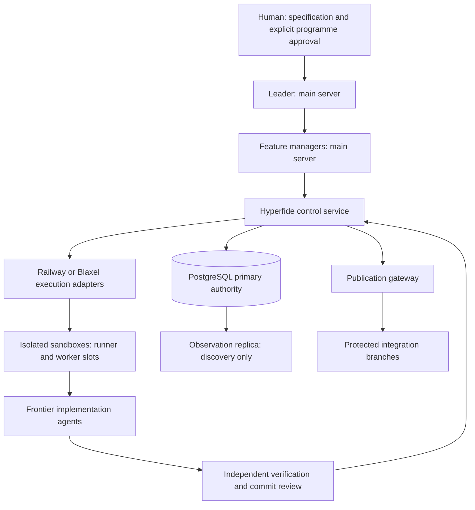

<div align="center">

# Hyperfide


<a
  href="https://trendshift.io/repositories/267432?utm_source=trendshift-badge&amp;utm_medium=badge&amp;utm_campaign=badge-trendshift-267432" target="_blank" rel="noopener noreferrer">

</a>

**A ferramenta de fluxo de trabalho para agentes que escala de projetos pequenos e simples a bases de código grandes e complexas.**

A CLI local é C11 puro: um único binário, um único banco SQLite, nenhuma telemetria.

[](../../LICENSE)
[](#)
[](../../.github/workflows/ci.yml)
</div>
<div align="center">

[English](../../README.md)  [简体中文](README.zh-CN.md) · [Español](README.es.md) · [हिन्दी](README.hi.md) · [العربية](README.ar.md) · [Français](README.fr.md) · [Português (BR)](README.pt-BR.md)
</div>

---

## Visão geral

O Hyperfide é um motor de fluxo de trabalho para agentes em um único binário, `hyperfide`. Ele mantém as quatro coisas de que um projeto precisa além do próprio código — o que o código **é**, como ele chegou **até aqui**, o que vem **a seguir** e o que foi **aprendido** ao longo do caminho — e entrega as quatro tanto a humanos quanto a agentes de IA.

Esta árvore é o Hyperfide 2.0 em desenvolvimento: `hyperfide version` imprime `2.0.0-dev`, e nada nela é uma release de produção. O Hyperfide nasceu do Codify, cujas releases 1.x, IDs de funcionalidade (como `codify-v15` e `codify-v16`) e histórico de commits mantêm seus nomes originais. A 2.0 acrescenta um [plano de controle distribuído](#o-plano-de-controle-do-hyperfide) — um líder e gerentes de funcionalidade em um servidor de supervisão, sandboxes remotas para builds e agentes, PostgreSQL como autoridade — em torno da mesma CLI local.

> **Compatibilidade.** `hyperfide` é o comando canônico. `cg` é um alias de compatibilidade obsoleto instalado a partir do mesmo executável, com argumentos, JSON e códigos de saída idênticos; ele permanece durante a janela de compatibilidade suportada da release aprovada e só é removido em uma release posterior que o anuncie. Todos os exemplos abaixo usam `hyperfide`; `cg` executa a mesma coisa.

`hyperfide fleet up` inicia um supervisor durável, que se recupera de falhas, para o agente principal, os gerentes de onda e os workers de tarefa. Ele administra cada processo do Codex ou do Claude Code até que o trabalho esteja qualificado e mesclado. Os agentes recebem contexto do grafo, o desvio entre branches é verificado antes da integração, e `hyperfide serve` transmite eventos ao editor. A indexação é aglutinada entre os workers; o grafo e a memória cobrem todas as branches e worktrees. O ciclo central não faz nenhuma chamada de rede; as poucas funcionalidades que fazem são nomeadas no fim desta visão geral.

**O que o código é.** O Hyperfide indexa arquivos-fonte em um grafo consultável: símbolos, chamadas, imports, tipos, rotas e busca em texto completo, tudo armazenado localmente em SQLite. A cobertura de linguagens vai da extração sintática nativa ao rastreamento apenas de arquivos; [a matriz de cobertura](../indexing.md#extraction-coverage) indica o limite de cada família. `hyperfide context <query>` responde a "me atualize sobre esta área" em uma única chamada: símbolos correspondentes com trechos, chamadores, chamados e rotas relacionadas. Os comentários são indexados como nós de primeira classe para propósito, contratos, perigos e acoplamentos que só existem em prosa.

**Como ele chegou até aqui.** Um sistema embutido de snapshots endereçados por conteúdo oferece commits, histórico, diffs e restauração sem exigir nenhum VCS externo. Como os snapshots compartilham o banco com o grafo, `hyperfide changes` reporta o raio de impacto das suas edições não commitadas. `hyperfide changelog` escreve as notas de versão: por padrão a partir do histórico do git — uma release por tag ou por mudança de versão, grupos pelo prefixo do assunto do commit, cada referência de tarefa preservada e, com uma chave, um breve parágrafo de Highlights escrito por um modelo para cada release — e a partir da cadeia de snapshots, com diffs em nível de símbolo, quando você passa `--snapshots` ou o projeto não tem git algum.

**O que vem a seguir.** Um motor de specs transforma arquivos de spec kvx em texto puro em um plano funcional: um quadro de tarefas com ondas de dependência, critérios de aceitação anexados a cada tarefa — e um `done` que é verificado, não apenas declarado. `hyperfide spec new` e `hyperfide spec add` criam o plano, `hyperfide spec lint` prova que ele é executável e o ciclo o executa. No modo Prod, `implemented` registra a conclusão da codificação e a evidência no código sem alegar qualificação; só `done` significa que a qualificação executável e as checagens do grafo passaram. No modo paralelo, vários agentes trabalham ao mesmo tempo, limitados pela disjunção dos caminhos que cada tarefa declara.

**O que foi aprendido ao longo do caminho.** Uma memória de agente armazena anotações deliberadas — decisões, restrições, resultados, preferências, fatos — no mesmo banco que o grafo, ligadas à tarefa sob a qual foram feitas. `hyperfide remember` salva uma no meio da tarefa, cada `hyperfide spec done` registra automaticamente um resultado honesto (incluindo recusas), e `hyperfide recall` traz tudo de volta, ordenado por relevância e recência.

As camadas se reforçam mutuamente: os commits são etiquetados automaticamente com a tarefa que implementam, as memórias aparecem na tarefa a que pertencem, `hyperfide why` leva um símbolo de volta às decisões por trás dele e `hyperfide spec trace` percorre qualquer tarefa até seus símbolos, commits e memórias.

**E ele está presente entre as etapas, não só nelas.** `hyperfide work open` começa com um pacote compacto da tarefa, `hyperfide work update` devolve apenas os deltas novos de estado, evidência e workspace, `hyperfide event progress` classifica loops sem confundir atividade com progresso, e `hyperfide guard` percebe quando uma edição sai do escopo declarado. Um servidor MCP embutido expõe 67 ferramentas, recursos e prompts a qualquer agente compatível com MCP, enquanto `hyperfide integrate` planeja, aplica e diagnostica a configuração nativa de cada host.

**E ele conduz agentes, não apenas os atende.** `hyperfide handoff` e `hyperfide resume` passam uma tarefa entre sessões sem perder estado, `hyperfide spec claim-next` entrega atomicamente a um agente ocioso a próxima tarefa sem conflito, e `hyperfide spec run` distribui uma onda inteira para sessões do Codex CLI ou do Claude Code — um processo filho em sandbox por tarefa reivindicada, logs e prompts em disco, leases liberados em caso de falha.

**E ele sobrevive a uma frota.** A indexação é um recurso compartilhado, não um hábito de cada processo: o primeiro `hyperfide` que precisa de uma passada a executa, os demais deixam um recado e se aglutinam nela, uma janela de frescor pula a varredura inteira, e slots de parsing em toda a máquina mantêm projetos simultâneos dentro do orçamento de núcleos ([docs/sync.md](../sync.md)). Acima disso, `spec/workflow.kvx` pode declarar uma hierarquia — um agente principal dono da lista de tarefas, um gerente por onda, um worker por tarefa — e `hyperfide fleet` conduz o fluxo de branches: worktree, merge para cima, integração atrás dos gates de teste e lint, pull request, checkpoint. `hyperfide fleet up` roda essa árvore inteira sozinho sob um supervisor destacado — todas as ondas de uma vez, cada gerente e seus workers vivos juntos, cada worker em sua própria worktree — cutucando agentes travados, repetindo os que falharam com o que deu errado, escalando o que não tem salvação, parando nos gates de aprovação que você ativou e reportando conclusão quando o trabalho foi **mesclado**, não quando um processo saiu ([docs/hierarchy.md](../hierarchy.md)). Mate o supervisor e `hyperfide fleet up --resume` adota os agentes ainda vivos. Desvios da spec, tarefas que colidem e mudanças de interface de que outras branches dependem são sinalizados antes do merge ([docs/drift.md](../drift.md)); `hyperfide projection build` dobra cada branch ativa, trabalho não commitado incluído, em uma única ref de projeção e nomeia os conflitos de símbolo, de interface e textuais com suas branches antes de qualquer merge, e a projeção acompanha o trabalho pelos hooks, `hyperfide watch`, `hyperfide serve` e o supervisor ([docs/projection.md](../projection.md)). Cada mudança é um evento que `hyperfide events --follow` e `hyperfide serve` transmitem ao vivo ([docs/events.md](../events.md)). Todos compartilham um grafo e uma memória: cada branch e worktree vinculada do repositório indexa no mesmo `.codegraph/`, com escopo por branch ([docs/branches.md](../branches.md)).

**E ele pede uma decisão quando uma é necessária.** `hyperfide jev` consulta o modelo System One da TypeSafe para julgamentos tipados — verdadeiro/falso, um-entre-vários, ranqueado. `hyperfide memory classify` o usa para dizer quais anotações são skills reutilizáveis, e `hyperfide skills promote` as transforma em `.agents/skills/<slug>/SKILL.md` portáteis; um `verify_cmd` que falha ganha uma linha de triagem, os achados de `hyperfide guard` são ranqueados e um pull request recebe uma nota de prontidão. O Jev é obrigatório para as funcionalidades construídas sobre ele, nunca para o ciclo central, e nunca autoritativo — nenhuma resposta do Jev muda um código de saída ([docs/jev.md](../jev.md)).

**E a documentação é a última tarefa verificada.** Specs de funcionalidade novas ativam por padrão uma etapa de fechamento `@docs`. Quando todas as tarefas comuns se qualificam, o Hyperfide monta um pacote de evidências limitado a partir da spec, dos snapshots atribuídos a tarefas, do grafo de código, das rotas, das memórias, das checagens e da documentação existente. O mesmo conector de agente configurado atualiza a documentação de usuário e de desenvolvedor, enquanto `hyperfide docs check` verifica as referências de afirmações declaradas, os links locais inline, a cobertura exigida da superfície do grafo e o escopo de alvos configurado. `hyperfide docs close` registra um snapshot dedicado `[spec:<feature>/@docs]` e uma linha de base incremental para o próximo fluxo de spec. Essas checagens estruturais apoiam a revisão; não certificam o sentido de cada frase.

A CLI não roda serviços em segundo plano que você não iniciou e não envia telemetria — o supervisor da frota só roda após `hyperfide fleet up` e para com `hyperfide fleet down`. O grafo, a memória, os snapshots e todo o ciclo de tarefas rodam na sua máquina e ficam nela. As exceções são nomeadas e opcionais: as decisões Jev precisam de `OPENROUTER_API_KEY`, e só os comandos construídos sobre elas fazem essa chamada; `hyperfide changelog` pede highlights de release a um modelo, e `hyperfide recap` faz o Solar Decide escolher afirmações de sessões passadas e um modelo escrever o resumo, apenas quando `CENTRA_API_KEY` (ou `HYPERFIDE_CHANGELOG_KEY`) está definida; e `hyperfide fleet pr` e `checkpoint` chamam `gh`. Os serviços de controle distribuído em `services/hyperfide` são processos separados que você inicia explicitamente ([O plano de controle do Hyperfide](#o-plano-de-controle-do-hyperfide)).

## Por que Hyperfide

**Ele fecha o ciclo do plano à prova.** A maioria das ferramentas ou planeja o trabalho (listas de tarefas) ou descreve o código (busca, índices). O Hyperfide faz as duas coisas contra o mesmo banco, então o plano pode ser confrontado com a realidade: quando uma tarefa declara que introduz `checkMode` e toca `src/*.ts`, `hyperfide spec done` se recusa a concluí-la até que o grafo e o histórico concordem.

**Agentes trabalham como engenheiros, não como turistas.** Em vez de vagar por um repositório arquivo por arquivo, um agente pergunta a `hyperfide spec next` o que fazer, a `hyperfide context` tudo sobre a área e a `hyperfide impact` quem quebra — e então faz o commit com atribuição automática da tarefa. O ciclo inteiro está disponível via MCP, então ele nunca precisa sair do protocolo.

**O projeto lembra o que as sessões esquecem.** As janelas de contexto dos agentes são reiniciadas; a tabela de memórias, não. Uma decisão escrita uma vez com `hyperfide remember` encontra a sessão seguinte automaticamente — em `hyperfide spec next`, em `hyperfide spec start`, em `hyperfide recall` no início da sessão — em vez de ser redescoberta a preço cheio. E, como as conclusões recusadas também ficam registradas, "esta tarefa foi bloqueada duas vezes e eis o porquê" está a uma consulta de distância.

**O contexto chega em uma chamada, não em vinte — e dentro de um orçamento.** `hyperfide context <query>` foi desenhado em torno de como os agentes realmente consomem código. Uma requisição devolve tudo o que é preciso para começar a trabalhar: memórias relevantes, onde a execução entra, o que correspondeu, quem chama, o que é chamado e quais rotas tocam aquilo — ranqueado (definições reais acima de fixtures de teste, código chamado acima de código morto) e ajustado a um orçamento de tokens (`--budget`, padrão 4000). Um símbolo é impresso por inteiro uma vez; cada menção posterior é um compacto `name path:line`, e o que o orçamento corta é anunciado com uma contagem explícita de omitidos em vez de ser descartado em silêncio.

**A análise de impacto é um comando de primeira classe.** `hyperfide impact <name> -d 3` percorre transitivamente as arestas de chamadores e chamados e responde às duas perguntas que importam antes de qualquer mudança: quem quebra se isso mudar, e do que isso depende.

**A busca é instantânea e em camadas.** Um índice FTS5 de trigramas sobre nomes de símbolos oferece correspondência de substring sem distinção de maiúsculas e sem aquecimento, apoiado por um índice de palavras sobre o corpo completo dos arquivos para todo o resto.

**O índice avisa quando a cobertura ou o frescor são incertos.** `hyperfide watch` observa mudanças em arquivos e solicita sincronizações com debounce. Um evento perdido do watcher ou um registro que falhou deixa uma dívida de reconciliação durável. As respostas da CLI e do MCP expõem a cobertura de extração e checagens limitadas da fonte como verificadas, defasadas ou não checadas; uma atualização aglutinada não certifica o frescor por si só. Um processo segura o gate do índice enquanto os demais chamadores deixam recados de sujeira, e slots em toda a máquina limitam as threads de parsing entre projetos ([detalhes da indexação](../indexing.md#freshness-and-migrations)).

**Ele se adapta ao hardware em que roda.** Na inicialização, o `hyperfide` dimensiona seu pool de workers e os caches do SQLite pelo que o sistema realmente oferece: contagem de núcleos ciente de contêineres (a interseção da cota de CPU do cgroup v1/v2, da máscara de afinidade e das CPUs online), RAM disponível honesta (`MemAvailable` intersectada com os limites de memória do cgroup) e custo medido por projeto. Uma estação de trabalho de 16 núcleos recebe o pipeline paralelo completo. Uma VPS de 2 núcleos recebe um ajustado para terminar com confiabilidade. Rode `hyperfide info` para ver exatamente como o pipeline foi dimensionado.

**Tudo permanece local.** O grafo vive em um banco SQLite sob `.codegraph/`, e os snapshots são objetos endereçados por conteúdo sob `.codegraph/objects/`. Apague o diretório e todo rastro desaparece.

## A camada de intenção

Um parser vê símbolos, chamadas e rotas. Ele não vê *por que* uma função
existe, o que seus chamadores precisam garantir, ou que `save_tasks` precisa
rodar depois que `load_tasks` lê o disco — essa metade do código vive só em
comentários. O Hyperfide a indexa ([docs/ANCHORS.md](../ANCHORS.md) é a
convenção completa):

- **Âncoras** são comentários que passam no teste de derivabilidade — *se um
  agente poderia tê-lo escrito lendo o código, não é âncora.* Quatro tipos
  valem a pena: **purpose**, **contract**, **danger**, **pointer**.
- **Recuperação doc-first**: onde há âncora, `hyperfide context` serve doc +
  assinatura em vez das linhas do corpo — várias vezes mais símbolos por
  orçamento de tokens.
- **`hyperfide survey`** lê cem arquivos pelo preço de um corpo: linhas de
  propósito e docs com assinaturas, nunca corpos.
- **Arestas suaves**: nomes dentro de âncoras viram referências `(soft)` —
  acoplamentos dinâmicos e entre linguagens que nenhum parser consegue derivar,
  rotulados para nunca serem confundidos com chamadas analisadas.
- **Honestidade sobre desvio**: cada âncora registra uma linha de base do código
  que descreve. Quando o código muda, a doc é marcada como defasada — em
  `hyperfide check`, `hyperfide guard` e na própria recuperação — até ser
  atualizada ou apagada. Avisa, não bloqueia.
- **`hyperfide anchors`** ranqueia símbolos descobertos por pontuação de
  coordenação (fan-out × extensão × arquivos que referenciam, deliberadamente
  não a popularidade bruta), para que o preenchimento comece pelos pontos de
  orquestração, não por `sb_puts`.

Nada disso é obrigatório: um repositório que nunca adota a convenção ainda
ganha captura, survey e arestas suaves a partir dos comentários que já existem.

## Uma sessão com o Hyperfide

```sh
hyperfide brief                     # root, active task + ACs, uncommitted work, prior decisions
hyperfide spec next                 # the next eligible task, ACs + relevant memories
hyperfide spec start 16.7           # claim it — one task in progress at a time
hyperfide context "password auth"   # memories, entry points, symbols, callers, routes in one call
hyperfide why verifyLogin           # who changed it, under which task, and what was decided
hyperfide impact verifyLogin -d 2   # who breaks if this changes
# ...implement...
hyperfide guard                     # anything drifting outside what task 16.7 declared?
hyperfide test-impact               # which tests cover what you just changed
hyperfide remember "sessions rotate on login" --type decision   # linked to task 16.7
hyperfide review                    # the change, paired with the ACs it claims to satisfy
hyperfide commit -m "add password auth"   # snapshot, auto-tagged [spec:ion_spec/16.7]
hyperfide spec done 16.7            # qualification: verify_cmd + graph checks; outcome recorded
hyperfide spec trace 16.7           # proof: task -> symbols -> commits -> memories
```

E quando uma sessão precisa parar antes de a tarefa terminar — a janela de contexto está cheia, o dia acabou — o trabalho não evapora:

```sh
# session A, stopping early
hyperfide handoff --done "schema migration; token rotation" \
                  --next "wire the login route; extend 03_auth test" \
                  --blocked "flaky fixture on CI" -m "rotate on login, not refresh"

# session B, hours later, a fresh context window
hyperfide resume --prompt   # paste-ready block: task, steps done, blockers,
                            # next steps, uncommitted files, lease state
```

Um handoff é armazenado como uma memória estruturada ligada à tarefa; cada novo substitui o anterior, então `hyperfide resume` sempre encontra o estado mais recente, não uma pilha de anotações defasadas.

Cada comando desse ciclo também é uma ferramenta MCP, então um agente conectado pode executá-lo de ponta a ponta — e cada etapa funciona tão bem em um projeto de dez arquivos quanto em um monorepo. `hyperfide check` roda o gate inteiro na CI em um único passo, e `hyperfide hook install` conecta a sincronização e a checagem de escopo para que a maior parte disso aconteça sem que ninguém precise invocar.

## Linguagens e frameworks suportados

Adaptadores sintáticos nativos cobrem JavaScript/JSX, TypeScript/TSX, C, C++, Objective-C, Go, Rust, Python, Ruby, PHP, Java, Kotlin, Scala, C#, Swift, Dart, Lua, Luau, R, Erlang, Solidity, Terraform, Nix, Pascal, COBOL, VB.NET, CFScript, CFQuery e ArkTS. Adaptadores de formato misto cobrem construções selecionadas de CFML, Vue, Svelte, Astro, Liquid, Razor, formulários Delphi e MyBatis XML. JSON, YAML, Twig e properties são rastreados em nível de arquivo. O [guia de indexação](../indexing.md) explica os fatos suportados, o fallback, os limites e as fronteiras não resolvidas.

O roteamento ciente de frameworks registra as declarações literais suportadas e liga um handler identificado de forma única quando a evidência permite. Ele cobre Express, Next.js, React Router, Expo Router, SvelteKit, Vue/Nuxt, FastAPI, Django, Flask, Laravel, Rails, Spring, Gin, Axum, ASP.NET e Vapor, além de declarações selecionadas em Koa, Fastify, Hapi, NestJS, Sinatra, Echo, Fiber, Chi e Actix. Caminhos computados e handlers ambíguos permanecem não resolvidos.

## Instalação

O Hyperfide 2.0 é compilado a partir do código-fonte nesta revisão. O instalador de uma linha em `scripts/install.sh` não é anunciado como release do Hyperfide até que as tarefas de distribuição e de renomeação (25.4 e 26.2 em `spec/hyperfide/spec.kvx`) sejam fechadas.

Dependências: um compilador C, `python3` (o build descobre os componentes nativos com ele) e os pacotes de desenvolvimento de SQLite, libcurl e da libcrypto do OpenSSL (`libsqlite3-dev`, `libcurl4-openssl-dev`, `libssl-dev` no Debian e no Ubuntu). O runtime e as gramáticas do tree-sitter vêm incluídos no repositório (vendored).

```sh
make && sudo make install
```

`make` linka `./hyperfide` e o copia para `./cg`; `make install` verifica que os dois são idênticos byte a byte e instala ambos em `$(PREFIX)/bin` (padrão `/usr/local`). `make uninstall` remove os dois. Os dados `.codegraph/` de cada projeto nunca são tocados.

Atualizações são seguras em projetos existentes: o banco carrega uma versão de schema (18 nesta árvore) e, na primeira abertura após uma atualização, o `hyperfide` reconstrói apenas as tabelas de índice derivadas (arquivos, símbolos, refs, rotas, imports e os índices de busca) — a próxima sincronização as repopula. Memórias, histórico do git, leases, tentativas, eventos e os registros de branches e de agentes nunca são descartados por uma migração. Um binário mais antigo se recusa a abrir um banco mais novo em vez de rebaixá-lo.

Depois, em qualquer projeto:

```sh
cd your-project
hyperfide init
```

Em um terminal, `hyperfide init`, `hyperfide index` e `hyperfide sync` mostram uma linha de progresso ao vivo
no stderr — fase, arquivos feitos de arquivos a fazer, workers, tempo decorrido e qualquer
lock pelo qual estejam esperando — apagada antes do resumo. A saída redirecionada não muda;
`HYPERFIDE_PROGRESS=plain` imprime linhas simples, `HYPERFIDE_PROGRESS=0` a desliga.
Veja [docs/sync.md](../sync.md#progress).

As variáveis de ambiente se escrevem `HYPERFIDE_*` em toda parte. Os nomes antigos `CG_*`, e os nomes `CODIFY_*` que a árvore ainda reconhece (`CODIFY_ROOT`, `CODIFY_INSTALL_DIR`, `CODIFY_BASE_URL` e as variáveis de autoridade, credenciais, transporte, política de ferramentas MCP e modo), são aceitos como aliases da mesma configuração; definir um alias e seu nome `HYPERFIDE_*` com valores diferentes interrompe o comando com um erro de conflito de alias em vez de escolher um deles.

## Referência de comandos

`hyperfide help` imprime o mapa: todos os comandos por grupo, uma linha cada, ajustados ao terminal. `hyperfide help <command>` (ou `hyperfide <command> --help`, `-h`) mostra o uso de um comando, subcomandos, flags, exemplos e comandos relacionados; `hyperfide help --all` imprime todos eles, e `hyperfide help --json` entrega a editores e agentes a mesma tabela para montar menus. As tabelas abaixo nomeiam os mesmos comandos que `hyperfide help`. A visão geral também imprime a nota sobre nomes de comando citada no parágrafo [Compatibilidade](#visão-geral).

| Comando | Descrição |
| --- | --- |
| `hyperfide help [<command>] [--all] [--json]` | A visão geral agrupada, o detalhe de um comando, todos os detalhes ou a tabela inteira em JSON. Um nome desconhecido sugere os mais próximos e sai com 1. Negrito e esmaecido só em terminal (`NO_COLOR`, `TERM=dumb` e `HYPERFIDE_COLOR=0\|1` decidem); `COLUMNS` define a largura, nunca abaixo de 60 |
| `hyperfide version` | Imprime a versão (`--version` também) |

### Grafo

| Comando | Descrição |
| --- | --- |
| `hyperfide init [--nested] [--force]` | Cria `.codegraph/` e constrói o índice inicial; dentro de uma worktree git vinculada de um repositório inicializado, entra no grafo compartilhado sob esta branch. Recusa-se dentro de um projeto envolvente (`--nested` torna este diretório um projeto próprio) e no seu diretório home (`--force`) |
| `hyperfide sync [paths] [--max-age MS] [--background] [--wait MS] [--auto] [--workers N]` | Índice incremental: aglutina-se a uma passada já em andamento (`--wait`, padrão 2000 ms), pula quando está fresco e varre só os caminhos nomeados; `--auto` marca uma sincronização implícita que `[sync] auto = false` pula |
| `hyperfide index [--full] [--workers N]` | A forma bloqueante de sync que sempre varre, esperando por uma passada já em andamento. `--workers N` (nos dois) tem precedência sobre `HYPERFIDE_INDEX_WORKERS` e `[index] workers` na configuração do projeto. Sai com 75 quando o banco continua ocupado além da espera pelo lock |
| `hyperfide branches` | Todas as branches indexadas no grafo compartilhado, com sua worktree, head, base e contagem de arquivos |
| `hyperfide search <q> [-n N]` | Busca de símbolos e em texto completo (padrão 20 resultados; `--path`, `--lang`, `--kind`, `--name`, `--no-tests` a restringem): uma frase casa com nomes (`export memory` encontra `memory_export` e `exportMemory`), comentários de documentação e corpos, ranqueados nessa ordem, com código-fonte antes de testes; acertos de arquivo mostram a linha correspondente. Respondem as definições, nunca seus protótipos; um fallback limitado para erros de digitação se aplica quando correspondências exatas e por segmento não encontram nada ([docs/retrieval.md](../retrieval.md)) |
| `hyperfide grep <pattern> [-E] [-i]` | Busca por linha em vez de um grep do shell: um literal (ou regex `-E`) encontrado pelo índice de trigramas, lido do disco, cada acerto situado no símbolo que o envolve, ranqueado e limitado por `-n` e `--budget` com a cauda omitida; `--path`, `--lang`, `--no-tests`, `--symbol`, `--kind`, `-C`, `--files`, `--count` ([docs/retrieval.md](../retrieval.md)) |
| `hyperfide symbol <name>` | Definição, trecho e contagem de referências |
| `hyperfide impact <name> [-d N] [--budget N]` | Chamadores e chamados transitivos até a profundidade N (padrão 3), ajustados a um orçamento de tokens (padrão 8000) |
| `hyperfide flow <callers\|callees\|impact\|paths> <name> [target]` | Travessia limitada de relações tipadas com evidência da fonte, fronteiras dinâmicas e limites explícitos: `--depth` (1 a 8), `--max-nodes` (até 256), `--max-edges` (até 512), `--max-ms` (até 2000), `--max-output` bytes |
| `hyperfide inspect` | Inspeção de hierarquia e, com cautela, de código sem referências; veja os subcomandos abaixo |
| `hyperfide inspect hierarchy <name> [-n N]` | Ancestrais, subtipos e implementações limitados, a partir de relações tipadas |
| `hyperfide inspect unused [-n N] [--path GLOB]` | Símbolos sem referências e alcançabilidade limitada a partir de raízes conhecidas, com motivos de exclusão; nunca um veredito de exclusão |
| `hyperfide context <q> [--budget N] [-n K]` | Pacote de contexto em uma chamada para agentes: memórias, símbolos, pontos de entrada, rotas — os K principais símbolos (padrão 8), preenchidos até um orçamento de tokens (padrão 4000) com contagens explícitas de omitidos e, em `--json`, `tokens_used`. Um caminho de arquivo recebe o resumo do arquivo (propósito, símbolos, imports, dependentes); um diretório recebe seus arquivos |
| `hyperfide survey [path\|query] [--budget N]` | O nível abaixo dos corpos: linhas de propósito dos arquivos e docs de símbolos com assinaturas em ~100 arquivos por chamada — nunca um corpo. Arquivos e símbolos descobertos são nomeados, e o que o orçamento (padrão 16000) corta é uma contagem explícita de omitidos |
| `hyperfide files [pattern] [--dirs] [--depth N] [-n N]` | Arquivos por glob (`src/**/*.go`), pelas palavras do caminho (`sync gate`) ou por diretório, cada um com linguagem, linhas e contagem de símbolos; `--dirs` mapeia diretórios com contagens de arquivos e linhas e a linguagem dominante. `--path`, `--lang` e `--no-tests` restringem, como restringem `search`, `context` e `survey` |
| `hyperfide anchors [--stale] [--uncovered]` | Saúde das âncoras: docs cujo código mudou, e símbolos descobertos ranqueados por pontuação de coordenação (fan-out × extensão × arquivos que referenciam) — a lista de trabalho do preenchimento |
| `hyperfide routes [filter]` | Tabela de padrão de URL para handler |
| `hyperfide show <symbol\|path:line> [--full]` | Só o corpo daquele símbolo — por nome ou pela posição do cursor que um editor tem; corpos longos são truncados com um marcador `… (+N more lines, use --full)` |
| `hyperfide why <symbol>` | Proveniência: os commits que o mudaram, as tarefas que eles implementaram, as decisões registradas |
| `hyperfide test-impact [symbol]` | Testes que referenciam um símbolo — ou todos os símbolos das suas mudanças não commitadas |
| `hyperfide watch [--debounce MS] [--fleet]` | Sincronização automática em eventos nativos do sistema de arquivos (debounce padrão 300 ms); `--fleet` observa todas as worktrees que o grafo conhece, cada uma sob sua própria branch |
| `hyperfide root` | A raiz de projeto para a qual o `hyperfide` resolve a partir daqui; `--json` acrescenta o projeto compartilhado, a flag de worktree e a branch |
| `hyperfide info` | Perfil da máquina, dimensionamento do pipeline (a contagem de workers e sua origem), a raiz de projeto e a branch vinculadas, a cobertura do índice por branch e o inventário de parsers |
| `hyperfide config [init\|get K\|set K V\|check] [--json]` | Configuração do projeto em `hyperfide.kvx` (um `codify.kvx` legado ainda é lido): cada configuração com sua origem, os padrões comentados, uma chave lida ou escrita no lugar e uma checagem de chaves desconhecidas e valores inválidos. Funciona antes de `hyperfide init`. Veja [docs/config.md](../config.md) |

### Controle de versão

Os snapshots são endereçados por conteúdo com SHA-256 e os blobs são deduplicados.

| Comando | Descrição |
| --- | --- |
| `hyperfide commit -m <msg>` | Tira um snapshot da árvore de trabalho, sincronizado antes e etiquetado automaticamente com a tarefa em andamento; `--task <id>` nomeia a tarefa, `--amend` substitui o último snapshot, `--git` também faz um commit git real com a mesma etiqueta de spec |
| `hyperfide log [-n N]` / `hyperfide status` | Histórico de snapshots (padrão 20), e a worktree contra HEAD com a cobertura do índice por branch e a reconciliação pendente |
| `hyperfide diff [A] [B]` | Diff de linhas por LCS entre snapshots ou a worktree |
| `hyperfide checkout <id> [--force]` | Restaura um snapshot |
| `hyperfide changes [--limit N]` | Raio de impacto das edições não commitadas: os símbolos que você tocou mais seus chamadores externos — limitado por padrão (40 símbolos, 8 chamadores cada) com marcadores `(+N more)`; `--limit` altera o limite |
| `hyperfide git-sync [-n N]` | Ingere o histórico do git (padrão 2000 commits) — commits, autores, churn por arquivo — que passa a ranquear a busca e o contexto e responde a `hyperfide why` |
| `hyperfide events [--since N] [--kind K,..] [-n N] [--follow [--for S]] [--head]` | O log de eventos: cada mudança de tarefa, claim, tentativa, agente, frota, supervisor, desvio e aprovação, por número de sequência. `--kind` aceita uma lista separada por vírgulas em que um `.` final é um prefixo (`fleet.`); `--follow` transmite; `--json` é um objeto por linha. Veja [docs/events.md](../events.md) |

Os snapshots do Hyperfide não substituem o git. `.gitignore` é respeitado junto com `.cgignore`, `hyperfide git-sync` lê seu histórico real e `hyperfide commit --git` escreve nos dois, então adotar o Hyperfide nunca é tudo ou nada.

### Changelog

`hyperfide changelog` gera notas de versão a partir do histórico do git. Uma release começa em uma tag **ou** no commit que mudou a versão do projeto — `CG_VERSION` em `src/cg.h`, um arquivo `VERSION` ou `package.json` —, então um projeto que nunca cria tags ainda ganha uma seção por versão. O que veio depois da última recebe o nome da versão que a árvore de trabalho carrega quando ela é nova (a release em preparação), o de `--tag NAME`, e só em último caso `[Unreleased]`. Um grupo é o prefixo do assunto do commit, e o `[spec:<feature>/<task>]` que `hyperfide commit` acrescenta vira uma referência de tarefa no item. Os links de commit e de comparação vêm de `git remote get-url origin`; sem remoto, um item fica `- Add gauge (497c30a)` e os links do rodapé são omitidos.

```markdown
## [0.3.0] - 2026-09-28

### Features
- Add gauge ([497c30a](https://github.com/acme/demo/commit/497c30acbc9dc0daf869af07a993db74ea0da779))

### Documentation
- Explain gauges ([191d0c8](https://github.com/acme/demo/commit/191d0c811203dc1bba7b39f0b9095e5875a1ff7f))

## [0.2.0] - 2026-09-28

### Bug fixes
- **parser:** Handle empty input ([682f9f8](https://github.com/acme/demo/commit/682f9f8c9bd6bb5813cfc2665c4e1265fba16933), task demo/1.2)

[0.3.0]: https://github.com/acme/demo/compare/0.2.0...0.3.0
[0.2.0]: https://github.com/acme/demo/compare/0.1.0...0.2.0
```

**Highlights.** Com `CENTRA_API_KEY` no ambiente ou no `.env` do projeto (ou `HYPERFIDE_CHANGELOG_KEY`), cada release também ganha um bloco `### Highlights`: de duas a cinco frases, e alguns itens para uma release grande, escritos por um modelo a partir dos commits agrupados daquela release. Os itens derivados nunca são alterados, e o prompt diz ao modelo para não inventar nada que os commits não digam. O endpoint padrão é `https://gateway.centra.ag/v1/chat/completions` com o modelo `openrouter/anthropic/claude-haiku-5.5`; `HYPERFIDE_CHANGELOG_ENDPOINT` e `HYPERFIDE_CHANGELOG_MODEL` o apontam para qualquer endpoint compatível com OpenAI. As respostas ficam em cache em `.codegraph/changelog-cache/`, indexadas pelos commits da release e pelo modelo, então regenerar o arquivo só pergunta sobre as releases que mudaram. `--summarize` insiste (e avisa quando nenhuma chave é encontrada), `--no-summarize` deixa o modelo de fora, e uma chamada que falha imprime `highlights for <release> skipped — <why>` no stderr e escreve as notas sem prosa.

```sh
hyperfide changelog -o CHANGELOG.md        # every release, highlights when a key is present
hyperfide changelog --unreleased           # only the newest section and its footer line
hyperfide changelog --tag 1.2.0            # name the newest section 1.2.0, dated today
hyperfide changelog --no-summarize -n 3    # the plain record, three newest releases
```

`-n N` limita as seções de release, e `-o FILE` escreve o arquivo relativo à raiz do repositório e informa quantos highlights foram escritos e quantos vieram do cache. `--snapshots` — e qualquer projeto sem `.git` — recorre ao gerador de snapshots, cuja saída é um diff em nível de símbolo por snapshot em vez de um histórico de releases. `cliff.toml` na raiz do repositório é a configuração correspondente do [git-cliff](https://git-cliff.org); o git-cliff só conhece tags, então os dois produzem o mesmo arquivo apenas em um repositório só com tags, sem arquivo de versão e sem chave de modelo. O `CHANGELOG.md` deste repositório é gerado com `hyperfide changelog -o CHANGELOG.md`.

### Recap

`hyperfide recap` escreve o resumo de que um agente novo precisa para retomar um projeto: o que o projeto é, o que mudou nas últimas semanas, o que as sessões recentes fizeram, os fatos que de outro modo se perderiam e o próximo passo. Sua matéria-prima são as transcrições que o Claude Code e o Codex já guardam na máquina (`~/.claude/projects/<cwd>/*.jsonl` e `~/.codex/sessions/**/rollout-*.jsonl`, associadas a este repositório pelo diretório de trabalho), que são o único registro do *porquê* entre commits e longas demais para serem entregues inteiras.

Dois modelos fazem dois trabalhos diferentes. Cada transcrição é cortada em afirmações — um pedido do usuário, um parágrafo ou item da resposta do assistente, um arquivo editado, um comando que fez commit ou rodou testes — e entregue em pequenos blocos ao **Solar Decide**, o modelo de decisão System One da Upstage, pelo gateway Centra (`openrouter/upstage/solar-decide` em `https://gateway.centra.ag/v1/systemone`, o mesmo esquema de requisição do Jev). Para cada afirmação ele responde a três perguntas tipadas com probabilidades calibradas e nenhuma prosa: de que tipo ela é (objetivo, decisão, restrição, fato, feito, fio em aberto, beco sem saída, ruído), se ela ainda valia quando a sessão terminou e se um agente que retoma o trabalho precisa dela. As afirmações que passam do limiar, ranqueadas pelo produto dessas probabilidades e cortadas a `--budget` caracteres, formam o **log decidido**: cada linha citada de uma sessão, nenhuma escrita por um modelo. Esse log, junto com fatos lidos do repositório (a funcionalidade ativa e os status de suas tarefas, os commits recentes, as memórias armazenadas), vai para o modelo de chat do gateway que `hyperfide changelog` já usa, que escreve o resumo propriamente dito. O log decidido é mantido em `.codegraph/recap/decided.md`, para que qualquer frase do resumo possa ser confrontada com o que foi de fato dito.

```bash
hyperfide recap                              # 6 newest sessions of the last 21 days → <context>/recap.md
hyperfide recap --sessions 10 --since 45     # wider window
hyperfide recap --decided                    # stop at the picked statements; print them, write no prose
hyperfide recap --facts                      # the repository facts alone; no key, no model
hyperfide recap -o - --agents codex          # to stdout, Codex sessions only
```

As duas chamadas usam `CENTRA_API_KEY` (ou `HYPERFIDE_CHANGELOG_KEY`) do ambiente ou do `.env` do projeto; sem ela o comando para com um erro claro, já que nenhuma das metades tem um substituto local. O endpoint cobra cada pergunta sobre o estado inteiro, então os blocos são pequenos (6 afirmações, `HYPERFIDE_RECAP_CHUNK`) e vários rodam ao mesmo tempo (`HYPERFIDE_RECAP_PARALLEL`, padrão 6). Tempo e custo dependem da sessão e do gateway; esta revisão não informa um valor medido. As decisões ficam em cache por bloco em `.codegraph/recap-cache/`, então uma nova execução só pergunta sobre as sessões novas. O que nunca chega a um modelo: blocos de raciocínio, saída de ferramentas, notificações e lembretes do harness, blocos de código e sessões de outros projetos. `HYPERFIDE_RECAP_DECIDE_MODEL`, `HYPERFIDE_RECAP_DECIDE_ENDPOINT` e `HYPERFIDE_RECAP_MODEL` apontam qualquer das metades para outro lugar; `HYPERFIDE_RECAP_CLAUDE_DIR` e `HYPERFIDE_RECAP_CODEX_DIR` dizem onde procurar. O resumo é escrito em `recap.md` no diretório de contexto: `.codify/recap.md` por padrão, `.hyperfide/context/recap.md` quando o projeto tem um `hyperfide.kvx`.

### Mapa de código

`hyperfide codemap` escreve `CODEMAP.md` na raiz do repositório: o único arquivo que um agente novo (ou uma pessoa) lê para saber o que o projeto é, como compilá-lo e testá-lo, onde as coisas ficam e em quais símbolos o resto do código se apoia. Ele é construído a partir do grafo, nunca de um modelo. As linhas de propósito são os próprios comentários de arquivo e READMEs do código, e um diretório sem nenhum dos dois não recebe nenhuma. Os símbolos são ranqueados pelas chamadas que resolvem para eles. O mesmo grafo dá os mesmos bytes, e o mapa nunca conta a si mesmo, então `hyperfide codemap --check` funciona como gate de CI. `hyperfide brief` nomeia o mapa e diz se ele está atualizado; a ferramenta MCP `codemap` o devolve sem escrever. Veja [docs/codemap.md](../codemap.md).

```bash
hyperfide codemap                  # write CODEMAP.md (8000-token budget)
hyperfide codemap --budget 3000    # tighter: least-referenced entries go first, each section counts what it left out
hyperfide codemap --check          # exit 1 when CODEMAP.md is missing or stale; writes nothing
hyperfide codemap -o - --json      # the same map as structured data
```

### Memória

Anotações duráveis de agentes, armazenadas no mesmo banco SQLite que o grafo. Memórias escritas enquanto uma tarefa de spec está em andamento se ligam a ela, e `hyperfide spec done` registra resultados automaticamente. Nunca guarde segredos nelas.

| Comando | Descrição |
| --- | --- |
| `hyperfide remember <text>` | Salva uma memória — `--type decision\|constraint\|outcome\|preference\|fact` (padrão `fact`), `--task <feature/id>` (por padrão a tarefa de spec em andamento), âncoras opcionais `--symbols` / `--files`, `--supersedes <id>` para aposentar uma decisão revertida |
| `hyperfide recall [query]` | Busca memórias: texto completo sobre o corpo, ranqueado por relevância e depois recência; filtre com `--task`, `--type`, `-n N` ou `--near <file>` para recuperação ancorada |
| `hyperfide forget <id>` | Apaga uma memória |
| `hyperfide memory compact` | Funde memórias duplicadas (`--dry-run` para pré-visualizar) |
| `hyperfide memory classify [<id>\|--all\|--unclassified]` | Pergunta ao Jev o que cada anotação é — `skill`, `decision`, `constraint`, `fact`, `noise` — com uma confiança, e grava isso na memória. Sem argumento, classifica as não classificadas; `-n N` limita o lote |
| `hyperfide memory export [-o FILE]` | Escreve as memórias como JSONL — uma linha de cabeçalho, depois um objeto por memória indexado por um id de conteúdo — no stdout ou em `FILE`; selecione com `--task` (uma etiqueta ou prefixo), `--type`, `--branch`, `--since DAYS` |
| `hyperfide memory import <FILE\|->` | Acrescenta as memórias que este grafo ainda não tem, por id de conteúdo, em uma única transação: horário de criação, classe e substituição são preservados; `--dry-run` informa sem escrever, `--keep-branch` mantém nomes de branches que este grafo não rastreia, `--retask OLD=NEW` reescreve um prefixo de etiqueta de tarefa. `--from DIR` lê o grafo de outro projeto Hyperfide em modo somente leitura em vez de um arquivo. Veja [docs/memory-transport.md](../memory-transport.md) |
| `hyperfide skills list\|promote <id>\|render` | As memórias classificadas como `skill`, promovidas a `.agents/skills/<slug>/SKILL.md` e mantidas em dia com a anotação de que vieram |

Uma memória substituída nunca é apagada — a reversão é um histórico que vale a pena guardar. Ela simplesmente deixa de liderar os resultados, para que uma sessão encontre primeiro a decisão atual.

Uma memória classificada carrega sua classe em todo lugar onde aparece — `class skill 0.82` em `hyperfide recall`, `[decision/skill]` em `hyperfide brief`, `class` e `confidence` no `--json` de ambos. A promoção escreve um arquivo gerado que diz isso: ele carrega um marcador de propriedade e um link de volta para a memória, um arquivo sem esse marcador nunca é sobrescrito, e `hyperfide skills render` atualiza aqueles cuja anotação mudou. Veja [docs/jev.md](../jev.md#memory-classification-and-skills).

### Agentes

| Comando | Descrição |
| --- | --- |
| `hyperfide mcp` | Roda como servidor MCP via stdio (ele se identifica como `hyperfide`): 67 ferramentas, recursos `hyperfide://` para o fluxo de trabalho, cada spec de funcionalidade e o contexto do agente (URIs legadas `codify://` ainda são lidas), e os prompts `orient`, `start-work`, `review-change` e `close-task` |
| `hyperfide lsp` | Roda como Language Server (stdio) — para qualquer editor, não só o VS Code |
| `hyperfide serve` | Uma conexão JSON-RPC (stdio) para um editor: todas as ferramentas MCP, qualquer comando `hyperfide` (`exec`), `cancel` e assinaturas de eventos enviados a partir de um número de sequência. Ocioso, não segura lock nem roda passada de índice. Veja [docs/events.md](../events.md#hyperfide-serve) |
| `hyperfide tool list \| call <name> [json]` | Roda uma ferramenta MCP a partir do shell, sem cliente MCP |
| `hyperfide integrate detect\|plan\|apply\|doctor [--no-plugin]` | Configuração ciente de capacidades para Codex, Claude Code, Copilot/VS Code, Cursor, Gemini CLI, OpenCode, Zed, Windsurf, Cline e Continue; `detect` é o padrão, o planejamento é somente leitura, apply é idempotente e faz backup em cópias `.codify.bak` |
| `hyperfide mcp-install` | Alias de compatibilidade para `hyperfide integrate apply` |
| `hyperfide hook install` | Conecta hooks de agente e de git para que o grafo fique atualizado e o desvio de escopo apareça sozinho |
| `hyperfide hook post-edit` | O próprio hook de edição conectado: lê o payload do host no stdin e faz uma sincronização direcionada em segundo plano mais um guard do caminho editado — um processo por edição, não duas sincronizações completas |
| `hyperfide hook event` | O hook de ciclo de vida conectado (`--host claude\|codex`): registra as sessões do próprio host e os subagentes que sua ferramenta Agent cria no registro de agentes, com worktree, branch, tarefa e última ferramenta, emite eventos `agent.native.*` e repassa o payload para `hyperfide event ingest`; sempre sai com 0 |
| `hyperfide hook pre-bash` | O hook de Bash conectado: quando um comando roda grep, rg, ag, ack, find, fd ou `ls -R` sobre a árvore, responde com o equivalente em `hyperfide grep` ou `hyperfide files` como contexto, uma vez por sessão por comando; nunca é uma decisão de permissão, fica em silêncio com `HYPERFIDE_SHELL_ADVICE=0` ou `[hooks] shell_advice = false`; sempre sai com 0 |
| `hyperfide changelog [-n N] [-o FILE] [--unreleased] [--tag NAME] [--snapshots] [--summarize\|--no-summarize]` | Notas de versão a partir do histórico do git: uma release por tag ou mudança de versão, a mais nova nomeada pela versão da árvore de trabalho, grupos pelo prefixo do assunto do commit, `[spec:<feature>/<task>]` exibido como referência de tarefa, e Highlights escritos por modelo por release quando `CENTRA_API_KEY` está definida (veja [Changelog](#changelog)). `--snapshots`, ou um projeto sem `.git`, gera a partir da cadeia de snapshots, com diffs em nível de símbolo: funções adicionadas e removidas, rotas novas |
| `hyperfide recap [--sessions N] [--since DAYS] [--budget CHARS] [-o FILE] [--agents claude,codex] [--decided] [--facts]` | Resumo para retomada a partir de sessões passadas do Claude Code e do Codex: o Solar Decide (System One, pelo gateway Centra) escolhe as afirmações de que um agente que retoma precisa, o modelo de chat do gateway escreve `recap.md` no diretório de contexto; as afirmações escolhidas ficam em `.codegraph/recap/decided.md`. Precisa de `CENTRA_API_KEY` (veja [Recap](#recap)) |
| `hyperfide agentmd [--write]` | Gera a orientação do grafo como `agent-context.md` no diretório de contexto (`.codify/` por padrão, `.hyperfide/context/` com um `hyperfide.kvx`); os `AGENTS.md` e `CLAUDE.md` da raiz continuam pertencendo a `hyperfide spec render` |
| `hyperfide codemap [-o FILE\|-] [--budget N] [--force] [--check] [--json]` | Escreve `CODEMAP.md`, o mapa do repositório que um agente lê primeiro: visão geral com comandos de build e teste, organização, pontos de entrada, módulos com seus símbolos mais referenciados, dependências entre diretórios, testes, ponteiros do fluxo de trabalho. Estável byte a byte, ajustado a um orçamento de tokens (padrão 8000), nunca sobrescreve um arquivo que não gerou; `--check` sai com 1 quando ele está ausente ou defasado (veja [Mapa de código](#mapa-de-código)) |

### Plano de controle de agentes

O Hyperfide mantém explícitas quatro autoridades independentes: o estado do Git, o estado dos snapshots do Hyperfide, o estado declarado da spec e as tentativas vivas com fence. `hyperfide state` mostra todas juntas sem tratar uma como prova de outra; `hyperfide spec reconcile` diagnostica declarações órfãs e só altera algo com `--repair`.

Os hooks nativos dos hosts enviam JSON a `hyperfide event ingest`. Cada evento recebe uma identidade semântica estável, uma impressão digital de ocorrência, a identidade de sessão/tentativa, a revisão exata do workspace e um delta de evidência. `hyperfide event progress` classifica falhas repetidas, observações repetidas, oscilação de patches A-B e janelas sem evidência. A recuperação é finita — avisar, replanejar, experimento limitado, handoff, aguardar entrada, parada opcional — e consultiva, a menos que `HYPERFIDE_PROGRESS_ENFORCE=1` ative explicitamente a política terminal.

`hyperfide work open` compõe o objetivo, os critérios, o escopo permitido, o estado independente, as memórias, o contexto focado do grafo, os testes e o último evento em um único pacote. Sua revisão opaca alimenta `hyperfide work update`, que devolve apenas o estado, a evidência e os caminhos do workspace que mudaram. `hyperfide work close` pareia cada critério com uma evidência durável ou o marca como não verificado.

O registro de adaptadores informa capacidades nativas, portáteis ou indisponíveis para MCP, instruções, skills, hooks, sessões e execução na nuvem. Os recursos portáteis ficam em `.agents/` e no diretório de contexto (`.codify/` por padrão, `.hyperfide/context/` com um `hyperfide.kvx`); configurações existentes dos hosts são mescladas com cópias recuperáveis `.codify.bak`, e `integrate apply` também gera o plugin do Claude Code em `~/.codify/plugins/claude-code` e escreve `.codex/hooks.json` (`--no-plugin` pula os dois). As integrações executam o binário local `hyperfide`, os registros de runtime ficam em `.codegraph/graph.db`, e nada disso faz chamada de rede ou envia telemetria.

### Governança

Estes quatro são o que torna o Hyperfide presente em cada etapa, e não só no começo e no fim. Todos apenas aconselham por padrão; só `--strict` os faz falhar.

| Comando | Descrição |
| --- | --- |
| `hyperfide brief` | Estado da sessão em uma chamada: raiz, tarefa ativa com seus critérios, caminhos não commitados, decisões recentes e se `CODEMAP.md` está atualizado |
| `hyperfide review` | A mudança pareada com o que ela alega: símbolos alterados, chamadores agora em risco e os critérios de aceitação da tarefa |
| `hyperfide guard [paths] [--strict]` | Achados de fundamentação, contrato e higiene contra os `touches` declarados da tarefa em andamento, incluindo edições fora desse escopo |
| `hyperfide drift check <id> [--base REF] \| collisions \| coverage \| summary [-f F]` | A mudança de uma tarefa contra seus touches e símbolos declarados; tarefas abertas que colidiriam se rodassem ao mesmo tempo; critérios de aceitação sem tarefa qualificada; contagens de desvio de uma funcionalidade. Avisa; veja [docs/drift.md](../drift.md) |
| `hyperfide check [--strict]` | O gate único de CI: defasagem da renderização, lint da spec, evidência das tarefas, consistência das alegações, estado da worktree |
| `hyperfide state` | Rotula separadamente o estado do Git, dos snapshots, das declarações da spec, das tentativas vivas e o que está defasado |
| `hyperfide event ingest\|history\|progress` | Normaliza o JSON de ciclo de vida dos hosts e classifica evidência nova versus atividade ou loops |
| `hyperfide work open\|update\|close` | Abre um contexto de trabalho compacto (`--task ID`), obtém os deltas desde uma `REVISION` e fecha critérios contra evidências (`--evidence CLAUSE=PROOF`, repetível) |
| `hyperfide handoff` | Registra o estado da sessão em uma tarefa antes de parar: `--done "a;b"`, `--next "a;b"`, `--blocked "x"`, `-m <note>`, `--task <id>` (por padrão a sua tarefa atual). Armazenado como memória estruturada; cada handoff substitui o anterior daquela tarefa |
| `hyperfide resume [--task <id>] [--prompt] [--budget N]` | Tudo de que uma sessão nova precisa para retomar uma tarefa: o pacote da tarefa, o último handoff (de volta em feito/próximo/bloqueado), memórias da tarefa, caminhos não commitados, estado do lease. `--prompt` o gera como um bloco pronto para colar em uma nova sessão de agente, ajustado a `--budget` (padrão 6000 tokens) |
| `hyperfide journal [list\|apply\|drop <id>\|--failed\|--all]` | Escritas pendentes enfileiradas enquanto o banco estava ocupado: listar, aplicar, descartar. Escritas de ciclo de vida que encontram o banco travado vão para `.codegraph/journal/` e são reaplicadas em ordem pelo próximo processo que obtiver o lock de escrita |

A maioria dos comandos de consulta aceita `--json`. Essa flag, o servidor MCP e o language server são as interfaces nativas para agentes.

## Fluxo de trabalho de specs

O fluxo de trabalho de specs é como o Hyperfide transforma o plano de uma funcionalidade em trabalho rastreado e verificado. As specs vivem como arquivos kvx em texto puro — legíveis por humanos, comparáveis por diff e pertencentes ao seu repositório — e o Hyperfide as transforma em arquivos de regras de IDE e espelhos em markdown enquanto conduz o ciclo de tarefas por cima. Funciona em qualquer repositório que contenha `spec/workflow.kvx`, é totalmente independente de `.codegraph/` e é um substituto direto em C para o `spec/specgen` do Ion, com saída idêntica byte a byte.

| Comando | Descrição |
| --- | --- |
| `hyperfide spec new <feature>` | Cria o esqueleto de `spec/<feature>/spec.kvx` — e de `spec/workflow.kvx` quando o repositório não tem um — e o torna ativo |
| `hyperfide spec add <id> --title T` | Insere uma tarefa preservando todos os outros bytes: `--wave`, `--requires`, `--symbols`, `--touches`, `--verify`, `--do "a;b"`, `--reqs`, `--section` |
| `hyperfide spec lint` | Valida o plano: ciclos em `requires`, requires que apontam para tarefas desconhecidas, tarefas sem critérios de aceitação, globs de `touches` mortos. Sai com 2 em caso de erros |
| `hyperfide spec render [--check]` | Regenera os arquivos de ponteiro de IDE nomeados em `[adapters]` em `spec/workflow.kvx` (um workflow novo lista `CLAUDE.md` e `AGENTS.md`; os ponteiros de Cursor, Devin e Kiro recebem seu próprio front matter) e o espelho em markdown (`requirements.md`, `design.md`, `tasks.md`); `--check` sai com 2 se algo estiver defasado |
| `hyperfide spec` / `hyperfide spec status` | Quadro de tarefas: o modo mais contagens separadas de `done`, `implemented`, `in_progress` e `pending`, o progresso, a tarefa atual, a próxima elegível e quaisquer claims vivos |
| `hyperfide spec mode <prod\|standard\|parallel>` | Configura a semântica de dependência e concorrência; modo ausente ou desconhecido é standard |
| `hyperfide spec wave` | Todas as tarefas elegíveis da onda atual, não só a primeira |
| `hyperfide spec ready` | Todas as tarefas elegíveis em **todas** as ondas, agrupadas por onda, cada uma marcada quando seus `touches` conflitam com um claim vivo — a fronteira completa que um orquestrador pode despachar |
| `hyperfide spec claim <id>` / `release <id>` | Concede o lease de uma tarefa a um agente dono, com validade (`--agent`, `--ttl` em minutos, padrão 30); o claim recusa uma tarefa que outro agente segura ao vivo, e liberar o lease de outro exige o nome desse agente ou `--force` — nada de roubos silenciosos. `done` e `implemented` liberam o lease da tarefa automaticamente |
| `hyperfide spec heartbeat <id>` | Renova o lease de uma tentativa viva: `--agent`, `--attempt`, `--fence`, `--ttl` |
| `hyperfide spec reconcile [--repair]` | Informa declarações em andamento sem tentativa viva que as sustente; `--repair` as corrige |
| `hyperfide spec claim-next [--agent N] [--ttl M]` | Reivindica atomicamente a primeira tarefa elegível cujos `touches` não conflitam nem com tarefas em andamento nem com leases vivos (lock de arquivo + uma transação) e devolve o pacote completo: tarefa, lease, memórias da tarefa. Sai com 3 quando a fronteira está vazia — distinto de um erro |
| `hyperfide spec run` | Orquestra uma onda paralela ou Prod: reivindica tarefas elegíveis e conduz um processo de agente por slot — veja [Conduzindo agentes](#conduzindo-agentes). `-n N`, `--driver codex\|claude\|custom`, `--dry-run`, `--max-fail K`, `--agent-prefix P`; `--fleet` é a forma hierárquica (veja [Modo frota](#modo-frota-uma-hierarquia-de-agentes)) |
| `hyperfide spec next` | A tarefa pendente da onda mais baixa cujos `requires` estão satisfeitos (só `done` no modo standard; `implemented` ou `done` no modo Prod), com seus itens do-bullets e os critérios de aceitação expandidos |
| `hyperfide spec start <id>` | Marca uma tarefa como `in_progress`; impõe uma por vez e `requires` atendidos. `--force` sobrepõe apenas o limite de uma por vez; `--ahead` reivindica uma tarefa cujos `requires` ainda estão abertos, para ser construída sobre a projeção, e `done` espera até que eles sejam integrados |
| `hyperfide spec implemented <id>` | No modo Prod, roda as checagens do grafo sobre o código sem executar `verify_cmd` e então marca a codificação como concluída em `implemented` (desmarcada; qualificação pendente; sem `--force`) |
| `hyperfide spec done <id>` | A partir de `in_progress` ou `implemented`, roda o `verify_cmd` da tarefa e as checagens do grafo; marca como `done` só quando a qualificação passa, caso contrário mantém `implemented`, e registra uma memória de resultado em qualquer caso. `--force` a marca como done sem qualificar |
| `hyperfide spec trace [<id>] [--no-sync]` | Rastreia tarefas até o código (após uma atualização do grafo, a menos que `--no-sync`): símbolos declarados resolvidos no grafo (local, tipo, refs), caminhos tocados confrontados com as mudanças reais, os commits etiquetados com a tarefa e suas memórias |
| `hyperfide spec docs <status\|auto\|manual\|off\|start\|block\|reset\|done>` | Inspeciona ou configura a etapa reservada de fechamento `@docs`. Specs novas usam `auto`; specs sem seção `[documentation]` mantêm o comportamento legado de conclusão até serem ativadas explicitamente |

`mode`, `start`, `implemented` e `done` reescrevem apenas a única linha `status = "..."` ou a linha de configuração do modo no arquivo kvx. Todos os outros bytes, comentários e linhas em branco sobrevivem. O comando então rerrenderiza em silêncio para que as caixas de seleção em `tasks.md` fiquem atualizadas; tarefas implementadas continuam desmarcadas e trazem `Implemented - qualification pending`. Os arquivos kvx continuam sendo a única fonte da verdade; todo subcomando de spec aceita `-f <feature>` para sobrepor `[meta] active_feature`, e `--root DIR` para agir sobre outra árvore.

`hyperfide commit` etiqueta automaticamente sua mensagem com a tarefa em andamento, por exemplo `... [spec:ion_spec/16.7]`, para que `hyperfide log` e `hyperfide changelog` rastreiem cada snapshot até a spec. Os comandos de spec também são expostos como ferramentas MCP, permitindo que um agente conectado planeje (`spec_new`, `spec_add`, `spec_lint`), conduza o ciclo standard (next, start, snapshot, done) ou o ciclo Prod (next, start, snapshot, implemented, qualificação, done) e trabalhe a fronteira paralela (`spec_ready`, `spec_claim_next`, `spec_release`, `handoff`, `resume`) sem sair do protocolo.

### Fechamento da documentação

Para um passo a passo completo, instruções de propriedade e recuperação e as limitações do verificador, leia [Gerar e manter a documentação do projeto](../DOCUMENTATION.md). Mantenedores podem consultar a [referência do código-fonte](../SOURCE-REFERENCE.md); [rotas de fixtures e símbolos de teste](../TEST-REFERENCE.md) são listados à parte e não são serviços ativos do Hyperfide.

`@docs` é trabalho no nível da funcionalidade, e não uma tarefa de implementação numerada sintética. No modo `auto`, `hyperfide spec next` e `hyperfide spec claim-next` a devolvem depois que a última tarefa folha é qualificada, então `hyperfide spec run` a lança pelo driver existente do Codex, do Claude ou customizado, com o mesmo lease, fence, heartbeat, log e recuperação de falhas. `manual` a mantém visível para um agente iniciado explicitamente; `off` a pula intencionalmente. Uma spec mais antiga sem seção `[documentation]` usa o comportamento `legacy` e pode aderir com `hyperfide spec docs auto` ou `hyperfide spec docs manual`.

Os comandos de documentação aceitam `-f <feature>` como os comandos de spec. Ao renomear o diretório de uma funcionalidade, tarefas concluídas podem manter a atribuição original de snapshot com `evidence_task = "original-feature/task-id"`; snapshots novos continuam usando o nome atual da funcionalidade.

```ini
[documentation]
mode      = "auto"
status    = "pending"
audiences = ["user", "developer"]
targets   = ["README.md", "docs/**", "CONTRIBUTING.md", "CHANGELOG.md"]
```

| Comando | Contrato |
| --- | --- |
| `hyperfide docs status` | Modo atual, estado efetivo, alvos e modo da linha de base |
| `hyperfide docs plan` | Plano de linha de base ou incremental, somente leitura, requisitos por público, escopo dos alvos e inventário da documentação existente |
| `hyperfide docs packet` | Escreve `.codegraph/docs/<feature>/packet.md`, `provenance.json`, `claims.kvx` e `required.kvx` a partir de evidência local limitada |
| `hyperfide docs check` | Valida o escopo dos alvos, a preservação dos documentos, links locais, mapeamentos de público, evidência das afirmações, comandos, caminhos do repositório, símbolos, rotas e a superfície pública alterada exigida |
| `hyperfide docs trace` | Liga afirmações e snapshots da documentação aos snapshots das tarefas de origem, à proveniência e à última linha de base |
| `hyperfide docs close` | Roda as checagens de novo, cria o snapshot atribuído, fecha a tentativa `@docs` com fence e registra a linha de base incremental de todo o projeto |

O agente preenche `claims.kvx`; o Hyperfide regenera `required.kvx`. Cada afirmação precisa nomear um documento configurado e uma evidência local. Orientação ao usuário, orientação ao desenvolvedor, notas de release ou de migração, exclusões e itens não resolvidos continuam em campos separados, para que evidência ausente não vire prosa de produto às escondidas. O verificador nunca apaga nem renomeia um documento canônico, nunca aceita escritas fora dos alvos configurados e revoga seu marcador de verificação após qualquer falha.

Essas checagens estabelecem fundamentação estrutural, não a verdade de cada frase: os agentes precisam registrar as afirmações factuais e os revisores precisam avaliar seu sentido. Links Markdown locais inline são checados quanto à existência do destino no repositório; URLs externas, âncoras de fragmento, links no estilo de referência e o comportamento em tempo de execução não são certificados. Evidência de código ausente é rotulada como indisponível. Os pacotes e marcadores gerados ficam em `.codegraph/docs/`; os arquivos Markdown ou reStructuredText do projeto continuam sendo a saída pública. As seis operações também são expostas via MCP, e o VS Code mostra o item de fechamento mais as ações plan, packet, check e trace.

### Modo paralelo

Os modos standard e Prod rodam uma tarefa por vez. Os agentes, cada vez mais, não — um fan-out de cinco ou vinte agora é comum, e a falha que vem em seguida é sempre a mesma: dois deles editando os mesmos arquivos.

`hyperfide spec mode parallel` mantém a semântica do modo Prod em que `implemented` desbloqueia a implementação e relaxa apenas quantas tarefas podem estar em andamento, porque o plano já declara os `touches` de cada tarefa. Isso torna a sobreposição conhecível antes de qualquer trabalho começar:

```sh
hyperfide spec ready                         # the whole frontier: every eligible task, every wave,
                                      # conflicts with live claims marked
hyperfide spec claim 4.1 --agent alice       # a lease with an owner and an expiry
hyperfide spec start 4.1                     # refused if another live task claims the same paths
hyperfide spec claim-next --agent bob        # or skip the choosing: atomically claim the first
                                      # conflict-free task and get the full packet back
```

`claim-next` é a primitiva sobre a qual uma frota roda: a escolha e o claim acontecem sob um lock de arquivo e uma única transação no banco, então vinte agentes chamando ao mesmo tempo recebem vinte tarefas diferentes e disjuntas — ou o código de saída 3 quando a fronteira está vazia. Um claim mantido por outro agente não pode ser tomado nem liberado por baixo dele (`--force` existe, e é barulhento). Terminar honestamente é automático: `hyperfide spec done` e `hyperfide spec implemented` liberam o lease da tarefa por conta própria.

Leases expiram, então um agente que morre segurando um não trava a onda; `hyperfide check` reporta leases expirados e claims vivos sobrepostos como problemas.

Quando o projeto também tem um índice `.codegraph/`, as tarefas podem declarar como sua implementação se parece. `hyperfide spec implemented` checa a evidência no código sem rodar comandos; `hyperfide spec done` faz a qualificação executável contra a realidade:

```ini
[task.2.1]
title   = "Check mode"
symbols = ["checkMode"]      # must exist in the code graph
touches = ["src/*.ts"]       # a matching path must actually have changed
```

Os `symbols` são procurados no grafo indexado; os padrões de `touches` (caminhos exatos ou globs) são confrontados com a união das mudanças da worktree e dos arquivos alterados pelos commits etiquetados com a tarefa — snapshots do Hyperfide e commits **git** comuns cuja mensagem traz `[spec:<feature>/<id>]` contam igualmente, e o histórico do git é ingerido antes de a checagem rodar, então a verificação ainda passa depois que o trabalho foi commitado. É disso que uma frota precisa: cada worker faz commit na sua própria branch, enquanto a cadeia de snapshots é uma única linha compartilhada por todos. No modo Prod, `implemented` satisfaz os `requires` posteriores, mas não é qualificado e nunca aparece como `[x]`; se a qualificação falhar, a tarefa continua `implemented`. `hyperfide spec trace [<id>]` mostra a cadeia completa tarefa→código→commit de uma tarefa ou da funcionalidade inteira, em texto ou `--json`.

O fluxo de trabalho também alimenta a camada de memória por conta própria. Cada conclusão escreve uma memória de resultado concisa — inclusive as recusadas, para que uma sessão posterior veja que uma tarefa foi bloqueada e por quê. `hyperfide spec next` e `hyperfide spec start` imprimem as memórias relevantes para a tarefa (ligadas por id ou que casam com o título), e `hyperfide spec trace` as inclui na cadeia. Um agente que conduz o ciclo constrói a memória do projeto sem que ninguém precise pedir.

### Modo frota: uma hierarquia de agentes

O modo paralelo impede que vinte agentes editem os mesmos arquivos. O modo frota lhes dá uma forma. `spec/workflow.kvx` declara uma hierarquia — um agente **principal** que é dono da lista de tarefas e mescla os pull requests, um **gerente de onda** por onda, dono de uma branch de onda cortada da main, e um **worker de tarefa** por tarefa em uma branch cortada da sua branch de onda — para que todas as ondas rodem ao mesmo tempo, as tarefas de uma onda rodem lado a lado e o trabalho flua para cima por merges verificados. Com `waves = parallel` (o padrão no git 2.38 ou mais novo), uma tarefa pode começar antes das tarefas de que ela depende em `requires`, construindo sobre a projeção; `done` continua estrito, a main é mesclada para a frente em cada branch de onda viva após cada integração, e os workers a incorporam com `hyperfide fleet sync`. Templates sem `{wave}` e `{task}` mantêm a forma antiga: um gerente por funcionalidade, um worker por onda.

```ini
[hierarchy]
enabled    = true
main       = "main"
remote     = "origin"
worktrees  = ".codegraph/worktrees"
waves      = "parallel"      # parallel | sequential: may a task start ahead of its requires?
test_gate  = "make test"
lint_gate  = "make hyperfide CFLAGS='-O2 -Werror'"
pr         = "auto"          # auto | manual
checkpoint = "manual"

[role.worker]                # [role.main] and [role.manager] likewise;
branch  = "task/{feature}/{task}"  # every key falls back to a default;
base    = "wave/{feature}/{wave}"  # {wave} and {task} give each wave and each task its own branch
driver  = "codex"            # how its agents run, and what they may spend
wall    = "3h"
stall   = "10m"
retries = 2
approve = ["land"]           # opt-in: wait for `hyperfide fleet approve`
```

| Comando | Descrição |
| --- | --- |
| `hyperfide projection build [--index] [--strict]`, `status`, `diff [branch]`, `show`, `findings` | Todas as branches ativas dobradas sobre a base com `git merge-tree` (git 2.38 ou mais novo), trabalho não commitado incluído, em `refs/codify/projection` (a ref mantém seu nome histórico); conflitos reportados por caminho e branch. `--index` a indexa como a branch `codify/projection`, `--strict` deixa de fora uma branch em conflito, `--branch NAME` dobra uma branch, `--force` reconstrói entradas inalteradas ([docs/projection.md](../projection.md)) |
| `hyperfide fleet roles` | A hierarquia como configurada: templates de branch, base, remoto, gates, política de PR. Um repositório sem seção `[hierarchy]` mostra os padrões que *usaria*, marcados como não configurados |
| `hyperfide fleet status [--all] [--no-discover]` | Quem está vivo em qual papel, em qual tarefa, sob qual pai |
| `hyperfide fleet discover [--since DUR]` | Sessões e subagentes nativos do Claude Code e do Codex encontrados nas transcrições que os hosts escrevem, para hosts cujos hooks nunca dispararam: linhas criadas ou concluídas (nunca sobrescrevendo um campo de um hook), worktrees registradas, transcrições intocadas marcadas como defasadas. `fleet status`/`tree`, `serve` e `watch --fleet` o rodam antes, a menos que `--no-discover` ou `[fleet] discover = false` |
| `hyperfide fleet sync [--base B]` | Em uma worktree de tarefa, mescla sua branch base depois que uma integração foi mesclada para a frente: recusado enquanto um arquivo não commitado também mudou na base (nomeado), um conflito é abortado e nomeado, caso contrário mostra os commits e arquivos que entraram e então faz um build da projeção |
| `hyperfide fleet plan [-f F]` | Qual gerente é dono de cada onda e qual worker é dono de cada tarefa, branches planejadas ao lado dos agentes vivos |
| `hyperfide fleet tree [-f F]` | A árvore viva — principal, gerentes, workers — com o progresso de cada branch, se ela está à frente da sua base ou já mesclada, e a tentativa e o heartbeat de cada worker. Recusado em um repositório que roda plano |
| `hyperfide fleet begin <id> [-f F] [--agent A]` | Cria ou reutiliza a branch e a worktree da tarefa, cortadas da sua branch de onda, e reivindica a tarefa para seu worker. Idempotente; `--agent` nomeia um substituto; `--ahead` reivindica uma tarefa cujos `requires` ainda estão abertos |
| `hyperfide fleet merge-up <id> [--keep]` | Mescla uma branch de tarefa **qualificada** na sua branch de onda, depois de imprimir os achados conhecidos da projeção para ela. Recusado enquanto a ponta da branch diz que a tarefa não está `done` (`--force` sobrepõe); conflitos são listados por caminho e o merge é abortado, ou deixado no lugar com `--keep` |
| `hyperfide fleet land <wave\|id>` | Mescla uma branch de onda na main local e roda os gates de teste e lint. Recusado enquanto uma tarefa da onda estiver aberta; vermelho reseta a main para onde estava; verde abre o PR quando a política diz `auto` e mescla a main para a frente nas branches de onda vivas. `--no-pr` pula o PR |
| `hyperfide fleet pr <wave\|feature>` | Faz push e abre o pull request contra `<remote>/<main>` via `gh`, ou imprime os comandos exatos quando `gh` não está presente. `--dry-run` não chama nada; um PR já aberto é reportado, não duplicado |
| `hyperfide fleet checkpoint [--dry-run]` | Mescla os pull requests `wave/*` abertos (`feature/*` na forma antiga), do menor número para o maior, parando no primeiro que não mesclar |
| `hyperfide fleet up [-f F \| --all] [-n N] [--driver D] [--max-fail K] [--max-rounds R] [--foreground] [--resume [RUN]] [--dry-run]` | Inicia uma execução durável sob um supervisor destacado: principal, gerentes e workers de uma vez, supervisionados até que cada tarefa esteja qualificada e mesclada. `--resume` continua uma execução inacabada, adotando os agentes ainda vivos |
| `hyperfide fleet down [--drain] [--wait SECONDS] \| pause \| resume [RUN]` | Para (claims liberados, branches mantidas), deixa o trabalho vivo terminar antes (`--wait`, padrão 30 s), congela a criação de agentes ou continua |
| `hyperfide fleet runs` | As execuções, seu estado e se o supervisor delas está vivo |
| `hyperfide fleet approvals [--all] \| approve <id> [--reject] [-m note]` | O que espera em um gate opcional (`land`, `pr`, `drift`, `coverage`) e a decisão que o libera |
| `hyperfide fleet steer <agent> <message>` | Uma mensagem para um agente em execução: na sua próxima edição (Claude Code, pelo hook post-edit) ou no seu próximo prompt |
| `hyperfide fleet brief [feature]` | O briefing do gerente para uma funcionalidade: estado da subárvore, workers vivos, tentativas falhas, conflitos, aprovações |

O lugar de um agente na árvore vive no seu ambiente — `HYPERFIDE_AGENT`, `HYPERFIDE_ROLE`, `HYPERFIDE_PARENT`, `HYPERFIDE_FEATURE`, `HYPERFIDE_WAVE` (e `HYPERFIDE_GH` para nomear o binário `gh`) — e `hyperfide fleet begin` imprime a linha exata a exportar (ele escreve as variáveis com seus aliases `CG_*`, que são equivalentes). Sem papel definido nada é registrado, então uma sessão solo não muda. Com ele, `hyperfide brief` nomeia o papel e o pai, os claims carregam a branch, e o registro de tentativas guarda a branch, a worktree e o pai em definitivo.

`hyperfide fleet up` conduz a árvore inteira sozinho. Um supervisor destacado roda cada funcionalidade que você nomeia (`--all`: cada funcionalidade com trabalho restante, cada uma começando quando seus `[meta] requires` estão concluídos), um gerente por onda e seus workers vivos juntos, cada worker em sua própria worktree com sua identidade no ambiente. Um trecho do teste de integração `tests/integration/35_fleet_e2e.sh`, que conduz o supervisor com um driver customizado roteirizado:

```
$ hyperfide fleet up --foreground --all -n 3 --max-fail 5
[fleet] alpha — a manager per wave (all at once) + 3 worker slot(s), driver custom, 48 wake(s)
[fleet] waves parallel — a task may start ahead of its requires, on the projection (default, git >= 2.38)
[fleet] manager wm-alpha-1 on wave/alpha/1 (47 wake(s) left), log .codegraph/agents/alpha-manager-1.log
[fleet] worker w-alpha-2.1 → 2.1 (wave 1) on task/alpha/2.1, log .codegraph/agents/alpha-2.1.log
[fleet] worker w-alpha-2.2 → 2.2 (wave 1) on task/alpha/2.2, log .codegraph/agents/alpha-2.2.log
[fleet] worker w-alpha-2.1 task 2.1 exit 1 → INCOMPLETE
[fleet] worker w-alpha-2.1 → 2.1 (wave 1) on task/alpha/2.1, log .codegraph/agents/alpha-2.1.log
[fleet] worker w-alpha-2.1 task 2.1 exit 0 → done
[fleet] worker w-alpha-2.2 on 2.2: no progress for 2s — nudged
[fleet] worker w-alpha-2.2 on 2.2: stalled — no progress for 2s after a nudge — stopping it
[fleet] worker w-alpha-2.2 task 2.2 exit 143 → INCOMPLETE
...
[fleet] alpha complete — 4/4 task(s) qualified, wave/alpha/* merged into main, 2 failure(s)
[fleet] beta complete — 2/2 task(s) qualified, wave/beta/* merged into main, 0 failure(s)
```

O que ele faz entre essas linhas:

- **As execuções são duráveis.** A execução e cada nó — papel, pai, tarefa, branch, worktree, pid, tentativa, fence, novas tentativas, gasto — vivem no banco. Mate o supervisor e `hyperfide fleet up --resume` adota os agentes ainda vivos (verificados por pid e horário de início) e mantém as contagens de novas tentativas; `down`, `down --drain`, `pause` e `resume` param, drenam, congelam ou continuam uma execução.
- **Supervisão.** Progresso é trabalho — eventos, saída de log, mudanças na worktree — não um heartbeat. Uma janela de travamento sem ele rende um cutucão; uma segunda para a tentativa com um handoff. Orçamentos de `wall` e `spend` param uma tentativa; uma tarefa que falhou é tentada de novo com o que deu errado no seu prompt; quando as novas tentativas se esgotam, ela é escalada ao gerente, depois ao principal, e então marcada como bloqueada enquanto o resto da execução continua.
- **Três níveis ao mesmo tempo.** Um lock de merge por funcionalidade substitui o revezamento, então gerentes e workers rodam juntos; com um template de branch `{task}`, as tarefas de uma onda rodam em paralelo em suas próprias branches, exceto os pares previstos para colidir. `[hierarchy] main_agent = true` roda também o Main Gideon como processo.
- **Briefings a partir do grafo.** O prompt de um worker carrega seus critérios, as definições atuais dos seus símbolos declarados com chamadores e chamados, o que seus pré-requisitos de fato produziram na branch da funcionalidade e o que seus irmãos estão tocando, ajustado a um orçamento de tokens; `hyperfide work update` reporta os símbolos mesclados acima desde que a tentativa começou.
- **Bloquear é opcional.** Os gates listados no `approve` de um papel param `land`, `pr`, um `merge-up` com desvio ou uma integração com critérios descobertos até `hyperfide fleet approve`. Sem eles, nada espera por uma pessoa.

Uma subárvore está completa porque foi **mesclada**, não porque um processo saiu. `hyperfide spec run --fleet` é a mesma execução em primeiro plano, `--dry-run` planeja sem reivindicar nem criar nada, e sem uma `[hierarchy]` ativada a frota é recusada antes de qualquer agente ser criado; o `hyperfide spec run` de um só nível não muda.

O fluxo completo, a supervisão, as aprovações, os briefings e um exemplo trabalhado estão em [docs/hierarchy.md](../hierarchy.md); o desvio, em [docs/drift.md](../drift.md); o log de eventos, `hyperfide serve` e o direcionamento, em [docs/events.md](../events.md).

### Um grafo para todas as branches

Uma frota trabalha em muitas branches, em muitas worktrees de um repositório, e o Hyperfide indexa todas elas em um único `.codegraph/`. Uma worktree vinculada resolve para o projeto compartilhado pelo diretório comum do git, então `hyperfide init` ali **entra** no grafo em vez de exigir um segundo banco:

```sh
$ cd .codegraph/worktrees/wave-fleet-1 && cg init
joined /path/proj as worktree /path/proj/.codegraph/worktrees/wave-fleet-1 on branch wave/fleet/1

$ hyperfide branches
* main             203 files  bde2b2a9  /path/proj                         9s ago
  feature/fleet      0 files  227a1f98  …/worktrees/feature-fleet   2m ago  base main
  wave/fleet/1      13 files  b5d899dd  …/worktrees/wave-fleet-1    1m ago  base feature/fleet
```

As linhas de arquivo têm escopo por branch (`UNIQUE(branch_id, path)`), então uma sincronização em uma branch nunca acrescenta nem remove as linhas de outra; o frescor e o gate do índice também são por branch, então duas worktrees varrem em paralelo sem que nenhuma ouça que o grafo já está fresco. O schema (da versão 16 em diante; 18 nesta árvore) carrega o registro de branches mais a branch, a worktree e o pai em cada tentativa. A identidade da branch é lida dos próprios arquivos do git — nenhum processo é criado para descobrir o nome de uma branch, o que importa quando uma frota abre o grafo milhares de vezes.

As consultas respondem pela branch em que você está. `--branch <name>` pergunta a outra e `--all-branches` pergunta a todas — em `search`, `symbol`, `context`, `survey`, `impact`, `recall`, `anchors`, `check` e `guard` — e um acerto só é rotulado com `@branch` quando mais de uma branch está no escopo, então a saída de uma só branch nunca muda. Dez worktrees são, em sua maior parte, os mesmos bytes, então o indexador indexa o conteúdo analisado por hash e o reutiliza entre branches (`40 reused` em `hyperfide sync`, `"reused"` no seu JSON): uma worktree nova custa uma varredura e uma cópia, não um parsing completo.

As memórias carregam a branch em que foram feitas, porque uma decisão tomada em uma branch de onda ainda não é uma decisão do projeto; `hyperfide fleet merge-up` as promove para a base junto com o código, descartando as que a base já tem. `hyperfide brief` começa com a branch, sua worktree e as outras branches com trabalho no grafo. E `hyperfide watch --fleet` acompanha todas as worktrees registradas a partir de um processo, pegando uma worktree que `hyperfide fleet begin` criou segundos depois de ela aparecer. Os detalhes e as regras de migração estão em [docs/branches.md](../branches.md).

### Decisões Jev

Algumas perguntas não são determinísticas — *esta falha é instável ou real, esta memória é uma skill reutilizável ou ruído, qual destes achados importa mais.* `hyperfide jev` pede ao modelo System One da TypeSafe (`typesafe/jev-1.13`, via OpenRouter) uma resposta tipada: um `noul` (probabilidade de verdadeiro), uma `choice` entre até 255 opções rotuladas ou um `score` ordinal. Ele nunca gera texto.

| Comando | Descrição |
| --- | --- |
| `hyperfide jev doctor [--probe]` | Saúde da chave, do curl, do endpoint, do modelo e do log; `--probe` envia uma decisão minúscula |
| `hyperfide jev ask [<request.json>\|-]` | Pergunta diretamente: `--state S`, `--noul N I`, `--choice N I --option K=D …`, `--score N I --level L …` ou um corpo de requisição completo |
| `hyperfide jev log [-n N]` | As últimas N chamadas de `.codegraph/jev.log`, com id da requisição, modelo, tokens, custo e latência |

Três comandos fazem uma pergunta própria e imprimem a resposta ao lado do seu veredito:

| Quando | O Jev acrescenta |
| --- | --- |
| `hyperfide spec done` e o `verify_cmd` falha | `jev triage: test_failure (confidence 0.82) → fix_test (confidence 0.82)` — uma categoria e uma próxima ação a partir do fim da saída, também anexadas à memória de resultado |
| `hyperfide guard` | `[jev 3.80 Blocking]` por achado, e os achados ordenados do mais grave ao menos grave — pontuados em uma chamada, qualquer que seja a quantidade |
| `hyperfide fleet pr` | `Jev readiness: 0.95 (high) — 2/3 tasks qualified, 4 commits` no corpo do pull request |

Os três compartilham um único gate, então o modo de falha é o mesmo em toda parte: `jev: OPENROUTER_API_KEY is not set — failure triage skipped`, uma vez, no stderr, com o veredito e o código de saída do próprio comando intactos. `hyperfide guard --strict` continua falhando exatamente no que falhava antes; um `verify_cmd` vermelho continua vermelho.

Além dos highlights opcionais do changelog e de `hyperfide recap`, esta é a única chamada remota que a CLI local faz, e o princípio diz isso: o grafo, a memória e o fluxo de trabalho permanecem locais, o Jev é **obrigatório** para as funcionalidades construídas sobre ele — `hyperfide memory classify` sem `OPENROUTER_API_KEY` é um erro claro, nunca um fallback silencioso — e **nunca autoritativo**: ele restringe, ranqueia e sinaliza, enquanto o `verify_cmd` e as checagens do grafo decidem. A chave nunca chega a uma linha de comando (o `curl` é conduzido por um arquivo de configuração privado `0600`), `429` e `529` recuam e tentam de novo, e toda chamada é registrada em log. Veja [docs/jev.md](../jev.md).

## Configuração do projeto

O Hyperfide funciona sem nenhum arquivo de configuração. Se você quiser mudar
onde ele guarda seus arquivos, impedir que ele sincronize o grafo por conta
própria ou definir quantos workers de parsing uma passada de índice usa,
acrescente um `hyperfide.kvx` opcional na raiz do repositório. `hyperfide config init`
escreve um com cada padrão explicitado e um comentário em cada chave (trecho;
ele também lista as chaves comentadas de `[projection]`, `[fleet]` e `[hooks]`):

```
[sync]
auto = true                 # implicit syncs: hooks, read-command freshness, MCP/LSP/serve/watch

[paths]
spec    = "spec"            # workflow.kvx, feature specs, rendered mirrors
context = ".hyperfide/context"         # agent-context.md, recap.md
skills  = ".agents/skills"  # generated SKILL.md files
codemap = "CODEMAP.md"      # written by cg codemap

[index]
# workers = auto            # parse workers per index pass: 1-64; auto sizes from the machine
# walk = auto               # how sync finds changes: git (status + diff since the last pass), full (walk the tree), auto (git above 20000 files)
```

Um projeto configurado antes da renomeação continua funcionando: quando não há
`hyperfide.kvx`, o `codify.kvx` legado é lido, e sem nenhum arquivo o
diretório de contexto tem como padrão `.codify`. Um `hyperfide.kvx` novo tem como
padrão `.hyperfide/context`. Se os dois arquivos existirem, os comandos param com
um conflito de configuração, a menos que uma migração de nomes concluída
(registrada em `.hyperfide/names.json`) selecione `hyperfide.kvx`; resolva
mantendo um só arquivo.

Definir `paths.spec = "planning/specs"` move todo o fluxo de trabalho de specs
para lá. O motor, o orquestrador, a frota, a documentação, o desvio, o recap, os
recursos MCP e a descoberta da raiz o seguem, e os CLAUDE.md e AGENTS.md
gerados nomeiam o novo diretório.

Definir `auto = false` interrompe toda sincronização implícita: o hook
post-edit, a checagem de frescor dos comandos de leitura, o índice de
pre-commit, o hook post-commit e as atualizações do MCP, do LSP, do watch e do
VS Code. `hyperfide sync`, `hyperfide index` e `hyperfide init` continuam
rodando, e `hyperfide brief` avisa que o grafo pode estar defasado.

`[index] workers = N` (1 a 64) define os workers de parsing de `hyperfide init`, `hyperfide index`
e `hyperfide sync` — mais do que o perfil da máquina escolhe em uma máquina grande, menos
em uma compartilhada. `--workers N` na linha de comando tem precedência sobre
`HYPERFIDE_INDEX_WORKERS`, que tem precedência sobre o arquivo; `hyperfide info`
imprime a contagem e de onde ela veio ([docs/config.md](../config.md#index-workers)).

Um caminho absoluto, que escapa do repositório com `..` ou que está vazio é
rejeitado com uma mensagem que nomeia a chave e o arquivo, e o padrão é usado
no lugar. Chaves desconhecidas nunca interrompem um comando: `hyperfide config check`
as lista, e `hyperfide check` as reporta como aviso. Veja
[docs/config.md](../config.md).

## Conduzindo agentes

Tudo o que foi descrito acima serve a um agente que já existe. O Hyperfide também pode ser aquilo que os inicia: do terminal com `hyperfide spec run`, ou do VS Code, uma tarefa por vez.

### O orquestrador: `hyperfide spec run`

`hyperfide spec run` transforma uma spec paralela em sessões de agente em execução. Ele percorre em loop as mesmas primitivas que uma frota humana usaria — `claim-next` escolhe uma tarefa sem conflito, `resume --prompt` escreve seu briefing — e então cria um processo de driver por slot, entregando a cada um o prompt no stdin e capturando sua saída em um log por tarefa:

```
$ hyperfide spec run -n 1
[run] task 1.1 → custom (agent run-1, log .codegraph/agents/drv-1.1.log)
[run] task 1.1 exit 0 → status done
[run] task 2.1 → custom (agent run-1, log .codegraph/agents/drv-2.1.log)
[run] task 2.1 exit 0 → status done
...
[run] frontier empty — 0 failure(s) this run
```

(Saída de `tests/integration/18_orchestrate.sh`, que usa um driver customizado roteirizado; com o driver padrão, cada linha nomeia `codex`.)

A configuração fica em `spec/workflow.kvx`, ao lado de tudo o mais que pertence ao fluxo de trabalho:

```ini
[agents]
driver      = "codex"        # codex | claude | custom
max         = 2              # default slot count (-n overrides); 2 when absent
ttl         = 3600           # lease TTL, seconds
codex_args  = ""             # extra arguments for the codex driver
claude_args = ""             # extra arguments for the claude driver
cmd         = ""             # custom driver: a shell template with
                             # ${PROMPT_FILE} ${TASK} ${ROOT} ${AGENT} ${MODEL}
model       = ""             # optional model passed to the driver
```

A postura de segurança é deliberada. O driver `codex` roda `codex exec --sandbox workspace-write --skip-git-repo-check -C <root>`, então os filhos recebem o sandbox workspace-write do Codex CLI — podem editar o projeto e nada mais. O driver `claude` roda `claude -p --permission-mode acceptEdits`: headless, edições aceitas automaticamente, e tudo o que for mais arriscado continua controlado pelo próprio sistema de permissões do Claude Code. O driver `custom` entrega o seu próprio template de comando a `/bin/sh -c`, com o arquivo de prompt, o id da tarefa, a raiz e o nome do agente substituídos — que é também como o orquestrador se testa sem nenhuma das duas CLIs instalada.

A conclusão é julgada pela spec, não pelo processo: depois que um filho sai, o status da tarefa é relido. `done` ou `implemented` significa sucesso (o lease já foi liberado automaticamente); qualquer outra coisa libera o lease para que a tarefa volte ao conjunto disponível, e registra uma memória de resultado — `agent exited rc=N without completing` — para que a falha seja conhecimento, não só uma linha de log. A execução para quando a fronteira fica vazia ou quando as falhas excedem `--max-fail` (padrão 2). Ctrl-C encerra os filhos, libera seus leases e sai com 130; nada fica reivindicado por uma execução morta. `--dry-run` imprime o plano completo — ondas, tarefas, o argv exato de cada tarefa — e não reivindica nada.

A orquestração exige um índice `.codegraph/` (os leases vivem lá) e `hyperfide spec mode parallel` (ou `prod`); qualquer outra situação é recusada com uma dica de uma linha.

### A visão de agente (VS Code)

A barra lateral do Hyperfide traz uma visão de chat **Agent** persistente: a extensão é um cliente do [Agent Client Protocol](https://agentclientprotocol.com) que inicia o Claude Code ou o Codex pelo seu adaptador ACP (`claude-code-acp` / `codex-acp`, ou qualquer agente ACP via `codify.acp.customCommand`) de forma preguiçosa, na sua primeira mensagem — sem exigir tarefa, com um seletor de driver no cabeçalho e New Chat para recomeçar. A visão exibe respostas e raciocínio em streaming, chamadas de ferramenta como cartões de status ao vivo com diffs, o plano do agente e pedidos de permissão como botões inline. Toda sessão recebe **o servidor MCP do Hyperfide injetado automaticamente** (`hyperfide mcp`), então o agente tem as ferramentas de grafo, spec e memória sem nenhuma configuração por repositório; as leituras e escritas de arquivo ACP do agente são atendidas pela extensão e confinadas ao workspace.

O chat em si é um chat de verdade: respostas em markdown com títulos, tabelas e blocos de código que se copiam com um clique, cada caminho de arquivo que o agente menciona clicável até aquela linha, raciocínio recolhido, um campo de composição que se redimensiona com histórico, e uma barra de contexto com a funcionalidade, o status ao vivo da tarefa anexada e o driver. Digitar `/` abre uma paleta com **os verbos do próprio Hyperfide** — `/brief`, `/next`, `/context`, `/search`, `/impact`, `/why`, `/changes`, `/review`, `/tests`, `/check`, `/status`, `/remember`, `/handoff`, `/task`, `/open` — cada um dos quais roda o comando `hyperfide` real no workspace, mostra a saída como um cartão *e* a entrega ao agente como contexto. Perguntar "o que quebra se eu mudar isto?" e rodar `hyperfide impact` são o mesmo gesto. Além desses, **cada ferramenta que o `hyperfide` serve é um comando de barra** — a paleta é gerada a partir da lista de ferramentas, com dicas de argumentos e tipos tirados do esquema de cada ferramenta (`/get_context auth flow`, `/spec_claim id=2.1 ttl=20`) — então o chat alcança tudo o que o Hyperfide pode fazer. E alcança a frota: `/fleet` mostra a árvore e as execuções, `/attach <agent>` acompanha a transcrição ao vivo de um agente da frota para que o que você digitar em seguida o direcione, `/steer <agent> <message>` envia uma mensagem, e pedidos de aprovação e escalonamentos chegam como cartões com Approve e Reject. As transcrições são exibidas em janelas, então uma transcrição longa não é renderizada de uma vez.

**Start Agent Session on Task** conduz o mesmo chat com a disciplina do quadro: reivindica a tarefa, semeia o prompt de abertura a partir de `hyperfide resume --task <id> --prompt` e roda a sessão na visão (ou, quando a visão está ocupada, em um painel de editor ao lado — sessões de tarefa simultâneas recebem cada uma o seu). Defina `codify.agent.interface: "terminal"` para usar o terminal semeado clássico — esse caminho também é oferecido automaticamente quando o adaptador não consegue iniciar.

**Run Agent Headless on Task** roda o claim + prompt como uma task do VS Code em segundo plano (`codex exec --sandbox workspace-write` ou `claude -p`) e informa a saída como uma notificação. **Run Wave with Agents** lança `hyperfide spec run -n <codify.agent.parallelism>` em um terminal. **Hand Off Task** e **Resume Task in Agent Session** envolvem `hyperfide handoff` e `hyperfide resume`, e **Stop Agent Session** encerra uma sessão — um painel ou terminal que fecha com a tarefa inacabada oferece um handoff e libera o claim. Todas as visões se atualizam a partir de eventos enviados por uma única conexão `hyperfide serve`, então não há polling; com um binário mais antigo, o quadro volta a fazer polling a cada 10 segundos enquanto há sessões rodando. Cada tarefa é decorada com o agente que segura o seu lease. Veja [editors/vscode/README.md](../../editors/vscode/README.md).

## O plano de controle do Hyperfide

Tudo o que foi descrito acima roda em uma máquina: um grafo SQLite, um supervisor por projeto. O Hyperfide 2.0 acrescenta um modelo operacional distribuído para execuções grandes demais para isso — muitos gerentes de funcionalidade, sandboxes remotas, verificação independente — descrito em [docs/hyperfide/operations.md](../hyperfide/operations.md) e na [visão geral do design](../../spec/hyperfide/design.body.md). É uma árvore de desenvolvimento, não uma release: as interfaces abaixo existem no código-fonte, e sua qualificação é acompanhada tarefa por tarefa.



- **O líder e os gerentes supervisionam; as sandboxes executam.** O humano trabalha com o líder, que fixa a spec e nomeia os gerentes de funcionalidade; os dois rodam no servidor principal de supervisão. Builds, implementação, testes e execuções de verificadores pertencem às sandboxes, nunca ao servidor de liderança. Uma sandbox não é um agente: sua capacidade é reservada antes que slots de worker, testes ou builds sejam admitidos.
- **O PostgreSQL é a autoridade.** O serviço de controle registra tarefas, tentativas, leases, custódia e evidências em um PostgreSQL primário. Uma réplica de leitura serve apenas para observação e descoberta; mudanças de propriedade, leases, qualificação e publicação são revalidadas no primário.
- **Os provedores são adaptadores com lacunas explícitas.** Os adaptadores Railway e Blaxel criam sandboxes. Capacidades que um provedor não tem são reportadas como `UNSUPPORTED`, nunca emuladas; a tabela de capacidades está no guia de operações.
- **Os agentes não podem certificar a si mesmos.** O Claude Code e o Codex continuam sendo os conectores de execução de fronteira. Um worker não pode ganhar autoridade de publicação nomeando uma branch, reportando um código de saída zero ou editando o status de uma tarefa: verificadores independentes e revisores de commit checam a submissão exata, e só um gateway de publicação escreve nas branches de integração protegidas. Modelos de decisão (o Jev e as outras rotas avaliadas) podem restringir, ranquear ou sinalizar; gates determinísticos decidem.

Os serviços são TypeScript em `services/hyperfide` (Node 24.22.0, fixado pelo seu lockfile). Compile-os em uma sandbox de execução:

```sh
make hyperfide-deps       # npm --prefix services/hyperfide ci --ignore-scripts
make hyperfide-services   # npm --prefix services/hyperfide run build
make hyperfide-check      # type-check only
```

`services/hyperfide/dist/control.js`, `provisioner.js` e `dispatch.js` são os pontos de entrada. Cada um precisa de um arquivo de política aprovado explicitamente e da revisão exata da especificação que ele aprova (`--policy FILE --spec-revision REV`, mais os opcionais `--components`, `--module-root`, `--mode stdio|https|daemon`, `--host`, `--port`, `--tls-cert`, `--tls-key`), e recusa qualquer outra coisa:

```text
$ node services/hyperfide/dist/control.js
{"ok":false,"error":{"code":"INVALID_ARGS","message":"Explicit trusted policy and pinned specification revision required"}}
$ node services/hyperfide/dist/control.js --policy /nonexistent --spec-revision X
{"ok":false,"error":{"code":"POLICY_INVALID","message":"Trusted policy file is unavailable"}}
```

O que isso muda para quem lê o resto desta página:

- A CLI local `hyperfide` não é cliente do serviço de controle e não concede nenhuma autoridade distribuída. `hyperfide fleet down --drain` para uma execução supervisionada pela CLI; não para sandboxes remotas.
- As configurações de banco dos serviços são `HYPERFIDE_<ROLE>_PRIMARY_DATABASE_URL` (com fallback para `DATABASE_URL`), uma `HYPERFIDE_<ROLE>_REPLICA_DATABASE_URL` opcional e `HYPERFIDE_MIGRATION_DATABASE_URL` para o operador de migração; as configurações limitadas do pool estão no guia de operações.
- Os componentes de migração importam o estado histórico do SQLite com sua proveniência, planejam a renomeação de `codify.kvx` para `hyperfide.kvx` e de `.codify/agent-context.md` para `.hyperfide/context/agent-context.md` com backups, e tratam as variáveis legadas `CG_*`/`CODIFY_*` como aliases. Uma antiga marca `done` é importada como histórico, não como qualificação atual.

**Estado nesta revisão.** `spec/hyperfide/spec.kvx` registra 8 das suas 113 tarefas como `done`; as demais, incluindo as tarefas de renomeação, distribuição e release (25.x, 26.x, 28.x) e as campanhas com provedores reais, de replay de agendamento e de falhas (27.2–27.4), estão `pending`. A evidência das tarefas fica em `artifacts/hyperfide/tasks/<id>/evidence-index.json`; são recibos de componentes das tarefas, não casos de aceitação completos. Nenhum limite de provedor real, de frota, de throughput, de latência ou de restauração foi medido. Centenas de agentes e 100 sandboxes simultâneas em pools Railway e Blaxel são metas de planejamento, não capacidade nem disponibilidade medidas, e os limites das contas dos provedores são entradas de implantação que ainda precisam de qualificação.

## Editores

### Language server

`hyperfide lsp` é um Language Server sobre o mesmo grafo, então todo editor ganha o Hyperfide — não só aquele que tem extensão. Ele não precisa de compilador, de toolchain nem de configuração de projeto: tudo é respondido a partir de `.codegraph/`.

| Capacidade | O que você ganha |
| --- | --- |
| Ir para a definição, encontrar referências | Direto das tabelas `symbols` e `refs` |
| Hover | O que o símbolo é, quantas referências ele tem **e as decisões registradas sobre ele** |
| Símbolos do workspace e do documento | Busca instantânea apoiada em trigramas por todo o projeto |
| Code lens | Contagem de referências e de referências em testes acima de cada função — lacunas de cobertura ficam visíveis durante a leitura |
| Diagnósticos | Erros de parsing de kvx, e arquivos editados fora dos `touches` declarados da tarefa em andamento |

Essa última linha é o ponto: o desvio de escopo aparece como um sublinhado ondulado no momento da edição, para o humano e para o agente, sem que nenhum dos dois rode um comando.

Aponte qualquer cliente LSP para `hyperfide lsp` via stdio. Para o Neovim:

```lua
vim.lsp.start({ name = "hyperfide", cmd = { "hyperfide", "lsp" },
                root_dir = vim.fs.root(0, { ".codegraph", ".git" }) })
```

### Extensão para VS Code

`editors/vscode/` traz a extensão do Hyperfide — o fluxo de trabalho inteiro no editor:

- **Navegação de código a partir do grafo.** Ela roda `hyperfide lsp` e conversa com ele via LSP, então ir para a definição, encontrar referências, símbolos do workspace e code lens funcionam em todas as linguagens indexadas, sem compilador e sem configuração. O hover mostra o que um símbolo é, quantas referências ele tem e as decisões registradas sobre ele.
- **Desvio de escopo como sublinhado ondulado.** Editar um arquivo fora dos `touches` declarados da tarefa em andamento gera um aviso no painel Problems, no momento da edição. Consultivo, nunca um erro.
- **Uma árvore de tarefas ao vivo.** Tarefas agrupadas por funcionalidade → seção → onda, do jeito que a spec é escrita e do jeito que uma frota divide o trabalho. Cada linha traz o que decide se você pode pegá-la: status, o agente que segura o lease e seu papel, a branch e os requires ainda não atendidos. Filtre por status, onda ou dono e busque por id, título, seção, dono, símbolo ou caminho; o filtro ativo aparece no título da visão e sobrevive a um recarregamento. Um painel de detalhes por tarefa mostra os critérios de aceitação, os passos do-steps, os símbolos declarados com sua localização resolvida, os caminhos tocados, o comando de verificação, os commits etiquetados e as memórias escritas sob ela. Inicie, conclua, reivindique, libere, rode o comando de verificação na própria worktree da tarefa, abra sua branch e copie um prompt de retomada.
- **Sessões de agente a partir do quadro de tarefas.** Inicie uma sessão do Claude Code ou do Codex em uma tarefa — no painel de agente ACP por padrão, ou em um terminal, ou headless —, faça handoff, retome, rode uma onda inteira e pare sessões, com decorações de lease ao vivo no quadro. Veja [Conduzindo agentes](#conduzindo-agentes).
- **Um navegador de memórias.** Texto completo por toda a memória do projeto, com filtros por tipo, classe Jev, tarefa, branch e data, um painel de detalhes cujos símbolos e arquivos levam de volta ao código, e substituir, esquecer, classificar com o Jev e promover a skill como ações.
- **Inicie a frota e acompanhe ao vivo.** **Start fleet** — um CodeLens no `spec.kvx` de uma funcionalidade, o título da visão da frota ou a paleta de comandos — pré-visualiza o plano (papéis e orçamentos, os agentes e branches que um dry run criaria, colisões previstas, o que já está rodando) e, ao confirmar, roda `hyperfide fleet up`; Stop (agora ou drenando), Pause e Resume ficam na visão. A árvore da frota mostra o Main Gideon, os gerentes e os workers com cada branch, worktree, tentativa, heartbeat e estado de merge, mais o que cada agente disse ou fez por último, seus tokens e custo, e selos de travamento, nova tentativa e escalonamento; aprovações pendentes são linhas a partir das quais você decide, e clicar em um agente abre sua transcrição. Begin, merge-up, land, PR, checkpoint e open-worktree continuam como ações. Uma atualização nunca abre um pull request, e o estado de merge é apenas o que o registro de branches consegue provar.
- **Ao vivo por uma única conexão.** Com um binário que tem `serve`, a extensão mantém um único filho `hyperfide serve` para cada chamada e cada evento, ajusta as visões a partir dos eventos enviados e desliga seus pollings. `codify.serve: false`, ou um binário mais antigo, volta a executar comandos no shell e fazer polling.
- **Um único menu Actions** cobrindo brief, review, test-impact, why, check, guard, snapshot, autoria de specs e instalação de hooks. Os relatórios abrem como markdown renderizado.
- **Edição de kvx.** Ir para a definição em uma entrada de `requires` salta para aquela tarefa; o autocompletar oferece as chaves que uma tarefa realmente entende; o outline lista cada requisito e tarefa.
- **Um único agendador de atualizações.** Todo gatilho — um evento enviado, um arquivo de spec mudando, um turno terminando, um comando concluindo, um polling — passa por uma única cadeia de chamadas `hyperfide`: rajadas são agrupadas em uma execução por debounce, há um piso de dois segundos entre execuções, e no máximo uma execução final fica na fila atrás de uma cadeia em andamento. Cada cadeia sincroniza uma vez dentro de uma janela de frescor de três segundos, com prioridade de segundo plano, e nunca espera pela passada de outro processo. A extensão **não** observa `graph.db` — a própria sincronização dela o escreve, e esse watcher costumava transformar cada atualização na seguinte.

A extensão não tem dependências nem etapa de build — incluindo seu cliente de Language Server, escrito à mão exatamente por esse motivo.

```sh
cd editors/vscode
npx @vscode/vsce package        # produces codify-workflow-2.0.0-dev.vsix
code --install-extension codify-workflow-2.0.0-dev.vsix --force
```

A extensão aparece como Hyperfide Workflow; seu pacote e sua identidade no Marketplace mantêm os nomes históricos (`codify-workflow`, `SidioraLabs.codify-workflow`), assim como suas configurações `codify.*` e ids de comando. Todo comando também é registrado sob um id `hyperfide.*`, e o binário é encontrado por `hyperfide.binaryPath` (ou pelo legado `codify.binaryPath`; os dois precisam concordar), com padrão `hyperfide` no `PATH`. Veja [editors/vscode/README.md](../../editors/vscode/README.md). Qualquer outro editor ganha a mesma navegação apontando seu cliente LSP para `hyperfide lsp`.

## Desenvolvimento

```sh
make                     # build ./hyperfide and its byte-identical copy ./cg
make unit                # C unit tests          (tests/unit/*.c against build/libcg.a)
make integration         # end-to-end CLI tests  (tests/integration/*.sh in sandboxes)
make test                # both
make hyperfide-services  # build the TypeScript control services (after make hyperfide-deps)
make hyperfide-check     # type-check them
```

`make release` roda `scripts/release.sh`, que constrói uma release com checksums em um executor remoto e nunca a publica. Ele precisa de `scripts/release.sh --output DIR` e `HYPERFIDE_BUILD_PLACEMENT=remote`, além do toolchain fixado de Node, npm e Python que ele verifica; `make release` puro não passa `--output` e para com `hyperfide release: --output is required`.

Organização do repositório:

```
src/                 C modules and focused headers; src/cg.h is the shared core header
src/hyperfide/       native Hyperfide components: branding, sandbox supervisor,
                     launch, readiness, preparation, transport, control client
src/govern.c         brief, review, guard, check, handoff, resume — the governance layer
src/orchestrate.c    hyperfide spec run and the fleet supervisor (hyperfide fleet up):
                     durable runs, three levels at once, stalls, budgets, retries, escalation
src/syncgate.c       the single-writer index gate and machine-wide parse slots
src/fleet.c          roles and capabilities, the branch lifecycle, merge lock,
                     approval gates, fleet tree
src/events.c         the append-only event log and hyperfide events
src/serve.c          hyperfide serve — one JSON-RPC connection with pushed events
src/drivers.c        agent launch argv, structured output read into events, steering
src/drift.c          spec drift, collision prediction, interface drift, coverage
src/changelog.c      release notes from git history, optional model highlights
src/recap.c          resume brief from agent transcripts: System One picks, chat model writes
src/jev.c            typed decisions over curl
src/skills.c         memories classed as skills, rendered as .agents/skills
src/lsp.c            language server over the graph
src/gitint.c         git history ingestion, churn, branch identity, commit mirroring
services/hyperfide/  TypeScript control, provisioner and dispatch services
tests/unit/          kvx grammar, SHA-256 vectors, JSON scanner, StrBuf/IO
tests/integration/   graph, vcs, agentic, MCP protocol, spec engine, watcher,
                     sync gate, fleet, branches, jev, changelog, events, serve,
                     supervisor, drift, briefings, fleet end to end, recap,
                     explore
tests/hyperfide/     the qualification runner (qualify.py), the independent
                     evidence checker (check-evidence.py), cases and manifests
tests/fixtures/      sample polyglot project, a spec repo with golden outputs,
                     an explore project with gold queries,
                     stand-ins for curl, gh, and an OpenAI endpoint, and a
                     scripted fleet driver
editors/vscode/      VS Code extension (plain JS): kvx language, task tree,
                     agent panel, memory browser, live fleet view, serve client
scripts/             install/uninstall scripts (not advertised for 2.0 yet),
                     release construction, native component discovery
spec/hyperfide/      the Hyperfide 2.0 specification, design and contracts
artifacts/hyperfide/ per-task evidence indexes
docs/ARCHITECTURE.md how the pieces fit together
docs/hyperfide/operations.md  the control plane: build, start, PostgreSQL,
                     providers, verification, recovery, migration
docs/sync.md         the sync gate, freshness, slots, incremental resolution
docs/config.md       project configuration: relocated spec/context/skills paths, auto-sync
docs/journal.md      the write journal: what is queued when the database is busy, replay,
                     hyperfide journal
docs/retrieval.md    declarations, phrase ranking, path outlines, the budget
docs/hierarchy.md    roles, branch flow, the supervisor, supervision, approvals,
                     briefings
docs/drift.md        spec, collision, interface, and coverage drift
docs/events.md       the event log, hyperfide serve, drivers, steering
docs/branches.md     the unified multi-branch graph and its schema
docs/jev.md          typed decisions: types, transport, configuration, limits
```

Os goldens de renderização de specs foram gerados pelo specgen original em Go, então a paridade de renderização é garantida por `make test`. A CI (`.github/workflows/ci.yml`) compila e roda as suítes de unidade e de integração em pushes para `main` e em pull requests.

## Compartilhando o grafo entre o editor e os agentes

O grafo é um único arquivo SQLite em modo WAL, e todo processo `hyperfide` em um checkout escreve nele — o `hyperfide lsp` do editor, `hyperfide watch`, `hyperfide mcp` e os comandos de cada agente. Os escritores tomam o lock em rajadas curtas (o indexador faz commit a cada poucas dezenas de arquivos e faz o parsing fora do lock), e um comando da CLI espera até `HYPERFIDE_BUSY_TIMEOUT_MS` (padrão 30000) pela sua vez, então `hyperfide spec start`/`done` durante uma indexação do editor simplesmente espera um instante. Se o lock nunca for liberado, escritas de ciclo de vida como `hyperfide remember`, `hyperfide handoff`, a contabilidade por trás de `hyperfide spec done` e os eventos de hooks são enfileirados em `.codegraph/journal/`. O comando sai com 0 e diz que a escrita foi enfileirada, e o próximo comando `hyperfide` que obtiver o lock a aplica (`hyperfide journal` lista a fila; [docs/journal.md](../journal.md)). Escritas que precisam ver o estado vivo, como `hyperfide spec claim` e `claim-next`, continuam saindo com 75. A mensagem delas diz que nada foi aplicado, que o mesmo comando pode ser repetido com segurança e por que a escrita não foi enfileirada. `hyperfide lsp` e `hyperfide watch` nunca seguram um agente: adiam o próprio índice enquanto o banco está ocupado e continuam respondendo a partir do último índice concluído.

O lock do banco decide quem *escreve*. Um gate separado decide quem *varre*: `.codegraph/index.lock` é mantido pelo único processo que roda uma passada de índice, e todos os outros chamadores deixam seus caminhos em `.codegraph/index.dirty` e retornam imediatamente, aglutinados. Quem segura o gate esvazia esse recado antes de liberar, então uma edição feita durante uma passada é captada por essa passada, e não por um quarto processo. Acima do projeto, as threads de parsing são racionadas em toda a máquina por arquivos de slot em `/tmp/codify-<uid>` (`HYPERFIDE_INDEX_SLOTS`, `HYPERFIDE_INDEX_WORKERS`, `HYPERFIDE_SLOT_DIR`), então dez projetos indexando ao mesmo tempo não reivindicam, cada um, todos os núcleos. Uma worktree vinculada recebe seu próprio lock e recado ao lado dos da árvore principal. [docs/sync.md](../sync.md) tem o contrato completo.

## Notas e limitações

- As regras de ignorar combinam padrões embutidos (diretórios de VCS, `node_modules`, saída de build e binários), arquivos `.gitignore` da raiz e aninhados, e padrões de `.cgignore`.
- Os adaptadores de árvore sintática nativos extraem fatos estruturais; os adaptadores embutidos e declarativos reconhecem construções selecionadas, e os formatos só de arquivo não têm grafo de símbolos. Um fallback heurístico rotulado lida com falhas do parser. A resolução usa evidência sintática, mas não é um verificador de tipos completo. Chamadas dinâmicas e alvos ambíguos permanecem não resolvidos ([cobertura](../indexing.md#extraction-coverage)).
- Os snapshots armazenam arquivos não ignorados de até 32 MiB, incluindo binários. O grafo analisa arquivos de texto de até 8 MiB; os limites de profundidade e de nós do parser são à parte.
- Uma sincronização aglutinada enfileira suas mudanças para quem segura o índice e retorna antes que essas mudanças estejam garantidamente visíveis. As leituras podem ver blocos de índice já commitados; a saúde da resposta informa o trabalho pendente e checa os arquivos-fonte que contribuem dentro de um orçamento limitado.
- As consultas usam por padrão a branch atual. Muitas aceitam `--branch <name>` e `--all-branches`, mas a travessia e a inspeção do grafo exigem uma única branch; acertos entre branches são rotulados onde há suporte. Veja a ajuda de cada comando para o seu escopo.
- `hyperfide fleet` conduz `git` e `gh` como subprocessos. Sem `gh`, `pr` e `checkpoint` imprimem os comandos em vez de executá-los, e `checkpoint` só trata como seus os pull requests cuja branch head casa com o template de branch do gerente até `{feature}` (`wave/` por padrão, `feature/` na forma antiga).
- O Jev precisa de rede e de `OPENROUTER_API_KEY`. Nada no ciclo central depende dele, e nenhuma resposta do Jev muda um código de saída.
- O supervisor da frota é um por projeto e cria agentes pelas suas CLIs; ele não os autentica. Um orçamento de `spend` depende do custo que o driver reporta, só o Claude Code pode ser direcionado no meio de um turno, e o gate de aprovação `retry` é aceito, mas ainda não é aplicado. O resto está em [docs/hierarchy.md](../hierarchy.md#limitations).
- A detecção de desvio é em nível de linha e de grafo: mudanças de comportamento dentro de linhas inalteradas, chamadas por meio de uma terceira função e referências que o indexador não enxerga passam despercebidas ([docs/drift.md](../drift.md#limitations)).
- Os highlights do changelog precisam de rede e de uma chave; sem ela, as notas são o registro derivado puro.
- O plano de controle distribuído não está qualificado nesta revisão: seus casos de aceitação completos, execuções com provedores reais e campanhas de falhas estão pendentes, então nenhum número de capacidade, throughput ou disponibilidade se aplica a ele ([Estado nesta revisão](#o-plano-de-controle-do-hyperfide)).
- Alguns textos gerados e identificadores históricos ainda carregam o nome Codify: a ref de projeção `refs/codify/projection`, o diretório de slots `/tmp/codify-<uid>`, os backups `.codify.bak`, `.cgignore` e as configurações `codify.*` da extensão.

## Comunidade

- [Por que o Codify existe](../../WHY.md)
- [Guia de contribuição](../../CONTRIBUTING.md)
- [Política de segurança](../../SECURITY.md)
- [Código de conduta](../../CODE_OF_CONDUCT.md)
- [Mantenedores](../../MAINTAINERS.md)
- [Como citar](../../CITATION.cff)

## Licença

MIT © [Sidiora Labs](https://sidiora.com)
