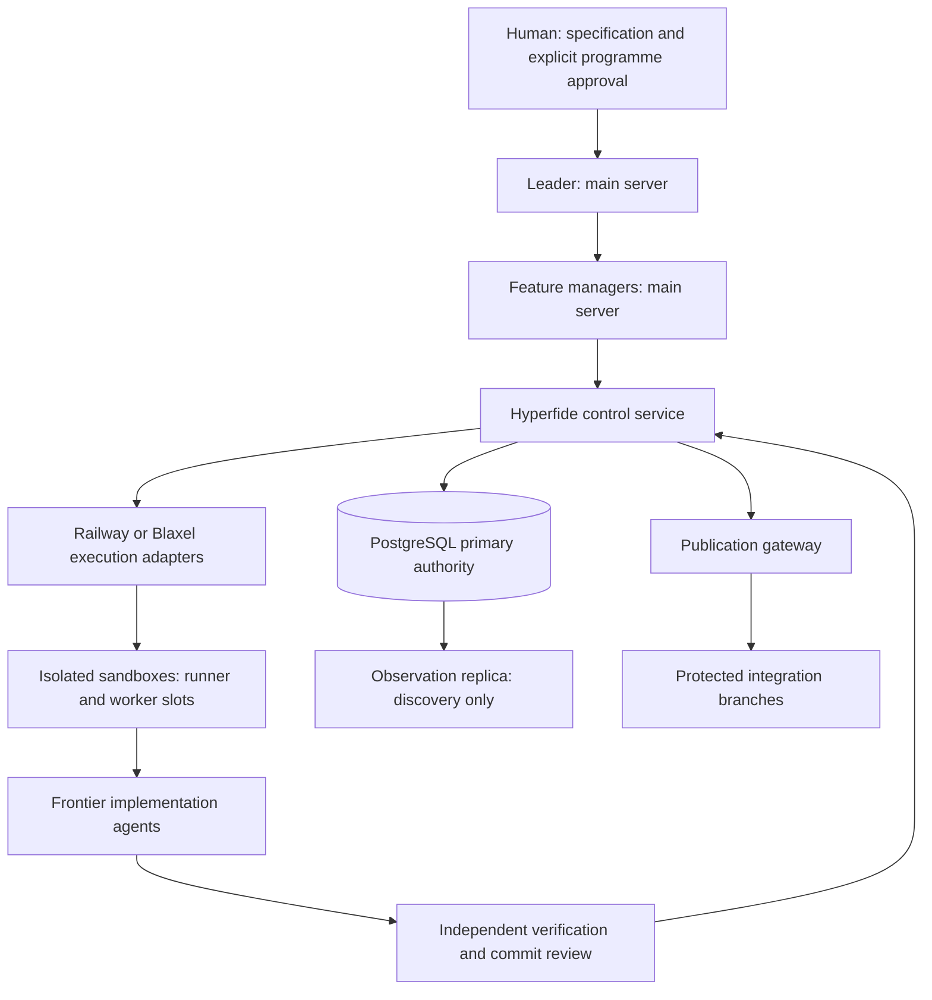

<div align="center">

# Hyperfide


<a
  href="https://trendshift.io/repositories/267432?utm_source=trendshift-badge&amp;utm_medium=badge&amp;utm_campaign=badge-trendshift-267432" target="_blank" rel="noopener noreferrer">

</a>

**面向智能体的工作流工具——从小而简单的项目到庞大复杂的代码库。**

本地 CLI 为纯 C11 实现:一个二进制文件,一个 SQLite 数据库,没有遥测。

[](../../LICENSE)
[](#)
[](../../.github/workflows/ci.yml)
</div>
<div align="center">

[English](../../README.md) · [简体中文](README.zh-CN.md) · [Español](README.es.md) · [हिन्दी](README.hi.md) · [العربية](README.ar.md) · [Français](README.fr.md) · [Português (BR)](README.pt-BR.md)
</div>

---

## 概述

Hyperfide 是一个装在单个二进制文件 `hyperfide` 里的智能体工作流引擎。它维护着代码本身之外、项目最需要的四样东西——代码**是什么**、它是**如何走到今天**的、**接下来**要做什么、以及一路走来**学到了什么**——并将这四者同时提供给人类和 AI 智能体。

这棵代码树是开发中的 Hyperfide 2.0:`hyperfide version` 打印 `2.0.0-dev`,其中没有任何内容是生产发布。Hyperfide 脱胎于 Codify,Codify 的 1.x 发布、特性 ID(例如 `codify-v15` 和 `codify-v16`)以及提交历史都保留原来的名称。2.0 在同一个本地 CLI 之外增加了一个[分布式控制面](#hyperfide-控制面)——监督服务器上的领导者(leader)与特性管理者、用于构建和运行智能体的远程沙箱,以及作为权威来源的 PostgreSQL。

> **兼容性。** `hyperfide` 是规范命令。`cg` 是一个已弃用的兼容别名,由同一个可执行文件安装,参数、JSON 和退出码完全相同;它会在已批准发布的受支持兼容期内保留,只有在某个明确宣布移除的后续发布中才会被删除。下文所有示例都使用 `hyperfide`;`cg` 运行的是同样的东西。

`hyperfide fleet up` 启动一个持久、可在崩溃后恢复的监督进程(supervisor),负责主智能体、wave 管理者和任务工作者。它管理每一个 Codex 或 Claude Code 进程,直到其工作通过资格确认并完成合并。智能体获得来自图的上下文,分支漂移在集成之前被检查,`hyperfide serve` 将事件推送给编辑器。索引在各工作者之间合并执行;图和记忆覆盖每一个分支和 worktree。核心循环不发起任何网络调用;少数会发起网络调用的功能在本概述末尾逐一列出。

**代码是什么。** Hyperfide 将源文件索引成一个可查询的图:符号、调用、导入、类型、路由以及全文检索,全部本地存储在 SQLite 中。语言覆盖范围从原生语法提取到仅跟踪文件;[覆盖矩阵](../../docs/indexing.md#extraction-coverage)给出了每个语言族的边界。`hyperfide context <query>` 一次调用即可回答"帮我快速了解这一块":匹配的符号及代码片段、调用者、被调用者以及相关路由。注释也被作为一等节点索引,承载只存在于文字中的目的、契约、危险和耦合。

**它是如何走到今天的。** 内置的内容寻址快照系统提供提交、历史、差异和恢复能力,无需任何外部版本控制系统。由于快照与图共享同一个数据库,`hyperfide changes` 能报告未提交修改的影响范围。`hyperfide changelog` 负责写发布说明:默认基于 git 历史——每个 tag 或每次版本号变更对应一个发布,按提交标题前缀分组,保留每条任务引用;配置密钥后,每个发布还会附上一段由模型撰写的简短 Highlights——传入 `--snapshots` 或项目根本没有 git 时,则基于快照链生成符号级差异。

**接下来做什么。** 一个 spec 引擎将纯文本 kvx 规格文件转化为可执行的计划:带依赖波次(wave)的任务面板、附在每个任务上的验收标准——以及一个经过验证而非口头宣称的 `done`。`hyperfide spec new` 与 `hyperfide spec add` 创建计划,`hyperfide spec lint` 证明它可执行,循环负责执行它。在 Prod 模式下,`implemented` 记录编码完成与源代码证据,但不宣称通过资格确认;只有 `done` 表示可执行的资格确认与图检查都已通过。在 parallel 模式下,多个智能体同时工作,边界由每个任务所声明路径的互不相交来保证。

**一路走来学到了什么。** 智能体记忆将刻意留下的笔记——决策、约束、结果、偏好、事实——存储在与图相同的数据库中,并关联到写下它们时所在的任务。`hyperfide remember` 在任务进行中保存一条记忆,每次 `hyperfide spec done` 都会自动记录一条如实的结果(包括被拒绝的完成),而 `hyperfide recall` 按相关性与新近程度排序,将这一切重新带回。

这几层相互增强:提交会自动打上其所实现任务的标签,记忆会浮现在它们所属的任务上,`hyperfide why` 能把一个符号追溯到其背后的决策,`hyperfide spec trace` 能从任意任务一路追溯到它的符号、提交和记忆。

**它不仅出现在步骤的起止处,也陪伴在步骤之间。** `hyperfide work open` 以一个紧凑的任务包开始,`hyperfide work update` 只返回新增的状态、证据与工作区增量,`hyperfide event progress` 识别循环而不把"有活动"误当作"有进展",`hyperfide guard` 会在编辑越出声明范围时察觉。内置的 MCP 服务器向所有支持 MCP 的智能体暴露 67 个工具以及资源和提示词,`hyperfide integrate` 负责规划、应用并诊断各宿主的原生配置。

**它不仅服务智能体,还能驱动智能体。** `hyperfide handoff` 与 `hyperfide resume` 让任务在会话之间转移而不丢失状态,`hyperfide spec claim-next` 以原子方式把下一个无冲突的任务交给空闲的智能体,`hyperfide spec run` 则把整个 wave 分发给 Codex CLI 或 Claude Code 会话——每个已认领任务一个沙箱子进程,日志和提示词落盘,失败时释放租约。

**它扛得住一整支 fleet。** 索引是共享资源,而非每个进程各自的习惯:第一个需要索引的 `hyperfide` 负责执行,其余的留下一条记录并合并进去,新鲜度窗口可以完全跳过遍历,机器级的解析槽位让并发的多个项目都保持在核心预算之内([docs/sync.md](../../docs/sync.md))。在此之上,`spec/workflow.kvx` 可以声明一个层级——拥有任务列表的主智能体、每个 wave 一个管理者、每个任务一个工作者——由 `hyperfide fleet` 驱动分支流程:worktree、向上合并、在测试与 lint 关卡之后落地、拉取请求、检查点。`hyperfide fleet up` 在一个脱离终端的监督进程下独立运行整棵树——所有 wave 同时进行,每个管理者与其工作者同时存活,每个工作者在自己的 worktree 中——催促停滞的智能体,带着失败原因重试,升级无法挽救的问题,在你选择启用的审批关卡处停下,并且只在工作**合并**之后才报告完成,而不是在进程退出时([docs/hierarchy.md](../../docs/hierarchy.md))。杀掉监督进程后,`hyperfide fleet up --resume` 会接管仍在运行的智能体。偏离 spec 的改动、相互冲突的任务、其他分支依赖的接口变化都会在合并前被标出([docs/drift.md](../../docs/drift.md));`hyperfide projection build` 把每个活跃分支(包括未提交的工作)折叠到同一个投影 ref 上,在任何合并发生之前指出符号、接口与文本冲突及其所属分支,并且投影会通过钩子、`hyperfide watch`、`hyperfide serve` 和监督进程跟随工作更新([docs/projection.md](../../docs/projection.md))。每一次变化都是一个事件,可由 `hyperfide events --follow` 与 `hyperfide serve` 实时推送([docs/events.md](../../docs/events.md))。它们共享同一个图和同一份记忆:仓库的每个分支和关联 worktree 都索引进同一个 `.codegraph/`,按分支隔离([docs/branches.md](../../docs/branches.md))。

**需要做判断时,它会请求一个决策。** `hyperfide jev` 调用 TypeSafe 的 System One 模型获取类型化的判断——真/假、多选一、排序。`hyperfide memory classify` 用它判断哪些笔记是可复用的技能,`hyperfide skills promote` 再将其渲染为可移植的 `.agents/skills/<slug>/SKILL.md`;失败的 `verify_cmd` 会得到一行分诊,`hyperfide guard` 的发现会被排序,拉取请求会得到一个就绪度评分。Jev 对构建于其上的功能是必需的,对核心循环从不需要,并且从不具有权威性——Jev 的任何回答都不会改变退出码([docs/jev.md](../../docs/jev.md))。

**文档是最后一个经过验证的任务。** 新的特性 spec 默认启用 `@docs` 收尾阶段。所有普通任务通过资格确认后,Hyperfide 从 spec、按任务归属的快照、代码图、路由、记忆、检查结果和现有文档中构建一个有界的证据包。同一个已配置的智能体连接器负责更新用户与开发者文档,而 `hyperfide docs check` 检查声明的引用、本地内联链接、必需的图表面覆盖以及已配置的目标范围。`hyperfide docs close` 记录一个专门的 `[spec:<feature>/@docs]` 快照和供下一轮 spec 流程使用的增量基线。这些结构性检查辅助评审,但并不担保每句话的含义。

CLI 不运行任何你未曾启动的后台服务,也不发送遥测——fleet 监督进程只在 `hyperfide fleet up` 之后运行,并随 `hyperfide fleet down` 停止。图、记忆、快照以及整个任务循环都在你的机器上运行,并且只留在你的机器上。例外都明确列出且需主动启用:Jev 决策需要 `OPENROUTER_API_KEY`,且只有构建于其上的命令才会发起这一调用;`hyperfide changelog` 请求模型生成发布亮点,`hyperfide recap` 让 Solar Decide 从过往会话中挑选陈述、再由模型撰写简报,两者都只在设置了 `CENTRA_API_KEY`(或 `HYPERFIDE_CHANGELOG_KEY`)时发生;`hyperfide fleet pr` 和 `checkpoint` 会调用 `gh`。`services/hyperfide` 下的分布式控制服务是需要你显式启动的独立进程([Hyperfide 控制面](#hyperfide-控制面))。

## 为什么选择 Hyperfide

**它闭合了从计划到证明的回路。** 大多数工具要么规划工作(任务列表),要么描述代码(搜索、索引)。Hyperfide 在同一个数据库上同时做这两件事,因此计划可以对照现实来核验:当一个任务声明它引入 `checkMode` 并涉及 `src/*.ts` 时,`hyperfide spec done` 会在图和历史都确认之前拒绝将其标记为完成。

**智能体像工程师一样工作,而不是像游客。** 智能体不必一个文件一个文件地在仓库里闲逛,而是通过 `hyperfide spec next` 询问该做什么,通过 `hyperfide context` 获取该区域的全部信息,通过 `hyperfide impact` 了解谁会被破坏——然后提交时自动附上任务归属。整个循环都可以通过 MCP 完成,因此智能体永远不必离开协议。

**会话会遗忘,项目会记住。** 智能体的上下文窗口会重置;记忆表不会。用 `hyperfide remember` 写下一次的决策,会自动迎接下一次会话——出现在 `hyperfide spec next`、`hyperfide spec start` 以及会话开始时的 `hyperfide recall` 里——而不必付出全部代价重新发现。并且由于被拒绝的完成同样会被记录,"这个任务被卡了两次,原因在这里"只需一次查询。

**上下文一次到位,而不是二十次——并且控制在预算之内。** `hyperfide context <query>` 是围绕智能体实际消费代码的方式设计的。一次请求返回开始工作所需的一切:相关记忆、执行入口、匹配项、调用者、被调用者以及涉及它的路由——经过排序(真实定义优先于测试夹具,被调用的代码优先于死代码),并适配到 token 预算(`--budget`,默认 4000)。一个符号只完整打印一次,之后每次提及都是紧凑的 `name path:line`,被预算裁掉的内容会以明确的省略计数告知,而不是悄悄丢弃。

**影响分析是一等命令。** `hyperfide impact <name> -d 3` 沿调用者与被调用者的边做传递性遍历,回答任何改动前最关键的两个问题:改了它谁会坏,它又依赖什么。

**搜索即时且分层。** 符号名上的 FTS5 三元组索引提供无需预热的、不区分大小写的子串匹配,完整文件正文上的词索引覆盖其余内容。

**覆盖或新鲜度不确定时,索引会如实报告。** `hyperfide watch` 观察文件变化并请求带防抖的同步。丢失的监听事件或注册失败会留下持久的对账欠账。CLI 和 MCP 的回答会把提取覆盖情况和有界的源文件检查标为 verified、stale 或 unchecked;一次合并执行的更新本身并不能证明新鲜度。一个进程持有索引关卡,其他调用者留下脏记录,机器级槽位限制跨项目的解析线程数([索引细节](../../docs/indexing.md#freshness-and-migrations))。

**它会适配所运行的硬件。** 启动时,`hyperfide` 根据系统实际提供的资源设定工作线程池和 SQLite 缓存:容器感知的核心数(cgroup v1/v2 CPU 配额、亲和性掩码与在线 CPU 三者的交集)、真实的可用内存(`MemAvailable` 与 cgroup 内存限制的交集),以及实测的单项目开销。16 核工作站获得完整的并行流水线。2 核 VPS 得到一条经过调校、能够可靠跑完的流水线。运行 `hyperfide info` 可以准确查看流水线是如何配置的。

**一切留在本地。** 图存储在 `.codegraph/` 下的 SQLite 数据库中,快照是 `.codegraph/objects/` 下的内容寻址对象。删掉这个目录,所有痕迹随之消失。

## 意图层

解析器能看到符号、调用和路由。它看不到函数*为什么*存在、调用者必须保证什么,
或者 `save_tasks` 必须在 `load_tasks` 读盘之后运行——代码库的这一半只存在于
注释中。Hyperfide 将其索引起来(完整约定见 [docs/ANCHORS.md](../../docs/ANCHORS.md)):

- **锚点(anchor)** 是通过"可推导性测试"的注释——*如果智能体读代码就能写出来,
  它就不是锚点。* 有价值的四类是:**目的(purpose)**、**契约(contract)**、
  **危险(danger)**、**指针(pointer)**。
- **文档优先检索**:有锚点时,`hyperfide context` 提供文档 + 签名而非函数体行——
  同样的 token 预算可容纳数倍的符号。
- **`hyperfide survey`** 以读一个函数体的代价读一百个文件:目的行以及带签名的文档,
  从不输出函数体。
- **软边**:锚点中的名称被解析为 `(soft)` 引用——解析器无法推导的跨语言与动态耦合,
  并加以标注,因此绝不会被误认为解析出的调用。
- **如实对待漂移**:每个锚点都会为它描述的代码记录基线。代码变了,文档就会被标为
  过期——在 `hyperfide check`、`hyperfide guard` 以及检索本身中——直到它被更新或删除。
  只警告,不阻断。
- **`hyperfide anchors`** 按协调度评分(扇出 × 范围 × 引用文件数,刻意不用原始的
  热门程度)对未覆盖的符号排序,让补写从编排点开始,而不是从 `sb_puts` 开始。

这些都不是必需的:从不采用该约定的仓库,依然能从现有注释中获得捕获、概览和软边。

## Hyperfide 的一次会话

```sh
hyperfide brief                     # root, active task + ACs, uncommitted work, prior decisions
hyperfide spec next                 # the next eligible task, ACs + relevant memories
hyperfide spec start 16.7           # claim it — one task in progress at a time
hyperfide context "password auth"   # memories, entry points, symbols, callers, routes in one call
hyperfide why verifyLogin           # who changed it, under which task, and what was decided
hyperfide impact verifyLogin -d 2   # who breaks if this changes
# ...implement...
hyperfide guard                     # anything drifting outside what task 16.7 declared?
hyperfide test-impact               # which tests cover what you just changed
hyperfide remember "sessions rotate on login" --type decision   # linked to task 16.7
hyperfide review                    # the change, paired with the ACs it claims to satisfy
hyperfide commit -m "add password auth"   # snapshot, auto-tagged [spec:ion_spec/16.7]
hyperfide spec done 16.7            # qualification: verify_cmd + graph checks; outcome recorded
hyperfide spec trace 16.7           # proof: task -> symbols -> commits -> memories
```

当会话不得不在任务完成前停下——上下文窗口满了,或者一天结束了——工作也不会蒸发:

```sh
# session A, stopping early
hyperfide handoff --done "schema migration; token rotation" \
                  --next "wire the login route; extend 03_auth test" \
                  --blocked "flaky fixture on CI" -m "rotate on login, not refresh"

# session B, hours later, a fresh context window
hyperfide resume --prompt   # paste-ready block: task, steps done, blockers,
                            # next steps, uncommitted files, lease state
```

handoff 以结构化记忆的形式存储并关联到任务;每条新的 handoff 会取代上一条,因此 `hyperfide resume` 看到的永远是最新状态,而不是一堆过期的笔记。

这个循环中的每条命令同时也是一个 MCP 工具,因此已连接的智能体可以端到端地运行它——而且每一步在十个文件的项目里和在 monorepo 里同样好用。`hyperfide check` 在 CI 中以单个步骤跑完整个关卡,`hyperfide hook install` 接好同步与范围检查,让其中大部分工作无需任何人手动调用就会发生。

## 支持的语言与框架

原生语法适配器覆盖 JavaScript/JSX、TypeScript/TSX、C、C++、Objective-C、Go、Rust、Python、Ruby、PHP、Java、Kotlin、Scala、C#、Swift、Dart、Lua、Luau、R、Erlang、Solidity、Terraform、Nix、Pascal、COBOL、VB.NET、CFScript、CFQuery 和 ArkTS。混合格式适配器覆盖 CFML、Vue、Svelte、Astro、Liquid、Razor、Delphi 窗体和 MyBatis XML 中的选定结构。JSON、YAML、Twig 和 properties 在文件级跟踪。[索引指南](../../docs/indexing.md)说明了支持的事实、回退、限制以及未解析的边界。

框架感知的路由解析会记录受支持的字面量注册,并在证据允许时关联到唯一确定的处理函数。它覆盖 Express、Next.js、React Router、Expo Router、SvelteKit、Vue/Nuxt、FastAPI、Django、Flask、Laravel、Rails、Spring、Gin、Axum、ASP.NET 和 Vapor,以及 Koa、Fastify、Hapi、NestJS、Sinatra、Echo、Fiber、Chi 和 Actix 中的部分注册方式。计算得出的路径和有歧义的处理函数保持未解析。

## 安装

在本修订版中,Hyperfide 2.0 需要从源码构建。在分发与更名任务(`spec/hyperfide/spec.kvx` 中的 25.4 和 26.2)关闭之前,`scripts/install.sh` 中的一行式安装脚本不作为 Hyperfide 发布对外推荐。

依赖:C 编译器、`python3`(构建过程用它发现原生组件),以及 SQLite、libcurl 和 OpenSSL libcrypto 的开发包(在 Debian 和 Ubuntu 上为 `libsqlite3-dev`、`libcurl4-openssl-dev`、`libssl-dev`)。tree-sitter 运行时和语法已随源码内置(vendored)。

```sh
make && sudo make install
```

`make` 链接出 `./hyperfide` 并将其复制为 `./cg`;`make install` 检查两者逐字节相同,然后把两者都安装到 `$(PREFIX)/bin`(默认 `/usr/local`)。`make uninstall` 移除两者。各项目的 `.codegraph/` 数据不会被触碰。

在已有项目上升级是安全的:数据库带有 schema 版本号(本代码树中为 18),升级后首次打开时 `hyperfide` 只重建派生的索引表(files、symbols、refs、routes、imports 以及搜索索引)——下一次同步会重新填充它们。记忆、git 历史、租约、尝试、事件以及分支和智能体注册表绝不会因迁移而丢失。旧版二进制会拒绝打开更新的数据库,而不是将其降级。

然后,在任意项目中:

```sh
cd your-project
hyperfide init
```

在终端中,`hyperfide init`、`hyperfide index` 和 `hyperfide sync` 会在 stderr 上显示一行实时进度
——当前阶段、已完成/待处理的文件数、工作线程数、已用时间,以及正在等待的
锁——并在输出摘要前清除。管道输出不受影响;
`HYPERFIDE_PROGRESS=plain` 改为打印普通文本行,`HYPERFIDE_PROGRESS=0` 将其关闭。
见 [docs/sync.md](../../docs/sync.md#progress)。

环境变量一律写作 `HYPERFIDE_*`。旧的 `CG_*` 名称,以及本代码树仍然识别的 `CODIFY_*` 名称(`CODIFY_ROOT`、`CODIFY_INSTALL_DIR`、`CODIFY_BASE_URL`,以及权威来源、凭据、传输、MCP 工具策略和模式相关变量),都被视为同一设置的别名接受;如果把某个别名和它的 `HYPERFIDE_*` 名称设为不同的值,命令会以别名冲突错误停止,而不是从中任选一个。

## 命令参考

`hyperfide help` 打印全景图:按分组列出每个命令,每条一行,按终端宽度排版。`hyperfide help <command>`(或 `hyperfide <command> --help`、`-h`)显示单个命令的用法、子命令、参数、示例和相关命令;`hyperfide help --all` 打印全部命令的详情,`hyperfide help --json` 则把同一张表交给编辑器和智能体,用来生成菜单。下面的表格列出的命令与 `hyperfide help` 相同。概览还会打印[兼容性](#概述)一段中引用的命令名称说明。

| 命令 | 说明 |
| --- | --- |
| `hyperfide help [<command>] [--all] [--json]` | 分组概览、单个命令的详情、全部详情,或以 JSON 输出整张表。名称未知时会提示最接近的命令并以 1 退出。粗体与暗色只在终端中使用(由 `NO_COLOR`、`TERM=dumb` 和 `HYPERFIDE_COLOR=0\|1` 决定);`COLUMNS` 设定宽度,最小为 60 |
| `hyperfide version` | 打印版本号(`--version` 亦可) |

### 图

| 命令 | 说明 |
| --- | --- |
| `hyperfide init [--nested] [--force]` | 创建 `.codegraph/` 并构建初始索引;在已初始化仓库的关联 git worktree 中,则以当前分支加入共享图。在外层项目内部会拒绝执行(`--nested` 让此目录成为独立项目),在你的主目录中也会拒绝(`--force`) |
| `hyperfide sync [paths] [--max-age MS] [--background] [--wait MS] [--auto] [--workers N]` | 增量索引:合并进已在运行的一轮(`--wait`,默认 2000 ms)、新鲜时跳过、只遍历指定的路径;`--auto` 标记一次隐式同步,`[sync] auto = false` 时会跳过它 |
| `hyperfide index [--full] [--workers N]` | 总会遍历的阻塞式同步,会等待已在运行的一轮。`--workers N`(两者皆可)优先于 `HYPERFIDE_INDEX_WORKERS` 和项目配置中的 `[index] workers`。数据库在锁等待时间过后仍然繁忙时以 75 退出 |
| `hyperfide branches` | 索引进共享图的每个分支,及其 worktree、head、base 与文件数 |
| `hyperfide search <q> [-n N]` | 符号与全文搜索(默认 20 条结果;`--path`、`--lang`、`--kind`、`--name`、`--no-tests` 用于缩小范围):一个短语会匹配名称(`export memory` 能找到 `memory_export` 和 `exportMemory`)、文档注释和函数体,按此顺序排序,源码排在测试之前;文件命中会显示匹配的行。返回的是定义,而不是其原型;精确匹配和片段匹配都找不到时,会启用有界的拼写容错回退([docs/retrieval.md](../../docs/retrieval.md)) |
| `hyperfide grep <pattern> [-E] [-i]` | 代替 shell grep 的行搜索:通过三元组索引查找字面量(或 `-E` 正则),从磁盘读取,每个命中定位到其所在的符号,按 `-n` 与 `--budget` 排序截断并给出省略的尾部;`--path`、`--lang`、`--no-tests`、`--symbol`、`--kind`、`-C`、`--files`、`--count`([docs/retrieval.md](../../docs/retrieval.md)) |
| `hyperfide symbol <name>` | 定义、代码片段与引用计数 |
| `hyperfide impact <name> [-d N] [--budget N]` | 深度 N(默认 3)以内的传递性调用者与被调用者,适配 token 预算(默认 8000) |
| `hyperfide flow <callers\|callees\|impact\|paths> <name> [target]` | 有界的类型化关系遍历,附源码证据、动态边界和明确的限制:`--depth`(1 到 8)、`--max-nodes`(最多 256)、`--max-edges`(最多 512)、`--max-ms`(最多 2000)、`--max-output` 字节数 |
| `hyperfide inspect` | 层级检查和审慎的无引用代码检查;见下方子命令 |
| `hyperfide inspect hierarchy <name> [-n N]` | 基于类型化关系的有界祖先、子类型和实现 |
| `hyperfide inspect unused [-n N] [--path GLOB]` | 无引用的符号以及从已知根出发的有界可达性,附排除原因;从不构成删除结论 |
| `hyperfide context <q> [--budget N] [-n K]` | 面向智能体的一次性上下文包:记忆、符号、入口点、路由——前 K 个符号(默认 8),填充到 token 预算(默认 4000),给出明确的省略计数,并在 `--json` 中给出 `tokens_used`。文件路径会得到该文件的大纲(目的、符号、导入、依赖方);目录会得到其中的文件 |
| `hyperfide survey [path\|query] [--budget N]` | 函数体之下的一层:每次调用跨约 100 个文件给出文件目的行和带签名的符号文档——从不输出函数体。未覆盖的文件和符号会被点名,被预算(默认 16000)裁掉的内容会给出明确的省略计数 |
| `hyperfide files [pattern] [--dirs] [--depth N] [-n N]` | 按 glob(`src/**/*.go`)、按路径中的词(`sync gate`)或按目录列出文件,各附语言、行数与符号数;`--dirs` 列出目录及其文件数、行数与主要语言。`--path`、`--lang` 与 `--no-tests` 可缩小范围,与它们在 `search`、`context` 和 `survey` 中的作用相同 |
| `hyperfide anchors [--stale] [--uncovered]` | 锚点健康度:代码已变化的文档,以及按协调度评分(扇出 × 范围 × 引用文件数)排序的未覆盖符号——即补写工作清单 |
| `hyperfide routes [filter]` | URL 模式到处理函数的映射表 |
| `hyperfide show <symbol\|path:line> [--full]` | 只看该符号的函数体——按名称,或按编辑器持有的光标位置;过长的函数体会以 `… (+N more lines, use --full)` 标记截断 |
| `hyperfide why <symbol>` | 来龙去脉:改过它的提交、这些提交实现的任务、记录下的决策 |
| `hyperfide test-impact [symbol]` | 引用某个符号的测试——或引用你未提交改动中每个符号的测试 |
| `hyperfide watch [--debounce MS] [--fleet]` | 基于原生文件系统事件的自动同步(防抖默认 300 ms);`--fleet` 监听图所知道的每个 worktree,各自归属其分支 |
| `hyperfide root` | 从当前位置解析到的 `hyperfide` 项目根目录;`--json` 附带共享项目、worktree 标志与分支 |
| `hyperfide info` | 机器画像、流水线配置(工作线程数及其来源)、绑定的项目根目录和分支、按分支的索引覆盖情况,以及解析器清单 |
| `hyperfide config [init\|get K\|set K V\|check] [--json]` | `hyperfide.kvx` 中的项目配置(仍会读取旧的 `codify.kvx`):每个设置及其来源、带注释的默认值、就地读取或写入单个键,以及对未知键和非法值的检查。在 `hyperfide init` 之前即可使用。见 [docs/config.md](../../docs/config.md) |

### 版本控制

快照采用 SHA-256 内容寻址,数据块自动去重。

| 命令 | 说明 |
| --- | --- |
| `hyperfide commit -m <msg>` | 对工作树做快照,先同步,并自动打上进行中任务的标签;`--task <id>` 指定任务,`--amend` 替换上一个快照,`--git` 同时生成一个带相同 spec 标签的真实 git 提交 |
| `hyperfide log [-n N]` / `hyperfide status` | 快照历史(默认 20 条),以及工作树相对 HEAD 的状态,附按分支的索引覆盖情况和待处理的对账 |
| `hyperfide diff [A] [B]` | 快照之间或与工作树之间的 LCS 行级差异 |
| `hyperfide checkout <id> [--force]` | 恢复某个快照 |
| `hyperfide changes [--limit N]` | 未提交修改的影响半径:你改动的符号及其外部调用者——默认有上限(40 个符号,每个 8 个调用者),并带 `(+N more)` 标记;`--limit` 可覆盖 |
| `hyperfide git-sync [-n N]` | 导入 git 历史(默认 2000 个提交)——提交、作者、每文件变动量——随后用于搜索和上下文排序,并回答 `hyperfide why` |
| `hyperfide events [--since N] [--kind K,..] [-n N] [--follow [--for S]] [--head]` | 事件日志:按序号记录每一次任务、认领、尝试、智能体、fleet、监督进程、漂移和审批变化。`--kind` 接受逗号列表,末尾的 `.` 表示前缀(`fleet.`);`--follow` 实时推送;`--json` 每行一个对象。见 [docs/events.md](../../docs/events.md) |

Hyperfide 的快照并不取代 git。`.gitignore` 与 `.cgignore` 一同生效,`hyperfide git-sync` 读取你真实的历史,`hyperfide commit --git` 两边同时写入,因此采用 Hyperfide 从不是全有或全无。

### 变更日志

`hyperfide changelog` 基于 git 历史生成发布说明。一个发布从某个 tag **或**项目版本号发生变化的那次提交开始——`src/cg.h` 中的 `CG_VERSION`、`VERSION` 文件或 `package.json`——所以从不打 tag 的项目也能每个版本得到一节。最后一个发布之后的内容,若工作树携带的版本号是新的(即正在准备的发布),就以它命名;也可用 `--tag NAME` 指定;否则才是 `[Unreleased]`。分组来自提交标题前缀,`hyperfide commit` 追加的 `[spec:<feature>/<task>]` 会成为条目上的任务引用。提交链接和比较链接来自 `git remote get-url origin`;没有 remote 时,条目写作 `- Add gauge (497c30a)`,页脚链接被省略。

```markdown
## [0.3.0] - 2026-09-28

### Features
- Add gauge ([497c30a](https://github.com/acme/demo/commit/497c30acbc9dc0daf869af07a993db74ea0da779))

### Documentation
- Explain gauges ([191d0c8](https://github.com/acme/demo/commit/191d0c811203dc1bba7b39f0b9095e5875a1ff7f))

## [0.2.0] - 2026-09-28

### Bug fixes
- **parser:** Handle empty input ([682f9f8](https://github.com/acme/demo/commit/682f9f8c9bd6bb5813cfc2665c4e1265fba16933), task demo/1.2)

[0.3.0]: https://github.com/acme/demo/compare/0.2.0...0.3.0
[0.2.0]: https://github.com/acme/demo/compare/0.1.0...0.2.0
```

**Highlights。** 环境变量或项目 `.env` 中有 `CENTRA_API_KEY`(或 `HYPERFIDE_CHANGELOG_KEY`)时,每个发布会多出一个 `### Highlights` 块:两到五句话,大型发布再加几条要点,由模型根据该发布分组后的提交撰写。派生出的条目绝不会被修改,提示词也要求模型不得编造提交中没有的内容。默认端点是 `https://gateway.centra.ag/v1/chat/completions`,模型为 `openrouter/anthropic/claude-haiku-5.5`;`HYPERFIDE_CHANGELOG_ENDPOINT` 与 `HYPERFIDE_CHANGELOG_MODEL` 可指向任何兼容 OpenAI 的服务。回答按发布的提交和模型缓存在 `.codegraph/changelog-cache/` 下,因此重新生成文件时只会询问有变化的发布。`--summarize` 强制启用(找不到密钥时会明确说明),`--no-summarize` 不调用模型,调用失败时在 stderr 打印 `highlights for <release> skipped — <why>`,并写出不含该段文字的说明。

```sh
hyperfide changelog -o CHANGELOG.md        # every release, highlights when a key is present
hyperfide changelog --unreleased           # only the newest section and its footer line
hyperfide changelog --tag 1.2.0            # name the newest section 1.2.0, dated today
hyperfide changelog --no-summarize -n 3    # the plain record, three newest releases
```

`-n N` 限制发布节数,`-o FILE` 相对仓库根目录写入文件,并报告写入了多少段 highlights、其中多少来自缓存。`--snapshots`——以及任何没有 `.git` 的项目——会退回到快照渲染器,其输出是每个快照的符号级差异,而不是发布历史。仓库根目录的 `cliff.toml` 是对应的 [git-cliff](https://git-cliff.org) 配置;git-cliff 只认 tag,因此只有在仅使用 tag、没有版本文件也没有模型密钥的仓库中,两者才会生成相同的文件。本仓库的 `CHANGELOG.md` 由 `hyperfide changelog -o CHANGELOG.md` 生成。

### 回顾

`hyperfide recap` 撰写一份简报,供全新的智能体重新接手项目:项目是什么、最近几周改了什么、近期的会话做了什么、那些否则会丢失的事实,以及下一步。它的原材料是 Claude Code 和 Codex 已经保存在本机上的会话记录(`~/.claude/projects/<cwd>/*.jsonl` 和 `~/.codex/sessions/**/rollout-*.jsonl`,按工作目录与本仓库匹配),它们是提交与提交之间关于*为什么*的唯一记录,而且长得远远无法整份交出去。

两个模型做两件不同的事。每份会话记录被切分成陈述——一条用户请求、助手回答中的一个段落或一个要点、一次文件编辑、一条执行了提交或测试的命令——并以小块的形式交给 **Solar Decide**,即 Upstage 的 System One 决策模型,经由 Centra 网关调用(`openrouter/upstage/solar-decide`,端点 `https://gateway.centra.ag/v1/systemone`,请求格式与 Jev 相同)。对每条陈述,它以校准过的概率回答三个类型化的问题,不输出任何文字:它属于哪一类(目标、决策、约束、事实、已完成、未结线索、死胡同、噪声),会话结束时它是否仍然成立,以及接手的智能体是否需要它。越过门槛的陈述按这些概率的乘积排序,并截断到 `--budget` 个字符,构成**决定日志(decided log)**:每一行都引自某次会话,没有一行由模型撰写。这份日志连同从仓库读取的事实(当前特性及其任务状态、最近的提交、已存储的记忆)被交给 `hyperfide changelog` 已在使用的网关聊天模型,由它撰写简报本身。决定日志保存在 `.codegraph/recap/decided.md`,因此简报中的任何一句话都可以对照实际说过的话来核查。

```bash
hyperfide recap                              # 6 newest sessions of the last 21 days → <context>/recap.md
hyperfide recap --sessions 10 --since 45     # wider window
hyperfide recap --decided                    # stop at the picked statements; print them, write no prose
hyperfide recap --facts                      # the repository facts alone; no key, no model
hyperfide recap -o - --agents codex          # to stdout, Codex sessions only
```

两次调用都使用环境变量或项目 `.env` 中的 `CENTRA_API_KEY`(或 `HYPERFIDE_CHANGELOG_KEY`);没有它时命令会以明确的错误停止,因为两半都没有本地替代品。该端点会针对整个状态为每个问题计费,所以分块很小(6 条陈述,`HYPERFIDE_RECAP_CHUNK`),并且多块同时运行(`HYPERFIDE_RECAP_PARALLEL`,默认 6)。耗时和费用取决于会话和网关;本修订版不给出实测数字。决定按块缓存在 `.codegraph/recap-cache/` 下,因此重新运行时只会询问新的会话。永远不会发给模型的内容:思考块、工具输出、宿主框架的通知和提醒、代码围栏,以及其他项目的会话。`HYPERFIDE_RECAP_DECIDE_MODEL`、`HYPERFIDE_RECAP_DECIDE_ENDPOINT` 和 `HYPERFIDE_RECAP_MODEL` 可让任一半指向别处;`HYPERFIDE_RECAP_CLAUDE_DIR` 和 `HYPERFIDE_RECAP_CODEX_DIR` 指定去哪里查找。简报写入上下文目录中的 `recap.md`:默认是 `.codify/recap.md`,项目有 `hyperfide.kvx` 时是 `.hyperfide/context/recap.md`。

### 代码地图

`hyperfide codemap` 在仓库根目录写出 `CODEMAP.md`:新来的智能体(或人)读这一个文件,就能知道项目是什么、如何构建和测试、东西放在哪里,以及其余代码依赖哪些符号。它由图构建,从不依赖模型。目的行来自代码自己的文件注释和 README,两者都没有的目录就没有目的行。符号按解析到它们的调用数排序。同样的图生成同样的字节,而且地图从不统计它自己,因此 `hyperfide codemap --check` 可以用作 CI 关卡。`hyperfide brief` 会提到这份地图并说明它是否最新;MCP 的 `codemap` 工具返回它但不写文件。见 [docs/codemap.md](../../docs/codemap.md)。

```bash
hyperfide codemap                  # write CODEMAP.md (8000-token budget)
hyperfide codemap --budget 3000    # tighter: least-referenced entries go first, each section counts what it left out
hyperfide codemap --check          # exit 1 when CODEMAP.md is missing or stale; writes nothing
hyperfide codemap -o - --json      # the same map as structured data
```

### 记忆

持久的智能体笔记,与图存储在同一个 SQLite 数据库中。在 spec 任务进行中写下的记忆会自动关联到该任务,`hyperfide spec done` 也会自动记录结果。切勿在其中存储任何机密信息。

| 命令 | 说明 |
| --- | --- |
| `hyperfide remember <text>` | 保存一条记忆——`--type decision\|constraint\|outcome\|preference\|fact`(默认 `fact`),`--task <feature/id>`(默认为进行中的 spec 任务),可选的 `--symbols` / `--files` 锚点,`--supersedes <id>` 用于废止被推翻的决策 |
| `hyperfide recall [query]` | 搜索记忆:对正文做全文检索,先按相关性再按新近程度排序;可用 `--task`、`--type`、`-n N` 过滤,或用 `--near <file>` 做锚定检索 |
| `hyperfide forget <id>` | 删除一条记忆 |
| `hyperfide memory compact` | 合并重复的记忆(`--dry-run` 预览) |
| `hyperfide memory classify [<id>\|--all\|--unclassified]` | 请 Jev 判断每条笔记属于 `skill`、`decision`、`constraint`、`fact` 还是 `noise`,连同置信度存入该记忆。不带参数时处理未分类的记忆;`-n N` 限制批量大小 |
| `hyperfide memory export [-o FILE]` | 把记忆写成 JSONL——一个头部行,然后每条记忆一个以内容 id 为键的对象——输出到 stdout 或 `FILE`;可用 `--task`(标签或前缀)、`--type`、`--branch`、`--since DAYS` 选择 |
| `hyperfide memory import <FILE\|->` | 在一个事务中按内容 id 添加本图尚未持有的记忆:创建时间、类别和取代关系都会随之迁移;`--dry-run` 只报告不写入,`--keep-branch` 保留本图未跟踪的分支名,`--retask OLD=NEW` 改写任务标签前缀。`--from DIR` 以只读方式读取另一个 Hyperfide 项目的图,而不是读取文件。见 [docs/memory-transport.md](../../docs/memory-transport.md) |
| `hyperfide skills list\|promote <id>\|render` | 被归为 `skill` 的记忆,提升为 `.agents/skills/<slug>/SKILL.md`,并随其源笔记保持更新 |

被取代的记忆永远不会被删除——推翻本身就是值得保留的历史。它只是不再排在结果前面,因此会话首先看到的是当前的决策。

已分类的记忆在出现的每个地方都带有其类别——`hyperfide recall` 中的 `class skill 0.82`、`hyperfide brief` 中的 `[decision/skill]`,以及两者 `--json` 中的 `class` 和 `confidence`。提升会写出一个自我声明为生成产物的文件:它带有归属标记和指回该记忆的链接,没有该标记的文件绝不会被覆盖,`hyperfide skills render` 会刷新那些源笔记已有变化的文件。见 [docs/jev.md](../../docs/jev.md#memory-classification-and-skills)。

### 智能体相关

| 命令 | 说明 |
| --- | --- |
| `hyperfide mcp` | 以 MCP stdio 服务器运行(自报名称为 `hyperfide`):67 个工具,面向工作流、每个特性 spec 和智能体上下文的 `hyperfide://` 资源(仍会读取旧的 `codify://` URI),以及提示词 `orient`、`start-work`、`review-change` 和 `close-task` |
| `hyperfide lsp` | 以语言服务器(stdio)运行——适用于所有编辑器,而不只是 VS Code |
| `hyperfide serve` | 面向编辑器的一条 JSON-RPC 连接(stdio):所有 MCP 工具、任意 `hyperfide` 命令(`exec`)、`cancel`,以及从某个序号开始的推送式事件订阅。空闲时不持锁、不跑索引。见 [docs/events.md](../../docs/events.md#hyperfide-serve) |
| `hyperfide tool list \| call <name> [json]` | 在 shell 中直接运行一个 MCP 工具,无需 MCP 客户端 |
| `hyperfide integrate detect\|plan\|apply\|doctor [--no-plugin]` | 面向 Codex、Claude Code、Copilot/VS Code、Cursor、Gemini CLI、OpenCode、Zed、Windsurf、Cline 与 Continue 的能力感知配置;`detect` 为默认操作,plan 只读,apply 幂等并以 `.codify.bak` 副本备份 |
| `hyperfide mcp-install` | `hyperfide integrate apply` 的兼容别名 |
| `hyperfide hook install` | 接入智能体与 git 钩子,让图保持新鲜、范围漂移自动浮现 |
| `hyperfide hook post-edit` | 接入的编辑钩子本身:从 stdin 读取宿主的负载,做一次定向后台同步,并对被编辑的路径做一次 guard——每次编辑一个进程,而不是两次完整同步 |
| `hyperfide hook event` | 接入的生命周期钩子(`--host claude\|codex`):把宿主自己的会话及其 Agent 工具派生的子智能体连同 worktree、分支、任务和最后一次工具调用记入智能体注册表,发出 `agent.native.*` 事件,并把负载交给 `hyperfide event ingest`;总是以 0 退出 |
| `hyperfide hook pre-bash` | 接入的 Bash 钩子:当命令在代码树上运行 grep、rg、ag、ack、find、fd 或 `ls -R` 时,以上下文形式给出对应的 `hyperfide grep` 或 `hyperfide files` 写法,每个会话每条命令一次;从不做权限决定,在 `HYPERFIDE_SHELL_ADVICE=0` 或 `[hooks] shell_advice = false` 下静默;总是以 0 退出 |
| `hyperfide changelog [-n N] [-o FILE] [--unreleased] [--tag NAME] [--snapshots] [--summarize\|--no-summarize]` | 基于 git 历史的发布说明:每个 tag 或版本号变更一个发布,最新一个以工作树的版本号命名,分组来自提交标题前缀,`[spec:<feature>/<task>]` 渲染为任务引用,设置 `CENTRA_API_KEY` 时每个发布附带模型撰写的 Highlights(见[变更日志](#变更日志))。`--snapshots`,或没有 `.git` 的项目,改为基于快照链渲染,给出符号级差异:新增和删除的函数、新路由 |
| `hyperfide recap [--sessions N] [--since DAYS] [--budget CHARS] [-o FILE] [--agents claude,codex] [--decided] [--facts]` | 基于过往 Claude Code 和 Codex 会话的接手简报:Solar Decide(System One,经由 Centra 网关)挑选接手的智能体所需的陈述,网关聊天模型在上下文目录中写出 `recap.md`;挑选出的陈述保留在 `.codegraph/recap/decided.md`。需要 `CENTRA_API_KEY`(见[回顾](#回顾)) |
| `hyperfide agentmd [--write]` | 在上下文目录中生成图导览 `agent-context.md`(默认是 `.codify/`,有 `hyperfide.kvx` 时是 `.hyperfide/context/`);根目录的 `AGENTS.md` 与 `CLAUDE.md` 仍归 `hyperfide spec render` 所有 |
| `hyperfide codemap [-o FILE\|-] [--budget N] [--force] [--check] [--json]` | 写出 `CODEMAP.md`,即智能体首先阅读的仓库地图:包含构建与测试命令的概览、布局、入口点、各模块及其被引用最多的符号、目录依赖、测试、工作流指引。字节稳定,适配 token 预算(默认 8000),从不覆盖不是由它生成的文件;`--check` 在文件缺失或过期时以 1 退出(见[代码地图](#代码地图)) |

### 智能体控制面

Hyperfide 明确区分四个相互独立的权威来源:Git 状态、Hyperfide 快照状态、声明的 spec 状态和实时的受隔离(fenced)尝试。`hyperfide state` 将它们并列展示而不以其一证明其他;`hyperfide spec reconcile` 诊断孤立的声明,只有加 `--repair` 才会修改。

原生宿主钩子将 JSON 送入 `hyperfide event ingest`。每个事件都会获得稳定的语义标识、发生指纹、会话/尝试标识、精确的工作区修订版和证据增量。`hyperfide event progress` 识别重复失败、重复观察、A-B 补丁振荡和无证据窗口。恢复措施是有限的——警告、重新规划、有界实验、handoff、等待输入、可选的停止——并且默认仅作建议,除非 `HYPERFIDE_PROGRESS_ENFORCE=1` 显式启用终止策略。

`hyperfide work open` 将目标、标准、允许范围、独立状态、记忆、聚焦的图上下文、测试和最新事件组成一个包。它的不透明修订号供 `hyperfide work update` 使用,后者只返回变化了的状态、证据和工作区路径。`hyperfide work close` 将每条标准与持久证据配对,或将其标为未验证。

适配器注册表针对 MCP、指令、技能、钩子、会话和云端执行报告原生、可移植或不可用三种能力状态。可移植资产位于 `.agents/` 和上下文目录下(默认是 `.codify/`,有 `hyperfide.kvx` 时是 `.hyperfide/context/`);已有的宿主配置会被合并,并保留可恢复的 `.codify.bak` 副本,`integrate apply` 还会在 `~/.codify/plugins/claude-code` 下渲染 Claude Code 插件并写出 `.codex/hooks.json`(`--no-plugin` 跳过这两项)。集成执行的是本地 `hyperfide` 二进制,运行记录留在 `.codegraph/graph.db`,整个过程不产生网络调用,也不发送遥测。

### 治理

这四个命令让 Hyperfide 出现在每一步,而不只是首尾两端。它们默认都只给出建议;只有 `--strict` 会让它们失败。

| 命令 | 说明 |
| --- | --- |
| `hyperfide brief` | 一次调用获得会话状态:根目录、当前任务及其标准、未提交的路径、近期的决策,以及 `CODEMAP.md` 是否最新 |
| `hyperfide review` | 改动与它所声称的内容并列:改动的符号、因此面临风险的调用者,以及任务的验收标准 |
| `hyperfide guard [paths] [--strict]` | 对照进行中任务声明的 `touches` 给出依据、契约和卫生方面的发现,包括越出该范围的编辑 |
| `hyperfide drift check <id> [--base REF] \| collisions \| coverage \| summary [-f F]` | 某个任务的改动与其声明的 touches 和符号的对照;若同时运行会相互冲突的未完成任务;没有任何已通过资格确认的任务覆盖的验收标准;某个特性的漂移计数。只警告;见 [docs/drift.md](../../docs/drift.md) |
| `hyperfide check [--strict]` | 唯一的 CI 关卡:渲染是否过期、spec lint、任务证据、声明一致性、工作树状态 |
| `hyperfide state` | 分别标注 Git、快照、spec 声明、实时尝试和过期状态 |
| `hyperfide event ingest\|history\|progress` | 规范化宿主的生命周期 JSON,并区分新的证据与单纯的活动或循环 |
| `hyperfide work open\|update\|close` | 打开紧凑的工作上下文(`--task ID`),获取自某个 `REVISION` 以来的增量,并对照证据关闭标准(`--evidence CLAUSE=PROOF`,可重复) |
| `hyperfide handoff` | 停下之前针对某个任务记录会话状态:`--done "a;b"`、`--next "a;b"`、`--blocked "x"`、`-m <note>`、`--task <id>`(默认为你当前的任务)。以结构化记忆存储;每次 handoff 都会取代该任务的上一次 |
| `hyperfide resume [--task <id>] [--prompt] [--budget N]` | 全新会话接手任务所需的一切:任务包、最新的 handoff(解析回 done/next/blocked)、任务范围内的记忆、未提交的路径、租约状态。`--prompt` 将其渲染为可直接粘贴给新智能体会话的块,适配 `--budget`(默认 6000 token) |
| `hyperfide journal [list\|apply\|drop <id>\|--failed\|--all]` | 数据库繁忙时排队的待写入项:列出、应用、丢弃。遇到数据库被锁的生命周期写入会落在 `.codegraph/journal/` 下,并由下一个持有写锁的进程按顺序重放 |

大多数查询命令都接受 `--json`。这个参数、MCP 服务器和语言服务器是面向智能体的原生接口。

## Spec 工作流

Spec 工作流是 Hyperfide 将特性计划转化为可跟踪、经过验证的工作的方式。Spec 以纯文本 kvx 文件的形式存在——人类可读、可 diff、归你的仓库所有——Hyperfide 将它们渲染成 IDE 规则文件和 markdown 镜像,同时在其之上驱动任务循环。它适用于任何包含 `spec/workflow.kvx` 的仓库,完全独立于 `.codegraph/`,并且是 Ion 的 `spec/specgen` 的即插即用 C 语言替代品,输出逐字节相同。

| 命令 | 说明 |
| --- | --- |
| `hyperfide spec new <feature>` | 生成 `spec/<feature>/spec.kvx` 脚手架——仓库没有 `spec/workflow.kvx` 时一并生成——并将其设为当前特性 |
| `hyperfide spec add <id> --title T` | 插入一个任务,保留其他所有字节:`--wave`、`--requires`、`--symbols`、`--touches`、`--verify`、`--do "a;b"`、`--reqs`、`--section` |
| `hyperfide spec lint` | 校验计划:`requires` 环、指向未知任务的 requires、没有验收标准的任务、失效的 `touches` glob。有错误时以 2 退出 |
| `hyperfide spec render [--check]` | 重新生成 `spec/workflow.kvx` 中 `[adapters]` 下列出的 IDE 指针文件(新工作流列出 `CLAUDE.md` 和 `AGENTS.md`;Cursor、Devin 和 Kiro 的指针文件带有各自的 front matter)以及 markdown 镜像(`requirements.md`、`design.md`、`tasks.md`);`--check` 在有任何内容过期时以 2 退出 |
| `hyperfide spec` / `hyperfide spec status` | 任务面板:模式,以及分开统计的 `done`、`implemented`、`in_progress` 和 `pending` 数量、进度、当前任务、下一个可执行任务,以及所有实时认领 |
| `hyperfide spec mode <prod\|standard\|parallel>` | 配置依赖与并发语义;未设置或未知的模式视为 standard |
| `hyperfide spec wave` | 当前 wave 中所有可执行的任务,而不只是第一个 |
| `hyperfide spec ready` | **所有** wave 中所有可执行的任务,按 wave 分组,`touches` 与实时认领冲突的任务会被标出——即编排者可以分派的完整前沿 |
| `hyperfide spec claim <id>` / `release <id>` | 把任务租给一个所属智能体,并设定过期时间(`--agent`、`--ttl` 分钟,默认 30);认领会拒绝另一个智能体正实时持有的任务,释放别人的租约需要提供那个智能体的名称或 `--force`——不允许悄悄抢占。`done` 和 `implemented` 会自动释放任务的租约 |
| `hyperfide spec heartbeat <id>` | 续订实时尝试的租约:`--agent`、`--attempt`、`--fence`、`--ttl` |
| `hyperfide spec reconcile [--repair]` | 报告没有任何实时尝试支撑的进行中声明;`--repair` 修复它们 |
| `hyperfide spec claim-next [--agent N] [--ttl M]` | 原子地认领第一个 `touches` 既不与进行中任务冲突、也不与实时租约冲突的可执行任务(文件锁 + 单个事务),并返回完整的任务包:任务、租约、任务范围内的记忆。前沿为空时以 3 退出——区别于错误 |
| `hyperfide spec run` | 编排一个 parallel 或 Prod wave:认领可执行的任务,每个槽位驱动一个智能体进程——见[驱动智能体](#驱动智能体)。`-n N`、`--driver codex\|claude\|custom`、`--dry-run`、`--max-fail K`、`--agent-prefix P`;`--fleet` 是层级形式(见 [Fleet 模式](#fleet-模式智能体的层级)) |
| `hyperfide spec next` | `requires` 已满足的最低 wave 中的待办任务(standard 模式下只认 `done`;Prod 模式下认 `implemented` 或 `done`),附其 do 条目和展开的验收标准 |
| `hyperfide spec start <id>` | 将任务标记为 `in_progress`;强制同一时刻只有一个,且 `requires` 已满足。`--force` 只覆盖"同一时刻一个"的限制;`--ahead` 认领一个 `requires` 仍未完成的任务,基于投影进行构建,`done` 会等到这些前置任务落地 |
| `hyperfide spec implemented <id>` | 在 Prod 模式下,运行源码图检查而不执行 `verify_cmd`,然后将编码完成标记为 `implemented`(不打勾;资格确认待定;没有 `--force`) |
| `hyperfide spec done <id>` | 从 `in_progress` 或 `implemented` 出发,运行任务的 `verify_cmd` 和图检查;只有资格确认通过才标记为 `done`,否则保留 `implemented`,无论哪种情况都记录一条结果记忆。`--force` 不经资格确认直接标记为完成 |
| `hyperfide spec trace [<id>] [--no-sync]` | 将任务追溯到代码(除非指定 `--no-sync`,否则先刷新图):声明的符号在图中解析的结果(位置、种类、引用)、涉及的路径与实际改动的匹配、带有该任务标签的提交,以及它的记忆 |
| `hyperfide spec docs <status\|auto\|manual\|off\|start\|block\|reset\|done>` | 查看或配置保留的 `@docs` 收尾阶段。新 spec 使用 `auto`;没有 `[documentation]` 小节的 spec 保持旧的完成行为,直到被显式启用 |

`mode`、`start`、`implemented` 和 `done` 只改写 kvx 文件中那一行 `status = "..."` 或模式设置行。其他每一个字节、注释和空行都会保留。随后命令会悄悄重新渲染,让 `tasks.md` 中的复选框保持最新;implemented 的任务保持不打勾,并带有 `Implemented - qualification pending`。kvx 文件始终是唯一的事实来源;每个 spec 子命令都接受 `-f <feature>` 来覆盖 `[meta] active_feature`,以及 `--root DIR` 来作用于另一棵代码树。

`hyperfide commit` 会自动在提交信息上打上进行中任务的标签,例如 `... [spec:ion_spec/16.7]`,因此 `hyperfide log` 和 `hyperfide changelog` 能把每个快照追溯回 spec。Spec 命令同样以 MCP 工具的形式暴露,让已连接的智能体无需离开协议即可做规划(`spec_new`、`spec_add`、`spec_lint`)、驱动 standard 循环(next、start、快照、done)或 Prod 循环(next、start、快照、implemented、资格确认、done),以及处理并行前沿(`spec_ready`、`spec_claim_next`、`spec_release`、`handoff`、`resume`)。

### 文档收尾

完整的操作指南、归属与恢复说明以及检查器的局限,请阅读[生成和维护项目文档](../../docs/DOCUMENTATION.md)。维护者可以浏览[源码参考](../../docs/SOURCE-REFERENCE.md);[夹具路由和测试符号](../../docs/TEST-REFERENCE.md)另行列出,它们不是实际运行的 Hyperfide 服务。

`@docs` 是特性级的工作,而不是一个人为编号的实现任务。在 `auto` 模式下,`hyperfide spec next` 和 `hyperfide spec claim-next` 会在最后一个叶子任务通过资格确认后返回它,因此 `hyperfide spec run` 会通过现有的 Codex、Claude 或自定义驱动启动它,使用相同的租约、fence、心跳、日志和失败恢复机制。`manual` 让它对显式启动的智能体保持可见;`off` 有意跳过它。没有 `[documentation]` 小节的旧 spec 使用 `legacy` 行为,可以通过 `hyperfide spec docs auto` 或 `hyperfide spec docs manual` 选择加入。

文档命令和 spec 命令一样接受 `-f <feature>`。重命名特性目录时,已完成的任务可以通过 `evidence_task = "original-feature/task-id"` 保留其原来的快照归属;新的快照仍使用当前的特性名称。

```ini
[documentation]
mode      = "auto"
status    = "pending"
audiences = ["user", "developer"]
targets   = ["README.md", "docs/**", "CONTRIBUTING.md", "CHANGELOG.md"]
```

| 命令 | 契约 |
| --- | --- |
| `hyperfide docs status` | 当前模式、实际状态、目标和基线模式 |
| `hyperfide docs plan` | 只读的基线计划或增量计划、受众要求、目标范围,以及现有文档清单 |
| `hyperfide docs packet` | 根据有界的本地证据写出 `.codegraph/docs/<feature>/packet.md`、`provenance.json`、`claims.kvx` 和 `required.kvx` |
| `hyperfide docs check` | 校验目标范围、文档保留、本地链接、受众映射、声明证据、命令、仓库路径、符号、路由以及必需的已变更公共表面 |
| `hyperfide docs trace` | 将文档声明和快照关联到源任务快照、来源信息以及上一次基线 |
| `hyperfide docs close` | 重新运行检查,创建带归属的快照,关闭受隔离的 `@docs` 尝试,并记录项目范围的增量基线 |

智能体填写 `claims.kvx`;Hyperfide 重新生成 `required.kvx`。每条声明都必须指明一个已配置的文档和本地证据。用户指南、开发者指南、发布或迁移说明、排除项和未解决项保持为独立字段,因此缺失的证据无法悄悄变成产品文案。检查器从不删除或重命名规范文档,从不接受已配置目标之外的写入,并在任何失败之后撤销其验证标记。

这些检查建立的是结构上的依据,而不是每句话的真实性:智能体必须记录事实性声明,评审者必须评估其含义。本地内联 Markdown 链接会被检查是否指向仓库中存在的目标;外部 URL、片段锚点、引用式链接和运行时行为不在担保之列。缺失的源证据会被标为不可用。生成的证据包和标记位于 `.codegraph/docs/` 下;项目自有的 Markdown 或 reStructuredText 文件仍然是公开的产出。全部六项操作也通过 MCP 暴露,VS Code 会显示收尾条目以及 plan、packet、check 和 trace 操作。

### 并行模式

Standard 和 Prod 模式都是一次运行一个任务。智能体却越来越不是这样——同时铺开五个或二十个如今已很平常,而随之而来的故障总是同一种:其中两个在编辑同样的文件。

`hyperfide spec mode parallel` 保留 Prod 模式"`implemented` 即可解锁后续实现"的语义,只放宽同时进行的任务数量,因为计划已经声明了每个任务的 `touches`。这让重叠在任何工作开始之前就可知:

```sh
hyperfide spec ready                         # the whole frontier: every eligible task, every wave,
                                      # conflicts with live claims marked
hyperfide spec claim 4.1 --agent alice       # a lease with an owner and an expiry
hyperfide spec start 4.1                     # refused if another live task claims the same paths
hyperfide spec claim-next --agent bob        # or skip the choosing: atomically claim the first
                                      # conflict-free task and get the full packet back
```

`claim-next` 是 fleet 赖以运行的原语:挑选和认领在一个文件锁和单个数据库事务中完成,所以二十个智能体同时调用它,会得到二十个不同的、互不相交的任务——或者在前沿为空时得到退出码 3。另一个智能体持有的认领既不能被夺走,也不能被暗中释放(`--force` 存在,而且动静很大)。如实完成是自动的:`hyperfide spec done` 和 `hyperfide spec implemented` 会自行释放任务的租约。

租约会过期,所以持有租约时死掉的智能体不会卡住整个 wave;`hyperfide check` 会把过期的租约和重叠的实时认领报告为问题。

当项目还有 `.codegraph/` 索引时,任务可以声明其实现的样子。`hyperfide spec implemented` 检查源码证据而不运行命令;`hyperfide spec done` 则对照现实执行可执行的资格确认:

```ini
[task.2.1]
title   = "Check mode"
symbols = ["checkMode"]      # must exist in the code graph
touches = ["src/*.ts"]       # a matching path must actually have changed
```

`symbols` 在已索引的图中查找;`touches` 模式(精确路径或 glob)与工作树改动以及带有该任务标签的提交所改动文件的并集进行匹配——Hyperfide 快照和提交信息中带有 `[spec:<feature>/<id>]` 的普通 **git** 提交都算数,而且检查运行前会先导入 git 历史,因此工作提交之后验证依然能通过。这正是 fleet 所需要的:每个工作者都在自己的分支上提交,而快照链是所有人共享的一条线。在 Prod 模式下,`implemented` 满足下游的 `requires`,但并未通过资格确认,也永远不会渲染为 `[x]`;如果资格确认失败,任务保持 `implemented`。`hyperfide spec trace [<id>]` 以文本或 `--json` 显示单个任务或整个特性的完整 任务→代码→提交 链。

工作流还会自行为记忆层提供养料。每次完成都会写下一条简短的结果记忆——包括被拒绝的完成,这样之后的会话能看到某个任务被卡住过以及原因。`hyperfide spec next` 和 `hyperfide spec start` 会打印与任务相关的记忆(按 id 关联,或与其标题匹配),`hyperfide spec trace` 会把它们纳入追溯链。驱动这个循环的智能体无需被要求,就会逐步积累起项目记忆。

### Fleet 模式:智能体的层级

并行模式让二十个智能体不会编辑同样的文件。Fleet 模式则赋予它们结构。`spec/workflow.kvx` 声明一个层级——一个拥有任务列表并合并拉取请求的**主(main)**智能体,每个 wave 一个 **wave 管理者**,拥有一条从 main 切出的 wave 分支,以及每个任务一个**任务工作者**,位于从其 wave 分支切出的分支上——这样所有 wave 同时运行,同一 wave 的任务并排运行,工作通过经过验证的合并向上流动。设置 `waves = parallel`(在 git 2.38 及更新版本上为默认值)时,任务可以先于它所 `requires` 的任务开始,基于投影进行构建;`done` 依然严格,每次落地之后 main 会被向前合并进每一条活跃的 wave 分支,工作者通过 `hyperfide fleet sync` 将其并入。不含 `{wave}` 和 `{task}` 的模板保持旧的结构:每个特性一个特性管理者,每个 wave 一个工作者。

```ini
[hierarchy]
enabled    = true
main       = "main"
remote     = "origin"
worktrees  = ".codegraph/worktrees"
waves      = "parallel"      # parallel | sequential: may a task start ahead of its requires?
test_gate  = "make test"
lint_gate  = "make hyperfide CFLAGS='-O2 -Werror'"
pr         = "auto"          # auto | manual
checkpoint = "manual"

[role.worker]                # [role.main] and [role.manager] likewise;
branch  = "task/{feature}/{task}"  # every key falls back to a default;
base    = "wave/{feature}/{wave}"  # {wave} and {task} give each wave and each task its own branch
driver  = "codex"            # how its agents run, and what they may spend
wall    = "3h"
stall   = "10m"
retries = 2
approve = ["land"]           # opt-in: wait for `hyperfide fleet approve`
```

| 命令 | 说明 |
| --- | --- |
| `hyperfide projection build [--index] [--strict]`、`status`、`diff [branch]`、`show`、`findings` | 用 `git merge-tree`(git 2.38 或更新版本)把每个活跃分支(包括未提交的工作)折叠到 base 上,结果位于 `refs/codify/projection`(该 ref 保留其历史名称);冲突按路径和分支报告。`--index` 将其作为分支 `codify/projection` 建立索引,`--strict` 排除有冲突的分支,`--branch NAME` 折叠进单个分支,`--force` 在输入未变时也重新构建([docs/projection.md](../../docs/projection.md)) |
| `hyperfide fleet roles` | 已配置的层级:分支模板、base、remote、关卡、PR 策略。没有 `[hierarchy]` 小节的仓库会显示它*将会*使用的默认值,并标注为未配置 |
| `hyperfide fleet status [--all] [--no-discover]` | 谁以哪个角色存活、在做哪个任务、隶属于哪个父级 |
| `hyperfide fleet discover [--since DUR]` | 针对钩子从未触发过的宿主,从宿主写下的会话记录中发现原生的 Claude Code 和 Codex 会话及子智能体:创建或完成记录行(从不覆盖钩子写入的字段)、注册 worktree、把未变动的会话记录标为过期。`fleet status`/`tree`、`serve` 和 `watch --fleet` 会先运行它,除非指定 `--no-discover` 或 `[fleet] discover = false` |
| `hyperfide fleet sync [--base B]` | 在任务 worktree 中,当一次落地被向前合并之后把其 base 分支合并进来:如果某个未提交的文件在 base 上也有改动则拒绝(并点名该文件),冲突时中止并点名,否则列出并入的提交和文件,然后构建一次投影 |
| `hyperfide fleet plan [-f F]` | 哪个管理者拥有每个 wave、哪个工作者拥有每个任务,计划的分支与存活的智能体并列显示 |
| `hyperfide fleet tree [-f F]` | 存活的树——main、管理者、工作者——附每条分支的进度、是否领先于其 base 或已被合并,以及每个工作者的尝试和心跳。在扁平运行的仓库中会拒绝 |
| `hyperfide fleet begin <id> [-f F] [--agent A]` | 创建或复用从其 wave 分支切出的任务分支和 worktree,并为其工作者认领该任务。幂等;`--agent` 指定替代者;`--ahead` 认领一个 `requires` 仍未完成的任务 |
| `hyperfide fleet merge-up <id> [--keep]` | 在打印投影针对该分支的已知发现之后,把一个**已通过资格确认**的任务分支合并进其 wave 分支。分支顶端显示任务不是 `done` 时会拒绝(`--force` 可覆盖);冲突按路径列出并中止合并,或用 `--keep` 保留现场 |
| `hyperfide fleet land <wave\|id>` | 把一条 wave 分支合并进本地 main,并运行测试与 lint 关卡。该 wave 还有未完成任务时会拒绝;失败(红)会把 main 重置回原处;成功(绿)时若策略为 `auto` 则打开 PR,并把 main 向前合并进活跃的 wave 分支。`--no-pr` 跳过 PR |
| `hyperfide fleet pr <wave\|feature>` | 推送并通过 `gh` 针对 `<remote>/<main>` 打开拉取请求,没有 `gh` 时则打印确切的命令。`--dry-run` 不调用任何东西;已经打开的 PR 会被报告而不会重复创建 |
| `hyperfide fleet checkpoint [--dry-run]` | 按编号从小到大合并已打开的 `wave/*` 拉取请求(旧结构中为 `feature/*`),遇到第一个无法合并的就停止 |
| `hyperfide fleet up [-f F \| --all] [-n N] [--driver D] [--max-fail K] [--max-rounds R] [--foreground] [--resume [RUN]] [--dry-run]` | 在一个脱离终端的监督进程下启动一次持久运行:main、管理者和工作者同时运行,一直监督到每个任务都通过资格确认并完成合并。`--resume` 继续一次未完成的运行,接管仍然存活的智能体 |
| `hyperfide fleet down [--drain] [--wait SECONDS] \| pause \| resume [RUN]` | 停止(释放认领,保留分支)、先让进行中的工作完成(`--wait`,默认 30 s)、冻结派生,或继续 |
| `hyperfide fleet runs` | 各次运行、它们的状态,以及它们的监督进程是否存活 |
| `hyperfide fleet approvals [--all] \| approve <id> [--reject] [-m note]` | 在选择启用的关卡(`land`、`pr`、`drift`、`coverage`)处等待的事项,以及放行它的决定 |
| `hyperfide fleet steer <agent> <message>` | 给正在运行的智能体的一条消息:在它下一次编辑时(Claude Code,通过 post-edit 钩子)或下一次提示时送达 |
| `hyperfide fleet brief [feature]` | 管理者针对某个特性的简报:子树状态、存活的工作者、失败的尝试、冲突、审批 |

智能体在树中的位置存在于它的环境变量中——`HYPERFIDE_AGENT`、`HYPERFIDE_ROLE`、`HYPERFIDE_PARENT`、`HYPERFIDE_FEATURE`、`HYPERFIDE_WAVE`(以及用于指定 `gh` 二进制的 `HYPERFIDE_GH`)——`hyperfide fleet begin` 会打印需要 export 的确切命令行(它用这些变量的 `CG_*` 别名来书写,两者等价)。没有设置角色时不会注册任何东西,因此单人会话不受影响。设置之后,`hyperfide brief` 会说明角色和父级,认领会携带分支,尝试账本会永久记录分支、worktree 和父级。

`hyperfide fleet up` 独立驱动整棵树。一个脱离终端的监督进程运行你指定的每个特性(`--all`:每个还有剩余工作的特性,各自在其 `[meta] requires` 完成后开始),每个 wave 一个管理者与其工作者同时存活,每个工作者在自己的 worktree 中,身份写在环境变量里。下面摘自集成测试 `tests/integration/35_fleet_e2e.sh`,它用一个脚本化的自定义驱动来驱动监督进程:

```
$ hyperfide fleet up --foreground --all -n 3 --max-fail 5
[fleet] alpha — a manager per wave (all at once) + 3 worker slot(s), driver custom, 48 wake(s)
[fleet] waves parallel — a task may start ahead of its requires, on the projection (default, git >= 2.38)
[fleet] manager wm-alpha-1 on wave/alpha/1 (47 wake(s) left), log .codegraph/agents/alpha-manager-1.log
[fleet] worker w-alpha-2.1 → 2.1 (wave 1) on task/alpha/2.1, log .codegraph/agents/alpha-2.1.log
[fleet] worker w-alpha-2.2 → 2.2 (wave 1) on task/alpha/2.2, log .codegraph/agents/alpha-2.2.log
[fleet] worker w-alpha-2.1 task 2.1 exit 1 → INCOMPLETE
[fleet] worker w-alpha-2.1 → 2.1 (wave 1) on task/alpha/2.1, log .codegraph/agents/alpha-2.1.log
[fleet] worker w-alpha-2.1 task 2.1 exit 0 → done
[fleet] worker w-alpha-2.2 on 2.2: no progress for 2s — nudged
[fleet] worker w-alpha-2.2 on 2.2: stalled — no progress for 2s after a nudge — stopping it
[fleet] worker w-alpha-2.2 task 2.2 exit 143 → INCOMPLETE
...
[fleet] alpha complete — 4/4 task(s) qualified, wave/alpha/* merged into main, 2 failure(s)
[fleet] beta complete — 2/2 task(s) qualified, wave/beta/* merged into main, 0 failure(s)
```

在这些输出行之间,它做了这些事:

- **运行是持久的。** 运行本身及其每个节点——角色、父级、任务、分支、worktree、pid、尝试、fence、重试次数、花费——都存放在数据库中。杀掉监督进程后,`hyperfide fleet up --resume` 会接管仍然存活的智能体(按 pid 和启动时间核对)并保留重试计数;`down`、`down --drain`、`pause` 和 `resume` 分别停止、排空、冻结或继续一次运行。
- **监督。** 进展指的是工作——事件、日志输出、worktree 中的改动——而不是心跳。一个停滞窗口内没有进展会换来一次催促,第二个窗口则会以一次 handoff 停止该尝试。`wall` 和 `spend` 预算会停止尝试;失败的任务会带着失败原因写进提示词再重试;重试次数用尽后,先升级给管理者,再升级给 main,然后标记为 blocked,而运行的其余部分继续进行。
- **三个层级同时进行。** 特性合并锁取代了轮流执行,因此管理者和工作者一起运行;使用 `{task}` 分支模板时,同一 wave 的任务在各自的分支上并行运行,预测会相互冲突的任务对除外。`[hierarchy] main_agent = true` 会让 Main Gideon 也作为一个进程运行。
- **来自图的简报。** 工作者的提示词携带它的标准、所声明符号的当前定义及其调用者和被调用者、它的前置任务在特性分支上实际产出了什么,以及它的兄弟任务正在涉及什么,并适配到 token 预算;`hyperfide work update` 会报告自尝试开始以来在上游合并的符号。
- **阻断需主动启用。** 在某个角色的 `approve` 中列出的关卡会让 `land`、`pr`、发生漂移的 `merge-up`,或带有未覆盖标准的落地停下,直到 `hyperfide fleet approve`。没有这些关卡时,没有任何东西会等人。

子树之所以完成,是因为它**已合并**,而不是因为某个进程退出了。`hyperfide spec run --fleet` 是在前台进行的同一种运行,`--dry-run` 只做计划而不认领或创建任何东西,没有启用 `[hierarchy]` 时 fleet 会在派生任何东西之前被拒绝;单层的 `hyperfide spec run` 不受影响。

完整的流程、监督、审批、简报和一个完整示例见 [docs/hierarchy.md](../../docs/hierarchy.md);漂移见 [docs/drift.md](../../docs/drift.md);事件日志、`hyperfide serve` 和引导(steering)见 [docs/events.md](../../docs/events.md)。

### 所有分支共用一个图

一支 fleet 在同一个仓库的许多 worktree 中、许多分支上工作,而 Hyperfide 把它们全部索引进同一个 `.codegraph/`。关联 worktree 通过 git 的公共目录解析到共享项目,因此在那里运行 `hyperfide init` 会**加入**共享图,而不是要求再建一个数据库:

```sh
$ cd .codegraph/worktrees/wave-fleet-1 && hyperfide init
joined /path/proj as worktree /path/proj/.codegraph/worktrees/wave-fleet-1 on branch wave/fleet/1

$ hyperfide branches
* main             203 files  bde2b2a9  /path/proj                         9s ago
  feature/fleet      0 files  227a1f98  …/worktrees/feature-fleet   2m ago  base main
  wave/fleet/1      13 files  b5d899dd  …/worktrees/wave-fleet-1    1m ago  base feature/fleet
```

文件记录行按分支隔离(`UNIQUE(branch_id, path)`),因此在一个分支上的同步绝不会增删另一个分支的记录行;新鲜度和索引关卡也是按分支的,所以两个 worktree 可以并行遍历,谁都不会被告知图已经是新鲜的。schema(从版本 16 起;本代码树中为 18)包含分支注册表,并在每次尝试上记录分支、worktree 和父级。分支身份从 git 自己的文件中读取——不会为了得知分支名而派生任何进程,这在 fleet 成千上万次打开图时很重要。

查询针对你所在的分支作答。`--branch <name>` 询问另一个分支,`--all-branches` 询问所有分支——适用于 `search`、`symbol`、`context`、`survey`、`impact`、`recall`、`anchors`、`check` 和 `guard`——只有当范围内有不止一个分支时,命中才会被标上 `@branch`,因此单分支输出永远不变。十个 worktree 的字节大多相同,所以索引器按哈希为解析后的内容建键,并跨分支复用(`hyperfide sync` 中的 `40 reused`,其 JSON 中的 `"reused"`):一个全新的 worktree 只需一次遍历和一次复制,而不是一次完整解析。

记忆会携带它被写下时所在的分支,因为在 wave 分支上做出的决定还不是项目的决定;`hyperfide fleet merge-up` 会把它们连同代码一起提升到 base,丢弃 base 已经持有的那些。`hyperfide brief` 开头就会列出分支、它的 worktree,以及图中有工作的其他分支。而 `hyperfide watch --fleet` 用一个进程跟随每一个已注册的 worktree,`hyperfide fleet begin` 创建的 worktree 出现后几秒内就会被纳入。细节和迁移规则见 [docs/branches.md](../../docs/branches.md)。

### Jev 决策

有些问题不是确定性的——*这个失败是偶发的还是真的,这条记忆是可复用的技能还是噪声,这些发现中哪个最重要。* `hyperfide jev` 向 TypeSafe 的 System One 模型(`typesafe/jev-1.13`,经由 OpenRouter)请求一个类型化的回答:`noul`(为真的概率)、最多 255 个带标签选项的 `choice`,或有序的 `score`。它从不生成文本。

| 命令 | 说明 |
| --- | --- |
| `hyperfide jev doctor [--probe]` | 密钥、curl、端点、模型和日志的健康状况;`--probe` 发送一个极小的决策请求 |
| `hyperfide jev ask [<request.json>\|-]` | 直接提问:`--state S`、`--noul N I`、`--choice N I --option K=D …`、`--score N I --level L …`,或完整的请求体 |
| `hyperfide jev log [-n N]` | `.codegraph/jev.log` 中最近 N 次调用,附请求 id、模型、token、费用和延迟 |

有三个命令会自行提出问题,并把答案打印在它们的结论旁边:

| 时机 | Jev 补充的内容 |
| --- | --- |
| `hyperfide spec done` 且 `verify_cmd` 失败 | `jev triage: test_failure (confidence 0.82) → fix_test (confidence 0.82)`——根据输出末尾给出一个类别和下一步动作,同时追加到结果记忆中 |
| `hyperfide guard` | 每条发现附 `[jev 3.80 Blocking]`,发现按严重程度从高到低排序——无论数量多少都在一次调用中完成评分 |
| `hyperfide fleet pr` | 拉取请求正文中的 `Jev readiness: 0.95 (high) — 2/3 tasks qualified, 4 commits` |

三者共用同一个关卡,所以失败模式处处相同:在 stderr 上打印一次 `jev: OPENROUTER_API_KEY is not set — failure triage skipped`,命令自身的结论和退出码不受影响。`hyperfide guard --strict` 失败的情形与之前完全相同;红色的 `verify_cmd` 仍然是红色。

除了需主动启用的变更日志 highlights 和 `hyperfide recap`,这是本地 CLI 唯一的远程调用,原则也是这样规定的:图、记忆和工作流留在本地,Jev 对构建于其上的功能是**必需的**——没有 `OPENROUTER_API_KEY` 时 `hyperfide memory classify` 会给出明确的错误,绝不会悄悄回退——并且**从不具有权威性**:它负责缩小范围、排序和标记,而由 `verify_cmd` 和图检查做决定。密钥永远不会出现在命令行上(`curl` 通过一个私有的 `0600` 配置文件驱动),`429` 和 `529` 会退避重试,每次调用都会记录日志。见 [docs/jev.md](../../docs/jev.md)。

## 项目配置

Hyperfide 无需任何配置文件即可工作。如果你想改变它存放文件的位置、
阻止它自行同步图,或者设定一轮索引使用多少个解析工作线程,可以在
仓库根目录添加一个可选的 `hyperfide.kvx`。`hyperfide config init` 会写出一个
列明所有默认值、每个键都带注释的文件(节选;它还列出带注释的
`[projection]`、`[fleet]` 和 `[hooks]` 键):

```
[sync]
auto = true                 # implicit syncs: hooks, read-command freshness, MCP/LSP/serve/watch

[paths]
spec    = "spec"            # workflow.kvx, feature specs, rendered mirrors
context = ".hyperfide/context"         # agent-context.md, recap.md
skills  = ".agents/skills"  # generated SKILL.md files
codemap = "CODEMAP.md"      # written by cg codemap

[index]
# workers = auto            # parse workers per index pass: 1-64; auto sizes from the machine
# walk = auto               # how sync finds changes: git (status + diff since the last pass), full (walk the tree), auto (git above 20000 files)
```

更名之前配置的项目依然可用:没有 `hyperfide.kvx` 时会读取旧的
`codify.kvx`,两个文件都没有时上下文目录默认为 `.codify`。新的
`hyperfide.kvx` 将其默认为 `.hyperfide/context`。如果两个文件同时存在,
命令会以配置冲突停止,除非一次已完成的名称迁移(记录在
`.hyperfide/names.json` 中)选定了 `hyperfide.kvx`;只保留其中一个文件即可解决。

设置 `paths.spec = "planning/specs"` 会把整个 spec 工作流移到那里。
引擎、编排器、fleet、docs、漂移、recap、MCP 资源和根目录发现都会随之调整,
渲染出的 CLAUDE.md 和 AGENTS.md 也会写上新的目录。

设置 `auto = false` 会停止所有隐式同步:post-edit 钩子、读命令上的
新鲜度检查、提交前索引、post-commit 钩子,以及 MCP、LSP、watch 和 VS Code
的刷新。`hyperfide sync`、`hyperfide index` 和 `hyperfide init` 仍会运行,
`hyperfide brief` 会说明图可能已经过期。

`[index] workers = N`(1 到 64)设定 `hyperfide init`、`hyperfide index`
和 `hyperfide sync` 的解析工作线程数——在大机器上比机器画像选择的更多,在
共享机器上更少。命令行上的 `--workers N` 优先于 `HYPERFIDE_INDEX_WORKERS`,
后者又优先于配置文件;`hyperfide info` 会打印线程数及其来源
([docs/config.md](../../docs/config.md#index-workers))。

绝对路径、用 `..` 逃出仓库的路径或空路径会被拒绝,并给出指明键和文件的
消息,转而使用默认值。未知的键从不会让命令停止:`hyperfide config check` 会
列出它们,`hyperfide check` 会把它们作为警告报告。见
[docs/config.md](../../docs/config.md)。

## 驱动智能体

上面的一切都在服务一个已经存在的智能体。Hyperfide 也可以成为启动它们的那一方:在终端中用 `hyperfide spec run`,或者在 VS Code 中一次一个任务。

### 编排器:`hyperfide spec run`

`hyperfide spec run` 把一个并行 spec 变成正在运行的智能体会话。它循环使用人工 fleet 也会使用的同一组原语——`claim-next` 挑选一个无冲突的任务,`resume --prompt` 写出它的简报——然后每个槽位 fork 一个驱动进程,通过 stdin 把提示词喂给它,并把它的输出捕获到每个任务各自的日志中:

```
$ hyperfide spec run -n 1
[run] task 1.1 → custom (agent run-1, log .codegraph/agents/drv-1.1.log)
[run] task 1.1 exit 0 → status done
[run] task 2.1 → custom (agent run-1, log .codegraph/agents/drv-2.1.log)
[run] task 2.1 exit 0 → status done
...
[run] frontier empty — 0 failure(s) this run
```

(输出来自 `tests/integration/18_orchestrate.sh`,它使用脚本化的自定义驱动;使用默认驱动时,每一行写的都是 `codex`。)

配置位于 `spec/workflow.kvx`,与工作流拥有的其他一切放在一起:

```ini
[agents]
driver      = "codex"        # codex | claude | custom
max         = 2              # default slot count (-n overrides); 2 when absent
ttl         = 3600           # lease TTL, seconds
codex_args  = ""             # extra arguments for the codex driver
claude_args = ""             # extra arguments for the claude driver
cmd         = ""             # custom driver: a shell template with
                             # ${PROMPT_FILE} ${TASK} ${ROOT} ${AGENT} ${MODEL}
model       = ""             # optional model passed to the driver
```

安全姿态是经过深思熟虑的。`codex` 驱动运行 `codex exec --sandbox workspace-write --skip-git-repo-check -C <root>`,因此子进程处于 Codex CLI 的 workspace-write 沙箱中——它们可以编辑项目,除此之外什么都不能动。`claude` 驱动运行 `claude -p --permission-mode acceptEdits`:无界面运行,编辑自动接受,任何风险更高的操作仍受 Claude Code 自身权限系统的把关。`custom` 驱动把你自己的命令模板交给 `/bin/sh -c`,并替换进提示词文件、任务 id、根目录和智能体名称——编排器也正是用这种方式在两个 CLI 都没安装的情况下测试自己。

完成与否由 spec 判定,而不是由进程判定:子进程退出后,会重新读取任务的状态。`done` 或 `implemented` 表示成功(租约已经被自动释放);其他任何状态都会释放租约,让任务回到池中,并记录一条结果记忆——`agent exited rc=N without completing`——让失败成为知识,而不只是一行日志。当前沿为空,或失败次数超过 `--max-fail`(默认 2)时,运行停止。Ctrl-C 会终止子进程、释放它们的租约,并以 130 退出;死掉的运行不会留下任何认领。`--dry-run` 打印完整的计划——wave、任务、每个任务的确切 argv——而不认领任何东西。

编排需要 `.codegraph/` 索引(租约存放在那里)和 `hyperfide spec mode parallel`(或 `prod`);其他情况都会被拒绝,并给出一行提示。

### 智能体视图(VS Code)

Hyperfide 侧边栏带有一个常驻的 **Agent** 聊天视图:扩展是一个 [Agent Client Protocol](https://agentclientprotocol.com) 客户端,在你发送第一条消息时才按需通过 ACP 适配器(`claude-code-acp` / `codex-acp`,或通过 `codify.acp.customCommand` 使用任意 ACP 智能体)启动 Claude Code 或 Codex——不需要任务,标题栏中有驱动选择器,New Chat 可以重置。视图会渲染流式回复和思考过程,把工具调用显示为带差异的实时状态卡片,显示智能体的计划,并把权限请求显示为内联按钮。每个会话都会**自动注入 Hyperfide 的 MCP 服务器**(`hyperfide mcp`),因此智能体无需任何逐仓库配置就拥有图、spec 和记忆工具;智能体的 ACP 文件读写由扩展提供服务,并被限制在工作区之内。

聊天本身是真正的聊天:带标题、表格和代码围栏块的 markdown 回复,代码块一键复制,智能体提到的每个文件路径都可以点击跳转到对应行,思考过程默认折叠,输入框自动调整大小并带历史记录,上下文栏显示特性、所附任务的实时状态和驱动。输入 `/` 会打开一个由 **Hyperfide 自己的动词**组成的面板——`/brief`、`/next`、`/context`、`/search`、`/impact`、`/why`、`/changes`、`/review`、`/tests`、`/check`、`/status`、`/remember`、`/handoff`、`/task`、`/open`——每一个都会在工作区中运行真正的 `hyperfide` 命令,把输出显示为卡片,*并且*把它作为上下文交给智能体。问"改了这个会坏掉什么?"和运行 `hyperfide impact` 是同一个动作。除此之外,**`hyperfide` 提供的每个工具都是一个斜杠命令**——面板由工具列表生成,参数提示和类型取自每个工具的 schema(`/get_context auth flow`、`/spec_claim id=2.1 ttl=20`)——因此聊天能触及 Hyperfide 能做的一切。它也能触及 fleet:`/fleet` 显示树和运行,`/attach <agent>` 跟随某个 fleet 智能体的实时会话记录,让你接下来输入的内容引导它,`/steer <agent> <message>` 发送一条消息,审批请求和升级会以带 Approve 和 Reject 的卡片形式到达。会话记录以窗口化方式渲染,因此长会话记录不会一次性全部渲染。

**Start Agent Session on Task** 以任务面板的纪律驱动同一个聊天:它认领任务,用 `hyperfide resume --task <id> --prompt` 生成开场提示词,并在视图中运行会话(或者在视图繁忙时,在其旁边的编辑器面板中运行——并发的任务会话各有自己的面板)。设置 `codify.agent.interface: "terminal"` 可改用传统的预填充终端——当适配器启动失败时,也会自动提供这条路径。

**Run Agent Headless on Task** 以后台 VS Code 任务的形式运行认领 + 提示词(`codex exec --sandbox workspace-write` 或 `claude -p`),并以通知报告退出情况。**Run Wave with Agents** 在终端中启动 `hyperfide spec run -n <codify.agent.parallelism>`。**Hand Off Task** 和 **Resume Task in Agent Session** 封装了 `hyperfide handoff` 和 `hyperfide resume`,**Stop Agent Session** 结束一个会话——任务未完成时关闭面板或终端,会提示进行 handoff 并释放认领。每个视图都通过一条 `hyperfide serve` 连接推送的事件更新,因此没有轮询;面对较旧的二进制时,会话运行期间任务面板会退回到每 10 秒轮询一次。每个任务都会标注持有其租约的智能体。见 [editors/vscode/README.md](../../editors/vscode/README.md)。

## Hyperfide 控制面

上面的一切都在一台机器上运行:一个 SQLite 图,每个项目一个监督进程。Hyperfide 2.0 为超出这一规模的运行增加了一个分布式运行模型——许多特性管理者、远程沙箱、独立验证——详见 [docs/hyperfide/operations.md](../../docs/hyperfide/operations.md) 和[设计概览](../../spec/hyperfide/design.body.md)。这是一棵开发中的代码树,而不是一个发布:下面的接口存在于源码中,其资格确认按任务逐一跟踪。



- **领导者和管理者负责监督;沙箱负责执行。** 人与领导者协作,领导者锁定 spec 并任命特性管理者;两者都运行在监督用的主服务器上。构建、实现、测试和检查器运行都属于沙箱,绝不在领导服务器上进行。沙箱不是智能体:在接纳工作者槽位、测试或构建之前,会先预留它的容量。
- **PostgreSQL 是权威来源。** 控制服务在 PostgreSQL 主库中记录任务、尝试、租约、托管(custody)和证据。只读副本只用于观察和发现;所有权变更、租约、资格确认和发布都会在主库上重新校验。
- **提供方是带有明确缺口的适配器。** Railway 和 Blaxel 适配器负责创建沙箱。提供方缺少的能力会被报告为 `UNSUPPORTED`,绝不模拟;能力表见运维指南。
- **智能体无法为自己作证。** Claude Code 和 Codex 依然是前沿的执行连接器。工作者无法通过指定一个分支名、报告零退出码或编辑任务状态来获得发布权限:独立的验证者和提交评审者会检查确切的提交内容,只有发布网关才能写入受保护的集成分支。决策模型(Jev 以及其他经过评估的路由)可以缩小范围、排序或标记;由确定性的关卡做决定。

这些服务是 `services/hyperfide` 下的 TypeScript 代码(Node 24.22.0,由其 lockfile 锁定)。请在执行沙箱中构建它们:

```sh
make hyperfide-deps       # npm --prefix services/hyperfide ci --ignore-scripts
make hyperfide-services   # npm --prefix services/hyperfide run build
make hyperfide-check      # type-check only
```

`services/hyperfide/dist/control.js`、`provisioner.js` 和 `dispatch.js` 是入口点。每个入口都需要一个经过显式批准的策略文件,以及它所批准的确切规格修订版(`--policy FILE --spec-revision REV`,外加可选的 `--components`、`--module-root`、`--mode stdio|https|daemon`、`--host`、`--port`、`--tls-cert`、`--tls-key`),其他任何情况都会被拒绝:

```text
$ node services/hyperfide/dist/control.js
{"ok":false,"error":{"code":"INVALID_ARGS","message":"Explicit trusted policy and pinned specification revision required"}}
$ node services/hyperfide/dist/control.js --policy /nonexistent --spec-revision X
{"ok":false,"error":{"code":"POLICY_INVALID","message":"Trusted policy file is unavailable"}}
```

这对本页其余内容的读者意味着什么:

- 本地 `hyperfide` CLI 不是控制服务的客户端,也不授予任何分布式权限。`hyperfide fleet down --drain` 停止的是由 CLI 监督的运行;它不会停止远程沙箱。
- 这些服务的数据库设置是 `HYPERFIDE_<ROLE>_PRIMARY_DATABASE_URL`(回退到 `DATABASE_URL`)、可选的 `HYPERFIDE_<ROLE>_REPLICA_DATABASE_URL`,以及供迁移操作员使用的 `HYPERFIDE_MIGRATION_DATABASE_URL`;有界连接池的设置见运维指南。
- 迁移组件会连同来源信息一起导入历史 SQLite 状态,规划把 `codify.kvx` 更名为 `hyperfide.kvx`、把 `.codify/agent-context.md` 更名为 `.hyperfide/context/agent-context.md`(带备份),并把旧的 `CG_*`/`CODIFY_*` 变量视为别名。旧的 `done` 标记会作为历史导入,而不是作为当前的资格确认。

**本修订版的状态。** `spec/hyperfide/spec.kvx` 记录其 113 个任务中有 8 个为 `done`;其余任务,包括更名、分发和发布任务(25.x、26.x、28.x)以及实际提供方、调度重放和故障演练任务(27.2–27.4),都是 `pending`。任务证据位于 `artifacts/hyperfide/tasks/<id>/evidence-index.json`;它们是任务组件的凭据,而不是完整的验收用例。尚未测量任何实际提供方、fleet、吞吐量、延迟或恢复方面的极限。数百个智能体和跨 Railway 与 Blaxel 资源池的 100 个并发沙箱是规划目标,而不是实测的容量或可用性;提供方账户限额是仍需资格确认的部署输入。

## 编辑器

### 语言服务器

`hyperfide lsp` 是基于同一个图的语言服务器,因此每个编辑器都能用上 Hyperfide——而不只是有扩展的那一个。它不需要编译器、不需要工具链,也不需要项目配置:一切都由 `.codegraph/` 作答。

| 能力 | 你得到什么 |
| --- | --- |
| 跳转到定义、查找引用 | 直接来自 `symbols` 和 `refs` 表 |
| 悬停 | 符号是什么、有多少引用,**以及关于它记录下的决策** |
| 工作区与文档符号 | 基于三元组索引、覆盖整个项目的即时查找 |
| Code lens | 每个函数上方的引用计数和测试引用计数——阅读时就能看到覆盖缺口 |
| 诊断 | kvx 解析错误,以及在进行中任务声明的 `touches` 之外被编辑的文件 |

最后一行正是关键:范围漂移会在编辑的那一刻以波浪线的形式出现,对人和智能体都一样,无需任何一方运行命令。

把任意 LSP 客户端通过 stdio 指向 `hyperfide lsp` 即可。Neovim 的配置如下:

```lua
vim.lsp.start({ name = "hyperfide", cmd = { "hyperfide", "lsp" },
                root_dir = vim.fs.root(0, { ".codegraph", ".git" }) })
```

### VS Code 扩展

`editors/vscode/` 提供 Hyperfide 扩展——把整个工作流带进编辑器:

- **来自图的代码导航。** 它运行 `hyperfide lsp` 并与之用 LSP 通信,因此跳转到定义、查找引用、工作区符号和 code lens 在每一种已索引的语言中都能使用,无需编译器,也无需配置。悬停会显示符号是什么、有多少引用,以及关于它记录下的决策。
- **范围漂移显示为波浪线。** 在进行中任务声明的 `touches` 之外编辑文件,会在编辑的那一刻在 Problems 面板中给出警告。仅作建议,从不报错。
- **实时任务树。** 任务按 特性 → 小节 → wave 分组,与 spec 的书写方式以及 fleet 划分工作的方式一致。每一行都带有决定你能否接手它的信息:状态、持有租约的智能体及其角色、分支,以及尚未满足的 requires。可按状态、wave 或所有者筛选,并按 id、标题、小节、所有者、符号或路径搜索;当前筛选条件显示在视图标题中,重新加载后依然保留。每个任务的详情面板显示验收标准、do 步骤、声明的符号及其解析出的位置、涉及的路径、验证命令、带标签的提交以及在其下写下的记忆。可以开始、完成、认领、释放任务,在任务自己的 worktree 中运行验证命令,打开它的分支,以及复制接手提示词。
- **从任务面板发起智能体会话。** 针对某个任务启动 Claude Code 或 Codex 会话——默认在 ACP 智能体面板中,也可以在终端中或无界面运行——进行 handoff、接手、运行整个 wave、停止会话,任务面板上带有实时的租约标注。见[驱动智能体](#驱动智能体)。
- **记忆浏览器。** 对项目记忆做全文检索,可按类型、Jev 类别、任务、分支和日期筛选,详情窗格中的符号和文件可链接回代码,并提供取代、遗忘、用 Jev 分类和提升为技能等操作。
- **启动 fleet,并实时观察。** **Start fleet**——位于特性 `spec.kvx` 上的 CodeLens、fleet 视图的标题栏或命令面板中——会预览计划(角色和预算、试运行将会派生的智能体和分支、预测的冲突、已经在运行的内容),确认后运行 `hyperfide fleet up`;Stop(立即或排空)、Pause 和 Resume 位于视图上。fleet 树显示 Main Gideon、管理者和工作者,以及每个的分支、worktree、尝试、心跳和合并状态,还有每个智能体最后说了或做了什么、它的 token 和费用,以及停滞、重试和升级徽标;待处理的审批是可以直接在上面做决定的行,点击某个智能体会打开它的会话记录。Begin、merge-up、land、PR、checkpoint 和 open-worktree 仍作为操作保留。刷新绝不会打开拉取请求,合并状态只显示分支注册表能够证明的内容。
- **一条连接实时更新。** 二进制支持 `serve` 时,扩展会为所有调用和所有事件保持一个 `hyperfide serve` 子进程,根据推送的事件修补视图,并关闭轮询。`codify.serve: false`,或较旧的二进制,会退回到调用 shell 并轮询。
- **一个 Actions 菜单**,涵盖 brief、review、test-impact、why、check、guard、快照、spec 编写和钩子安装。报告以渲染后的 markdown 打开。
- **kvx 编辑。** 在 `requires` 条目上跳转到定义会跳到对应的任务;补全会提供任务真正理解的键;大纲列出每个需求和任务。
- **一个刷新调度器。** 每一种触发——推送的事件、spec 文件变化、一轮对话结束、命令完成、一次轮询——都汇入同一条 `hyperfide` 调用链:突发的触发被防抖合并为一次运行,两次运行之间至少间隔两秒,在途的调用链后面最多排队一次尾随运行。每条调用链在三秒的新鲜度窗口内以后台优先级同步一次,并且从不等待其他进程的索引轮次。扩展**不**监听 `graph.db`——它自己的同步会写入该文件,而这个监听器过去会让每一次刷新触发下一次刷新。

扩展没有任何依赖,也没有构建步骤——包括它的语言服务器客户端,正是出于这个原因而手写的。

```sh
cd editors/vscode
npx @vscode/vsce package        # produces codify-workflow-2.0.0-dev.vsix
code --install-extension codify-workflow-2.0.0-dev.vsix --force
```

扩展显示名称为 Hyperfide Workflow;它的包和 Marketplace 标识保留历史名称(`codify-workflow`、`SidioraLabs.codify-workflow`),它的 `codify.*` 设置和命令 id 也是如此。每个命令同时以 `hyperfide.*` id 注册,二进制通过 `hyperfide.binaryPath`(或旧的 `codify.binaryPath`;两者必须一致)查找,默认是 `PATH` 上的 `hyperfide`。见 [editors/vscode/README.md](../../editors/vscode/README.md)。其他任何编辑器只要把 LSP 客户端指向 `hyperfide lsp`,就能获得同样的导航能力。

## 开发

```sh
make                     # build ./hyperfide and its byte-identical copy ./cg
make unit                # C unit tests          (tests/unit/*.c against build/libcg.a)
make integration         # end-to-end CLI tests  (tests/integration/*.sh in sandboxes)
make test                # both
make hyperfide-services  # build the TypeScript control services (after make hyperfide-deps)
make hyperfide-check     # type-check them
```

`make release` 运行 `scripts/release.sh`,它在远程执行器上构建一个带校验和的发布包,并且从不发布它。它需要 `scripts/release.sh --output DIR` 和 `HYPERFIDE_BUILD_PLACEMENT=remote`,以及它会检查的锁定版本 Node、npm 和 Python 工具链;直接运行 `make release` 不会传入 `--output`,会以 `hyperfide release: --output is required` 停止。

仓库布局:

```
src/                 C modules and focused headers; src/cg.h is the shared core header
src/hyperfide/       native Hyperfide components: branding, sandbox supervisor,
                     launch, readiness, preparation, transport, control client
src/govern.c         brief, review, guard, check, handoff, resume — the governance layer
src/orchestrate.c    hyperfide spec run and the fleet supervisor (hyperfide fleet up):
                     durable runs, three levels at once, stalls, budgets, retries, escalation
src/syncgate.c       the single-writer index gate and machine-wide parse slots
src/fleet.c          roles and capabilities, the branch lifecycle, merge lock,
                     approval gates, fleet tree
src/events.c         the append-only event log and hyperfide events
src/serve.c          hyperfide serve — one JSON-RPC connection with pushed events
src/drivers.c        agent launch argv, structured output read into events, steering
src/drift.c          spec drift, collision prediction, interface drift, coverage
src/changelog.c      release notes from git history, optional model highlights
src/recap.c          resume brief from agent transcripts: System One picks, chat model writes
src/jev.c            typed decisions over curl
src/skills.c         memories classed as skills, rendered as .agents/skills
src/lsp.c            language server over the graph
src/gitint.c         git history ingestion, churn, branch identity, commit mirroring
services/hyperfide/  TypeScript control, provisioner and dispatch services
tests/unit/          kvx grammar, SHA-256 vectors, JSON scanner, StrBuf/IO
tests/integration/   graph, vcs, agentic, MCP protocol, spec engine, watcher,
                     sync gate, fleet, branches, jev, changelog, events, serve,
                     supervisor, drift, briefings, fleet end to end, recap,
                     explore
tests/hyperfide/     the qualification runner (qualify.py), the independent
                     evidence checker (check-evidence.py), cases and manifests
tests/fixtures/      sample polyglot project, a spec repo with golden outputs,
                     an explore project with gold queries,
                     stand-ins for curl, gh, and an OpenAI endpoint, and a
                     scripted fleet driver
editors/vscode/      VS Code extension (plain JS): kvx language, task tree,
                     agent panel, memory browser, live fleet view, serve client
scripts/             install/uninstall scripts (not advertised for 2.0 yet),
                     release construction, native component discovery
spec/hyperfide/      the Hyperfide 2.0 specification, design and contracts
artifacts/hyperfide/ per-task evidence indexes
docs/ARCHITECTURE.md how the pieces fit together
docs/hyperfide/operations.md  the control plane: build, start, PostgreSQL,
                     providers, verification, recovery, migration
docs/sync.md         the sync gate, freshness, slots, incremental resolution
docs/config.md       project configuration: relocated spec/context/skills paths, auto-sync
docs/journal.md      the write journal: what is queued when the database is busy, replay,
                     hyperfide journal
docs/retrieval.md    declarations, phrase ranking, path outlines, the budget
docs/hierarchy.md    roles, branch flow, the supervisor, supervision, approvals,
                     briefings
docs/drift.md        spec, collision, interface, and coverage drift
docs/events.md       the event log, hyperfide serve, drivers, steering
docs/branches.md     the unified multi-branch graph and its schema
docs/jev.md          typed decisions: types, transport, configuration, limits
```

spec 渲染的黄金输出由最初的 Go 版 specgen 生成,因此渲染一致性由 `make test` 锁定。CI(`.github/workflows/ci.yml`)会在推送到 `main` 以及拉取请求时构建并运行单元测试和集成测试套件。

## 在编辑器与智能体之间共享图

图是一个 WAL 模式的 SQLite 文件,一个检出目录中的每个 `hyperfide` 进程都会写入它——编辑器的 `hyperfide lsp`、`hyperfide watch`、`hyperfide mcp`,以及每个智能体的命令。写入者以短促的方式持锁(索引器每几十个文件提交一次,并在锁外解析),CLI 命令最多等待 `HYPERFIDE_BUSY_TIMEOUT_MS`(默认 30000)轮到自己,因此在编辑器索引期间执行 `hyperfide spec start`/`done` 只需稍等片刻。如果锁始终不释放,诸如 `hyperfide remember`、`hyperfide handoff`、`hyperfide spec done` 背后的簿记以及钩子事件之类的生命周期写入会被排队到 `.codegraph/journal/`。命令以 0 退出并说明写入已排队,下一个拿到锁的 `hyperfide` 命令会应用它(`hyperfide journal` 列出队列;[docs/journal.md](../../docs/journal.md))。必须看到实时状态的写入,例如 `hyperfide spec claim` 和 `claim-next`,仍然以 75 退出。它们的消息会说明没有应用任何内容、同一条命令可以安全重试,以及为什么该写入没有被排队。`hyperfide lsp` 和 `hyperfide watch` 从不拖住智能体:数据库繁忙时它们会推迟自己的索引,并继续基于上一次完成的索引作答。

数据库锁决定谁来*写*。另一个独立的关卡决定谁来*遍历*:`.codegraph/index.lock` 由正在执行索引轮次的那一个进程持有,其他所有调用者都把自己的路径留在 `.codegraph/index.dirty` 中并立即返回,即合并执行。持有者在释放之前会处理完这份记录,因此在一轮索引期间做出的编辑会被这一轮拾取,而不是由第四个进程处理。在项目之上,解析线程通过 `/tmp/codify-<uid>` 下的槽位文件在全机范围内配给(`HYPERFIDE_INDEX_SLOTS`、`HYPERFIDE_INDEX_WORKERS`、`HYPERFIDE_SLOT_DIR`),因此十个项目同时索引时不会各自占满所有核心。关联 worktree 在主树的锁和记录旁边拥有自己的一份。完整的契约见 [docs/sync.md](../../docs/sync.md)。

## 说明与限制

- 忽略规则结合了内置默认值(VCS 目录、`node_modules`、构建输出和二进制文件)、根目录及嵌套的 `.gitignore` 文件,以及 `.cgignore` 模式。
- 原生语法树适配器提取结构性事实;嵌入式和声明式适配器识别选定的结构,仅跟踪文件的格式没有符号图。解析器失败时由一个带标注的启发式回退处理。解析使用语法证据,但并不是完整的类型检查器。动态调用和有歧义的目标保持未解析([覆盖范围](../../docs/indexing.md#extraction-coverage))。
- 快照存储未被忽略的、不超过 32 MiB 的文件,包括二进制文件。图扫描不超过 8 MiB 的文本文件;解析器的深度和节点限制另行设定。
- 合并执行的同步会把其改动排队交给索引持有者,并在这些改动保证可见之前返回。读取可能看到已经提交的索引分块;回答的健康信息会报告待处理的工作,并在有界预算内检查相关的源文件。
- 查询默认针对当前分支。许多查询接受 `--branch <name>` 和 `--all-branches`,但图遍历和检查需要单个分支;在受支持的地方,跨分支命中会被标注。各命令的范围见其帮助。
- `hyperfide fleet` 以子进程方式驱动 `git` 和 `gh`。没有 `gh` 时,`pr` 和 `checkpoint` 会打印命令而不是运行它们,并且 `checkpoint` 只把头分支与管理者分支模板中 `{feature}` 之前部分相匹配的拉取请求(默认为 `wave/`,旧结构中为 `feature/`)视为自己的。
- Jev 需要网络和 `OPENROUTER_API_KEY`。核心循环中没有任何东西依赖它,Jev 的任何回答都不会改变退出码。
- fleet 监督进程每个项目一个,通过各智能体的 CLI 派生它们;它不负责对它们进行身份认证。`spend` 预算取决于驱动报告的费用,只有 Claude Code 能在一轮对话中途被引导,`retry` 审批关卡会被接受但尚未强制执行。其余内容见 [docs/hierarchy.md](../../docs/hierarchy.md#limitations)。
- 漂移检测是行级和图级的:未改动的行内部的行为变化、经由第三个函数的调用,以及索引器看不到的引用都会被遗漏([docs/drift.md](../../docs/drift.md#limitations))。
- 变更日志 highlights 需要网络和密钥;没有密钥时,说明只是朴素的派生记录。
- 分布式控制面在本修订版中未通过资格确认:其完整的验收用例、实际提供方运行和故障演练都还待完成,因此没有任何容量、吞吐量或可用性数字适用于它([本修订版的状态](#hyperfide-控制面))。
- 一些生成的文本和历史标识符仍带有 Codify 的名称:投影 ref `refs/codify/projection`、`/tmp/codify-<uid>` 槽位目录、`.codify.bak` 备份、`.cgignore`,以及扩展的 `codify.*` 设置。

## 社区

- [Codify 为何存在](../../WHY.md)
- [贡献指南](../../CONTRIBUTING.md)
- [安全策略](../../SECURITY.md)
- [行为准则](../../CODE_OF_CONDUCT.md)
- [维护者](../../MAINTAINERS.md)
- [如何引用](../../CITATION.cff)

## 许可证

MIT © [Sidiora Labs](https://sidiora.com)
