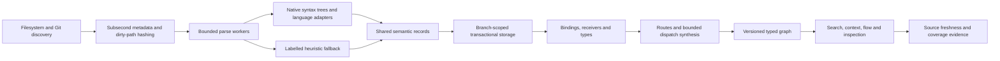

# Codify 1.6 indexing architecture

The index is a versioned materialization of source facts, resolution decisions and explicitly inferred relationships. A successful command must distinguish source coverage, graph completeness and source freshness. A missing edge is not proof that a call cannot happen.

## Compatibility and boundaries

Keep the C executable, SQLite, current command contracts, branch isolation, bounded producer/consumer queues, dirty-note coalescing, and content reuse. Syntax parsers are pinned vendored source compiled into the executable, not new runtime services or shared-library dependencies. Their upstream licences and source revisions must be retained. Build tooling may retrieve pinned sources, but a source checkout containing the vendor directory must build and index offline. The core never calls a model.

The existing index directory name and on-disk history are compatibility contracts. Do not rename them or remove historical records during this feature. All new specification, documentation, comments and release messaging describe Codify capabilities on their own terms.

## Shared ownership and worker contracts

One worker owns each leaf task. Workers use separate Git worktrees and task branches. Main integrates completed task branches in dependency order, resolves shared-hook conflicts, and runs the combined verification. A worker may prepare a dependent adapter against an agreed interface while its prerequisites are being implemented, but qualification requires the actual prerequisite implementation. No completion may be forced.

Tasks 2.1 and 2.2 establish the semantic and parser APIs before other adapters are integrated. Publish those headers early. Prefer new modules and per-family grammar manifests so independent workers do not edit one registry or Makefile concurrently. Shared-file changes are narrow hooks; no unrelated formatting.

`semantic.h` owns the shared rich records, ownership and lifetime rules. It extends rather than contradicts the existing symbol and reference model: reference owner and resolved target are distinct fields. A parse result owns all heap strings and its optional semantic records until `parse_result_free`. The single writer maps in-memory indices to database identifiers. Parser workers never write SQLite. Source locations use zero-based byte columns and one-based lines, with the convention documented at every external boundary.

`ast.h` owns parser registration and traversal. The runtime dispatches by source language and adapter; parser instances belong to workers, never to shared mutable global state. Each language family implements its own registration hook or manifest and fixtures. Grammars must actually parse the supplied source; extension recognition or a fallback regex cannot satisfy a grammar-backed acceptance criterion. Syntax recovery yields partial coverage and diagnostics, not fabricated precision.

`semantic.c` owns schema, storage, file deletion/copy, and the orchestrated semantic lifecycle. Resolver modules export narrow pass functions; the orchestrator invokes imports, receivers, types, routes, dispatch and channels in that order. Until all passes exist, link-safe registration must leave absent capabilities explicitly unavailable rather than inventing results. Final qualification requires every declared pass.

## Storage and evidence

Keep branch-scoped file and symbol identities. Add qualified ownership, spans, modifiers, export and type facts without discarding existing comments, body indexes, memories or task history. Typed relations carry source, target, kind, source site, original reference, strategy and provenance. Synthesized relationships also carry channel, registration site and an explanation. Unknown and ambiguous references remain retryable records with candidate evidence.

Avoid line-number-only identity as a promise of stability. Within a generation, endpoints must be deterministic and unique; incremental/full comparisons normalize by source path, qualified owner, kind and span rather than SQLite allocation order. Rename or move reconciliation must never merge overloaded or same-name symbols merely because their names match.

Indexes cover file/branch ownership, symbol name and qualified owner, reference names and targets, relation endpoints and kinds, dependency keys, and identifier segments. New tables participate in purge, rollback, branch deletion and twin-copy paths. Test each lifecycle explicitly.

## Incremental correctness

Store subsecond timestamps. Explicit watcher/editor dirty paths always receive content verification even when size and timestamps match. High-resolution metadata is a prefilter, not proof of identical bytes. Old timestamp rows are reverified during migration.

Watcher coverage loss creates durable whole-tree reconciliation debt. Keep that debt through lock contention, restart and partial failure, and expose it to readers. A periodic filesystem reconciliation protects Git-accelerated candidate discovery; an explicit full reindex bypasses content reuse when extraction semantics change.

Track extraction version separately from schema and per-branch source generation. Advance only after extraction and required resolution finish. Changes to definitions, export bindings, project configuration, route tables or registrations invalidate their indexed dependents. Failed writes must preserve retry information; failed parsing must retain prior facts as stale or replace them with an explicit failed state, never silently certify old facts as current.

Base facts and synthesized facts have separate replacement lifecycles. Recompute bounded affected synthesis sets transactionally; remove stale edges without deleting ordinary parsed/resolved edges. A no-op or unrelated edit skips unnecessary synthesis. Compare full normalized graph sets after replay to prove convergence.

## Precision and coverage

Prefer explicit scope, imports, visibility and receiver types over repository-wide names. Equal plausible candidates are ambiguity, not a stable tie-breaker. Syntax-derived facts, resolved relationships and heuristics remain distinguishable in every path explanation.

Framework detection gates adapters. Only supported literal or structurally proven registrations produce cross-tier edges. Computed paths, dynamic reflection, unknown receivers and ambiguous registrations become visible graph boundaries. Bound traversal and synthesis fan-out, and include omission reasons.

Coverage is a per-language and per-framework matrix backed by fixtures. Each adapter reports structural, partial, fallback or file-only support. Generated code is indexed according to policy and labelled for ranking; being generated does not itself justify inventing or dropping relationships silently.

## Retrieval and qualification

Retain exact definitions, comment/body ranking, trigrams and live-text verification. Enrich the tools agents already call with structured filters, overload bodies, named-symbol paths, source evidence and budget/coverage signals. Add bounded hierarchy and conservative unreferenced-code inspection; never describe missing references as proof of dead code.

Source validation on answers has explicit file, byte and time caps. A contributing file is verified, stale or unchecked. These fields are independent of an index pass returning success or coalescing with another writer.

Every adapter includes positive and negative symbol/edge assertions. The integration corpus exercises edit/delete/rename/configuration/registration changes, competing names, commit replay, interrupted work and branch isolation. Resource tests report actual cold/no-op/edit/replay timings, peak RSS and database growth under fixed settings. Final gates include strict compilation, all unit and integration tests, spec lint, migration/offline-build checks and documentation closure. Release notes reflect only passed acceptance criteria.
