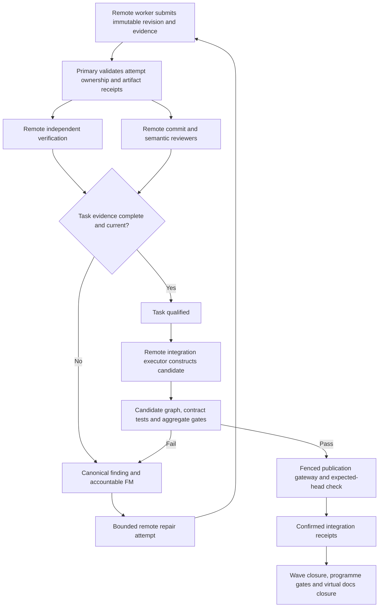

# Hyperfide 2.0 — assurance, review, remediation, and integration

Status: **proposed implementation contract for review; no implementation authorised**. All work packages and scenarios below are pending/UNRUN. The product name is Hyperfide; existing code and commands remain Codify/`cg` until the approved migration implements compatibility.

## 1. Authority and evidence boundary

The proposed assurance profile covers mechanical verification, semantic API correctness, and overall system coherence across 48–72-hour qualification runs. Its default review policy configures 10–15 commit watchers, each examining every in-scope commit and reporting findings for GitHub mirroring. Issue reconciliation runs every ten minutes. Humans interact through the primary leader. The main control host supervises; dependency preparation, indexing, implementation, builds, tests, reproductions, review execution, and integration execution run remotely. Main-host leaders and managers may inspect source packets and evidence and make engineering decisions; control services validate records and route events. They do not execute qualification commands locally.

Stable feature ownership across successive wave packages, canonical internal findings, prompt internal routing, and specialist semantic reviewer roles are proposed design choices. They require implementation and qualification. Full watcher coverage in section 6 is the default policy; sharded coverage requires an explicit policy amendment.

PostgreSQL primary transactions govern acceptance of results, assurance transitions, finding ownership, integration authorisation, and dependency release. Replicas may serve revision-labelled reports and published graph packets; a lagged read cannot authorise progression. Git stores source objects. Durable artifact storage holds full evidence; database rows hold relationships, integrity identifiers, and receipts. A provider's process exit, an agent's assertion, model confidence, a commit, a task count, or a graph edge cannot alone qualify implementation.

For an explicitly governed distributed run, required gates are part of the approved run contract. A failed/missing required gate prevents that run's transition. Advisory graph findings remain advisory unless that run explicitly selects a blocking policy. This does not silently change the default governance behaviour of all existing local projects.

## 2. Current repository facts and limits

Inspected on 2026-10-16; these are source observations, not runtime qualification of the proposed system. Line references describe this checkout and may move during implementation.

| Current fact | Source | Consequence for implementation |
|---|---|---|
| `spec_done_cmd` checks dependencies, executes a non-empty `verify_cmd`, runs graph checks, and changes status through the owned-status path. It also exposes a force path past failed verification/graph checks. | [`src/spec.c:3143`](../../src/spec.c#L3143), [`src/spec.c:3190`](../../src/spec.c#L3190) | Import status history with provenance. A historical or forced `done` is not automatically a current Hyperfide qualification. |
| `spec_verify_task` establishes declared symbol existence and touched-path evidence from worktree/snapshots/tagged commits. | [`src/spec.c:3555`](../../src/spec.c#L3555) | Preserve useful grounding checks; do not describe them as proof of behaviour. |
| Graph refresh can report a busy/coalesced index and run checks against the last completed index. | [`src/spec.c:3382`](../../src/spec.c#L3382) | The new evidence envelope must name the graph version and checked source identity. Required graph evidence cannot silently use an incompatible version. |
| Coverage iterates acceptance clauses and counts a task with matching whole-requirement or clause `reqs` and `status=done` as coverage. | [`src/drift.c:726`](../../src/drift.c#L726) | Retain traceability, add a separate criterion-evidence relation and current-evidence evaluation. Whole-requirement links do not establish that every clause was exercised. |
| Projection assembles an object-level preview, including shadow commits for dirty work. A projection may contain conflict markers. | [`src/projection.c:1`](../../src/projection.c#L1) | Useful anticipation; preview existence is not a clean candidate or integration proof. |
| Projection findings detect symbol overlap, changed/removed public interfaces referenced by another branch's changed code, near-line edits, and Git conflicts. Findings are advisory. | [`src/conflicts.c:1`](../../src/conflicts.c#L1), [`src/conflicts.c:469`](../../src/conflicts.c#L469) | Behaviour changes with unchanged signatures and unchanged consumers need additional analysis and tests. |
| The inspected `contract_findings` routine checks calls to non-callable symbols and unresolved route-handler names. | [`src/resolve.c:1526`](../../src/resolve.c#L1526) | Do not claim this routine proves arity, protocol behaviour, compatibility, or system coherence. |
| Fleet merge-up checks branch task status and prints projection findings; landing uses configured test/lint commands and skips an absent command. The local lifecycle uses a filesystem merge lock. | [`src/fleet.c:1786`](../../src/fleet.c#L1786), [`src/fleet.c:2185`](../../src/fleet.c#L2185), [`src/fleet.c:2315`](../../src/fleet.c#L2315) | Replace local authority with the distributed publication protocol; resolve missing required gates before a run starts. |
| Documentation is a reserved virtual `@docs` task. Closure couples deterministic checking to an attributed snapshot and owned completion. Baseline write failure currently emits a warning after closure. | [`src/cg.h:27`](../../src/cg.h#L27), [`src/spec.c:1771`](../../src/spec.c#L1771), [`src/spec.c:1855`](../../src/spec.c#L1855), [`src/docs.c:950`](../../src/docs.c#L950) | Preserve the virtual stage and snapshot provenance; require a durable baseline receipt for Hyperfide's stronger closure contract. |

Inspection of the referenced `src` paths did not establish an integrated GitHub issue watcher satisfying this contract. Deployment qualification must inventory any existing watcher launcher, credential scope, repository mapping, and durable checkpoints before reuse. This observation does not establish the absence of external tooling.

## 3. Assurance state model

Implementation history and current assurance are separate dimensions. Historical evidence is append-only. Invalidation changes its applicability, not its recorded outcome.

| Milestone | Transition requirements | Does not establish |
|---|---|---|
| `SUBMITTED` | Current attempt/fence; immutable source revision(s); complete submission manifest; referenced artifacts durably received. | Correctness or integration. |
| `TASK_QUALIFIED` | All task-scoped required commands and checks pass; clause mappings satisfied; independent verification and review obligations met; required graph current; no applicable blocking findings. | Compatibility with an untested merged candidate. |
| `CANDIDATE_QUALIFIED` | Identified combined source revision(s), selected qualified inputs, candidate-specific graph and required contract/integration gates, current review coverage. | Publication to target branches. |
| `INTEGRATED` | Authorised publication confirmed at exact target ref(s), with receipts tied to the candidate. | Wave or programme closure. |
| `WAVE_CLOSED` | Required tasks integrated, wave aggregate gates current, mandatory findings resolved, downstream release conditions satisfied, wave closure manifest persisted. | End-to-end programme acceptance. |
| `PROGRAMME_QUALIFIED` | All declared scope and clauses covered by current evidence on the programme manifest, all required wave/contract/end-to-end/rehearsal gates passed, required documentation closed, unresolved findings dispositioned under the run policy. | Authorisation to deploy, activate a chain, or perform external release actions outside the run's permitted actions. |

Assurance evaluations also report `PENDING`, `RUNNING`, `PASS`, `FAIL`, `UNKNOWN`, `STALE`, `CANCELLED`, and `NOT_APPLICABLE`. `UNKNOWN`, skipped checks, missing logs, zero selected tests, and unavailable dependencies cannot become `PASS`. `NOT_APPLICABLE` requires a recorded rule and scope justification; it cannot be an automatic substitute for a failing gate. A waived criterion remains a visible exception, not a fabricated pass. Changing required acceptance criteria creates a new spec revision through the programme-change path.

Dependencies must declare the milestone they consume: qualified immutable task output, integrated target revision, or closed wave. A task referring to a qualified producer consumes its exact revision, not the producer branch's moving head. Later work that invalidates an assurance marks the affected dependency satisfaction stale and holds new consumers until requalification; already running consumers receive a durable intervention and are reconciled according to impact.

## 4. Submission, evidence, and independent verification contract

### 4.1 Worker submission

Every submission contains:

* Run/spec revision, feature/wave/task/attempt identifiers, ownership generation, worker session and supervisor boot identity, and an idempotency key.
* Repository identity, base and submitted commit for each changed repository, explicit dependency revisions, changed-path manifest, and immutable source availability receipt. Dirty edits must be checkpointed before submission; they are not the authoritative final artifact.
* Claimed implemented clauses with implementation locations, contract changes, affected consumers, known limitations, and links to unresolved findings. Unrelated findings are recorded without silently expanding task scope.
* Build/verification commands actually run, working directory, selector, start/end times, exit/signal/timeout state, toolchain and environment identity, non-secret configuration fingerprint, dependency/lock hashes, fixture/data identity, and full artifact receipts.
* Test discovery and execution counts where the runner supports them, including selected/skipped/failed tests; the adapter must make unavailable counts explicit. A generic process exit cannot manufacture framework-level counts.
* Source/graph version used for graph checks; worker summaries remain explicitly attributed claims alongside raw results.

The result receiver validates identity and fencing on the primary, verifies artifact integrity/availability, records the submission and event atomically, and acknowledges the durable receipt. Repeated identical submissions return the same receipt. Conflicting payloads under the same key are rejected. Results from a superseded attempt may be archived as recovery material, but cannot qualify or replace the current attempt.

### 4.2 Criterion-level traceability

The assurance graph is:

`spec revision → requirement clause → task(s) → contract(s) → producer/consumer revisions → evidence → candidate manifest`.

Each clause declares required evidence kind, scope, gate, and observable expected result. One test may support several clauses with explicit mappings and rationale. Several tests may be required for one clause. A source reference, symbol existence check, checklist, review opinion, or whole-requirement task link cannot silently stand in for an executable assertion about behaviour.

Before dispatch, the spec linter checks unknown dependency identifiers, cycles, missing gate definitions, empty selectors, unsupported evidence kinds, ambiguous task ownership, and unresolved mandatory external dependencies. A spec critique model may identify vague claims and hidden coupling; it does not rewrite acceptance criteria or release work. Cross-programme dependencies found in prose become explicit dependency records or unresolved findings before affected dispatch.

### 4.3 Independent execution

The default distributed-run policy assigns required qualification to a distinct verification executor identity in a clean remote worktree/container at the submitted revision. It uses the registered gate definition, not a worker-provided replacement command. It may reuse a prepared environment whose input identity matches. The worker cannot approve its own required review obligations or write a verification success receipt.

Independence is operational separation and reproducible inputs; using a second agent with the same model is not proof of statistical independence. Reviewers inspect test adequacy as well as output. Stronger isolation, different platforms/toolchains, sanitizers, cluster fixtures, or replicated checks are selected by the run's gate policy and resource reservation.

Required command definitions include expected test-selection behaviour. A command that returns zero after collecting no tests, skipping required selectors, or merely compiling when behaviour was required fails the qualification contract. A missing planned gate remains `PENDING` until implemented and registered; its declaration is not evidence that it exists.

Gate outcomes distinguish product defect, infrastructure failure, unavailable external dependency, cancelled execution, and unknown result. Triage assists repair but cannot convert a failed check into a pass. Flaky outcomes remain visible: retry policy and pass criteria are declared, every attempt retained, and a later pass does not erase a prior failure or establish an untested root cause.

### 4.4 Evidence freshness and reuse

Every evidence item is keyed to its actual semantic inputs: source manifest, spec clause version, gate definition, test/fixture inputs, resolved dependencies, toolchain/environment configuration, and graph/contract versions where used. Reuse requires the same relevant inputs and an explicit scope rule. Relevant configuration uses a non-secret fingerprint or secret-version identifier rather than credentials in logs.

A change to a producer, consumer, schema, migration, units, ordering, fixture, or dependency invalidates affected evidence. A change outside a gate's scope can preserve evidence only if a deterministic impact rule justifies reuse. If impact analysis is incomplete or ambiguous, mark it `UNKNOWN` and rerun the required scope; model confidence cannot narrow that scope by itself.

A published graph has a source manifest and parser/resolver configuration. A replica must confirm that graph publication is visible before serving it to a required review. The primary evaluates the result against the expected graph identity. A stale cached graph may aid exploration if labelled; it cannot satisfy a required current-graph obligation.

## 5. Semantic assurance and system coherence

### 5.1 Contract records

A versioned contract links producers and consumers across repositories, including unchanged consumers identified in the graph and declared external clients. Depending on the interface, its obligations include:

| Dimension | Required representation and verification examples |
|---|---|
| Shape and compatibility | Inputs/outputs, schemas, ABI, encodings, version negotiation, generated clients, backwards/forwards compatibility, migrations. |
| Errors and authority | Error codes/payloads, authentication/authorisation, denied-operation side effects, partial failure and rollback. |
| Idempotency and recovery | Duplicate requests, replay keys/expiry, retry semantics, acknowledgement boundaries, crash windows. |
| Values | Units, precision, rounding, range, overflow, currency/asset identifiers, time domains, freshness limits. |
| Ordering and concurrency | Ordering guarantees, sequencing, transactional boundaries, races, determinism, visibility and consistency assumptions. |
| Behaviour | State transitions, invariants, cross-component obligations, resource lifecycle, external-service assumptions. |

Each contract has an accountable FM, producer and consumer task/repository references, supported versions, observable examples, negative cases, and gate bindings. A missing producer/consumer edge is represented as incomplete coverage, not “no consumers”. Graph extraction is supplemented with explicit declarations for dynamic calls, FFI, generated code, RPC, schemas, and external systems that analysis cannot resolve.

### 5.2 Four assurance levels

1. **Task:** scoped functionality, grounding and bounded local behaviour at the immutable worker result.
2. **Contract:** producer/consumer agreement, including negative cases and unchanged consumers affected by changed behaviour.
3. **Integrated candidate:** combined changes, cross-feature scenarios, migration compatibility, aggregate builds/sanitizers/cluster checks at the candidate manifest.
4. **Programme:** declared end-to-end invariants, operational rehearsal, recovery and activation/release readiness where the spec requires them.

Contract review produces claims, counterexamples, affected edges, and evidence requests. Frontier reviewers investigate difficult questions and can create remote reproductions/test additions through assigned tasks. Decision models may prioritise contracts or flag contradictions. Neither review consensus nor a high score establishes executable behaviour or grants task ownership.

Projection remains useful early warning for work in flight. A conflict-bearing projection is labelled non-qualifying; it is never promoted because Git produced an object. A clean textual merge and unchanged signatures still require candidate-level contract checks. A projection findings count of zero means the configured detectors found nothing, not that all system semantics agree.

### 5.3 Workload-grounded qualification cases

Use synthetic fixtures to exercise the following semantic failure patterns. These are required test designs, not claims about defects in any deployed system.

* Separate implementation, qualification, and external activation. Bound verification commands, and reuse evidence only when source, inputs, scope, and environment match. Avoid rerunning every expensive aggregate check for each task when an explicit reuse rule is valid.
* Compare speculative and sequential execution where required; verify signed receipts, acknowledgement timing, and replicated-state agreement. Bind all producer and consumer revisions, and perturb abort, ordering, and failure conditions. Compilation or interface resolution alone cannot satisfy behavioural clauses.
* Seed a prose-only dependency between tasks that share build configuration or host-interface files. Preflight must identify the unresolved coordination requirement, publish explicit dependency/scope rules, and qualify the combined native-library/build environment remotely.
* Seed generated acceptance clauses that contain only an import or a JSON version literal. Flag the absent behavioural assertion; task status and scenario counts cannot substitute for runtime evidence.
* Seed a producer/consumer freshness incompatibility with unchanged response schemas. Verify the shared freshness boundary and detect the seeded incompatibility through consumer and integration gates.

## 6. Commit watchers and review coverage

The default run policy requires **10–15 commit watcher identities, each examining every in-scope commit**, with a durable `(repository, commit, watcher-policy-slot, rubric-version)` obligation matrix. Distinct reviewer lenses (API/ABI compatibility, concurrency, state invariants, security/authority, test adequacy, integration assumptions, and dependency/configuration changes) can make that coverage useful without reducing it. Specialist semantic reviewers are additional roles or explicit watcher lenses, not an excuse to drop obligations.

The earlier illustrative 12-watcher fleet is a capacity example. It does not establish that 12 is optimal or that every provider can sustain it. A sharded review pool that assigns fewer watchers per commit is a separate proposed policy alternative requiring an explicit spec/run-policy change. It must not silently replace the default full-coverage requirement.

At run start, pin the watcher policy and required reviewer slots. Commits registered through the supervisor receive obligations immediately. Git ingestion periodically reconciles repository history/ref updates to discover commits missed during disconnects. A review result is tied to immutable commit/tree identity, dependency manifest, rubric and graph version; branch names are display context. Merge commits and changes introduced by conflict resolution receive coverage. A rebased result may reuse review only under a registered equivalence rule that preserves the reviewed content and relevant context; otherwise new obligations are generated. Merely rewriting a message must not manufacture behavioural review coverage.

A failed reviewer session is replaced in the same obligation slot and retains its audit trail. A duplicate report cannot satisfy two different required slots. A reviewer records inspected scope, findings or an explicit no-finding result, unresolved questions, and evidence links. The system reports the denominator and backlog, not only completed review counts. Required review completion and applicable blocking-finding disposition are checked before candidate qualification/publication under the run policy.

Review capacity is reserved remotely. Backlog may reduce new implementation dispatch or hold integration without stopping healthy workers indiscriminately. Measure review latency, duplicate reports, valid findings, missed defects, repair lead time, and context cost. Overlap metrics inform a future policy proposal; they do not automatically reduce coverage.

## 7. Canonical findings, GitHub projection, and remediation

### 7.1 Finding identity and ownership

Persist the canonical finding before attempting GitHub issue creation. The record includes stable ID, run/spec/candidate context, first and latest occurrence, reporter and rubric, severity with evidence, reproduction/counterexample, affected contracts and revisions, introducing commit attribution, producer/consumer tasks, accountable FM, collaborating FMs, duplicates/related findings, and resolution evidence.

A deterministic occurrence key prevents the same detector/report replay from creating repeated occurrences. Cross-detector/model duplicate suggestions remain proposals until a rule or authorised reviewer confirms equivalence. Do not collapse separate bugs merely because they share a file or error message. Merging duplicate records preserves original reports and relationships and leaves one accountable remediation record.

Default routing first attributes the introducing commit to its task/FM. Cross-feature defects additionally identify affected producers and consumers. There is exactly one accountable FM for the remediation record, with explicit collaborator obligations. Ambiguous/unattributed findings enter the leader's durable routing queue; they do not disappear. FM replacement or wave reassignment transfers accountability through an auditable record.

Proposed lifecycle: `OPEN → TRIAGED → ASSIGNED → REPAIRING → READY_FOR_RECHECK → RESOLVED`, with `DUPLICATE`, `NOT_REPRODUCED`, `ACCEPTED_EXCEPTION`, and `REOPENED` dispositions carrying reasons and authority. A worker's fix claim or closed GitHub issue cannot establish `RESOLVED`. Resolution requires current rerun/review evidence against the relevant repaired candidate and a re-evaluation of affected consumers. New reproducing evidence reopens the canonical finding.

### 7.2 GitHub synchronisation

The GitHub issue is an external projection and collaboration surface for the canonical record. Persist an outbox operation with the finding transaction. Include a stable Hyperfide finding marker in the issue and persist the repository/issue mapping. On an ambiguous create response, search/reconcile that marker before creating again. Retry with backoff and record rate-limit/dependency failures. Repeated events or controller restarts must not create duplicate issues, assignments, or comments. Issue edits/closures update external state; they cannot erase internal evidence or bypass qualification.

The ten-minute issue watcher is a required reconciliation path. Proposed prompt webhook/internal-event routing supplements it. Reconciliation uses durable cursors, overlap windows, pagination and per-repository checkpoints to recover missed/external changes. Webhook processing validates the shared secret against the raw body, stores the received event durably, and performs routing asynchronously. Deduplicate delivery IDs, while treating retries of failed processing as resumable; GitHub documents that redelivery retains the original delivery ID. Event ordering must not overwrite newer issue state with an older delivery. Sources: [GitHub webhook best practices](https://docs.github.com/en/webhooks/using-webhooks/best-practices-for-using-webhooks), [delivery validation](https://docs.github.com/en/webhooks/using-webhooks/validating-webhook-deliveries), checked 2026-10-16.

Internal findings route as soon as durably recorded. The ten-minute cadence is the default run policy; any tighter delivery target is a proposed SLO to qualify. During GitHub outage, canonical findings still route and hold required gates. Credentials and raw sensitive execution logs stay in access-controlled storage; publish only reviewed/redacted summaries and controlled artifact links.

### 7.3 Repair loop

The FM receives a durable finding packet including exact failing inputs, affected criteria/contracts, prior attempts and current owner. It requests an eligible bounded repair attempt through Hyperfide. Frontier-model selection follows the declared short-critical versus sustained-work routing policy. Retry limits, scope and escalation come from the run/task policy; no universal two-retry limit is assumed.

Repair submission follows the same independent qualification path. Required reproductions demonstrate failure on the original applicable revision where feasible and success on the repaired revision. If reproducing the original environment is unavailable, record that limitation and obtain the run-policy-required alternative evidence rather than claiming the counterfactual was observed. Resolution triggers impact analysis and appropriate regression checks. Repeated failure, contradictory contracts, missing prerequisites, or scope conflict goes to the manager/leader with evidence, without silently broadening acceptance or restarting identical work forever.

## 8. Integration and distributed publication

### 8.1 Candidate manifest

An integration executor in a remote sandbox constructs an immutable candidate with target repository/ref, expected target head, ordered input revisions, dependency/repository manifest, source tree/commit, integration policy version, task qualification references, candidate graph, review coverage and required gate results. Conflicts create repair work; candidate branches do not modify the authoritative target while tests run. Expensive aggregate, sanitizer, cluster and programme-specific checks run at the declared combined scope; identical applicable evidence can be reused under section 4.4.

The primary grants one publication authority generation per protected target. Many candidates may be prepared concurrently; only one authorised publisher can advance a target. Required gates, review coverage, applicable finding disposition and exact head are revalidated when publication is authorised. Missing configured gates remain explicit failures of readiness rather than silent skips.

### 8.2 Fencing the actual Git side effect

A database token alone cannot fence a process holding unrestricted Git credentials. Implementation must mediate protected-target writes through a publication gateway (or an equivalently enforced server-side protocol) that validates authorisation and exposes no bypass credentials to implementation/review workers. The actual Git operation must require the recorded expected old object ID and permitted new object ID, and retain normal ancestry/branch-protection checks required by policy.

Git's explicit `--force-with-lease=<ref>:<expect>` checks a specified old value, but does not itself enforce Hyperfide ownership generations or required ancestry. Unqualified lease forms can depend on mutable remote-tracking refs. Git atomic push can cover several refs on a supporting single server; ordinary pushes to different repositories are independent. These are transport primitives to qualify, not a complete publication protocol. [Git push documentation](https://git-scm.com/docs/git-push), checked 2026-10-16.

Required publication sequence:

1. Transactionally create an immutable publication intent containing target, expected head, candidate, generation, validated assurance references, and idempotency key. Mark that target's publication operation active.
2. The gateway validates that intent and performs the bounded expected-head update. Do not hold a database transaction open for builds/tests or an entire remote network operation.
3. Confirm the remote target and persist a publication receipt. If the response is lost, enter `PUBLICATION_UNCERTAIN` and reconcile the actual ref before retrying, abandoning, or granting a replacement publication operation.
4. If the expected head changed, reject publication and create a new candidate/evidence evaluation. Never overwrite intervening work using unconditional force.
5. If the remote ref moved but the receipt transaction failed, reconciliation links the observed candidate publication to the existing intent. Repeated finalisation has one effect. Do not mark an unrelated observed head integrated.

Fencing transitions and credential enforcement must ensure that an old publisher cannot finish a superseded intent. An uncertain in-flight publication cannot be superseded blindly merely because a lease expired. The implementation work package must establish the exact gateway/server enforcement and test the crash windows before claiming this guarantee.

### 8.3 Multiple repositories and wave closure

There is no assumed cross-repository atomic Git transaction. A programme integration manifest pins the exact revision of each repository/artifact and records per-target publication outcomes. A release barrier prevents dependent consumers or external activation from observing a partially published set as complete. Partial publication enters reconciliation; recovery advances a compatible manifest or performs an explicitly authorised compensating revision. It does not falsely report rollback of external state.

Wave closure checks all required task milestone obligations, candidate receipts, aggregate gate applicability, review matrix, finding status, graph publication and documentation stages required at that point. Historical task qualification stays visible if later evidence becomes stale. The leader receives an evidence-backed closure packet and unresolved programme decisions; a language-model assertion cannot write an unauthorised closure transition.

## 9. Documentation closure and programme completion

Preserve virtual `@docs` and configured modes (`auto`, `manual`, `off`, legacy compatibility) during migration. Required documentation is generated remotely from implementation/task snapshots, anchors, contracts and qualified candidate manifests. The worker modifies only configured documentation targets and the claims ledger. It must not recursively start the implementation run to close documentation.

The proposed distributed closure operation verifies documentation deterministically at the checked revision, stores an attributed `@docs` snapshot and provenance, persists feature/workspace incremental baseline artifacts durably, and records the owned closure receipt. Failure to check, snapshot, persist baseline, or confirm ownership leaves closure incomplete and retryable. Documentation success cannot qualify failed implementation. Implementation success cannot claim required documentation closure.

Programme completion reports each acceptance clause's current status and evidence, exact integrated repository/artifact manifest, required rehearsal outcomes, unresolved findings/exceptions, documentation provenance/baseline, and any excluded scope. Required `UNRUN`, `UNKNOWN`, missing, stale or failed obligations prevent `PROGRAMME_QUALIFIED`. Programme qualification and external deployment/activation are distinct transitions controlled by the run's permitted actions and approved programme authority.

## 10. Proposed implementation work packages

These packages are inputs to the pack's native task plan, not active tasks. They require distributed identity/state, artifact receipts and remote execution contracts from the other chapters. All heavy execution and all test commands below run on remote qualification capacity once implementation is authorised. Planned commands/fixtures are not claimed to exist today.

| Package | Deliverable | Dependencies | Qualification required |
|---|---|---|---|
| ASSUR-W01 | Immutable submission/evidence schema, durable receipts, fenced idempotent acceptance, historical-status importer. | Primary transaction/identity and artifact contracts. | Stale owner, duplicate/conflicting payload, missing artifact and forced-status import cases. |
| ASSUR-W02 | Clause evidence graph, gate registry, explicit milestone dependencies and preflight lint. | W01; spec parser; run schema. | Missing/empty/zero-test gate refusal, whole-requirement link insufficiency, cycles and prose dependency findings. |
| ASSUR-W03 | Independent remote qualification executor, environment/input identity, evidence applicability/invalidation. | W01–W02; remote runner; graph publication. | Clean-revision rerun, wrong graph, changed fixture/config, cancelled/unknown/flaky outcomes. |
| ASSUR-W04 | Versioned producer/consumer contracts, impact graph, semantic packets and contract gate orchestration. | W02–W03; central graph/version API. | Unchanged consumer, unchanged-signature behavioural defect, cross-repository compatibility and unknown edges. |
| ASSUR-W05 | Full 10–15-watcher obligation matrix, durable commit discovery, reviewer replacement/backpressure. | W01; session and Git ingestion contracts. | Every commit × every required watcher coverage; restart, rebase, conflict-resolution and no-finding receipts. |
| ASSUR-W06 | Canonical finding lifecycle, single accountable owner, cross-feature collaborators, bounded repair loop. | W01–W04; manager/package registry. | Ambiguous attribution, manager replacement, duplicate proposals, recheck-based resolution/reopening. |
| ASSUR-W07 | GitHub outbox/inbox projection, verified webhooks, idempotent sync and ten-minute reconciliation. | W06; credential scope; durable event service. | Ambiguous issue create, duplicate/out-of-order delivery, external issue, missed webhook and prolonged API outage. |
| ASSUR-W08 | Remote immutable integration candidates and enforced publication gateway/reconciliation. | W03–W06; Git authority; distributed ownership. | Stale generation, concurrent head update, lost acknowledgement, stale direct-push denial and receipt recovery. |
| ASSUR-W09 | Multi-repository manifests, partial-publication barriers, wave/programme closure evaluator. | W02–W08. | Partial publish, changed evidence, premature downstream release and complete closure manifest. |
| ASSUR-W10 | Distributed virtual `@docs`, checked snapshots, durable baseline and completion packet. | W01–W03, W09; documentation and artifact contracts. | Snapshot/baseline failure, fence loss, incremental baseline reload, no recursive run, required docs pending. |

## 11. Acceptance scenario catalogue

All scenarios: **UNRUN**. Scenario names are stable authoring identifiers for mapping into native acceptance/task sections. Verification should combine deterministic fault injection with actual remote Git/runner/provider qualification where the guarantee depends on those systems; mocks alone cannot prove external publication or provider recovery.

| ID | Given / action | Required observable result |
|---|---|---|
| ASSUR-A01 | Current worker submits exact source, evidence and receipts; deliver twice. | One accepted submission/event and same receipt; no duplicated qualification jobs. |
| ASSUR-A02 | Reassigned old worker submits with a stale generation. | No current-state advancement; recovery artifacts attributed to old attempt only. |
| ASSUR-A03 | Worker changes payload while reusing its submission key. | Conflict recorded; accepted immutable payload unchanged. |
| ASSUR-A04 | Imported task says done/forced, but required behavioural evidence is absent. | History retained; current qualification UNKNOWN/PENDING. |
| ASSUR-A05 | Required command absent, selector unknown, all required tests skipped, or zero tests selected. | Required gate not PASS; detailed readiness failure recorded. |
| ASSUR-A06 | Task links a whole requirement with three clauses, exercising one. | Other two clauses remain uncovered by current evidence. |
| ASSUR-A07 | Worker supplies passing logs for another commit/toolchain or missing artifacts. | Submission/evidence rejected or non-qualifying; no false pass. |
| ASSUR-A08 | Changed producer preserves signature but changes error, units, order, freshness or retry behaviour. | Relevant unchanged consumers selected; counterexample/contract gate catches seeded incompatibility. |
| ASSUR-A09 | Graph incomplete or replica has not received required published version. | Explicit UNKNOWN/wait or primary/current packet fallback; no stale qualification. |
| ASSUR-A10 | Change fixtures, environment, dependency commit or gate definition after PASS. | Affected applicability becomes STALE; unrelated evidence reused only by declared rule. |
| ASSUR-A11 | Projection creates an object with conflict markers or no detector findings. | Object/detector result remains separate from candidate qualification. |
| ASSUR-A12 | Configure 10, 12 or 15 watcher slots; ingest commits through events and reconciliation. | Every in-scope commit gets each required watcher obligation, including replay/restart cases. |
| ASSUR-A13 | Kill a watcher; replay a completed report; add conflict-resolution commit. | Replacement retains slot provenance; replay satisfies no extra slot; new commit receives coverage. |
| ASSUR-A14 | Review backlog exceeds admitted capacity. | Backlog and dispatch/integration holds visible; no silent coverage reduction. |
| ASSUR-A15 | Two reports might be duplicates but have different reproductions. | Preserve both until confirmed; single-owner routing after legitimate consolidation. |
| ASSUR-A16 | Defect spans producer and consumer FMs; introducing owner leaves. | Exactly one current accountable FM, explicit collaborators and durable transfer. |
| ASSUR-A17 | GitHub create succeeded but response was lost; replay outbox. | Existing marker reconciled; one external issue mapping, no blind duplicate. |
| ASSUR-A18 | Webhook redelivered/out of order, signature invalid, external issue created during outage. | Valid deliveries deduplicated/resumable; invalid refused; reconciliation discovers external issue without regressing newer state. |
| ASSUR-A19 | GitHub unavailable for several polling periods. | Canonical findings route, required holds persist, sync catches up using retained checkpoints. |
| ASSUR-A20 | Worker claims fix and external issue closes while reproducer still fails. | Canonical finding unresolved; gate remains held; recheck evidence controls resolution. |
| ASSUR-A21 | Two integration candidates share expected target head; publish concurrently. | Exactly one permitted advancement; second re-evaluated without overwrite. |
| ASSUR-A22 | Publisher loses ownership before publication; worker attempts direct protected push. | Actual publication path denies stale generation/bypass, not merely a database receipt. |
| ASSUR-A23 | Git update succeeds, acknowledgement/DB finalisation fails; controller restarts. | Uncertain intent reconciles to exact observed ref; one integration receipt; no duplicate/new blind publication. |
| ASSUR-A24 | Target head changes during candidate tests. | Old candidate cannot land on assumed inputs; fresh candidate/evidence evaluation required. |
| ASSUR-A25 | First repository publishes and second fails. | Partial manifest visible; release/dependent milestone held until authorised reconciliation. |
| ASSUR-A26 | Task qualifies but wave aggregate test fails. | Task history retained; candidate/wave not closed; finding routed to accountable manager. |
| ASSUR-A27 | Required docs checker, snapshot or durable baseline persistence fails. | `@docs` remains incomplete/retryable; programme closure held. |
| ASSUR-A28 | All tasks marked done, one clause UNRUN or evidence stale, one required review missing. | Programme remains unqualified with exact outstanding obligations. |
| ASSUR-A29 | A synthetic prose dependency is omitted from the structural graph; a generated import clause is presented as a behavioural test. | Preflight identifies unresolved dependency and missing behavioural evidence; no manufactured runtime result. |
| ASSUR-A30 | Recover a long run with main-server interruption, repaired consumer and new graph version. | Remote execution/evidence survives per recovery contract; exact ownership, review and freshness obligations rebuilt before closure. |

## 12. Open qualifications and review decisions

* Inventory the existing external watcher deployment and GitHub authentication/permissions, including what “every commit” covers across repositories, attempt checkpoints, abandoned branches and merge commits. Default coverage here is all source commits registered to the run; exclusions require explicit policy and reporting.
* Select stable feature ownership or explicit wave-boundary transfer as the run allocation policy. Regardless of manager lifecycle, task/finding accountability and historical attribution must survive reassignment.
* Fix exact required review/gate severity policy per run and what exceptions the leader may disposition without changing approved programme intent. New global advisory detectors should not silently block unrelated projects.
* Qualify the actual repository server/gateway write enforcement, branch protections, credentials and expected-head operation. Database ownership alone does not establish an external side-effect guarantee.
* Define workload-specific contract suites and evidence reuse boundaries from the actual source and accepted specifications. Synthetic examples in this chapter are test designs awaiting execution.
* Measure watcher throughput and review overlap under the declared workload profiles before proposing any change to the 10–15 full-coverage policy. No model-quality, throughput or 72-hour reliability result is claimed by this draft.
