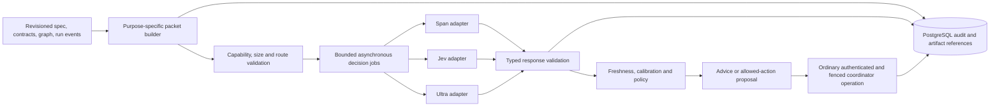

# Hyperfide decision models: research, contracts, and implementation plan

Status: **DRAFT — implementation awaiting approval.** Research checked 2026-10-16. Requirements in this chapter are proposed implementation requirements. All acceptance cases below are **UNRUN**. No paid inference, credential lookup, model installation, cloud creation, or implementation changes were performed for this chapter.

## 1. Scope and authority

**DESIGN SCOPE:** investigate `respan/span-02`, `typesafe/jev-1.14`, and `liquid/d1-ultra` for decision assistance in Fleet, Spec, orchestration, and semantic assurance. Coding work remains with configured frontier models through qualified Claude Code and Codex connectors. A proposed routing policy uses Claude Code for short, critical, complex assignments and Codex for sustained, complex assignments; validate that policy against workload outcomes. Exact native model identifiers belong in versioned run configuration. Decision models do not replace those workers.

Distributed execution, PostgreSQL authority, current evidence, and cross-feature correctness take priority over model-routing optimisation. Dependencies are unrestricted for this design. No model decision can create task ownership, renew a lease, release a dependency, qualify a task, weaken a criterion, suppress mandatory review, or authorise publication. Those operations require the ordinary authenticated, fenced, transactional Hyperfide paths.

A provider outage must not stop heartbeats, reconciliation, cancellation, task claiming, deterministic scheduling, verification, or result acceptance. An explicitly requested model critique may report failure; an advisory subsystem failure must not turn into programme-wide inability to work. A recommendation which requires engineering judgement goes to the accountable feature manager and, if necessary, the primary leader. It must not introduce a separate worker-to-human interaction channel.

## 2. Current facts and limits

### 2.1 Route identity and context

| Requested catalogue name | Direct model field | Direct endpoint | Verified context and qualification boundary |
|---|---|---|---|
| `respan/span-02` | `span-02` or `respan/span-02` | `POST https://api.respan.ai/api/v1/decisions` | OpenRouter catalogue reports 131,072 tokens. The self-host engine describes 131,072 **per question including thought/images**, additionally constrained by its KV cache. Hosted and self-host profiles must be distinct. |
| `typesafe/jev-1.14` | `jev-1.14.0` | `POST https://api.typesafe.ai/v1/systemone` | Defaults: 64K/request, 32K/question. Opt-in `TypeSafe-Danger-Zone-Long-Context: true` raises both to 262K; vendor warns of lower accuracy and greater latency. |
| `liquid/d1-ultra` | `d1-ultra` | `POST https://api.liquid.ai/decisions/v1/systemone` | Vercel catalogue reports 32,768 tokens. A matching **direct API** context limit was not established; do not silently transfer a gateway's limit to the direct route. |

Sources: [Respan hosted contract](https://www.respan.ai/docs/documentation/span-02/concept), [OpenRouter Respan catalogue](https://openrouter.ai/respan), [Span engine/model card](https://huggingface.co/respanai/span-02), [TypeSafe model reference](https://docs.typesafe.ai/models), [TypeSafe API](https://docs.typesafe.ai/api), [Liquid Ultra launch/API example](https://www.liquid.ai/blog/d1-ultra), [Vercel Ultra catalogue](https://vercel.com/ai-gateway/models/d1-ultra).

TypeSafe currently maps `jev-latest` to 1.13 and `jev-preview` to 1.14. Pin `jev-1.14.0`, retain the returned model identifier, and invalidate calibration on a version change. Jev 1.14 was released on October 14; Span and Ultra were announced October 15. Model aliases and catalogue availability can change. [TypeSafe versions](https://docs.typesafe.ai/models), [Respan announcement](https://www.respan.ai/blog/introducing-span-2), [Liquid announcement](https://www.liquid.ai/blog/d1-ultra)

**OPEN QUALIFICATION:** direct route entitlements, quota values, latency, exact billing, model immutability, availability, and cross-route feature forwarding require authorised integration qualification. OpenRouter model pages were intermittently inaccessible during this audit; the common API reference and Respan catalogue were accessible. The pack does not claim a successful call to any route.

### 2.2 Typed output and modality differences

| Route family | Baseline types | Conditional extensions | Input details and limits |
|---|---|---|---|
| Span native | Noul, Choice, Score | Number | Text/JSON, up to four images; no streaming. Hosted unknown model names are rejected. |
| Jev native | Noul, Choice, Score | Experimental images and Box, explicitly enabled | Structured text; images use `assets` references. Jev 1.13 and 1.14 accept experimental images; Box requires 1.14. |
| Ultra native | Noul, Choice, Score | No Number/Box contract established | Text and images; launch example uses top-level `images`. Exact image/question-count limits remain unqualified. |
| OpenRouter | Noul, Choice, Score in common reference | Jev Box documented; Span Number/reasoning forwarding unqualified | Documented image parts use `state`; top-level `images` returns 400. A common endpoint does not imply common extension support. |

Sources: [Span hosted](https://www.respan.ai/docs/documentation/span-02/concept), [Jev images](https://docs.typesafe.ai/images), [Jev Box](https://docs.typesafe.ai/primitives/box), [Ultra launch](https://www.liquid.ai/blog/d1-ultra), [OpenRouter API](https://openrouter.ai/docs/api/api-reference/alphadecisions/submit-a-decisions-request), [OpenRouter modality rules](https://openrouter.ai/docs/guides/community/multimodal-decisions).

Span Choice supports 1–679 options; Score has 2–10 ordered levels. Number returns a numeric value or `null`, associated text, and at most 32 output tokens. Its confidence is the geometric mean of answer-token probabilities, **not measured factual correctness**. Number questions reason only under `mode: on`. [Span question types](https://www.respan.ai/docs/documentation/span-02/question-types)

Jev's API permits up to 255 Choice options and 2–10 Score levels; the question count is bounded by context rather than a separately advertised count. Text bodies are limited to 32 MiB and nesting to 64 levels. [Jev API](https://docs.typesafe.ai/api), [Context limits](https://docs.typesafe.ai/models)

Jev image/Box support is explicitly experimental. Native PNG/JPEG limits include 16 MiB/file, 280–1,568 pixels per side, and 32 MiB body/processed/expanded-request budgets. References insert an image at each occurrence. The OpenRouter page instead lists a 256-pixel minimum and automatically uses long context for Jev image requests. **Treat these as distinct, potentially drifting route contracts; use the stricter native dimensions until qualified.** [Native image limits](https://docs.typesafe.ai/images), [Gateway image rules](https://openrouter.ai/docs/guides/community/multimodal-decisions)

A Jev Box contains normalised `left`, `right`, `top`, and `bottom` edges, with strict ordering. It always returns a box even when the target is absent; pair it with a presence Noul and abstain if presence is uncertain. No recommended universal Box confidence threshold is published. Experimental vision remains disabled by default in Hyperfide. [Box contract](https://docs.typesafe.ai/primitives/box)

### 2.3 Reasoning, confidence, and hosting

Hosted Span defaults to `reasoning.mode: auto`; `budget_ms` ranges 0–600000 and defaults to **0, meaning no deadline**. Thoughts remain hidden and unbilled; a per-question length cap still applies. The hosted endpoint can return 402 for missing credits, 429 for quota, and 504 for timeout. Hyperfide must supply a positive budget whenever enabling thought and enforce its own overall deadline. [Hosted reasoning and errors](https://www.respan.ai/docs/documentation/span-02/concept)

The Span engine is Rust/CUDA with 16.4 GB quantised weights, based on Gemma 4 26B-A4B with approximately 4B active parameters. It supports RTX 5090/RTX PRO 6000 Blackwell, not general Transformers/vLLM loading. Default memory is about 28 GB; benchmark configuration uses about 41 GB. The engine's auto default is 700 ms, while `launch.sh` uses specialised benchmark flags. Local endpoint: `/v1/systemone`. Usage repeats shared-state tokens per question. The card declares Apache-2.0 for engine and derivative weights; verify pinned weights, draft-model and NOTICE terms before distribution. It reports full-text median 36 ms/p95 850 ms under its own conditions. These are vendor results. [Official model card and engine instructions](https://huggingface.co/respanai/span-02)

No native adjustable reasoning contract was established for Jev or Ultra. Their adapters must reject a requested reasoning control rather than silently ignore it. No downloadable Jev or **Ultra** artifact was established by the reviewed sources. Liquid's separately released `d1-3B` and `d1-omni-600M` are different models; their weights, hardware claims, context, and licensing cannot be attributed to Ultra. [TypeSafe model reference](https://docs.typesafe.ai/models), [Ultra launch](https://www.liquid.ai/blog/d1-ultra), [Separate Liquid open models](https://www.liquid.ai/blog/d1-open)

Noul supplies `p(yes)` without a separate native confidence. TypeSafe suggests `abs(2p-1)` when a concentration measure is needed. Choice confidence is `(p_max - 1/n)/(1 - 1/n)`. Score confidence accounts for probability-weighted distance from its modal level relative to a uniform distribution. These are distribution statistics; they are not proof that a judgement is right. Keep distributions and calibrated outcome estimates separate. [TypeSafe confidence definitions](https://docs.typesafe.ai/confidence)

### 2.4 Billing and benchmark interpretation

At research time, OpenRouter's Respan catalogue listed **$0.010/M input, $0/M output**. TypeSafe lists **$0.042/M input, output free**. Ultra's direct launch price is **$0.042/M input, no output charge**. Native Respan uses credits and describes input/output pricing without a fixed rate in the reviewed concept page; do not transfer its gateway price to direct access. [Respan catalogue](https://openrouter.ai/respan), [TypeSafe prices](https://docs.typesafe.ai/models), [Liquid price](https://www.liquid.ai/blog/d1-ultra), [Native Respan billing](https://www.respan.ai/docs/documentation/span-02/concept)

Ultra bills shared text/images again for every question; its 1024² image example counts 1,536 tokens. Span's engine usage also repeats shared-state tokens per question. TypeSafe's batching cookbook demonstrates paying for shared state once, but its experiment pins **Jev 1.12**. Qualify 1.14 and each gateway separately. For Ultra, ten questions over 10,000 shared tokens cost about **$0.0042 before question overhead**, calculated from the advertised rate. Batching can reduce transport or compute overhead while billing remains provider-specific. [Ultra billing](https://www.liquid.ai/blog/d1-ultra), [Span accounting](https://huggingface.co/respanai/span-02), [TypeSafe batching experiment](https://docs.typesafe.ai/cookbooks/parallel_questions)

Respan's launch comparison mixes server time, Jev API round trips, and board timing; some reasoning scores extrapolate from samples. Liquid compares models on its own 112-evaluation suite. TypeSafe itself warns of bias in its internal evaluations. None establishes a winner for Hyperfide's source code, recovery, or semantic-review packets. Hosted end-to-end p50/p95/p99, timeout rate, and cost must be measured under the intended concurrency. [Respan methodology](https://www.respan.ai/blog/introducing-span-2), [Liquid comparison](https://www.liquid.ai/blog/d1-ultra), [TypeSafe benchmark caveats](https://typesafe.ai/blog/jev-1-14)

## 3. Existing code: retain, correct, and migrate

**VERIFIED CURRENT FACTS, checkout inspected 2026-10-16:**

| Existing seam | Evidence | Migration requirement |
|---|---|---|
| Jev defaults to `typesafe/jev-1.13` through OpenRouter; environment overrides exist. | [src/jev.c:35](../../src/jev.c#L35), `jev_config` | Preserve legacy route configuration through an explicit compatibility mapping; new calibrated policies pin exact provider/version. |
| Constructors support only Noul/Choice/Score; Choice 2–255, Score minimum two with no constructor maximum. | [src/jev.c:80](../../src/jev.c#L80), [src/cg.h:1261](../../src/cg.h#L1261) | Add route-specific capability validation before serialisation. Reject unsupported limits/types locally. |
| Parser accepts those three types and sets Noul confidence to `max(p,1-p)`. | [src/jev.c:345](../../src/jev.c#L345), `jev_parse` | Preserve raw values; version and migrate threshold semantics. Existing 0.5 minimum concentration cannot be treated as the provider's 0–1 concentration scale. |
| `jev_parse` reads probability JSON without establishing a full distribution/option-schema validation contract. | [src/jev.c:345](../../src/jev.c#L345) | Validate finite ranges, expected keys/types, probability mass, cardinality, and requested-answer correspondence; no partial malformed result becomes actionable. |
| Standard call defaults to four attempts at 30 s each; alternate-route helper defaults to 180 s per attempt. | [src/jev.c:63](../../src/jev.c#L63), [src/jev.c:642](../../src/jev.c#L642), `jev_ask_at` | Move calls out of control polling; enforce one total deadline across all retries/routes. Do not inherit these bounds for scheduling. |
| Logs include hashes, requested/returned model, status, attempts, elapsed time, and successful-call usage/cost. | [src/jev.c:449](../../src/jev.c#L449), `jev_log` | Add durable linkage to run/task/attempt/fence, packet/rubric/policy versions, action, outcome, and replayable retained artifacts. Hash-only logs cannot replay missing content. |
| Failure triage, finding rank, memory classification, PR-readiness advice already call Jev. PR-body generation omits failed advice and continues. | [src/jev.c:1208](../../src/jev.c#L1208), [src/jev.c:1294](../../src/jev.c#L1294), [src/memory.c:641](../../src/memory.c#L641), [src/fleet.c:2515](../../src/fleet.c#L2515) | Migrate each consumer and its failure semantics deliberately; preserve deterministic qualification authority. |
| Recap uses `openrouter/upstage/solar-decide` through Centra, chunk caching, and a separate prose-writing model. | [src/recap.c:48](../../src/recap.c#L48), [src/recap.c:727](../../src/recap.c#L727) | Do not claim recap already uses Jev. Preserve provenance/retention behaviour and writer separation while moving its decision transport behind the common adapter. |

Existing commands that explicitly require a configured model may continue to report a clear error. New autonomous-control purposes must carry an explicit outage policy. There must be no silent production change from mandatory advice to success, or from missing advice to stopped fleet operation.

## 4. Proposed component and contracts

### DM-001: Provider capability profile

Profile identity is `(provider, endpoint class, model ID/version, adapter schema version, capability revision)`. Store supported question types, context definitions, question/option/score/image/body limits, input representation, experimental opt-ins, reasoning support/defaults, usage semantics, route retention class, and qualification evidence. Unknown is distinct from unlimited. Global provider capabilities are insufficient: direct Jev, gateway Jev, and self-host Span are distinct profiles.

Initial production common subset is text Noul/Choice/Score. Number is Span-only conditional support. Box and images require separately enabled, qualified profiles; no extension may be stripped to make an unsupported request appear successful. Future provider fields are retained as bounded raw artifacts but cannot grant new authority.

### DM-002: Request and packet identity

A request records `decision_id`, purpose, run/feature/task/attempt IDs where applicable, ownership generation, requesting actor, creation and expiry times, allowed actions, spec revision, input repository commit vector, graph snapshot/configuration, contract revisions, relevant event watermark, packet hash, mandatory-context manifest, rubric hash/version, calibration version, route profile, token/cost budget, absolute deadline, and idempotency key. Optional fields are explicitly absent for pre-run spec critique rather than fabricated.

Packet builders include only evidence available at decision time. Required acceptance criteria, scope, constraints, verification commands, revision identities, and prior relevant failure facts cannot be dropped by optional context ranking. Every excerpt carries a retrievable source identity and truncation marker. Secret values and native authentication/session material are excluded. Run policy identifies which routes may receive repository information; fallback cannot change that permission implicitly.

Canonical serialisation, stable question/option ordering, image hashes, and deterministic hashing make packet comparison and replay possible. Rubric instructions treat quoted source, logs, issue bodies, and agent text as untrusted evidence rather than control instructions. Detecting suspicious content may produce advice; it cannot authorise arbitrary tools or broaden the allowed action set.

### DM-003: Typed result validation and uncertainty

Results contain the selected/weighted value, complete returned distribution, provider confidence with its semantic tag, derived concentration if used, calibrated outcome estimate if available, model/provider response ID, usage, timing, and status. Status is one of `accepted_advice`, `abstained`, `invalid_response`, `unsupported`, `expired`, `cancelled`, `unavailable`, or `budget_exhausted`.

For Noul enforce finite `[0,1]`. For Choice require a requested option and exactly the expected distribution keys. For Score require ordered rubric indices, matching legend and a weighted value consistent with the distribution within the adapter's documented tolerance. Validate probability sums within **proposed tolerance 1e-3**; reject larger discrepancies, preserve raw data, and record any permitted numerical normalisation. Missing/extra questions, duplicate JSON keys, nonfinite values, oversized fields, and type mismatches are rejected. Number must preserve `null` and token-confidence semantics. Box validates ordered normalised edges plus independently checked presence.

Calibrate per purpose, model/route version, rubric, and relevant packet strata, including option count and context size. Thresholds are versioned configuration derived from held-out results, not universal 0.75/0.9 constants. Low certainty, out-of-distribution input, missing evidence, stale revisions, disagreement, or lack of calibration produce explicit abstention. A high distribution concentration alone cannot establish a correct semantic judgement.

### DM-004: Policy and action boundary

The job returns advice or proposes one of the request's permitted actions. Immediately before applying it, the coordinator rereads required current authority on the PostgreSQL primary, validates fence and packet freshness, rechecks eligibility/capacity/policy, and invokes the ordinary operation. Changed inputs lead to discard/rebuild; there is no result-driven direct database mutation.

No model can remove a required test/review, mark a finding resolved, change a spec criterion, merge duplicate findings irreversibly, authorise secrets, grant ownership, or publish a branch. Model-suggested dependencies become recorded engineering proposals and pass normal graph validation before affecting eligibility. Profile changes remain within the configured frontier workers. Duplicate suggestions preserve every original finding, evidence link, and mandatory review obligation.

### DM-005: Asynchrony, deadline, budgets, and outage

Use a durable bounded job queue; model I/O never runs inside scheduler, lease, heartbeat, or provider-reconciliation transactions. Proposed initial limits for review: 16 active remote requests per control deployment, at most 256 queued jobs per purpose, **two total transport attempts across all routes**, and 2 s total deadline for online advice / 30 s for background critique. These are tuning defaults, not vendor promises. Quota policies may lower concurrency independently per provider/organisation. A priority queue cannot starve cancellation or fleet control because they use separate execution resources.

For Span thought, use a positive explicit budget within the remaining total deadline; proposed online ceiling 500 ms. Never emit zero as a shorthand for disabled reasoning. Off is explicit. Respect retry headers only within remaining budget, use jitter and a circuit breaker, and never retry invalid credentials/schema/unsupported capabilities indefinitely. Authentication failure produces a credential-class event without revealing secrets. Queue expiry and cost exhaustion select the same explicit fallback mechanism as transport failure.

Fallback order is policy-specific and recorded: use a qualified compatible alternative route if permitted and time remains; otherwise return abstention and apply a deterministic baseline or manager-review routing. Baselines rank only eligible work, preserve required review coverage, and use bounded existing recovery policies. In shadow mode, advice cannot change actions. In an outage, spec critique reports unavailable; deterministic lint and fleet execution remain available. Durable events report fallback rate so degraded operation is visible to the leader without requiring human intervention for routine failures.

### DM-006: Audit, retention, replay, and cost

PostgreSQL stores lifecycle metadata and content-addressed artifact references for requests/responses; artifacts hold redacted, bounded replay content according to run retention policy. Retain packet/rubric/calibration/adapter versions, requested and returned model, route, all transport attempts, usage and estimated/actual cost provenance, raw probabilities, validation status, abstention reason, policy output, action actually taken, rejecting authority checks, and eventual task/repair/verification outcome. Late usage reconciles cost even if advice expired; retries are billable until proven otherwise.

A request hash is not sufficient when source content has expired. Replay distinguishes: (1) deterministic policy replay using a recorded response; (2) model re-evaluation of the same packet, which can differ; and (3) counterfactual comparison, which does not prove an unchosen action would work. Live retries and multiple model votes must not be relabelled independent ground-truth evidence. Reused cached advice must satisfy the same packet/freshness/calibration checks; a new attempt or changed event watermark cannot accidentally reuse stale recovery advice.

## 5. Purpose contracts and deterministic fallbacks

| Purpose | Evidence and model contribution | Permitted downstream handling | Deterministic fallback and principal metric |
|---|---|---|---|
| Spec critique | Clause-level criteria, candidate verify commands, graph/interface references; flag ambiguity, untestability, missing contract/dependency. | Frontier manager drafts corrections; validated spec change records intent. | Structural lint plus manager review; measure missed/false defect flags. |
| Eligible-work ranking | Eligible task shortlist, measured history, ambiguity and context demands. | Recommend ordering and configured frontier profile; scheduler revalidates. | Stable deterministic priority/critical-path policy; measure qualified throughput and waiting. |
| Recovery and progress triage | Attempt checkpoints, commands/failures, dependencies, missing inputs, resource waits. | Suggest `retry_same`, `refresh_context`, `repair_environment`, `change_frontier_profile`, `manager_review`, `insufficient_evidence`; policy bounds attempts. | Recorded failure-class retry/escalation policy; measure repeated failures and cost/time per qualified repair. |
| Context ranking | Optional symbols, contracts, memories, failure excerpts with provenance. | Rank optional material within packet budget; mandatory manifest preserved. | Existing graph/search ranking and deterministic clipping; measure tokens **and** qualification/retrieval success. |
| Semantic review targeting | Producer/consumer contracts, revision differences, available tests and evidence. | Propose affected contracts, reviewers, reproductions, evidence gaps. | Rule/graph-derived affected set and mandatory reviewer coverage; measure missed cross-component defects. |
| Finding deduplication and routing | Finding content, revision, contract, producer/consumer tasks and ownership. | Suggest related findings and accountable managers; retain originals. | Identity/hash matching and recorded attribution; measure duplicate burden and incorrect consolidation/routing. |
| Evidence adequacy/PR readiness | Clauses, current evidence, gate results and input versions. | Flag unsupported assertions or contradictions for frontier investigation. | Mechanical completeness/freshness checks; advice can never qualify or publish. |
| Memory and recap | Source-linked notes/transcript excerpts. | Classify/rank retained statements; separate frontier/prose writer remains responsible for summary. | Explicit unavailable state or configured source-only brief; never fabricate remembered content. |

These are candidate purposes, not fixed model assignments. Jev 1.14 is a migration comparison baseline; Span is a reasoning/control/self-host challenger; Ultra is another judgement-quality challenger. Each may win different purposes or none. No round-robin multi-provider vote is required for every decision.

## 6. Evaluation and activation contract

### DM-007: Leakage-controlled benchmark

Construct a versioned corpus spanning real specs, API/ABI/schema contracts, cross-repository changes, concurrency/state semantics, flaky tests, missing context, provider failures, issue duplicates, and complete negative examples. Include long contexts, languages, image edge cases only for enabled profiles, and adversarial instructions inside evidence. Representative large specifications are workload inputs, not correctness labels.

Split by programme/repository and time, grouping near-duplicate tasks, repeated commits, and shared failure families. Keep a frozen holdout outside rubric/threshold development. For historical decisions, reconstruct only evidence available at that event watermark; later successful patches, issue outcomes, and review labels are labels only, never prompt input. Treat vendor-public benchmark contamination separately; Hyperfide holdout performance carries more selection weight. Ground truth requires independent adjudication and executable reproductions when applicable; status `done` and model agreement are insufficient labels.

Report per-purpose precision/recall, false-negative severity, calibration curves, Brier score, selective error versus coverage, confidence intervals, p50/p95/p99 latency, quota/error/abstention rates, actual billed input per question/request, total cost including retries, and full packet-building cost. Analyse performance by provider route, context size, option count, language, task family, and missing-evidence class. A score averaged over all purposes cannot conceal a critical semantic false negative.

### DM-008: Shadow to bounded control

First run frozen-packet replay; then shadow the live deterministic policy with no action changes. Shadow compares judgements and latency; it cannot prove alternative scheduling or retry decisions improve outcomes. A controlled trial must randomise at a unit that avoids interference—run or independent feature/wave groups where dependencies permit—predeclare primary outcomes, stop rules, sample-size/power plan, and holdout labels. Measure elapsed run time, attempts, idle/wait time, verified defect escape, total sandbox/frontier/decision-model cost, and cost per qualified integrated result.

Activation requires route contract qualification, validated budgets/fallbacks, no invariant violations in the deterministic suite, a documented calibration/coverage target per purpose, and an approved trial report showing the predeclared benefit without exceeding its defect non-inferiority bound. The report must give actual confidence intervals and sample counts. Insufficient evidence leaves the purpose advisory/shadow; no invented universal winner or statistically unsupported success claim. Rollback disables model action policies without stopping existing workers, losing artifacts, or altering accepted evidence.

## 7. Implementation work packages

All packages remain **pending** and their commands are **planned interfaces**, not existing files or already-run checks. Root's native task plan will assign final IDs, waves, touched files and exact commands.

| Package | Deliverable | Dependencies | Required qualification |
|---|---|---|---|
| DM-P1 | Versioned purpose/request/result/capability schemas and fixture corpus for three models and current Jev/recap. | Shared IDs, artifact and audit contracts. | DM-T01–T05, DM-T13. |
| DM-P2 | Typed direct/gateway adapters, validation, experimental flags, legacy configuration migration. | DM-P1, credential-reference contract. | DM-T01–T06, DM-T12; authorised live route checks recorded separately. |
| DM-P3 | Async jobs, deadline/cost/quota/circuit policy, freshness and fence validation, deterministic fallbacks. | DM-P1–P2, coordinator queue/ownership primitives. | DM-T07–T11, DM-T14. |
| DM-P4 | Clause critique and recovery packets; migrate failure/rank/readiness/memory consumers; recap transport compatibility. | DM-P3, graph/spec/evidence APIs. | DM-T04, DM-T08–T10, DM-T13–T15. |
| DM-P5 | Eligible ranking, optional context, semantic targeting and finding relationship advice. | DM-P4, scheduling and assurance contracts. | DM-T09–T10, DM-T15–T16. |
| DM-P6 | Leakage-controlled evaluation harness, provider billing/latency reports, shadow mode, controlled trial and rollback. | DM-P1–P5, qualified representative run data. | DM-T17–T19; report activation evidence per purpose. |
| DM-P7 | Optional self-host Span operational profile and pinned-license/artifact review. | DM-P2–P3; independently approved GPU capacity. | Same adapter/eval gates plus GPU readiness, overload and restart qualification. No assumed GPU on main server. |

Self-host inference belongs on remote execution capacity or a dedicated inference host. It must not introduce build/preparation work on the supervision-only main server. It is optional and cannot delay qualifying the three hosted-route adapters.

## 8. Measurable acceptance scenarios

All statuses: **UNRUN**. Fixture checks should run without secrets or paid services; live-account checks are separate, explicit qualification jobs after implementation authorisation.

| ID | Scenario and required observation |
|---|---|
| DM-T01 | Replay valid Noul/Choice/Score provider fixtures: 100% requested answer IDs/types/rubrics preserved; selected values/distributions round-trip within the specified numerical tolerance. |
| DM-T02 | Submit invalid option counts, Score counts, unsupported Number/Box/reasoning/media/flags, unknown route limit, and oversize packets: reject before network I/O; record zero adapter sends. Unknown limits require a qualified bounded profile rather than assume unlimited. |
| DM-T03 | Return NaN/infinity, out-of-range Noul/probabilities, wrong keys/types, missing/extra/duplicate answers, malformed JSON, bad weighted Score, invalid Box: zero actionable results; each has a durable reason. |
| DM-T04 | Confidence fixtures at Noul p=0.5/0.9 and uniform/nonuniform Choice/Score: preserve raw probabilities, expose correct semantic tags, demonstrate legacy `max(p,1-p)` differs from `abs(2p-1)`; no migrated threshold reuses an unversioned scale. |
| DM-T05 | Span fixture requests distinguish explicit `off`, bounded `on`, native versus self-host defaults, and Number null; no active Hyperfide profile emits `budget_ms: 0` accidentally. |
| DM-T06 | Route media fixtures prove native Span/Liquid top-level images, TypeSafe assets/flags, and gateway state parts are translated by separate profiles; experimental vision is disabled by default. Absent-target Box cannot become a positive finding from coordinates alone. |
| DM-T07 | Inject 120 s delayed provider replies plus 429/529/retry headers: online job terminates by its 2 s deadline, background by 30 s, with at most two total sends; control operations complete within the fleet's independently defined control SLO. No model wait holds an ownership transaction open. |
| DM-T08 | Simulate quota exhaustion, 401, credit exhaustion, queue overflow, deadline exhaustion, and all-provider outage: explicit recorded fallback, zero lost heartbeats/cancellation/reconciliation, zero automatic frontier substitution. |
| DM-T09 | Change spec, relevant commit, graph/configuration, contract, event watermark or ownership generation between request and action: every affected stale recommendation rejected; no task claim/release/completion/integration authority bypass. |
| DM-T10 | Model recommends skipping a required test, removing a review, granting ownership, editing acceptance criteria, or closing a duplicate: policy denies each prohibited action regardless of confidence and retains source findings. |
| DM-T11 | Duplicate/reordered jobs and coordinator restart: original decision/action IDs remain traceable; idempotent application creates at most one accepted operational effect, while separately executed requests retain their actual cost. |
| DM-T12 | Authorised route qualification compares one versus ten questions over the same state and image: report returned model, exact headers, all token/usage fields, invoice/usage reconciliation and p50/p95/p99 at stated concurrency. Unknown billing remains unknown until reconciled. |
| DM-T13 | Replay a retained decision after source checkout removal: reproduce policy output/action eligibility from packet/rubric/response versions. Expired retained payload produces explicit non-replayable status rather than invented reconstruction. Logs and artifacts contain no planted credential sentinel. |
| DM-T14 | Fill 256 queued jobs and 16 active slots: next request follows configured reject/coalesce policy; queue age/cost/expiry are bounded; no unbounded memory growth or starvation of fleet-control operations. |
| DM-T15 | Context ranker tries dropping criterion/verify command/constraint: mandatory manifest survives. Recovery distinguishes waiting for capacity from stalled implementation; bounded retry policy remains enforced. |
| DM-T16 | Cross-feature defect with unchanged signature and duplicate-looking reports: preserve producer/consumer attribution, mandatory review coverage and each original evidence record; model advice creates investigation packets rather than qualification. |
| DM-T17 | Leakage sentinel puts future repair text only in labels: historical packet reconstruction contains none of it. Near-duplicate cross-split records fail corpus validation. Frozen holdout hashes are stable. |
| DM-T18 | Shadow mode across representative runs: zero changes in assignments/retries/integration attributable to advice; report disagreement, abstention, calibration, cost and latency with sample counts. |
| DM-T19 | Controlled-trial report uses predeclared groups/outcomes and confidence intervals; activation fails if benefit/non-inferiority conditions are unproven. Disabling the policy during a run retains workers and evidence and selects deterministic fallback. |

## 9. Open qualifications and review decisions

1. Qualify exact direct and gateway billing, context/quota limits, returned model/version stability, experimental feature forwarding and data-retention terms for the actual accounts. Lack of an Ultra limits page is a documented gap, not permission to infer the smaller open-model contract.
2. Select purposes for initial activation after replay/shadow; proposed first pair is spec critique and recovery, following the distributed control foundation. Select a provider per measured purpose. No permanent winner is chosen here.
3. Approve or revise proposed deadlines, concurrency/queue defaults, numerical tolerance, retention period, monetary caps and calibrated per-purpose activation targets during implementation design review. Store them as versioned policy, not scattered constants.
4. Decide whether self-host Span merits dedicated Blackwell capacity. A CPU supervision host does not establish compatible GPU hardware; qualify accelerator hardware independently.
5. Decide exact compatibility spelling for `CG_JEV_*`, existing CLI output, recap caches, and future Hyperfide decision commands under the rebranding workstream. Preserve an explicit migration path rather than silently changing working automation.
