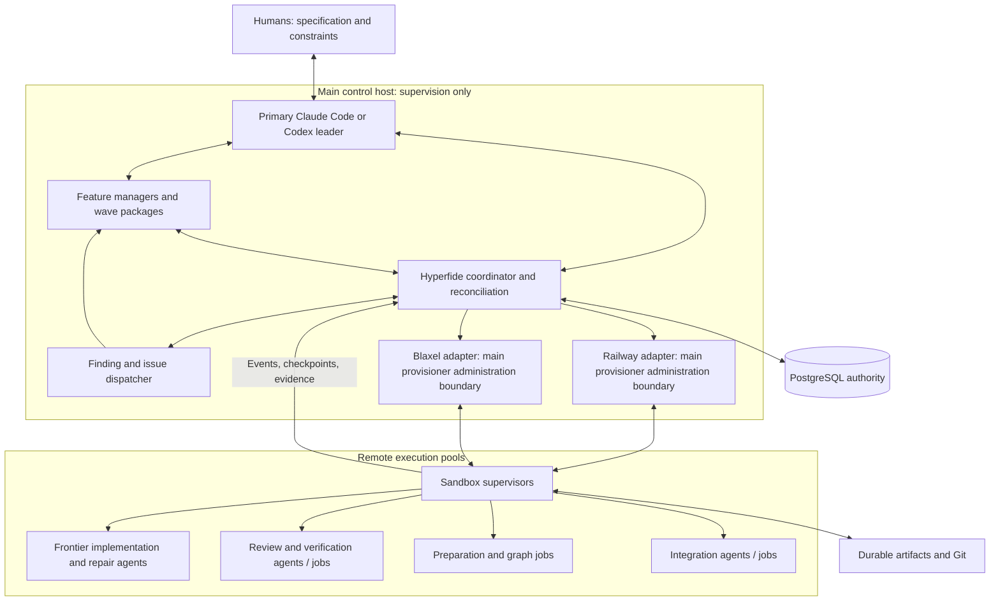

# Hyperfide execution contract

Status: **PROPOSED DESIGN — implementation requires review and approval.** Protocol names in this document describe required capabilities; they are not claims that endpoints, commands, connectors, or tests already exist. Existing Codify command, MCP, configuration, and identity migration belongs to the pack's migration workstream.

## 1. Design scope and operating profiles

This proposed contract defines the distributed execution model for Hyperfide. Protocols and operating profiles require implementation and qualification before production enablement.

| Design area | Requirement or proposed operating profile |
|---|---|
| Workload qualification | Qualify 48–72-hour runs, up to 1,500 registered agent sessions over a run, and a large-run profile of at least 200 concurrent agents. A smaller-run profile may use fewer total agents; it does not carry the same concurrency target. These are proposed qualification targets, not measured operating results. |
| Coding agents | Use frontier Codex and Claude Code connectors. The initial routing policy prefers Claude Code for short, critical, complex work and Codex for sustained complex work; qualify model identities and suitability per deployment profile. |
| Remote capacity | Qualify a 100-sandbox fleet across Railway and Blaxel. Configure account, environment, region, and resource limits from deployment-specific evidence; the profile makes no account entitlement or throughput claim. |
| Dependencies | Evaluate dependencies against capability, operational cost, and maintainability. Legacy dependency restrictions do not constrain the proposed distributed architecture. |
| Shared state | PostgreSQL centrally tracks fleet state, progress, branches, and the shared graph. Replicas support concurrent reads subject to explicit freshness rules. |
| Control placement | The main control host runs the primary leader and feature managers under a measured deployment capacity profile. Humans supply specifications and interact through the primary leader; managers launch remote workers through Hyperfide. Implementation and build execution run remotely. |
| Review boundary | The implementation specification remains a draft until reviewed and approved. Product and provider capabilities described here are proposed, rather than deployed claims. |
| Coordination | A coordinator mediates authority; remote supervisors execute; immutable evidence qualifies results. Feature ownership may persist across successive wave packages under a declared allocation policy. |

The illustrative 200-remote-agent fleet below is a large-run qualification profile. Sandbox density, concurrency duration, model availability, and resource limits require live qualification.

### 1.1 Non-negotiable execution invariants

1. PostgreSQL primary state decides ownership, revocation, result acceptance, dependency release, and integration publication. Replica reads, caches, provider status, model opinions, and local files cannot grant authority.
2. A task has at most one **current authoritative attempt**. Additional assisting agents must be registered against that attempt; independently competing attempts require an explicit future policy and must not each gain publication authority.
3. Physical execution may overlap after a partition or retry. Fencing ensures only current authorised outputs can become accepted task or integration results. Do not claim exactly-once physical execution.
4. No assignment omits its spec revision, source inputs, owner generation, execution profile, scope, checks, and recovery policy.
5. A process exiting successfully does not qualify a task. Evidence is immutable and scoped to exact inputs; independent acceptance decides qualification.
6. Every native child agent and substantial build/test process consumes registered capacity. Untracked recursive delegation is prohibited by the remote connector contract.
7. The proposed placement policy confines the main control host to supervision. Dependency preparation, repository indexing, implementation, builds, tests, reproductions, benchmarks, review execution, and Git integration execution run remotely. Main-host state queries, source inspection, packet composition, and engineering reasoning remain supervisory activities. Production enablement requires an approved run contract and enforcement qualification.
8. Human intent and acceptance criteria cannot be silently weakened by a worker or manager. Programme-level scope changes pass through the primary leader and become a versioned spec/run amendment.
9. No physical resource is presumed dead merely because a request timed out. Unknown outcomes are reconciled before replacement or deletion.
10. Acknowledged checkpoints and evidence have durable storage references and verified hashes. Provider process logs alone are insufficient archival evidence.

All authority generations are scoped to the fresh restore/platform epoch defined by the storage and migration contracts. A database rewind cannot make an old worker, custody, or integration fence current again by reusing numeric generations.

## 2. Roles and distribution

The leader owns programme interpretation, decomposition, cross-feature decisions, manager appointment, and reporting. Feature managers own engineering direction for their assigned work packages. The coordinator enforces admission, leases, state transitions, and evidence acceptance. A manager's natural-language instruction cannot bypass those checks.

**Manager ownership decision for review:** manager allocation follows the run’s wave/package structure. The proposed default is a stable feature/domain owner receiving successive wave packages, retaining responsibility for later findings. A pure wave-manager policy remains expressible by recording an explicit ownership transfer at a wave boundary. Implement both as package allocation, without hardcoding one manager per feature or one manager per wave. Every transfer records predecessor, successor, task/finding set, durable handoff, and acknowledgement; no finding becomes ownerless.

Leader and manager sessions have persisted packages, decisions, summaries, pending instructions, and native-session references. Replacing a manager does not automatically replace healthy workers. One logical leader authority epoch controls a run; a replacement leader acquires a newer epoch before issuing mutations.

The normal human interface is the primary leader. Provider consoles, worker chats, and manager prompts are not required operational steps. Operational recovery should work through that interface, while platform administrators retain emergency revocation and credential recovery capability. Any such action is audited and surfaced to the leader.

### 2.1 Illustrative large-run fleet

This allocation is a proposal, not a resource benchmark or an account limit. Worker density must pass isolation, auth, CPU/RAM/disk, and provider qualification.

| Remote role pool | Railway | Blaxel | Native agents per active sandbox | Remote agents |
|---|---:|---:|---:|---:|
| Implementation and repair | 45 | 30 | 2 | 150 |
| Review and investigation | 6 | 4 | 3 | 30 |
| Qualification and integration | 6 | 4 | 2 | 20 |
| Prepared replacement capacity | 3 | 2 | 0 | 0 |
| Total | 60 | 40 | Variable | 200 |

One leader plus an illustrative 13 managers adds 14 main-server agents: 214 model sessions in this example. Supervisor processes and deterministic checks are not model agents. Preparation/indexing jobs also need reservations; the table does not grant them extra free capacity. Reserve separate resource dimensions inside a pool or temporarily reallocate idle slots.

The default review contract requires 10–15 commit watchers, each inspecting every in-scope commit. Changing that into sampled or partitioned coverage requires explicit policy review. The review/assurance chapter defines coverage and issue routing; the execution system supplies revision-pinned review jobs and their capacity.

## 3. Identity and durable records

Use opaque globally unique logical IDs. Provider-generated IDs and OS PIDs are external attributes; neither is a primary identity. All records include creation time, schema version, monotonically increasing record version, and append-only transition provenance.

| Record | Distinct identity and required relationships |
|---|---|
| Run | `run_id`; immutable spec digest/revision; run amendment history; leader authority epoch; repository set; programme and safety policies. |
| Manager package | `package_id`; `run_id`; owner manager session; feature/domain; wave; task and finding set; dependencies; handoff history. |
| Task definition | `task_id`, stable within its spec namespace; acceptance clause IDs; dependencies and required milestone (`qualified` or `integrated`); allowed scope and verification profile. Definition version differs from live progress. |
| Attempt | `attempt_id`; `run_id/task_id`; attempt number; ownership generation; compute authority and lease expiry; assigned package; admission reservation; launch intent; submitted result. Retrying creates a new attempt. |
| Submitted-result custody | `submission_id`; immutable submitted revision/packet/artifact digest; source `attempt_id` and ownership generation; `custody_generation`; coordinator-owned custody state and scheduled qualification jobs. Distinct from the worker's compute lease. |
| Sandbox | `sandbox_id`; provider/project/environment or workspace; external sandbox ID; profile/preparation digest; desired/observed lifecycle; capacity; registration and last reconciliation. |
| Sandbox boot | `boot_id`; `sandbox_id`; newly issued runner identity; boot nonce; runner version; reconnect history. Restart/fork/restore must not reuse an already active boot identity. |
| Slot | `slot_id`; `sandbox_id`; capabilities; resource allocation; current reservation; workspace, home, build, temporary, and port bindings. |
| Workspace | `workspace_id`; attempt; repository revisions; base and attempt branch refs; current checkpoint; materialisation manifest; isolation boundaries. |
| Agent session | `agent_session_id`; role; parent session; manager/package/attempt; connector version; configured model alias and resolved identity when available; native session/thread ID; auth profile reference. Resume may retain this record only when the native connector verifies identity continuity. |
| Native process | `process_id` (logical); agent/job; `boot_id`; local PID plus start identity; process group/container identity; exit status. PID reuse must never cause signalling an unrelated process. |
| Provider process/session | Provider-specific process/session reference scoped to external sandbox ID and boot; observations do not substitute for native agent session identity. A provider may not expose this primitive; record unsupported rather than inventing an ID. |
| Job | `job_id`; preparation/indexing/build/test/review/integration kind; exact inputs; resource reservation; owning attempt or candidate; process/evidence associations. |
| Checkpoint/artifact/evidence | Separate IDs with content hashes and durable locations; producing session, attempt, boot, input manifest, upload status, retention obligations. |
| Operation/event/instruction | `operation_id`, `event_id`, `instruction_id`; idempotency, ordering, delivery, acknowledgement, and causation relationships described below. |

Native child agents receive distinct agent-session IDs with parent links before they perform repository mutations or substantial execution. They may share a parent's task attempt only under explicit scope and allocated resources; they cannot inherit a different task's publication authority implicitly. If a connector cannot expose or bound native delegation, disable it for that execution profile until qualified.

## 4. Preparation and task packet

### 4.1 Preparation manifest

A preparation profile describes required capabilities rather than assuming Railway and Blaxel images behave identically. Suggested initial families are C/Rust, Go/blockchain, web/browser, and system integration; actual repositories determine final profiles.

Each immutable preparation manifest contains:

- Profile version and content digest; OS/architecture; provider image/template/checkpoint reference; image digest when available; CPU/RAM/disk and persistent-volume requirements.
- Toolchain, package-manager, native agent CLI, connector, supervisor, and Hyperfide versions; installed system packages; installation recipe and verification results.
- Repository URL identities, baseline commits, submodule/LFS requirements, lockfile digests, dependency sources, generated-input digests, and applicable build configuration.
- Cache identities and trust scope; cache may accelerate preparation but is never evidence that inputs match.
- Required network routes, registry availability, health capabilities, test/browser capabilities, storage limits, process lifetime policy, and credential **references**, without credential values.
- Preparation evidence and expiration/rebuild policy. A profile is not reusable for an incompatible source/lock/toolchain configuration merely because its name matches.

The recipe `FilePin` binds the exact UTF-8 bytes of a versioned JSON preparation policy. Version 1 has exactly these fields: `schema_version: 1`, `kind: "hyperfide.preparation-policy"`, `commands: [{repository, argv, timeout_seconds}]`, `cache_scope`, `cache_paths: [{repository, path}]`, `minimum_free_bytes`, `minimum_free_inodes`, and `network_timeout_milliseconds`. Repository names must belong to the parent manifest; argument vectors are bounded and contain no NUL bytes. Each command timeout is between 1 and 3,600 seconds, and their total cannot exceed the profile lifetime. Storage minima use canonical nonnegative decimal strings; the network timeout is between 100 and 10,000 milliseconds.

The pure policy reader verifies the full parent manifest and the recipe bytes against its exact `FilePin`. Staging and execution recheck the same verified policy rather than inferring commands from a script digest. Unsupported legacy script bytes or unknown formats are refused explicitly; a recipe digest mismatch is a failure. Effective-result derivation preserves the complete recipe `FilePin` across the parent/result lineage. Parsing a policy or deriving a profile does not grant preparation readiness.

Prepare heavy dependencies remotely, then clone/materialise exact assignment inputs into each writable slot. Shared base source and caches must be immutable or protected against simultaneous writes. Do not bake credentials, native authenticated session state, live ownership, or active agent identities into reusable bases.

### 4.2 Assignment packet

An assignment is an immutable, hashed packet. A correction creates a new packet revision and explicit instruction or replacement attempt; workers must not silently drift between definitions.

| Group | Required fields |
|---|---|
| Identity/authority | Packet schema/version/hash; `run_id`, spec revision/digest, `package_id`, `task_id`, `attempt_id`, ownership generation, lease token/expiry, coordinator endpoint identity, launch operation ID. |
| Intent | Task purpose; exact acceptance clause IDs/text or immutable references; required contracts and system invariants; declared scope/touches; known forbidden changes; completion and escalation conditions. |
| Inputs | Repository identities and exact commits; dependency task result/candidate revisions; branch bases; contract versions; graph snapshot ID and source coverage; permitted external inputs; unavailability/lag declarations. |
| Runtime | Selected frontier connector/model profile; native-session launch/resume mode; preparation digest; sandbox/slot/workspace IDs; working directory; build/home/temp paths; resource and port reservations. |
| Configuration | Non-secret runtime values; named credential references and permitted use; environment manifest digest after resolving non-secret configuration; required connectivity. Secret bytes are delivered separately through the qualified credential path. |
| Verification | Commands as structured executable/argv/cwd/env references; timeouts; expected evidence outputs; criterion-to-check mapping; independent-review obligations; integration dependency milestone. Commands remain project-authored inputs subject to run policy. |
| Context | Mandatory spec/contracts/failure excerpts; optional ranked context with source IDs; persisted decisions and earlier checkpoints; pending findings; explicit missing information. |
| Operations | Checkpoint interval and triggers; heartbeat and lease policy; offline deadline; retry limits; cancellation grace; escalation destination; output/artifact locations and retention; instruction/event protocol versions. |

Local worktree creation must validate that the resolved commit set equals the packet, that the slot is unoccupied, and that the workspace path belongs to the slot. Attempts use their own branch/ref namespace. A worker cannot directly push integration-target updates using its attempt credentials.

Only the integration publication gateway holds the capability to update protected integration targets. It uses expected-head comparison and a durable publication intent, then reconciles uncertain Git outcomes before retrying. Multi-repository candidates bind all participating revisions to one candidate manifest and release barrier; no distributed atomic Git commit is assumed. The assurance/integration chapter defines partial-publication recovery and prevents declaring a mixed candidate released.

Readiness has two levels. `SANDBOX_READY` proves boot identity, runner compatibility, capacity, storage, coordinator/artifact/Git reachability, and preparation capabilities. `SLOT_READY` additionally proves exact source/dependency materialisation, isolated paths/ports, required credentials by capability check without revealing values, and packet binding. Only a current admitted attempt on a `SLOT_READY` slot can start.

## 5. States and transition rules

The following are proposed state vocabularies. Desired lifecycle, observed liveness, execution outcome, and assurance are separate fields. `UNKNOWN` observations do not automatically rewrite a desired state or historical outcome.

### 5.1 Run and manager package

Run lifecycle: `DRAFT → VALIDATING → READY → RUNNING`. Validation failure returns a recorded failure report without activating work. `RUNNING → COMPLETING → COMPLETED` requires programme closure evidence. `FAILED` denotes a recorded terminal run failure, not a transient provider outage. Controlled transitions are `PAUSING → PAUSED`, `DRAINING → DRAINED`, `CANCELLING → CANCELLED`, and `STOPPING → STOPPED`; resume from `PAUSED/DRAINED/STOPPED` is an explicit new control operation against current state, with revalidation and fresh attempts where required. `CANCELLED/COMPLETED` runs require a new run to execute again.

Manager-package lifecycle: `PLANNED → ASSIGNED → ACTIVE → CLOSING → CLOSED`, with `BLOCKED`, `HANDOFF_PENDING`, and `CANCELLED` branches. Package closure requires task/finding disposition and wave-policy evidence; a manager saying “finished” is insufficient. A paused run may retain assigned packages while workers are quiescent.

### 5.2 Task and attempt

Task progress: `BLOCKED → ELIGIBLE → ACTIVE → SUBMITTED → QUALIFYING → QUALIFIED → INTEGRATING → INTEGRATED`. `REPAIR_REQUIRED` returns the task to scheduling after a defined repair/requalification plan; `CANCELLED` requires recorded programme authority. Eligibility is derived from current dependencies and policy. Qualification freshness is separate: `CURRENT`, `STALE`, or `MISSING`; an integrated task's historical milestone remains recorded when later changes invalidate assurance.

Attempt execution: `RESERVED → PREPARING → START_REQUESTED → RUNNING → CHECKPOINTING → SUBMITTED → SUCCEEDED`. `SUCCEEDED` means the attempt's submission was accepted for the task's required qualification; it does not mean the programme is integrated. Terminal alternatives: `FAILED`, `CANCELLED`, `SUPERSEDED`. `RECONCILING` is a recoverable uncertainty state reachable after timeouts or lost observations; it cannot itself permit a second accepted owner. A rejected or failed qualification records the submission and evidence, terminates or repairs through policy, and never overwrites the previous result history.

There are two different authorities, with an atomic handoff between them:

1. **Worker compute authority** has state `CURRENT`, `RELEASED`, `REVOKED`, or `EXPIRED`. Only `CURRENT` plus an unexpired compute lease authorises worker execution, renewal, and initial submission. An irrevocably superseded ownership generation cannot regain authority.
2. **Coordinator submitted-result custody** is created by accepted submission, with `submission_id`, `custody_generation`, and authority state `ACTIVE`; other authority states are `REVOKED`, `SUPERSEDED`, or `RELEASED`. Qualification outcome is separately `PENDING`, `PASS`, or `FAIL`. Custody remains `ACTIVE` while the task is `SUBMITTED`, `QUALIFYING`, `QUALIFIED`, or `INTEGRATING`, including after qualification passes. It is released only by an explicit terminal integration/disposition transaction. This authority permits independent qualification and integration of the submitted immutable inputs; it does not authorise further worker computation or mutations to that submission.

`SubmitResult` atomically validates current compute authority/lease, stores immutable submission and active custody, changes worker compute authority to `RELEASED`, and schedules required qualification. Its replay returns that same submission/custody even though the compute lease has since been released. Cleanup of the coding slot waits for the worker to become quiescent and required artifacts to be durable; qualification does not hold that slot or extend its compute lease. Verification executors have their own jobs, resource reservations, and compute leases.

After that acknowledgement, the original worker ceases task mutation; the supervisor may finish quiescence, log/checkpoint upload and cleanup under its runner/control capability. Those housekeeping actions confer no new compute authority or right to alter the accepted submission.

**Any active submitted-result custody record is excluded from compute-lease-expiry task reclamation**, including qualified work awaiting integration. Releasing or expiring the original worker's lease must not create a replacement attempt or invalidate accepted submission. Qualification checks the task's current submission ID, attempt/ownership generation, active custody generation, applicable evidence, and permitted run state; it does not require a live lease for the original worker. A failed qualification records outcome `FAIL`; an explicit custody revocation/disposition must occur before retry/reassignment. Reassignment atomically supersedes active custody and allocates a new attempt/ownership generation. Whichever transaction wins a race between qualification and reassignment determines the legal subsequent transition; the loser fails its expected-version/custody check. Qualified results retain active custody and therefore cannot be reclaimed through an expired compute lease while awaiting integration.

After terminal integration releases submission custody, subsequent assurance requalification uses a new coordinator-owned operation/generation bound to the immutable integration receipt and exact inputs, with its own verification jobs. It never resurrects the original worker lease or released custody. Candidate inputs already present in an integrated base are justified by their integration receipts; only newly pending contributors require active submitted-result custody.

QUALIFICATION preparation plans may bind lease generation `0` before the first verifier claim; staging and preparation at that generation grant no verification execution authority.

### 5.3 Infrastructure and sessions

| Entity | Lifecycle | Important orthogonal observations |
|---|---|---|
| Sandbox | `REQUESTED → PROVISIONING → BOOTSTRAPPING → READY → DRAINING → DELETING → DELETED`; failure branch `QUARANTINED` | Provider reachability/health may be `HEALTHY`, `SUSPECT`, `UNKNOWN`, `ABSENT`; capacity is separately reserved/available. |
| Slot | `FREE → RESERVED → MATERIALISING → READY → STARTING → BUSY → CLEANING → FREE`; `QUARANTINED` on unsafe residual state | Workspace/evidence persistence and lease validity are independent. |
| Agent session | `CREATED → LAUNCHING → ACTIVE → CHECKPOINTING → QUIESCENT/EXITED`; `LOST`, `FAILED`, `CANCELLED` alternatives | Native resume support, process liveness, useful progress, and task qualification are distinct. |
| Job/process | `CREATED → STARTING → RUNNING → EXITED`; uncertain observation `UNKNOWN` | Exit code, signal, resource usage, timeout, evidence completeness. |
| Provision/launch operation | `PENDING → DISPATCHING → CONFIRMED`; alternatives `OUTCOME_UNKNOWN`, `FAILED`, `RECONCILING` | Terminal resource identity and reconciliation evidence are retained. |

## 6. Proposed protocol and atomic operations

The names below are logical protocol operations for CLI/MCP/service adapters. Wire paths and final command spellings are selected during implementation design. They are **not present-tense API documentation**.

Every mutating request includes protocol version, authenticated actor, run scope, unique idempotency key, payload digest, correlation/causation IDs, and expected record version or fencing fields as applicable. The server stores the committed outcome before acknowledging. Repeating a key with an identical payload returns the same outcome; reuse with another payload fails `IDEMPOTENCY_CONFLICT`. Unknown outcomes are resolved by operation lookup with the original key. Retain keys through the run's recovery and retention horizon; deletion cannot permit replaying a retired destructive request.

| Operation | Preconditions and atomic effect | External work / retry rule |
|---|---|---|
| `CreateRun`, `ValidateRun`, `AmendRun` | Bind spec and policy versions; reject incompatible running amendments; record actor and justification. | Structural validation can schedule remote graph/spec jobs; acceptance is never implied by request success. |
| `AssignPackage`, `TransferPackage` | Current leader epoch; package version check; record owner and acknowledged handoff. | Existing workers retain their valid attempts unless explicitly revoked. |
| `ReserveAttempt` | Primary transaction checks task dependencies/milestone, eligible task progress, run state, current compute ownership **and absence of active submitted-result custody**, capability/capacity budgets; allocates attempt/fence/lease and reservation atomically. | Repeating reservation request returns the existing attempt; no model response grants a reservation. An expired former compute lease cannot bypass active custody, including qualified work awaiting integration. |
| `RequestSandbox` | Reserve pool quota and record provisioning intent/operation before any provider call. | Adapter creates or discovers resource using supported labels/dedup mechanisms; uncertain creation is reconciled, not blindly repeated. |
| `RegisterBoot`, `ReportReady` | Verify one-time bootstrap identity, sandbox binding, boot freshness and manifest; bind readiness report. | Restored/forked images obtain new identity. Duplicate registration returns existing boot or explicit conflict. |
| `MaterialiseSlot`, `ConfirmSlotReady` | Current reservation, attempt/fence, slot version; publish exact materialisation manifest and readiness result. | Idempotent workspace preparation; interrupted preparation is inspected/cleaned before reuse. |
| `RequestLaunch`, `ConfirmLaunch` | Persist one launch intent for an attempt/slot/boot; require ready slot, valid fence/lease, current run permissions. | Runner keeps a local durable launch ledger keyed by intent. On duplicate, discover/report existing native session/process. Crash between spawn and ledger update triggers process/workspace reconciliation before another spawn. |
| `RegisterChild` | Validate parent session, scope, allowed connector delegation, and resource reservation; allocate child identity. | Native spawn happens only after admission; child cannot silently create new task ownership. |
| `RenewLease` | Primary checks current attempt/fence/boot and allowed run state; advances expiry using server time. | A heartbeat is not an implicit renewal. No primary connectivity means no new lease. |
| `AppendEvents`, `StoreCheckpoint` | Deduplicate event IDs/sequences; verify referenced durable objects; commit event/checkpoint metadata with cursor. | Retry uploads/events safely; acknowledged byte range/object hashes must be durable. |
| `Steer`, `AcknowledgeInstruction` | Validate actor/package/run scope, fence and expected packet/session; allocate ordered instruction sequence and persist ack/progress. | Repeated delivery has one logical effect; unsupported instructions fail explicitly. |
| `SubmitResult` | Check current compute authority, fence, lease, packet/revision binding, required artifact completeness and expected task version; atomically store immutable submission, create active custody, release original compute authority, and schedule checks. | Idempotency lookup precedes live-lease validation on replay, returning the original outcome. Acceptance is distinct from passing qualification. |
| `AcceptQualification` | Primary validates current submission ID/ownership generation, active custody generation, complete current evidence, dependencies/contracts, authorised qualification role and permitted run state; records outcome `PASS`, retains custody `ACTIVE`, and records task `QUALIFIED` milestone/event atomically. | Original worker's compute lease is deliberately irrelevant. Failed checks record outcome `FAIL` and require explicit custody disposition before retry. Stale qualification cannot race through revocation/reassignment. |
| `PublishIntegration` | Primary validates qualified result/candidate identity, active custody generations with qualification `PASS` for newly pending contributors, integration receipts for already integrated base inputs, current evidence/dependencies/contracts, authorised gateway's **integration publication fence**, expected target head and run state; records publication intent/milestone according to the integration contract. | Original coding-worker lease is irrelevant. Custody remains active through uncertain publication and is released only on terminal integration/disposition. Git publication uses expected-head and uncertainty reconciliation; no open DB transaction spans Git/provider execution. |
| `RequestRequalification` | Primary binds a fresh coordinator-owned operation/generation to an integrated receipt, exact source/config/contract inputs, affected criteria and required checks; schedules independent verification jobs under current run policy. | Released submission custody and former worker lease remain terminal. New applicable evidence is appended to assurance history without erasing historical integration. |
| `RevokeAttempt`, `ReassignAttempt` | Revoke compute authority and explicitly revoke/supersede any active custody; record reason before authorising replacement; new attempt gets a newer ownership generation. | Stop old process best-effort; late artifacts may be archived with stale provenance but cannot advance task state. An accepted submission is never implicitly revoked merely because its former compute lease expired. |
| `Pause`, `Drain`, `Cancel`, `Stop`, `Resume` | Durable run-control transition, admission barrier and required revocations; ordered instructions issued to affected scopes. | Completion tracks actual acknowledgements/process observations; a sent signal is not confirmation. |
| `Reconcile`, `DeleteSandbox` | Compare desired/observed state; deletion requires no current reservations/authority plus persistence/disposition policy, or recorded emergency override. | Adapter deletion is retried by stable resource identity; `ABSENT` confirms deletion. Never delete a newly reused resource based on an old name. |

All operations reject scope/role mismatch, stale record versions, stale fences, incompatible schema, or unqualified capabilities with machine-readable reasons. Transient errors include a bounded retry hint; permanent errors retain evidence. API clients must not interpret a generic network error as rejection or success.

### 6.1 Capacity and API budget

Reservations cover provider/environment sandbox count, provisioning operations in flight, agent sessions, native children, CPU, RAM, disk, build/link slots, test slots, exclusive services, ports, and external API concurrency. Resource profiles use declared requirements and measured consumption; they do not assume all agents spend the same resources.

Provider/account rate and creation limits, native model limits, registry/Git bandwidth, log upload throughput, and coordinator connection pools have separate budgets. Honour qualified provider throttling/retry signals with bounded exponential backoff and jitter. Keep high-priority renewal/revocation/control traffic independent from bulk logs, graph uploads, and context reads. Control recovery must not wait behind a full artifact queue.

Reserve capacity through PostgreSQL transactions and expire orphan reservations by reconciliation. Global, per-run, per-provider, and per-environment budgets compose; one pool cannot exceed an account limit merely because each manager stayed within a local limit. Warm capacity counts toward quota. A sandbox undergoing uncertain deletion remains reserved until reconciled or explicitly accounted as leaked capacity.

Compute-lease expiry revokes compute authority; it does not invalidate active submitted-result custody or prove CPU, memory, disk, ports, or provider quota have been released. Retain observed occupied/uncertain resource accounting until stop/absence is established, or account an explicit conservative orphan allocation before replacement.

The main control host also needs session/CPU/memory admission for leaders and managers. Its deployment profile must declare and qualify those budgets; hardware inventory alone cannot establish a safe manager count. Workload qualification measures that budget without running repository builds there.

## 7. Supervisor, IPC, durable events, and steering

The remote supervisor survives transient controller connections, owns local native-agent IPC, and reconciles its process ledger on restart. Proposed local IPC is a framed structured protocol over an authenticated local channel; an agent connector adapts it to each native CLI/app-server/session mechanism. Final transports are an implementation choice. Closing a remote control connection must not inadvertently close the agent's local input stream.

Log streams and structured events are separate. Each structured event includes `event_id`, run/attempt/fence, sandbox/boot/session, producer sequence, server receipt cursor, local observation time, type/schema, payload hash, and causation. Sequence gaps are detectable. Coordinator deduplication is transactional with consumer state; durable consumer cursors permit replay. Network delivery is at least once. A queue notification is a wakeup hint, never the sole event record.

Supervisor local spooling is bounded and persists across its process restart. If backlog threatens disk or durable checkpoint guarantees, the runner prioritises control/checkpoint data, reports pressure, and follows pause policy; it cannot silently drop required evidence. Log truncation/gaps are explicit in artifact metadata. The artifact layer defines multipart upload, integrity, and retention.

Steering instructions contain target session/attempt/fence, monotonically increasing target sequence, instruction ID, expected packet/session revision, type, payload, expiry, and issuer. Required phases are `QUEUED`, `DELIVERED`, `ACKNOWLEDGED`, `APPLIED` or `REJECTED`; delivery alone does not mean the agent understood or applied it. Ordering gaps cause fetch/replay before applying subsequent mutating instructions. Cancellation/revocation can pre-empt queued ordinary steering, with the pre-emption recorded.

Checkpoint envelopes join code revision or patch artifact, workspace manifest, uncommitted/untracked file disposition, instruction cursor, native-session checkpoint reference when supported, decisions/handoff summary, unresolved findings, and artifact hashes. Never advertise native-context restoration unless the connector proved it. A fresh session can reconstruct from the task/spec/contracts, code, events, and summary while explicitly recording context loss.

## 8. Evidence and result acceptance

Every evidence envelope includes:

- Evidence ID/schema/type; producing actor, attempt/fence/session/boot; start/end and server receipt times.
- Run/spec/criterion IDs; repository and complete commit set; task packet hash; relevant contract and published graph versions; preparation/configuration digests.
- Structured command or review rubric/version, cwd, relevant non-secret environment inputs, exit status/signal, timeout and resource observations.
- Full output/artifact references, content hashes and completeness; explicit missing/truncated information; cache/reuse provenance where relevant.
- Assertion-to-criterion mapping, limitations, affected consumers/candidate, independent reviewer identity and outcome where required.

Evidence has separate `UPLOADING`, `DURABLE`, `VALIDATED`, `REJECTED` ingestion state and `CURRENT/STALE` applicability. A missing test, skipped check, stale graph, or failed upload is an explicit condition, never a passing result. A worker's own assertions cannot replace independent verification required by run policy. Semantic assurance and integration invalidation are further specified in the assurance chapter.

Late source and artifact outputs from an expired/revoked compute attempt can be imported as explicitly attributed inputs by a new attempt. The new attempt must re-establish applicability and qualification; changing the owner label on old evidence is forbidden. An already accepted immutable submission with active coordinator custody follows section 5.2 instead: original compute-lease expiry alone does not invalidate it or require import into another attempt.

## 9. Lease, recovery, and main-server outage policy

Leases use coordinator server time and are renewed through primary-backed operations. The runner derives a conservative monotonic local deadline from the last acknowledged lease, with a safety margin and clock/round-trip uncertainty; it never extends authority using its own wall clock. Lease TTLs, renewal cadence, checkpoint intervals, and grace periods are run/profile parameters selected by measured failure tests, rather than invented universal constants.

After control-plane disconnection, an already admitted worker may continue local computation only until its last acknowledged lease/offline deadline. It cannot claim successor tasks, release dependencies, or publish integration. Before the deadline it checkpoints; if renewal remains unavailable it quiesces or terminates according to its qualified connector policy. Processes such as builds are stopped safely within the same resource policy. Reconnection does not revive a revoked fence.

| Failure | Required reconciliation and recovery |
|---|---|
| Lost API response during creation/start | Lookup persisted operation and provider/runner observations using stable identities; attach to the existing resource/process, or prove absence before retry. If absence cannot be established, quarantine the uncertain slot and fence any replacement. |
| Runner process restart | Recover spool/launch ledger; inspect processes by boot-scoped start identity, not PID alone; re-register and reconcile ownership before steering or publication. |
| Native agent process/session loss | Preserve available workspace, logs, native checkpoint and handoff summary. Resume only using a qualified same-session connector path; otherwise start a new recorded session and mark context continuity lost. |
| Sandbox loss | Revoke affected active compute authority and reconcile occupied reservations; restore unfinished work from durable checkpoints into fresh attempts/boots. Preserve active submitted-result custody when its complete immutable inputs are already durable: loss of the former coding sandbox alone does not revoke it. Record/recover any qualification job lost on that sandbox under its own lease. Never assume local ephemeral state survived. |
| Manager loss | Restore package, decisions, outstanding findings and instructions; native session resume if qualified, otherwise new manager session and durable handoff. Keep valid task workers. |
| Leader or main-server loss | Remote workers obey the bounded offline policy. PostgreSQL/artifacts outside the main failure domain preserve acknowledged state. Restarted control services reconcile before admission, then the leader resumes/reconstructs against a newer authority epoch. No uninterrupted supervision claim without a separately qualified standby. |
| Primary database unavailable | No ownership/result/integration mutation succeeds. Replicas support explicitly stale observation only. Existing workers follow offline deadline; retry queued events after primary recovery. |
| Artifact service unavailable | Spool within bounded limits; do not acknowledge durable checkpoint/result acceptance until storage is verified; pause before capacity exhaustion. |
| Partitioned old worker returns | Revoke/quiesce and archive useful stale artifacts. Reject lease renewal, result acceptance, and integration using the superseded generation. |
| Bad preparation or shared contamination | Quarantine affected profile/slots; trace users by manifest digest; preserve failed evidence; rebuild remotely and reschedule affected attempts. |

Recovery reporting states which native context, source data, and artifacts were actually recovered, which were lost, and what was re-executed. “Recovered” without those dimensions is insufficient.

## 10. Pause, drain, cancel, stop, and cleanup

These controls are callable by authorised leader/control actors for a run, package, sandbox, or attempt scope. Narrow scope cannot override an enclosing run prohibition.

Pause preserves submitted custody but blocks qualification advancement while the enclosing run policy is paused; drain allows already admitted qualification to finish. Cancel/stop explicitly revoke affected pending custody and integration authority as well as compute authority. Control transitions and custody dispositions are transactional and auditable. Physical sandbox deletion after completed worker cleanup must not revoke independent durable custody merely because the old workspace is gone.

| Control | Admission and execution semantics | Completion condition |
|---|---|---|
| Pause | Immediately block new execution admission in scope; checkpoint active work and reach a supported quiescent state within grace. Stop checkpointed processes when native pause cannot be qualified. Do not assume provider hibernation preserves the native session. | All affected work is quiescent or terminated, artifacts/dispositions recorded. Resume revalidates inputs/authority and either resumes a qualified session or creates new attempts. |
| Drain | Block new assignments to scope; let already admitted valid work finish within a declared deadline. No automatic successor dispatch. Only already authorised integration jobs may finish. | No active reservations/processes requiring the scope; outputs/evidence persisted. Deadline expiry invokes the recorded pause/cancel fallback. |
| Cancel | Revoke publication authority and prevent new work immediately; request checkpoint if safe, then terminate within grace. | Affected processes observed stopped/absent or explicitly uncertain and fenced; resource cleanup tracked separately. Cancelled attempts never resume. |
| Stop | Emergency stop: revoke authority and admission immediately, prioritise termination/revocation over ordinary steering. Preserve available artifacts without delaying the configured force-stop deadline. | Confirmed stop or explicit unreachable/uncertain status with enforced publication fencing. Resume requires deliberate revalidation and fresh attempts. |

The primary leader acknowledges controls with a durable operation ID and progress, rather than claiming all work stopped when only instructions were enqueued. A provider outage may prevent confirming physical termination; report that uncertainty and maintain fences. External side effects beyond Git/result publication require their own idempotency and capability revocation; a database fence cannot undo an already issued external action.

Normal cleanup requires zero active ownership/reservations, captured process disposition, required durable artifacts/checkpoints, released credential capability, and a retention decision. Cleanup never deletes active work based solely on age, missing heartbeat, or a provider list omission. Emergency deletion is an explicit audited override that records potential data loss. Keep provider tombstones and reconcile billable leftovers. Slot reuse requires credential removal, process teardown, workspace disposition, port release, and profile/health validation; otherwise quarantine it.

## 11. Qualification obligations

No command or result is claimed here as already run. The implementation task plan must supply executable checks covering the following acceptance scenarios on both providers and the selected native connectors:

1. Duplicate reserve/start/result requests produce one authoritative attempt and one accepted result; process duplication at the spawn crash boundary is detected and cannot create duplicate publication.
2. Two workers in one sandbox cannot alter each other's worktrees, homes, build outputs, temporary files, or port reservations through ordinary configured paths; a stronger-isolation profile is tested separately.
3. A changed lockfile/toolchain/source baseline invalidates incompatible preparation; readiness rejects a mismatched packet or manifest.
4. An unregistered native child is prevented or surfaced as a profile failure; registered delegation consumes capacity and retains provenance.
5. A controller disconnect leaves local native IPC functioning, then enforces the configured offline deadline; no successor/integration work is admitted offline.
6. Lost provider creation and process-start acknowledgements reconcile to existing resources without blind duplicate launch.
7. Manager, leader, runner, agent, sandbox, primary database, and artifact failures recover with explicit data/context-loss reports and intact historical evidence.
8. An old owner returning after reassignment cannot renew, submit accepted results, or publish; stale useful patches remain importable with provenance. A valid accepted submission can finish independent qualification after its worker's compute lease is released/expired. A concurrent scheduler must not reclaim that task while custody is active. Race explicit custody revocation/reassignment against qualification and prove exactly one permitted transition wins.
9. Event/instruction duplication, reordering, sequence gaps, reconnect replay, spool exhaustion, and full bulk queues preserve control priority and declared acknowledgement semantics.
10. Pause, drain, cancel, and emergency stop have distinct tested outcomes; retries and resumed control requests are idempotent; uncertain physical termination remains visible.
11. Cleanup cannot remove active resources or unpersisted required outputs; deletion timeout/retry and reused names cannot delete a replacement sandbox.
12. A 48–72-hour large-run rehearsal measures at least 200 concurrent agent sessions within a qualified sandbox profile, with indexing, builds, review, and recovery load together. It records actual limits and failures; it does not infer capacity from CRUD or launch-only benchmarks.
13. Main-server telemetry and execution provenance demonstrate no repository preparation/indexing/build/test/implementation/integration job ran there. Native leader/manager supervision resource usage is measured separately.
14. Human routine interaction is exclusively through the main leader; no provider console action, worker prompt, or undocumented credential copy is required to complete the qualified workflow.

Provider/account, native-auth, and exact model-alias qualification remain open until live evidence resolves them. These open facts do not authorise implementation during the specification review period.
