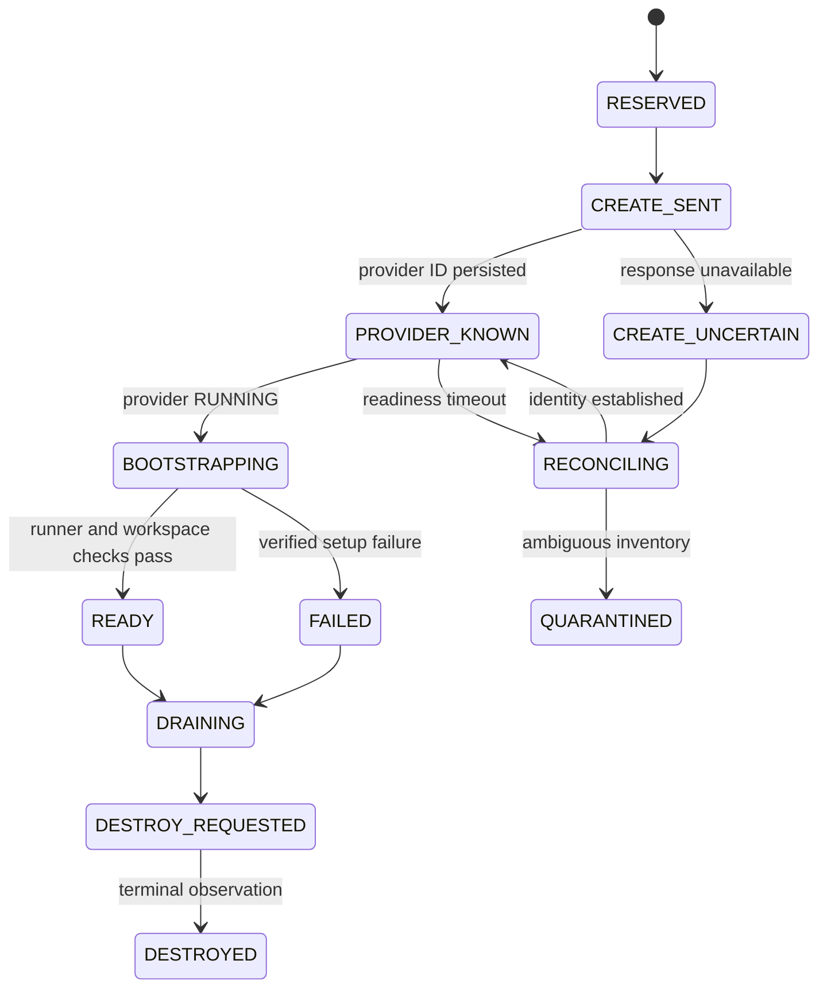

# Hyperfide Railway execution provider

Status: **DRAFT FOR USER REVIEW — implementation not authorised**. Authored and primary sources checked on **2026-10-16**. Every future acceptance scenario below is **UNRUN**. No account inspection, cloud mutation, credentials, or live performance test was used to write this chapter.

## Scope and provenance

This chapter implements the execution-provider portion of the proposed Hyperfide architecture. The supervision server hosts the leader, feature managers, and coordination services. Railway sandboxes perform preparation, dependency installation, implementation, indexing, builds, tests, reproductions, and integration. Feature managers request execution through Hyperfide; provider credentials remain with the provisioner.

Read in conjunction with the pack's execution, persistence, security, and recovery contracts. This chapter defines Railway-specific behaviour rather than giving Railway task ownership authority.

The provider contract covers sandbox preparation, prerequisites, runtime variables, agent launch, tracking, and recovery. The public engineering target is a mixed fleet of 100 sandboxes and 200 concurrent workers; it describes a qualification profile, not an existing deployment or purchased allocation.

### Source identity

The inspected official SDK repository is `railwayapp/railway-ts-sdk`, revision **`97fdb4f61d351319d5633c2c92a86ca2ff0062d8`**. Its [package manifest](https://github.com/railwayapp/railway-ts-sdk/blob/97fdb4f61d351319d5633c2c92a86ca2ff0062d8/package.json) declares package `railway`, version **3.16.0**, and Node **>=22**. This is a source revision identification, not proof that the identical package was installed or published to the registry. Implementation must pin and record the actual resolved package, integrity hash, runtime, and provider API compatibility.

Primary sources:

- [Railway sandbox documentation](https://docs.railway.com/sandboxes).
- [Sandbox factories and checkpoint operations](https://github.com/railwayapp/railway-ts-sdk/blob/97fdb4f61d351319d5633c2c92a86ca2ff0062d8/src/sandbox/sandbox.ts).
- [Creation, readiness polling, inventory, and session engine](https://github.com/railwayapp/railway-ts-sdk/blob/97fdb4f61d351319d5633c2c92a86ca2ff0062d8/src/sandbox/engine.ts).
- [Creation and execution option types](https://github.com/railwayapp/railway-ts-sdk/blob/97fdb4f61d351319d5633c2c92a86ca2ff0062d8/src/sandbox/types.ts).
- [Execution implementation](https://github.com/railwayapp/railway-ts-sdk/blob/97fdb4f61d351319d5633c2c92a86ca2ff0062d8/src/sandbox/exec.ts).
- [Template implementation](https://github.com/railwayapp/railway-ts-sdk/blob/97fdb4f61d351319d5633c2c92a86ca2ff0062d8/src/sandbox/template.ts).
- [GraphQL operations](https://github.com/railwayapp/railway-ts-sdk/blob/97fdb4f61d351319d5633c2c92a86ca2ff0062d8/src/graphql/operations/sandbox.graphql) and [generated input schema](https://github.com/railwayapp/railway-ts-sdk/blob/97fdb4f61d351319d5633c2c92a86ca2ff0062d8/src/generated/graphql.ts).
- [Railway private networking](https://docs.railway.com/networking/private-networking).

## Facts and design decisions

| Classification | Statement | Consequence |
|---|---|---|
| Verified public documentation | Pro has a 100-per-environment cap; Enterprise starts at 100, adjustable by agreement. `CREATING` and `RUNNING` count. | Include pending creations and ambiguous allocations in admission accounting. Actual deployment quotas and resource sizes require account qualification. |
| Verified source | Create, fork, template, named checkpoint restore, connect, refresh, heartbeat, destroy, files, sessions, and durable WebSocket exec exist. | Implement the adapter against pinned interfaces and qualify actual hosts. |
| Proposed design | Use a TypeScript provider component and official SDK/API operations, with a local sandbox supervisor. | Dependencies are unrestricted. SDK choice does not require rewriting every existing Codify component. |
| Open qualification | SDK/auth permissions, negotiated limits, disk capacity, CPU architecture, host features, region availability, package egress, quotas, and 72-hour continuity. | Record an approved-account qualification report before production admission. No invented guarantee from vendor marketing. |

## Adapter boundary

The following operation names describe a **planned Hyperfide interface**. They are not current CLI commands or claims of implemented APIs.

| Operation | Contract |
|---|---|
| `capabilities(pool)` | Return versioned provider/SDK features, quota evidence, region and network scope, and qualification state. Unknown features remain unknown. |
| `prepare(recipe)` | Build or locate a reusable base for an immutable recipe digest; preserve preparation evidence and return a provider-scoped reference. |
| `ensureSandbox(intent)` | Consume one durable provisioning intent and its resource reservation. Return an observed provider ID or an explicit uncertain state; never claim caller-supplied idempotency that Railway does not expose. |
| `inspect(providerRef)` | Read actual lifecycle/placement, last observation, available session data, and reconciliation status. |
| `inventory(pool, cursor)` | Enumerate all pages with explicit continuation and completion status. An incomplete inventory cannot prove absence. |
| `bootstrap(providerRef, packet)` | Materialise the pinned workspace, inject scoped runtime configuration, start/register a fresh supervisor, and report readiness checks. |
| `startSupervisor(providerRef, launch)` | Start a durable exec and persist session identity; tolerate an uncertain start by inspection rather than immediate duplicate launch. |
| `attach / listSessions / signal` | Recover observation or request termination without assuming a transport exception means process exit. |
| `captureBase / restoreBase` | Capture clean disk state or create a fresh instance from it, preserving source region/environment restrictions. |
| `destroy(providerRef)` | Record desired teardown, invoke deletion, then observe terminal absence/state. Retrying after a lost response requires inspection. |

Every operation carries an operation ID, account/pool, environment, requested region, recipe digest where relevant, and actor/run correlation. Return observed timestamps and raw provider error classification without leaking secret values. Hyperfide operation IDs are internal deduplication keys, not provider guarantees.

### Capability matrix

| Feature | Railway capability observed | Hyperfide baseline |
|---|---|---|
| Fresh VM and explicit size | Supported; fractional vCPU and decimal GB; plan/account maximum applies. | Record requested size; qualify actual effective resources in readiness. |
| Prebuilt base | Template recipe and disk checkpoint. | Required; key by pinned preparation inputs. |
| Live process/memory cloning | Fork/checkpoint restore boots fresh disk. | Unsupported; always register a new boot identity. |
| Durable command observation | Session name, detach, reattach, session enumeration. | Required for supervisor lifecycle; test current host. |
| Writable stdin / ephemeral exec | Supported only on hosts with exec-control capability. | Probe; return explicit unsupported result or use a separately qualified supervisor-local transport. |
| HTTP-only command | Available; no streaming/stdin/cancellation; maximum ten minutes. | Short diagnostics only; forbidden for long agent execution. |
| Cross-environment private DNS | Private network isolated per environment. | Use reachable authenticated coordinator/artifact/Git endpoints. |
| Caller-provided create ID or metadata | Not present in inspected public creation options/generated input. | Implement durable ambiguity handling and inventory reconciliation. |
| Complete inventory | Underlying GraphQL returns cursors; public `Sandbox.list()` returns an array for one request. | Own pagination explicitly. |
| Long-term evidence retention | Durable exec replay is bounded. | Upload complete logs/artifacts independently. |

## Preparation and code materialisation

Maintain preparation records per **account, environment, region, recipe digest, and provider base reference**. The digest includes OS/toolchain/compiler versions, Hyperfide and agent connector versions, dependency-lock hashes, relevant build configuration, repository baseline, and preparation-script digest. A cache hit is an identity match with successful readiness evidence, not merely a similarly named checkpoint.

Use toolchain profiles for the actual programme languages and tests. Preparation execution happens remotely. The main server can construct a recipe and inspect its resulting evidence; it cannot install prerequisites or run the preparation build.

Templates are immutable recipe builders. Explicit `build()` prewarms; `create(template)` also builds as necessary. Build-time variables belong to the recipe compilation; runtime variables must be supplied separately. The template implementation returns a new recipe for mutations and has no effect for build-only variables without build steps. [Template source](https://github.com/railwayapp/railway-ts-sdk/blob/97fdb4f61d351319d5633c2c92a86ca2ff0062d8/src/sandbox/template.ts)

Create reusable bases before assigning live agent identities. Install pinned agents/tools, materialise non-secret dependencies, and write a preparation manifest. Stop writers and flush outputs before checkpoint capture: Railway captures while the source remains running, so Hyperfide must ensure its preparation state is coherent. Restore each base into a clean supervisor boot with fresh registration.

Do not fork a live task workspace as a general reusable base. Disk copies can retain credential files, native agent homes, task state, Git credentials, application databases, and ownership markers even when runtime environment variables are not inherited. A recovery checkpoint is a separately classified task artifact; restore under a new boot identity and validate current attempt ownership before starting anything.

After creation, each worker slot checks out exact source inputs, validates dependency compatibility with the base, and receives independent writable worktree/build/tmp/home/ports. Fetching a branch name alone is insufficient: verify the expected commit. Build outputs and dependency caches require input-sensitive identities. The preparation manifest and source revisions become evidence inputs.

## Creation, placement, and readiness

The SDK's `Sandbox.create()` resolves at `RUNNING`, but that means provider command readiness, not Hyperfide worker readiness. The current engine polls readiness with a five-minute client limit; expiry does not prove that the allocated VM was destroyed. [Engine source](https://github.com/railwayapp/railway-ts-sdk/blob/97fdb4f61d351319d5633c2c92a86ca2ff0062d8/src/sandbox/engine.ts#L77)

Planned state progression:

Creation concurrency and running capacity are independent controls. Prewarming reserves real capacity and is visible in fleet accounting. A new VM receives the complete runtime configuration, including explicit resources, idle timeout, network mode, and domain requests; source defaults cannot substitute for the assignment contract.

Fresh placement can specify a region. Forks remain in their source environment/region; templates and checkpoints restore in the region of their base data. Do not promise automatic cross-region or cross-environment cloning. To use another pool, prepare/copy permitted source inputs there and create a separately identified base. Read the observed region back and compare it with policy.

Readiness requires: expected boot identity, runner and connector versions, required tools, source/dependency manifest, allocated slot layout, enough measured disk/memory for the workload profile, coordinator/Git/artifact access, scoped credentials, and capability probes. A failed probe leaves the sandbox unassigned or quarantined, with actionable evidence.

### Ambiguous creation and complete inventory

The current creation input exposes no idempotency token, caller-selected sandbox ID, or arbitrary name/metadata. Never blindly replay a timed-out create. [Generated creation schema](https://github.com/railwayapp/railway-ts-sdk/blob/97fdb4f61d351319d5633c2c92a86ca2ff0062d8/src/generated/graphql.ts#L7732)

Persist an intent and reservation before the side effect. Prefer a thin adapter that durably records the returned provider ID immediately after `sandboxCreate`, before readiness polling, rather than hiding that ID inside the high-level wait. API response loss before an ID is received still leaves ambiguity.

For that case, retain the reservation, stop replaying that intent, and reconcile against a complete environment inventory and its pre-create baseline. Track candidates by provider ID and creation window; once accessible, probe an injected non-secret provisioning-operation marker through the sandbox/supervisor. Existing inventory rows are not proof of ownership merely because their timestamps match. Multiple or unverifiable candidates remain quarantined; do not destroy unowned resources. Limit unresolved creations per reconciliation scope to prevent ambiguity multiplying.

`Sandbox.list({ first, after })` currently discards page information and returns only that request's nodes. The GraphQL operation exposes `hasNextPage` and `endCursor`. Implement a cursor-aware inventory wrapper through the supported SDK/API layer and test multiple pages. `sessions()` itself pages, but has an internal maximum of 20 pages; a partial or unavailable session view cannot establish that no process exists. [Inventory/session engine](https://github.com/railwayapp/railway-ts-sdk/blob/97fdb4f61d351319d5633c2c92a86ca2ff0062d8/src/sandbox/engine.ts#L265), [GraphQL pagination](https://github.com/railwayapp/railway-ts-sdk/blob/97fdb4f61d351319d5633c2c92a86ca2ff0062d8/src/graphql/operations/sandbox.graphql#L22)

## Checkpoint identity and document drift

Current public docs show checkpoint rename/delete receiving the checkpoint **name**. The inspected SDK instead implements `renameCheckpoint(id, name)` and `deleteCheckpoint(id)`; its GraphQL operations take `ID!`. Creating from a checkpoint still takes its name, and `key` is the listed name. This discrepancy is verified in source, not resolved through a live mutation.

Store **both ID and key**, plus environment, region, recipe digest, and creation time. For the pinned inspected version, resolve a key to its listed ID before rename/delete; do not pass the key as the ID. Qualify this against the actual installed package/API before enabling destructive checkpoint management. Reusing a capture name replaces its target, so Hyperfide should use immutable digest-qualified keys and explicit retirement. [Public docs](https://docs.railway.com/sandboxes#checkpoints), [SDK wrapper](https://github.com/railwayapp/railway-ts-sdk/blob/97fdb4f61d351319d5633c2c92a86ca2ff0062d8/src/sandbox/sandbox.ts#L151), [GraphQL operations](https://github.com/railwayapp/railway-ts-sdk/blob/97fdb4f61d351319d5633c2c92a86ca2ff0062d8/src/graphql/operations/sandbox.graphql#L114)

## Runtime variables and network boundaries

Keep non-secret preparation defaults, assignment identity, and credential material distinct. Supply runtime settings explicitly for fresh creation, fork, and restore. A fork does not inherit source sizing, idle policy, network settings, published domains, or runtime variables. Per-command `env` and `cwd` apply only to fresh execution and are rejected during reattach. Provider environment variables are sandbox-wide; worker-specific secrets belong in the individual process configuration or runner-managed files with appropriate permissions.

Use runtime credential references from the central secret system. Shared preparations must contain no reusable account tokens or live agent sessions. Where private dependencies require credentials during preparation, the qualification must demonstrate that the resulting reusable disk and logs do not retain them; merely omitting runtime `env` on the fork is inadequate. Never embed secrets into template commands or non-secret recipe identity fields. Do not expose the Railway administration token inside workers.

Railway private networks are environment-isolated. `PRIVATE` connects a sandbox to its own environment; `ISOLATED` is the default and permits outbound connectivity without that private-network membership. Cross-environment and Blaxel workers need an authenticated reachable coordinator endpoint, not an assumption that `postgres.railway.internal` is globally resolvable. Worker database access is mediated by the coordinator contract. [Networking boundaries](https://docs.railway.com/networking/private-networking)

Public preview domains are optional workload capabilities, requested at creation and not inherited by forks. They must never be used as proof of runner identity or task ownership. Allocate worker ports deliberately and test actual routing when a task requires an externally reachable application.

## Agent launch, observation, timeouts, and logs

Launch the sandbox supervisor as a **durable WebSocket exec**, persist its session name, and let that local supervisor own worker subprocesses and their stdio. An external transport reconnect must not tear down the local agent input channel. Do not directly couple a long-lived native agent's input lifetime to a controller's WebSocket without a connector-specific demonstrated recovery contract.

Verified source behaviour: normal exec has immediate stdin EOF unless requested; explicit stdin supports backpressure. Detach closes that handle's writable stdin. Stdin and ephemeral modes can be rejected before a command is sent on older hosts. A reattach recovers retained output, not a universal guarantee that every agent protocol resumes. Qualify required host capabilities before admission. [Execution options](https://github.com/railwayapp/railway-ts-sdk/blob/97fdb4f61d351319d5633c2c92a86ca2ff0062d8/src/sandbox/types.ts#L153), [Detach implementation](https://github.com/railwayapp/railway-ts-sdk/blob/97fdb4f61d351319d5633c2c92a86ca2ff0062d8/src/sandbox/exec.ts#L249)

Track sandbox boot ID, supervisor session, worker process identity, native agent session, attempt, and ownership generation separately. A native exit is not task qualification. A null session inventory is unavailable evidence, not an empty list.

Keep provider idle expiry, command deadline, task deadline, ownership lease, progress timeout, and run duration as separate policies. The intended long-run pool should explicitly request disabled idle expiry where the negotiated plan permits it, and still reconcile/checkpoint. A provider heartbeat extends idle liveness; it cannot renew Hyperfide task authority or prove useful progress. A detached active exec can prevent idle teardown, but arbitrary background activity outside such a session is not sufficient. [Timeout/heartbeat source interfaces](https://github.com/railwayapp/railway-ts-sdk/blob/97fdb4f61d351319d5633c2c92a86ca2ff0062d8/src/sandbox/sandbox.ts#L231)

Normal WebSocket exec has no default execution deadline. Explicit timeout/abort termination uses TERM and escalates to KILL after five seconds; lack of confirmed exit can leave the outcome unknown. `ExecInterruptedError` or a connection failure must enter reconciliation. Detach means observation stopped; kill requests termination. Record request and confirmation separately. [Execution implementation](https://github.com/railwayapp/railway-ts-sdk/blob/97fdb4f61d351319d5633c2c92a86ca2ff0062d8/src/sandbox/exec.ts)

Provider replay retains approximately the last 8 MiB and can silently miss intermediate output when a consumer falls behind. Persist agent/build/test logs to local spool files and continuously upload sequenced chunks with hashes, offsets, acknowledgements, and explicit gaps. Provider replay is diagnostic. `captureOutput: false` prevents unbounded client accumulation; it does not create durable evidence. Command output must not contain credentials. Full log retention is a required result condition for checks that depend on it.

HTTP exec is limited to ten minutes and has bounded output; it has no streaming, stdin, or cancellation. It cannot run the primary long-lived supervisor. File streaming uploads need checksums and atomic publish: a one-shot stream can fail leaving a partial file. Retryable source factories and subsequent digest verification are required for large transfers. [HTTP and file option types](https://github.com/railwayapp/railway-ts-sdk/blob/97fdb4f61d351319d5633c2c92a86ca2ff0062d8/src/sandbox/types.ts#L81)

## Recovery, teardown, and capacity

Reconcile desired state from PostgreSQL with provider inventory and runner observations after controller restart. Never import the provider session itself as task authority. A restored/forked sandbox registers a fresh boot identity; recovered workers must reacquire a current assignment or remain paused. Superseded attempts may upload recoverable artifacts through the designated path but cannot publish accepted completion or integration.

Before normal teardown: drain workers, checkpoint recoverable source/native session data, finish required artifact uploads, release ownership according to the central transaction contract, and request destroy. Forced teardown records any missing evidence. Continue cleanup reconciliation until destruction is confirmed. An API timeout does not free the reservation; leaked, quarantined, and draining resources remain visible.

Do not use automatic scope-based disposal around an asynchronous fleet assignment if ending that local scope could destroy a still-owned sandbox. Hyperfide owns an explicit durable lifecycle.

There is no verified Railway throughput or spin-up latency target yet. Measure cold/warm preparation, create/readiness latency, API throttling, storage behaviour, disconnect recovery, and cost in the approved qualification. Run-policy capacity may scale across qualified environments within configured quotas. The 100-sandbox operating profile is a system qualification target, not evidence of a provider allocation.

## Implementation work packages

All remain pending and must become traceable tasks in the root native spec.

| ID | Deliverable | Dependencies | Evidence required |
|---|---|---|---|
| RLY-01 | Pin SDK/runtime; implement capability record and auth/account preflight. | Shared provider and secret interfaces. | Installed integrity/version; redacted permissions and account limit report. |
| RLY-02 | Implement immutable preparation registry, prewarm, capture, restore, and checkpoint-ID compatibility. | RLY-01; artifact identity. | Manifests; clean-base proof; checkpoint lifecycle qualification. |
| RLY-03 | Implement durable create intent, early provider-ID persistence, cursor-aware inventory, ambiguous-create reconciliation, and placement checks. | RLY-01; central reservations/outbox. | Fault traces proving retained reservations and no blind replay. |
| RLY-04 | Implement supervisor bootstrap, worker-slot isolation, durable session tracking, capability probes, and safe transfers. | RLY-02, RLY-03; runner/connectors. | Exact-source and prerequisite readiness evidence; two-worker isolation. |
| RLY-05 | Implement log spooling/upload, reconnect, cancellation outcomes, idle policy, and teardown reconciliation. | RLY-04; artifact and ownership protocols. | Disconnect/overflow/termination/restart traces. |
| RLY-06 | Qualify approved Railway account, mixed fleet, and 72-hour lifecycle; publish measured limits. | RLY-01–05; cross-provider/system qualification. | Real provider report; complete artifacts; no untracked resources. |

## Acceptance scenarios

All scenarios are **UNRUN**. Test interfaces and harnesses are to be implemented; names below are scenario IDs, not existing executable commands. Mock protocol tests are useful for exhaustive faults but cannot substitute for the listed real-provider qualifications.

| ID | Scenario and required observation | Qualification layer |
|---|---|---|
| RLY-A01 | Pin package and runtime; mismatched required host capability keeps the worker unready. | Local contract + real host. |
| RLY-A02 | Prepare once and create two workers; both match manifest while edits/build output do not cross workspaces. | Real provider. |
| RLY-A03 | Change lock/toolchain/recipe input; stale base is rejected or rebuilt, never reported as compatible. | Contract + real provider. |
| RLY-A04 | Fork/checkpoint a clean preparation containing a test process and sentinel file; file survives, process does not; boot registration is fresh. | Real provider. |
| RLY-A05 | Supply distinct parent/child runtime variables, size, idle policy, network and domain settings; validate explicit child configuration rather than inherited assumptions. | Real provider. |
| RLY-A06 | Disconnect after create submission before response; reserve remains consumed and reconciliation adopts only an established matching resource, with no blind create replay. | Fault proxy + real provider. |
| RLY-A07 | Interrupt after receiving ID but before readiness; restart retrieves that ID and reconciles it without another allocation. | Fault injection + real provider. |
| RLY-A08 | Enumerate multiple inventory pages and a resource appearing on the last page; absence is never declared from the first page. | Deterministic API fixture + approved real inventory paging. |
| RLY-A09 | Present ambiguous same-window creations and an unrelated resource; quarantine ambiguity and preserve unrelated resources. | Deterministic fault fixture + real reconciliation smoke. |
| RLY-A10 | Request forbidden region change for a base; surface placement failure; prepare separately in a permitted target pool. | Real provider. |
| RLY-A11 | Capture, list, restore, rename, and delete checkpoint using actual installed-version ID/key semantics; repeated name capture is handled without identity confusion. | Real provider. |
| RLY-A12 | Check reusable base disk/logs/native homes for test credential markers and live ownership; reject contaminated base. | Real provider, synthetic secrets only. |
| RLY-A13 | Validate same-environment private access and cross-environment isolation; each pool reaches authenticated coordinator/Git/artifacts using intended endpoints. | Real provider + second environment. |
| RLY-A14 | Start durable supervisor; drop controller stream and restart controller; worker local stdio survives and supervision reattaches without duplicate worker. | Real provider. |
| RLY-A15 | Exercise stdin, backpressure, detach, reattach, and unsupported-control response; unsupported mode cannot silently launch an untracked command. | Contract fixtures + real supported host. |
| RLY-A16 | Produce more than 8 MiB while disconnecting provider log consumer; artifact sequence remains complete or explicitly reports an unrecoverable gap; provider replay cannot masquerade as complete evidence. | Real provider. |
| RLY-A17 | Trigger command timeout, abort, confirmed kill, and unconfirmed termination; reflect confirmed/unknown outcomes distinctly and reconcile before replacement. | Fault injection + real provider. |
| RLY-A18 | Leave long model-wait intervals; explicit idle settings/heartbeat policy retain intended sandbox; lease expiry still fences its task independently. | Real provider. |
| RLY-A19 | Interrupt streamed file upload; partial target cannot pass digest verification or become visible as a ready artifact. | Fault proxy + real provider. |
| RLY-A20 | Teardown response is lost; controller restarts and confirms actual deletion before freeing provider allocation; repeated cleanup does not affect another sandbox. | Fault injection + real provider. |
| RLY-A21 | Exhaust a configured small admission quota including pending/unknown allocations; no over-dispatch. Reconcile actual account cap without bulk resources beyond approved qualification. | Contract + real quota preflight. |
| RLY-A22 | Run approved 72-hour lifecycle with checkpoints, controller interruption, and replacement attempt; show complete ownership history, source/evidence continuity, and final resource accounting. | Real provider endurance. |

## Open qualification ledger

- Confirm actual account/environment permissions, environment limits, VM limits, rate limits, and checkpoint quotas without assuming public plan values equal the deployment agreement.
- Confirm SDK package/API compatibility, especially checkpoint ID/key semantics and inventory pagination, before destructive operations.
- Measure actual disk availability/persistence and workload profiles independently for each execution pool.
- Qualify 72-hour process continuity, native agent authentication/renewal, artifacts, and external connectivity in actual pools.
- Confirm provider-specific snapshot consistency/durability guarantees needed for recovery; application checkpoints remain the baseline when stronger guarantees are undocumented.
- Establish measured operational thresholds and alerting from approved trials. No documentation-only latency, availability, or exactly-once claim is accepted.
