# Hyperfide deployment, authority and execution schematics

Status: **DRAFT — PROPOSED DESIGN FOR USER REVIEW.** No implementation, deployment, provider provisioning or workload qualification has been performed by authoring this document.

This chapter is the diagram companion to the Hyperfide implementation pack. It distinguishes programme requirements from proposed engineering decisions. Implementation requires approval of the specification revision. Requirements, decisions and public source evidence provide the review trail; private source material is not a prerequisite for using this pack.

The diagrams express logical responsibilities. A box is not necessarily a separate deployable service, and an arrow is not a measured runtime path. Provider-specific lifecycle and authentication behaviour is governed by the provider contracts and qualification tasks in the pack. None of the figures establishes current Codify support for the proposed behaviour.

## Reading the drawings

- Solid arrows identify requests, evidence or data flow. Dotted arrows identify advisory influence or explanatory relationships, as labelled.
- PostgreSQL is the shared execution authority; Git holds source revisions and object storage holds large durable artifacts.
- “Main” means the configured supervisory server. “Remote” means Railway/Blaxel execution capacity, including preparation and graph work.
- “Worker” is an execution role. A verification command is not automatically a model-agent session.
- Source diagrams live under [diagrams/](diagrams/). Embedded copies below are generated from those sources for a self-contained review.

## Schematic index

| ID | View | Review question |
|---|---|---|
| S01 | Physical topology | Is every execution job remote and every durable authority identified? |
| S02 | Roles and authority | Who requests, executes, decides and owns remediation? |
| S03 | Task sequence | Can launch, steering, qualification and publication survive retries? |
| S04 | State axes | Are infrastructure health, attempt execution and assurance separate? |
| S05 | Recovery | Can stale work be rejected while useful artifacts remain recoverable? |
| S06 | Data and graphs | Do readers get the requested complete version at the required freshness? |
| S07 | Reviews and issues | Does every commit receive coverage and every finding receive closure? |
| S08 | Fleet example | Are sandbox, model-agent and deterministic-job counts distinct? |
| S09 | Migration | Is authority cutover deliberate and implementation gated by approval? |
| S10 | Multiple repositories | Are partial Git publication and release barriers explicit? |

## S01 — Physical deployment and failure domains

PROGRAMME REQUIREMENT: The main server hosts the primary leader and feature managers and performs supervision only. Implementation and build work run remotely. Its hardware profile is deployment configuration and is recorded only in the approved campaign manifest.

PROPOSED PLACEMENT CONTRACT: Dependency preparation, graph indexing, tests, reproductions, reviews and integration also execute in Railway/Blaxel pools. This expanded list is a proposed contract for review. Source inspection and reading published graph packets are supervisory activities; running a reproduction is an execution job.

PROPOSED DESIGN: The coordination API, scheduler, provisioner, reconciler and event dispatcher also run on the main server. PostgreSQL primary/replica, Git and durable artifact storage occupy an external failure domain. Their hosting and high-availability topology remain qualification decisions. The external database preserves state if the main server fails; it does not itself provide an alternative leader or an always-available coordination API.

The provider SDK adapters execute inside the main provisioner administration boundary and hold scoped provider administration credentials. Remote provider interfaces expose sandbox lifecycle operations; sandbox supervisors do not hold those administration credentials. Provisioning is a supervisory control operation.

The remote placement of the publication gateway prevents target-branch mutation from becoming an implementation task on the main server. A sole authorised publication path holds target-ref credentials. Ordinary worker credentials may publish permitted attempt refs, but cannot modify protected integration/release refs.

All provider environments reach the authenticated coordination endpoint. Provider adapters translate lifecycle operations and preserve provider-specific capabilities. Provider administration credentials stay with the provisioner; worker packets carry scoped runtime credential references rather than baked-in credentials. The drawing does not imply that environments share a private network or that a snapshot preserves process state.

[Standalone Mermaid source](diagrams/01-physical-topology.mmd)

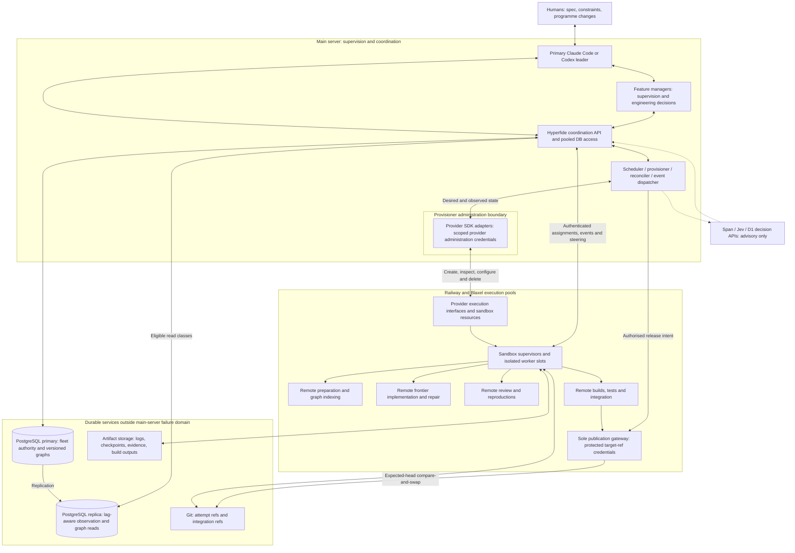

## S02 — Roles, delegation and authority

PROGRAMME REQUIREMENT: Humans interact through the primary Claude Code or Codex leader. The primary leader owns engineering coordination after the spec is supplied. Managers spawn on the main server and request sandbox/worker execution through Hyperfide. The proposed routing policy uses Claude Code for short critical complex tasks and Codex for long sustained complex tasks; exact supported model versions are deployment configuration and require qualification.

PROPOSED DESIGN FOR REVIEW: A feature/domain manager retains accountability across successive wave packages. Persistent feature ownership is a proposed policy requiring review. A different approved ownership policy can assign packages by wave while retaining one recorded accountable owner per task/finding.

Hyperfide services enforce ownership and allowed state transitions. They are deterministic software processes rather than additional model agents. A manager can request a repair, extra review or execution-profile change; it cannot bypass a required check, invent evidence or weaken the spec silently. Registered native child agents retain their parent/session/task relationship and consume tracked capacity.

The dotted decision-model path is advisory. Span, Jev and D1 can rank eligible work, recommend context, classify failures and suggest routing. They cannot grant leases, accept stale results, declare a test passed, release dependencies or publish a branch. Requested model IDs are candidate routes; coding-model IDs and supported connector versions are qualified independently.

[Standalone Mermaid source](diagrams/02-role-authority.mmd)

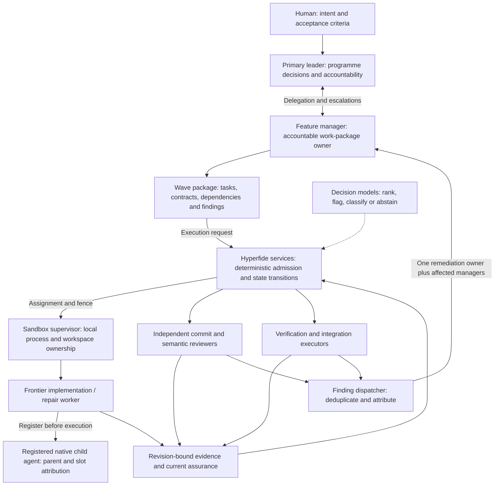

## S03 — Task execution from admission through integration

PROPOSED CONTRACT: Every request carries an idempotency key. The claim transaction checks dependency milestones, spec revision, ownership and capacity; it records the attempt, generation and durable outbox entry. The transaction ends before provisioning or executing the task. No database lock spans an agent session.

A launch packet names the run, task, attempt, current ownership generation, source revisions, branch/workspace, preparation recipe, required capabilities, connector configuration, credentials by reference, mandatory context, verification commands and bounded disconnection/recovery policy. The supervisor registers a fresh boot identity and attests readiness before launch. A provider create timeout means an uncertain outcome that must be reconciled.

The supervisor maintains the local connector channel independently of the controller connection. Heartbeats, native process health, useful progress and qualification remain separate observations. Steering has durable message identity, delivery acknowledgement and processing acknowledgement; uncertain acknowledgements are displayed rather than represented as successful steering.

Submission identifies immutable source and artifact manifests. Accepted submission transfers durable custody to the coordinator and releases the worker compute lease; independent review jobs receive their own leases. Reviews and commands establish evidence against those inputs. Failing checks route to the owner and create repair work. Passing task evidence permits qualification but does not establish integration.

The remote integrator prepares a candidate; the publication gateway alone mutates target refs. It verifies the authorised candidate, ownership generation and expected head before compare-and-swap. A timeout after mutation is an unknown outcome that requires Git inspection and reconciliation before another publication. A PostgreSQL fence alone cannot stop a client with independent Git write credentials. Multi-repository publication follows S10.

[Standalone Mermaid source](diagrams/03-task-execution.mmd)

```mermaid
sequenceDiagram
    autonumber
    participant FM as Feature manager
    participant API as Hyperfide coordinator
    participant DB as PostgreSQL primary
    participant P as Main provisioner adapter
    participant S as Sandbox supervisor
    participant W as Frontier worker
    participant A as Git and artifact storage
    participant V as Review and verification
    participant I as Remote integrator
    participant G as Publication gateway
    FM->>API: Request eligible task with idempotency key
    API->>DB: Short transaction: validate dependencies, claim attempt, reserve slot, outbox
    DB-->>API: Attempt ID, ownership generation and assignment
    API->>P: Ensure sandbox for recorded provisioning request
    P-->>API: Provider identity or uncertain creation result
    Note over API,P: Uncertain creation is reconciled before another create
    API->>S: Bootstrap packet and scoped runtime credential references
    S->>A: Fetch pinned source and prepared dependency artifacts
    S->>API: Register boot identity, workspace, capabilities and readiness
    API->>DB: Validate attempt and boot identity
    API->>S: Start connector with session identity and execution packet
    S->>W: Launch native agent with isolated runtime and workspace
    loop During execution
        S->>API: Heartbeats, process observations and progress events
        W->>A: Source checkpoints, logs and session checkpoints
        FM->>API: Durable steering message
        API->>S: Deliver instruction with message ID
        S->>W: Local connector delivery
        S->>API: Delivery and processing acknowledgements
    end
    W->>A: Publish immutable source revision and evidence artifacts
    S->>API: Submit result manifest, revision and ownership generation
    API->>DB: Validate compute lease; create ACTIVE submission custody; release compute authority
    Note over S,DB: Clean worker slot after quiescence and durable outputs; custody survives compute expiry
    API->>V: Independent review and qualification packet
    Note over API,V: Qualification jobs hold their own compute leases
    V->>A: Preserve command results, findings and reproductions
    V->>API: Revision-bound qualification and review results
    API->>DB: Validate current submission and ACTIVE custody generation; record outcome and retain custody
    alt Required evidence fails
        API->>FM: Route finding and failure packet
        FM->>API: Request repair attempt under same task
    else Required evidence passes
        API->>I: Build candidate from qualified revisions and expected target head
        I->>A: Construct candidate, run integration gates and store evidence
        I->>API: Candidate revision, expected head and result manifest
        API->>DB: Validate integration ownership, candidate inputs and evidence
        API->>G: Authorise publication with candidate, expected head and integration generation
        Note over I,G: Integrators lack target-ref credentials; gateway is the sole publication path
        G->>A: Compare-and-swap target ref against expected head
        G->>API: Report actual publication result or uncertain outcome
        Note over API,G: Reconcile uncertain Git outcome before replacement publication
        API->>DB: Reconcile publication; record integration, release terminal custody and evaluate wave closure
        API-->>FM: Wave status and newly eligible work
    end
```

## S04 — Independent task, attempt, assurance and sandbox state

PROPOSED STATE MODEL: These drawings use the canonical proposed vocabulary in [execution-contract.md, section 5](execution-contract.md). Task progress describes engineering delivery; attempt execution describes one run of a worker; infrastructure lifecycle, observed health and slot occupancy are independent fields. The drawings show principal paths and selected failure transitions; the execution contract governs the complete transition validation.

Task progress is `BLOCKED → ELIGIBLE → ACTIVE → SUBMITTED → QUALIFYING → QUALIFIED → INTEGRATING → INTEGRATED`. Failure or integration repair enters `REPAIR_REQUIRED` and returns to scheduling only with a defined repair/requalification plan. `CURRENT`, `STALE` and `MISSING` assurance is recorded separately. Historical qualification and integration remain recorded after later changes invalidate current assurance.

Dependent work requires declared milestones, such as a qualified immutable branch revision or an integrated revision. A wave barrier is an additional admission condition when declared by the spec. The default must be conservative where the spec lacks the distinction. Activity, submission or a task counter cannot release a dependency.

### Task progress and separate assurance

[Standalone Mermaid source](diagrams/04-state-machines.mmd)

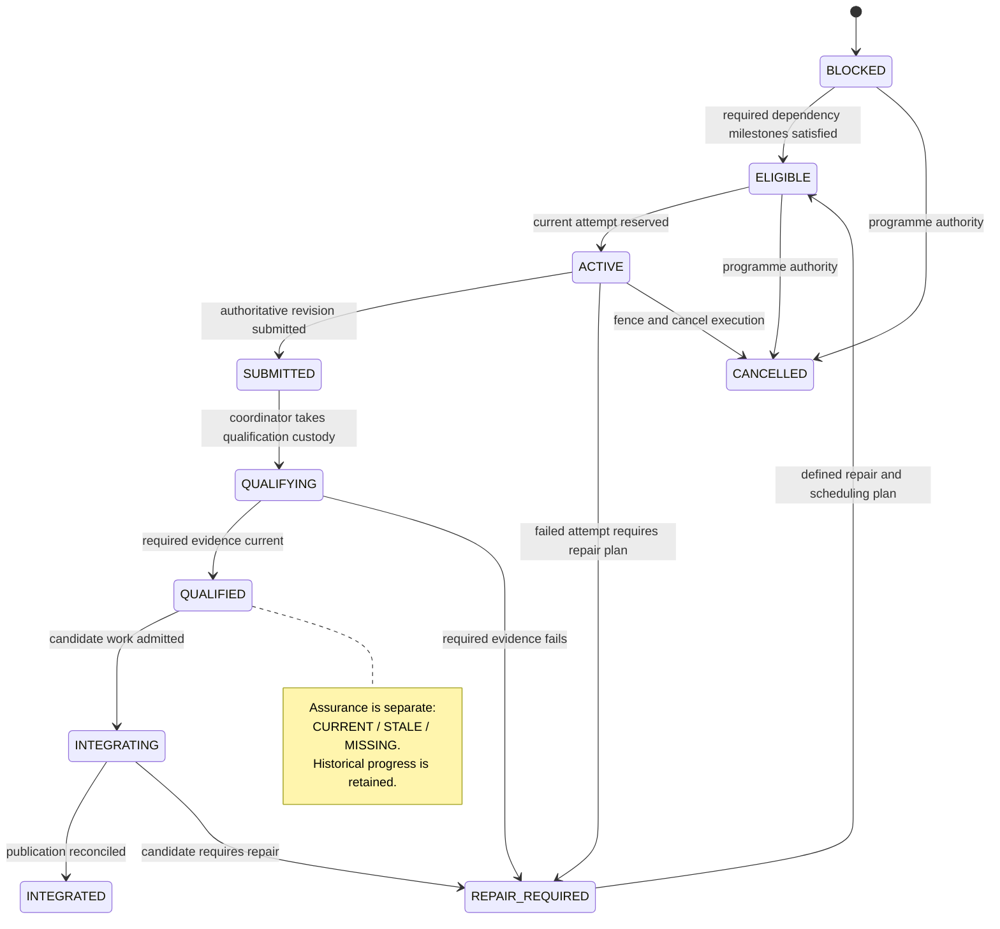

### Attempt execution and separate compute authority

[Standalone Mermaid source](diagrams/04a-attempt-state.mmd)

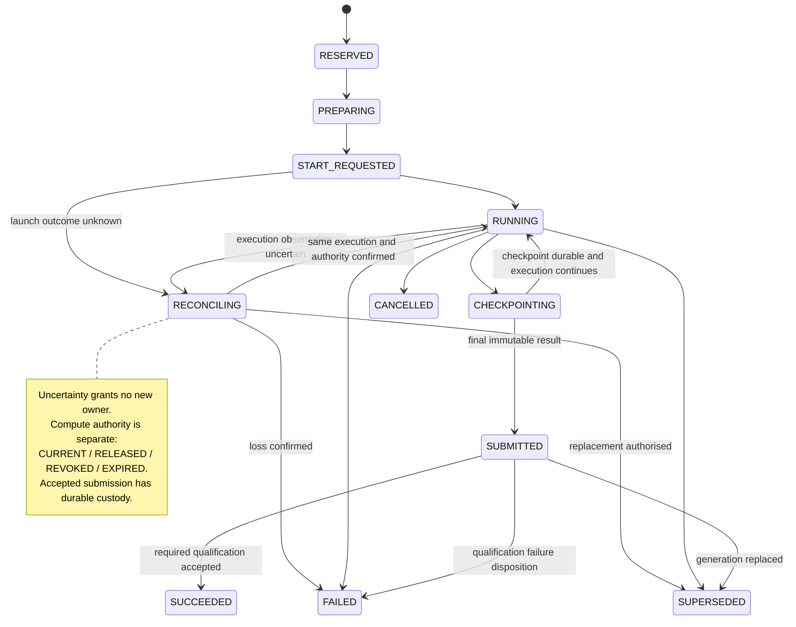

### Sandbox lifecycle, observed health and slot lifecycle

[Standalone Mermaid source](diagrams/04b-sandbox-and-slot-state.mmd)

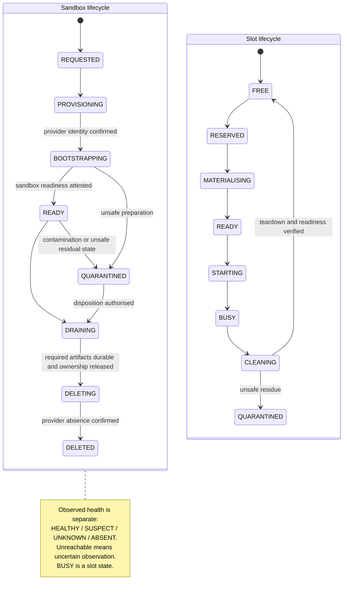

An attempt progresses through `RESERVED`, `PREPARING`, `START_REQUESTED`, `RUNNING`, checkpointing and submission. `SUCCEEDED` means its submission satisfied required qualification; it does not mean programme integration. Compute authority is independently `CURRENT`, `RELEASED`, `REVOKED` or `EXPIRED`. Initial `SubmitResult` requires current compute authority and an unexpired lease. Accepted immutable submission atomically creates a submission ID and `ACTIVE` custody generation, then releases worker compute authority. Terminal attempt history is never overwritten or resurrected. The worker slot can be released after required persistence and process cleanup, without holding coding capacity throughout review.

### Submission custody survives worker compute expiry

Submission custody authority is `ACTIVE`, `REVOKED`, `SUPERSEDED` or `RELEASED`; qualification outcome is separately `PENDING`, `PASS` or `FAIL`. Custody stays `ACTIVE` through submission, qualification and integration preparation. Successful qualification records `PASS` and task `QUALIFIED` without releasing custody. Any `ACTIVE` custody is excluded from compute-expiry reclamation. Independent qualification validates the current submission, ownership generation and active custody generation, rather than the original worker lease. The qualification job holds its own compute lease. Terminal integration or disposition releases custody; explicit revocation or reassignment revokes/supersedes it transactionally. A released worker lease cannot do so implicitly.

[Standalone Mermaid source](diagrams/04c-submission-custody.mmd)

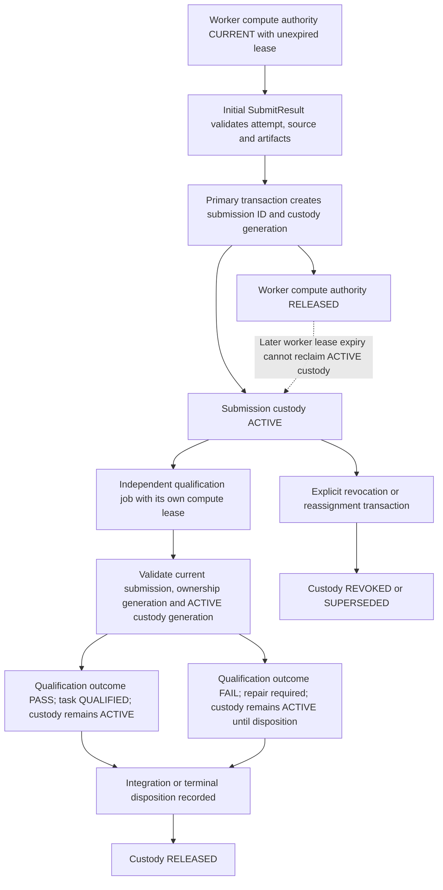

Unreachable infrastructure is an observation problem (`UNKNOWN` or `SUSPECT`), not an automatic lifecycle failure. Reconciliation may reattach to existing execution. Busy capacity belongs to a slot, not to the sandbox lifecycle. Deletion is complete only after provider absence is established; uncertain create/delete operations retain their quota accounting until reconciled. Desired state remains separate from observations.

## S05 — Recovery, late results and artifact adoption

PROPOSED CONTRACT: The primary records ownership changes before replacement dispatch. A late worker may still execute during a network partition, but its old generation cannot produce an accepted authoritative state change. Supervisors follow the run’s bounded continuation/pause policy while disconnected; the permitted local work window cannot be inferred from a heartbeat alone.

Recovery manifests connect Git revisions, uncommitted workspace patches, log cursors, artifact hashes, native-session checkpoints and environment identities. Connector-specific native resume must be qualified. If it is unavailable or incompatible, the system starts a fresh frontier session with the checkpoint packet and records that distinction.

Late artifacts remain potentially useful. They enter quarantine with their original provenance. The current owner may adopt validated content through a new recorded result; adoption never restores the old generation or transfers old evidence automatically. Qualification and integration eligibility are re-evaluated against current inputs.

Coding-sandbox or process loss alone does not revoke an admitted durable submission. Reconciliation preserves active custody and restarts any lost verification job under its own lease. Replacing unfinished coding work requires no active custody, or an explicit primary-backed custody disposition before reassignment.

On main-server restart, control services recover durable cursors, desired state and assignments before reacquiring control ownership and reconciling sandboxes. Manager replacement recovers the work package without terminating valid workers. A separate standby control host is an optional future availability decision, not an existing capability.

[Standalone Mermaid source](diagrams/05-failure-recovery.mmd)

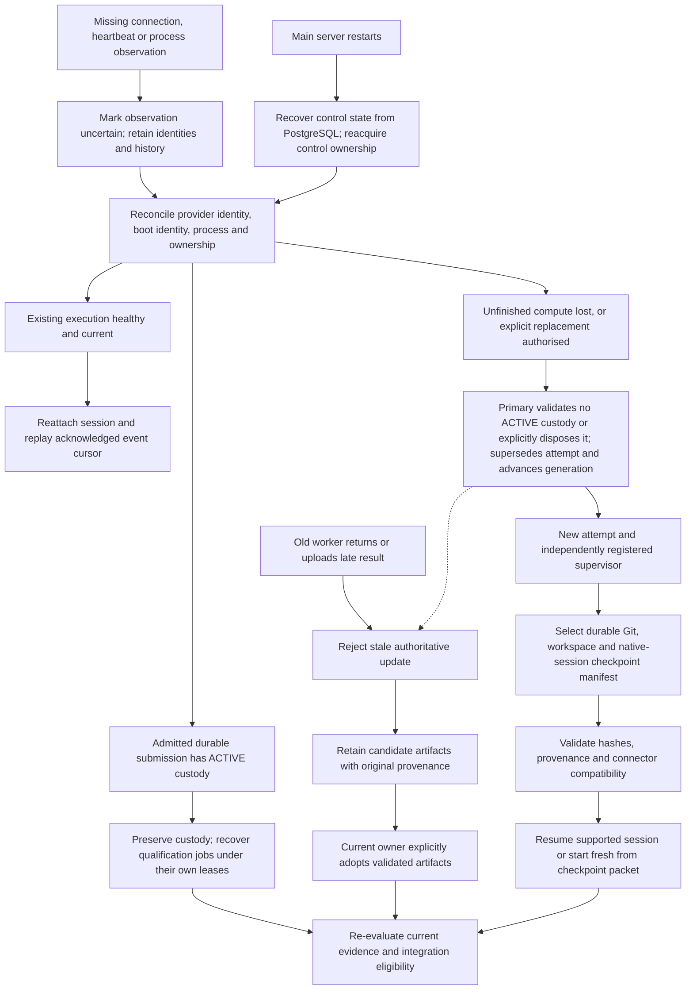

## S06 — Central graph publication and consistency-aware reads

PROGRAMME DIRECTION: PostgreSQL centrally tracks fleet state, progress and branches, with replicas supporting concurrent state queries; central graph storage and batched indexing are in scope. Faster indexing is an objective to measure, not a proven consequence of changing databases.

PROPOSED CONTRACT: Claims, leases, result acceptance, dependency release and integration decisions use the primary. Observation reads may use a replica with an explicit freshness watermark. Read-your-writes requires the primary or a replica that has reached the operation’s required watermark. Graph reads request a published version, whose rows and publication marker must both be available. The API may wait within a bounded deadline or use the primary; it must not silently return another revision.

Remote workers parse changed files and submit batches tagged with repository, revision, parser/toolchain configuration and extraction provenance. Version-isolated staging prevents incomplete ingest from entering the published graph. A remote resolution executor drives set-based database work; the main server does not run graph indexing. Publication becomes visible atomically only after the required checks. Existing readers can retain their requested complete graph version.

Caches are optional accelerators keyed by immutable inputs/version. They cannot become a second authoritative graph or execution store. Graph and orchestration traffic require separate workload accounting and query controls even when stored in the same PostgreSQL deployment. Large artifacts stay in durable object storage; their verified references and lifecycle metadata live in the primary. No particular throughput improvement or production scale has been measured by this draft.

[Standalone Mermaid source](diagrams/06-data-and-graph.mmd)

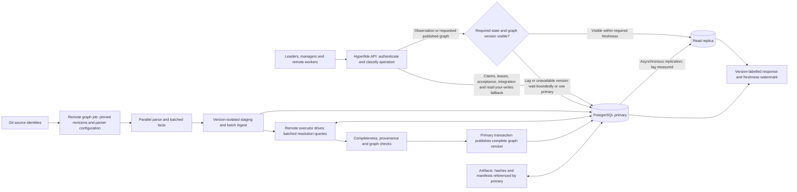

## S07 — Review coverage, issue routing and semantic closure

PROPOSED REVIEW BASELINE: 10–15 commit watchers examine every commit and open GitHub issues; an issue watcher checks at ten-minute intervals and routes to the commit’s feature manager. The proposed baseline preserves every configured watcher’s coverage of every commit. Sharding watchers by rubric or risk is a possible future policy change, not an assumption in this pack.

PROPOSED EXTENSION: Internal findings route promptly through durable events; the ten-minute reconciliation catches missed events and externally created/edited issues. A stable finding identity prevents duplicate repair ownership. Commit attribution supplies an initial manager; a cross-feature contract finding also records affected producer/consumer managers and one accountable remediation owner.

Semantic coverage extends beyond signature shape: schemas/ABI, error behaviour, authorisation, retry/idempotency, units/precision, ordering/timing, state transitions and invariants are candidate contract dimensions. Which dimensions apply is recorded in each contract. Reviewers produce supporting source evidence, reproductions or stronger tests. A confidence score alone is not a qualification result.

Finding closure requires current resolution evidence and affected-consumer checks. Required review coverage, task checks, contract checks, candidate checks and programme gates are evaluated separately. Input changes invalidate affected evidence while preserving the audit trail. GitHub synchronisation failures remain observable and retryable; external issue state cannot silently substitute for internal evidence.

[Standalone Mermaid source](diagrams/07-review-and-contract-closure.mmd)

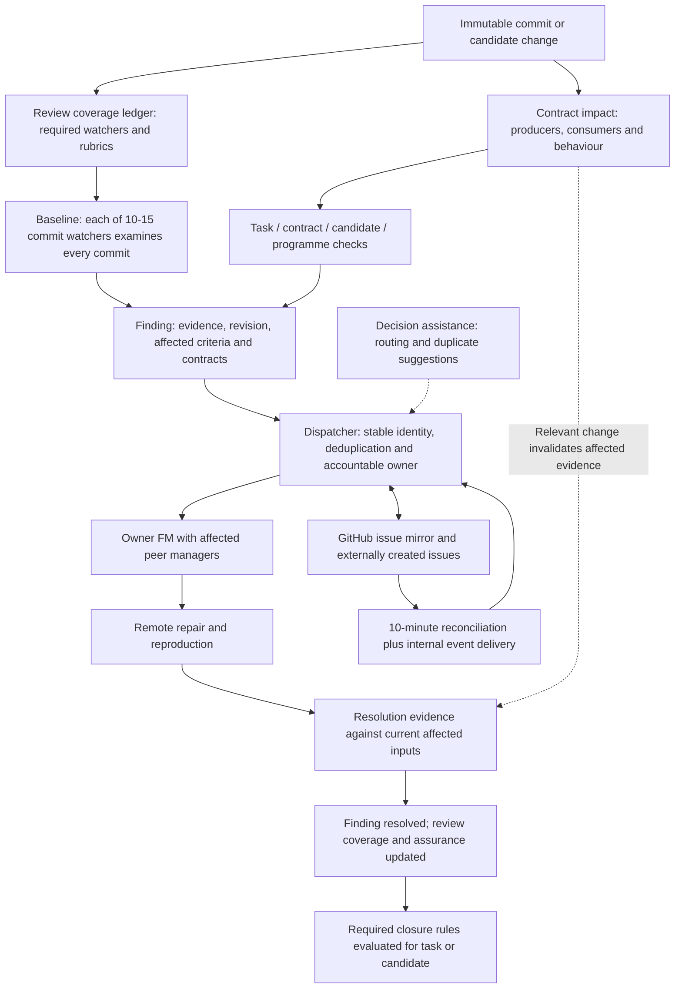

## S08 — Illustrative 100-sandbox fleet

ILLUSTRATION ONLY: This allocation demonstrates arithmetic for one large-run profile, not a prescribed capacity limit, benchmark or provider quota. It uses 95 active sandboxes and five prepared reserves to host 200 remote model agents, plus one main leader and an illustrative 13 managers on the supervisory server. The manager count is an example, subject to the approved ownership policy and actual programme structure.

The 30-agent review pool contains **12 commit watchers + 12 semantic/API reviewers + 6 regression investigators**. The 20 qualification/integration agents investigate and coordinate execution; ordinary builds and verification commands are separate non-model jobs. All agent roles draw from the approved frontier connector profiles. Decision-model API requests, supervisors, database services and build processes are not counted as agents.

Each slot has its own writable worktree, runtime home, outputs, temporary storage and ports. The number of concurrent builds/tests has independent reservations. Sharing a sandbox does not itself prove sufficient process or credential isolation; qualification determines when dedicated sandboxes are necessary. Preparation and indexing consume declared capacity and cannot overcommit an already allocated build slot.

The public qualification target covers up to 1,500 session lifetimes over a 48–72 hour run, with at least 200 concurrent remote agents in the large-run profile. Those are distinct total/concurrent figures, and the lower bound is not arithmetically imposed on every smaller profile. The example proves only 75×2 + 10×3 + 10×2 = 200 remote agents.

Provider quotas, topology, request rates, permissions and measured startup characteristics are deployment-specific inputs. Qualify the approved combined allocation before the live campaign. A provider allocation is not a statement of any organisation’s purchased capacity or a claim of tested operating scale.

[Standalone Mermaid source](diagrams/08-illustrative-fleet.mmd)

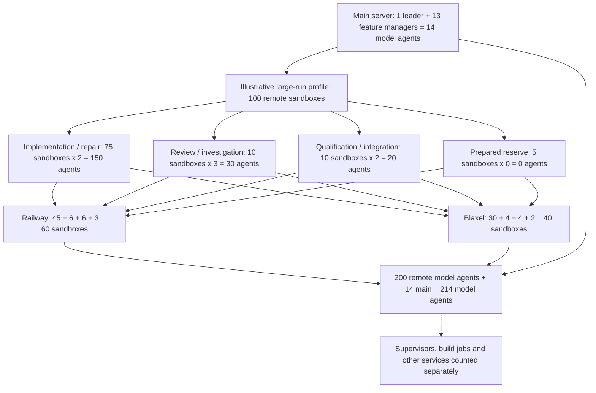

## S09 — Implementation, authority migration and rebranding gates

APPROVAL REQUIREMENT: This pack awaits review and explicit implementation authorisation. **Hyperfide** is the proposed successor identity. Existing runtime, CLI and configuration still use Codify until approved migration work changes them.

PROPOSED PLAN: Inventory existing stores, workflows, connectors, command surfaces and evidence first. Implement the new state/protocol contracts and qualification harness, then qualify providers/connectors, graph/data migration, semantic gates, recovery and scale before authority cutover. The figure is a gate ordering; independent implementation tasks may overlap only when their explicit dependencies allow it.

Migration must choose one authoritative writer at every stage. Read comparison or shadow ingest is permitted; competing local KVX/SQLite and PostgreSQL live status writers are not. Reconcile old attempts and freeze or drain incompatible work before cutover. A rollback rehearsal must account for accepted work after cutover rather than restoring an old database snapshot and losing history.

Branding includes binary/package name, help/version text, docs, generated-agent pointers, API/configuration names and compatibility handling. The new CLI spelling, version scheme and alias/deprecation window are proposed release decisions. Historical provenance and old artifact references must remain interpretable; a broad textual replacement is insufficient. Nothing in this diagram activates a spec, changes the current workflow or creates cloud resources.

[Standalone Mermaid source](diagrams/09-migration-gates.mmd)

```mermaid
flowchart LR
    DRAFT["Draft pack and explicit decisions"]
    APPROVAL["Human reviews pack and authorises implementation"]
    BASE["Inventory compatibility and capture baseline evidence"]
    STATE["Implement versioned state and execution contracts"]
    PROVIDERS["Qualify provider adapters and native connectors"]
    GRAPH["Migrate graph and evidence with parity checks"]
    PILOT["Controlled pilot including recovery and semantic gates"]
    SCALE["Mixed-load scale and 48-72 hour qualification"]
    CUT["Controlled authority cutover and rollback rehearsal"]
    BRAND["Hyperfide release and documented compatibility window"]
    DRAFT --> APPROVAL --> BASE --> STATE --> PROVIDERS --> GRAPH --> PILOT --> SCALE --> CUT --> BRAND
```

## S10 — Multi-repository integration and release barriers

PROPOSED CONTRACT: A programme candidate identifies the exact repository revision set and cross-repository contract versions. Remote qualification exercises that whole set. Each Git ref update has its own expected head and observed outcome; PostgreSQL transactions do not make updates across independent Git repositories atomic.

A release intent records every required target ref and candidate revision. The sole publication gateway records and reconciles per-repository updates. Partial or uncertain publication holds the programme release barrier closed and blocks dependent work requiring the complete release. The recovery policy explicitly states whether to complete remaining updates, restore earlier refs when allowed, or create a corrective release; history is retained in all cases.

Only after all required outcomes are verified may Hyperfide expose the integrated programme milestone. A task that needs merely a qualified immutable input can follow its explicit dependency policy, while a task requiring the released programme remains blocked until the barrier is satisfied.

[Standalone Mermaid source](diagrams/10-multi-repository-publication.mmd)

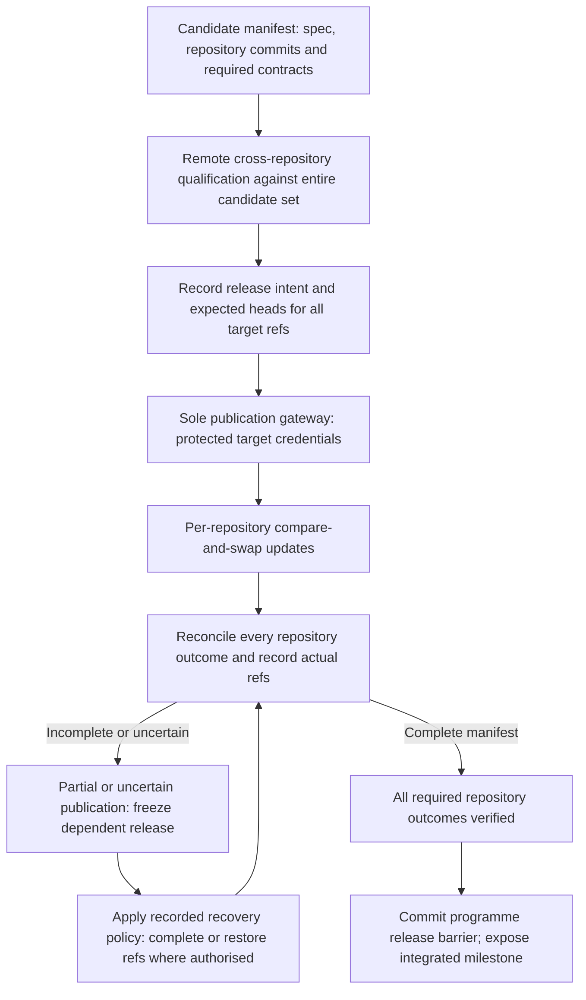

## Diagram validation and remaining qualification

The pack checks that standalone sources and embedded figures match. The figures use standard Mermaid flowchart, sequence and state syntax. No Mermaid renderer was available in the authoring environment at initial authoring, so successful SVG rendering is not claimed. Render qualification must be recorded separately if a renderer becomes available.

The figures deliberately leave account authentication, exact provider quotas, measured placement density, controller availability targets, lease/heartbeat timing, graph throughput and connector resume behaviour to their explicit decisions and qualification tasks. An open value is not an implicit successful qualification.
