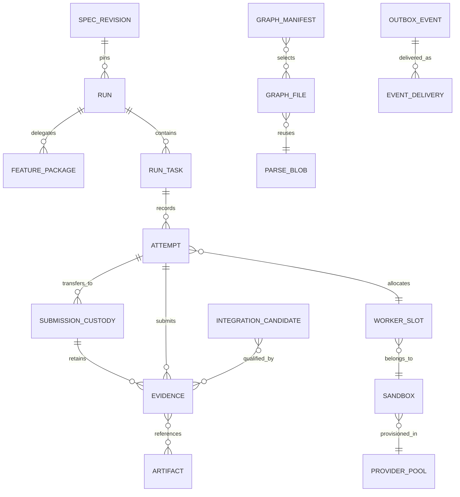

# Hyperfide storage and coordination contract

Status: proposed implementation design for user review. Checked against current source and primary documentation on 2026-10-16. No database, provider resources, or implementation have been changed by this chapter. Task identifiers belong to the pack's canonical KVX; the work packages below are inputs to that plan.

## 1. Requirements and authority

**Design requirements:** shared PostgreSQL state for the fleet, progress, branches, and central graph; replicas to accommodate concurrent readers; batched ingestion and retrieval; and dependencies selected for the distributed system's operational needs. The main control host performs supervision. The proposed placement policy assigns graph extraction, dependency preparation, implementation, builds, tests, reproductions, review execution, and integration execution to remote capacity. Implementation follows review and approval of the specification.

**Proposed authority split:**

| Store | Authority | Exclusions |
|---|---|---|
| PostgreSQL primary | Current run state; task ownership; reservations; revision metadata; evidence admission; published graph manifests; event delivery state | Does not contain provider secrets or large raw transcripts/build artifacts |
| PostgreSQL replicas | Read service for eligible queries with explicit freshness semantics | Never grant ownership, release dependencies, accept evidence, or authorise integration |
| Git | Source objects and branch refs | A pushed commit alone does not qualify a task |
| Object storage | Immutable artifacts, checkpoints, graph ingestion bundles, retained evidence | An uploaded object alone does not establish admitted evidence |
| Versioned spec/KVX | Programme intent and accepted criteria at the run's pinned revision | Editable local status fields cannot become a competing distributed run authority |
| Optional local cache | Revision-keyed graph/context and durable pending uploads | Cannot grant leases, invent accepted status, or hide a primary outage |

All authoritative mutations pass through authenticated coordination operations. Worker sandboxes receive scoped API credentials, not unrestricted primary database credentials. PostgreSQL and artifact storage are proposed to live outside the main server's failure domain. Replicas distribute reads; their count and sizing remain qualification outcomes, not assumptions that a particular machine can serve the fleet.

The central graph is in scope. A local SQLite cache is optional; retaining one does not diminish the requirement for shared revision-addressable graph state. Neither PostgreSQL adoption nor local caching is, by itself, a measured indexing speedup.

## 2. Verified current baseline and migration implications

These findings were rechecked from the checkout on 2026-10-16. Line numbers describe this snapshot and may move during implementation.

| Current fact | Source | Consequence |
|---|---|---|
| `Cg` contains a SQLite connection, and opening a project opens the shared worktree database with WAL and a busy timeout. | `src/cg.h:193`; `src/db.c:414–430` | Storage access is embedded throughout the C client; migration requires an explicit API/storage boundary. |
| Graph/FTS data, leases, attempts, agents, runtime events, fleet runs, and fleet nodes share the schema. | `src/db.c:17–157` | Indexing and operational state compete for the same writer. |
| Index parsing is buffered and writes are chunked at 96 files. | `src/scan.c:1–23`, `1378–1420` | Batching already exists; the design must improve concurrency and query shape, not merely announce batching. |
| Final soft-edge/import/reference resolution and semantic processing commit in one write transaction. | `src/scan.c:1977–2014` | A long final phase can delay other writers; central publication must avoid a fleet-wide writer lock. |
| Claims cannot be journalled because they need current ownership state; a busy claim exits without changing state. | `spec_claim_begin`, `src/spec.c:1086–1095` | Preserve current-state claim semantics when moving to a network service. |
| Attempts already record a fence, host, session, expiry, branch, worktree, and parent. | `src/db.c:83–96`; `src/spec.c:1124` | Import provenance and extend fencing rather than discarding useful attempt history. |
| Events are inserted through triggers and explicit paths; the current default retention is 50,000 rows. KVX status is a separate input. | `src/events.c:1–23`, `26–75`; `src/db.c:123–134` | PostgreSQL event delivery requires its own commit-order and retention design; copying the SQLite cursor is insufficient. |
| SQLite-specific features include FTS5 tokenisers, `MATCH`, SQLite row IDs, `INSERT OR IGNORE`, `sqlite_master`, and SQLite date functions. | `src/db.c:49–70`, `205–247`, `509`; `src/scan.c:278`, `600`, `888`; `src/sem_incremental.c:9`; `src/spec.c:1065` | A textual SQL substitution will not preserve behaviour or performance. Search and graph semantics require parity qualification. |
| Supervisor and integration code use filesystem locks. | `src/orchestrate.c:2248`; `src/fleet.c:1364`; `src/syncgate.c:71` | Replacing SQLite does not create distributed process or merge authority. |

SQLite documents a single writer per WAL database and requires WAL participants to share a host. This rules out a shared WAL file mounted by all sandboxes; it does not imply that every local cache must be removed. [SQLite WAL](https://sqlite.org/wal.html)

## 3. Relational model and constraints

The following is a logical schema contract, not executed DDL. Use opaque globally unique identifiers for durable entities; keep names and native provider IDs as attributes. Use composite foreign keys or equivalent database-enforced ownership checks wherever IDs cross a run/organisation boundary. Text fields must have explicit bounds; searchable operational fields must not be buried only in JSON.

| Entity | Identity / required relations | Database constraints and lifecycle rules |
|---|---|---|
| `organisation`, `project`, `repository` | Stable IDs; repository identity independent of checkout path | Repository URL changes retain identity and audit history; access is organisation-scoped. |
| `spec_revision` | Project, immutable content hash, Git object/ref provenance, schema version | Unique `(project_id, content_hash)`; accepted criteria immutable. |
| `run` | Spec revision, run policy hash, authority epoch, state, current spec generation | References exactly one current accepted spec generation; amendments create new generations and recorded deltas. |
| `run_repository` | `(run_id, repository_id)`, source/base revision and integration target | Immutable revision set for each execution packet; no floating `main` in admitted evidence. |
| `feature_package` | Run, feature/domain, wave/package revision, manager session | Manager assignment history retained. Persistent domain ownership across waves is a proposed allocation policy. |
| `run_task` | `(run_id, task_key)`; spec generation; criteria hash; current attempt ID; current submission/custody ID; generation counter; state version | One current authoritative attempt and at most one current coordinator-owned submission custody; generation only advances. Task text/criteria history stays immutable. |
| `task_dependency` | Run, task, predecessor, required milestone, dependency revision | Unique edge per milestone; reject self-edges and cycles through validated graph publication. Cross-repository/programme edges are first-class. |
| `attempt` | Attempt ID; task; generation; authority epoch; manager/session; slot; input packet hash; execution state; compute-authority state; compute lease expiry | Unique `(run_id, task_key, generation)`; a partial unique index allows at most one current compute-authority attempt per task. Compute authority is `CURRENT`, `RELEASED`, `REVOKED`, or `EXPIRED`. Historical/speculative reviewer attempts are typed and cannot masquerade as the task owner. |
| `submission_custody` | Submission ID; task/attempt; monotonically versioned custody generation; coordinator authority epoch; immutable source/evidence manifest; authority `ACTIVE`, `REVOKED`, `SUPERSEDED`, or `RELEASED`; qualification outcome `PENDING`, `PASS`, or `FAIL` | Unique `(run_id, task_key, custody_generation)` and at most one `ACTIVE` custody per task. Authority remains `ACTIVE` through task `QUALIFIED`/`INTEGRATING` with outcome `PASS`; worker compute lease expiry does not invalidate admitted custody. Qualification/integration references the exact current custody generation. |
| `provider_pool`, `capacity_account` | Provider/account/environment/region/profile; capacity dimension and configured limit | Deployment-specific account capacity is configuration with provenance and qualification status, not a public API guarantee. Nonnegative reserved/allocated counters and bounded updates. |
| `reservation` | Request ID, capacity account(s), resource vector, expiry/state, attempt or provisioning job | Unique logical request; each counted reservation has a release history; resource vectors cannot be negative. |
| `sandbox` | Logical ID; pool; desired and observed states; boot generation; preparation manifest | Unique `(provider_account, native_sandbox_id)` when known. Unknown create outcomes remain represented until reconciliation. |
| `worker_slot` | `(sandbox_id, slot_key)`; boot generation; capabilities; runtime/workspace identity | Unique active allocation per slot, with typed capacity for agent/build/test/index jobs. Sandbox reboot changes boot identity. |
| `agent_session` | Run, role, parent session, connector, native ID, boot identity | Native IDs are namespaced by connector/account/boot as appropriate. Registered child sessions consume explicit capacity. |
| `workspace`, `branch_observation` | Repository, sandbox/slot, attempt, base commit, branch ref, observed head, observation version | Branch uniqueness is repository-scoped. Observations do not prove exclusive authority. Writable workspaces have one active owning slot/attempt. |
| `branch_authority`, `integration_candidate` | Repository/ref, branch generation, expected old head, candidate head, input/evidence manifest, publication intent | One live publication authority per target; candidate has a unique request ID. Branch generation and expected head are checked together. |
| `artifact`, `checkpoint`, `evidence` | Hash, size, storage key, retention class; attempt/input tuple; admission state | Unique scoped content identity; evidence cannot reference an incomplete/deleted object as available. Checkpoint includes native-session support level and source revision. |
| `contract`, `finding`, `review_coverage` | Versioned contract/criteria, affected revisions and consumers, accountable package, evidence | Finding deduplication retains individual observations; review completion names its exact input set and rubric. |
| `graph_build`, `graph_manifest`, `graph_channel` | Source revision set, parser/schema/config hashes, completeness state, parent; channel's published graph ID | Unique build-input identity; manifests immutable once published. Channel changes use compare-and-set against expected publication generation. |
| `parse_blob`, `graph_file`, `graph_symbol`, `graph_reference`, `graph_edge` | Content-addressed syntax facts plus graph-specific file/semantic membership | Unique parser-input/fact keys; foreign keys remain within graph identity; unresolved/ambiguous references remain explicit. |
| `command_inbox`, `outbox_event`, `event_delivery` | Scoped idempotency key, request hash/result; event ID; consumer ID and delivery state | Unique `(principal_scope, operation, idempotency_key)` and `(event_id, consumer_id)`. Conflicting payload reuse is rejected. |

Cross-row totals, graph acyclicity, and provider external state cannot be enforced by a simple row `CHECK`. They require locked transaction logic plus periodic invariant audits. Database uniqueness remains the final defence against concurrent duplicates. All state transitions increment an aggregate `state_version`; clients can reject older observations and use conditional writes.

## 4. Transaction and fencing protocols

### 4.1 Atomic claim and capacity admission

1. Authenticate manager intent and look up the scoped idempotency key. An existing identical request returns its recorded result; a different request body with that key is rejected.
2. Begin a short primary transaction. Lock rows in a documented deterministic order: run policy/spec generation, affected capacity accounts, selected slot, task, and any mutable dependency/barrier records. Avoid a run-wide exclusive lock for ordinary claims; a shared policy lock or generation/CAS mechanism must serialize policy changes without serialising all independent claims.
3. Check run admission state, exact spec generation, manager permissions, predecessor milestones, declared barriers, scope conflicts, slot boot generation, and capacity. An `ACTIVE` coordinator-owned submission custody makes the task ineligible for compute-expiry reclaim, including during task states `SUBMITTED`, `QUALIFYING`, `QUALIFIED`, and `INTEGRATING`. Candidate discovery may use `FOR UPDATE SKIP LOCKED`, but eligibility is revalidated on the primary after the relevant locks are acquired. Count-based checks without locking a capacity account are invalid.
4. Sample primary time after locks are acquired. Supersede an expired compute attempt only when it has no active admitted submission custody; explicit failure/revocation/reassignment must fence such custody before a replacement is admitted. Advance task generation, create attempt and reservation, set current attempt, and create the dispatch outbox event and required delivery rows in the same transaction.
5. Commit before any provider operation or agent launch. A lost response is reconciled by the idempotency key, never treated as proof the claim failed.

`SKIP LOCKED` is suitable for queue discovery, not a complete consistency mechanism. PostgreSQL explicitly warns that skipped rows give an inconsistent view; independent task correctness comes from revalidation and constraints. [SELECT locking](https://www.postgresql.org/docs/current/sql-select.html)

Dependency evidence can be invalidated concurrently with admission. Either lock relevant milestone/version rows and require invalidation to take conflicting locks, or use serializable transactions with complete retry of serialization failures. Record the chosen approach and test the race. Never claim that ordinary read-committed multi-query logic automatically makes cross-row predicates atomic. [Transaction isolation](https://www.postgresql.org/docs/current/transaction-iso.html)

Reservations distinguish `provisioning`, `allocated`, `release_pending`, and `released`. A timed-out create request retains its provider reservation until provider reconciliation establishes whether an instance exists. TTL expiry can release an unused logical request; it cannot assert that a possibly live provider resource disappeared. Observed over-capacity becomes visible and stops new admission until reconciled.

### 4.2 Leases and generations

The worker compute-authority token is `(deployment_epoch, run_id, task_key, attempt_id, attempt_generation, sandbox_boot_generation)`. It is not a worker PID or timestamp. Coordinator-owned submission custody and protected branch publication use their own durable generation/state checks. The deployment epoch also prevents pre-restore/pre-failover sessions from regaining authority after recovery. A fresh epoch must remain unique after database rewind: use a cryptographically random deployment UUID or a fenced external monotonic authority; incrementing a counter restored from the same backup is insufficient. Epoch activation requires exclusive control-plane/DB-writer fencing; incrementing a row on one side of a split brain is insufficient.

Lease comparisons and renewal expiry use database server time sampled after acquiring the ownership lock. `clock_timestamp()` advances within a transaction, whereas PostgreSQL transaction timestamps are fixed at transaction start; a timestamp captured before a lock wait cannot extend ownership accidentally. [Date/time functions](https://www.postgresql.org/docs/current/functions-datetime.html)

Renewal succeeds only for the current token, expected state, matching boot identity, and still-valid lease. An expired token cannot revive itself; recovery needs a new claim/generation. Workers use conservative monotonic local deadlines to checkpoint/pause on connectivity loss, but local clock assertions never extend authority. Illustrative defaults—15-second heartbeat, 90-second lease, and renewal by one-third of lease remaining—are proposed tunables, subject to provider/network qualification.

Compute lease expiry does not kill a partitioned process. It prevents new worker-authorised mutations and submission; process termination is a separately reconciled action. It does not discard coordinator-owned custody of a result already admitted. Stale workers may upload preserved artifacts into quarantine, but cannot accept task results, update authoritative status, or publish target refs. All protected side effects must pass a fenced gateway; broad Git credentials would defeat this guarantee.

### 4.3 Evidence/result admission

Upload artifact bytes first under immutable content identity; confirm size/hash and successful storage completion. A short primary transaction resolves the inbox key first: identical replay returns its original outcome before checking the now-released/expired compute lease. For a new submission it checks current worker compute-authority token/lease, source and criteria generations, graph/environment/rubric identities, and required evidence manifest. It atomically records the immutable submission, creates a new `ACTIVE` coordinator-owned custody generation, changes compute authority to `RELEASED`, removes the worker's right to modify that submission, releases its compute allocation through the normal cleanup protocol, and creates qualification jobs. Submission is not qualification.

A later qualification transaction validates the current submission ID and `ACTIVE` custody generation, coordinator epoch, source/evidence applicability, and all required independent results before advancing milestones. It does not require the submitting worker's compute lease to remain alive. Verification/review executors have separate job attempts and leases; their loss causes job recovery, not automatic loss of the implementation submission. A task with active custody cannot be reclaimed simply because its original worker exits or its compute lease expires.

Qualification outcome and custody authority are separate. Failure records outcome `FAIL` and requires explicit revocation/disposition before retry; cancellation/stop or invalidated inputs record authority `REVOKED`; manager-authorised reassignment records `SUPERSEDED`. Each disposition atomically fences dependent qualification/integration operations before a replacement attempt is admitted. Superseded evidence stays historical. Successful qualification records outcome `PASS` and task `QUALIFIED` while custody stays `ACTIVE`; integration publication checks that authority, outcome, current generation, and the separate branch-authority generation. Explicit terminal integration/disposition releases custody as `RELEASED`; custody and task/milestone transitions commit together. Pause preserves admitted custody but blocks advancement; drain permits already admitted qualification under its policy. Coding sandbox loss or cleanup alone preserves durable custody.

Superseded or incompatible results are retained with a reason and cannot release dependencies. A duplicate submission returns its prior recorded result. Object-store success followed by DB failure leaves an unreferenced object for delayed garbage collection; DB success followed by an HTTP response loss is recovered through inbox lookup. Do not hold a DB transaction across object upload, a model call, a build, or provider API traffic.

### 4.4 Integration candidate and Git compare-and-set

Git and PostgreSQL do not share one transaction. Publication therefore uses a durable intent/reconciliation protocol:

1. In a primary transaction, reserve branch authority generation and record `(repository, ref, expected_old_head, proposed_head, candidate_manifest, evidence_manifest, publication_id)` after validating current qualification and every contributing submission's current admitted custody generation. No live implementation-worker lease is required after custody transfer.
2. A dedicated publication gateway receives the intent, revalidates authority, and applies a Git ref update conditional on the exact expected old object ID. A generic non-fast-forward override without the old-ID condition is forbidden. Workers have no direct permission to update protected integration targets.
3. Reconcile Git's observed ref and publication audit receipt. Record `published` and release downstream integration milestones only after the external update is established. A crash after push but before DB recording is recovered by inspection, not another unconditional push. A timed-out push remains `outcome_unknown`; do not supersede its authority or dispatch a competing publication until the old gateway/in-flight path is fenced and the ref outcome is reconciled.
4. If ref state is ambiguous, externally changed, or cannot be attributed, freeze that target and investigate/rebuild. A stale gateway must be fenced at the credential/connection/service boundary before replacement can publish. No database lease can revoke an already in-flight remote request by itself.

Concurrent candidates against the same expected head cannot both become accepted branch history. New branch head means re-evaluate the candidate/evidence; qualified input history is preserved. Branch deletion/recreation must advance authority generation, even if the ref text is reused.

Ordinary updates to different Git repositories are not an atomic programme transaction. Multi-repository integration therefore records a programme manifest of exact candidate commits and per-repository publication intents, exposes `partially_published` while any target is unresolved, and releases the programme milestone only after every required ref/receipt is confirmed. Consumers use the admitted programme manifest rather than assuming simultaneous visibility of branch names. Failure policy specifies forward repair or an explicitly qualified revert sequence; neither is described as a globally atomic rollback. Deployment/activation barriers are separate from repository publication and require their own authority and evidence.

## 5. Durable events, inboxes, and replay

State mutation, outbox event, and delivery obligations commit atomically. The baseline uses a durable delivery row for each standing logical consumer needed by the operation, such as sandbox dispatch, finding routing, audit projection, or GitHub synchronisation. Consumer process replicas share a logical consumer identity. Workers claim pending/retryable delivery rows with bounded leases, deliver at least once, and acknowledge only after the receiver durably records the command/event in its inbox. Receiver applies the state effect and inbox result together where transactional; external effects use their own intent/reconciliation protocol.

**Do not copy the SQLite global high-water cursor onto `BIGSERIAL`.** PostgreSQL sequence allocation is outside transactional rollback semantics. As a design counterexample, transaction A allocates 10, transaction B allocates and commits 11, a reader advances to 11, and A later commits 10: `WHERE id > 11` permanently misses A. An event identity is not commit order. [Sequence semantics](https://www.postgresql.org/docs/current/functions-sequence.html)

Pending delivery scans use state, acknowledgement, retry time, and unique `(event_id, consumer_id)` obligations; they do not declare earlier event IDs delivered just because a larger ID was seen. Aggregate event versions, incremented while holding the aggregate row, provide per-aggregate ordering. Receivers defer/reconcile missing versions and tolerate duplicates; no global total order is assumed. Dead-letter records preserve cause and remediation owner. Retry budgets cannot silently discard dispatch, cancellation, evidence, or issue obligations.

Critical standing consumers are registered before their run/attempt can produce work. For a new observation subscriber, register durable buffering first, then take a fresh consistent snapshot and replay buffered events newer than each aggregate's snapshot version; overlapping events are deduplicated. Registration changes must be serialized with delivery-obligation creation or use a proven durable fan-out log protocol. Tombstones and subscription bootstrap retention prevent deletion gaps. Logical decoding is a possible later alternative, requiring its own failover/slot/retention design rather than an unreviewed cursor substitution.

`LISTEN/NOTIFY` may wake a poller. It does not replace pending delivery rows: delivery depends on listening sessions, notifications may coalesce, and payloads are bounded. The consumer must recover by querying durable state after any connection loss. A dedicated listener connection is separate from transaction-pooled query traffic. [NOTIFY](https://www.postgresql.org/docs/current/sql-notify.html)

Retention is acknowledgement-aware. Critical undelivered events are retained or explicitly escalated; trimming a history table must not erase pending commands. Replay tokens include consumer identity, epoch, and retention boundary. An expired observation cursor returns `resnapshot_required`, never an apparently complete empty stream.

## 6. Primary/replica query contract

| Query class | Routing and consistency |
|---|---|
| Claims, renewals, reservations, cancellations, accepted result/evidence, dependency release, integration authorisation | Primary only; current token/generation checked inside the mutation transaction |
| Immediate read after a mutation | Primary or explicit causal barrier satisfied by a replica |
| Dashboard, fleet history, approximate progress | Replica with `observed_at`, lag status, epoch, and aggregate version; primary fallback within an explicit request budget |
| Published graph search/context | Exact graph ID on replica only after publication is visible and completeness manifest is validated |
| Execution/verification packet | Short consistent snapshot of a named source/spec/graph/evidence tuple; never independently fetched floating “latest” fields |

Streaming replication is asynchronous by default; a replica can lag a committed mutation. Synchronous durability and replica query visibility are different properties. The proposed authority tier uses synchronous commit to a qualified failover standby; observation replicas may remain asynchronous. [Replication behaviour](https://www.postgresql.org/docs/current/warm-standby.html)

Each primary mutation may return a causal token containing cluster/system identity, deployment epoch, timeline lineage, and a conservative post-commit WAL barrier sampled after the transaction has committed on that primary. The sampled position must cover the commit record; sampling WAL before commit is insufficient. A reconnect after ambiguous commit resolves the inbox result first, then obtains a new barrier. Cross-cluster comparisons of bare numeric LSNs are invalid.

To satisfy such a token on a replica, establish that it belongs to the correct cluster and accepted timeline lineage and wait, outside the packet transaction, until its replay position covers the barrier. Only then start the read-only repeatable-read snapshot. Checking replay position inside an older already-established snapshot can still serve stale data. On timeout or lineage uncertainty, use the primary or return an explicit freshness failure. PostgreSQL exposes replay positions through `pg_last_wal_replay_lsn()`. [Administrative functions](https://www.postgresql.org/docs/current/functions-admin.html)

Graph packet assembly pins graph ID, source-set hash, spec generation, criteria hash, relevant contract versions, and environment/rubric versions. All constituent queries share a short snapshot; the resulting packet is immutable and content-hashed. An unavailable pinned graph is an explicit error/degraded result governed by policy, never a substitution with an unrelated latest graph. Mutable task eligibility is always revalidated on the primary at action time even if its context packet was consistent.

Replica lag is reported as bytes/LSN and observed timing with “unknown” states. Idle transaction timestamps alone are not a complete lag measurement. A stalled replica is removed from eligible routing; fallback load is bounded so a replica failure does not overload claim traffic on the primary.

## 7. Central graph ingestion, search, and publication

```mermaid
flowchart LR
    R[Remote revision-pinned parsing] --> O[Hashed ingestion bundles]
    O --> S[COPY to staging partitions]
    S --> V[Validate manifests and deduplicate]
    V --> E[Resolve imports references and semantics in batches]
    E --> Q[Completeness and parity checks]
    Q --> P[Atomic graph manifest publication]
    P --> RR[Replica replay barrier]
    RR --> C[Version-pinned context and review packets]
```

Remote jobs extract syntax from exact Git trees plus explicitly recorded overlays where speculative graphs are required. Overlays carry their own content identity and never present themselves as committed source. The graph input identity includes repository/submodule revision set, parser and language versions, build flags, generated source manifests, and semantic resolver configuration. Facts derived only from identical file content may share a `parse_blob`; build-dependent resolution must include its full dependency/configuration identity.

Ingest through bounded `COPY` batches into graph-build-scoped staging. Validate bundle digests, row counts, limits, schema version, and file membership. Replaying the same batch is idempotent; a mismatched payload under an existing batch ID is rejected. `COPY` is the documented bulk-loading path, but the whole graph must not become one enormous operational transaction. [Bulk population](https://www.postgresql.org/docs/current/populate.html)

Resolve references in set-oriented bounded partitions with resumable checkpoints. Retain unresolved, ambiguous, budget-exhausted, and unsupported-language states. Incremental invalidation must include reverse dependencies, imports, generated files, configuration changes, and deleted symbols; a changed file list alone is insufficient. Full rebuild and incremental rebuild of the same input set must produce equivalent admitted graph facts, aside from explicitly nonsemantic metadata.

A build stays `staging`/`resolving`/`validating` until completeness checks pass. A short primary transaction publishes its immutable manifest and changes the graph-channel pointer with expected-generation CAS. Every published row was committed before this pointer changes. Readers name one graph version throughout a request; failed builds cannot leak partial data into that version. Old versions remain until no live packet, candidate, evidence, or retention obligation references them. Reclaimed/rebuildable data has explicit unavailable status and provenance, not silent disappearance.

Batched context endpoints accept sets of symbol/file/contract IDs, bounded traversal depth, result size, and ordering rules. They must avoid network round trips per symbol or call edge. Pagination is graph-version-pinned with stable tie-breakers. Query timeout returns structured completeness/truncation information. Explain-plan and round-trip evidence are part of qualification.

Search migration preserves public query semantics deliberately. PostgreSQL `tsvector`/GIN is a candidate for word-oriented retrieval; `pg_trgm` is a candidate extension for identifier/substring similarity. Neither automatically reproduces SQLite FTS5 tokenisation, `MATCH`, or `bm25()` ranking. Define language/identifier token rules, escaping, Unicode/case behaviour, exact-name precedence, ranking tie-breakers, and negative/empty queries against representative fixtures. Dependencies are open, so an extension is evaluated on behaviour and operations rather than excluded by the previous no-new-dependencies rule. [PostgreSQL text-search indexes](https://www.postgresql.org/docs/current/textsearch-indexes.html), [pg_trgm](https://www.postgresql.org/docs/current/pgtrgm.html)

## 8. Resource isolation and database operations

Use separate bounded connection pools and database roles for authority mutations, observation queries, ingestion, and maintenance. Reserve primary connections for claims, lease renewals, cancellation, and evidence admission. Worker and model concurrency do not map one-to-one to server connections. Pool waiting is observable and subject to deadlines. Transactions cannot retain session state accidentally across pooled requests; listener/session-lock users need dedicated connections or compatible pooling mode.

Graph staging and fleet tables have distinct schemas/partitions, indexes, retention and vacuum policies. This separates locks and maintenance scheduling, but the same PostgreSQL cluster still shares I/O, CPU, memory, WAL, and replication bandwidth. Apply ingestion concurrency/byte budgets, statement/lock/idle-in-transaction limits, incremental batch sizes, and admission backpressure. Throttle graph work when authority latency, WAL retention, replica lag, or disk headroom crosses the run policy. Never disable durability or replication on the authority database as an indexing optimisation.

If isolation on one cluster cannot meet the measured mixed-load gates, split graph data into a separately operated PostgreSQL cluster while keeping the authority database's immutable graph manifest and readiness receipt. That adds a cross-store publication/reconciliation protocol and separate causal tokens, so it is a qualified alternative, not a transparent switch.

Use WAL archiving plus base backups for point-in-time recovery; a read replica is not a backup against propagated deletion. Restore drills must include database state, artifact availability, Git object reachability, and credentials/configuration needed to start the control services. [Continuous archiving](https://www.postgresql.org/docs/current/continuous-archiving.html)

Proposed retention defaults for review: keep full run/evidence metadata for 180 days, active plus 30 days of high-volume operational events/logs, and 35 days of database PITR coverage. Preserve release/acceptance evidence for the product's declared release lifetime. These are proposed policy values, not established deployment requirements; record per-project overrides before activation. Artifact GC respects evidence references and retention holds. Database tombstones and encrypted-backup expiry are recorded; a deletion request cannot truthfully promise removal from immutable backups before their expiry.

Store credential references and audit metadata, not secret values, in packets/events. Redact raw tool output before ingestion while retaining controlled originals only when policy explicitly requires them. Encrypt transport/backups/object storage; scope project access and sensitive artifact retrieval; audit administrative reads and destructive retention changes. Operational logs should use hashes/IDs rather than full source or prompts by default. Compaction, anonymisation, and retention must preserve the evidence required to explain acceptance decisions.

## 9. Failure windows, failover, and restore

| Window | Required behaviour |
|---|---|
| Transaction rolls back before commit | No accepted mutation or dispatch obligation exists. Retry the same inbox key. |
| Commit succeeds, response is lost | Resolve inbox result on primary; do not create another logical attempt. |
| Outbox delivered, ack lost | Redelivery reaches receiver inbox and returns recorded effect. |
| Provider create outcome unknown | Keep reservation and reconcile request/native resource identity. |
| Artifact upload succeeds, result transaction fails | Preserve orphan temporarily; retry admission or GC after safety/retention delay. |
| Compute lease expires before submission while worker remains alive | Replacement generation may execute after fencing; old compute token has no authoritative mutation/publication rights. |
| Worker exits or its compute lease expires after admitted submission | Coordinator retains `ACTIVE` submission custody through qualification/integration, with qualification outcome tracked separately; no compute-expiry reclaim. |
| Graph build fails mid-batch | Resume/rebuild staging; published graph remains unchanged. |
| Replica lags or is rebuilt | Remove from freshness-qualified routing; use bounded fallback/explicit unavailability. |
| Main supervision server fails | External durable stores retain state; worker continuation is bounded by execution policy; restart reconciles before new dispatch. |
| Primary fails or a restore rolls state backwards | Fence prior primary/control writers, establish new epoch, reconcile live external resources and Git, then resume admission. |

The proposed production authority tier requires acknowledged ownership/publication decisions to survive any single primary failure: synchronous durable replication to an eligible standby, with fail-closed authority mutations when that guarantee cannot be met. `synchronous_commit=on` only provides remote durability when synchronous standbys are configured; otherwise it is local durability. Observation replicas and standby query visibility are separate concerns. [WAL durability configuration](https://www.postgresql.org/docs/current/runtime-config-wal.html)

Promotion must prevent the old primary from accepting writes and prevent old control/publication gateways from using stale authority. PostgreSQL itself does not supply the complete failure-detection and fencing system. Select a managed service with documented guarantees or a qualified HA manager; verify network/storage fencing and routing before enabling automatic promotion. [PostgreSQL failover](https://www.postgresql.org/docs/current/warm-standby-failover.html)

Do not automatically promote an arbitrary lagging observation replica. If acknowledged authority may have been lost, pause new authoritative publication, rotate deployment epoch and runner sessions, reconcile provider inventory and Git intents, and classify lost/unknown attempts before resuming. Point-in-time restore always starts with a fresh non-reusable deployment epoch and cannot reuse old lease tokens. Persisted submission custody is checked for artifact/source applicability and external effects, then explicitly rebound to the recovered coordinator epoch; it cannot be silently accepted or discarded on the basis of an old worker lease. Synchronous replication does not replace this restore protocol or protect against every correlated storage failure.

## 10. Migration and compatibility plan

1. Inventory current tables, native event hooks, schema upgrades, graph/search SQL, local lock boundaries, CLI status writes, and external consumers. Capture a revision-labelled SQLite fixture and representative query/evidence corpus remotely.
2. Introduce coordination operations and versioned wire/packet contracts. Existing local mode and distributed mode must advertise their authority explicitly; offline/local status changes cannot synchronise themselves as fleet truth later.
3. Implement relational migrations and import tools with schema-version checks, deterministic namespace mapping, checksums, row counts, and resumable batches. Source IDs are namespaced by source database/repository/table, and original event cursors remain historical. Existing fences are namespaced by the import/deployment epoch; active-looking imported leases/attempts are `requires_reconciliation`. Imported historical `done` status is declared history unless its evidence is independently admitted.
4. Port graph ingestion and search behind batched interfaces. Compare query/graph/evidence behaviour against the captured fixture, including unresolved and ambiguous cases. Record intentional search-ranking differences for review.
5. Shadow read/projection parity against captured input while SQLite remains the single authority for the old run. Do not dual-write two independent authoritative lease systems.
6. Cut over at a quiescent boundary: stop admission, checkpoint workers, drain or fence attempts, freeze old writes, import/reconcile final delta, verify invariants, activate a new authority epoch, and resume through PostgreSQL. Prefer completing existing local runs before migration where feasible.
7. After distributed execution begins, rollback is a controlled quiesce/reconcile/export procedure. Pointing old binaries at stale SQLite state is prohibited. Client/server compatibility tests cover old CLI aliases and reject unsupported mutation protocols explicitly.

Hyperfide branding and compatibility paths are owned by the pack's migration chapter. Database schema names, API versions, filesystem/config names, and the legacy `cg` alias need an explicit compatibility matrix; a rename must not accidentally create a second installation identity or database namespace.

## 11. Proposed qualification gates

All gates below are **planned and UNRUN**. Hardware, PostgreSQL version/configuration, provider topology, source fixture, query mix, network RTT, and random/fault seeds must be captured with results. Proposed latency numbers are initial acceptance targets for review, not observed performance or vendor guarantees.

| Gate | Workload and observable acceptance |
|---|---|
| Claim contention | 200 independent simulated managers contend for 1,500 tasks and 200 slots; zero overlapping accepted task ownership, zero negative/over-allocated logical capacity, and stable duplicate-request responses. |
| Mixed load | 100 sandbox supervisors, 200 active agent sessions, 1,500 cumulative attempts, 10–15 commit watchers, four concurrent graph ingestion jobs and sustained batched context readers; continue for 72 hours. Baseline proposed offered load: 50 state reads/s, 50 versioned context queries/s, 20 small authority mutations/s including heartbeats, plus bursts at 5× for 60 seconds. Ingestion throughput is measured against fixed corpus size/row counts rather than invented universal rows/s. |
| Authority responsiveness | Under declared mixed load and synchronous durability, proposed p95 claim/renew/result transaction latency ≤250 ms and p99 ≤1 s measured inside service/DB boundary; report end-to-end sandbox latency separately. Zero lease losses caused by starvation of reserved mutation capacity. |
| Context service | Proposed p95 ≤2 s for defined bounded packet fixture after graph publication. No mixed-version packets; complete/incomplete responses distinguished. Measure token/relevance quality in the decision/semantic chapters. |
| Replica lag | Force replay pause and graph WAL burst; no stale authority grant, no false freshness success, and causal reads either satisfy token or fail/fallback within proposed 2-second wait budget. |
| Event correctness | Deliberately invert transaction/sequence commit order, lose acks, restart consumers, and trim eligible history. Every required delivery is received or visibly outstanding; inbox effects occur once; no skipped low-ID late commits. |
| Lease/fence races | Delay lock acquisition, skew worker clocks ±10 min, expire/reassign while stale worker submits/pushes. Zero accepted stale authority changes. |
| Submission custody | Submit under valid compute lease, terminate worker and expire compute lease, then qualify/integrate successfully under current custody. Concurrent expiry scanner cannot reclaim the task. Explicit custody revocation/reassignment rejects late qualification and publication against the old custody generation. Restore cannot reuse a previous deployment epoch. |
| Git/DB atomicity gap | Crash before push, after accepted push, and before DB receipt; reconcile exact candidate identity without duplicate/unattributable accepted integration. Inject competing ref change. |
| Graph parity | Compare full vs incremental builds for same source/config, including deletion, rename, generated inputs, dependency changes, reused parse blobs, and ambiguous references. Published manifests never expose partial facts. |
| Search migration | Fixture corpus exercises identifier/Unicode/token/substring/escaped queries, stable pagination, exact-name ranking, timeouts, and injection-safe parameterisation. Document accepted differences from SQLite ranking. |
| HA and restore | Kill primary, isolate old primary, promote eligible standby, and reconnect stale control/worker sessions. Proposed authority RPO: zero acknowledged decisions for qualified single-primary failure. Proposed HA RTO ≤5 min; PITR service restoration ≤60 min, both measured and subject to deployment sizing. No dispatch before old-writer fencing/reconciliation. |
| Data retention | Expire artifacts/events/backups with live references and delivery backlog; preserve required evidence, surface unavailable data, audit deletion, and prove restore within supported retention. |

A 72-hour simulation verifies control logic endurance; it does not establish real frontier CLI/session or provider failure behaviour. The release gate also requires live Railway/Blaxel contract exercises and a representative repository run under the selected authentication mechanisms. All load generators and builds run remotely; the main server remains supervisory.

## 12. Alternatives assessed and open qualification

ObjectBox C is an embedded object database with native C/C++ interfaces. Its Sync system supports a strongly consistent Raft-based server cluster, while offline local clients apply changes eventually. Default conflicting object updates use last-received-write-wins; optional precedence/clock policies also exist. It is therefore inaccurate to reject ObjectBox by claiming it has no consensus. [ObjectBox C](https://github.com/objectbox/objectbox-c), [ObjectBox consistency FAQ](https://objectbox.io/faq/), [Conflict policies](https://sync.objectbox.io/syncing-concurrent-changes)

The proposed rejection is specific: independent local-store claim/read-modify-write followed by eventual sync does not implement Hyperfide's atomic task/slot/evidence ownership contract. A central gateway could add authority, but PostgreSQL directly supports the relational transaction/query/replication patterns chosen here and aligns with the selected central-authority architecture. No comparative throughput benchmark was performed. Bindings licensing and native core/Sync terms differ and would need review if ObjectBox were reconsidered; dependency freedom remains intact.

Open implementation qualification:

- Select PostgreSQL supported major version, managed service/HA manager, synchronous standby topology, storage sizing, backups, and measured failover fencing. Provider availability is not established by this document.
- Select database driver, service language, pooler, migration tool, and object store on the basis of the contract and measured deployment behaviour. No existing dependency restriction vetoes them.
- Define exact migration fixture/corpus and explain-query evidence; central graph scale and WAL production must be measured.
- Confirm Git hosting/protected-ref policy and publication gateway credentials enforce stale-worker fencing at the external boundary.
- Confirm production data retention, sensitive artifact policy, and customer/project access rules before activation.

## 13. Work packages for the canonical implementation plan

| Package | Deliverable | Predecessors |
|---|---|---|
| Storage schema | Versioned migrations, constraints, namespace model, invariant audit | Wire/entity contract agreement |
| Authority transactions | Claim/admit/renew/cancel/reassign, inbox results, reservations, server-clock fencing | Storage schema |
| Reliable delivery | Transactional delivery obligations, inboxes, retries/dead-letter, bootstrap and retention | Storage schema, event contract |
| Replica routing/packets | Freshness classes, causal tokens, consistent packet builder, bounded pools | Authority transactions, graph manifest model |
| Graph ingestion/search | Remote extract bundles, COPY stages, incremental invalidation, publication, FTS parity | Storage schema, artifact contract |
| Publication reconciliation | Branch authority, expected-head Git gateway, crash recovery | Authority transactions, integration/evidence contracts |
| HA/backup/retention | Deployment runbooks, fencing, synchronous durability, restore/GC drills | Storage and external gateway boundaries |
| Migration qualification | Snapshot importer, parity corpus, quiescent cutover and rollback | All storage interfaces |
| Mixed-load release evidence | Concurrency, event inversion, partitions, stale generations, 72-hour endurance | Above packages plus provider/agent implementations |
